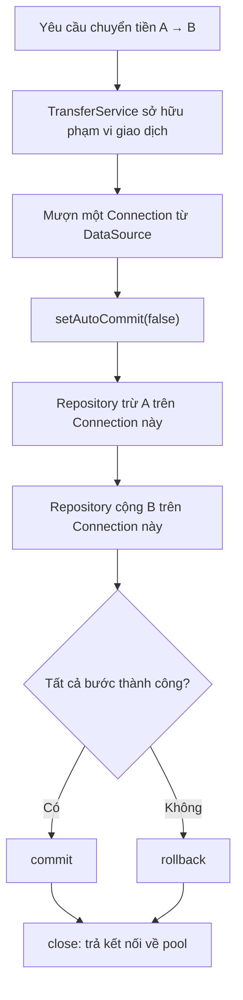

# Phạm vi giao dịch và quyền sở hữu kết nối

Trong chương **Giao dịch** thuộc module **DATA_PERSISTENCE_FUNDAMENTALS**, hai quyết định quan trọng ở tầng persistence là: **đoạn mã nào xác định lúc bắt đầu/kết thúc giao dịch**, và **đoạn mã nào chịu trách nhiệm lấy, sử dụng, trả kết nối cơ sở dữ liệu**. Nếu hai trách nhiệm này không rõ ràng, repository có thể `commit` quá sớm, tầng dưới có thể đóng kết nối của tầng trên, hoặc hai câu SQL tưởng cùng giao dịch lại chạy trên hai kết nối khác nhau.

Khi xây dựng ứng dụng Java, ranh giới giao dịch liên quan trực tiếp đến thiết kế service/repository, tính nhất quán dữ liệu, kiểm soát đồng thời, cô lập, lỗi kết nối và hiệu năng. Bài này sử dụng nghiệp vụ **chuyển tiền giữa hai tài khoản trong cùng một database** để giải thích; các nguyên tắc cũng áp dụng khi đặt hàng, cập nhật tồn kho, ghi hóa đơn và nhiều bảng liên quan.

## 1. Phân biệt giao dịch, kết nối và phạm vi nghiệp vụ

| Khái niệm | Ý nghĩa | Ví dụ |
| --- | --- | --- |
| **Thao tác nghiệp vụ** | Công việc ứng dụng cần hoàn tất | Chuyển 100.000 đồng từ A sang B |
| **Giao dịch DB** (*database transaction*) | Nhóm thao tác được DB xử lý với một quyết định `commit` hoặc `rollback` | Trừ A và cộng B cùng thành công, hoặc cùng bị hủy |
| **Kết nối** (*connection/session*) | Phiên giao tiếp với DB, trong JDBC biểu diễn bằng `java.sql.Connection` | Kết nối thực thi hai lệnh `UPDATE` |
| **Phạm vi giao dịch** (*transaction boundary*) | Điểm bắt đầu và kết thúc đơn vị giao dịch | Phương thức service `transfer(...)` |
| **Quyền sở hữu kết nối** | Trách nhiệm cấp phát, quản lý trạng thái và trả/đóng kết nối | Service hoặc transaction manager |
| **Pool kết nối** | Thành phần cấp kết nối logic, quản lý và tái sử dụng kết nối vật lý | `DataSource.getConnection()` và `Connection.close()` |

Trong JDBC thông thường, **một giao dịch DB cục bộ gắn với một kết nối**. Những câu SQL cần commit/rollback cùng nhau phải tham gia đúng **ngữ cảnh giao dịch** và dùng kết nối tương ứng. Hai repository dùng cùng database URL nhưng gọi `getConnection()` riêng không mặc nhiên tạo một giao dịch chung.

Phạm vi giao dịch DB không nhất thiết dài bằng một HTTP request. Request có thể xác thực, gọi API bên ngoài, thao tác DB và tạo response; chỉ những bước DB cần cùng đảm bảo tính nhất quán mới nên nằm trong transaction. Ngược lại, một nghiệp vụ trải qua hai database hoặc dịch vụ độc lập thường không thể đạt tính nguyên tử chỉ bằng một giao dịch JDBC cục bộ.

### 1.1. Liên hệ với ACID

- **Atomicity:** các thay đổi nằm trong giao dịch được commit hoặc rollback theo một đơn vị.
- **Consistency:** các constraint và bất biến dữ liệu phải được duy trì. Database hỗ trợ nhưng ứng dụng vẫn phải thiết kế quy tắc nghiệp vụ đúng.
- **Isolation:** xác định cách giao dịch nhìn thấy và chịu tác động của các giao dịch đồng thời.
- **Durability:** sau khi database xác nhận commit thành công, thay đổi được lưu bền vững theo cam kết và cấu hình của hệ quản trị.

`rollback` DB **không** hoàn tác một email đã gửi hay lệnh thanh toán ngoài DB đã hoàn tất. Có transaction cũng không tự sửa được thuật toán “đọc số dư rồi ghi đè” dễ sai khi có cập nhật đồng thời; còn phải chọn isolation và cách cập nhật đúng.

## 2. Ranh giới giao dịch nên đặt ở đâu?

Tầng **service/use case** thường là nơi hợp lý để quyết định transaction boundary, vì nó biết một thao tác nghiệp vụ gồm những bước nào. Repository biết cách đọc/ghi dữ liệu nhưng thường không biết toàn bộ nghiệp vụ đã hoàn thành hay chưa.



Một quy tắc đơn giản là **thành phần nào tạo ra phạm vi sống của tài nguyên thì thành phần ấy kết thúc phạm vi đó**:

| Thành phần | Trách nhiệm |
| --- | --- |
| Service quản lý JDBC thủ công | Mượn `Connection`, bắt đầu giao dịch, gọi các repository, commit/rollback và trả kết nối |
| Repository nhận `Connection` từ caller | Chạy SQL; đóng `PreparedStatement`/`ResultSet` do mình tạo; không commit, rollback hay close kết nối được truyền vào |
| Repository chạy thao tác riêng không có transaction của caller | Nếu tự mượn kết nối thì tự đóng; chấp nhận kết nối/giao dịch này độc lập |
| `PlatformTransactionManager` của Spring | Điều phối transaction, kết nối/EntityManager và cleanup thay cho mã nghiệp vụ |
| Connection pool | Quản lý kết nối vật lý, cấp và nhận lại kết nối logic theo cấu hình |

Không lưu một `Connection` đang hoạt động thành biến dùng chung trong singleton hay chia sẻ nó cho nhiều luồng cùng ghi: nó chứa trạng thái phiên và giao dịch, không được mặc định là an toàn khi sử dụng đồng thời.

## 3. `autoCommit` trong JDBC

Kết nối JDBC thường có `autoCommit = true` theo mặc định. Khi đó mỗi câu SQL được thực thi và hoàn tất như một đơn vị giao dịch riêng; thời điểm hoàn thành chính xác có thể phụ thuộc loại statement và vòng đời result set.

```java
try (Connection c = dataSource.getConnection()) {
    debitAccount(c, fromId, amount);
    creditAccount(c, toId, amount);
}
```

Nếu `autoCommit` đang bật, lệnh trừ tiền có thể đã commit trước khi lệnh cộng tiền thất bại. Dùng chung kết nối trong đoạn mã trên **vẫn chưa đủ** để bảo đảm hai câu lệnh nguyên tử nếu không điều khiển transaction.

```java
connection.setAutoCommit(false);
// Thực thi những câu SQL cần nguyên tử trên chính connection.
connection.commit();  // Hoặc rollback() khi thất bại.
```

Cần hiểu rõ:

1. `setAutoCommit(false)` thay đổi chế độ transaction. Database có thể bắt đầu giao dịch thực tế khi câu SQL đầu tiên được thực thi.
2. Sau `commit()` hoặc `rollback()`, nếu `autoCommit` vẫn là `false`, các câu SQL tiếp theo trên kết nối có thể tham gia **một transaction mới**.
3. Gọi `setAutoCommit(true)` khi còn transaction chưa hoàn tất có thể **commit** transaction đó theo quy tắc JDBC. Không được dùng nó làm thao tác cleanup vô điều kiện sau khi rollback gặp lỗi.
4. Pool có thể cấu hình giá trị `autoCommit`, isolation và cơ chế reset riêng. Cần biết rõ hợp đồng trạng thái kết nối mà `DataSource` cấp cho ứng dụng.

## 4. Ví dụ JDBC: chuyển tiền bằng một kết nối

Giả sử database có bảng:

```sql
CREATE TABLE accounts (
    id BIGINT PRIMARY KEY,
    balance NUMERIC(18, 2) NOT NULL CHECK (balance >= 0)
);
```

Một lần chuyển tiền cần trừ số dư người gửi và cộng số dư người nhận. Nếu người gửi thiếu tiền hoặc người nhận không tồn tại, tất cả thay đổi phải được hủy. Ví dụ Java sau sử dụng một `DataSource` cấp kết nối cho một **giao dịch JDBC cục bộ**.

```java
import java.math.BigDecimal;
import java.sql.Connection;
import java.sql.PreparedStatement;
import java.sql.SQLException;
import javax.sql.DataSource;

public final class TransferService {
    private final DataSource dataSource;

    public TransferService(DataSource dataSource) {
        this.dataSource = dataSource;
    }

    public void transfer(long fromId, long toId, BigDecimal amount)
            throws SQLException {
        if (fromId == toId || amount == null || amount.signum() <= 0) {
            throw new IllegalArgumentException("Invalid transfer");
        }

        try (Connection c = dataSource.getConnection()) {
            // Hợp đồng ví dụ: kết nối mới chưa có TX đang chạy
            // và pool cấp ở trạng thái autoCommit=true.
            if (!c.getAutoCommit()) {
                throw new SQLException("Expected autoCommit=true");
            }
            c.setAutoCommit(false);

            try {
                debit(c, fromId, amount);
                credit(c, toId, amount);
                c.commit();
            } catch (SQLException | RuntimeException failure) {
                try {
                    c.rollback();
                } catch (SQLException rollbackFailure) {
                    failure.addSuppressed(rollbackFailure);
                }
                throw failure;
            }
            // try-with-resources sẽ gọi c.close().
        }
    }

    private static void debit(Connection c, long accountId, BigDecimal amount)
            throws SQLException {
        String sql = """
            UPDATE accounts
               SET balance = balance - ?
             WHERE id = ? AND balance >= ?
            """;
        try (PreparedStatement ps = c.prepareStatement(sql)) {
            ps.setBigDecimal(1, amount);
            ps.setLong(2, accountId);
            ps.setBigDecimal(3, amount);
            if (ps.executeUpdate() != 1) {
                throw new SQLException("Source missing or insufficient balance");
            }
        }
    }

    private static void credit(Connection c, long accountId, BigDecimal amount)
            throws SQLException {
        String sql = """
            UPDATE accounts
               SET balance = balance + ?
             WHERE id = ?
            """;
        try (PreparedStatement ps = c.prepareStatement(sql)) {
            ps.setBigDecimal(1, amount);
            ps.setLong(2, accountId);
            if (ps.executeUpdate() != 1) {
                throw new SQLException("Destination account missing");
            }
        }
    }
}
```

**Phân tích:**

- `transfer` là **chủ sở hữu transaction**: chỉ nó quyết định `commit` hoặc `rollback`. Hai phương thức dữ liệu nhận đúng cùng một `Connection`.
- `UPDATE ... SET balance = balance - ? WHERE balance >= ?` trừ tiền có điều kiện ngay tại DB thay vì đọc số dư về Java rồi ghi đè giá trị có thể đã cũ. Kiểm tra `executeUpdate() == 1` phát hiện tài khoản không phù hợp hoặc thiếu tiền.
- `PreparedStatement` được đóng tại phương thức tạo ra nó. `Connection` được đóng ở service; với pool, `close()` trên kết nối logic thường **trả kết nối về pool**, không trực tiếp đóng socket vật lý.
- Nếu một bước lỗi trước khi commit thành công, service thử rollback. Nếu rollback cũng gặp lỗi, lỗi này được đính kèm qua `addSuppressed()` để không che mất ngoại lệ chính.

**Giới hạn của ví dụ:** Mã giả định `DataSource` cấp kết nối chưa có giao dịch mở ở trạng thái `autoCommit=true`, và pool được cấu hình dọn trạng thái transaction khi nhận lại kết nối. Trong hệ thống thật cần kiểm tra hợp đồng reset của pool và xử lý kết nối hỏng. Nếu `commit()` hoặc mạng gặp lỗi, caller có thể **không biết** DB đã commit hay chưa, ngay cả sau khi thử rollback. Với nghiệp vụ chuyển tiền, cần mã yêu cầu duy nhất (*idempotency key*), trạng thái bền vững để đối chiếu và quy tắc retry tránh thực hiện hai lần.

Nếu tách repository khỏi service, một hợp đồng rõ ràng là:

```java
public interface AccountRepository {
    int withdraw(Connection c, long id, BigDecimal amount)
            throws SQLException;

    int deposit(Connection c, long id, BigDecimal amount)
            throws SQLException;
}
```

Ở mô hình này repository **không** tự gọi `dataSource.getConnection()` bên trong `withdraw` hoặc `deposit`. Nếu mỗi repository tự lấy kết nối, chúng có thể thực thi ở những giao dịch khác nhau, khiến rollback của service không thể hủy thay đổi đã commit trên kết nối của repository.

## 5. Các lỗi phá vỡ quyền sở hữu và ranh giới

### 5.1. Repository commit quá sớm

```java
void withdraw(Connection c, long accountId, BigDecimal amount)
        throws SQLException {
    // UPDATE accounts ...
    c.commit(); // Sai nếu c do service truyền vào.
}
```

Nếu bước cộng tiền sau đó thất bại, rollback của service không thể hủy phần trừ tiền đã commit. Repository không biết toàn bộ nghiệp vụ đã hoàn tất nên không có quyền quyết định kết thúc transaction của caller.

### 5.2. Repository đóng kết nối của caller

```java
void withdraw(Connection passedConnection) throws SQLException {
    try (Connection c = passedConnection) {
        // UPDATE accounts ...
    } // Đóng kết nối mà service vẫn cần dùng.
}
```

Với pool, `close()` có thể trả kết nối về pool trong lúc service vẫn cần thực thi câu SQL tiếp theo hoặc rollback. Repository chỉ nên đóng statement/result set mà chính nó tạo.

### 5.3. Hai kết nối không phải một transaction

```java
try (Connection c1 = dataSource.getConnection();
     Connection c2 = dataSource.getConnection()) {
    c1.setAutoCommit(false);
    c2.setAutoCommit(false);
    // debit(c1, ...); credit(c2, ...);
    // c1.commit() rồi c2.commit() KHÔNG phải một commit nguyên tử.
}
```

`c1.commit()` có thể thành công nhưng `c2.commit()` thất bại, để lại cập nhật một phần. Hai kết nối trỏ tới cùng một DB vẫn có giao dịch cục bộ riêng. Điều phối transaction phân tán cần cơ chế riêng; nó không thay thế được lựa chọn đơn giản hơn là dùng cùng một kết nối khi nghiệp vụ chỉ làm việc trên một DB.

### 5.4. Giữ transaction trong lúc gọi dịch vụ ngoài

```text
BEGIN
  UPDATE accounts ...
  gọi HTTP API bên ngoài (có thể chậm hoặc timeout)
  UPDATE transfer_log ...
COMMIT
```

Ứng dụng có thể giữ kết nối và khóa DB trong lúc chờ mạng, làm tăng lock wait, deadlock, thời gian thực thi và nguy cơ cạn pool. Nếu API bên ngoài đã thực hiện thao tác, rollback DB cũng không thể hoàn tác tác vụ đó.

Khi nghiệp vụ vừa ghi DB vừa cần phát sự kiện, **transactional outbox** là một hướng xử lý: lưu thay đổi nghiệp vụ và bản ghi “cần phát sự kiện” trong **cùng một transaction DB**, rồi để một worker khác phát sự kiện sau commit. Bộ phát và phía nhận vẫn cần xử lý gửi trùng/idempotency. Với nghiệp vụ đi qua nhiều dịch vụ, có thể cân nhắc saga/compensation theo yêu cầu nhất quán.

## 6. Spring `@Transactional`: framework sở hữu giao dịch

Trong ứng dụng Spring, cách thông dụng là khai báo ranh giới ở phương thức service bằng `@Transactional`, để `PlatformTransactionManager` quản lý transaction, commit/rollback và cleanup. Repository tham gia giao dịch khi sử dụng **đúng transaction manager và tài nguyên được framework quản lý**, chẳng hạn JDBC qua `JdbcTemplate` gắn với `DataSource` tương ứng, hoặc JPA qua `EntityManager` được cấu hình đúng.

```java
@Service
public class TransferService {
    private final AccountRepository accounts;

    public TransferService(AccountRepository accounts) {
        this.accounts = accounts;
    }

    @Transactional
    public void transfer(long fromId, long toId, BigDecimal amount) {
        if (amount == null || amount.signum() <= 0 || fromId == toId) {
            throw new IllegalArgumentException("Invalid transfer");
        }
        if (accounts.withdrawIfEnough(fromId, amount) != 1) {
            throw new IllegalStateException("Insufficient balance");
        }
        if (accounts.deposit(toId, amount) != 1) {
            throw new IllegalStateException("Destination missing");
        }
        // Transaction manager commit khi phương thức hoàn tất phù hợp cấu hình.
    }
}
```

Đây là ví dụ về **vị trí ranh giới transaction**. `withdrawIfEnough` và `deposit` là các phương thức repository giả định do ứng dụng cài đặt. Chỉ đặt annotation trên service mà các repository lại tự mở kết nối bằng cơ chế **không tích hợp với transaction manager** vẫn có thể khiến giao dịch bị chia tách.

### 6.1. Transaction propagation

| Chế độ Spring | Khi đã tồn tại giao dịch | Tác động |
| --- | --- | --- |
| `REQUIRED` (mặc định) | Tham gia giao dịch hiện tại | Thường thích hợp cho service con cùng một nghiệp vụ |
| `REQUIRES_NEW` | Tạm ngưng giao dịch hiện tại, tạo giao dịch độc lập | Giao dịch trong có thể commit dù giao dịch ngoài rollback; có thể cần thêm kết nối |
| `MANDATORY` | Bắt buộc phải có giao dịch từ caller | Hữu ích khi method không được phép chạy ngoài một đơn vị công việc đã định |
| `SUPPORTS` | Tham gia nếu có, nếu không chạy không có transaction được quản lý | Không phù hợp khi thao tác bắt buộc nguyên tử |
| `NOT_SUPPORTED` | Tạm ngưng giao dịch, chạy không có transaction được quản lý | Cẩn trọng với thao tác ghi dữ liệu phải nhất quán |

Trong cơ chế Spring proxy thông dụng, một phương thức của bean gọi thẳng sang phương thức `@Transactional` khác của **chính bean đó** (*self-invocation*) thường không đi qua proxy, khiến annotation trên phương thức được gọi không có tác dụng mong muốn. `@Async`, luồng mới hay callback ngoài ngữ cảnh hiện tại cũng không mặc nhiên mang theo transaction đang được gắn với luồng ban đầu.

Spring mặc định thường rollback với `RuntimeException` và `Error`, nhưng **không mặc nhiên rollback với mọi checked exception**. Nếu nghiệp vụ yêu cầu rollback khi gặp checked exception, có thể khai báo rõ:

```java
@Transactional(rollbackFor = Exception.class)
public void performBusinessOperation() throws Exception {
    // Các lệnh repository cần hoàn thành cùng nhau.
}
```

Khi transaction manager đã sở hữu transaction, repository không tự ý gọi `commit()`, `rollback()` hoặc `close()` trên kết nối do framework điều phối. Với JPA/Hibernate, `flush` đồng bộ dữ liệu xuống DB nhưng **không đồng nghĩa với commit**; các thay đổi đã flush vẫn có thể bị rollback. `@Transactional(readOnly = true)` chủ yếu là hint/tối ưu hóa tùy framework và hệ quản trị, không phải cơ chế kiểm soát quyền ghi tuyệt đối.

## 7. Phạm vi giao dịch ảnh hưởng đến khóa và đồng thời

Transaction quá dài có thể giữ các row lock, snapshot hay tài nguyên DB khác lâu hơn cần thiết; transaction quá ngắn có thể chia tách các bước phải nguyên tử.

Ví dụ hai giao dịch chuyển tiền theo thứ tự cập nhật tài khoản ngược nhau:

```text
T1: UPDATE A → giữ khóa A; sau đó chờ khóa B
T2: UPDATE B → giữ khóa B; sau đó chờ khóa A
```

Đây là một tình huống **deadlock**. Một hướng giảm nguy cơ là khóa/cập nhật các tài khoản theo **thứ tự ID ổn định** trong mọi nhánh nghiệp vụ, dù không thể loại bỏ mọi nguyên nhân deadlock. Database có thể hủy một transaction để phá vòng chờ. Ứng dụng phải nhận biết lỗi và, khi phù hợp, retry **toàn bộ transaction**, không chỉ câu SQL vừa thất bại.

Trong PostgreSQL, SQLSTATE `40P01` (deadlock detected) và `40001` (serialization failure) là các ví dụ thường cần cân nhắc retry cả đơn vị giao dịch, có giới hạn số lần và độ trễ giữa các lần. Nếu client mất kết nối khi commit và không biết transaction đã hoàn tất hay chưa, không được retry chuyển tiền mù quáng: cần tra cứu giao dịch qua mã nghiệp vụ duy nhất/idempotency key.

Mức cô lập cũng tác động đến tính đúng đắn. `READ COMMITTED` cho phép một số kết quả đọc thay đổi giữa các câu SQL trong một transaction. `SERIALIZABLE` cung cấp các bảo đảm mạnh hơn về kết quả tương đương với lịch tuần tự, nhưng có thể yêu cầu chạy lại giao dịch khi phát sinh xung đột. Phải chọn isolation, khóa và cách viết lệnh SQL theo **bất biến nghiệp vụ**, không suy luận rằng chỉ cần đặt một transaction bao ngoài là mọi thao tác đọc/ghi đều an toàn trước tranh chấp.

## 8. Savepoint và giao dịch lồng nhau

Trong một transaction đang hoạt động, `Savepoint` có thể đánh dấu một mốc để quay lại một phần công việc:

```java
Savepoint checkpoint = connection.setSavepoint();
try {
    executeOptionalUpdate(connection);
} catch (SQLException optionalFailure) {
    connection.rollback(checkpoint);
    // Caller quyết định tiếp tục hay rollback toàn bộ.
}
// Giao dịch ngoài vẫn cần commit() hoặc rollback().
```

Rollback về savepoint không tự tạo giao dịch độc lập và **không kết thúc transaction ngoài**. Những thay đổi còn lại vẫn phụ thuộc vào quyết định commit/rollback cuối cùng. Việc hỗ trợ savepoint, khả năng tiếp tục sau lỗi và các hạn chế phụ thuộc driver/DB.

Trong Spring, `PROPAGATION_NESTED` có thể sử dụng savepoint khi transaction manager và tài nguyên hỗ trợ. Nó khác `REQUIRES_NEW`: transaction mới có thể commit riêng, trong khi thay đổi còn lại sau một savepoint vẫn phụ thuộc transaction ngoài.

## 9. Lỗi kết nối, commit chưa rõ và thu hồi tài nguyên

Xử lý lỗi transaction cần phân biệt **lỗi trước commit** và **không biết commit đã thành công hay chưa**:

| Tình huống | Hướng xử lý |
| --- | --- |
| Repository báo lỗi trước commit | Thử rollback trên cùng kết nối, không báo nghiệp vụ thành công |
| Rollback thất bại | Ghi nhận lỗi gốc và lỗi rollback, coi trạng thái kết nối không còn đáng tin; dọn tài nguyên theo hợp đồng pool |
| `commit()` trả lỗi hoặc mất kết nối | Không khẳng định chắc DB chưa commit; tra cứu mã giao dịch/idempotency key trước khi retry |
| Commit thành công nhưng `close()` hoặc trả pool lỗi | Không tự động chạy lại thao tác nghiệp vụ; DB có thể đã commit |
| Giao dịch giữ kết nối quá lâu | Kiểm tra lock wait, thời gian transaction, pool exhaustion và phần công việc có thể chuyển ra ngoài transaction |
| Deadlock/serialization/timeout | Kiểm tra mã lỗi DB và chính sách retry toàn bộ đơn vị công việc, có giới hạn và có thể thực hiện lại an toàn |

`try-with-resources` bảo đảm gọi `close()` khi rời phạm vi, kể cả khi xảy ra ngoại lệ, nhưng **không tự quyết định commit hay rollback**. Việc đóng connection khi transaction còn mở có thể có hành vi phụ thuộc DB/driver/pool; chủ sở hữu nên hoàn tất transaction rõ ràng khi có thể, rồi mới trả tài nguyên.

Trong vận hành, cần theo dõi số kết nối đang được mượn, thời gian chờ pool, thời lượng transaction, lock wait, deadlock, rollback và retry. Gắn correlation ID/mã thao tác nghiệp vụ vào log để truy vết, nhưng không ghi password hoặc thông tin kết nối nhạy cảm.

## 10. Quy trình thiết kế và kiểm thử

1. **Định nghĩa bất biến nghiệp vụ:** điều gì phải luôn đúng, ví dụ tổng số dư hai tài khoản không đổi sau chuyển tiền?
2. **Chọn ranh giới transaction:** những câu SQL nào bắt buộc nguyên tử; loại bỏ lời gọi mạng ngoài DB khỏi khoảng giữ khóa khi có thể.
3. **Giao rõ quyền sở hữu:** service hoặc transaction manager tạo và kết thúc transaction; repository chỉ đóng những statement/result set tự tạo.
4. **Kiểm tra cùng ngữ cảnh giao dịch:** với JDBC xác nhận cùng `Connection`; với Spring xác nhận transaction manager và cách lấy tài nguyên tương thích.
5. **Phân tích đồng thời:** thử update có điều kiện, lock ordering, mức cô lập, optimistic/pessimistic locking và các tình huống tranh chấp.
6. **Thiết kế xử lý lỗi:** rollback, rollback failure, commit chưa rõ, timeout, idempotency và retry.
7. **Đánh giá vận hành:** thời gian transaction, connection leak, pool exhaustion và chính sách reset tài nguyên.

Những ca kiểm thử tích hợp hữu ích: chuyển tiền thành công khiến cả hai tài khoản được cập nhật; lỗi ở bước cộng tiền khiến bước trừ tiền bị rollback; tài khoản thiếu tiền hoặc đích không tồn tại không tạo cập nhật một phần; nhiều yêu cầu đồng thời vẫn giữ bất biến và xử lý deadlock phù hợp; mô phỏng mất kết nối khi commit cho thấy cơ chế đối chiếu tránh chạy trùng nghiệp vụ.

### Tự kiểm tra

**Câu hỏi 1.** Một service gọi hai repository, mỗi repository tự lấy `Connection` rồi tự commit. Hai thao tác có tạo thành một giao dịch nguyên tử không?

**Gợi ý:** Không. Cần một kết nối/giao dịch cục bộ chung hoặc transaction manager điều phối đúng tài nguyên.

**Câu hỏi 2.** Repository nhận `Connection` từ service có nên dùng `try (Connection c = passedConnection)` không?

**Gợi ý:** Không. Repository sẽ đóng kết nối do caller sở hữu; chỉ nên đóng `PreparedStatement` và `ResultSet` do mình tạo.

**Câu hỏi 3.** Vì sao không gọi `setAutoCommit(true)` vô điều kiện trong `finally` sau khi rollback bị lỗi?

**Gợi ý:** Việc đổi chế độ có thể commit transaction còn mở. Cần biết trạng thái kết nối và để pool/framework xử lý cleanup theo hợp đồng.

**Câu hỏi 4.** Khi client mất kết nối lúc `commit()` chuyển tiền, có thể tự động chuyển lại ngay vì chắc chắn DB chưa commit không?

**Gợi ý:** Không. Kết quả có thể chưa rõ ở phía client; cần dùng mã nghiệp vụ duy nhất và đối chiếu trạng thái bền vững trước khi quyết định retry.

**Điểm cần ghi nhớ:** **Phạm vi giao dịch thuộc về toàn bộ thao tác nghiệp vụ; quyền sở hữu kết nối thuộc về thành phần quản lý vòng đời tài nguyên.** Phân định rõ hai trách nhiệm giúp ứng dụng Java commit/rollback đúng, kiểm soát lỗi kết nối, tránh rò rỉ kết nối và duy trì tính nhất quán khi có nhiều thao tác đồng thời.


