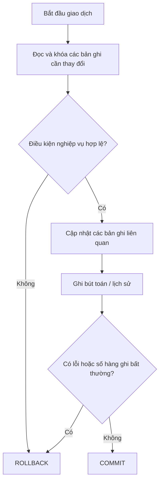

# Đọc và ghi nhiều bản ghi trong một giao dịch

> **Chương:** Giao dịch  
> **Phạm vi:** `DATA_PERSISTENCE_FUNDAMENTALS` — thiết kế ranh giới persistence cho Java, đọc và ghi dữ liệu nhất quán, xử lý cạnh tranh đồng thời và lỗi kết nối, tiến hóa lược đồ, bảo mật, sao lưu và tối ưu hiệu năng.

## Mục tiêu học tập

Sau bài này, người học có thể:

1. Nhận biết một thao tác nghiệp vụ cần **đọc và thay đổi nhiều bản ghi như một đơn vị công việc**.
2. Xác định ranh giới `BEGIN`/`COMMIT`/`ROLLBACK`, điều kiện kiểm tra nghiệp vụ và các bất biến cần giữ.
3. Hiểu sự khác nhau giữa **tính nguyên tử** và **tính cô lập**, đặc biệt khi nhiều giao dịch cùng đọc rồi ghi các bản ghi liên quan.
4. Sử dụng giao dịch trong SQL và Java (Spring JDBC hoặc JDBC thuần), kiểm tra số hàng bị tác động và xử lý lỗi an toàn.
5. Lựa chọn khóa bản ghi, cập nhật có điều kiện, mức cô lập và chiến lược retry phù hợp; nhận diện giới hạn khi làm việc với hệ thống bên ngoài cơ sở dữ liệu.

## 1. Vì sao đọc và ghi nhiều hàng cần chung một giao dịch?

Một thao tác nghiệp vụ thường được biểu diễn bằng nhiều câu SQL. Ví dụ, chuyển 120.000 đồng từ tài khoản A sang tài khoản B bao gồm:

- Đọc số dư A và B, xác minh cả hai tài khoản tồn tại.
- Xác minh A còn đủ tiền và hai tài khoản khác nhau.
- Trừ tiền ở A, cộng tiền ở B.
- Ghi thông tin lần chuyển tiền và hai bút toán đối ứng để kiểm tra sau này.

Nếu mỗi câu SQL tự commit riêng, hệ thống có thể trừ tiền khỏi A rồi bị lỗi trước khi cộng vào B. Dữ liệu lúc này phản ánh **một phần thao tác nghiệp vụ**, gây sai lệch số dư hoặc sổ ghi nhận.

**Giao dịch (transaction)** gom các thao tác đọc/ghi liên quan thành một đơn vị có điểm hoàn tất rõ ràng. Nếu tất cả điều kiện và câu lệnh thành công, ứng dụng `COMMIT`; nếu một bước thất bại, ứng dụng `ROLLBACK` các thay đổi chưa commit của giao dịch đó.

Ví dụ khác:

| Nghiệp vụ | Các bản ghi liên quan | Bất biến cần giữ |
| --- | --- | --- |
| Tạo đơn hàng | `orders`, `order_items`, `inventory` | Đơn hàng không được xác nhận nếu không giữ được số lượng hàng cần bán. |
| Chuyển tiền | Hai `account`, `transfer_record`, `transfer_entry` | Không tạo chuyển tiền một phía; không cho số dư âm theo chính sách. |
| Đặt chỗ | `booking` và các hàng quản lý chỗ | Một chỗ không được bán hai lần cho cùng thời điểm. |
| Gán quyền | `user`, `user_role`, `audit_log` | Thay đổi quyền và bản ghi kiểm toán cùng phản ánh một thao tác thành công. |

Giao dịch là ranh giới của **tính nhất quán ở cấp lưu trữ**, nhưng việc chọn đúng điều kiện kiểm tra và cách phối hợp các giao dịch vẫn là trách nhiệm thiết kế.

## 2. Một giao dịch bao gồm những bước nào?

Sơ đồ sau thể hiện quy trình đọc và ghi nhiều bản ghi:



Đặt mọi bước vào một giao dịch giúp đạt **atomicity (tính nguyên tử)**: hoặc toàn bộ các thay đổi thuộc giao dịch được commit, hoặc không thay đổi nào của giao dịch được công nhận. Khi một câu `UPDATE` thất bại, điều đó không tự động có nghĩa ứng dụng đã rollback trên mọi DBMS; ứng dụng/framework phải kết thúc giao dịch đúng cách.

Tuy nhiên, tính nguyên tử không đồng nghĩa với việc các giao dịch đồng thời sẽ không ảnh hưởng lẫn nhau. Đọc một giá trị, tính toán trong Java rồi ghi lại có thể tạo **lost update**, hoặc hai giao dịch đều thấy điều kiện còn đúng rồi cùng ghi làm sai bất biến. Những tình huống này cần phân tích mức cô lập và cơ chế khóa.

## 3. Mô hình ví dụ: chuyển tiền có ghi lịch sử

Sử dụng PostgreSQL để minh họa. Bảng `account` lưu số dư hiện tại; `transfer_record` lưu một yêu cầu chuyển tiền; `transfer_entry` lưu hai biến động số dư:

```sql
CREATE TABLE account (
    id BIGINT PRIMARY KEY,
    balance NUMERIC(18, 2) NOT NULL CHECK (balance >= 0),
    updated_at TIMESTAMPTZ NOT NULL DEFAULT now()
);

CREATE TABLE transfer_record (
    request_id UUID PRIMARY KEY,
    from_account_id BIGINT NOT NULL REFERENCES account(id),
    to_account_id BIGINT NOT NULL REFERENCES account(id),
    amount NUMERIC(18, 2) NOT NULL CHECK (amount > 0),
    created_at TIMESTAMPTZ NOT NULL DEFAULT now(),
    CHECK (from_account_id <> to_account_id)
);

CREATE TABLE transfer_entry (
    request_id UUID NOT NULL REFERENCES transfer_record(request_id),
    account_id BIGINT NOT NULL REFERENCES account(id),
    delta NUMERIC(18, 2) NOT NULL,
    PRIMARY KEY (request_id, account_id)
);

INSERT INTO account (id, balance)
VALUES (101, 500000.00), (202, 250000.00);
```

Mô hình này phục vụ học tập: `CHECK (balance >= 0)` giúp bảo vệ số dư khỏi âm; khóa chính `request_id` ngăn ghi trùng một lần chuyển tiền theo mã yêu cầu; khóa ngoại giúp không tham chiếu tài khoản không tồn tại. Hai bút toán có `delta` đối ứng về mặt ứng dụng, ví dụ `-120000.00` và `+120000.00`. Lược đồ trên **chưa tự kiểm tra tổng hai bút toán bằng 0**, số lượng bút toán phải bằng 2, hoặc tính hợp lệ của mọi vòng đời giao dịch. Một hệ thống tài chính thực cần thêm kiểm soát và đối soát phù hợp.

Không dùng `double`/`float` trong Java để tính tiền; dùng `BigDecimal` với quy tắc làm tròn, đơn vị tiền và giới hạn độ chính xác đã thống nhất. Kiểu `NUMERIC(18, 2)` trong ví dụ cũng chỉ phù hợp khi tiền tệ/nghiệp vụ sử dụng hai chữ số thập phân.

### 3.1. Các bước SQL trong cùng transaction

Giả sử chuyển 120.000 từ tài khoản `101` sang `202`:

```sql
BEGIN;

-- Khóa các hàng liên quan trước khi đọc/đánh giá điều kiện.
SELECT id, balance
FROM account
WHERE id IN (101, 202)
ORDER BY id
FOR UPDATE;

-- Ứng dụng phải xác nhận có đủ hai hàng và account 101 >= 120000.
-- Nếu không thỏa, ROLLBACK và dừng, không thực hiện các lệnh dưới.

UPDATE account
SET balance = balance - 120000.00, updated_at = now()
WHERE id = 101;

UPDATE account
SET balance = balance + 120000.00, updated_at = now()
WHERE id = 202;

INSERT INTO transfer_record
    (request_id, from_account_id, to_account_id, amount)
VALUES
    ('00000000-0000-4000-8000-000000000007', 101, 202, 120000.00);

INSERT INTO transfer_entry (request_id, account_id, delta)
VALUES
    ('00000000-0000-4000-8000-000000000007', 101, -120000.00),
    ('00000000-0000-4000-8000-000000000007', 202,  120000.00);

COMMIT;
```

Ví dụ SQL này trình bày **đường đi khi điều kiện hợp lệ**; nó không phải một script có thể chạy nguyên khối mà tự xử lý nhánh số dư thiếu. Trong ứng dụng thực, các bước kiểm tra quyết định `COMMIT` hay `ROLLBACK` và kiểm tra số lượng hàng được cập nhật trước khi tiếp tục.

Kết quả sau commit thành công:

| Tài khoản | Trước | Thay đổi | Sau |
| --- | ---: | ---: | ---: |
| `101` | 500.000 | -120.000 | 380.000 |
| `202` | 250.000 | +120.000 | 370.000 |
| **Tổng** | **750.000** | **0** | **750.000** |

Nếu câu `INSERT` bút toán thất bại và transaction rollback, cả hai lần cập nhật số dư trước đó cũng được hoàn tác. Nếu ứng dụng mất kết nối **trong lúc commit**, không được mặc định rằng rollback đã xảy ra: kết quả commit có thể chưa biết chắc từ phía client.

### 3.2. Khi nào cần đọc và khóa?

Trong PostgreSQL, `SELECT ... FOR UPDATE` khóa các hàng được chọn cho đến khi giao dịch kết thúc, giúp giao dịch khác không thể cập nhật/khóa xung đột cùng các hàng đó ngay lập tức. Giao dịch cạnh tranh có thể phải chờ và sau đó nhìn thấy trạng thái mới hoặc nhận lỗi tùy mức cô lập.

Đọc cả hai tài khoản trong cùng giao dịch có hai mục đích: kiểm tra tồn tại/điều kiện nghiệp vụ và giữ một trạng thái đủ ổn định để tính toán trước khi ghi. Nhưng `FOR UPDATE` chỉ khóa **các hàng tìm thấy**; nó không tự khóa mọi hàng có thể xuất hiện sau này hoặc bảo vệ điều kiện tổng hợp trên tập bản ghi thay đổi.

Để giảm nguy cơ deadlock khi nhiều giao dịch chuyển tiền qua lại, hãy khóa các tài khoản theo **một thứ tự cố định** (chẳng hạn `id` tăng dần), bất kể đâu là nguồn và đích. Cách này giảm xung đột vòng chờ giữa các giao dịch tuân thủ cùng quy tắc, nhưng không loại bỏ mọi deadlock.

## 4. Cài đặt ở Java bằng Spring JDBC

Với Spring, `@Transactional` xác định ranh giới giao dịch tại phương thức nghiệp vụ. Các thao tác `JdbcTemplate` phải tham gia cùng `DataSource` và transaction manager tương ứng. Ví dụ sau minh họa việc khóa từng tài khoản theo thứ tự `id` tăng dần, đọc trạng thái và ghi nhiều hàng trong **một** transaction:

```java
import java.math.BigDecimal;
import java.util.UUID;

import org.springframework.jdbc.core.JdbcTemplate;
import org.springframework.stereotype.Service;
import org.springframework.transaction.annotation.Transactional;

@Service
public class TransferService {
    private final JdbcTemplate jdbc;

    public TransferService(JdbcTemplate jdbc) {
        this.jdbc = jdbc;
    }

    @Transactional
    public void transfer(
            UUID requestId, long fromId, long toId, BigDecimal amount) {
        if (requestId == null || fromId == toId
                || amount == null || amount.signum() <= 0
                || amount.scale() > 2) {
            throw new IllegalArgumentException("Invalid transfer");
        }

        long first = Math.min(fromId, toId);
        long second = Math.max(fromId, toId);

        // Hai SELECT chạy trên cùng connection/transaction;
        // khóa tài khoản theo thứ tự id để giảm deadlock.
        BigDecimal firstBalance = jdbc.queryForObject(
            "SELECT balance FROM account WHERE id = ? FOR UPDATE",
            BigDecimal.class, first);
        BigDecimal secondBalance = jdbc.queryForObject(
            "SELECT balance FROM account WHERE id = ? FOR UPDATE",
            BigDecimal.class, second);

        BigDecimal sourceBalance =
            fromId == first ? firstBalance : secondBalance;
        if (sourceBalance.compareTo(amount) < 0) {
            throw new IllegalStateException("Insufficient funds");
        }

        int debited = jdbc.update(
            "UPDATE account SET balance = balance - ?, "
                + "updated_at = now() WHERE id = ?",
            amount, fromId);
        int credited = jdbc.update(
            "UPDATE account SET balance = balance + ?, "
                + "updated_at = now() WHERE id = ?",
            amount, toId);

        if (debited != 1 || credited != 1) {
            throw new IllegalStateException("Unexpected account update");
        }

        jdbc.update(
            "INSERT INTO transfer_record "
                + "(request_id, from_account_id, to_account_id, amount) "
                + "VALUES (?, ?, ?, ?)",
            requestId, fromId, toId, amount);

        jdbc.update(
            "INSERT INTO transfer_entry (request_id, account_id, delta) "
                + "VALUES (?, ?, ?)",
            requestId, fromId, amount.negate());
        jdbc.update(
            "INSERT INTO transfer_entry (request_id, account_id, delta) "
                + "VALUES (?, ?, ?)",
            requestId, toId, amount);
        // Thành công: Spring commit khi phương thức trả về bình thường.
        // RuntimeException hoặc DataAccessException: mặc định rollback.
    }
}
```

**Những điều cần chú ý khi áp dụng:**

1. Nếu không tìm thấy tài khoản, `queryForObject` sẽ ném ngoại lệ của Spring JDBC; transaction phải rollback. Không bỏ qua lỗi và tiếp tục xử lý với số dư giả định bằng 0.
2. Ví dụ chỉ chấp nhận số tiền có tối đa hai chữ số thập phân; khi đưa vào sản phẩm, kiểm tra giới hạn giá trị, đơn vị tiền, quyền chuyển khoản và trạng thái tài khoản theo quy tắc nghiệp vụ thực tế.
3. `@Transactional` mặc định rollback với `RuntimeException` và `Error`; với **checked exception**, cần cấu hình `rollbackFor` hoặc chủ động chuyển lỗi thành loại phù hợp khi có yêu cầu rollback. Không nuốt exception rồi trả kết quả “thành công”.
4. Nếu tự gọi `this.transfer(...)` bên trong chính class ở chế độ proxy mặc định của Spring, lời gọi có thể **không đi qua transaction proxy**. Phương thức giao dịch nên được gọi qua bean do Spring quản lý.
5. Không tạo `Connection` khác hoặc chạy SQL qua `DataSource` khác bên trong cùng thao tác rồi mặc nhiên cho rằng nó thuộc cùng giao dịch. Cần transaction manager và cơ chế kết nối được quản lý thống nhất.
6. Lệnh `UPDATE` kiểm tra số hàng ảnh hưởng giúp phát hiện tình huống bất thường; ràng buộc `CHECK`, `PRIMARY KEY` và `FOREIGN KEY` tiếp tục bảo vệ dữ liệu ở tầng DB.

**Thử nghiệm bắt buộc trong môi trường kiểm thử:** chuyển tiền thành công; số dư thiếu; tài khoản không tồn tại; chèn trùng `request_id`; lỗi khi ghi bút toán sau khi cập nhật số dư; hai lần chuyển tiền đồng thời; và mất kết nối/timeout. Với lỗi phát sinh trước commit, sau rollback tổng số dư và các bản ghi lịch sử phải trở lại trạng thái ban đầu.

## 5. Tự quản lý transaction bằng JDBC thuần

Không dùng framework, JDBC thường hoạt động với `autoCommit = true`: mỗi statement hoàn tất được commit riêng. Muốn gom nhiều thao tác, phải tắt auto-commit trên **cùng một `Connection`**:

```java
import java.sql.Connection;
import java.sql.SQLException;
import javax.sql.DataSource;

public void runUnitOfWork(DataSource dataSource) throws SQLException {
    try (Connection connection = dataSource.getConnection()) {
        boolean oldAutoCommit = connection.getAutoCommit();
        connection.setAutoCommit(false);
        try {
            // 1. SELECT ... FOR UPDATE trên connection này.
            // 2. Kiểm tra điều kiện nghiệp vụ.
            // 3. UPDATE nhiều hàng, INSERT lịch sử bằng chính connection.
            // 4. Kiểm tra số hàng cập nhật và các bất biến cần thiết.
            connection.commit();
        } catch (SQLException | RuntimeException failure) {
            try {
                connection.rollback();
            } catch (SQLException rollbackError) {
                failure.addSuppressed(rollbackError);
            }
            throw failure;
        } finally {
            connection.setAutoCommit(oldAutoCommit);
        }
    }
}
```

Đây là **khung quản lý transaction**, không phải hàm chuyển tiền hoàn chỉnh; SQL thực tế vẫn phải được viết bằng `PreparedStatement`/tham số hóa, đảm bảo mọi statement dùng `connection` đang quản lý. Việc khôi phục `autoCommit` trong `finally` nên được xử lý theo chính sách connection pool và lỗi kết nối của ứng dụng; nếu rollback/commit thất bại, kết nối có thể không còn dùng lại an toàn.

Nếu logic nghiệp vụ không hợp lệ (như không đủ hàng), ném ngoại lệ hoặc kết thúc nhánh bằng rollback rõ ràng. Đừng gọi `commit()` trong một helper trước khi tất cả bản ghi được ghi xong. Với JDBC thuần, tự động rollback khi đóng connection không phải cơ chế mà ứng dụng nên dựa vào để thay thế `rollback()` chủ động.

## 6. Đọc nhiều bản ghi trong một giao dịch có luôn là ảnh chụp nhất quán?

**Không nhất thiết.** Một giao dịch không mặc định bảo đảm mọi câu `SELECT` nhìn thấy cùng một snapshot trên mọi hệ quản trị hoặc mọi mức cô lập.

Trong PostgreSQL:

| Mức cô lập | Đặc trưng quan trọng khi đọc nhiều lần | Hệ quả khi ghi |
| --- | --- | --- |
| `READ COMMITTED` (mặc định) | Mỗi câu lệnh nhìn một snapshot tại đầu câu lệnh; hai `SELECT` liên tiếp có thể thấy dữ liệu đã commit khác nhau. | Cần khóa hoặc ghi có điều kiện khi giá trị vừa đọc là cơ sở ra quyết định ghi. |
| `REPEATABLE READ` | Các lần đọc thông thường trong giao dịch nhìn snapshot nhất quán của giao dịch. | Vẫn phải xử lý xung đột cập nhật/serialization error; snapshot ổn định không tự bảo vệ mọi bất biến liên hàng. |
| `SERIALIZABLE` | Cố gắng cho kết quả tương đương một thứ tự thực thi tuần tự. | Có thể hủy một giao dịch với lỗi serialization; ứng dụng phải retry **toàn bộ transaction** khi phù hợp. |

Tên mức cô lập giống nhau giữa các DBMS không đảm bảo chi tiết triển khai giống nhau. Trước khi áp dụng kỹ thuật khóa, cần kiểm tra hành vi của hệ quản trị đang dùng.

### 6.1. Lost update khi đọc rồi ghi giá trị tính sẵn

Hai yêu cầu cùng đọc tồn kho `available = 5`; mỗi yêu cầu muốn bán 4 sản phẩm. Nếu cả hai đọc rồi chạy `UPDATE inventory SET available = 1`, một lần ghi có thể ghi đè kết quả của lần kia. Việc đặt chúng trong hai transaction độc lập chưa chắc đã loại bỏ lỗi.

Cách thường dùng là **cập nhật có điều kiện bằng một statement nguyên tử**:

```sql
UPDATE inventory
SET available = available - 4
WHERE product_id = 88
  AND available >= 4;
```

Ứng dụng kiểm tra số hàng cập nhật: `1` nghĩa là đã giữ được số lượng theo điều kiện; `0` nghĩa là không có hàng hoặc không đủ hàng tại thời điểm cập nhật. Trong PostgreSQL ở `READ COMMITTED`, khi câu lệnh này cạnh tranh cùng hàng, điều kiện được kiểm tra lại phù hợp sau khi chờ cập nhật xung đột. Sau đó ứng dụng ghi `orders` và `order_items` **trong cùng transaction**; nếu bước tạo đơn thất bại, phần trừ tồn kho được rollback.

Đây là lựa chọn đơn giản khi chỉ cần thay đổi **một hàng theo điều kiện**. Với quy tắc phải đọc nhiều hàng trước khi quyết định hoặc liên quan tổng trên nhiều hàng, cần thiết kế khóa và mức cô lập phù hợp hơn.

### 6.2. Write skew và điều kiện trên một tập bản ghi

Giả sử phòng trực phải luôn có ít nhất một nhân viên trực. Hai giao dịch cùng đọc thấy hai nhân viên A và B đang trực. Giao dịch 1 cho A nghỉ; giao dịch 2 cho B nghỉ. Mỗi giao dịch chỉ cập nhật một hàng khác nhau, nên khóa riêng hai hàng đó có thể không chặn được việc cả hai cùng commit nếu các lần đọc không được bảo vệ thích hợp.

Đây là ví dụ **write skew**: từng cập nhật hợp lệ theo điều kiện đã đọc, nhưng kết quả chung vi phạm bất biến. Cần cân nhắc khóa một hàng đại diện cho trạng thái chung, khóa toàn bộ tập hàng liên quan theo thứ tự ổn định, hoặc `SERIALIZABLE` với cơ chế retry. Không mặc định rằng một giao dịch “đã đọc hết các hàng” thì đã khóa chúng.

## 7. Những lỗi và tình huống cạnh tranh thường gặp

| Tình huống | Tín hiệu hoặc nguyên nhân | Cách xử lý |
| --- | --- | --- |
| Không đủ số dư / hết tồn kho | Điều kiện nghiệp vụ không đạt | Rollback; trả lỗi nghiệp vụ có ý nghĩa; không retry mù quáng. |
| Vi phạm `UNIQUE`/`FOREIGN KEY` | Trùng mã yêu cầu hoặc bản ghi tham chiếu không hợp lệ | Rollback; phân biệt ràng buộc nào bị vi phạm trước khi ánh xạ lỗi. |
| Deadlock | Hai transaction giữ khóa và chờ khóa của nhau theo vòng | DB chọn một transaction để hủy; rollback/retry toàn bộ transaction theo chính sách, với giới hạn số lần và khoảng đợi phù hợp. |
| Serialization failure | DB không thể giữ lịch thực thi tương đương tuần tự | Retry toàn bộ transaction khi mã nghiệp vụ có thể chạy lại an toàn. |
| Lock timeout | Chờ khóa vượt giới hạn | Kiểm tra trạng thái transaction, rollback hoặc thoát theo chính sách; xem xét transaction quá dài. |
| Mất kết nối trong lúc commit | Client không biết chắc DB đã commit hay chưa | Tra cứu theo mã yêu cầu duy nhất/idempotency key; tránh tự động tạo lần chuyển mới. |

Trong PostgreSQL, SQLSTATE thường gặp là `40P01` cho deadlock, `40001` cho serialization failure, `23505` cho unique violation. Không nên nhận diện lỗi bằng cách so sánh thông điệp tiếng Anh, và không đánh đồng ba nhóm lỗi này.

**Retry đúng cách:** mở transaction **mới**, đọc lại mọi dữ liệu điều kiện, tính lại thay đổi và dùng lại một `request_id` nhất quán. Nếu lần trước đã commit nhưng client không nhận phản hồi, khóa duy nhất `request_id` cho phép phát hiện thao tác đã tồn tại; hệ thống phải so sánh nội dung yêu cầu, trạng thái và kết quả đã lưu trước khi coi lần gọi lại là thành công. Unique key giúp chặn ghi trùng, nhưng tự nó chưa giải quyết đầy đủ idempotency của API.

## 8. Chọn ranh giới transaction đúng

Một transaction thường nên bắt đầu ngay trước nhóm đọc/ghi phải nhất quán và kết thúc ngay sau khi các bản ghi cần thiết đã được cập nhật:

- **Không giữ transaction trong khi chờ người dùng** hoặc thực hiện xử lý dài không cần truy cập cơ sở dữ liệu; việc này giữ connection và khóa quá lâu.
- **Không gọi HTTP/email/thanh toán bên ngoài ngay trong transaction rồi giả định rollback DB sẽ thu hồi tác động đã xảy ra ở dịch vụ khác.** Transaction của một DB không tự bao phủ dịch vụ ngoài nó. Để phát sự kiện sau commit một cách đáng tin cậy, cân nhắc **transactional outbox**: ghi trạng thái nghiệp vụ và bản ghi outbox trong một transaction, sau đó worker chuyển sự kiện đi và xử lý gửi trùng ở bên nhận.
- **Không chia một thao tác nguyên tử thành nhiều transaction** chỉ để giảm thời gian giữ khóa nếu việc chia tách làm mất bất biến. Nếu nghiệp vụ kéo dài, cần thiết kế workflow, trạng thái trung gian, idempotency và bù trừ có kiểm soát.
- **Không lồng nhiều transaction tùy tiện.** Trong Spring, `PROPAGATION_REQUIRED` thường dùng chung transaction đang có; `REQUIRES_NEW` tạo transaction độc lập, có thể commit ngay cả khi transaction ngoài rollback. Chỉ dùng khi hành vi này thực sự được yêu cầu.
- **Hạn chế dữ liệu đọc/ghi và thời gian giữ khóa:** dùng chỉ mục cho cột tìm kiếm, khóa theo thứ tự nhất quán, giám sát deadlock và truy vấn chậm. Đánh giá kế hoạch truy vấn và số hàng bị quét trước khi dùng `FOR UPDATE` trên tập lớn.

Tách rõ **read-only transaction** dùng để báo cáo hoặc dựng màn hình và **read-modify-write transaction** dùng để đảm bảo bất biến. Khi chỉ đọc, cần chọn mức cô lập theo yêu cầu nhất quán của báo cáo; khi đọc rồi ghi, cần xác định những dữ liệu nào phải được bảo vệ khỏi thay đổi cạnh tranh.

### Mối liên hệ với backup, bảo mật và tiến hóa schema

Giao dịch giúp dữ liệu sau commit có ranh giới nhất quán, nhưng không thay thế sao lưu, giám sát lưu trữ hoặc thử nghiệm khôi phục. Với migration schema, phải xét các phiên bản ứng dụng cùng chạy và cách chúng ghi nhiều bảng; một thay đổi cấu trúc có thể yêu cầu chiến lược triển khai từng bước để tránh breaking change giữa các phiên bản.

Đối với bảo mật, mọi truy vấn phải dùng tham số hóa và thực thi theo quyền truy cập phù hợp. Khóa và transaction không tự đảm bảo người gọi có quyền chuyển tiền hoặc đọc tài khoản. Lưu vết giao dịch hữu ích để điều tra, nhưng log không nên phơi bày thông tin bí mật, dữ liệu định danh hoặc nội dung SQL có tham số nhạy cảm.

## 9. Bài thực hành: tạo đơn hàng có nhiều dòng

**Đề bài:** khách hàng đặt hai sản phẩm, mỗi sản phẩm cần một số lượng khác nhau. Thiết kế một transaction tạo hàng `orders`, các hàng `order_items` và trừ tồn kho từng sản phẩm. Không được để lại đơn hàng hoàn tất nếu bất kỳ dòng hàng nào không đủ tồn kho.

Một khung thuật toán phù hợp:

1. Bắt đầu transaction; dùng một mã yêu cầu duy nhất nếu API có retry.
2. Kiểm tra thông tin khách hàng/quyền tạo đơn; chuẩn hóa danh sách sản phẩm, gộp các dòng trùng sản phẩm và sắp xếp `product_id` theo thứ tự cố định.
3. Với từng sản phẩm, chạy `UPDATE inventory SET available = available - ? WHERE product_id = ? AND available >= ?`, kiểm tra kết quả đúng một hàng; nếu dòng nào trả về 0, rollback.
4. Ghi `orders` và toàn bộ `order_items` trong chính transaction, với khóa ngoại và các ràng buộc cần thiết.
5. Commit; chỉ khi commit thành công mới trả trạng thái hoàn tất. Nếu cần gửi xác nhận, dùng cơ chế sau commit/outbox thích hợp.

**Câu hỏi kiểm tra:**

1. Nếu đã trừ tồn kho dòng 1 nhưng dòng 2 thiếu hàng, dữ liệu sau rollback phải thế nào?
2. Vì sao chỉ dùng `synchronized` trong một instance Java không bảo vệ đủ khi dịch vụ chạy trên nhiều instance?
3. Nếu hai người cùng đặt sản phẩm còn đúng 1 đơn vị, câu `UPDATE ... WHERE available >= 1` giúp tránh tình huống nào?
4. Khi nào nên dùng `SELECT ... FOR UPDATE`, khi nào một câu cập nhật có điều kiện là đủ?
5. Vì sao mất kết nối lúc `COMMIT` khác với lỗi rõ ràng trước khi commit?
6. Làm thế nào để giao dịch DB và sự kiện gửi sang dịch vụ vận chuyển không bị lệch lâu dài khi tiến trình bị dừng đột ngột?

## Ghi nhớ

**Một thao tác nghiệp vụ nhất quán cần một ranh giới transaction rõ ràng**, nhưng `BEGIN`/`COMMIT`/`ROLLBACK` chỉ giải quyết phần nguyên tử của các thay đổi. Khi đọc rồi ghi nhiều bản ghi, phải xác định bất biến, chọn cách khóa hoặc cập nhật có điều kiện, hiểu mức cô lập, kiểm tra số hàng thực sự được ghi và chuẩn bị cho xung đột đồng thời. Trong Java, hãy dùng transaction manager hoặc cùng một JDBC connection xuyên suốt đơn vị công việc; xử lý rollback, retry và kết quả commit chưa xác định theo cơ chế có thể kiểm chứng.
