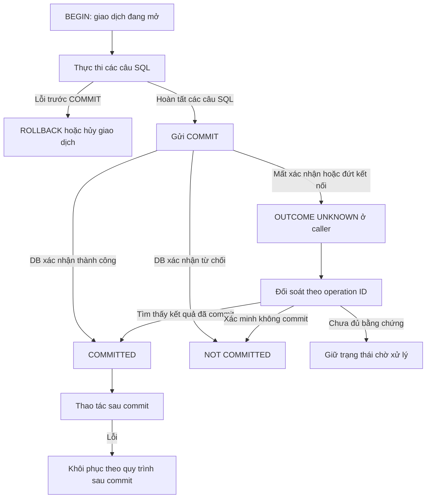
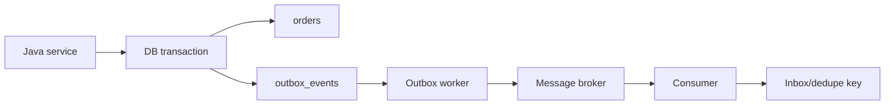

# Xử lý lỗi trước commit, trong commit và sau commit

Trong một ứng dụng có **persistence**, lỗi của giao dịch không chỉ được phân loại theo loại ngoại lệ. **Thời điểm xảy ra lỗi so với `COMMIT`** quyết định ứng dụng biết chắc điều gì về dữ liệu đã được lưu, liệu `ROLLBACK` còn ý nghĩa hay không và có thể thử lại thao tác nào một cách an toàn.

Đây là bài học thuộc chương **Giao dịch** của mô-đun **DATA_PERSISTENCE_FUNDAMENTALS**. Mô-đun hướng đến việc hiểu nguyên lý lưu trữ dữ liệu bền vững, thiết kế lược đồ, truy vấn, chỉ mục, giao dịch, cô lập và kiểm soát đồng thời; đồng thời xây dựng ranh giới persistence cho Java, xử lý lỗi kết nối, tiến hóa schema, bảo mật, sao lưu và tối ưu hiệu năng. Trong phạm vi bài này, ta tập trung vào vòng đời **một giao dịch cơ sở dữ liệu**, các lỗi quanh ranh giới commit và cách phối hợp chúng với ứng dụng Java.

Các ví dụ sử dụng SQL và JDBC theo cách thực hành phổ biến; phần minh họa hành vi cụ thể lấy **PostgreSQL** làm tham chiếu. Chi tiết về SQLSTATE, savepoint, khóa, độ bền và xác nhận commit có thể khác giữa các hệ quản trị và cấu hình vận hành.

## 1. Vì sao phải phân biệt ba thời điểm lỗi?

Xét API `POST /orders` tạo một đơn hàng và một bản ghi yêu cầu gửi thông báo. Hai bản ghi được thêm trong cùng giao dịch:

```text
BEGIN
  INSERT orders(...)
  INSERT outbox_events(...)
COMMIT
  -> trả kết quả cho caller
  -> tiến trình khác gửi thông báo từ outbox
```

Có ba nhóm tình huống khác nhau:

| Thời điểm | Ví dụ | Điều ứng dụng có thể biết | Hướng xử lý chính |
|---|---|---|---|
| **Trước commit** | Kiểm tra dữ liệu thất bại, lỗi SQL, deadlock khi cập nhật | Nếu chưa phát lệnh `COMMIT`, các thay đổi của giao dịch này chưa được commit bởi tiến trình đó | `ROLLBACK` hoặc để giao dịch được hủy, sửa nguyên nhân; chỉ retry khi phù hợp |
| **Trong commit** | Ràng buộc hoãn kiểm tra thất bại; mất kết nối lúc chờ xác nhận `COMMIT` | Có thể **biết bị từ chối**, hoặc **không biết kết quả cuối cùng**, tùy phản hồi thực tế | Phân biệt thất bại xác định với kết quả không xác định; đối soát trước khi retry |
| **Sau commit thành công đã được xác nhận** | Gửi HTTP response thất bại, gửi sự kiện lỗi, dựng DTO lỗi | DB đã xác nhận commit theo ngữ nghĩa và cấu hình độ bền của hệ | Không rollback được giao dịch đã commit; tiếp tục hoặc bù trừ theo nghiệp vụ |

**Hai tình huống dễ nhầm**: (1) một lỗi được ném ra từ `connection.commit()` không luôn chứng minh giao dịch đã rollback; (2) một lỗi xảy ra trong mã Java *sau khi* `commit()` trả về thành công không biến giao dịch đã commit thành thất bại.

## 2. Mô hình trạng thái: thực tế ở DB và điều caller biết

Khi thiết kế lỗi, cần tách **trạng thái thật trong DB** khỏi **mức độ chắc chắn của ứng dụng**.



`OUTCOME UNKNOWN` là **trạng thái nhận thức của caller**, không phải trạng thái thứ ba mà DB bắt buộc lưu trên đĩa. Giao dịch cục bộ cuối cùng hoặc được commit hoặc không; vấn đề là ứng dụng có thể chưa nhận được bằng chứng đáng tin cậy. Trong các hệ sử dụng **distributed transaction/2PC**, khái niệm *in-doubt* còn có ý nghĩa riêng; không nên đồng nhất nó với một kết nối JDBC đơn giản bị timeout.

Từ đây có ba nguyên tắc nền tảng:

1. **Chưa gửi `COMMIT`** và biết giao dịch đang được giữ trong `autoCommit=false` thì ứng dụng có thể chủ động rollback phần công việc chưa commit.
2. **Đã gửi `COMMIT` nhưng không có phản hồi chắc chắn** thì `rollback()` trên kết nối cũ, việc đóng kết nối hoặc HTTP 500 đều **không phải bằng chứng** rằng commit chưa xảy ra.
3. **Đã nhận xác nhận commit thành công** thì việc xử lý lỗi kế tiếp cần dựa trên giao dịch mới, thao tác có thể lặp lại hoặc một nghiệp vụ bù trừ; không thể đảo ngược commit cũ bằng `ROLLBACK`.

## 3. Lỗi trước commit: hủy phần công việc chưa hoàn tất

### 3.1. Những nguyên nhân điển hình

Lỗi trước commit có thể phát sinh từ đầu vào hoặc từ hệ thống:

- **Vi phạm ràng buộc ngay khi thực thi:** khóa ngoại, `NOT NULL`, `CHECK`, `UNIQUE` (khi không hoãn kiểm tra).
- **Xung đột đồng thời:** deadlock hoặc lỗi serialization; đôi khi phải hủy toàn bộ giao dịch và thử lại từ đầu.
- **Lỗi truy vấn:** sai cú pháp, kiểu tham số sai, câu lệnh vượt giới hạn tài nguyên hoặc bị timeout.
- **Lỗi ở tầng ứng dụng:** xác thực nghiệp vụ thất bại, Java ném exception khi ánh xạ hoặc kiểm tra dữ liệu.
- **Mất kết nối trước commit:** các thay đổi chưa commit trên kết nối cũ không trở thành một giao dịch đã commit chỉ vì ứng dụng mất kết nối; DB thường hủy giao dịch còn mở khi phiên kết thúc, dù thời điểm giải phóng tài nguyên có thể trễ.

Ví dụ, chuyển tiền giữa hai tài khoản cần diễn ra trong cùng một giao dịch:

```sql
BEGIN;

UPDATE accounts
SET balance = balance - 500000
WHERE id = 101 AND balance >= 500000;

-- Ứng dụng phải kiểm tra affected rows = 1.
UPDATE accounts
SET balance = balance + 500000
WHERE id = 202;

-- Nếu bất kỳ bước nào không hợp lệ, ROLLBACK thay vì COMMIT.
COMMIT;
```

Nếu phép trừ trả về `0` dòng, ứng dụng phải coi điều kiện số dư không được đáp ứng và **dừng trước commit**. Ngoài ra cần bảo đảm tài khoản đích có tồn tại và số dòng cập nhật đúng kỳ vọng; không nên hiểu rằng SQL chạy không ném exception là toàn bộ nghiệp vụ đã đúng.

### 3.2. Rollback và trạng thái giao dịch sau lỗi

Trong PostgreSQL, một lỗi câu lệnh thông thường bên trong transaction block có thể đưa giao dịch vào trạng thái *aborted*: các câu SQL tiếp theo sẽ bị từ chối cho đến khi `ROLLBACK`, hoặc `ROLLBACK TO SAVEPOINT` phù hợp. Quy tắc này **không giống hoàn toàn** mọi DBMS.

```sql
BEGIN;
SAVEPOINT before_optional_change;

-- Một thao tác tùy chọn có thể vi phạm ràng buộc.
INSERT INTO customers (id, email) VALUES (7, 'duplicate@example.com');

-- Nếu câu INSERT lỗi, ứng dụng có thể thực thi:
ROLLBACK TO SAVEPOINT before_optional_change;

-- Sau đó tiếp tục các thao tác hợp lệ rồi COMMIT,
-- hoặc ROLLBACK toàn bộ nếu lỗi ảnh hưởng tính đúng đắn nghiệp vụ.
```

`SAVEPOINT` có thể giữ phần giao dịch đã làm trước mốc lưu, nhưng **không tự quyết định** việc tiếp tục có hợp lệ về mặt nghiệp vụ hay không. Với thao tác nguyên tử như chuyển tiền, xử lý lỗi bằng cách bỏ qua phần bị lỗi và vẫn commit thường là sai; hãy rollback toàn bộ nếu không bảo toàn được bất biến.

### 3.3. Retry trước commit cần lặp lại đơn vị nào?

Một số lỗi có tính tạm thời, chẳng hạn `serialization_failure` (PostgreSQL SQLSTATE `40001`) hoặc `deadlock_detected` (`40P01`). Với các lỗi này, thông thường cần **thực hiện lại toàn bộ giao dịch**, gồm các phép đọc và quyết định nghiệp vụ có phụ thuộc trạng thái DB, trên một giao dịch mới. Chỉ chạy lại câu `UPDATE` cuối cùng có thể dùng thông tin cũ và vi phạm bất biến.

Ngược lại, lỗi `23505` (vi phạm `UNIQUE`) hoặc dữ liệu đầu vào sai không trở thành hợp lệ chỉ nhờ retry. Khi `23505` xuất hiện trên khóa idempotency, cần tra cứu kết quả của yêu cầu gốc và kiểm tra payload có trùng khớp, thay vì coi mọi trùng khóa đều là thất bại nghiệp vụ.

Áp dụng **giới hạn số lần thử**, backoff có jitter và deadline của request. Mỗi lần thử lại phải dùng giao dịch mới; tránh một vòng lặp vô hạn làm tăng tranh chấp hoặc gây quá tải DB.

## 4. Lỗi trong commit: khi kết quả có thể không xác định

`COMMIT` không chỉ là một lệnh "bật cờ" ở client. Hệ quản trị có thể phải kiểm tra ràng buộc được hoãn, chốt giao dịch, ghi thông tin commit vào log phục hồi và gửi phản hồi theo cấu hình độ bền của nó. Vì vậy, lỗi quanh commit cần phân hai trường hợp.

### 4.1. DB xác nhận từ chối commit

Ví dụ PostgreSQL cho phép ràng buộc khóa ngoại **DEFERRABLE INITIALLY DEFERRED**. Truy vấn có thể chạy được trong giao dịch nhưng lỗi ràng buộc chỉ được báo khi `COMMIT`:

```sql
CREATE TABLE departments (
    id BIGINT PRIMARY KEY
);

CREATE TABLE employees (
    id BIGINT PRIMARY KEY,
    department_id BIGINT REFERENCES departments(id)
        DEFERRABLE INITIALLY DEFERRED
);

BEGIN;
INSERT INTO employees (id, department_id) VALUES (1, 999);
-- Chưa có departments.id = 999.
COMMIT; -- Lỗi kiểm tra khóa ngoại: giao dịch không được commit.
```

Nếu DB **trả về lỗi ràng buộc xác định** và ứng dụng nhận được phản hồi đó, ứng dụng có cơ sở xem giao dịch vừa bị từ chối. Các lỗi serialization cũng có thể được phát hiện tại commit tùy DBMS và mức cô lập. Cần phân loại theo **thông tin trả về thực tế**; không chỉ dựa vào việc ngoại lệ phát sinh từ phương thức `commit()`.

### 4.2. Mất kết nối hoặc hết thời gian chờ lúc commit

Giả sử luồng giao tiếp là:

```text
Ứng dụng                           Database
    |  COMMIT -----------------------> |
    |                                | Ghi commit thành công
    |               X  <------------- | Phản hồi bị mất do đứt kết nối
    |  nhận SQLException/timeout      |
```

Ở phía ứng dụng, kết quả nhìn thấy giống một trường hợp khác:

```text
Ứng dụng                           Database
    |  COMMIT ----X                   |
    |  kết nối hỏng trước khi DB      | Không nhận COMMIT
    |  nhận lệnh                      | Giao dịch chưa commit
```

Trong cả hai trường hợp, caller có thể chỉ thấy `SQLException`, lỗi mạng hoặc timeout. **Không thể từ ngoại lệ đó suy ra chắc chắn** DB đã commit hay chưa. Việc gọi `rollback()` sau khi `commit()` có thể đã được xử lý không làm mất một commit đã hoàn tất; kết nối có thể đã hỏng nên cũng không thể gửi lệnh rollback.

Trạng thái đúng để báo lên tầng nghiệp vụ lúc này là **chưa xác định / cần đối soát**. Không được tự động tạo lại một đơn hàng hoặc chuyển tiền lần hai bằng một định danh mới chỉ vì yêu cầu đầu tiên timeout.

### 4.3. Giới hạn của xác nhận commit và tính bền vững

Thông thường, một xác nhận `COMMIT` thành công từ DB cho biết giao dịch đã commit theo bảo đảm của DB và **cấu hình độ bền hiện hành**. Ví dụ, PostgreSQL với `synchronous_commit=off` có thể trả xác nhận trước khi bản ghi commit được flush bền vững; sự cố máy chủ ngay sau đó có thể làm mất giao dịch đã được báo thành công. Các cấu hình replication và failover cũng ảnh hưởng khả năng quan sát kết quả.

Vì thế, "commit thành công" là khẳng định dựa trên hợp đồng và cấu hình hệ thống, không nên mở rộng thành lời hứa tuyệt đối về mọi kiểu mất mát dữ liệu. Với nghiệp vụ tài chính hoặc điều kiện độ bền cao, cần xác định và kiểm thử rõ chính sách WAL, đồng bộ hóa và khôi phục của DB.

## 5. Lỗi sau commit: dữ liệu đã được chốt, phần việc tiếp theo cần khôi phục

Sau khi `commit()` đã trả về thành công, một số thao tác vẫn có thể lỗi:

- API không gửi được HTTP response cho client; client thấy timeout dù đơn hàng đã tạo.
- Tiến trình gửi email, cập nhật hệ thống tìm kiếm hoặc phát sự kiện thất bại.
- Mã ứng dụng tạo DTO, ghi log, gửi metric hoặc chạy callback sau commit bị exception.
- Ứng dụng ngừng chạy giữa commit và bước tiếp theo.

Các lỗi trên **không thay đổi kết quả commit đã xác nhận**. `ROLLBACK` tại thời điểm này không xóa được bản ghi đã commit; nếu nghiệp vụ phải đảo tác động đã lưu, cần một **giao dịch bù trừ** mới, có quy tắc kiểm soát đồng thời và audit riêng.

Ví dụ: đơn hàng đã tạo nhưng chưa gửi được email. Một cách xử lý kém tin cậy là:

```text
commit order thành công
send email -> lỗi
trả API 500, client retry -> tạo thêm order
```

Cách an toàn hơn là lưu **ý định gửi email** vào bảng outbox trong cùng transaction tạo đơn. Sau commit, một worker đọc và gửi thông báo. Nếu việc gửi thất bại, worker có thể thử lại mà không tạo đơn hàng mới.

Phân biệt giao dịch DB và hệ thống ngoài DB: **một `COMMIT` cục bộ không bao trùm email, HTTP request, broker hay dịch vụ thanh toán**. Nếu cần kết hợp nhiều hệ, phải thiết kế giao thức nhất quán, idempotency và khôi phục; không giả định `@Transactional` trong Spring sẽ tự rollback tác dụng đã xảy ra ở hệ thống khác.

## 6. Idempotency: nền tảng để xử lý commit không xác định

**Idempotency** ở mức nghiệp vụ nghĩa là nhiều lần gửi *cùng một yêu cầu logic* không tạo ra tác động mới ngoài tác động đầu tiên. Nó quan trọng hơn việc biết lỗi thuộc lớp ngoại lệ nào, vì client có thể retry do mất kết nối ngay cả sau commit thành công.

### 6.1. Dùng operation ID ổn định cho một yêu cầu logic

Client sinh một `operation_id` duy nhất, chẳng hạn UUID, và **giữ nguyên ID** qua mọi lần retry của cùng yêu cầu. Server lưu ID này với ràng buộc duy nhất trong cùng transaction tạo dữ liệu nghiệp vụ.

```sql
CREATE TABLE orders (
    id BIGINT GENERATED ALWAYS AS IDENTITY PRIMARY KEY,
    operation_id UUID NOT NULL UNIQUE,
    request_hash TEXT NOT NULL,
    customer_id BIGINT NOT NULL,
    status TEXT NOT NULL,
    created_at TIMESTAMPTZ NOT NULL DEFAULT now()
);

CREATE TABLE outbox_events (
    id BIGINT GENERATED ALWAYS AS IDENTITY PRIMARY KEY,
    operation_id UUID NOT NULL,
    event_type TEXT NOT NULL,
    payload JSONB NOT NULL,
    published_at TIMESTAMPTZ,
    UNIQUE (operation_id, event_type)
);

BEGIN;

INSERT INTO orders (operation_id, request_hash, customer_id, status)
VALUES (:operation_id, :request_hash, :customer_id, 'CREATED');

INSERT INTO outbox_events (operation_id, event_type, payload)
VALUES (
    :operation_id,
    'OrderCreated',
    jsonb_build_object('operationId', :operation_id, 'customerId', :customer_id)
);

COMMIT;
```

Các tham số `:operation_id`, `:request_hash` là ký hiệu minh họa; khi dùng JDBC thuần, hãy chuyển thành placeholder `?` và bind đúng kiểu.

`request_hash` giúp phát hiện client tái sử dụng ID nhưng gửi **payload khác**. Cần tạo hash từ biểu diễn chuẩn hóa ổn định của các trường có ý nghĩa nghiệp vụ; tùy hệ thống có thể lưu thêm bản yêu cầu để kiểm tra và audit. Không chấp nhận một ID cũ với nội dung khác chỉ vì có bản ghi tồn tại.

Ràng buộc `UNIQUE (operation_id)` giúp ngăn hai giao dịch đồng thời cùng tạo bản ghi nghiệp vụ cho một ID. Nếu lần retry gặp xung đột, server phải đọc lại bản ghi gốc, xác thực `request_hash` và trả lại kết quả phù hợp, thay vì lập tức tạo operation ID khác.

**Phạm vi đảm bảo:** một khóa duy nhất trong một DB chỉ bảo đảm không có hai hàng cùng khóa ở DB đó. Nó chưa chứng minh mọi thao tác bên ngoài DB cũng diễn ra đúng một lần. Nếu thao tác đòi hỏi nhiều bản ghi hoặc nhiều hệ thống, hãy làm rõ ranh giới transaction và cơ chế khử trùng lặp của từng nơi.

### 6.2. Đối soát kết quả sau timeout

Khi không nhận được xác nhận commit, client/server có thể tra cứu theo `operation_id` ở nguồn dữ liệu có thẩm quyền:

```sql
SELECT id, operation_id, request_hash, status
FROM orders
WHERE operation_id = :operation_id;
```

Nếu thấy đơn hàng đã commit với **cùng request hash**, trả kết quả của thao tác ban đầu. Nếu thấy cùng ID với hash khác, trả lỗi xung đột yêu cầu. Nếu chưa thấy bản ghi, **không vội kết luận** giao dịch ban đầu chắc chắn thất bại: giao dịch đó có thể còn đang xử lý, kết quả chưa visible hoặc việc đọc replica bị trễ.

Cách xây dựng an toàn là phối hợp ràng buộc `UNIQUE` với một quy trình retry giữ nguyên ID. Thao tác ghi lần nữa có thể phải chờ giao dịch cạnh tranh kết thúc hoặc nhận lỗi trùng khóa, nhưng không tạo hai bản ghi cùng `operation_id`. Nếu các hệ còn đang bất định (network partition, failover), giữ trạng thái chờ đối soát, giới hạn thời gian và chuyển xử lý thủ công khi cần. Với những nghiệp vụ khó đảo ngược, **không dùng sự vắng mặt của một lần `SELECT` đơn lẻ** làm bằng chứng để phát lại tác dụng ngoài DB.

Nên truy vấn primary hoặc nguồn đọc có tính nhất quán phù hợp; một replica trễ có thể chưa phản ánh dữ liệu đã commit. Cần quản lý thời hạn lưu khóa idempotency theo khả năng retry thực tế: xóa khóa quá sớm khiến một retry đến muộn trở thành yêu cầu mới.

## 7. Tổ chức xử lý lỗi trong JDBC và Spring

### 7.1. Thứ tự kiểm soát một giao dịch JDBC

Đối với transaction cục bộ, logic có thể mô tả bằng giả mã sau:

```text
operationId = ID ổn định của yêu cầu logic
connection = mở kết nối mới
setAutoCommit(false)

try:
    ghi business rows + outbox rows trong cùng transaction
catch lỗi TRƯỚC khi gọi commit:
    rollback nếu connection còn dùng được
    phân loại lỗi: dữ liệu sai / xung đột / lỗi tạm thời
    trả kết quả tương ứng; retry có giới hạn nếu được phép

try:
    commit()
catch lỗi TRONG commit:
    nếu DB trả chứng cứ từ chối xác định -> NOT_COMMITTED
    nếu không thể xác nhận kết quả -> UNKNOWN
    đối soát operationId trước khi quyết định retry

nếu commit() trả về thành công:
    ghi nhận COMMITTED
    trả kết quả hoặc tiếp tục tác vụ sau commit
    nếu tác vụ sau commit lỗi -> khôi phục riêng, không rollback

finally:
    đóng/thu hồi connection, ghi nhận lỗi dọn tài nguyên riêng
```

Trong Java, `setAutoCommit(false)` là điều kiện thiết yếu khi muốn điều phối nhiều câu SQL trong một transaction. Nếu bỏ qua, JDBC thường bật autocommit; mỗi câu lệnh có thể commit độc lập, làm mất ý nghĩa "trước commit" của toàn bộ nghiệp vụ.

Ví dụ ranh giới commit dưới đây dùng phương thức `writeBusinessAndOutbox` (các câu lệnh `INSERT` đã bind đúng kiểu, dùng cùng connection) để tập trung vào cách phân loại kết quả:

```java
import java.sql.Connection;
import java.sql.SQLException;
import java.util.UUID;
import javax.sql.DataSource;

enum TxState { COMMITTED, NOT_COMMITTED, UNKNOWN }

record TxAttempt(TxState state, SQLException cause) {}

public class OrderTransaction {
    private final DataSource dataSource;

    public OrderTransaction(DataSource dataSource) {
        this.dataSource = dataSource;
    }

    public TxAttempt create(UUID operationId, long customerId) throws SQLException {
        Connection connection = dataSource.getConnection();
        boolean commitAttempted = false;
        try {
            connection.setAutoCommit(false);
            writeBusinessAndOutbox(connection, operationId, customerId);

            commitAttempted = true;
            connection.commit();
            return new TxAttempt(TxState.COMMITTED, null);
        } catch (SQLException failure) {
            if (!commitAttempted) {
                try {
                    connection.rollback();
                } catch (SQLException rollbackFailure) {
                    failure.addSuppressed(rollbackFailure);
                }
                return new TxAttempt(TxState.NOT_COMMITTED, failure);
            }
            // Bảo thủ: chưa có chứng cứ commit thành công hay bị từ chối.
            return new TxAttempt(TxState.UNKNOWN, failure);
        } finally {
            // Không biến lỗi đóng connection thành bằng chứng rollback.
            try {
                connection.close();
            } catch (SQLException closeFailure) {
                // Ghi log/metric qua logger thực tế của ứng dụng.
            }
        }
    }

    private void writeBusinessAndOutbox(
            Connection connection, UUID operationId, long customerId)
            throws SQLException {
        // Các PreparedStatement ghi orders và outbox_events,
        // cùng kiểm tra mọi ràng buộc nghiệp vụ cần thiết.
    }
}
```

Đây là **ví dụ minh họa xử lý trạng thái**, không phải lớp repository hoàn chỉnh: phần ghi dữ liệu được rút gọn; mã production phải xử lý cả lỗi `RuntimeException`, xác thực `operationId`/payload, lỗi hoàn trả connection về pool, deadline, log, metric, và phân loại lỗi commit đã được DB xác nhận từ chối. Trong ví dụ, mọi `SQLException` sau khi bắt đầu `commit()` được gắn `UNKNOWN` theo hướng bảo thủ, dù một số lỗi thực tế đủ chứng cứ để kết luận `NOT_COMMITTED`. `NOT_COMMITTED` ở nhánh trước commit nói về **lần thử hiện tại**; nó không phủ nhận khả năng một lần thử trước với cùng `operationId` đã thành công.

Với connection pool, phải bảo đảm kết nối được trả về trong trạng thái sạch theo hợp đồng của pool; tránh để transaction đang mở lan sang request khác. Một lỗi khi `close()` sau commit thành công cần được ghi nhận như lỗi dọn tài nguyên, **không được đảo nhãn kết quả giao dịch đã xác nhận**.

### 7.2. Spring `@Transactional` và sự giới hạn của rollback tự động

```java
@Transactional
public OrderReceipt placeOrder(CreateOrderCommand command) {
    // Lưu order và outbox trong cùng transaction.
    // Khi method trả về, transaction interceptor mới thực hiện commit.
    return orderRepository.saveWithOutbox(command);
}
```

Trong mô hình transaction quản lý bằng proxy của Spring, **commit thường diễn ra sau khi thân method trả về**, trong transaction interceptor. Vì vậy, `try/catch` nằm *bên trong* `placeOrder` không nhất thiết bắt được lỗi xảy ra khi interceptor commit. Tầng gọi bên ngoài ranh giới proxy có thể nhận ngoại lệ commit và cần đánh giá kết quả của thao tác theo operation ID.

Theo mặc định phổ biến của Spring, `RuntimeException` và `Error` đánh dấu rollback, còn checked exception không luôn gây rollback nếu chưa cấu hình `rollbackFor` hoặc quy tắc tương ứng. Rollback cũng có thể được đánh dấu do một phương thức con thất bại và dẫn đến `UnexpectedRollbackException` khi tầng ngoài cố commit. Hãy kiểm tra transaction manager đang dùng, propagation, các lời gọi qua proxy và cấu hình rollback thực tế.

Không gọi dịch vụ thanh toán bên ngoài, gửi email hay publish trực tiếp tới broker rồi trông chờ `@Transactional` rollback tác dụng đó khi SQL thất bại. Khi cần kết nối thế giới ngoài DB, dùng outbox và idempotency hoặc một giao thức điều phối phù hợp.

## 8. Transactional outbox và xử lý lỗi bên ngoài DB

Vấn đề **dual write** xuất hiện khi ứng dụng cố ghi DB và publish sự kiện thành hai thao tác độc lập:

```text
Trường hợp A: ghi DB thành công -> crash trước khi publish -> thiếu sự kiện
Trường hợp B: publish thành công -> DB rollback -> sự kiện không có dữ liệu gốc
```

**Transactional outbox** giải quyết khoảng trống giữa dữ liệu nghiệp vụ và *ý định phát sự kiện* bằng cách lưu cả hai trong một transaction của DB:



Worker có thể gặp lỗi sau khi broker nhận thông điệp nhưng trước khi cập nhật `published_at`; lúc khởi động lại, nó có thể **phát cùng sự kiện lần nữa**. Do đó outbox thường mang tính *at-least-once*, và consumer cần xử lý lặp bằng `event_id` hoặc `operation_id` có ràng buộc duy nhất trong transaction của consumer.

Ngay cả khi consumer đã khử trùng lặp, nếu nó gọi một dịch vụ ngoài DB thì dịch vụ đó cũng cần cơ chế idempotency tương ứng. Không khẳng định "exactly once" xuyên nhiều hệ thống chỉ vì đã dùng outbox.

Tại ranh giới nghiệp vụ sau commit, hãy xác định rõ cái gì đã hoàn thành: `order persisted`, `event queued`, `event published`, `customer notified`. Mỗi mốc có bằng chứng và chính sách retry khác nhau. Trả HTTP 201 có thể phù hợp khi hợp đồng API là *đơn hàng đã được lưu*, không nhất thiết có nghĩa thông báo đã được gửi.

## 9. Bảng quyết định khi gặp lỗi

| Tình huống | Kết luận có thể đưa ra | Hành động đề xuất |
|---|---|---|
| Java kiểm tra dữ liệu và dừng trước khi gọi SQL | Không có giao dịch ghi từ thao tác này | Trả lỗi đầu vào; không retry tự động |
| SQL vi phạm `CHECK`/`FOREIGN KEY` trước commit | Transaction hiện tại chưa commit | Rollback; sửa dữ liệu hoặc quy tắc nghiệp vụ |
| Deadlock/serialization failure đã được DB xác nhận hủy giao dịch | Lần thử đó không commit | Retry **toàn bộ transaction** có giới hạn, giữ cùng operation ID |
| DB phản hồi rõ lỗi ràng buộc tại `COMMIT` | Giao dịch bị từ chối | Không xem là đã commit; xử lý lỗi gốc |
| `commit()` timeout/mất kết nối, không nhận xác nhận | **UNKNOWN** | Không tạo operation ID mới; đối soát bằng khóa idempotency và trạng thái authoritative |
| `commit()` trả thành công, sau đó ghi response lỗi | Đã commit theo hợp đồng độ bền DB | Client retry cùng ID sẽ nhận lại kết quả đã lưu |
| Commit thành công, phát sự kiện lỗi | Dữ liệu và outbox vẫn đã commit | Worker retry publish; consumer khử trùng lặp |
| Commit thành công nhưng phát hiện dữ liệu nghiệp vụ cần hoàn tác | Giao dịch cũ đã hoàn tất | Tạo giao dịch bù trừ/audit; không gọi rollback cho giao dịch cũ |

Lưu ý: SQLSTATE và loại exception là **tín hiệu để phân loại**, không thay cho ngữ cảnh giao tiếp. Ví dụ PostgreSQL dùng lớp `08` cho lỗi kết nối, `40001` cho serialization failure, `40P01` cho deadlock, `23505` cho unique violation. Một lỗi kết nối xảy ra *trước khi gọi commit* và lỗi kết nối xảy ra *khi đang chờ phản hồi commit* có ý nghĩa rất khác nhau.

## 10. Vận hành: làm sao truy vết và đối soát sau sự cố?

Hệ thống cần có dấu vết đủ để trả lời: "Yêu cầu logic nào đã xảy ra, giao dịch DB có dấu vết thành công không, và bước nào đang chờ tiếp tục?"

**Gắn định danh xuyên suốt:** `operation_id` dùng cho idempotency; thêm `trace_id`/`request_id` để ghép log của API, repository, outbox và consumer. Đừng dùng `trace_id` tự sinh mới ở mỗi lần retry thay cho khóa idempotency nghiệp vụ.

**Đo các trạng thái khác nhau:** số lỗi trước commit, số commit không xác định, số giao dịch phải đối soát, độ trễ outbox, số lần retry, số sự kiện trùng và số giao dịch bù trừ. Log nguyên nhân exception và thời điểm tương đối với `COMMIT`, nhưng tránh ghi mật khẩu, token, PII hoặc toàn bộ payload nhạy cảm.

**Có đường xử lý sự cố:** người vận hành cần tra cứu theo operation ID, request hash, bản ghi nghiệp vụ và outbox; nhận diện kết quả `COMMITTED`, `NOT_COMMITTED` hay `UNKNOWN`; và có cơ chế tạm giữ, retry có kiểm soát hoặc chuyển xử lý thủ công. Với thao tác tiền hoặc tài sản, đối chiếu sổ cái/bản ghi bất biến và tuyệt đối không phát lại tác động chỉ vì một metric báo timeout.

**Kiểm thử các cửa sổ lỗi:** giả lập lỗi ràng buộc trước commit; ràng buộc hoãn ở commit; ngắt kết nối khi chờ commit; crash ngay sau commit nhưng trước response; worker publish xong rồi crash trước khi đánh dấu đã gửi. Kiểm tra số hàng có cùng operation ID, bất biến số dư, khả năng đối soát và hiệu quả retry trên tải song song. Không thể tái hiện mọi lỗi mạng bằng một unit test đơn giản; dùng integration test và fault injection khi phù hợp.

## 11. Tình huống tổng hợp: thanh toán bị timeout

Một client gửi yêu cầu tạo thanh toán với `operation_id = A`, server ghi bản ghi thu tiền và outbox trong một transaction. Ngay lúc `commit()`, kết nối bị đứt; API trả trạng thái *chưa xác định* cho request đó. Client gửi lại cùng operation ID.

Luồng xử lý đúng:

1. Tra cứu `A` từ nguồn dữ liệu có thẩm quyền, kiểm tra request hash và trạng thái; nếu bản ghi đã commit, trả kết quả trước đó.
2. Nếu chưa quan sát thấy `A`, kiểm tra khả năng giao dịch đầu còn đang tiến hành hoặc failover/replication chưa ổn định; giữ thao tác ở trạng thái chờ đối soát khi chưa đủ bằng chứng.
3. Nếu được phép thử ghi lại, **giữ nguyên `A`** và để ràng buộc duy nhất bảo vệ thao tác DB; với thanh toán bên ngoài DB cũng phải dùng khóa idempotency do nhà cung cấp hỗ trợ hoặc cơ chế đối soát riêng.
4. Sau khi xác định kết quả, tiếp tục xử lý outbox và ghi nhận thông tin quan sát; không thực hiện lại thanh toán bằng ID mới một cách mù quáng.

Đối với hệ thống tạo đơn hàng thông thường, một retry tự động có thể chấp nhận được sau khi có thiết kế khử trùng lặp. Với chuyển tiền, thanh toán hoặc thay đổi không thể đảo ngược, việc đối soát và ngăn tác động lặp phải là một phần của **hợp đồng API và mô hình dữ liệu** ngay từ đầu.

## 12. Nguyên tắc cần nhớ

- **Trước commit:** có thể hủy giao dịch đang mở; đánh giá lỗi nghiệp vụ và khả năng retry toàn bộ transaction.
- **Trong commit:** phân biệt lỗi DB xác nhận từ chối với lỗi mất xác nhận; `SQLException` không tự nói giao dịch đã commit hay chưa.
- **Sau commit thành công:** không rollback được tác động đã commit; xử lý công việc còn lại bằng retry, outbox, idempotency hoặc giao dịch bù trừ.
- **Ở mọi giai đoạn:** gắn một `operation_id` bền vững cho yêu cầu logic; đối soát khi kết quả không xác định và không phát lại tác dụng bên ngoài DB một cách mù quáng.
- **Trong Java:** đặt ranh giới transaction rõ ràng, phân biệt lỗi SQL với lỗi kết nối, quản lý tài nguyên JDBC/Spring và kiểm chứng hành vi dưới sự cố thật.

Xử lý lỗi giao dịch đúng nghĩa là giữ được **tính đúng đắn của nghiệp vụ khi ứng dụng không còn biết chắc điều gì đã xảy ra**. Commit là ranh giới quan trọng của persistence; thiết kế idempotency, cơ chế đối soát và khôi phục sau commit làm cho ranh giới đó trở nên an toàn trước timeout, lỗi mạng và sự cố tiến trình.
