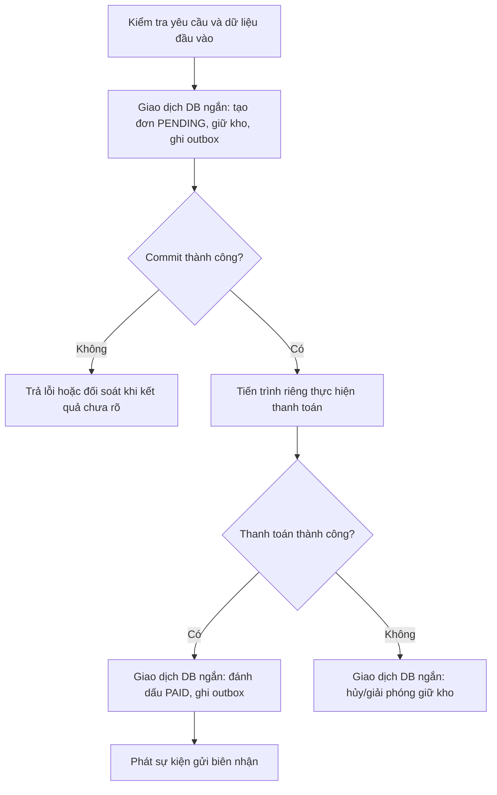

# Độ dài giao dịch và tài nguyên bị giữ

Một giao dịch cơ sở dữ liệu có thể chỉ thực hiện hai câu SQL, nhưng vẫn kéo dài hàng chục giây nếu ứng dụng chờ dịch vụ bên ngoài, chờ người dùng hoặc để kết nối ở trạng thái không làm gì. Trong khoảng thời gian đó, giao dịch có thể giữ khóa, giữ phiên làm việc và làm chậm các thao tác của người dùng khác. Vì vậy, **thời gian tồn tại của giao dịch** là một yếu tố thiết kế quan trọng của persistence, bên cạnh việc giao dịch có bảo đảm commit/rollback đúng hay không.

Bài này thuộc chủ đề **Giao dịch** trong module **DATA_PERSISTENCE_FUNDAMENTALS**. Mục tiêu là hiểu giao dịch giữ những tài nguyên nào, nhận diện giao dịch quá dài, và thiết kế ranh giới giao dịch ngắn, an toàn cho ứng dụng Java. Phân tích áp dụng cho hệ quản trị cơ sở dữ liệu quan hệ nói chung; các cơ chế khóa, MVCC và timeout cụ thể có thể khác nhau giữa PostgreSQL, MySQL/InnoDB, SQL Server và các hệ khác.

## 1. Độ dài giao dịch được tính như thế nào?

**Độ dài giao dịch** (*transaction duration* hoặc *transaction lifetime*) là khoảng thời gian giao dịch đang hoạt động, từ lúc bắt đầu đến khi hoàn tất bằng `COMMIT` hoặc `ROLLBACK`. Một số hệ quản trị chỉ bắt đầu tính hoặc cấp định danh giao dịch khi câu lệnh đầu tiên thực sự cần giao dịch được thực thi. Vì thế, khi đo cần nói rõ dùng mốc thời gian ở ứng dụng hay từ bộ giám sát của database.

Một giao dịch có thể dành thời gian cho:

1. Chạy SQL và chờ kết quả đọc/ghi.
2. Chờ lấy khóa do giao dịch khác đang giữ.
3. Chạy phép tính hoặc logic Java **giữa các câu SQL**.
4. Chờ HTTP, RPC, message broker, file hoặc một tài nguyên bên ngoài.
5. Không làm gì trong lúc ứng dụng chưa gửi lệnh tiếp theo: trạng thái thường gọi là *idle in transaction*.

Ví dụ hai lời gọi SQL chỉ mất 20 ms mỗi câu nhưng ứng dụng gọi một API mất 4 giây ở giữa:

```text
Bắt đầu transaction
  UPDATE inventory ...          20 ms
  Gọi API thanh toán         4.000 ms
  INSERT order ...              20 ms
COMMIT

Tổng thời gian transaction: khoảng 4.040 ms + chi phí khác
Tổng thời gian thực thi SQL: khoảng 40 ms
```

Tối ưu truy vấn từ 20 ms xuống 10 ms gần như không giải quyết được vấn đề chính. Ranh giới giao dịch mới là nguyên nhân khiến thời gian giữ tài nguyên dài.

### Ba khoảng thời gian dễ bị nhầm

| Khái niệm | Mốc bắt đầu và kết thúc | Ý nghĩa thực tế |
| --- | --- | --- |
| **Thời gian câu lệnh** (*statement/query time*) | Từ lúc gửi một lệnh SQL đến lúc lệnh hoàn thành hoặc thất bại | Bao gồm thực thi và có thể cả chờ khóa; tùy cách đo có thể bao gồm truyền kết quả |
| **Thời gian giao dịch** (*transaction age*) | Từ khi giao dịch bắt đầu đến `COMMIT`/`ROLLBACK` | Quyết định thời gian các tài nguyên gắn với giao dịch có thể tiếp tục bị giữ |
| **Thời gian giữ kết nối** (*connection checkout/hold time*) | Từ lúc lấy `Connection` từ pool đến lúc trả lại | Chiếm một suất kết nối trong pool, kể cả khi giao dịch đã kết thúc |

Ba khoảng này có thể chồng lên nhau nhưng **không đồng nhất**. Một ứng dụng có thể lấy kết nối sớm, làm việc không liên quan, mở giao dịch muộn, commit, rồi vẫn giữ kết nối một lúc trước khi đóng. Ngược lại, một hệ thống sử dụng transaction manager có thể gắn việc cấp kết nối vật lý với thời điểm truy cập database đầu tiên.

## 2. Giao dịch mở giữ những tài nguyên nào?

Không phải mọi hệ quản trị hoặc mọi câu SQL đều giữ đúng cùng một tài nguyên. Bảng sau cho thấy các nhóm chi phí thường gặp:

| Tài nguyên hoặc trạng thái | Khi nào có thể bị giữ | Tác động nếu giao dịch kéo dài |
| --- | --- | --- |
| **Kết nối/phiên database** | JDBC transaction thường cần một `Connection` trong suốt giao dịch | Các yêu cầu khác chờ connection pool; tăng nguy cơ timeout |
| **Khóa dữ liệu** (*row/table/key/range locks*) | Khi ghi, đọc có khóa hoặc chạy DDL; còn phụ thuộc hệ DB và isolation | Giao dịch khác phải chờ hoặc xung đột; thông lượng giảm |
| **Snapshot/phiên bản theo MVCC** | Khi transaction cần một snapshot theo cơ chế nhất quán của DB | Có thể trì hoãn việc dọn phiên bản cũ, tăng lưu trữ và công việc bảo trì |
| **Undo, trạng thái giao dịch, log và các cấu trúc nội bộ** | Khi thay đổi dữ liệu và theo cơ chế lưu trữ của DB | Phát sinh áp lực bộ nhớ, I/O, lưu trữ hoặc khôi phục |
| **Cursor, statement, result set** | Khi ứng dụng mở tài nguyên truy vấn mà chưa giải phóng | Có thể giữ bộ nhớ, tài nguyên phía server và kết nối lâu hơn cần thiết |
| **Luồng/tác vụ và ngữ cảnh ứng dụng** | Tùy cách JDBC, framework và pool quản lý | Thread chờ khóa hoặc I/O; tăng độ trễ và giảm khả năng phục vụ |

### 2.1. Khóa có thể tồn tại đến cuối giao dịch

Nhiều cơ sở dữ liệu giữ khóa ghi đối với bản ghi đã sửa cho đến khi giao dịch commit hoặc rollback. Hãy xem hai phiên làm việc:

```text
Thời điểm       Giao dịch A                 Giao dịch B
-------------------------------------------------------------------
T0              BEGIN
T1              UPDATE accounts id=7
T2              Chờ API bên ngoài...
T3                                          UPDATE accounts id=7
T4                                          ... phải chờ A
T5              COMMIT
T6                                          UPDATE tiếp tục
T7                                          COMMIT
```

Vấn đề không nằm ở việc câu `UPDATE` của A chậm. A đã ghi xong nhưng vẫn chưa commit, nên B có thể tiếp tục bị chặn. Thời gian chờ của B gần bằng **thời gian còn lại** của giao dịch A sau lúc B bắt đầu đợi.

Một số thao tác `SELECT` thông thường đọc qua MVCC, không giữ khóa dòng theo kiểu khóa ghi; các lệnh `SELECT ... FOR UPDATE`, cập nhật, DDL hoặc mức cô lập khác có thể tạo khóa riêng. Không nên kết luận rằng mọi lần đọc đều chặn mọi lần ghi, hoặc rằng mọi lần đọc đều không có chi phí giữ tài nguyên.

### 2.2. MVCC vẫn có chi phí khi không thấy khóa trực tiếp

**MVCC (Multiversion Concurrency Control)** cho phép các giao dịch đọc phiên bản dữ liệu phù hợp với trạng thái nhìn thấy của mình, giúp giảm nhiều xung đột đọc/ghi. Nhưng một giao dịch giữ snapshot cũ lâu có thể khiến hệ quản trị chưa thể dọn một số phiên bản cũ. Tùy hệ thống, hệ quả có thể là bảng/index phình to, vùng undo tăng, hoạt động vacuum/purge bị trì hoãn hoặc hiệu năng giảm dần.

Vì vậy, `SELECT` trong một giao dịch đọc lâu cũng đáng quan sát. Mức độ ảnh hưởng phụ thuộc isolation level, thời điểm snapshot được tạo và cơ chế cụ thể của database; không phải giao dịch nào cũng giữ cùng một snapshot từ đầu đến cuối.

### 2.3. Kết nối trong pool là tài nguyên hữu hạn

Giả sử pool có 20 kết nối. Nếu 20 yêu cầu cùng bắt đầu giao dịch rồi chờ một HTTP API trong 5 giây, một yêu cầu thứ 21 có thể không lấy được kết nối dù cơ sở dữ liệu gần như không thực hiện SQL nào. Tăng kích thước pool chỉ đẩy thêm kết nối và tải sang database; không thay thế việc sửa ranh giới giao dịch.

Việc đóng `Connection` trong JDBC có sử dụng pool thường có nghĩa **trả kết nối cho pool**, không nhất thiết đóng socket vật lý. Ứng dụng phải giải phóng kết nối đúng lúc và để pool/transaction manager quản lý trạng thái tái sử dụng.

## 3. Giao dịch dài gây tác hại gì?

### Giảm thông lượng vì cạnh tranh khóa

Khi hai giao dịch cần cập nhật cùng tài nguyên, giao dịch thứ hai có thể phải chờ giao dịch thứ nhất. Giữ khóa lâu làm thời gian chờ trung bình tăng; khi số yêu cầu đồng thời tăng, hàng đợi có thể phát triển nhanh. Một ít giao dịch dài trên các bản ghi được nhiều người truy cập có thể làm cả chức năng phản hồi chậm.

### Làm cạn pool và kéo dài thời gian chờ ứng dụng

Một request đang giữ connection nhưng không chạy SQL vẫn chiếm slot. Các request khác có thể chờ lấy kết nối, rồi hết thời gian chờ của pool trước cả khi thực hiện câu SQL đầu tiên. Tăng số thread xử lý request thường không giải quyết được nút thắt này.

### Tăng xác suất xung đột, deadlock và rollback tốn kém

Thời gian giao dịch tồn tại càng dài, cơ hội chồng lấn với giao dịch khác càng nhiều. Điều này làm tăng rủi ro chờ khóa, deadlock hoặc xung đột khi dùng optimistic concurrency. Nếu một giao dịch đã cập nhật rất nhiều dữ liệu rồi mới thất bại, công việc rollback/khôi phục trạng thái cũng có thể tốn tài nguyên đáng kể.

### Làm chậm dọn dữ liệu phiên bản cũ

Trong các hệ dùng MVCC/undo, giao dịch tồn tại lâu có thể làm tăng tuổi phiên bản cần giữ và cản trở một số hoạt động bảo trì. Ảnh hưởng không phải lúc nào cũng xuất hiện ngay khi gọi SQL; nó có thể bộc lộ thành bảng lớn dần và truy vấn chậm về sau.

### Làm thời gian phản hồi khó dự đoán

Một transaction đang chờ database, HTTP hoặc người dùng có thể vượt qua timeout ở nhiều tầng. Timeout không được phân loại rõ ràng còn dẫn đến retry thiếu kiểm soát, làm tải tăng thêm. Tình huống kết nối bị ngắt đúng lúc `COMMIT` cũng có thể khiến ứng dụng không xác định được giao dịch đã thành công hay chưa.

## 4. Nhận diện giao dịch dài trong mã nguồn Java

Ví dụ sau cho thấy một ranh giới giao dịch quá rộng:

```java
@Transactional
public void checkout(CheckoutRequest request) {
    var order = orderRepository.createPending(request);
    inventoryRepository.reserve(request.items());

    // API ngoài database: có thể chờ nhiều giây hoặc timeout.
    paymentGateway.charge(request.payment(), order.id());

    orderRepository.markPaid(order.id());
    emailClient.sendReceipt(order.id());
}
```

Khi phương thức này thực sự chạy bên trong một transaction của database, các truy cập dữ liệu ban đầu có thể giữ khóa và connection trong lúc `charge` và `sendReceipt` thực hiện I/O. Ngoài ra, nếu email đã gửi hoặc dịch vụ thanh toán đã thu tiền rồi một bước database bị rollback, giao dịch database không thể tự hoàn tác hai tác vụ bên ngoài.

Một thiết kế phù hợp hơn thường chia công việc thành các giai đoạn ngắn, mỗi giai đoạn có trạng thái nghiệp vụ rõ ràng:



Trong sơ đồ này, một **transactional outbox** có thể ghi sự kiện vào cùng giao dịch với trạng thái đơn. Worker khác chuyển sự kiện ra message broker sau commit và hệ thống nhận xử lý lặp an toàn. Nếu bước thanh toán đã thành công nhưng kết quả trả về bị thất lạc, cần tra cứu/đối soát trước khi thu tiền lại. Trạng thái trung gian và tác vụ bù phải dựa trên quy tắc nghiệp vụ thực tế.

Không có một khoảng thời gian tối đa áp dụng cho mọi giao dịch. Việc chấp nhận một transaction xử lý hàng loạt kéo dài vài phút khác với yêu cầu trực tuyến đang phục vụ người dùng trong vài trăm mili giây. Cần xác định mục tiêu theo từng nhóm tác vụ và đo thời gian thực tế.

## 5. Thiết kế ranh giới giao dịch ngắn nhưng vẫn đúng

### Đưa xử lý không cần transaction ra ngoài

Các bước kiểm tra định dạng, phân quyền không cần đọc DB, tạo dữ liệu cho câu lệnh, tính toán thuần Java và gọi dịch vụ bên ngoài nên được đặt **trước hoặc sau** transaction khi có thể. Chỉ mở giao dịch lúc sắp thực hiện các thao tác DB cần tính nguyên tử.

Kiểm tra trước giao dịch chỉ giúp sàng lọc đầu vào. Dữ liệu có thể thay đổi giữa lúc kiểm tra và lúc ghi, nên các bất biến quan trọng như “tồn kho không âm” phải được kiểm tra/khẳng định lại bên trong transaction, tốt nhất bằng câu SQL cập nhật có điều kiện hoặc ràng buộc DB.

### Kết thúc giao dịch ngay sau khi các bất biến được bảo vệ

Đặt các thay đổi cần cùng thành công trong một transaction; thực thi SQL và commit/rollback ngay sau đó. Tránh tính toán lâu, `sleep`, phát HTTP hoặc duyệt tập dữ liệu khổng lồ trong khi giao dịch đang mở. Nếu phải xử lý khối lượng lớn, cân nhắc chia lô, checkpoint và thiết kế có thể khôi phục; mỗi lô phải giữ đúng bất biến của nó.

### Truy cập dữ liệu theo thứ tự nhất quán

Khi nhiều giao dịch cùng sửa nhiều đối tượng, truy cập theo thứ tự ổn định, chẳng hạn theo ID tăng dần, có thể làm giảm cơ hội tạo chu kỳ chờ khóa. Điều này không loại trừ mọi deadlock, nên ứng dụng vẫn cần xử lý lỗi, rollback và retry có kiểm soát.

### Phân biệt tối ưu thời gian với bảo đảm nhất quán

Không nên tách một giao dịch thành hai chỉ để giảm số mili giây nếu việc đó cho phép trạng thái sai được commit ở giữa. Nếu nghiệp vụ phải đi qua nhiều trạng thái hoặc nhiều hệ thống, hãy mô hình hóa trạng thái trung gian có ý nghĩa, ràng buộc và cơ chế bù/đối soát. Một giao dịch ngắn nhưng sai ranh giới vẫn là thiết kế sai.

## 6. Ví dụ JDBC: giữ kho và tạo bản ghi trong một transaction ngắn

Giả sử cơ sở dữ liệu có hai bảng:

- `inventory(product_id, available)` với `available` không âm.
- `reservations(order_id, product_id, quantity)` với `order_id` có ràng buộc duy nhất theo mô hình đơn giản mỗi đơn chỉ giữ một sản phẩm.

Phần chuẩn bị request và mọi gọi API ngoài database đã được thực hiện ở nơi khác. Dịch vụ dưới đây chỉ làm hai thao tác DB cần cùng thành công:

```java
import java.sql.Connection;
import java.sql.PreparedStatement;
import java.sql.SQLException;
import javax.sql.DataSource;

public final class ReservationService {
    private final DataSource dataSource;

    public ReservationService(DataSource dataSource) {
        this.dataSource = dataSource;
    }

    public void reserve(long orderId, long productId, int quantity)
            throws SQLException {
        if (quantity <= 0) {
            throw new IllegalArgumentException("Số lượng phải lớn hơn 0");
        }

        try (Connection connection = dataSource.getConnection()) {
            connection.setAutoCommit(false);

            try {
                // Kiểm tra điều kiện và giảm tồn kho trong cùng một SQL.
                try (PreparedStatement update = connection.prepareStatement(
                        "UPDATE inventory SET available = available - ? " +
                        "WHERE product_id = ? AND available >= ?")) {
                    update.setInt(1, quantity);
                    update.setLong(2, productId);
                    update.setInt(3, quantity);
                    if (update.executeUpdate() != 1) {
                        throw new IllegalStateException(
                                "Sản phẩm không tồn tại hoặc không đủ hàng");
                    }
                }

                try (PreparedStatement insert = connection.prepareStatement(
                        "INSERT INTO reservations(order_id, product_id, quantity) " +
                        "VALUES (?, ?, ?)")) {
                    insert.setLong(1, orderId);
                    insert.setLong(2, productId);
                    insert.setInt(3, quantity);
                    insert.executeUpdate();
                }

                connection.commit();
            } catch (SQLException | RuntimeException failure) {
                try {
                    connection.rollback();
                } catch (SQLException rollbackFailure) {
                    failure.addSuppressed(rollbackFailure);
                }
                throw failure;
            }
        }
    }
}
```

Trong ví dụ này, `Connection` được lấy khi thực sự cần truy cập DB. Các thao tác SQL dùng cùng kết nối và transaction. Nếu ghi reservation thất bại, số lượng kho vừa trừ được rollback. Câu `UPDATE ... WHERE available >= ?` giúp tránh cách kiểm tra tồn kho bằng một lần đọc rồi ghi đè thiếu kiểm soát; ràng buộc ở database vẫn cần thiết.

Ví dụ giả định cơ sở dữ liệu có giao dịch, ràng buộc `order_id` phù hợp, và connection pool trả kết nối về trạng thái chuẩn khi tái sử dụng. Khi dùng JDBC trực tiếp ngoài pool/framework, phải quản lý lại `autoCommit` và vòng đời connection theo hợp đồng của hệ thống. Với lỗi kết nối xảy ra ngay lúc commit, không thể mặc định rằng giao dịch đã rollback; thiết kế thực tế nên dùng mã yêu cầu duy nhất và cơ chế tra cứu kết quả trước khi retry.

### Vì sao không chỉ đếm thời gian của SQL?

Đo hai khoảng thời gian độc lập sẽ hữu ích hơn:

```java
long checkoutStarted = System.nanoTime();
try (Connection connection = dataSource.getConnection()) {
    long connectionAcquired = System.nanoTime();
    // Bắt đầu transaction và thực hiện các câu SQL ...
    // Đo thêm mốc ngay trước COMMIT và sau khi COMMIT hoàn tất.
} finally {
    long end = System.nanoTime();
    // Ghi metrics: lấy connection, transaction, giữ connection.
}
```

Đây là phác thảo các mốc đo, không phải một phương thức hoàn chỉnh: chỉ số `checkoutStarted` đến `connectionAcquired` cho biết thời gian chờ lấy connection, còn thời gian giao dịch nên đo từ khi thực sự bắt đầu transaction đến commit/rollback. Theo dõi `Connection` cho đến khi đóng/trả về pool giúp phát hiện trường hợp giữ connection lâu sau khi giao dịch đã kết thúc.

## 7. Spring: đặt `@Transactional` ở lớp xử lý dữ liệu nghiệp vụ

Với Spring và transaction manager được cấu hình đúng, phương thức `@Transactional` thường thể hiện ranh giới giao dịch ở lớp service. Để tránh kéo dài transaction, tách bước gọi dịch vụ bên ngoài ra khỏi phương thức transaction:

```java
@Service
public class CheckoutService {
    private final ExternalCatalogClient catalog;
    private final ReservationTxService reservations;

    public CheckoutService(
            ExternalCatalogClient catalog,
            ReservationTxService reservations) {
        this.catalog = catalog;
        this.reservations = reservations;
    }

    public void startCheckout(long orderId, long productId, int quantity) {
        // I/O ngoài DB trước ranh giới giao dịch.
        catalog.validateProductForSale(productId);
        reservations.reserveAndRecord(orderId, productId, quantity);
    }
}

@Service
public class ReservationTxService {
    private final InventoryRepository inventory;
    private final ReservationRepository reservationRepository;

    public ReservationTxService(
            InventoryRepository inventory,
            ReservationRepository reservationRepository) {
        this.inventory = inventory;
        this.reservationRepository = reservationRepository;
    }

    @Transactional(timeout = 5)
    public void reserveAndRecord(long orderId, long productId, int quantity) {
        if (inventory.decrementIfAvailable(productId, quantity) != 1) {
            throw new IllegalStateException("Không đủ hàng");
        }
        reservationRepository.insert(orderId, productId, quantity);
    }
}
```

Đoạn mã minh họa giả định các repository dùng cùng transaction manager, truy vấn giảm tồn kho là một cập nhật có điều kiện và `orderId` được kiểm soát trùng lặp. Sau lời gọi `catalog.validateProductForSale`, dữ liệu vẫn có thể thay đổi; điều kiện tồn kho quan trọng được xác thực lại khi cập nhật bên trong transaction.

Các lưu ý với `@Transactional`:

- **Hiệu lực proxy:** với cấu hình Spring proxy phổ biến, gọi một phương thức `@Transactional` từ phương thức khác trên chính đối tượng đó có thể bỏ qua interceptor. Tách service như ví dụ giúp lời gọi đi qua transaction proxy.
- **Rollback mặc định:** thường áp dụng cho `RuntimeException` và `Error`; checked exception có thể cần `rollbackFor` hoặc cấu hình riêng.
- **Timeout:** `timeout = 5` nêu ý định giới hạn thời gian theo transaction manager, nhưng hiệu lực cụ thể phụ thuộc cơ chế và driver. Không nên cho rằng mọi lệnh chờ khóa hay mọi thao tác mạng đều bị hủy chính xác sau 5 giây.
- **Ranh giới mở sớm:** gắn `@Transactional` trên một phương thức controller hoặc service chứa gọi HTTP và tính toán dài có thể giữ giao dịch rộng hơn mức cần thiết.
- **Giao dịch con:** propagation, nested transaction và việc phân phối transaction giữa các datasource là chủ đề riêng. Annotation không tự biến nhiều hệ thống độc lập thành một giao dịch nguyên tử.

## 8. Timeout và giới hạn: dùng đúng loại

Các cấu hình timeout khác nhau giải quyết các vấn đề khác nhau:

| Cấu hình | Giới hạn điều gì? | Không nên hiểu nhầm |
| --- | --- | --- |
| **Connection acquisition timeout** của pool | Thời gian tối đa request chờ lấy kết nối từ pool | Không giới hạn tuổi của giao dịch đã mở |
| **Query/statement timeout** | Thời gian một câu SQL được phép thực thi/chờ, theo hệ DB hoặc driver | Không nhất thiết giới hạn tổng thời gian nhiều câu lệnh và khoảng chờ giữa chúng |
| **Lock wait timeout** | Thời gian chờ lấy khóa | Không tự giải phóng khóa của giao dịch giữ khóa quá lâu |
| **Transaction timeout** | Ngân sách thời gian ở tầng transaction manager/DB, tùy nền tảng | Không nhất thiết có ngữ nghĩa hoặc độ chính xác giống nhau giữa các hệ |
| **Idle-in-transaction timeout** | Thời gian phiên không hoạt động khi vẫn còn giao dịch mở, nếu DB hỗ trợ | Không thay thế timeout cho truy vấn đang chạy |
| **HTTP/client timeout** | Thời gian chờ dịch vụ mạng | Không tự rollback tác động đã thực hiện ở hệ thống bên ngoài |

Chẳng hạn PostgreSQL hỗ trợ các tham số `statement_timeout`, `lock_timeout` và `idle_in_transaction_session_timeout`. Khi cấu hình, cần kiểm tra phạm vi session/giao dịch, quyền hạn và phiên bản PostgreSQL. Một câu lệnh SQL bị timeout có thể đưa giao dịch vào trạng thái lỗi cần rollback; ứng dụng phải xử lý rõ ràng trước khi trả connection về pool.

Timeout là hàng rào bảo vệ, không phải lý do để giữ một transaction mở lâu. Trình tự tốt hơn là thiết kế transaction ngắn trước, sau đó áp các timeout và giới hạn phù hợp với yêu cầu vận hành.

## 9. Đo và phát hiện giao dịch dài trong vận hành

Nên thu thập ít nhất các chỉ số sau, kèm phân nhóm theo loại nghiệp vụ:

| Chỉ số | Dấu hiệu cần quan tâm |
| --- | --- |
| Transaction duration p50/p95/p99 và số transaction vượt ngưỡng | Đuôi độ trễ cao, một số giao dịch kéo dài bất thường |
| Số connection đang mượn, đang rảnh và đang chờ trong pool | Chờ pool tăng dù số câu SQL đang chạy thấp |
| Lock wait duration và số session đang chờ khóa | Tranh chấp trên bản ghi hoặc bảng nóng |
| Số phiên `idle in transaction` và tuổi giao dịch cao nhất | Ứng dụng mở transaction rồi đứng yên |
| Tốc độ tăng bảng/undo, hiệu quả vacuum/purge theo hệ DB | Có thể liên quan transaction/snapshot dài hạn |
| Số lần deadlock, timeout và retry | Hành vi cạnh tranh tài nguyên hoặc retry làm tình hình xấu hơn |

Nên dùng histogram cho duration thay vì chỉ ghi thời gian trung bình: một số giao dịch cực dài có thể bị che khuất bởi hàng nghìn giao dịch nhanh. Ngưỡng cảnh báo cần dựa trên SLO, đặc tính OLTP/batch và số liệu thực tế; không có quy tắc “mọi giao dịch trên 1 giây đều sai”.

### Ví dụ giám sát bằng PostgreSQL

Câu truy vấn chỉ đọc sau tìm các phiên có transaction đang hoạt động, sắp theo thời điểm bắt đầu giao dịch:

```sql
SELECT
    pid,
    state,
    now() - xact_start AS transaction_age,
    now() - query_start AS current_query_age,
    wait_event_type,
    wait_event
FROM pg_stat_activity
WHERE datname = current_database()
  AND xact_start IS NOT NULL
ORDER BY xact_start ASC;
```

Ý nghĩa một số trạng thái:

- `active`: phiên đang thực hiện một câu lệnh; có thể vẫn đang chờ khóa hoặc I/O.
- `idle in transaction`: transaction vẫn mở nhưng hiện không thực thi câu lệnh; cần kiểm tra vì tài nguyên có thể đang bị giữ.
- `wait_event_type = 'Lock'`: thường cho biết phiên đang chờ một loại khóa; cần điều tra cả phiên giữ khóa và loại truy cập liên quan.

`transaction_age` lấy từ `xact_start`; `current_query_age` lấy từ `query_start`, nên không nên lấy hai cột này thay thế nhau. Thông tin và quyền quan sát phiên khác có thể bị giới hạn theo cấu hình PostgreSQL. MySQL/InnoDB có thể kiểm tra `information_schema.innodb_trx` cùng các bảng `performance_schema` phù hợp; công cụ và ngữ nghĩa khác nhau giữa các hệ.

Khi thấy một transaction rất dài, hãy liên kết mã request/trace ở ứng dụng với session DB, loại SQL và khoảng thời gian chờ. Tránh ghi dữ liệu nhạy cảm trong log hoặc phát tán nguyên văn câu SQL chứa tham số. Điều tra xem thời gian bị tiêu tốn ở **SQL**, **chờ khóa**, **chờ lấy connection**, hay **Java/HTTP nằm giữa các câu SQL** trước khi chọn giải pháp.

## 10. Những sai lầm thường gặp

| Cách làm | Vì sao có vấn đề | Hướng xử lý |
| --- | --- | --- |
| Mở transaction ngay khi nhận HTTP request | Toàn bộ bước xác thực, tính toán hoặc gọi API có thể kéo dài transaction | Mở transaction gần thao tác DB đầu tiên cần tính nguyên tử |
| Tối ưu từng `SELECT` nhưng bỏ qua thời gian idle | Query nhanh không có nghĩa transaction kết thúc nhanh | Đo tuổi giao dịch, lock wait và connection hold time |
| Tăng connection pool mỗi khi có timeout | Có thể đẩy nghẽn sang database, không sửa tài nguyên bị giữ lâu | Tìm transaction dài và hoạt động không cần giữ connection |
| Tách hai cập nhật phụ thuộc thành hai commit để “nhanh hơn” | Trạng thái nghiệp vụ có thể bị commit dở dang | Giữ một transaction ngắn cho nhóm cập nhật nguyên tử |
| Duyệt hàng triệu bản ghi trong một transaction online | Giữ snapshot, log, khóa và connection lâu | Chia lô có checkpoint, quy tắc idempotency và khả năng khôi phục |
| Coi `@Transactional(timeout=...)` là giải pháp duy nhất | Timeout không thay thế thiết kế ranh giới và kiểm soát lỗi | Tối ưu phạm vi giao dịch; cấu hình timeout ở tầng phù hợp |
| Cho rằng `COMMIT` lỗi nghĩa là chưa ghi | Kết quả commit có thể chưa rõ khi mất kết nối | Dùng idempotency key, tra cứu và đối soát trước retry |
| Giải phóng connection chỉ khi GC chạy | Connection pool có thể cạn | Dùng `try-with-resources` hoặc cơ chế quản lý transaction của framework |

## 11. Cách kiểm thử ảnh hưởng của giao dịch dài

Một bài kiểm thử tích hợp hữu ích có hai hoặc nhiều kết nối thật đến database test:

1. Giao dịch A cập nhật một bản ghi, **chưa commit**.
2. Giao dịch B cố cập nhật cùng bản ghi và ghi nhận thời gian chờ hoặc kết quả timeout.
3. Commit/rollback A rồi xác minh B tiếp tục hay thất bại theo quy tắc của DB.
4. Lặp lại với phiên bản mã A commit ngay sau SQL, chuyển các xử lý ngoài DB ra khỏi transaction.
5. So sánh lock wait, thời gian giữ connection và độ trễ của B.

Cũng nên tạo lỗi có kiểm soát ở bước ghi thứ hai để xác minh rollback bảo vệ bất biến nghiệp vụ. Kiểm thử bằng mock repository không chứng minh được hành vi khóa, MVCC, timeout hoặc rollback thật. Thời gian chờ có thể không ổn định trên CI; nên kiểm tra điều kiện quan sát được và cấu hình timeout thử nghiệm rõ ràng thay vì dựa vào số mili giây cứng.

### Tình huống tự đánh giá

Một dịch vụ Java thực hiện quy trình:

```text
Lấy Connection từ pool
Bắt đầu transaction
UPDATE products SET stock = stock - 1 WHERE id = 42
Gọi HTTP sang hệ thống vận chuyển (mất 3 giây)
INSERT INTO orders(...)
COMMIT
Trả Connection về pool
```

Hãy tự trả lời:

1. Phần nào có khả năng giữ khóa bản ghi `products` lâu nhất?
2. Nếu pool có ít kết nối và nhiều người mua cùng lúc, triệu chứng nào có thể xuất hiện?
3. Có thể chuyển bước nào ra ngoài giao dịch? Khi chuyển, bất biến nghiệp vụ nào vẫn phải bảo vệ?
4. Nếu gọi API vận chuyển thành công nhưng bước `INSERT` thất bại, `ROLLBACK` có hoàn tác tác vụ ở dịch vụ vận chuyển không?

**Gợi ý:** 3 giây chờ HTTP nằm giữa hai câu SQL làm transaction của ứng dụng kéo dài và có thể giữ khóa của câu `UPDATE` cho đến commit. Nhiều transaction tương tự sẽ chiếm connection và làm các cập nhật khác chờ. Thường nên ghi đơn cùng thay đổi tồn kho trong một transaction ngắn, rồi điều phối vận chuyển sau commit qua outbox hoặc một trạng thái nghiệp vụ có thể xử lý lại. Việc vận chuyển đã tạo thành công cần một cơ chế hủy/bù hoặc đối soát riêng, vì rollback database không ảnh hưởng đến hệ thống khác.

## 12. Ghi nhớ khi thiết kế persistence cho Java

- **Xác định nhóm thay đổi phải cùng commit** theo bất biến nghiệp vụ, rồi mở giao dịch sát lúc cần ghi dữ liệu.
- **Đo riêng** thời gian câu SQL, tuổi giao dịch, thời gian chờ khóa và thời gian giữ connection.
- **Giữ giao dịch ngắn**, giải phóng tài nguyên sớm; tránh chờ HTTP, người dùng hoặc các tác vụ dài giữa `BEGIN` và `COMMIT`.
- **Bảo vệ tính đúng đắn** bằng cập nhật có điều kiện, ràng buộc DB, isolation/concurrency control phù hợp và rollback khi lỗi.
- **Tách công việc nhiều hệ thống** qua trạng thái trung gian, outbox, saga/tác vụ bù và idempotency khi cần.
- **Quan sát trong vận hành** bằng transaction age, `idle in transaction`, lock wait và số connection đang bận; đặt timeout phù hợp với từng tầng.

Giao dịch càng dài không tự động càng an toàn: nó có thể giữ nhiều tài nguyên và làm tăng tranh chấp trong khi không bổ sung được bảo đảm nào cho các tác vụ ngoài cơ sở dữ liệu. Ranh giới hiệu quả là **đủ rộng để dữ liệu luôn hợp lệ khi commit, và đủ ngắn để tài nguyên được trả lại nhanh**.
