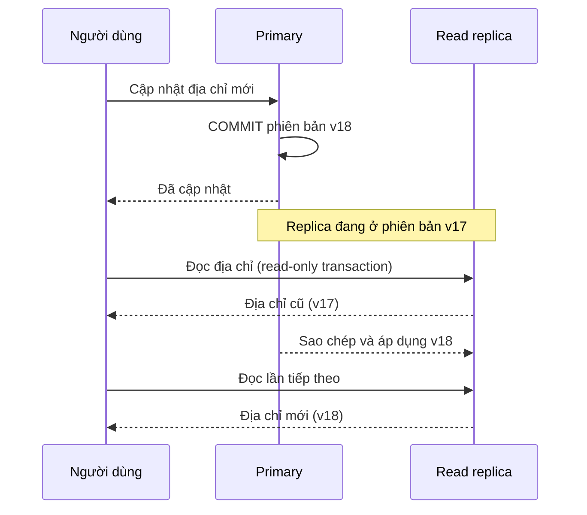

# Phân biệt giao dịch chỉ đọc với các bảo đảm thực tế của hệ lưu trữ

## 1. Vấn đề: chỉ đọc có đồng nghĩa với dữ liệu luôn đúng và mới?

Một API Java dùng giao dịch chỉ đọc để lấy số dư, báo cáo, danh sách đơn hàng hoặc thông tin người dùng. Lập trình viên có thể đánh dấu `readOnly = true` và kỳ vọng ba điều:

1. Giao dịch không được phép thay đổi dữ liệu.
2. Nhiều câu truy vấn bên trong giao dịch sẽ quan sát cùng một trạng thái.
3. Kết quả trả về luôn là bản mới nhất vừa được ghi.

Ba điều này là **ba loại bảo đảm khác nhau**. Tùy driver, transaction manager, DBMS, mức cô lập, cách triển khai bản sao và cấu hình kết nối, **không điều nào tự động suy ra từ hai điều còn lại**.

Bài học thuộc chương **Giao dịch** của **DATA_PERSISTENCE_FUNDAMENTALS**. Trong phạm vi thiết kế persistence cho Java, ta cần phân biệt *ý định chỉ đọc của ứng dụng* với những bảo đảm thật sự mà hệ lưu trữ cung cấp về giới hạn thao tác, ảnh chụp dữ liệu, độ mới, đồng thời, khả dụng và độ bền.

## 2. Giao dịch chỉ đọc thực chất là gì?

**Giao dịch chỉ đọc** (*read-only transaction*) là một transaction được khai báo hoặc sử dụng với mục đích đọc dữ liệu mà không thực hiện thay đổi trạng thái dữ liệu nghiệp vụ trong phạm vi được quy định.

Về mặt giao thức, nó vẫn là **giao dịch**: có điểm bắt đầu, ranh giới quan sát, thời điểm kết thúc bằng commit/rollback và có thể giữ tài nguyên trong quá trình chạy. Việc không có `INSERT`, `UPDATE` hay `DELETE` do ứng dụng phát ra **không đồng nghĩa** với việc DB đã áp đặt cấm ghi ở mọi đường truy cập.

Có ít nhất bốn cách dùng cụm từ “chỉ đọc”:

| Cách dùng | Nó thật sự nói lên điều gì? | Điều chưa được bảo đảm |
| --- | --- | --- |
| Hàm chỉ thực hiện `SELECT` | Theo thiết kế, đoạn mã không chủ động gọi lệnh DML ghi | DB không tự cấm hàm SQL, trigger hay đường gọi khác có tác dụng phụ |
| JDBC `Connection.setReadOnly(true)` | Ứng dụng thông báo cho driver/DB rằng kết nối dự kiến dùng để đọc | Đây không phải cơ chế bảo mật hoặc xác nhận phổ quát rằng mọi thao tác ghi bị chặn |
| Lệnh SQL `BEGIN ... READ ONLY` hoặc `SET TRANSACTION READ ONLY` | Yêu cầu DBMS áp đặt quy tắc read-only theo ngữ nghĩa của chính DBMS | Không đồng nghĩa snapshot ổn định, đọc dữ liệu mới nhất hoặc tự tạo quyền hạn |
| Kết nối tới read replica | Đọc từ một nút thường không được sử dụng làm nơi ghi trực tiếp | Replica có thể chậm so với nguồn dữ liệu chính; chính sách failover cũng cần xem xét |

**Phân biệt hai ranh giới:** (a) *ý định ứng dụng* tại service/repository và (b) *thực thi tại storage*. Khi một yêu cầu thật sự cần bảo đảm không ghi, cần kiểm tra DBMS có hỗ trợ chế độ read-only bắt buộc hay không, và cấu hình quyền tài khoản DB theo nguyên tắc tối thiểu. `setReadOnly(true)` tự nó không thay thế quyền truy cập.

Đối với lệnh SQL, chi tiết còn tùy hệ quản trị: có hệ cho phép một số thao tác liên quan bảng tạm, có hệ phân loại việc gọi hàm, DDL hoặc khóa khác nhau. Không nên suy ra một quy tắc chung cho mọi database chỉ từ từ khóa `READ ONLY`.

## 3. Tách các bảo đảm cần hỏi

Một read-only transaction có thể được đánh giá theo các chiều sau:

| Bảo đảm | Câu hỏi phải trả lời | Nguồn quyết định chính |
| --- | --- | --- |
| **Cấm ghi** (*write prohibition*) | DB có từ chối thay đổi dữ liệu được bảo vệ không? | Quyền DB, chế độ transaction, cơ chế thực thi SQL |
| **Cô lập** (*isolation*) | Transaction có thể thấy thay đổi đồng thời theo cách nào? | Isolation level và ngữ nghĩa cụ thể của DBMS |
| **Ảnh chụp nhất quán** (*consistent snapshot*) | Hai truy vấn có cùng quan sát một phiên bản logic của dữ liệu không? | MVCC, snapshot transaction và cách truy vấn |
| **Độ mới** (*freshness*) | Kết quả có bao gồm bản ghi đã commit tại nguồn hay chưa? | Vị trí đọc, replication lag, quy tắc đồng bộ |
| **Đọc thấy ghi của chính mình** (*read-your-writes*) | Sau khi người dùng ghi thành công, lần đọc kế tiếp có thấy thay đổi đó không? | Định tuyến phiên, phiên bản commit, primary/replica |
| **Thứ tự thời gian thực** (*linearizability*) | Một lần đọc bắt đầu sau khi ghi đã hoàn tất có phản ánh ghi đó theo ràng buộc đã công bố không? | Giao thức đọc/ghi và cơ chế phối hợp của hệ lưu trữ |
| **Độ bền** (*durability*) | Dữ liệu đã xác nhận ghi có được giữ theo cam kết khi lỗi xảy ra không? | Nhật ký ghi, đồng bộ, sao lưu và chính sách failover |

Ví dụ: một transaction có thể **không ghi**, có **snapshot ổn định**, nhưng snapshot được đọc từ replica đang chậm hai giây. Nó nhất quán *nội bộ* nhưng chưa đáp ứng yêu cầu *độ mới*. Ngược lại, transaction đọc tại primary có thể thấy các dữ liệu mới commit giữa hai lệnh `SELECT` nếu isolation level cho phép, dù bản thân nó hoàn toàn không ghi gì.

Trong ACID, **Atomicity** và **Durability** thường được thảo luận cho thao tác ghi; một giao dịch chỉ đọc vẫn chịu tác động của **Isolation**. Chữ **Consistency** trong ACID nói về việc duy trì ràng buộc dữ liệu ở các trạng thái đã cam kết, chứ không có nghĩa “mọi kết quả đọc đều mới nhất” hoặc “mọi replica đều đồng bộ tức thì”.

## 4. Hai câu SELECT trong một giao dịch chỉ đọc vẫn có thể không khớp

Giả sử hệ thống có bảng tài khoản, với tổng số dư của hai tài khoản luôn là 200 đơn vị. Một transaction chuyển 50 đơn vị từ tài khoản A sang B thực hiện cả hai cập nhật và commit nguyên tử:

| Thời điểm | A | B | Tổng |
| --- | ---: | ---: | ---: |
| Trước chuyển tiền | 100 | 100 | 200 |
| Sau chuyển tiền | 50 | 150 | 200 |

Transaction đọc báo cáo chạy hai truy vấn riêng. Trong một DBMS có MVCC ở mức **READ COMMITTED** với snapshot theo từng câu lệnh (ví dụ PostgreSQL), lịch thực thi có thể như sau:

```mermaid
sequenceDiagram
    participant R as Giao dịch đọc
    participant DB as Database
    participant W as Giao dịch chuyển tiền
    R->>DB: BEGIN READ ONLY, READ COMMITTED
    R->>DB: SELECT balance WHERE id = 'A'
    DB-->>R: A = 100
    W->>DB: BEGIN
    W->>DB: UPDATE A = 50; UPDATE B = 150
    W->>DB: COMMIT
    R->>DB: SELECT balance WHERE id = 'B'
    DB-->>R: B = 150
    Note over R: Cộng hai kết quả = 250 (ảo)
    R->>DB: COMMIT
```

Không thời điểm đã commit nào có tổng 250. Từng `SELECT` đều lấy dữ liệu hợp lệ theo snapshot của *câu lệnh đó*, nhưng kết hợp hai câu lệnh tại hai thời điểm lại sinh ra một báo cáo không tương ứng với một trạng thái chung.

**Nguyên nhân là mức cô lập và phạm vi snapshot**, không phải transaction đã ghi hay không ghi. Với yêu cầu một báo cáo nhất quán, có thể:

- Dùng một câu truy vấn tổng hợp `SELECT SUM(balance) FROM accounts WHERE ...` để các giá trị được tính trong **cùng câu lệnh** khi DBMS hỗ trợ snapshot nhất quán theo câu lệnh.
- Dùng transaction có **snapshot chung** cho nhiều truy vấn, chẳng hạn `REPEATABLE READ` trong PostgreSQL. Phải xác minh ngữ nghĩa cụ thể của DBMS, vì cùng tên isolation level không có hành vi hoàn toàn giống nhau ở mọi hệ.
- Dùng mức cô lập **SERIALIZABLE** khi cần chứng minh kết quả tương đương một thứ tự giao dịch tuần tự và xử lý xung đột/retry theo quy định của DBMS.

Không nên kết luận “`REPEATABLE READ` ở mọi nơi bảo đảm toàn bộ các truy vấn có cùng snapshot” hoặc “`SERIALIZABLE` luôn trả về trạng thái mới nhất tại thời điểm phản hồi”. Hai kết luận đó vượt quá bảo đảm chung nếu không biết DBMS và giao thức đọc.

## 5. Snapshot, isolation level và các loại nhất quán

### READ COMMITTED

Mức cô lập này ngăn đọc dữ liệu chưa commit theo định nghĩa của chuẩn. Tuy nhiên **non-repeatable read** và **phantom** có thể xảy ra tùy hệ thống. Ở PostgreSQL, mỗi câu lệnh `SELECT` thông thường thấy snapshot các transaction đã commit khi câu lệnh bắt đầu; do đó hai `SELECT` trong cùng transaction có thể thấy hai phiên bản khác nhau.

### REPEATABLE READ và snapshot isolation

Trong các hệ sử dụng MVCC, một transaction có thể đọc trên một snapshot cố định, giúp các câu truy vấn nhất quán theo cùng mốc dữ liệu. Với PostgreSQL, `REPEATABLE READ` dùng snapshot ổn định cho các truy vấn trong transaction. Tuy nhiên ở các DBMS khác, ngữ nghĩa của `REPEATABLE READ`, truy vấn đọc khóa và nhất quán của snapshot cần được xác minh theo engine.

Một snapshot nhất quán **không đòi hỏi** đó phải là trạng thái mới nhất. Một báo cáo bắt đầu trước khi có lệnh ghi mới có thể tiếp tục thấy dữ liệu trước ghi cho tới khi kết thúc, và điều đó hoàn toàn đúng với snapshot đã chọn.

### SERIALIZABLE

**Serializability** là bảo đảm kết quả các transaction có thể được giải thích như thể chúng chạy theo một thứ tự tuần tự nào đó. Nó mạnh hơn việc chỉ giữ cố định một snapshot khi có các transaction ghi cạnh tranh, nhưng thường kéo theo yêu cầu xử lý lỗi serialization và thử lại cả transaction.

**Strict serializability** bổ sung điều kiện tôn trọng thứ tự thời gian thực giữa các transaction đã kết thúc và transaction bắt đầu sau. Vì vậy một lịch có thể serializable mà chưa thỏa ràng buộc thời gian thực cần thiết cho một API “đọc ngay giá trị vừa xác nhận”.

### Một giao dịch chỉ đọc cũng có thể cần cô lập mạnh

Đọc chỉ để **hiển thị tham khảo** có thể chấp nhận dữ liệu trễ hoặc một snapshot cũ. Ngược lại, đọc để lập **báo cáo đối soát**, kiểm tra quan hệ giữa nhiều bảng, tạo bằng chứng kiểm toán hoặc ra quyết định có ràng buộc có thể đòi hỏi snapshot giao dịch hoặc serializability.

Dù vậy, **chỉ kiểm tra điều kiện bằng transaction đọc rồi kết thúc trước khi ghi không bảo vệ được bất biến nghiệp vụ**. Nếu hai yêu cầu cùng đọc “còn một ghế” và sau đó ghi ở hai transaction khác nhau, cả hai đều có thể tin rằng được phép đặt. Muốn tránh tranh chấp, điểm **kiểm tra và ghi** phải được thiết kế nguyên tử, thông qua constraint, cập nhật có điều kiện, khóa hoặc transaction đủ cô lập trên nguồn có thẩm quyền.

## 6. Minh họa SQL: thay đổi chế độ đọc chưa thay đổi toàn bộ bảo đảm

Các ví dụ sau sử dụng **PostgreSQL** để minh họa rõ cú pháp và ý nghĩa. Đây không phải SQL có thể sao chép nguyên vẹn sang mọi hệ quản trị.

**Chỉ đọc, READ COMMITTED:**

```sql
BEGIN TRANSACTION ISOLATION LEVEL READ COMMITTED READ ONLY;

SELECT balance FROM accounts WHERE id = 'A';
SELECT balance FROM accounts WHERE id = 'B';

COMMIT;
```

Database hạn chế thay đổi dữ liệu theo chế độ `READ ONLY` của PostgreSQL. Nhưng hai câu `SELECT` vẫn có thể quan sát các snapshot khác nhau khi transaction khác commit ở giữa.

**Chỉ đọc, snapshot ổn định trong PostgreSQL:**

```sql
BEGIN TRANSACTION ISOLATION LEVEL REPEATABLE READ READ ONLY;

SELECT balance FROM accounts WHERE id = 'A';
SELECT balance FROM accounts WHERE id = 'B';

COMMIT;
```

Trong trường hợp này các phép đọc thông thường cùng thuộc một snapshot giao dịch, nên không bị lỗi ghép số dư từ hai thời điểm như ở ví dụ trước. Snapshot vẫn có thể cũ hơn các ghi vừa hoàn tất sau khi snapshot hình thành.

**Báo cáo dài cần bảo đảm serializable trong PostgreSQL:**

```sql
BEGIN TRANSACTION ISOLATION LEVEL SERIALIZABLE READ ONLY DEFERRABLE;

SELECT region, SUM(amount)
FROM ledger_entries
GROUP BY region;

COMMIT;
```

Trong PostgreSQL, tổ hợp `SERIALIZABLE READ ONLY DEFERRABLE` cho phép transaction đọc đợi tới khi có một snapshot an toàn trước khi thực thi. Điều này hữu ích cho một số báo cáo chỉ đọc dài vì giảm rủi ro phải chạy lại do xung đột serialization; đổi lại lần bắt đầu đọc có thể phải chờ. `DEFERRABLE` có ý nghĩa riêng trong tổ hợp hỗ trợ đó, không phải một tùy chọn độc lập bảo đảm tính đúng đắn cho mọi chế độ.

## 7. JDBC: đặt ý định read-only và ranh giới transaction đúng chỗ

Trong Java, `Connection.setReadOnly(true)` thường được gọi trước khi bắt đầu transaction. Theo hợp đồng JDBC, đây là **gợi ý** để driver và DB tối ưu hóa việc truy cập khi kết nối ở chế độ read-only; nó **không được dùng như một hàng rào phân quyền**. Một số driver/DBMS thực thi mạnh hơn, nhưng mã ứng dụng không thể suy ra điều đó nếu chưa kiểm tra.

Ví dụ đọc hai số dư bằng một kết nối và một transaction:

```java
import java.math.BigDecimal;
import java.sql.Connection;
import java.sql.PreparedStatement;
import java.sql.ResultSet;
import java.sql.SQLException;
import javax.sql.DataSource;

public final class BalanceReportRepository {
    private final DataSource dataSource;

    public BalanceReportRepository(DataSource dataSource) {
        this.dataSource = dataSource;
    }

    public record Balances(BigDecimal accountA, BigDecimal accountB) {
        public BigDecimal total() {
            return accountA.add(accountB);
        }
    }

    public Balances loadConsistentBalances() throws SQLException {
        try (Connection connection = dataSource.getConnection()) {
            // Cấu hình trước khi bắt đầu giao dịch.
            connection.setReadOnly(true);
            connection.setTransactionIsolation(
                    Connection.TRANSACTION_REPEATABLE_READ);
            connection.setAutoCommit(false);

            try {
                BigDecimal a = getBalance(connection, "A");
                BigDecimal b = getBalance(connection, "B");
                connection.commit();
                return new Balances(a, b);
            } catch (SQLException | RuntimeException failure) {
                try {
                    connection.rollback();
                } catch (SQLException rollbackFailure) {
                    failure.addSuppressed(rollbackFailure);
                }
                throw failure;
            }
        }
    }

    private static BigDecimal getBalance(Connection connection, String id)
            throws SQLException {
        try (PreparedStatement statement = connection.prepareStatement(
                "SELECT balance FROM accounts WHERE id = ?")) {
            statement.setString(1, id);
            try (ResultSet rows = statement.executeQuery()) {
                if (!rows.next()) {
                    throw new SQLException("Account not found: " + id);
                }
                return rows.getBigDecimal(1);
            }
        }
    }
}
```

Ví dụ có các giả định cần được kiểm chứng trong môi trường thực:

1. Driver hỗ trợ `TRANSACTION_REPEATABLE_READ` và DBMS thực thi kiểu đọc phù hợp. Nếu không hỗ trợ, việc yêu cầu mức cô lập có thể thất bại hoặc có hành vi khác với mong đợi.
2. **Cả hai truy vấn phải dùng cùng một connection và một transaction.** Gọi hai repository dùng các connection độc lập không tự tạo một snapshot chung.
3. `dataSource` trỏ đến nguồn dữ liệu đáp ứng yêu cầu về độ mới. Dùng `REPEATABLE READ` trên replica đang chậm chỉ giữ ổn định **trạng thái cũ của replica**.
4. Việc sử dụng pool cần kiểm tra cách trả kết nối về cấu hình ban đầu (read-only, isolation, autocommit). Ví dụ dựa vào việc đóng kết nối được pool xử lý đúng; không được mặc định mọi pool đều có cùng chính sách reset.
5. Nếu truy vấn dài, cấu hình timeout thích hợp. Transaction đang mở có thể giữ snapshot, bộ nhớ, lock hoặc cản trở dọn phiên bản cũ ở DBMS dùng MVCC.

Lưu ý: `connection.commit()` là cách kết thúc transaction ngay cả khi chỉ đọc; nó không có nghĩa transaction đã ghi dữ liệu. Nếu cần DBMS **từ chối lệnh ghi**, hãy cấu hình thêm chế độ transaction và quyền DB phù hợp, không chỉ gọi `setReadOnly(true)`.

### Với Spring Framework

Mã thường gặp:

```java
@Transactional(
    readOnly = true,
    isolation = Isolation.REPEATABLE_READ
)
public BalanceReport loadReport() {
    return reportRepository.loadReport();
}
```

`@Transactional(readOnly = true)` diễn đạt ý định và có thể được transaction manager hoặc ORM sử dụng để tối ưu hóa, ví dụ điều chỉnh cách flush. **Nó không tự chứng minh rằng mọi câu ghi sẽ bị DB từ chối**, và cũng không tự tạo bảo đảm đọc mới nhất hoặc chuyển kết nối sang replica. Hiệu lực còn tùy cấu hình transaction manager, ORM, driver và cơ sở dữ liệu.

Với transaction do Spring quản lý, các thao tác repository phải thực sự tham gia vào transaction được quản lý đó. Gọi phương thức nội bộ không đi qua cơ chế proxy trong một số cấu hình Spring có thể khiến annotation không có hiệu lực mong đợi. Nếu cần cô lập mạnh, hãy kiểm tra SQL/transaction thực tế và thử nghiệm đồng thời trên chính DBMS mục tiêu.

## 8. Read-only transaction trên replica có thể đọc dữ liệu cũ

Giả sử một người dùng đổi địa chỉ giao hàng; ứng dụng ghi vào primary và đã nhận phản hồi commit thành công. Sau đó trang xác nhận đọc từ replica:



Giao dịch đọc ở replica có thể hoàn toàn tuân thủ `READ ONLY` và trả về snapshot nhất quán của **phiên bản v17**. Nhưng trải nghiệm “đọc thấy ghi của chính mình” (*read-your-writes*) bị vi phạm trong lần đọc đầu. Từ `readOnly = true` không thể suy ra chính sách đồng bộ giữa các node.

Một số lựa chọn theo yêu cầu sản phẩm:

- **Đọc từ primary** ngay sau ghi đối với màn hình cần xác nhận kết quả, với điều kiện đường đọc primary đáp ứng bảo đảm cần thiết.
- **Mang theo token phiên bản hoặc vị trí commit**; chỉ phục vụ từ replica sau khi nó áp dụng ít nhất phiên bản đó, nếu hệ lưu trữ hỗ trợ. Cần xác định timeout và fallback khi bản sao chưa bắt kịp.
- **Chấp nhận stale read** cho danh mục, thống kê hoặc nội dung có thể trễ; nêu thời điểm cập nhật cuối và theo dõi replication lag.
- **Session consistency** cho người dùng di chuyển giữa các replica, để lần đọc sau không quay ngược về phiên bản cũ hơn đã quan sát.

Không nên mặc định “đọc từ primary” hay “quorum read” đồng nghĩa với linearizability ở mọi sản phẩm. Phải kiểm tra cam kết và cấu hình của công nghệ cụ thể, kể cả trường hợp chuyển primary sau lỗi.

### Snapshot consistency không bằng freshness

Để làm rõ, xét ba trường hợp:

| Tình huống | Có thể cùng snapshot? | Có thể mới nhất? | Đánh giá |
| --- | --- | --- | --- |
| Hai `SELECT` trên primary ở READ COMMITTED | Không chắc: có thể khác snapshot theo câu lệnh | Mỗi lệnh có thể thấy các commit trước thời điểm lệnh bắt đầu | Phù hợp một số đọc đơn giản, không đủ để ghép báo cáo đa câu lệnh |
| Một transaction REPEATABLE READ trên primary | Có, theo DBMS hỗ trợ snapshot transaction | Không nhất thiết: snapshot có thể hình thành trước ghi mới | Phù hợp báo cáo cần trạng thái chung, phải chú ý tuổi snapshot |
| Một transaction REPEATABLE READ trên replica chậm | Có thể có snapshot nội bộ ổn định | Có thể thiếu ghi đã commit ở primary | Phù hợp khi chấp nhận độ trễ, không đủ cho read-your-writes nếu thiếu cơ chế bổ sung |

## 9. Chỉ đọc không đồng nghĩa với miễn phí, không khóa hoặc luôn an toàn

- **Tài nguyên:** một transaction chỉ đọc dài có thể giữ snapshot cũ, khiến DBMS trì hoãn dọn dẹp phiên bản dữ liệu, tăng áp lực storage hoặc ảnh hưởng vacuum. Với engine dùng khóa, truy vấn đọc có thể giữ khóa chia sẻ hoặc khóa phạm vi; mức độ tùy DBMS và lệnh SQL.
- **Hiệu năng:** `readOnly` không tự làm truy vấn nhanh. Hiệu năng phụ thuộc chỉ mục, kế hoạch thực thi, lượng dữ liệu quét, kết nối, I/O, cache và tải hệ thống. Một query đọc có thể gây quá tải dù không ghi.
- **Bảo mật:** đánh dấu service là read-only không thay thế quyền `SELECT` tối thiểu, phân tách tài khoản, hạn chế truy cập bảng nhạy cảm, RLS khi cần hoặc tham số hóa câu truy vấn.
- **Tác dụng phụ:** phương thức Java mang annotation read-only vẫn có thể gọi HTTP API, gửi sự kiện hoặc thay đổi cache bên ngoài DB. Transaction DB không tự rollback các tác động đó.
- **Lỗi và khả dụng:** replica có thể gián đoạn, query bị hủy, timeout hoặc failover. Retry một lần đọc thường dễ hơn retry một lần ghi, nhưng vẫn cần chú ý tính nhất quán giữa lần đọc và hành động phụ thuộc vào kết quả đó.
- **Độ bền:** transaction chỉ đọc không chứng minh một commit trước đó đã được sao chép bền vững qua mọi node. Độ bền của dữ liệu ghi, RPO và chính sách failover là những cam kết riêng.

Một trường hợp quan trọng: đọc hạn mức, sau đó trả lời “có thể thanh toán” chỉ là thông tin tại thời điểm đọc. Nếu hệ thống muốn **giữ hạn mức**, cần thực hiện quyết định và ghi nhận đặt giữ trong một transaction có kiểm soát cạnh tranh. Chuyển `readOnly` sang `false` ở service **chưa đủ** nếu vẫn kiểm tra rồi ghi thành hai bước không nguyên tử.

## 10. Chọn bảo đảm theo mục tiêu nghiệp vụ

| Nhu cầu | Có nên dùng read-only transaction? | Bảo đảm và kỹ thuật cần xem thêm |
| --- | --- | --- |
| Xem danh mục sản phẩm | Có; thường một hoặc vài truy vấn độc lập | Chấp nhận độ trễ, cache/replica lag, giới hạn tài nguyên |
| Trang chi tiết đơn vừa đặt | Có khi chỉ đọc, nhưng chọn nguồn dữ liệu cẩn thận | Read-your-writes, định tuyến primary hoặc chờ replica bắt kịp |
| Báo cáo đối soát nhiều truy vấn | Có | Snapshot chung, transaction ngắn nhất có thể, đôi khi serializable |
| Lấy dữ liệu để cập nhật số dư hoặc giữ chỗ | Chỉ đọc không đủ để quyết định và cam kết thay đổi | Constraint, cập nhật có điều kiện, khóa hoặc transaction ghi đủ cô lập |
| Báo cáo từ bản sao tại một mốc dữ liệu | Có | Watermark/phiên bản hoặc mốc thời gian, bảo đảm snapshot và phạm vi đồng bộ |
| Kiểm tra quyền truy cập vừa bị thu hồi | Có thể có truy vấn đọc | Độ mới và yêu cầu bảo mật của chính sách; tránh nguồn stale vượt ngân sách cho phép |

Trước khi chọn cấu hình, hãy viết rõ hai hợp đồng riêng:

1. **Hợp đồng transaction:** có được phép ghi không; đọc nhiều câu lệnh cần cùng snapshot hay không; mức cô lập và cách xử lý lỗi nào được yêu cầu?
2. **Hợp đồng dữ liệu:** đọc từ node nào; có cần thấy ghi trước đó, thấy thứ tự thời gian thực hoặc chấp nhận độ trễ tối đa bao nhiêu?

Sau đó kiểm tra các hợp đồng này bằng cơ sở dữ liệu, driver và framework đang triển khai, thay vì suy diễn từ tên annotation hoặc tên isolation level.

## 11. Kiểm thử các bảo đảm thật sự

Một bài kiểm thử tốt phải tạo điều kiện để hành vi kỳ vọng có thể **bị chứng minh sai**, không chỉ xác nhận rằng một truy vấn `SELECT` trả về dữ liệu.

**Kiểm tra cấm ghi:** khởi tạo transaction được cấu hình read-only, thử thao tác DML trên bảng kiểm thử và quan sát DB có từ chối tại câu lệnh hay tại commit. Đồng thời kiểm tra quyền của tài khoản DB. Nếu chỉ gọi `setReadOnly(true)` mà driver vẫn cho ghi, đấy là một kết quả cấu hình cần được ghi nhận, không nên coi tên API là bằng chứng đã chặn ghi.

**Kiểm tra snapshot:** cho giao dịch đọc A rồi B; giữa hai câu `SELECT`, một transaction khác chuyển tiền nguyên tử từ A sang B. Chạy riêng ở mức `READ COMMITTED` và mức snapshot cần dùng, quan sát xem báo cáo có thấy hai phiên bản khác nhau không. Sử dụng ranh giới đồng bộ rõ ràng trong test để chủ động tạo lịch cạnh tranh.

**Kiểm tra độ mới:** sau commit tại primary, đọc ngay từ mỗi replica; đo khoảng thời gian đến khi thấy phiên bản vừa ghi và kiểm tra read-your-writes cho phiên người dùng. Thử tình huống chuyển replica, lag lớn và failover.

**Kiểm tra tải và tài nguyên:** đo transaction duration, thời gian chờ snapshot/lock, query latency, replication lag, sự kiện timeout và độ tăng của dữ liệu phiên bản cũ nếu DBMS có MVCC. Cấu hình timeout và kích thước trang dữ liệu để tránh transaction đọc kéo dài không cần thiết.

Không có một test duy nhất chứng minh mọi loại nhất quán; nên gắn từng test với một cam kết cụ thể, chẳng hạn “hai phép đọc tài khoản trong báo cáo dùng cùng snapshot” hoặc “người dùng luôn thấy phiên bản đã tự cập nhật”.

## 12. Tình huống tự kiểm tra

**Câu 1.** Một service Spring dùng `@Transactional(readOnly = true)`. Trong cùng phương thức, nó đọc số lượng đơn ở đầu và cuối một khoảng thời gian ngắn. Kết quả khác nhau dù phương thức không gọi câu lệnh ghi. Điều đó có nhất thiết là lỗi của annotation không?

**Câu 2.** Một truy vấn trên replica ở `REPEATABLE READ` trả về trạng thái đơn cũ trong khi primary đã xác nhận đơn hoàn thành. Transaction đọc đó có nhất thiết vi phạm snapshot consistency không? Người dùng đang thiếu bảo đảm nào?

**Câu 3.** Đội phát triển muốn ngăn mọi ghi trên connection dành riêng cho báo cáo. Chỉ gọi `setReadOnly(true)` đã đủ chưa? Nên bổ sung lớp bảo vệ nào?

**Câu 4.** Hai request đều chạy giao dịch chỉ đọc để kiểm tra “còn một vé” rồi mỗi request thực hiện transaction ghi tạo vé. Mỗi request đều nhận thành công và số vé vượt giới hạn. Vì sao cấu hình chỉ đọc không giải quyết lỗi?

**Đáp án gợi ý:**

1. Không. Isolation level có thể cho phép các câu `SELECT` thấy snapshot khác nhau; cần xác minh transaction manager, kết nối thực và ngữ nghĩa DBMS.
2. Không nhất thiết; snapshot của replica có thể nhất quán nhưng cũ. Cần read-your-writes hoặc yêu cầu độ mới mạnh hơn.
3. Chưa đủ để bảo đảm chung. Cần quyền DB giới hạn ghi, chế độ SQL read-only có thực thi nếu hỗ trợ, và kiểm thử trên DBMS/driver mục tiêu.
4. Read-only chỉ quy định hành vi đọc; việc kiểm tra và đặt vé bị tách thành các giao dịch nên có cạnh tranh giữa lúc kiểm tra và ghi. Cần bảo vệ bất biến tại điểm ghi bằng constraint, cập nhật có điều kiện hoặc transaction đủ cô lập.

## Kết luận

**Giao dịch chỉ đọc** mô tả ý định hoặc giới hạn các thao tác của một transaction. **Mức cô lập và snapshot** quyết định giao dịch đó có thể ghép các kết quả đọc thành một trạng thái logic hay không. **Đường đọc và cơ chế đồng bộ** quyết định dữ liệu trả về mới đến mức nào. **Quyền DB và chế độ thực thi** quyết định có thực sự chặn ghi hay không. Khi xây dựng persistence boundary trong Java, hãy kiểm chứng riêng từng bảo đảm trên driver, framework và hệ lưu trữ thực tế; chỉ khi đó nhãn `readOnly` mới có ý nghĩa cụ thể đối với yêu cầu nghiệp vụ.
