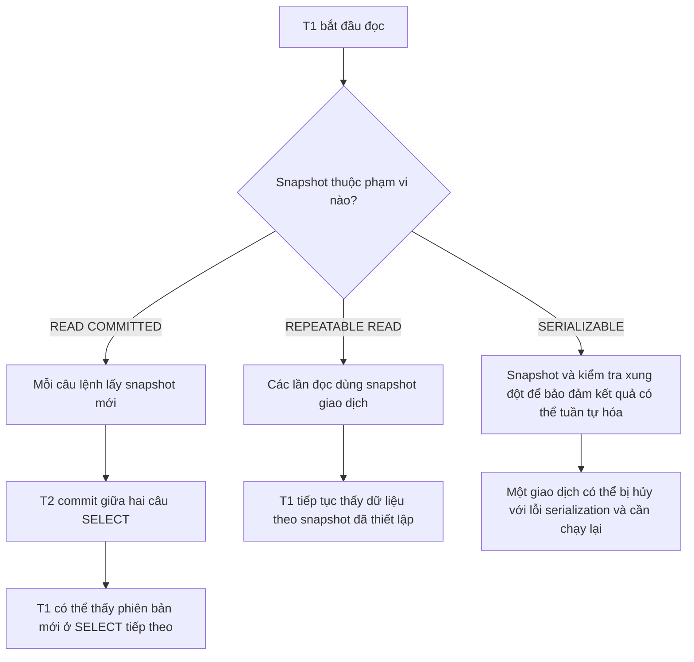

# Vì sao truy cập đồng thời tạo ra các hiện tượng đọc bất thường

## Mục tiêu học tập

Sau bài học, người học có thể:

- Giải thích vì sao nhiều giao dịch đọc và ghi cùng dữ liệu tại các thời điểm khác nhau có thể dẫn tới kết quả đọc không nhất quán.
- Phân biệt **dirty read**, **non-repeatable read**, **phantom read** và **read skew** thông qua lịch thực thi của hai giao dịch.
- Hiểu vai trò của giao dịch, tính nguyên tử, snapshot, khóa và **MVCC** trong việc kiểm soát dữ liệu mà mỗi truy vấn được phép nhìn thấy.
- Nhận biết tác động của các mức cô lập đối với hiện tượng đọc trong **PostgreSQL**, đồng thời tránh suy rộng hành vi này sang mọi hệ quản trị cơ sở dữ liệu.
- Chọn cách tổ chức các lần đọc trong ứng dụng **Java/JDBC** để bảo vệ yêu cầu nhất quán của nghiệp vụ.

## 1. Truy cập đồng thời và sự khác nhau giữa “dữ liệu đúng” với “điều tôi đã đọc”

Trong ứng dụng thực tế, nhiều request HTTP, tác vụ nền và tiến trình xử lý hàng đợi có thể đồng thời sử dụng một cơ sở dữ liệu. Mỗi tác vụ có thể mở một giao dịch, đọc các bản ghi, tính toán, cập nhật và `COMMIT`. Hệ quản trị phải cho các công việc này tiến triển mà vẫn bảo vệ những cam kết nhất quán đã được cấu hình.

Một **giao dịch (transaction)** là nhóm thao tác mà hệ quản trị xử lý theo các quy tắc ACID. Tính **atomicity** giúp các thay đổi trong một giao dịch được commit như một đơn vị hoặc rollback khi thất bại. Tính **isolation** trả lời một câu hỏi khác: *Trong lúc các giao dịch xen kẽ, giao dịch đang đọc được phép quan sát phiên bản dữ liệu nào của các giao dịch còn lại?*

Ví dụ, tài khoản A có 500 đơn vị tiền, tài khoản B có 500. Một giao dịch chuyển 100 từ A sang B:

```text
Trước khi chuyển:       A = 500, B = 500, tổng = 1.000
Sau khi chuyển:         A = 400, B = 600, tổng = 1.000
```

Hai trạng thái trên đều hợp lệ. Tuy nhiên, một báo cáo đọc A trước khi giao dịch chuyển tiền commit và đọc B sau khi commit có thể tự cộng được **500 + 600 = 1.100**. Không có thời điểm đã commit nào mà tổng tiền thực sự là 1.100; báo cáo đã ghép dữ liệu từ **hai thời điểm khác nhau**. Đó là một hiện tượng đọc bất thường.

Trong phạm vi `DATA_PERSISTENCE_FUNDAMENTALS`, hiểu các hiện tượng này giúp người học thiết kế ranh giới persistence cho Java, chọn mức cô lập, tổ chức giao dịch, bảo vệ truy vấn và quyết định khi nào cần khóa hoặc cơ chế kiểm soát đồng thời. Không nên chữa một lỗi đọc nhất quán bằng cách thêm chỉ mục hoặc tăng số connection: đó là những quyết định hiệu năng, không tự thay đổi quy tắc quan sát dữ liệu.

### Từ một truy vấn đến một lịch thực thi

Khi chỉ một giao dịch thao tác trên dữ liệu, thứ tự đọc–ghi thường dễ hình dung. Khi nhiều giao dịch chạy song song, các bước có thể xen kẽ:

```text
Thời gian ──────────────────────────────────────────▶

T1 (báo cáo):    READ A ───────────── READ B ─ COMMIT
T2 (chuyển tiền):        BEGIN ─ UPDATE A ─ UPDATE B ─ COMMIT
```

Việc hai giao dịch **chồng lấn thời gian** chưa đủ để kết luận có lỗi. Bất thường xảy ra khi lịch thực thi và quy tắc hiển thị phiên bản dữ liệu cho phép một giao dịch đọc giá trị không đáp ứng giả định nhất quán của nghiệp vụ. Hệ quản trị có thể ngăn một số hiện tượng bằng snapshot, khóa hoặc cơ chế phát hiện xung đột, tùy mức cô lập.

## 2. Ba thành phần cần phân biệt trước khi xét bất thường

| Thành phần | Ý nghĩa | Ví dụ |
| --- | --- | --- |
| **Giao dịch** | Phạm vi bắt đầu, thực thi và kết thúc bằng `COMMIT` hoặc `ROLLBACK` | Request Java chuyển tiền giữa hai tài khoản |
| **Phiên bản dữ liệu được phép nhìn thấy** | Tập thay đổi mà một lần đọc có thể quan sát theo mức cô lập | Một câu `SELECT` thấy giá trị trước hay sau khi giao dịch khác commit |
| **Bất biến nghiệp vụ (invariant)** | Điều kiện hệ thống phải giữ đúng để kết quả có ý nghĩa | Tổng số dư hai tài khoản không đổi trong một chuyển khoản nội bộ |

Đừng đồng nhất **khóa** với **cô lập**. Khóa có thể chặn hoặc tuần tự hóa thao tác xung đột; nhiều hệ quản trị còn dùng **multi-version concurrency control (MVCC)**, giữ các phiên bản bản ghi để truy vấn đọc một snapshot thích hợp mà không cần khóa chặn mọi writer. Cũng đừng đồng nhất “đọc dữ liệu đã commit” với “toàn bộ các lần đọc trong giao dịch luôn nhìn cùng một trạng thái”: đây là hai mức cam kết khác nhau.

Một bất thường đọc có thể xuất hiện dù **từng giao dịch ghi riêng lẻ vẫn đúng và commit nguyên tử**. Vấn đề nằm ở tổ hợp những gì giao dịch đọc đã quan sát khi các commit xảy ra giữa các lần đọc.

## 3. Dirty read — đọc giá trị chưa được commit

**Dirty read** xảy ra nếu T1 đọc được thay đổi của T2 khi T2 **chưa commit**, rồi T2 có thể `ROLLBACK`. Khi đó, T1 đã sử dụng một giá trị chưa bao giờ trở thành dữ liệu đã commit.

Giả sử giá sản phẩm đang là 100. T2 thử đổi thành 70 nhưng hủy giao dịch:

| Thứ tự | T1 — dịch vụ báo giá | T2 — nhân viên cập nhật giá |
| --- | --- | --- |
| 1 | | `BEGIN; UPDATE product SET price = 70 WHERE id = 1;` |
| 2 | Đọc `price = 70` trong hệ thống cho phép dirty read | Chưa commit |
| 3 | Tính giảm giá hoặc tạo báo giá dựa trên 70 | `ROLLBACK;` |
| 4 | Báo giá đã tính trên dữ liệu không tồn tại sau rollback | Giá được giữ ở 100 |

Điều kiện cốt lõi là **giá trị chưa commit bị lộ**. Nếu T1 chỉ thấy giá 70 **sau khi T2 commit**, đó không phải dirty read; khi ấy cần xét các hiện tượng khác, như non-repeatable read.

**Lưu ý về hệ quản trị:** ví dụ trên mô tả hiện tượng lý thuyết hoặc hệ thống cho phép đọc chưa commit. **PostgreSQL không cho phép dirty read**: ngay cả khi yêu cầu `READ UNCOMMITTED`, PostgreSQL xử lý ở mức tương đương `READ COMMITTED`. Vì vậy không thể dùng hai phiên PostgreSQL để tái tạo bước đọc 70 chưa commit như trong bảng.

**Tác hại:** báo cáo, giá bán, điều kiện thanh toán hoặc quyết định phê duyệt có thể dựa vào dữ liệu bị rollback. Cách phòng tránh cơ bản là dùng mức cô lập ngăn đọc chưa commit, như `READ COMMITTED` trên PostgreSQL.

## 4. Non-repeatable read — đọc lại cùng hàng ra giá trị khác

**Non-repeatable read** (đọc không lặp lại) xảy ra khi trong **cùng một giao dịch**, T1 đọc một hàng, T2 sửa hoặc xóa hàng đó rồi commit, sau đó T1 đọc lại **đúng hàng đó** và nhận giá trị khác hoặc không còn thấy hàng.

| Thứ tự | T1 — giao dịch kiểm tra đơn | T2 — giao dịch cập nhật đơn |
| --- | --- | --- |
| 1 | `BEGIN; SELECT status FROM purchase_order WHERE id = 10;` → `PENDING` | |
| 2 | | `UPDATE purchase_order SET status = 'PAID' WHERE id = 10; COMMIT;` |
| 3 | `SELECT status FROM purchase_order WHERE id = 10;` → `PAID` | |
| 4 | T1 `COMMIT` | |

Một giao dịch đọc đã thấy **hai phiên bản được commit khác nhau của cùng một hàng**. Việc đọc lần thứ hai diễn ra sau T2 commit nên không có dirty read. Tuy nhiên, mã Java dựa trên giả định “đọc lại trong transaction sẽ ra đúng giá trị cũ” có thể đưa ra quyết định không ổn định.

Trong PostgreSQL, kịch bản này có thể xảy ra ở `READ COMMITTED` vì **mỗi câu lệnh nhận snapshot mới**. Ví dụ hai cửa sổ SQL thực thi theo thứ tự các bước được chú thích:

```sql
-- Chuẩn bị một lần trên môi trường thử nghiệm.
CREATE TABLE purchase_order (
    id BIGINT PRIMARY KEY,
    status TEXT NOT NULL
);
INSERT INTO purchase_order (id, status) VALUES (10, 'PENDING');
```

```sql
-- Phiên A, bước 1
BEGIN ISOLATION LEVEL READ COMMITTED;
SELECT status FROM purchase_order WHERE id = 10; -- PENDING

-- Chạy phiên B rồi quay lại phiên A, bước 3:
SELECT status FROM purchase_order WHERE id = 10; -- PAID
COMMIT;
```

```sql
-- Phiên B, thực hiện giữa hai lần SELECT của phiên A
BEGIN;
UPDATE purchase_order SET status = 'PAID' WHERE id = 10;
COMMIT;
```

Các đoạn SQL trên minh họa **hai kết nối độc lập**; nếu chạy liền cả ba khối trong một phiên thì không tạo được cùng lịch xen kẽ. Có thể đặt A và B vào hai cửa sổ SQL riêng. Muốn thử lại, đưa `status` về `PENDING` trước mỗi lượt và xác nhận dữ liệu ban đầu.

**Tác hại:** luồng xác nhận đơn hàng có thể dùng trạng thái khác nhau ở hai bước. Nếu cần đảm bảo trạng thái không bị thay đổi trong khi quyết định và ghi kết quả, chỉ tăng mức cô lập đọc chưa chắc đã đủ; có thể phải khóa hàng, cập nhật có điều kiện hoặc kiểm tra version của bản ghi.

## 5. Phantom read — kết quả của một điều kiện có thêm hoặc bớt hàng

**Phantom read** (đọc bóng ma) xảy ra khi T1 chạy lại **cùng điều kiện tìm kiếm** và thấy tập hàng kết quả thay đổi vì một giao dịch khác thêm, xóa hoặc thay đổi hàng để hàng đó đi vào/ra khỏi tập thỏa điều kiện, rồi commit.

Giả sử T1 kiểm tra số đơn `PENDING` trong một tenant:

| Thứ tự | T1 — báo cáo | T2 — tạo đơn |
| --- | --- | --- |
| 1 | `SELECT COUNT(*) ... WHERE tenant_id = 42 AND status = 'PENDING'` → 5 | |
| 2 | | Thêm đơn mới `tenant_id = 42`, `status = 'PENDING'`; `COMMIT` |
| 3 | Cùng câu `SELECT COUNT(*) ...` → 6 | |

Ví dụ tạo thêm dữ liệu thử nghiệm:

```sql
CREATE TABLE pending_order (
    id BIGINT PRIMARY KEY,
    tenant_id BIGINT NOT NULL,
    status TEXT NOT NULL
);
INSERT INTO pending_order (id, tenant_id, status)
VALUES (1, 42, 'PENDING'), (2, 42, 'PENDING');
```

```sql
-- Phiên A, bước 1 và bước 3
BEGIN ISOLATION LEVEL READ COMMITTED;
SELECT COUNT(*) FROM pending_order
WHERE tenant_id = 42 AND status = 'PENDING'; -- 2

-- Sau khi phiên B COMMIT:
SELECT COUNT(*) FROM pending_order
WHERE tenant_id = 42 AND status = 'PENDING'; -- 3
COMMIT;
```

```sql
-- Phiên B, chạy giữa hai SELECT của A
BEGIN;
INSERT INTO pending_order (id, tenant_id, status)
VALUES (3, 42, 'PENDING');
COMMIT;
```

Điểm khác với non-repeatable read là **đối tượng được quan sát**: non-repeatable read tập trung vào giá trị của *cùng một hàng*; phantom read tập trung vào **tập hàng thỏa một điều kiện**. Trên thực tế, một số thao tác sửa dữ liệu có thể tạo cả hai kiểu thay đổi; việc phân loại phụ thuộc câu hỏi nghiệp vụ đang quan sát. Cả hai đều có thể xuất hiện ở PostgreSQL `READ COMMITTED`.

**Tác hại:** quy trình kiểm tra “chưa có bản ghi thỏa điều kiện” rồi tạo mới có thể sai trong lúc giao dịch khác cũng tạo mới. Dù chuyển sang snapshot ổn định, ứng dụng vẫn cần **ràng buộc `UNIQUE`** hoặc cơ chế tuần tự hóa phù hợp để bảo vệ một quy tắc như “mỗi khách hàng chỉ có một đơn đang hoạt động”. Một lần `SELECT COUNT(*) = 0` không thay thế được ràng buộc dữ liệu.

## 6. Read skew — ghép nhiều lần đọc từ những thời điểm khác nhau

**Read skew** (đọc lệch thời điểm) xuất hiện khi một giao dịch đọc **nhiều hàng liên quan** nhưng ghép giá trị thuộc các snapshot khác nhau. Đây là ví dụ quan trọng vì *mỗi giá trị đọc được đều có thể đã commit*, song kết quả tổng hợp không khớp với bất kỳ trạng thái nhất quán nào.

```sql
-- Thiết lập môi trường thử nghiệm cho hai tài khoản.
CREATE TABLE bank_account (
    id BIGINT PRIMARY KEY,
    balance NUMERIC(12, 2) NOT NULL
);
INSERT INTO bank_account (id, balance)
VALUES (1, 500.00), (2, 500.00);
```

| Thời điểm | T1 — tạo báo cáo | T2 — chuyển 100 từ A sang B |
| --- | --- | --- |
| t1 | `BEGIN` tại `READ COMMITTED`; đọc A = **500** | |
| t2 | | `BEGIN`; cập nhật A = **400**, B = **600** |
| t3 | | `COMMIT` cả hai thay đổi |
| t4 | Đọc B = **600**; tự tính A + B = **1.100** | |
| t5 | `COMMIT` | |

Số dư thực tế trước và sau chuyển khoản đều cộng thành 1.000. T1 không đọc dữ liệu chưa commit, nhưng đã kết hợp A trước commit với B sau commit. Nếu báo cáo yêu cầu một ảnh chụp nhất quán tại một thời điểm, cách đọc này không đáp ứng yêu cầu.

```sql
-- Phiên A: đọc hai hàng bằng HAI câu SELECT riêng.
BEGIN ISOLATION LEVEL READ COMMITTED;
SELECT balance FROM bank_account WHERE id = 1; -- 500.00

-- Chờ phiên B COMMIT, sau đó:
SELECT balance FROM bank_account WHERE id = 2; -- 600.00
COMMIT;
```

```sql
-- Phiên B: thực hiện giữa hai SELECT của A.
BEGIN;
UPDATE bank_account SET balance = balance - 100 WHERE id = 1;
UPDATE bank_account SET balance = balance + 100 WHERE id = 2;
COMMIT;
```

Nếu chỉ cần **tổng tại một snapshot**, một câu `SELECT SUM(balance) FROM bank_account` trong PostgreSQL `READ COMMITTED` nhìn thấy một snapshot nhất quán cho **câu lệnh đó**; không gặp đúng dạng lệch thời điểm giữa hai câu `SELECT` ở ví dụ. Nhưng điều này không có nghĩa mọi bài toán báo cáo đều gom được thành một câu SQL. Khi phải dùng nhiều truy vấn hoặc đọc qua nhiều thời điểm, cần thiết kế giao dịch phù hợp.

## 7. MVCC, snapshot và mức cô lập quyết định điều gì được nhìn thấy

### MVCC nhìn dữ liệu theo phiên bản

Trong PostgreSQL, MVCC cho phép nhiều phiên bản logic của hàng tồn tại trong một giai đoạn. Thông tin giao dịch và snapshot giúp bộ máy quyết định phiên bản nào khả kiến đối với câu lệnh đang chạy. Khi T2 commit cập nhật hàng, T1 không nhất thiết phải đổi ngay phiên bản mình đang nhìn; điều đó phụ thuộc mức cô lập của T1.



**Snapshot của câu lệnh** có nghĩa là một câu truy vấn đọc theo ảnh chụp dữ liệu tương ứng với thời điểm bắt đầu câu lệnh đó, dưới các quy tắc của hệ quản trị. **Snapshot của giao dịch** giữ một góc nhìn nhất quán qua nhiều câu truy vấn, nhưng không tự bảo đảm mọi kết quả đồng thời tương đương với một thứ tự tuần tự hóa hoàn chỉnh.

### Các mức cô lập trong PostgreSQL

| Mức cô lập được yêu cầu | Dirty read | Non-repeatable read | Phantom read | Read skew giữa hai lần đọc | Ghi chú |
| --- | --- | --- | --- | --- | --- |
| `READ UNCOMMITTED` | Không | Có thể | Có thể | Có thể | PostgreSQL thực thi tương đương `READ COMMITTED` |
| `READ COMMITTED` | Không | Có thể | Có thể | Có thể | Mỗi lệnh có snapshot mới; đây là mức mặc định của PostgreSQL |
| `REPEATABLE READ` | Không | Không | Không | Không theo dạng ví dụ | Snapshot ổn định; vẫn có thể có bất thường tuần tự hóa như *write skew* |
| `SERIALIZABLE` | Không | Không | Không | Không | Bảo đảm các giao dịch commit có kết quả như một lịch tuần tự; cần xử lý retry khi xảy ra serialization failure |

Ở bảng này, “không” và “có thể” nói về **hành vi PostgreSQL**, không phải lời hứa chung cho mọi cơ sở dữ liệu. Theo mô tả tối thiểu của tiêu chuẩn SQL, `REPEATABLE READ` không nhất thiết chặn mọi phantom; PostgreSQL chặn phantom ở mức này nhờ snapshot isolation. Đặc tính `READ UNCOMMITTED` cũng khác nhau giữa các hệ quản trị.

Thử thay dòng của phiên A trong ví dụ non-repeatable read bằng:

```sql
BEGIN ISOLATION LEVEL REPEATABLE READ;
```

Khi lần đọc đầu thiết lập snapshot và phiên B commit sau đó, phiên A vẫn nhìn `PENDING` ở lần `SELECT` kế tiếp. Đối với ví dụ read skew, nếu T1 dùng `REPEATABLE READ`, hai lần đọc sẽ thấy cặp số dư từ cùng snapshot: **500 và 500**, miễn là T2 commit sau khi snapshot của T1 được thiết lập. Giao dịch mới bắt đầu sau khi T2 đã commit sẽ thấy **400 và 600**.

**Chú ý:** snapshot ổn định không có nghĩa ứng dụng được phép bỏ qua mọi kiểm soát đồng thời. Hai giao dịch có thể cùng đọc một trạng thái hợp lệ rồi sửa **hai hàng khác nhau**, khiến bất biến bị phá vỡ khi cả hai commit. Đó là lớp bất thường *write skew*, khác với các hiện tượng đọc đang xét. PostgreSQL `SERIALIZABLE` kiểm tra các phụ thuộc giữa giao dịch để tránh kết quả không thể tuần tự hóa, thường bằng cách hủy một giao dịch và yêu cầu thử lại.

## 8. Từ lỗi đọc đến quyết định kỹ thuật trong Java

Giả sử một dịch vụ Java cần xuất báo cáo tổng hợp số dư từ nhiều truy vấn. Nếu các lần đọc phải phản ánh **cùng một thời điểm**, hãy đặt chúng trong **một transaction** có mức cô lập phù hợp. Ví dụ JDBC:

```java
import java.math.BigDecimal;
import java.sql.Connection;
import java.sql.PreparedStatement;
import java.sql.ResultSet;
import java.sql.SQLException;
import javax.sql.DataSource;

public class BalanceReportService {
    private final DataSource dataSource;

    public BalanceReportService(DataSource dataSource) {
        this.dataSource = dataSource;
    }

    public BigDecimal totalOfTwoAccounts(long firstId, long secondId)
            throws SQLException {
        try (Connection connection = dataSource.getConnection()) {
            connection.setTransactionIsolation(Connection.TRANSACTION_REPEATABLE_READ);
            connection.setReadOnly(true); // Gợi ý cho driver/DB; không thay thế quyền hạn hay isolation.
            connection.setAutoCommit(false);
            try {
                BigDecimal first = balanceOf(connection, firstId);
                BigDecimal second = balanceOf(connection, secondId);
                BigDecimal total = first.add(second);
                connection.commit();
                return total;
            } catch (SQLException | RuntimeException e) {
                try {
                    connection.rollback();
                } catch (SQLException rollbackError) {
                    e.addSuppressed(rollbackError);
                }
                throw e;
            }
        }
    }

    private BigDecimal balanceOf(Connection connection, long accountId)
            throws SQLException {
        String sql = "SELECT balance FROM bank_account WHERE id = ?";
        try (PreparedStatement statement = connection.prepareStatement(sql)) {
            statement.setLong(1, accountId);
            try (ResultSet rows = statement.executeQuery()) {
                if (!rows.next()) {
                    throw new SQLException("Account not found: " + accountId);
                }
                return rows.getBigDecimal(1);
            }
        }
    }
}
```

**Điểm cần hiểu ở ví dụ:**

- Hai lần `SELECT` dùng **cùng một `Connection`**, cùng một transaction. Nếu mỗi lời gọi repository/JDBC vô tình lấy kết nối và transaction riêng, hai lần đọc sẽ không chia sẻ snapshot như mong muốn.
- `setTransactionIsolation(...)` được gọi **trước** khi bắt đầu transaction; khả năng hỗ trợ và thời điểm đổi mức cô lập phụ thuộc driver/DBMS. `setReadOnly(true)` không làm tăng mức cô lập.
- `commit` và `rollback` cần được xử lý rõ ràng. Trong mã dùng transaction manager của Spring, nên để transaction manager quản lý vòng đời transaction và đặt isolation trong cấu hình phù hợp, tránh tự tạo transaction lồng nhau không chủ ý.
- Nếu quy trình có **ghi dữ liệu dựa trên giá trị vừa đọc**, `REPEATABLE READ` chưa chắc bảo vệ bất biến nghiệp vụ. Cần xem xét khóa `SELECT ... FOR UPDATE`, cập nhật có điều kiện, optimistic locking bằng cột `version`, ràng buộc cơ sở dữ liệu hoặc `SERIALIZABLE` và retry.

Với Spring, một phương thức dịch vụ có thể khai báo:

```java
@Transactional(readOnly = true, isolation = Isolation.REPEATABLE_READ)
public BalanceReport buildReport() {
    // Các repository dùng cùng transaction do Spring quản lý.
    return reportRepository.readBalancesAndBuildReport();
}
```

Ví dụ trên giả định các repository thực sự tham gia cùng transaction manager, cùng tài nguyên dữ liệu và lời gọi đi qua cơ chế quản lý transaction của Spring. `@Transactional` bị bỏ qua trong một số trường hợp gọi nội bộ qua `this` khi dùng proxy mặc định; cần kiểm tra ranh giới service thật sự. `readOnly = true` là ý định tối ưu/hạn chế phù hợp, **không phải** cam kết mọi hệ quản trị sẽ từ chối tất cả các lệnh ghi.

### Đừng dùng mức cô lập cao hơn một cách máy móc

Mức cô lập mạnh hơn có thể làm giao dịch phải chờ, xung đột, bị rollback hoặc retry nhiều hơn trong workload đồng thời. Với PostgreSQL, `REPEATABLE READ` và `SERIALIZABLE` có thể phát sinh lỗi `SQLSTATE 40001` ở các tình huống xung đột; luồng ứng dụng cần retry **toàn bộ transaction** theo chính sách giới hạn số lần, có backoff thích hợp và bảo đảm các tác dụng bên ngoài giao dịch không bị lặp ngoài ý muốn. Chỉ retry một câu SQL sau lỗi không tái lập được nhất quán của những lần đọc trước đó.

Các truy vấn phục vụ UI có thể chấp nhận việc trạng thái thay đổi giữa hai lần tải trang, trong khi quyết toán, kiểm toán, kiểm tra hạn mức hoặc tạo chứng từ có thể cần snapshot ổn định hoặc tuần tự hóa. Chọn mức cô lập theo **cam kết nghiệp vụ**, không dựa đơn thuần vào tên gọi `SERIALIZABLE` có vẻ “an toàn nhất”.

## 9. Thiết kế kiểm chứng bằng hai phiên giao dịch

Để quan sát vấn đề, dùng **hai kết nối riêng** trỏ tới một cơ sở dữ liệu PostgreSQL thử nghiệm. Một phiên đóng vai người đọc (T1), phiên còn lại là người ghi (T2). Ghi lại từng thời điểm, trạng thái ban đầu và kết quả đọc.

1. **Non-repeatable read:** tại `READ COMMITTED`, cho T1 đọc trạng thái đơn; T2 sửa và commit; T1 đọc lại cùng hàng. Ghi nhận hai giá trị khác nhau.
2. **Phantom read:** cho T1 đếm hàng theo điều kiện; T2 chèn hàng thỏa điều kiện và commit; T1 đếm lại. Ghi nhận số lượng tăng.
3. **Read skew:** cho T1 đọc A; T2 chuyển tiền và commit; T1 đọc B. Ghi nhận tổng 1.100 dù dữ liệu luôn commit với tổng 1.000.
4. **Lặp lại với `REPEATABLE READ`:** reset dữ liệu, để T1 thực hiện lần đọc đầu trước khi T2 commit. Quan sát giá trị không đổi trong các lần `SELECT` tiếp theo của T1.
5. **Kiểm tra giới hạn:** đừng kỳ vọng tái tạo dirty read bằng PostgreSQL `READ UNCOMMITTED`; tài liệu hệ quản trị nói rõ mức đó được xử lý như `READ COMMITTED`.

Khi đo thời gian thực thi, dùng `EXPLAIN` và chỉ mục để hiểu hiệu năng truy vấn **riêng biệt** với tính đúng đắn của snapshot. Một `SELECT` nhanh vẫn có thể tham gia vào báo cáo read skew nếu nó nằm trong chuỗi nhiều lần đọc không chia sẻ snapshot.

## 10. Câu hỏi tự kiểm tra

**Câu 1.** T1 đọc `price = 100`, T2 cập nhật `price = 120` rồi commit, T1 đọc lại nhận 120. Đây là dirty read hay non-repeatable read?

**Câu 2.** T1 đọc `COUNT(*) WHERE status = 'PENDING'` được 3, T2 thêm một hàng `PENDING` rồi commit, T1 đếm lại được 4. Hiện tượng nào được minh họa?

**Câu 3.** T1 đọc A = 500, T2 chuyển 100 từ A sang B trong **một giao dịch đã commit**, T1 đọc B = 600 rồi tính tổng 1.100. Vì sao chỉ nói “đọc dữ liệu đã commit” là chưa đủ?

**Câu 4.** Trên PostgreSQL, ở `REPEATABLE READ`, hai lần đọc một hàng trong cùng transaction có thấy thay đổi vừa commit từ T2 sau lần đọc đầu không? Điều đó có đồng nghĩa không thể có mọi bất thường ghi không?

**Câu 5.** Một API kiểm tra “chưa có đơn hoạt động” rồi insert đơn. Có thể chỉ dùng transaction đọc snapshot ổn định mà bỏ `UNIQUE`/quy tắc chống trùng không?

### Đáp án và giải thích

1. **Non-repeatable read**: lần đọc thứ hai thấy giá trị đã commit của cùng một hàng; dirty read yêu cầu thấy dữ liệu **chưa commit**.
2. **Phantom read**: tập hàng khớp với một điều kiện tìm kiếm thay đổi giữa hai lần quét.
3. Vì mỗi lần đọc có thể thuộc snapshot khác nhau ở `READ COMMITTED`; kết quả ghép từ hai thời điểm không phản ánh một trạng thái nhất quán. Đây là **read skew**.
4. **Không**: `REPEATABLE READ` của PostgreSQL giữ snapshot ổn định nên không thấy thay đổi đó ở lần đọc tiếp theo. Nhưng snapshot isolation vẫn có thể xảy ra *write skew* trong một số lịch ghi, nên phải xét bất biến và mức `SERIALIZABLE` khi cần.
5. **Không**: hai transaction có thể đồng thời cùng kiểm tra điều kiện rồi ghi. Cần bảo vệ bất biến bằng ràng buộc cơ sở dữ liệu, chiến lược khóa, cập nhật có điều kiện hoặc cô lập phù hợp; tình huống cần phân tích cả phần ghi.

## Ghi nhớ khi thiết kế ranh giới persistence

- **Dirty read**: thấy thay đổi **chưa commit** của giao dịch khác.
- **Non-repeatable read**: đọc lại **cùng hàng** trong một transaction và thấy giá trị đã commit khác.
- **Phantom read**: đọc lại **cùng điều kiện** và thấy tập hàng thay đổi.
- **Read skew**: đọc **nhiều dữ liệu liên quan** ở các snapshot khác nhau rồi ghép thành kết quả không nhất quán.

Trong Java, hãy xác định rõ **phạm vi transaction**, **tính nhất quán cần cho nghiệp vụ**, **các truy vấn thực tế** và **hệ quản trị đang sử dụng** trước khi chọn isolation. Một giao dịch chỉ đọc dữ liệu đã commit có thể vẫn gặp bất thường giữa nhiều câu `SELECT`; snapshot ổn định bảo vệ việc đọc nhất quán nhưng không tự thay thế ràng buộc và kiểm soát đồng thời cần thiết cho thao tác ghi.
