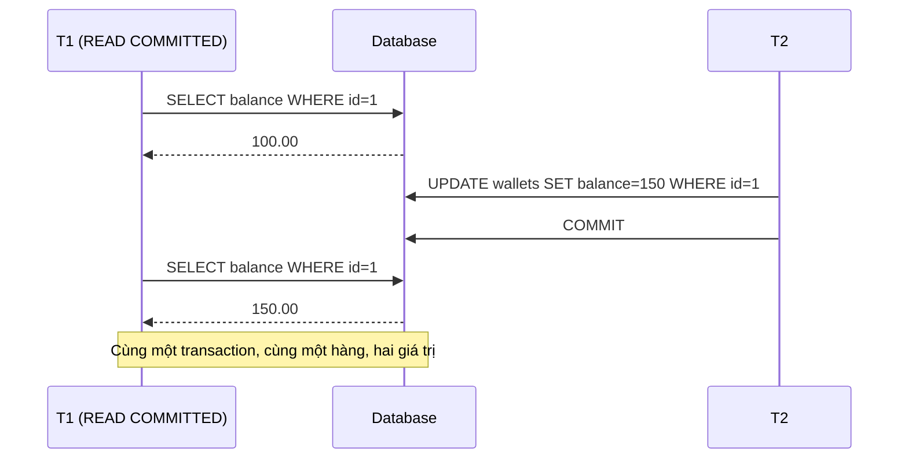

# Đọc lại nhận giá trị khác (non-repeatable read)

**Non-repeatable read** (đọc lại nhận giá trị khác) xảy ra khi **một giao dịch đọc cùng một hàng dữ liệu hai lần và nhận hai giá trị khác nhau**, vì giao dịch khác đã thay đổi hàng đó và commit ở giữa hai lần đọc. Đây là một hiện tượng quan trọng khi nghiên cứu **tính cô lập** (*isolation*) trong giao dịch cơ sở dữ liệu: một câu `SELECT` có thể trả về dữ liệu hợp lệ tại thời điểm nó chạy, nhưng các lần `SELECT` liên tiếp trong cùng giao dịch không nhất thiết nhìn thấy cùng trạng thái.

Bài học thuộc chương **Tính cô lập** của mô-đun **DATA_PERSISTENCE_FUNDAMENTALS**. Mục tiêu chung của mô-đun là hiểu nguyên lý lưu trữ dữ liệu bền vững trong ứng dụng: mô hình dữ liệu, schema, truy vấn, chỉ mục, giao dịch, cô lập, kiểm soát đồng thời và ranh giới persistence trong Java; từ đó xử lý đúng lỗi, tối ưu hiệu năng và bảo vệ tính nhất quán nghiệp vụ. Ở đây, trọng tâm là **nhận diện non-repeatable read, xác định điều kiện xuất hiện và chọn cách ứng phó phù hợp**, thay vì mặc định mọi giao dịch phải nhìn thấy dữ liệu mới nhất ở từng câu lệnh.

Các ví dụ thực hành sử dụng **PostgreSQL**, SQL chuẩn và JDBC. Hành vi chi tiết có thể khác ở MySQL, SQL Server hoặc các cơ sở dữ liệu khác do cơ chế MVCC, khóa và cấu hình mức cô lập.

## 1. Nhận diện hiện tượng bằng hai giao dịch

Giả sử bảng `wallets` lưu số dư của một ví:

```sql
CREATE TABLE wallets (
    id      BIGINT PRIMARY KEY,
    balance NUMERIC(14, 2) NOT NULL CHECK (balance >= 0)
);

INSERT INTO wallets (id, balance) VALUES (1, 100.00);
```

Hai phiên làm việc độc lập (**Connection A** và **Connection B**) cùng truy cập hàng `id = 1`. Trong ví dụ, cả hai dùng mức cô lập `READ COMMITTED`, mặc định của PostgreSQL.

| Thứ tự | Giao dịch T1 — Connection A | Giao dịch T2 — Connection B |
|---|---|---|
| 1 | `BEGIN`; đọc `balance = 100.00` | Chưa thực hiện gì |
| 2 | Giao dịch vẫn mở | `BEGIN`; cập nhật số dư thành `150.00` |
| 3 | Chưa đọc lại | `COMMIT` thành công |
| 4 | Đọc lại **chính hàng `id = 1`**; nhận `150.00` | Đã kết thúc |
| 5 | `COMMIT` | — |

T1 không hề ghi lên hàng đó, nhưng lần đọc thứ hai đã cho một giá trị khác lần đầu. T1 nhìn thấy **giá trị đã được T2 commit**, vì vậy đây là **non-repeatable read**, không phải *dirty read* (đọc dữ liệu chưa commit).



Ba điều kiện cần ghi nhớ để nhận diện ví dụ này:

1. Hai lần đọc thuộc **cùng một giao dịch T1**, chưa có `COMMIT` hoặc `ROLLBACK` ở giữa.
2. Hai lần đọc nhằm vào **cùng một hàng và cùng thuộc tính**; truy vấn có ý nghĩa tương đương.
3. Một giao dịch khác **thay đổi và commit** hàng đó giữa hai lần đọc; mức cô lập của T1 cho phép quan sát phiên bản mới ở lần đọc sau.

Nếu T1 đã commit rồi mở giao dịch mới trước lần đọc thứ hai, việc thấy giá trị mới là bình thường giữa hai giao dịch, chưa phải ví dụ non-repeatable read theo định nghĩa trên.

## 2. Tái hiện trên PostgreSQL bằng hai cửa sổ SQL

Hãy mở **hai kết nối riêng** tới cùng cơ sở dữ liệu và chạy lệnh đúng thứ tự. Các lệnh SQL sau giả định đã tạo bảng mẫu ở phần 1 và số dư ban đầu là `100.00`.

**Bước A1 — tại Connection A:**

```sql
BEGIN TRANSACTION ISOLATION LEVEL READ COMMITTED;

SELECT balance
FROM wallets
WHERE id = 1;
-- 100.00
```

Giữ nguyên transaction của A ở trạng thái mở. Chưa chạy `COMMIT` trên A.

**Bước B1 — tại Connection B:**

```sql
BEGIN;

UPDATE wallets
SET balance = balance + 50.00
WHERE id = 1;

COMMIT;
```

**Bước A2 — quay lại Connection A:**

```sql
SELECT balance
FROM wallets
WHERE id = 1;
-- 150.00: khác 100.00 ở lần đọc đầu

COMMIT;
```

Kết quả quan sát được trong PostgreSQL `READ COMMITTED` là `100.00 → 150.00`. Điểm then chốt không phải số tiền tăng bao nhiêu, mà là **mỗi câu lệnh ở mức `READ COMMITTED` có thể sử dụng một ảnh chụp dữ liệu (*snapshot*) mới**. T2 đã commit trước khi A thực hiện câu `SELECT` thứ hai, nên câu đọc đó có thể thấy phiên bản vừa được commit.

Để lặp lại thí nghiệm với đúng số liệu ban đầu, đặt lại số dư bằng một câu `UPDATE` và commit **sau khi cả hai transaction thí nghiệm đã kết thúc**:

```sql
UPDATE wallets SET balance = 100.00 WHERE id = 1;
```

Với kết nối ở chế độ autocommit mặc định, câu lệnh này được commit riêng. Không chạy lệnh reset ở giữa hai lần đọc nếu mục tiêu là quan sát duy nhất tác động của T2.

## 3. Vì sao `READ COMMITTED` cho phép đọc lại ra kết quả khác?

### 3.1. Mức cô lập trả lời câu hỏi "một truy vấn được phép nhìn thấy gì?"

Mức cô lập quy định khả năng quan sát dữ liệu từ giao dịch khác và các bảo đảm về bất thường đồng thời. `READ COMMITTED` ngăn đọc các giá trị **chưa được commit**, nhưng không hứa rằng toàn bộ transaction nhìn thấy một tập dữ liệu cố định trong suốt vòng đời của nó.

Trong PostgreSQL, một câu `SELECT` thông thường ở `READ COMMITTED` bắt đầu với snapshot riêng của **câu lệnh**. Hai câu `SELECT` ở hai thời điểm khác nhau có thể chọn hai tập phiên bản dữ liệu khác nhau, ngay cả khi nằm trong cùng transaction. Điều này khác với nhận định sai rằng `BEGIN` luôn "đóng băng" dữ liệu cho mọi truy vấn sau nó.

Một câu `SELECT` riêng lẻ vẫn có góc nhìn nhất quán theo cơ chế snapshot của PostgreSQL: không phải cứ đọc đến nửa câu lệnh là các hàng tự chuyển sang phiên bản mới do người khác commit. Hiện tượng đang xét xảy ra **giữa hai câu đọc**, không đòi hỏi một câu đọc đơn lẻ phải thấy dữ liệu bị xé đôi.

### 3.2. MVCC giúp nhiều phiên bản cùng tồn tại

PostgreSQL sử dụng **Multi-Version Concurrency Control (MVCC)**: khi cập nhật một hàng, hệ thống có thể lưu nhiều phiên bản của hàng và xác định phiên bản nào hiển thị với snapshot của từng giao dịch.

```text
wallets.id = 1

Phiên bản V1: balance = 100.00  ── T1 đọc lần đầu
                  |
                  | T2 UPDATE + COMMIT
                  v
Phiên bản V2: balance = 150.00  ── T1 đọc lần hai (READ COMMITTED)
```

MVCC không đồng nghĩa với "mọi transaction luôn nhìn thấy cùng một phiên bản". **Chính sách chọn snapshot** phụ thuộc mức cô lập và DBMS. Với `READ COMMITTED`, mỗi câu đọc mới có thể sử dụng snapshot mới; với `REPEATABLE READ` của PostgreSQL, transaction giữ cùng snapshot cho các câu đọc thông thường.

### 3.3. Không phải do có hay không có chỉ mục

Chỉ mục giúp DB tìm nhanh hàng `id = 1` nhưng **không quyết định phiên bản dữ liệu được phép quan sát**. Thêm B-tree trên `wallets(id)` (đã có ngầm qua `PRIMARY KEY`) không loại bỏ non-repeatable read. Cách sửa phải đến từ mức cô lập hoặc chiến lược kiểm soát đồng thời phù hợp.

## 4. So sánh các mức cô lập

Bảng dưới diễn đạt **bảo đảm tối thiểu thường dùng theo SQL standard**, với một số lưu ý thực tế về PostgreSQL:

| Isolation level | Có thể gặp non-repeatable read? | Ý nghĩa đối với bài toán |
|---|---|---|
| `READ UNCOMMITTED` | **Có thể** | Theo chuẩn có thể quan sát nhiều bất thường; PostgreSQL xử lý mức này tương tự `READ COMMITTED` |
| `READ COMMITTED` | **Có thể** | Không đọc dữ liệu chưa commit; hai câu đọc trong cùng transaction vẫn có thể khác nhau |
| `REPEATABLE READ` | **Không**, với các phép đọc cùng hàng được bảo đảm lặp lại | Bảo vệ giá trị đã đọc khỏi thay đổi quan sát được giữa các lần đọc trong transaction |
| `SERIALIZABLE` | **Không** | Bổ sung bảo đảm giao dịch tương đương một thứ tự thực thi tuần tự; có thể buộc một giao dịch retry |

**Không suy rộng máy móc giữa các hệ quản trị:**

- **PostgreSQL:** `REPEATABLE READ` cung cấp snapshot nhất quán của transaction cho các câu đọc thông thường; snapshot được xác lập tại câu lệnh không điều khiển transaction đầu tiên, thay vì chỉ vì đã gửi `BEGIN`. PostgreSQL còn ngăn *phantom read* ở mức này, mạnh hơn mức tối thiểu theo chuẩn; nhưng vẫn có thể xảy ra *serialization anomaly* như write skew, nên chưa tương đương `SERIALIZABLE`.
- **MySQL/InnoDB:** ở `REPEATABLE READ`, các câu `SELECT` đọc nhất quán (*consistent nonlocking reads*) thường dùng snapshot được tạo khi lần đọc nhất quán đầu tiên diễn ra. Tuy nhiên `SELECT ... FOR UPDATE`, thao tác ghi và một số câu đọc khóa lại có ngữ nghĩa **current read**; trộn các kiểu đọc có thể cho bức tranh khác với chỉ dùng `SELECT` thông thường. Không dùng kết quả PostgreSQL để khẳng định mọi câu lệnh InnoDB đều nhìn cùng phiên bản.
- **SQL Server:** hành vi `READ COMMITTED` chịu ảnh hưởng của cấu hình khóa hoặc row-versioning (ví dụ `READ_COMMITTED_SNAPSHOT`). Cần phân biệt `READ COMMITTED`, `REPEATABLE READ` và `SNAPSHOT`; cơ chế thực thi và mức tranh chấp có thể khác PostgreSQL.

**Bảo đảm cô lập là hợp đồng của DBMS**, không phải tính chất của cú pháp `SELECT` trong Java. Khi thiết kế persistence, cần biết driver, transaction manager và cơ sở dữ liệu đang thực sự dùng mức nào.

## 5. Thí nghiệm đối chứng: `REPEATABLE READ`

Đặt lại số dư `100.00`, bảo đảm câu đặt lại đã commit và hai phiên không còn transaction cũ. Sau đó chạy:

**Connection A:**

```sql
BEGIN TRANSACTION ISOLATION LEVEL REPEATABLE READ;

SELECT balance FROM wallets WHERE id = 1;
-- 100.00; đây là lần đọc xác lập snapshot của T1 trong ví dụ.
```

**Connection B:**

```sql
BEGIN;
UPDATE wallets SET balance = balance + 50.00 WHERE id = 1;
COMMIT;
-- T2 hoàn tất thành công.
```

**Quay lại Connection A:**

```sql
SELECT balance FROM wallets WHERE id = 1;
-- Vẫn 100.00 với PostgreSQL REPEATABLE READ.

COMMIT;

-- Giao dịch mới nhìn thấy dữ liệu đã commit của T2:
SELECT balance FROM wallets WHERE id = 1;
-- 150.00
```

T2 không bị chặn chỉ vì T1 đã thực hiện một câu `SELECT` thông thường. T1 tiếp tục đọc được **phiên bản cũ phù hợp với snapshot** của nó, còn giao dịch mới sau commit quan sát phiên bản mới. Đây là một cách tránh non-repeatable read mà không nhất thiết phải khóa độc quyền hàng ngay lúc đọc.

Điều này **không có nghĩa** T1 được quyền cập nhật tùy ý dựa trên snapshot cũ. Trên PostgreSQL, nếu T1 ở `REPEATABLE READ` cố cập nhật một hàng đã bị giao dịch khác cập nhật và commit từ khi snapshot T1 được xác lập, T1 có thể nhận lỗi `could not serialize access due to concurrent update` (SQLSTATE `40001`). Ứng dụng phải rollback rồi thử lại **toàn bộ transaction** nếu nghiệp vụ cho phép.

## 6. Phân biệt với các hiện tượng đồng thời khác

| Hiện tượng | Điều gì xảy ra? | Phân biệt với non-repeatable read |
|---|---|---|
| **Dirty read** | T1 đọc một thay đổi của T2 **chưa commit**, rồi T2 có thể rollback | Non-repeatable read trong ví dụ chỉ dùng giá trị T2 **đã commit** |
| **Non-repeatable read** | T1 đọc **cùng hàng** hai lần, thấy hai giá trị khác nhau | Trọng tâm là thay đổi của giá trị ở hàng đã đọc |
| **Phantom read** | T1 chạy lại cùng truy vấn theo điều kiện và thấy tập hàng phù hợp thay đổi vì giao dịch khác insert/delete/update | Trọng tâm là **tập hàng thỏa điều kiện**, không chỉ giá trị của cùng hàng |
| **Lost update** | Một thay đổi bị ghi đè bởi thay đổi khác do phối hợp đọc–ghi không đúng | Đây là lỗi về **kết quả ghi**, không chỉ là sự khác nhau giữa hai lần đọc |
| **Read skew** | T1 đọc nhiều dữ liệu liên quan tại các thời điểm khác nhau, dẫn tới tổ hợp giá trị không đại diện cho một trạng thái nhất quán | Có liên hệ với snapshot giữa các câu lệnh, nhưng mô tả **nhiều hàng/đối tượng** và bất biến liên quan |

Ví dụ phantom read: T1 chạy `SELECT COUNT(*) FROM orders WHERE status = 'PENDING'`; T2 tạo thêm đơn `PENDING` rồi commit; T1 chạy lại đúng câu đếm và thấy số hàng tăng. Đó là thay đổi **tập kết quả**. Nếu T1 đọc `orders.id = 10` lần đầu thấy `status = 'PENDING'`, T2 sửa thành `PAID` và commit, rồi T1 đọc lại cùng hàng thấy `PAID`, ta đang nói về non-repeatable read.

Hai khái niệm có thể cùng xuất hiện trong một lịch thực thi phức tạp; khi kiểm tra một truy vấn cụ thể, phải mô tả rõ **hàng đã đọc, điều kiện tìm kiếm và thao tác đồng thời**. Các mức cô lập của DBMS thực tế có thể ngăn nhiều hiện tượng hơn yêu cầu tối thiểu của chuẩn.

## 7. Vì sao non-repeatable read có thể gây lỗi nghiệp vụ?

Không phải mọi lần đọc ra giá trị khác đều là lỗi. Một trang quản trị muốn cập nhật tình hình theo thời gian thực có thể **chủ động chấp nhận** dữ liệu mới ở mỗi truy vấn. Rủi ro phát sinh khi mã ứng dụng âm thầm giả định rằng giá trị đã đọc đầu transaction sẽ không thay đổi trong suốt nhiều bước xử lý.

### 7.1. Kiểm tra rồi hành động dựa trên dữ liệu cũ

Một luồng đặt hàng đọc `inventory.available = 5`, kiểm tra muốn mua `4` sản phẩm, tính giá và chuẩn bị tạo order. Trong lúc đó, giao dịch khác cập nhật tồn kho còn `2` rồi commit. Nếu ứng dụng dùng lại kết luận "đủ hàng" dựa trên lần đọc cũ mà không kiểm tra lại ở bước ghi, nó có thể bán vượt tồn kho.

Non-repeatable read là **tín hiệu** về tính thay đổi của dữ liệu đang đọc; nguyên nhân trực tiếp của bán vượt kho còn phụ thuộc cách cập nhật, kiểm tra điều kiện và khóa. Chuyển toàn bộ API sang `REPEATABLE READ` chưa tự đảm bảo rằng quy tắc `available >= quantity` được giữ đúng khi có nhiều writer.

### 7.2. Báo cáo đọc nhiều lần trong một transaction

Một bản báo cáo tính số dư đầu và cuối bằng hai câu `SELECT` trong cùng transaction. Nếu mục đích là có **một ảnh chụp dữ liệu nhất quán**, `READ COMMITTED` có thể tạo các chỉ số xuất phát từ hai thời điểm khác nhau. `REPEATABLE READ` với truy vấn đọc thông thường thường phù hợp hơn khi muốn toàn bộ báo cáo dựa trên một snapshot chung.

Đổi lại, snapshot được cố định có thể là **dữ liệu cũ** so với những commit vừa xảy ra. Cần phân biệt yêu cầu "nhất quán trong một báo cáo" với yêu cầu "luôn cập nhật tức thời"; không thể mặc nhiên đồng thời tối đa hóa cả hai.

### 7.3. Kiểm tra quyền, chính sách và trạng thái nghiệp vụ

Nếu ứng dụng đọc quyền truy cập hoặc trạng thái nghiệp vụ rồi thực hiện hành động sau đó, chính sách có thể đã thay đổi. Các quyết định nhạy cảm cần **ràng buộc tại thời điểm ghi hoặc tại điểm sử dụng**, hoặc có cơ chế kiểm soát phiên bản phù hợp. Chỉ giữ snapshot cũ có thể khiến ứng dụng tiếp tục dựa vào quyền đã bị thu hồi; một mức cô lập cao hơn không thay thế được thiết kế quy tắc nghiệp vụ.

## 8. Những cách kiểm soát phù hợp với mục tiêu

### 8.1. Chấp nhận `READ COMMITTED` và cập nhật nguyên tử

Nếu nghiệp vụ chỉ cần bảo đảm **không trừ kho vượt số lượng hiện có**, một câu `UPDATE` có điều kiện thường đơn giản và hiệu quả hơn việc đọc rồi dự đoán trạng thái sau đó:

```sql
CREATE TABLE inventory (
    product_id BIGINT PRIMARY KEY,
    available  INTEGER NOT NULL CHECK (available >= 0),
    version    BIGINT NOT NULL DEFAULT 0
);

-- PostgreSQL: biến :quantity và :product_id là tham số của thư viện SQL;
-- với JDBC thuần cần dùng ? và bind đúng kiểu.
UPDATE inventory
SET available = available - :quantity,
    version = version + 1
WHERE product_id = :product_id
  AND available >= :quantity
RETURNING available, version;
```

Ứng dụng xác thực `quantity > 0` trước khi gửi SQL và kiểm tra **số hàng được cập nhật**. Trong PostgreSQL `READ COMMITTED`, các updater cạnh tranh trên cùng hàng được phối hợp bằng khóa hàng; khi cần, điều kiện `WHERE` được đánh giá lại theo phiên bản phù hợp sau khi chờ updater trước. Vì vậy điều kiện `available >= quantity` có thể ngăn cập nhật khiến tồn kho âm ngay ở bước ghi.

Nếu không có hàng được trả về, có thể là hàng không tồn tại hoặc không đủ tồn kho; xử lý theo hợp đồng API. Truy vấn trên minh họa **một điều kiện nghiệp vụ đơn giản**. Khi bất biến trải qua nhiều hàng hoặc nhiều bảng, phải đánh giá tính nguyên tử của **toàn bộ bất biến**, không chỉ một câu lệnh.

### 8.2. Khóa hàng trước khi đọc–sửa–ghi

Khi cần đọc hiện trạng, thực hiện nhiều kiểm tra rồi cập nhật **cùng hàng**, có thể dùng truy vấn khóa trong một giao dịch:

```sql
BEGIN;

SELECT available
FROM inventory
WHERE product_id = 10
FOR UPDATE;

-- Ứng dụng kiểm tra available và tính quantity.
-- Các giao dịch khác muốn cập nhật hàng đã khóa phải đợi hoặc thất bại,
-- tùy kiểu truy vấn và chính sách timeout.

UPDATE inventory
SET available = available - 3,
    version = version + 1
WHERE product_id = 10 AND available >= 3;

-- Kiểm tra số hàng đã cập nhật đúng kỳ vọng, sau đó COMMIT hoặc ROLLBACK.
COMMIT;
```

`SELECT ... FOR UPDATE` ở PostgreSQL bảo vệ **các hàng được chọn** bằng khóa thích hợp; nó không tự khóa mọi hàng tương lai thỏa một điều kiện phạm vi. Transaction phải giữ khóa đến điểm commit/rollback, và ứng dụng nên giữ transaction ngắn để giảm chờ khóa, deadlock và timeout. Khi cần chặn ghi vào một tập hàng phụ thuộc quan hệ phức tạp, phải xét thêm ràng buộc DB, khóa thích hợp hoặc `SERIALIZABLE`.

### 8.3. Optimistic locking bằng cột phiên bản

Khi việc tranh chấp không thường xuyên, có thể đọc `version` cùng dữ liệu rồi kiểm tra lại phiên bản **ngay trong lệnh cập nhật**:

```sql
-- Bước đọc:
SELECT available, version
FROM inventory
WHERE product_id = :product_id;

-- Sau tính toán nghiệp vụ, bước ghi:
UPDATE inventory
SET available = available - :quantity,
    version = version + 1
WHERE product_id = :product_id
  AND version = :version_read_before
  AND available >= :quantity;
```

Nếu kết quả cập nhật `0` hàng, ứng dụng không được tự cho rằng mình đã cập nhật thành công. Nó phải phân biệt trường hợp dữ liệu bị thay đổi, không đủ tồn kho hoặc hàng đã bị xóa; nếu muốn thử lại, đọc lại trạng thái mới và tính lại quyết định nghiệp vụ. Mô hình `version` hỗ trợ phát hiện xung đột trong read–modify–write nhưng cần mọi đường ghi liên quan đều tuân thủ quy tắc tăng phiên bản.

**Optimistic locking không yêu cầu snapshot cố định cho toàn transaction.** Đây là chiến lược bảo vệ quyết định ghi dựa trên một trạng thái đã đọc, thường dùng trong các ứng dụng Java/JPA với `@Version`.

### 8.4. Dùng `REPEATABLE READ` hoặc `SERIALIZABLE` khi cần

Chọn `REPEATABLE READ` khi nghiệp vụ thực sự cần **các lần đọc thông thường của cùng transaction nhìn cùng snapshot**, chẳng hạn lập báo cáo nhiều bước hoặc tính toán nhiều truy vấn cần một góc nhìn ổn định. Dùng `SERIALIZABLE` khi cần bảo đảm các giao dịch thực thi đồng thời có kết quả tương đương một thứ tự tuần tự, đặc biệt với bất biến phụ thuộc nhiều hàng và điều kiện phức tạp.

Với PostgreSQL, cả `REPEATABLE READ` và `SERIALIZABLE` có thể đưa đến lỗi `40001` trong một số tình huống xung đột; giải pháp khi được phép là **rollback và retry toàn bộ transaction**, gồm đọc lại dữ liệu và quyết định nghiệp vụ. Hãy giới hạn số lần retry, đặt deadline, dùng backoff phù hợp và đảm bảo các tác động bên ngoài DB không bị lặp vô ý.

Độ cô lập cao hơn thường đi kèm thêm chi phí quản lý snapshot, rủi ro xung đột/retry và tác động đến tài nguyên; đặc biệt transaction giữ snapshot quá lâu có thể cản trở dọn các phiên bản cũ trong hệ dùng MVCC. Do đó **không nên tăng mức cô lập toàn hệ thống chỉ để xử lý một luồng nghiệp vụ** khi một điều kiện cập nhật nguyên tử hoặc kiểm tra version giải quyết được yêu cầu.

## 9. Thiết kế ranh giới transaction trong Java

### 9.1. JDBC: hai lần đọc phải nằm trong cùng một transaction

Với JDBC, `Connection` thường ở chế độ **autocommit** theo mặc định. Nếu mỗi câu `SELECT` chạy trong transaction riêng, việc giá trị thay đổi giữa hai lần đọc **không chứng minh** non-repeatable read. Hãy tắt autocommit và đặt mức cô lập **trước khi thực hiện các câu lệnh cần quan sát**:

```java
import java.math.BigDecimal;
import java.sql.Connection;
import java.sql.PreparedStatement;
import java.sql.ResultSet;
import java.sql.SQLException;
import javax.sql.DataSource;

public final class WalletReader {
    private final DataSource dataSource;

    public WalletReader(DataSource dataSource) {
        this.dataSource = dataSource;
    }

    public void readTwice(long walletId) throws SQLException {
        try (Connection connection = dataSource.getConnection()) {
            connection.setTransactionIsolation(Connection.TRANSACTION_REPEATABLE_READ);
            connection.setAutoCommit(false);
            try {
                BigDecimal first = readBalance(connection, walletId);
                // Một giao dịch khác có thể UPDATE và COMMIT ngay tại đây.
                BigDecimal second = readBalance(connection, walletId);

                connection.commit();
                System.out.println("First=" + first + ", second=" + second);
            } catch (SQLException | RuntimeException failure) {
                try {
                    connection.rollback();
                } catch (SQLException rollbackFailure) {
                    failure.addSuppressed(rollbackFailure);
                }
                throw failure;
            }
        }
    }

    private BigDecimal readBalance(Connection connection, long id)
            throws SQLException {
        String sql = "SELECT balance FROM wallets WHERE id = ?";
        try (PreparedStatement statement = connection.prepareStatement(sql)) {
            statement.setLong(1, id);
            try (ResultSet rs = statement.executeQuery()) {
                if (!rs.next()) {
                    throw new IllegalStateException("Wallet not found: " + id);
                }
                return rs.getBigDecimal("balance");
            }
        }
    }
}
```

Đây là đoạn minh họa mức cô lập `REPEATABLE READ`; đổi thành `Connection.TRANSACTION_READ_COMMITTED` để so sánh trong PostgreSQL. Để tái hiện đúng lịch ở phần 2, một **connection thứ hai** phải cập nhật và commit giữa hai lời gọi `readBalance`; không dựa vào `Thread.sleep` để kiểm thử tính đồng thời. Một bài integration test nên dùng các điểm đồng bộ chủ động (*barrier/latch*) giữa hai kết nối.

Code sản phẩm cần xử lý thêm timeout, retry có giới hạn, lựa chọn isolation được driver và DB hỗ trợ, cùng chính sách pool trả connection về trạng thái sạch. Nếu logic nghiệp vụ còn cập nhật dữ liệu, phải bảo đảm các lỗi `40001` được xử lý bằng giao dịch mới và quyết định được tính lại; không giữ nguyên kết luận rút ra từ snapshot đã thất bại.

### 9.2. Spring: phạm vi `@Transactional` và cache của ORM

Ví dụ cấu hình transaction đọc nhất quán bằng Spring:

```java
@Service
public class WalletReportService {
    private final WalletRepository walletRepository;

    public WalletReportService(WalletRepository walletRepository) {
        this.walletRepository = walletRepository;
    }

    @Transactional(
        isolation = Isolation.REPEATABLE_READ,
        readOnly = true
    )
    public WalletReport snapshot(long walletId) {
        Wallet first = walletRepository.findById(walletId).orElseThrow();
        // Các truy vấn trong method tham gia cùng transaction khi proxy hoạt động.
        return buildReport(first);
    }
}
```

Ví dụ Spring cho thấy nơi khai báo isolation, không phải bài kiểm thử hai lần đọc. Cần import `@Service`, `@Transactional`, `Isolation` và các kiểu miền từ dự án thực tế. `readOnly=true` là **gợi ý tối ưu/giới hạn theo transaction manager**, không bảo đảm mọi DBMS cấm mọi thao tác ghi. Cấu hình isolation thường có hiệu lực khi transaction mới được tạo; nếu method **tham gia transaction đã tồn tại**, nó có thể thừa hưởng mức cô lập của transaction ngoài.

Với JPA/Hibernate, **first-level persistence context cache** có thể trả lại chính entity đã load trước đó, khiến hai lần `findById` trông như lặp lại được ngay cả ở `READ COMMITTED`. Điều đó **không chứng minh DB ngăn non-repeatable read**. Khi kiểm chứng hành vi của cơ sở dữ liệu, dùng JDBC hoặc truy vấn thực sự chạm DB, kiểm soát `EntityManager.refresh`/cache theo mục tiêu test, và xác nhận hai lần đọc thuộc cùng transaction vật lý.

## 10. Quy trình kiểm chứng và chọn giải pháp

Một bài kiểm thử có ý nghĩa cần cố định lịch thực thi, rồi so sánh kết quả theo mức cô lập:

| Bước | T1 | T2 | Kết quả kỳ vọng trong PostgreSQL |
|---|---|---|---|
| 1 | Bắt đầu transaction và đọc số dư | Chưa chạy | `100.00` |
| 2 | Giữ transaction mở | Cập nhật thành `150.00`, `COMMIT` | T2 commit thành công |
| 3 | Đọc lại cùng hàng, chưa commit T1 | Đã xong | `READ COMMITTED`: `150.00`; `REPEATABLE READ`: `100.00` |
| 4 | Commit T1, mở transaction mới và đọc | — | `150.00` với cả hai mức |

Để kết quả đáng tin cậy, cần **hai connection độc lập**, reset fixture trước mỗi lần chạy, đảm bảo T2 commit xong trước lần đọc thứ hai của T1, và xác minh autocommit đã tắt trên T1. Không dùng hai request giả lập nhưng lại vô tình chia sẻ một connection, cũng không để ORM trả entity từ cache mà không đọc DB.

Sau khi tái hiện, hãy chọn phương án theo yêu cầu:

1. **Chỉ cần một lần cập nhật đúng điều kiện?** Viết `UPDATE ... WHERE điều_kiện` nguyên tử và kiểm tra số hàng chịu tác động.
2. **Quyết định ghi dựa trên dữ liệu đã đọc?** Dùng khóa hàng hoặc optimistic locking để phát hiện xung đột và tính lại nếu cần.
3. **Cần nhiều phép đọc cho cùng một ảnh chụp nhất quán?** Dùng snapshot ở `REPEATABLE READ` trong transaction ngắn, theo hành vi DB đang dùng.
4. **Bất biến liên quan nhiều hàng/giao dịch và phải tương đương xử lý tuần tự?** Đánh giá `SERIALIZABLE`, constraint thích hợp và retry đầy đủ.
5. **Dữ liệu được phép thay đổi giữa hai lần đọc?** Chấp nhận `READ COMMITTED` và thể hiện rõ trong hợp đồng API, không giả định dữ liệu giữ nguyên.

## 11. Những nhầm lẫn thường gặp

- **"`READ COMMITTED` là đọc được dữ liệu đã commit nên kết quả luôn nhất quán suốt transaction."** Không đúng: nó ngăn dirty read, nhưng hai câu `SELECT` có thể dùng hai snapshot khác nhau.
- **"Chỉ cần bọc hai câu `SELECT` trong `BEGIN/COMMIT` là sẽ đọc cùng giá trị."** Không đúng nếu isolation vẫn cho phép non-repeatable read.
- **"Tăng isolation là đủ để ngăn mọi lỗi đồng thời."** Không đúng: còn bất biến nghiệp vụ, write skew, deadlock, retry và tính nguyên tử của quyết định ghi.
- **"Khóa và MVCC là cùng một cơ chế."** Không đúng: MVCC cho phép đọc phiên bản phù hợp; khóa hàng điều phối các thao tác có xung đột. Chúng có thể được kết hợp theo cách khác nhau ở từng DBMS.
- **"Một lần đọc ở PostgreSQL `READ COMMITTED` có thể nhìn thấy giá trị chưa commit."** Không đúng: hiện tượng đang xét dùng giá trị **đã commit** của T2.
- **"Entity JPA đọc lại không đổi nghĩa là DB đang ở `REPEATABLE READ`."** Chưa chắc: persistence context cache có thể làm hai lần đọc không chạm DB.
- **"`REPEATABLE READ` luôn cho dữ liệu mới nhất."** Không đúng: giá trị lặp lại được thường chính là một phiên bản cũ nhưng nhất quán trong transaction.

## 12. Kết luận thực hành

Non-repeatable read mô tả **một giao dịch nhận các phiên bản khác nhau của cùng hàng ở hai lần đọc** sau khi giao dịch khác cập nhật và commit. Trong PostgreSQL, điều này có thể xảy ra ở `READ COMMITTED` do snapshot cấp câu lệnh, nhưng các câu đọc thông thường trong `REPEATABLE READ` chia sẻ snapshot của transaction và không gặp hiện tượng đó.

Khi xây dựng ranh giới persistence cho Java, cần quyết định **nghiệp vụ có cần một ảnh chụp ổn định hay cần một bước ghi được bảo vệ khỏi thay đổi đồng thời**. Chọn mức cô lập, truy vấn có điều kiện, khóa hàng hoặc optimistic locking theo đúng bất biến; sau đó xác minh bằng hai kết nối thật, lịch commit có kiểm soát và quan sát trực tiếp hành vi của DBMS. Sự ổn định của kết quả đọc là một bảo đảm cần thiết trong một số luồng xử lý, nhưng **tính đúng đắn toàn giao dịch** còn phụ thuộc cách ứng dụng phối hợp đọc, quyết định và ghi dữ liệu.
