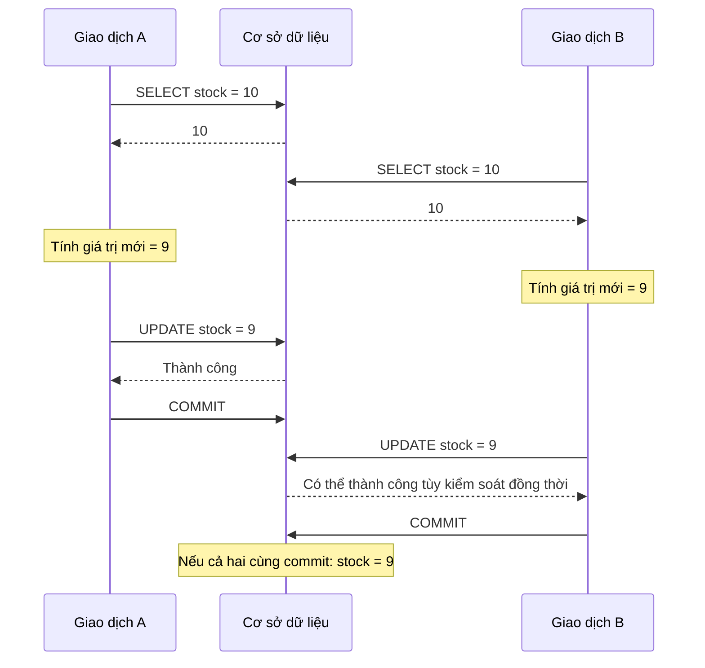
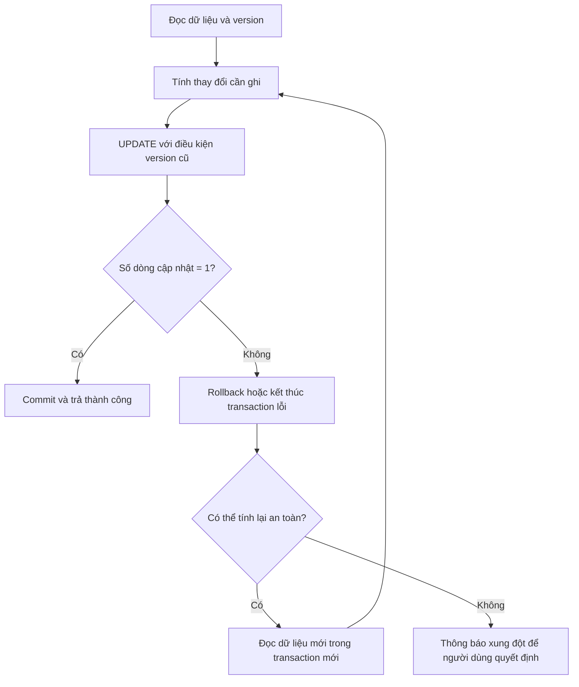

# Mất cập nhật (lost update)

Trong ứng dụng có nhiều người dùng, hai yêu cầu có thể cùng đọc một bản ghi, tính kết quả mới rồi ghi trở lại. Nếu yêu cầu sau ghi đè kết quả của yêu cầu trước bằng dữ liệu đã đọc từ trước, một thay đổi hợp lệ có thể **biến mất** dù cả hai giao dịch đều báo thành công. Hiện tượng đó gọi là **mất cập nhật** (*lost update*).

Đây là một vấn đề trọng tâm của **tính cô lập giao dịch** (*transaction isolation*) trong module **DATA_PERSISTENCE_FUNDAMENTALS**. Khi thiết kế persistence cho Java, hiểu lost update giúp chọn cách cập nhật dữ liệu, mức cô lập, chiến lược kiểm soát đồng thời và cách thử nghiệm chính xác. Ví dụ sử dụng SQL và Java/JDBC; hành vi khóa và isolation cụ thể phải được kiểm chứng trên hệ quản trị cơ sở dữ liệu được triển khai.

## 1. Lost update là gì?

Lost update xảy ra khi hai hoặc nhiều tác vụ cùng dựa trên một giá trị cũ để tạo ra các thay đổi, nhưng một lần ghi sau đó **ghi đè** lần ghi khác, khiến kết quả của một tác vụ không còn được phản ánh trong dữ liệu cuối cùng.

Ví dụ một sản phẩm có số lượng tồn kho ban đầu là **10**. Hai khách A và B đều mua một sản phẩm. Kết quả đúng, nếu cả hai đơn đều được chấp nhận, là **8**.

```text
Giá trị ban đầu: stock = 10

Yêu cầu A đọc 10, tính 10 - 1 = 9
Yêu cầu B đọc 10, tính 10 - 1 = 9
Yêu cầu A ghi stock = 9
Yêu cầu B ghi stock = 9

Giá trị thực tế cuối: stock = 9
Giá trị mong đợi:      stock = 8
```

Khi B ghi `9`, thay đổi giảm một sản phẩm do A thực hiện đã bị ghi đè về mặt ý nghĩa nghiệp vụ. Hệ thống có thể đã xác nhận **hai** đơn hàng nhưng chỉ giảm kho **một** đơn vị.

Lost update cũng có thể xuất hiện trong nhiều miền nghiệp vụ:

| Ngữ cảnh | Giá trị được đọc cùng lúc | Hệ quả khi ghi đè |
| --- | --- | --- |
| Ví điện tử | Hai tác vụ cùng đọc số dư để trừ tiền | Một khoản trừ không xuất hiện trong số dư cuối |
| Giỏ hàng | Hai thiết bị cùng sửa số lượng hoặc danh sách sản phẩm | Một thay đổi giỏ hàng biến mất |
| Hồ sơ người dùng | Hai quản trị viên sửa cùng bản ghi | Bản cập nhật sau xóa mất trường vừa được người trước thay đổi |
| Bộ đếm | Hai yêu cầu tăng lượt xem từ cùng giá trị | Bộ đếm chỉ tăng một thay vì hai |
| Phân bổ tồn kho | Hai đơn cùng đọc tồn kho cũ | Tồn kho thực tế không phản ánh đủ đơn đã nhận |

**Cốt lõi:** câu lệnh SQL có thể chạy thành công về mặt kỹ thuật nhưng **trạng thái cuối không phản ánh đầy đủ mọi thay đổi nghiệp vụ đã được chấp nhận**.

## 2. Diễn biến của hai giao dịch gây lost update

Xem hai transaction, mỗi transaction đọc tồn kho rồi dùng kết quả đó để tạo câu lệnh cập nhật:



Đây là **lịch thực thi minh họa cho một hệ thống cho phép ghi đè giá trị cũ**. Với một số mức cô lập/cơ chế MVCC, giao dịch B có thể bị từ chối ở bước cập nhật hoặc commit vì xung đột đồng thời; khi đó lost update không thực sự xảy ra. Không được suy từ sơ đồ rằng mọi DB ở mọi isolation level đều cho phép cả hai commit.

Hai đoạn SQL dưới đây thể hiện kiểu **đọc–tính–ghi** (*read-modify-write*) dễ gặp rủi ro:

```sql
-- Mỗi giao dịch có thể chạy đoạn sau trên một kết nối riêng:
BEGIN;
SELECT stock FROM products WHERE id = 42;
-- Java nhận stock = 10, tính newStock = 9.
UPDATE products SET stock = 9 WHERE id = 42;
COMMIT;
```

Trong mã thực tế, giá trị `9` đến từ phép tính `newStock = oldStock - 1`; câu `UPDATE` ghi một **giá trị tuyệt đối** đã tính từ bản đọc có thể không còn mới. Nếu không có cơ chế phát hiện xung đột, câu lệnh chỉ nói “đặt stock thành 9” chứ không nói “giảm đúng một đơn vị so với giá trị hiện tại”.

### Vì sao giao dịch vẫn có thể bị mất cập nhật?

Một transaction bảo vệ nguyên tử tính của **các thao tác nằm trong chính nó**, nhưng nhiều transaction khác nhau vẫn có thể xen kẽ các bước. Nếu mức cô lập cho phép lịch thực thi có mất cập nhật và ứng dụng không dùng biện pháp kiểm soát đồng thời, việc bọc mỗi luồng trong `BEGIN ... COMMIT` **không đủ**.

Tình huống nguy hiểm thường có ba dấu hiệu:

1. Nhiều tác vụ cùng đọc một giá trị có thể thay đổi.
2. Mỗi tác vụ dùng bản đọc đó để tính giá trị thay thế.
3. Câu ghi không kiểm tra rằng bản đọc còn hợp lệ, hoặc hệ quản trị không tự chặn xung đột này.

## 3. Phân biệt lost update với các hiện tượng gần giống

| Hiện tượng | Đặc điểm | Ví dụ |
| --- | --- | --- |
| **Lost update** | Một thay đổi đã được chấp nhận bị ghi đè bởi thao tác khác dựa trên dữ liệu cũ | Hai yêu cầu đều trừ `1`, cuối cùng chỉ giảm `1` |
| **Dirty read** | Một transaction đọc dữ liệu chưa commit của transaction khác | B đọc số dư do A vừa sửa nhưng A lại rollback |
| **Non-repeatable read** | Cùng một transaction đọc lại cùng bản ghi và thấy giá trị thay đổi sau commit của transaction khác | Lần đọc đầu thấy `10`, lần sau thấy `9` |
| **Write skew** | Hai transaction cập nhật **các bản ghi khác nhau** dựa trên trạng thái chung, khiến ràng buộc liên bản ghi bị vi phạm | Hai bác sĩ cùng thấy còn người trực rồi mỗi người tự nghỉ ca |
| **Dirty write** | Một transaction ghi đè thay đổi **chưa commit** của transaction khác | B thay giá trị A vừa sửa khi A chưa commit |

Đặc biệt, **non-repeatable read không đồng nghĩa với lost update**: một giao dịch có thể thấy dữ liệu đổi giữa hai lần đọc mà không hề ghi đè cập nhật của ai. Ngược lại, một câu lệnh ghi giá trị tính từ bản đọc cũ có thể làm mất cập nhật dù ứng dụng chỉ thực hiện một lần đọc.

Có những sản phẩm chủ động dùng chính sách **last write wins** (ghi mới nhất thắng), ví dụ một ô mô tả mà nghiệp vụ cho phép thay thế toàn bộ. Khi đó việc ghi đè có thể được chấp nhận theo yêu cầu sản phẩm. Nhưng không nên áp chính sách này cho bộ đếm, số dư, tồn kho hoặc dữ liệu có bất biến cần bảo vệ.

## 4. Cách 1: Cập nhật nguyên tử ngay trong SQL

Khi phép thay đổi có thể diễn đạt trực tiếp bằng một câu SQL, đây thường là phương án đơn giản và hiệu quả nhất.

**Cách dễ mất cập nhật:**

```java
int oldStock = repository.findStock(productId);
int newStock = oldStock - 1;
repository.updateStock(productId, newStock);
```

**Cách phù hợp hơn cho phép trừ tồn kho:**

```sql
UPDATE products
SET stock = stock - 1
WHERE id = :productId
  AND stock >= 1;
```

Database thực hiện phép trừ dựa trên giá trị hiện tại trong thao tác cập nhật, thay vì nhận giá trị `9` được tính sẵn từ một lần đọc cũ. Các hệ DB có giao dịch thông dụng sẽ điều phối cập nhật cùng bản ghi bằng cơ chế khóa hoặc phát hiện xung đột. Nếu câu SQL được thực thi thành công và ảnh hưởng đúng một hàng, giá trị đã giảm một đơn vị.

Câu `AND stock >= 1` còn giúp chặn xuất kho vượt số lượng sẵn có. Ứng dụng phải kiểm tra **số dòng bị cập nhật**:

- `1`: tìm được đúng một sản phẩm và đã trừ được kho.
- `0`: sản phẩm không tồn tại, tồn kho không đủ hoặc không còn thỏa điều kiện.
- Lớn hơn `1`: bất thường với khóa định danh duy nhất; cần xem lại lược đồ/truy vấn.

Ví dụ với bộ đếm:

```sql
UPDATE articles
SET view_count = view_count + 1
WHERE id = :articleId;
```

Với chuyển tiền, cần **hai cập nhật và bản ghi nghiệp vụ liên quan nằm trong một transaction**, dù mỗi câu lệnh có thể dùng phép cộng/trừ nguyên tử. Cập nhật nguyên tử một cột không thay thế atomicity của toàn bộ use case.

### Khi nào cập nhật SQL đơn lẻ chưa đủ?

Nếu tính toán phụ thuộc vào nhiều trường, nhiều bảng, quy tắc ở Java hoặc dữ liệu vừa đọc từ nguồn bên ngoài, việc diễn đạt mọi thứ trong một `UPDATE` có thể khó. Khi đó cần kết hợp giao dịch với **optimistic locking**, **pessimistic locking**, ràng buộc database hoặc mức cô lập phù hợp.

## 5. Cách 2: Optimistic locking bằng phiên bản

**Khóa lạc quan** (*optimistic locking*) cho phép nhiều tác vụ cùng đọc, nhưng **chỉ chấp nhận ghi nếu dữ liệu chưa bị ai sửa kể từ lần đọc đó**. Cách phổ biến là lưu cột `version` (số phiên bản).

Ví dụ bản ghi ban đầu:

```text
products(id = 42, stock = 10, version = 3)
```

Hai tác vụ đọc `version = 3`. Tác vụ A cập nhật trước:

```sql
UPDATE products
SET stock = 9,
    version = version + 1
WHERE id = 42
  AND version = 3;
```

A cập nhật được 1 dòng: bản ghi thành `stock = 9, version = 4`. Tác vụ B tiếp tục thử ghi kết quả tính từ bản đọc cũ:

```sql
UPDATE products
SET stock = 9,
    version = version + 1
WHERE id = 42
  AND version = 3;
```

B cập nhật **0 dòng** vì phiên bản hiện tại không còn bằng `3`. Nhờ vậy hệ thống phát hiện xung đột, không chấp nhận việc B ghi đè A.

### Quy trình xử lý xung đột



**Không được** xem `0` dòng như thành công. Cần trả lỗi xung đột, tải lại dữ liệu hoặc thử lại toàn bộ phép tính từ phiên bản mới nếu nghiệp vụ cho phép. Thử lại vô hạn hoặc gửi lại các hiệu ứng bên ngoài như thanh toán/email có thể tạo tác dụng phụ trùng lặp.

### Ví dụ trong JPA/Hibernate

JPA hỗ trợ optimistic locking với `@Version`:

```java
import jakarta.persistence.Entity;
import jakarta.persistence.Id;
import jakarta.persistence.Version;

@Entity
public class Product {
    @Id
    private Long id;

    private int stock;

    @Version
    private Long version;

    protected Product() { }

    public void decreaseStock() {
        if (stock <= 0) {
            throw new IllegalStateException("Hết hàng");
        }
        stock--;
    }
}
```

Trong một service có `@Transactional`, việc lấy entity được quản lý, gọi `decreaseStock()` rồi flush/commit sẽ khiến JPA provider kiểm tra phiên bản theo cơ chế optimistic locking. Nếu có thay đổi từ giao dịch khác, provider có thể ném ngoại lệ optimistic lock lúc `flush` hoặc `commit`. Cần quản lý rollback, ánh xạ ngoại lệ và retry **trong transaction mới** theo khả năng của nghiệp vụ.

Lưu ý: ví dụ JPA sử dụng `jakarta.persistence` như các ứng dụng Jakarta Persistence hiện đại; dự án cũ có thể còn dùng `javax.persistence`. Việc cập nhật dữ liệu hàng loạt bằng JPQL/native SQL có thể **không tự tăng hoặc kiểm tra version** giống cập nhật entity được quản lý; phải kiểm tra cơ chế thực thi cụ thể.

### Chi phí và giới hạn

Optimistic locking phù hợp khi xung đột ít và có thể xử lý thử lại. Khi nhiều yêu cầu cùng sửa một bản ghi rất nóng, tỷ lệ xung đột, rollback và retry có thể cao. Nó cũng chỉ bảo vệ các bản ghi và bất biến được đưa vào điều kiện kiểm tra; một cột `version` trên một hàng **không tự ngăn được** write skew giữa nhiều hàng.

## 6. Cách 3: Pessimistic locking (khóa trước khi sửa)

**Khóa bi quan** (*pessimistic locking*) yêu cầu cơ sở dữ liệu khóa tài nguyên liên quan trước khi đọc để sửa. Ví dụ với hệ DB hỗ trợ `SELECT ... FOR UPDATE`:

```sql
BEGIN;

SELECT stock
FROM products
WHERE id = 42
FOR UPDATE;

-- Ứng dụng kiểm tra stock > 0 và tính :newStock = stock - 1
-- từ giá trị vừa đọc khi đã giữ khóa.
UPDATE products
SET stock = :newStock
WHERE id = 42;

COMMIT;
```

Giao dịch B cũng yêu cầu khóa cùng hàng sẽ thường phải **chờ A kết thúc**, hoặc bị lỗi/timeout theo cấu hình và tùy chọn khóa. Sau khi được tiếp tục, B cần đọc và tính lại từ trạng thái hiện tại theo semantics của hệ DB, tránh tái sử dụng giá trị `stock` đã lấy từ trước khi khóa.

**Khóa phải được giữ trong cùng một transaction và trên kết nối/ngữ cảnh giao dịch phù hợp.** Dùng `SELECT ... FOR UPDATE` ở một connection rồi `UPDATE` ở connection khác không tạo ra ranh giới bảo vệ như mong đợi.

Khóa bi quan thường phù hợp khi xung đột cao, logic tính toán phức tạp hoặc cần bảo đảm quyết định dựa trên dữ liệu vừa khóa. Tuy vậy, nó có chi phí: chờ khóa, giảm đồng thời, nguy cơ deadlock và chiếm connection lâu. Không giữ giao dịch đang khóa trong lúc gọi HTTP, chờ người dùng hay thực hiện xử lý lâu.

### Thứ tự khóa để giảm deadlock

Nếu chuyển tiền phải khóa hai tài khoản, quy ước luôn khóa theo thứ tự ID tăng dần giúp giảm nguy cơ hai giao dịch khóa theo chiều đối ngược. Đây là biện pháp giảm rủi ro, **không loại bỏ mọi deadlock**. Ứng dụng vẫn phải rollback và cân nhắc retry khi DB báo deadlock hoặc lỗi serialization.

## 7. Ví dụ JDBC: giảm tồn kho và ghi giữ chỗ an toàn

Khi một yêu cầu mua hàng vừa trừ kho vừa tạo bản ghi giữ hàng, hai câu SQL cần cùng commit. Ví dụ dưới đây sử dụng **cập nhật có điều kiện** và quản lý transaction bằng JDBC.

Giả định:

- `inventory(product_id, available)` dùng `product_id` duy nhất.
- `reservations(order_id, product_id, quantity)` có ràng buộc phù hợp, trong ví dụ một `order_id` đại diện một lần giữ sản phẩm.
- Có ràng buộc ở DB để số lượng không âm khi cần, giao dịch được hỗ trợ, và các repository không tự mở transaction ngoài.

```java
import java.sql.Connection;
import java.sql.PreparedStatement;
import java.sql.SQLException;
import javax.sql.DataSource;

public final class InventoryService {
    private final DataSource dataSource;

    public InventoryService(DataSource dataSource) {
        this.dataSource = dataSource;
    }

    public void reserve(long orderId, long productId, int quantity)
            throws SQLException {
        if (quantity <= 0) {
            throw new IllegalArgumentException("Số lượng phải dương");
        }

        try (Connection connection = dataSource.getConnection()) {
            connection.setAutoCommit(false);
            try {
                try (PreparedStatement update = connection.prepareStatement(
                        "UPDATE inventory " +
                        "SET available = available - ? " +
                        "WHERE product_id = ? AND available >= ?")) {
                    update.setInt(1, quantity);
                    update.setLong(2, productId);
                    update.setInt(3, quantity);

                    if (update.executeUpdate() != 1) {
                        throw new IllegalStateException(
                                "Không tìm thấy sản phẩm hoặc không đủ kho");
                    }
                }

                try (PreparedStatement insert = connection.prepareStatement(
                        "INSERT INTO reservations(order_id, product_id, quantity) " +
                        "VALUES (?, ?, ?)")) {
                    insert.setLong(1, orderId);
                    insert.setLong(2, productId);
                    insert.setInt(3, quantity);
                    insert.executeUpdate();
                }

                connection.commit();
            } catch (SQLException | RuntimeException failure) {
                try {
                    connection.rollback();
                } catch (SQLException rollbackFailure) {
                    failure.addSuppressed(rollbackFailure);
                }
                throw failure;
            }
        }
    }
}
```

Hai điểm quan trọng:

1. Câu `UPDATE` trực tiếp giảm giá trị **hiện tại**, đồng thời yêu cầu `available >= quantity`, nên không dùng một giá trị tồn kho cũ do Java tính trước. Với điều kiện và khóa thích hợp của DB, hai yêu cầu cạnh tranh không cùng vượt qua điều kiện khi chỉ còn đủ hàng cho một yêu cầu.
2. Nếu `INSERT` thất bại, phần trừ kho được **rollback**, vì hai câu lệnh nằm trên cùng một `Connection` và chưa commit. Transaction bảo vệ tính nguyên tử của toàn bộ thao tác giữ hàng.

Ví dụ tập trung vào bảo vệ tồn kho; triển khai thực tế còn cần ràng buộc `order_id` duy nhất, idempotency key và khả năng tra cứu kết quả để tránh tạo nhiều đơn do retry. Nếu mất kết nối khi `COMMIT`, ứng dụng có thể **không biết** commit đã thành công hay chưa, nên không được tự động thực hiện lại nghiệp vụ mà không đối soát.

Với một phép tăng/giảm nguyên tử chỉ cần **một** câu `UPDATE`, giao dịch auto-commit của một câu lệnh có thể đủ. Khi nhiều thay đổi phải cùng thành công, nên quản lý transaction có chủ đích như ví dụ.

## 8. Mức cô lập có tự ngăn lost update không?

**Không thể suy chỉ từ tên isolation level** rằng một chương trình đọc–tính–ghi sẽ luôn an toàn. Hành vi phụ thuộc cách DB triển khai isolation, loại câu SQL, phiên bản engine và cách xử lý xung đột tại thời điểm ghi.

| Mức cô lập | Cách liên hệ với lost update |
| --- | --- |
| **Read Uncommitted** | Cung cấp rất ít bảo đảm về dữ liệu đọc; không nên dựa vào mức này để ngăn lost update. Một số hệ DB thực thi gần giống Read Committed. |
| **Read Committed** | Thường cho phép mỗi câu đọc thấy dữ liệu đã commit gần nhất; đọc–tính–ghi với giá trị cũ có thể gây lost update nếu không có bảo vệ bổ sung. |
| **Repeatable Read** | Một số DB phát hiện/khước từ cập nhật xung đột, trong khi hệ khác có thể cho phép một dạng ghi đè từ dữ liệu cũ. Cần kiểm chứng implementation và kiểu truy vấn. |
| **Serializable** | Yêu cầu kết quả tương đương một thứ tự chạy tuần tự của các transaction đã commit, nên ngăn lịch lost update bất hợp lệ. Đổi lại, transaction có thể bị buộc abort/retry hoặc chờ nhiều hơn. |

Ví dụ, **PostgreSQL** ở `REPEATABLE READ` có thể báo lỗi serialization khi transaction cố cập nhật hàng đã bị transaction đồng thời sửa sau snapshot của mình. Còn `READ COMMITTED` với kiểu truy vấn đọc rồi ghi một giá trị tuyệt đối vẫn cần biện pháp bảo vệ. **MySQL/InnoDB** có quy tắc khác giữa consistent read và locking read; không được giả định tên `REPEATABLE READ` bảo đảm cùng hành vi với PostgreSQL.

Ngay cả ở mức cô lập mạnh, ứng dụng phải **xử lý kết quả transaction bị từ chối** đúng cách. “Không bị mất cập nhật” có thể có nghĩa một giao dịch phải rollback và người dùng nhận yêu cầu thử lại, chứ không phải cả hai giao dịch luôn thành công.

### `@Transactional` không phải bảo đảm chống lost update

Ví dụ sau có rủi ro nếu repository đọc rồi ghi giá trị tuyệt đối và DB cho phép lịch ghi đè:

```java
@Transactional
public void decrease(long productId) {
    int current = inventoryRepository.findStock(productId);
    inventoryRepository.setStock(productId, current - 1);
}
```

`@Transactional` có thể bảo đảm hai thao tác cùng thuộc một transaction, nhưng không tự động thêm điều kiện version hoặc biến `setStock` thành phép trừ nguyên tử. Cần thay đổi thuật toán cập nhật, dùng `@Version`, khóa tương ứng hoặc isolation đủ mạnh tùy yêu cầu.

## 9. Chọn giải pháp theo nghiệp vụ

| Tình huống | Hướng tiếp cận thường phù hợp | Lưu ý |
| --- | --- | --- |
| Bộ đếm lượt xem, tăng/giảm một cột | `UPDATE count = count + 1` | Giảm round-trip và tránh gửi giá trị cũ từ Java |
| Giảm kho có điều kiện không âm | `UPDATE stock = stock - ? WHERE stock >= ?` | Kiểm tra số dòng; gộp với ghi đơn trong transaction nếu cần |
| Form chỉnh sửa hồ sơ trong vài phút | Optimistic locking `version` | Nếu xung đột, hiển thị dữ liệu mới và hỗ trợ giải quyết |
| Ghi nhiều bảng phụ thuộc nhau | Transaction + ràng buộc + điều khiển đồng thời phù hợp | Không tách commit làm mất bất biến |
| Quy trình cạnh tranh cao trên một bản ghi | SQL atomic, khóa bi quan hoặc cách phân vùng tải | Theo dõi lock wait, deadlock, retry và throughput |
| Quy tắc liên quan nhiều bản ghi | Khóa đúng tập dữ liệu hoặc Serializable và retry | `version` của một hàng không tự bảo vệ toàn bộ ràng buộc |

Chọn **optimistic locking** khi xung đột ít, thời gian sửa dài hoặc cần phát hiện việc dữ liệu đã thay đổi (ví dụ biểu mẫu người dùng). Chọn **pessimistic locking** khi phải tính nhiều bước trên trạng thái hiện hành và cần ngăn tác vụ cạnh tranh sửa dữ liệu trong khoảng ngắn. Ưu tiên **SQL atomic có điều kiện** cho phép cập nhật đơn giản diễn đạt được hoàn toàn ở DB.

Khi xung đột nhiều, các phương án này đều có chi phí: khóa có thể tăng hàng đợi, còn optimistic locking có thể tăng số lần xử lý thất bại và retry. Không có cơ chế nào tối ưu cho mọi loại dữ liệu.

## 10. Kiểm thử lost update một cách có kiểm soát

Vì lost update phụ thuộc thứ tự xen kẽ của các yêu cầu, kiểm thử cần **hai giao dịch độc lập trên hai kết nối** và kiểm soát thời điểm đọc/ghi. Một kiểm thử tuần tự chỉ chạy A xong rồi mới chạy B không tái hiện được lỗi.

### Kịch bản tái hiện vấn đề

Với hàng `id = 42, stock = 10` và isolation level cho phép kiểu ghi đè:

| Bước | Kết nối A | Kết nối B |
| --- | --- | --- |
| 1 | `BEGIN` | `BEGIN` |
| 2 | `SELECT stock` → `10` | |
| 3 | | `SELECT stock` → `10` |
| 4 | `UPDATE products SET stock = 9 WHERE id = 42` | |
| 5 | `COMMIT` | |
| 6 | | `UPDATE products SET stock = 9 WHERE id = 42` |
| 7 | | `COMMIT` |
| 8 | Đọc trạng thái cuối | Nếu DB cho cả hai commit, `stock = 9` |

Nếu DB từ chối một giao dịch do serialization/update conflict, đó là **kết quả hợp lệ của cơ chế bảo vệ**; ghi nhận mã lỗi và kiểm tra rollback thay vì ép kịch bản phải ra `9`. Không nên thử trên dữ liệu sản xuất.

### Kịch bản kiểm thử đã sửa

Khởi tạo lại `stock = 10`, cho hai kết nối cùng thực hiện:

```sql
BEGIN;
UPDATE products
SET stock = stock - 1
WHERE id = 42 AND stock >= 1;
COMMIT;
```

Nếu cả hai thao tác thành công và commit, **giá trị cuối phải là `8`**. Với tình huống chỉ còn `stock = 1`, hai yêu cầu đồng thời cùng giảm `1` thì chỉ một yêu cầu được chấp nhận, yêu cầu còn lại cập nhật `0` dòng hoặc nhận lỗi cần xử lý tùy hệ DB và isolation.

Với optimistic locking, cho A và B cùng đọc `version = 3`, sau đó để A cập nhật trước. Xác minh B nhận `0` dòng hoặc lỗi optimistic lock, **không được âm thầm trả thành công**. Nếu ứng dụng có retry, xác minh retry đọc phiên bản mới rồi tính lại trong transaction mới và tránh tạo hiệu ứng phụ trùng lặp.

### Kiểm thử tích hợp trong Java

Có thể dùng hai `Connection` lấy từ pool, `CountDownLatch` hoặc barrier để đồng bộ thời điểm hai tác vụ đã đọc xong, rồi cho chúng thực hiện cập nhật và commit. Hãy dùng database thật hoặc Testcontainers với cùng loại engine dự kiến triển khai: mock repository không tái hiện locking, MVCC và isolation.

Các kết quả cần xác minh:

- Giá trị cuối phản ánh đúng số phép cập nhật **đã thực sự được chấp nhận**.
- Một xung đột bị từ chối dẫn tới rollback, lỗi nghiệp vụ phù hợp hoặc retry có kiểm soát.
- Khi trừ kho không đủ, trạng thái không âm và không có đơn hàng được xác nhận sai.
- Deadlock, lock timeout hoặc serialization failure không để lại transaction dang dở.
- Kiểm thử không phụ thuộc vào `sleep` và giả định thứ tự thread; dùng điểm đồng bộ rõ ràng.

Lưu ý: một số test framework tự bọc mỗi test trong một transaction và rollback cuối test. Nếu các bước kiểm thử đều chạy trong transaction bao ngoài đó, phép kiểm có thể che giấu hành vi commit thật. Cần tổ chức kết nối và transaction thử nghiệm sao cho các phiên độc lập đúng nghĩa.

## 11. Các lỗi thiết kế thường gặp

| Lỗi | Hệ quả | Cách khắc phục |
| --- | --- | --- |
| Đọc giá trị vào Java rồi `UPDATE column = newValue` | Ghi đè bản cập nhật mới hơn | Dùng SQL atomic, `version` hoặc khóa khi cần |
| Giả định transaction mặc định luôn chặn lost update | Nhiều transaction vẫn có thể dùng dữ liệu cũ | Kiểm chứng isolation thật và cơ chế phát hiện xung đột |
| Dùng `SELECT FOR UPDATE` ngoài transaction hoặc khác connection | Khóa không bảo vệ toàn bộ read–modify–write | Giữ khóa và cập nhật trong cùng transaction |
| Có `@Version` nhưng bỏ qua lỗi xung đột | Người dùng tin rằng cập nhật đã được lưu | Xử lý exception, rollback và quyết định retry/merge |
| Retry lại nguyên yêu cầu sau mọi lỗi | Có thể tạo đơn, thu tiền hoặc phát sự kiện trùng | Phân loại lỗi, idempotency key và đối soát |
| Giữ khóa khi gọi API bên ngoài | Tăng lock wait và timeout | Tách giao dịch ngắn; dùng outbox/trạng thái trung gian |
| Chỉ bảo vệ một hàng khi ràng buộc trải trên nhiều hàng | Vẫn có thể vi phạm bất biến liên bản ghi | Xác định tập dữ liệu cần khóa hoặc dùng Serializable phù hợp |
| Tối ưu bằng cách tắt kiểm tra version trên bulk update | Đường cập nhật khác bỏ qua cơ chế optimistic locking | Dùng điều kiện version hoặc cơ chế xung đột thống nhất |

## 12. Quan sát và xử lý lỗi đồng thời trong vận hành

Lost update **khó phát hiện chỉ bằng độ trễ** vì cả hai câu `UPDATE` có thể nhanh và đều trả thành công. Cần kết hợp phòng ngừa ngay ở tầng dữ liệu với quan sát và kiểm tra bất biến:

- Ghi nhận số lần optimistic lock conflict, serialization failure, deadlock, lock timeout và retry theo use case.
- Giám sát số dòng cập nhật `0` của các câu `UPDATE ... WHERE version = ?` hoặc `WHERE available >= ?`; phân biệt hết hàng, không tồn tại và xung đột dữ liệu.
- Dùng ràng buộc `CHECK`, `UNIQUE`, khóa ngoại và mô hình dữ liệu phù hợp để bảo vệ các bất biến DB có thể diễn đạt.
- Đối soát sổ cái, đơn hàng, lượng tồn kho và lịch sử cập nhật với dữ liệu nguồn tin cậy; chỉ log ID, version, mã lỗi và trace cần thiết, tránh lộ dữ liệu nhạy cảm.
- Giữ các transaction ngắn, và chỉ retry khi lỗi/operation thực sự có thể retry an toàn. Với lỗi kết nối ngay lúc commit, tra cứu bằng mã yêu cầu trước khi phát sinh nghiệp vụ lần nữa.

Một hệ thống dùng optimistic locking có thể cho thấy nhiều **xung đột bị phát hiện** mà không có lost update thực sự; đây là tín hiệu để xem lại mức cạnh tranh và trải nghiệm người dùng. Ngược lại, hệ thống không ghi nhận lỗi nào chưa chắc đã an toàn nếu câu SQL luôn âm thầm ghi đè giá trị cũ.

## 13. Bài tập tự đánh giá

**Tình huống:** Hệ thống giữ chỗ có 5 vé còn lại. Hai người dùng đồng thời yêu cầu giữ 4 vé. Mỗi transaction `SELECT available`, kiểm tra `available >= 4`, tính `newAvailable = available - 4` và gọi `UPDATE seats SET available = newAvailable`. Sau đó hệ thống tạo hai bản ghi reservation.

Hãy trả lời:

1. Tại sao có thể xuất hiện hai reservation trong khi `available` cuối cùng chỉ giảm từ `5` xuống `1`?
2. Bọc mỗi request trong `@Transactional` đã đủ để giải quyết chưa?
3. Viết một câu SQL giúp chỉ một request thành công khi kho còn 5 vé.
4. Nếu câu `UPDATE` giảm vé thành công nhưng `INSERT reservation` thất bại, ứng dụng phải xử lý thế nào?
5. Khi dùng optimistic locking và cả hai người cùng đọc `version = 7`, hành vi đúng của lần cập nhật thứ hai là gì?

**Gợi ý lời giải:** Hai request có thể cùng đọc `5`, cùng tính `1`, rồi ghi đè cùng giá trị. Mỗi transaction riêng lẻ không bảo đảm chặn lỗi nếu isolation và truy vấn cho phép lịch đó. Một câu SQL phù hợp là:

```sql
UPDATE seats
SET available = available - 4
WHERE event_id = :eventId
  AND available >= 4;
```

Kiểm tra số dòng bị ảnh hưởng: với 5 vé ban đầu, chỉ một yêu cầu được giữ 4 vé nếu hai lần cập nhật được điều phối đúng. `INSERT reservation` phải nằm trong **cùng transaction** với `UPDATE` để rollback toàn bộ nếu ghi reservation thất bại. Với optimistic locking, lần cập nhật dùng `version = 7` sau khi version đã tăng phải bị từ chối hoặc báo xung đột; ứng dụng tải lại dữ liệu mới và quyết định thông báo hết chỗ hoặc thử lại theo quy tắc nghiệp vụ.

## 14. Những điểm cần ghi nhớ

- **Lost update** là hiện tượng một lần ghi dựa trên dữ liệu cũ làm biến mất tác động của cập nhật khác.
- **Bọc mã trong transaction chưa bảo đảm tránh được lost update.** Phải xét isolation level, hành vi DB và thuật toán đọc–tính–ghi.
- Với phép tăng/giảm đơn giản, ưu tiên **`UPDATE column = column + delta`** và thêm điều kiện nghiệp vụ như `available >= quantity`; luôn kiểm tra số dòng cập nhật.
- Với sửa dữ liệu dài hoặc cần nhận biết người khác đã thay đổi, dùng **optimistic locking** qua `version` và xử lý xung đột thật.
- Với logic cần khóa trước khi tính toán, dùng **pessimistic locking** trong giao dịch ngắn trên cùng connection và xử lý deadlock/timeout.
- **Serializable** bảo vệ tính tương đương tuần tự nhưng có thể khiến transaction abort và cần retry. `Repeatable Read` và các mức khác phải được đánh giá theo engine và loại truy vấn.
- Kiểm thử bằng **ít nhất hai transaction độc lập**, xác minh trạng thái sau commit và những cập nhật bị từ chối.

Thiết kế persistence đúng cần biến quy tắc “mỗi thay đổi đã chấp nhận phải được phản ánh trong dữ liệu” thành điều kiện có thể kiểm tra và bảo vệ tại database. Khi làm được điều đó, nhiều yêu cầu Java chạy đồng thời sẽ không âm thầm làm mất kết quả của nhau.
