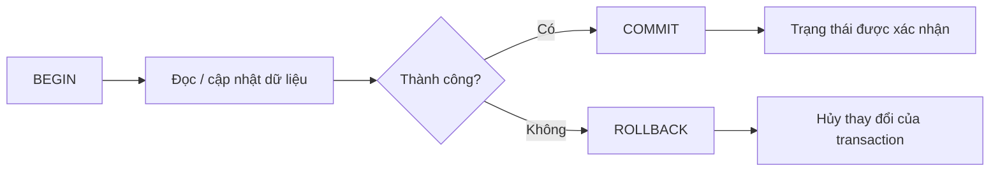

# Mức READ UNCOMMITTED và nguy cơ đọc dữ liệu chưa commit

## 1. READ UNCOMMITTED giải quyết vấn đề gì và đánh đổi điều gì?

Trong ứng dụng có nhiều người dùng, một transaction có thể đang sửa dữ liệu nhưng chưa đưa ra quyết định **COMMIT** hay **ROLLBACK**. Một transaction khác đọc đúng vào khoảng thời gian đó sẽ phải đối mặt với câu hỏi: **có được quan sát thay đổi tạm thời của transaction thứ nhất hay không?**

**READ UNCOMMITTED** là mức cô lập (*isolation level*) yếu nhất trong bốn mức cô lập truyền thống của SQL. Mức này **cho phép** hiện tượng **dirty read**: transaction đọc giá trị do transaction khác ghi nhưng chưa commit. Nếu transaction ghi rollback, giá trị vừa đọc chưa từng trở thành trạng thái dữ liệu được xác nhận.

Ví dụ: nhân viên chuyển khoản đang sửa số dư từ 1.000 xuống 300, nhưng giao dịch chuyển khoản chưa hoàn tất. Nếu màn hình xét duyệt của một người khác đọc 300 và từ chối một yêu cầu mới, quyết định đã dựa trên giá trị có thể không bao giờ được commit.

Bài này nằm trong chương **Tính cô lập** của module **DATA_PERSISTENCE_FUNDAMENTALS**. Khi thiết kế ranh giới persistence cho Java, người học cần xác định dữ liệu nào được phép đọc, dự đoán lỗi khi chạy đồng thời, chọn mức cô lập phù hợp và kiểm chứng hành vi thực tế của DBMS cùng JDBC driver.

> **Ý chính:** READ UNCOMMITTED mô tả một **mức bảo đảm cô lập được yêu cầu**. Nó không phải lời hứa mọi hệ quản trị đều cho đọc dữ liệu chưa commit. Một số hệ thống áp dụng mức mạnh hơn dù ứng dụng yêu cầu READ UNCOMMITTED.

## 2. Commit, rollback và dữ liệu đang ở trạng thái tạm

Một transaction thường có chu trình:



- **COMMIT:** kết thúc transaction thành công; các thay đổi được công bố theo cơ chế giao dịch của hệ lưu trữ.
- **ROLLBACK:** hủy các thay đổi chưa commit của chính transaction. Dữ liệu chưa commit có thể là kết quả của bước đang thực hiện, bước sẽ thất bại hoặc yêu cầu bị hủy.
- **Transaction khác đang chạy:** dưới mức cô lập đủ mạnh để ngăn dirty read, transaction đọc không được lấy các giá trị chưa commit đó; phương thức thực thi có thể là chờ khóa, đọc phiên bản đã commit, hoặc cơ chế khác.

Cần phân biệt **dữ liệu chưa commit** với **dữ liệu đã commit nhưng cũ**. Một read replica chậm đồng bộ có thể trả về phiên bản đã commit trước đó: đó là vấn đề độ mới (*staleness*), không nhất thiết là dirty read. Ngược lại, một dirty read có thể diễn ra ngay trên cùng một node khi đọc bản cập nhật đang dở dang.

## 3. Dirty read: ví dụ diễn tiến có rollback

Giả sử tài khoản `A001` có số dư **1.000.000 đồng** ở trạng thái đã commit. Transaction T1 bắt đầu ghi nhận một khoản chi 700.000 đồng, trong khi transaction T2 đọc số dư để đưa ra quyết định.

| Thời điểm | Transaction T1 (ghi) | Transaction T2 (đọc ở READ UNCOMMITTED) | Giá trị đã commit |
| --- | --- | --- | ---: |
| T0 | Chưa thực hiện | Chưa thực hiện | 1.000.000 |
| T1 | `BEGIN`; cập nhật số dư còn **300.000**, chưa commit | — | 1.000.000 |
| T2 | Đang mở | `SELECT balance`, có thể thấy **300.000** | 1.000.000 |
| T3 | Gặp lỗi; thực hiện `ROLLBACK` | T2 vẫn đã sử dụng giá trị 300.000 | 1.000.000 |
| T4 | Đã kết thúc | Đọc lại có thể thấy **1.000.000** | 1.000.000 |

```mermaid
sequenceDiagram
    participant T1 as T1 - transaction ghi
    participant DB as Database
    participant T2 as T2 - transaction đọc
    T1->>DB: BEGIN; UPDATE balance = 300000
    Note over DB: Thay đổi chưa COMMIT
    T2->>DB: SELECT balance (READ UNCOMMITTED)
    DB-->>T2: Có thể trả 300000
    T2->>T2: Ra quyết định dựa trên 300000
    T1->>DB: ROLLBACK
    Note over DB: Bản đã commit vẫn là 1000000
    T2->>DB: SELECT balance lần nữa
    DB-->>T2: 1000000
```

**Lỗi cốt lõi** không phải câu truy vấn chạy sai cú pháp. T2 đã quan sát trạng thái tạm của T1 và có thể đưa ra tác động nghiệp vụ bên ngoài transaction (từ chối thanh toán, gửi cảnh báo, cập nhật dashboard, kích hoạt một workflow). Việc T1 rollback không thể tự động “thu hồi” email, quyết định hoặc yêu cầu gửi đi từ T2.

Không phải mọi transaction ở READ UNCOMMITTED đều xảy ra dirty read. Hiện tượng này chỉ xuất hiện khi có thao tác ghi chưa commit, lịch chạy xen kẽ thích hợp và DBMS thực sự cho phép đọc giá trị đó.

## 4. Ví dụ SQL chạy bằng hai session

Các lệnh sau dùng cú pháp **Microsoft SQL Server** để minh họa một hệ quản trị hỗ trợ cách đọc dirty read theo READ UNCOMMITTED. Hãy chạy trên môi trường thử nghiệm; mở hai kết nối riêng tới cùng database. Không dùng bảng số dư thật.

Thiết lập dữ liệu ban đầu và commit:

```sql
CREATE TABLE dbo.DemoAccount (
    account_id VARCHAR(20) PRIMARY KEY,
    balance BIGINT NOT NULL
);

INSERT INTO dbo.DemoAccount (account_id, balance)
VALUES ('A001', 1000000);
-- Chạy thiết lập trước khi bắt đầu hai session.
```

**Session 1 — ghi nhưng chưa commit:**

```sql
BEGIN TRANSACTION;

UPDATE dbo.DemoAccount
SET balance = 300000
WHERE account_id = 'A001';

-- Giữ transaction đang mở để session 2 đọc.
-- Sau khi session 2 đã đọc, chạy:
ROLLBACK TRANSACTION;
```

**Session 2 — chạy trong khoảng sau UPDATE và trước ROLLBACK của session 1:**

```sql
SET TRANSACTION ISOLATION LEVEL READ UNCOMMITTED;
BEGIN TRANSACTION;

SELECT balance
FROM dbo.DemoAccount
WHERE account_id = 'A001';

COMMIT TRANSACTION;
```

Trên cấu hình SQL Server phù hợp, `SELECT` ở session 2 **có thể trả về 300000** dù T1 chưa commit. Sau khi chạy `ROLLBACK` ở session 1, một lần đọc mới theo dữ liệu đã commit sẽ thấy **1000000**.

Để đối chiếu, hãy chạy lại lịch trên với session 2 yêu cầu mức `READ COMMITTED`:

```sql
SET TRANSACTION ISOLATION LEVEL READ COMMITTED;
BEGIN TRANSACTION;

SELECT balance
FROM dbo.DemoAccount
WHERE account_id = 'A001';

COMMIT TRANSACTION;
```

Trong SQL Server, với cơ chế đọc dựa trên khóa truyền thống, lệnh đọc này thường phải **đợi** T1 kết thúc để tránh dirty read. Nếu database bật `READ_COMMITTED_SNAPSHOT`, lệnh đọc ở READ COMMITTED có thể lấy **phiên bản đã commit** mà không phải chờ khóa ghi theo cùng cách. Hai cách thực thi khác nhau nhưng cùng nhằm không đọc thay đổi chưa commit.

**Chú ý thứ tự thực hiện:** khối session 1 được viết liền để dễ hiểu, nhưng phải tạm dừng sau `UPDATE`, chạy session 2 rồi mới thực hiện `ROLLBACK`. Nếu chạy toàn bộ session 1 trước, sẽ không còn cửa sổ để quan sát dirty read.

## 5. So sánh các mức cô lập SQL truyền thống

Mức cô lập có thể mô tả bằng những **hiện tượng được phép** theo phân loại của SQL. Đây là cách nhìn về mức bảo đảm tối thiểu; từng DBMS có thể cung cấp bảo đảm mạnh hơn hoặc có chi tiết triển khai khác nhau.

| Mức cô lập | Dirty read | Non-repeatable read | Phantom read |
| --- | --- | --- | --- |
| **READ UNCOMMITTED** | Có thể xảy ra | Có thể xảy ra | Có thể xảy ra |
| **READ COMMITTED** | Không được phép | Có thể xảy ra | Có thể xảy ra |
| **REPEATABLE READ** | Không được phép | Không được phép theo cách phân loại chuẩn | Có thể xảy ra theo phân loại chuẩn |
| **SERIALIZABLE** | Không được phép | Không được phép | Không được phép |

Các khái niệm khác nhau:

- **Dirty read:** đọc một giá trị **chưa commit** do transaction khác ghi; transaction ghi sau đó có thể rollback.
- **Non-repeatable read:** đọc cùng một bản ghi hai lần, giữa hai lần transaction khác **commit** thay đổi, khiến kết quả khác nhau.
- **Phantom read:** chạy lại truy vấn theo một điều kiện lọc, số lượng/tập bản ghi phù hợp thay đổi vì transaction khác **commit** việc thêm, xóa hoặc sửa các dòng thỏa điều kiện.

Ví dụ dirty read là thấy số dư 300.000 của T1 *trước commit*. Nếu T1 đã commit việc thay số dư thành 300.000 rồi T2 đọc lại trong cùng transaction và thấy kết quả khác lần trước, đó là hiện tượng non-repeatable read, **không phải dirty read**.

**Lưu ý:** bảng mô tả mức cô lập theo hiện tượng SQL cổ điển, không bao quát mọi bất thường như **write skew** hay trường hợp khác biệt giữa snapshot isolation và serializability. Chẳng hạn, mức `REPEATABLE READ` của PostgreSQL dựa trên snapshot có thể ngăn cả phantom theo ngữ nghĩa triển khai của nó; điều đó không biến mọi cấu hình `REPEATABLE READ` trên các DBMS thành tương đương nhau.

## 6. Vì sao READ UNCOMMITTED nguy hiểm trong nghiệp vụ?

### 6.1. Quyết định dựa trên dữ liệu không tồn tại sau rollback

Một dịch vụ xét duyệt đơn kiểm tra `available = 0` trong lúc transaction bán hàng vừa tạm giảm tồn kho, nhưng cuối cùng transaction bán hàng rollback vì thanh toán lỗi. Dịch vụ xét duyệt đã từ chối đơn mới dù về thực tế hàng chưa bị bán.

Tình huống tương tự xuất hiện ở điểm thưởng, hạn mức chi tiêu, số dư ví, phân bổ suất học hoặc quyền truy cập. **Độ nhanh của phép đọc** không bù được chi phí nghiệp vụ nếu quyết định không thể thu hồi.

### 6.2. Báo cáo và tổng hợp có thể không phản ánh một trạng thái hợp lệ

Một báo cáo cộng tổng doanh thu trong khi transaction đang sửa nhiều dòng có thể thấy một phần thay đổi tạm thời. Tại một số engine/cơ chế quét, đọc không khóa thích hợp còn có thể dẫn tới thiếu hoặc lặp dòng khi trang dữ liệu thay đổi trong lúc quét. Vì vậy “chỉ để báo cáo, cho phép sai một chút” cũng không tự động làm READ UNCOMMITTED an toàn.

Nếu báo cáo cần một ảnh chụp thống nhất giữa nhiều câu truy vấn, **READ COMMITTED cũng có thể chưa đủ**; cần xác định cơ chế snapshot, mức cô lập và phạm vi transaction của DBMS.

### 6.3. Hiệu ứng dây chuyền qua các hệ thống

Một dịch vụ đọc giá trị chưa commit và dùng kết quả để gọi API khác, phát sự kiện hoặc lưu vào cache. T1 rollback, nhưng hệ thống ngoài vẫn giữ hệ quả của dữ liệu tạm. Việc bọc phép đọc trong một JDBC transaction không tự rollback những tác động ngoài database.

### 6.4. Có thể che lấp lỗi thiết kế cạnh tranh

READ UNCOMMITTED không giải quyết **lost update**, không bảo vệ bất biến “số lượng không âm”, không thay thế khóa và cũng không bảo đảm transaction ghi chạy tuần tự. Việc thấy dữ liệu sớm hơn chỉ có thể làm thay đổi kiểu lỗi. Nếu thao tác yêu cầu kiểm tra điều kiện rồi ghi, hãy thiết kế **kiểm tra và cập nhật nguyên tử** trên nguồn có thẩm quyền.

## 7. READ UNCOMMITTED có giống NOLOCK không?

Trong SQL Server, hint `WITH (NOLOCK)` trên một bảng thường yêu cầu hành vi tương đương `READUNCOMMITTED` đối với các phép đọc dữ liệu từ bảng đó:

```sql
SELECT order_id, amount
FROM dbo.Orders WITH (NOLOCK)
WHERE status = 'PENDING';
```

Điều này có nghĩa câu truy vấn **chấp nhận nguy cơ dirty read**, và tùy tình huống có thể gặp dữ liệu thiếu, trùng hoặc lỗi khi quét cùng lúc với thao tác di chuyển dữ liệu.

Tên “NOLOCK” rất dễ gây hiểu lầm:

- Nó **không có nghĩa** truy vấn không bao giờ sử dụng bất kỳ khóa nào. Chẳng hạn, SQL Server vẫn có thể dùng khóa ổn định schema (Sch-S) trong biên dịch/thực thi truy vấn và bị chặn bởi một số thay đổi schema.
- Nó **không đồng nghĩa** với transaction chỉ đọc hay quyền chỉ đọc.
- Nó **không bảo đảm** kết quả là snapshot nhất quán hoặc dữ liệu mới nhất.
- Nó **không phải cú pháp SQL chung** cho PostgreSQL, MySQL hay mọi hệ quản trị khác.

Trong các trường hợp tranh chấp đọc–ghi, nên khảo sát **READ COMMITTED với row versioning** hoặc **SNAPSHOT isolation** nếu DBMS hỗ trợ và hệ thống phù hợp. Những lựa chọn này có thể giảm chặn do khóa trong khi không cần chấp nhận dirty read; đổi lại có chi phí quản lý phiên bản dữ liệu và những quy tắc đồng thời riêng.

## 8. Không phải DBMS nào cũng thực thi READ UNCOMMITTED giống nhau

Đây là điểm bắt buộc kiểm chứng khi triển khai persistence đa hệ quản trị hoặc ứng dụng Java dùng JDBC.

| Hệ quản trị | Khi yêu cầu READ UNCOMMITTED | Điểm cần xác minh |
| --- | --- | --- |
| **PostgreSQL** | Được chấp nhận về cú pháp nhưng vận hành như **READ COMMITTED** | PostgreSQL không cung cấp dirty read theo mức này; mỗi câu lệnh có thể dùng snapshot đã commit khác nhau |
| **SQL Server** | Có thể đọc dữ liệu chưa commit, tương tự hint `READUNCOMMITTED`/`NOLOCK` trong những ngữ cảnh áp dụng | Chế độ row versioning, khóa schema, cách quét dữ liệu và transaction đồng thời |
| **MySQL InnoDB** | Có thể xảy ra dirty read trong những tình huống phù hợp | Isolation thực tế của connection, loại truy vấn, phiên bản engine và kiểm thử đồng thời |

Ở PostgreSQL, việc chạy:

```sql
BEGIN TRANSACTION ISOLATION LEVEL READ UNCOMMITTED;
SELECT balance FROM accounts WHERE account_id = 'A001';
COMMIT;
```

**không chứng minh** hệ thống đã cho dirty read, vì PostgreSQL thực thi mức này như READ COMMITTED. Nếu dựng đúng kịch bản hai transaction ở trên trên PostgreSQL, phép đọc thông thường không lấy giá trị chưa commit của transaction khác. Không nên coi hành vi đó là lỗi driver: đó là lựa chọn của DBMS mạnh hơn mức tối thiểu được yêu cầu.

Trên các DBMS khác, chỉ nhớ tên isolation level là chưa đủ. Cần xác định **engine lưu trữ, phiên bản, loại lệnh, chế độ snapshot và cấu hình kết nối**, rồi kiểm thử trên môi trường thật.

## 9. Cấu hình mức cô lập qua JDBC

JDBC định nghĩa hằng số `Connection.TRANSACTION_READ_UNCOMMITTED`. Ứng dụng có thể yêu cầu mức này cho một connection trước khi bắt đầu transaction:

```java
import java.sql.Connection;
import java.sql.PreparedStatement;
import java.sql.ResultSet;
import java.sql.SQLException;
import javax.sql.DataSource;

public final class BalanceReader {
    private final DataSource dataSource;

    public BalanceReader(DataSource dataSource) {
        this.dataSource = dataSource;
    }

    // Chỉ minh họa cách cấu hình; không dùng mức này để xét duyệt số dư.
    public long readAtWeakestIsolation(String accountId) throws SQLException {
        try (Connection connection = dataSource.getConnection()) {
            connection.setTransactionIsolation(
                    Connection.TRANSACTION_READ_UNCOMMITTED);
            connection.setAutoCommit(false);

            try (PreparedStatement statement = connection.prepareStatement(
                    "SELECT balance FROM accounts WHERE account_id = ?")) {
                statement.setString(1, accountId);
                long balance;

                try (ResultSet result = statement.executeQuery()) {
                    if (!result.next()) {
                        throw new SQLException("Account not found: " + accountId);
                    }
                    balance = result.getLong(1);
                }

                connection.commit();
                return balance;
            } catch (SQLException | RuntimeException error) {
                try {
                    connection.rollback();
                } catch (SQLException rollbackError) {
                    error.addSuppressed(rollbackError);
                }
                throw error;
            }
        }
    }
}
```

Đoạn mã cho thấy **cách yêu cầu** mức cô lập; nó không chứng minh DBMS thực sự cho phép dirty read. Cần lưu ý:

1. Thiết lập `setTransactionIsolation(...)` **trước khi** transaction bắt đầu. Việc thay đổi isolation giữa transaction đang chạy có ngữ nghĩa và hạn chế tùy driver/DBMS.
2. `Connection.getMetaData().supportsTransactionIsolationLevel(...)` và `getTransactionIsolation()` giúp kiểm tra khả năng và cấu hình được báo cáo, nhưng **không thay thế thử nghiệm ngữ nghĩa**. PostgreSQL có thể báo mức được hỗ trợ nhưng hành xử như READ COMMITTED.
3. Không nên mặc định connection pool luôn khôi phục đúng isolation cũ khi trả connection. Kiểm tra cấu hình pool/transaction manager để tránh rò rỉ mức cô lập yếu sang request khác.
4. `setReadOnly(true)` là tín hiệu mục đích đọc đối với driver/DBMS; nó **không ngăn dirty read** và không tự nâng isolation level.
5. Nếu hệ thống không hỗ trợ mức yêu cầu, hãy xử lý hoặc cấu hình theo hợp đồng của DBMS; **không được âm thầm cho rằng kết quả đạt yêu cầu**.

### Với Spring

Spring cho phép khai báo:

```java
@Transactional(
    readOnly = true,
    isolation = Isolation.READ_UNCOMMITTED
)
public AccountView loadAccount(String id) {
    return repository.loadAccount(id);
}
```

Đây là **yêu cầu cấu hình transaction**, không phải sự bảo đảm mọi DBMS sẽ thực hiện dirty read. Để annotation có hiệu lực như mong đợi, phương thức phải tham gia transaction manager tương ứng; lời gọi nội bộ không đi qua proxy trong một số cấu hình Spring có thể bỏ qua interception. Các transaction đã tồn tại cũng có thể khiến thiết lập isolation mới không được áp dụng nếu phương thức chỉ tham gia transaction đó.

Với nghiệp vụ liên quan tiền, tồn kho, quyền truy cập hay sự kiện quan trọng, tránh lựa chọn READ UNCOMMITTED chỉ để “tăng tốc” khi chưa định lượng rủi ro và kiểm chứng các phương án khác.

## 10. Chọn giải pháp khi mục tiêu thật sự là giảm chặn đọc

Đội phát triển đôi khi chọn READ UNCOMMITTED vì truy vấn chậm hoặc bị chặn bởi transaction ghi. Nhưng việc giảm chặn có nhiều hướng xử lý:

| Mục tiêu | Lựa chọn nên đánh giá | Điều cần đo hoặc xác nhận |
| --- | --- | --- |
| Đọc dữ liệu đã commit, giảm chờ khóa | READ COMMITTED với cơ chế phiên bản (nếu hỗ trợ) | Khả năng đọc snapshot, chi phí version store, độ trễ |
| Nhiều truy vấn phải dùng cùng một trạng thái | Snapshot/REPEATABLE READ theo DBMS | Phạm vi snapshot, thời gian transaction, xung đột ghi |
| Bảo vệ bất biến khi có ghi đồng thời | Constraint, cập nhật có điều kiện, khóa hoặc SERIALIZABLE | Tỷ lệ tranh chấp, retry, deadlock, tính đúng đắn |
| Báo cáo quy mô lớn | Replica, materialized view, bảng tổng hợp hoặc pipeline riêng | Độ trễ đồng bộ, mốc dữ liệu và chất lượng kết quả |
| Truy vấn SELECT quá chậm | Chỉ mục, truy vấn hiệu quả, phân trang, giới hạn thời gian | Execution plan, I/O, khóa, số hàng quét |
| Chỉ cần trạng thái gần đúng | Bộ đếm tổng hợp đã commit, dữ liệu theo mốc thời gian | Sai số được định nghĩa rõ; không dựa vào các giá trị tạm chưa commit |

**READ COMMITTED** ngăn dirty read theo hợp đồng của mức cô lập, nhưng **không** mặc nhiên bảo đảm nhiều câu truy vấn cùng snapshot, read-your-writes qua một replica chậm hay tính đúng đắn của nghiệp vụ “đọc điều kiện rồi ghi”. Với từng nhu cầu, phải làm rõ loại nhất quán đang cần thay vì tăng hoặc giảm isolation theo cảm tính.

## 11. Kiểm thử dirty read theo cách có thể lặp lại

Một bài test có ích phải cố ý tạo **cửa sổ chưa commit**. Chạy tuần tự mọi SQL rồi quan sát kết quả không đủ để chứng minh mức cô lập.

**Kịch bản thử nghiệm:**

1. Khởi tạo tài khoản `A001` có số dư 1.000.000 và commit.
2. Dùng connection T1, `BEGIN` và cập nhật số dư thành 300.000, nhưng chưa commit.
3. Dùng connection T2 riêng, chọn isolation level cần khảo sát rồi đọc cùng dòng.
4. Ghi lại giá trị T2 thấy, thời gian chờ và trạng thái của T1.
5. Cho T1 `ROLLBACK`, sau đó đọc lại bằng transaction mới ở READ COMMITTED.
6. Lặp lại với các isolation level và DBMS mục tiêu; đối chiếu kết quả với tài liệu của đúng phiên bản đang chạy.

Để tự động hóa, sử dụng hai connection và cơ chế đồng bộ (ví dụ `CountDownLatch` trong Java) để T2 thực hiện `SELECT` **sau UPDATE và trước ROLLBACK** của T1. Đặt timeout hợp lý cho trường hợp READ COMMITTED phải chờ T1; không để test treo vô hạn. Không dùng cùng một connection cho cả hai transaction vì như vậy sẽ không kiểm thử được khả năng nhìn thấy ghi *của transaction khác*.

**Kỳ vọng:**

- Nếu DBMS cho dirty read, T2 **có thể** thấy 300.000 khi T1 vẫn chưa commit; sau rollback, trạng thái được xác nhận vẫn là 1.000.000.
- Nếu DBMS chặn dirty read bằng khóa, T2 có thể đợi T1 kết thúc và sau đó đọc 1.000.000.
- Nếu DBMS dùng snapshot của dữ liệu đã commit, T2 có thể đọc 1.000.000 ngay mà không cần chờ khóa dữ liệu ghi theo cùng cách.
- Nếu yêu cầu READ UNCOMMITTED bị nâng thành READ COMMITTED trong DBMS, việc không tái hiện dirty read **không phải** test thất bại; phải ghi đúng bảo đảm thực tế.

Không được dùng một lần không quan sát được dirty read để kết luận tuyệt đối hệ thống không cho phép nó; còn phụ thuộc lịch chạy, hình thức truy vấn và cấu hình. Khi khẳng định một cam kết nghiệp vụ, cần căn cứ vào tài liệu của hệ lưu trữ cộng với kiểm thử đúng kịch bản.

## 12. Tình huống luyện tập

**Tình huống 1.** Một transaction cập nhật tồn kho từ 5 xuống 0 nhưng rollback vì thanh toán thất bại. Một trang khác đọc `available = 0` trước rollback và thông báo “hết hàng”. Đây là dạng bất thường gì?

**Tình huống 2.** Hai lần đọc từ cùng một transaction lần lượt trả `balance = 1.000.000` và `balance = 300.000`. Giữa hai lần đọc, transaction ghi **đã commit** thay đổi. Có đủ bằng chứng kết luận dirty read không?

**Tình huống 3.** Ứng dụng JDBC yêu cầu `TRANSACTION_READ_UNCOMMITTED` trên PostgreSQL nhưng trong thử nghiệm không thấy dữ liệu của transaction chưa commit. Có nên cố “sửa” driver để tạo dirty read?

**Tình huống 4.** Truy vấn báo cáo SQL Server bị chờ khóa ghi. Nhóm đề xuất thêm `NOLOCK` cho mọi bảng vì “báo cáo không cần chính xác tuyệt đối”. Cần đặt những câu hỏi nào trước khi chấp nhận?

**Gợi ý trả lời:**

1. Dirty read: trang đã đọc thay đổi chưa commit và dữ liệu đó cuối cùng bị rollback.
2. Không. Đây có thể là non-repeatable read do dữ liệu **đã commit** thay đổi; cần biết thời điểm từng câu đọc và commit.
3. Không. PostgreSQL thực thi READ UNCOMMITTED như READ COMMITTED; cần tuân theo bảo đảm thực tế của DBMS.
4. Cần biết báo cáo có ảnh hưởng quyết định nghiệp vụ không, có chịu được giá trị chưa commit/thiếu/trùng dòng không, khoảng chờ xuất phát từ đâu, và liệu read committed snapshot, tối ưu truy vấn hoặc replica có đáp ứng được mà không cần dirty read hay không.

## Kết luận

**READ UNCOMMITTED** cho phép một transaction quan sát thay đổi **chưa commit** của transaction khác. Khi transaction ghi rollback, phép đọc trước đó có thể trở thành **dirty read** và gây quyết định sai hoặc hiệu ứng dây chuyền khó thu hồi. Hành vi thực tế phụ thuộc DBMS: SQL Server và một số cấu hình InnoDB có thể tạo dirty read, trong khi PostgreSQL đối xử với yêu cầu này như READ COMMITTED.

Khi triển khai persistence trong Java, cần phát biểu rõ yêu cầu nghiệp vụ, chọn isolation level theo bất thường phải ngăn, kiểm tra cấu hình JDBC/Spring và thử nghiệm bằng hai transaction chạy xen kẽ. **Giảm chờ khóa** là mục tiêu hiệu năng; **chỉ đọc dữ liệu đã commit** là một yêu cầu tính đúng đắn. Hai mục tiêu cần được thiết kế và đánh giá riêng.
