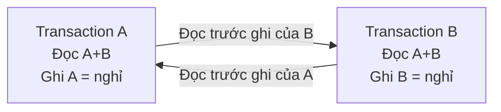

# Phân biệt snapshot isolation với thực thi tuần tự tương đương

> **Chương:** Tính cô lập  
> **Phạm vi:** `DATA_PERSISTENCE_FUNDAMENTALS` — hiểu nguyên lý lưu trữ dữ liệu bền vững, thiết kế lược đồ và truy vấn; lựa chọn mức cô lập, kiểm soát đồng thời và ranh giới persistence cho Java; xử lý lỗi giao dịch, tiến hóa schema, bảo mật, sao lưu và hiệu năng.

## Mục tiêu học tập

Sau bài này, người học có thể:

1. Mô tả một **snapshot** của dữ liệu và cách **snapshot isolation (SI)** cho giao dịch đọc phiên bản dữ liệu nhất quán.
2. Phân biệt **lịch thực thi tuần tự** với **lịch thực thi tương đương tuần tự** (*serializable schedule*).
3. Giải thích tại sao SI vẫn có thể cho phép **write skew** khi hai giao dịch đọc cùng điều kiện nhưng cập nhật các hàng khác nhau.
4. Hiểu vì sao PostgreSQL `REPEATABLE READ` thường thực hiện SI, còn `SERIALIZABLE` sử dụng Serializable Snapshot Isolation (SSI) để ngăn các lịch không tương đương tuần tự.
5. Chọn cách bảo vệ bất biến nghiệp vụ bằng mức cô lập, khóa/cập nhật bản ghi đại diện và retry toàn bộ giao dịch trong ứng dụng Java.

## 1. Vấn đề cốt lõi: nhất quán lúc đọc chưa đủ để nhất quán lúc ghi

Giả sử một bệnh viện có quy tắc: **mỗi ca trực phải có ít nhất một bác sĩ đang trực**. Trong ca số `42` có hai bác sĩ A và B, cả hai hiện đều đang trực.

Hai yêu cầu đến gần như cùng lúc:

- A muốn kết thúc ca, nhưng chỉ khi còn ít nhất một bác sĩ khác.
- B cũng muốn kết thúc ca với điều kiện tương tự.

Nếu hai giao dịch cùng nhìn dữ liệu trước khi có ai kết thúc ca, mỗi giao dịch đều thấy có hai người trực. Mỗi giao dịch tự suy luận rằng việc mình rời ca là an toàn. Sau đó A thay đổi hàng của A, B thay đổi hàng của B. Khi cả hai commit, không còn bác sĩ nào trực.

Không có giao dịch nào đọc dữ liệu “bẩn” hay thấy ảnh chụp dữ liệu bị trộn giữa các thời điểm. Vấn đề là **hai quyết định dựa trên một snapshot cũ không nhất thiết tạo thành một kết quả có thể xảy ra nếu các giao dịch được thực hiện lần lượt**.

Đó là ranh giới quan trọng giữa **snapshot isolation** và **serializability**.

## 2. Thế nào là tương đương thực thi tuần tự?

Một *lịch thực thi* (*schedule/history*) mô tả thứ tự các thao tác đọc, ghi và commit/rollback của nhiều giao dịch.

**Thực thi tuần tự (serial execution)** nghĩa là giao dịch này hoàn tất trước khi giao dịch kia bắt đầu thực hiện các thao tác; các lệnh của hai giao dịch không xen kẽ.

**Tương đương thực thi tuần tự (serializable execution)** cho phép các thao tác xen kẽ để tận dụng tính đồng thời, nhưng kết quả quan sát được bởi các giao dịch đã commit phải phù hợp với **ít nhất một thứ tự thực thi tuần tự** của chính các giao dịch đó. Không chỉ trạng thái cuối cùng của bảng, mà các giá trị được đọc và quyết định phụ thuộc vào chúng cũng là một phần của tính đúng đắn.

Với ví dụ ca trực, hai thứ tự tuần tự hợp lệ là:

| Thứ tự | Giao dịch đầu tiên | Giao dịch sau | Kết quả |
| --- | --- | --- | --- |
| A rồi B | A thấy 2 người, cho A rời ca | B thấy còn 1 người, phải từ chối | B vẫn trực |
| B rồi A | B thấy 2 người, cho B rời ca | A thấy còn 1 người, phải từ chối | A vẫn trực |

Nếu một lịch đồng thời **cho phép cả A và B rời ca**, không thể giải thích kết quả đó bằng một trong hai thứ tự tuần tự hợp lệ trên. Lịch này **không serializable**.

Một hệ quản trị có thể đạt serializability bằng khóa, xác thực xung đột, MVCC kết hợp theo dõi phụ thuộc hoặc các kỹ thuật khác. “Serializable” mô tả **cam kết về kết quả**, không yêu cầu DBMS chạy từng giao dịch một trên thực tế.

## 3. Snapshot và snapshot isolation hoạt động ra sao?

### 3.1. Snapshot trong cơ sở dữ liệu MVCC

Trong **Multi-Version Concurrency Control (MVCC)**, một hàng có thể tồn tại dưới nhiều phiên bản được sinh ra bởi các transaction khác nhau. Khi đọc, hệ quản trị xác định phiên bản nào hiển thị cho giao dịch dựa trên snapshot và quy tắc của hệ quản trị.

Một snapshot biểu diễn tập các thay đổi đã commit mà giao dịch được phép quan sát tại thời điểm tạo snapshot. Nó thường giúp reader không phải chờ mọi writer, nhưng **snapshot không phải bản sao vật lý của toàn bộ database**.

Ví dụ, một giao dịch bắt đầu khi số dư hai tài khoản lần lượt là `500` và `300`. Giao dịch khác chuyển `100` từ tài khoản đầu sang tài khoản thứ hai rồi commit. Với snapshot đủ ổn định, giao dịch đọc ban đầu tiếp tục nhìn thấy các phiên bản `500` và `300` từ cùng một trạng thái đã commit, thay vì thấy sự kết hợp “đã trừ nhưng chưa cộng”.

Trong một giao dịch, các thay đổi do **chính giao dịch đó** thực hiện thường vẫn hiển thị cho các thao tác đọc tiếp theo của nó; “snapshot nhất quán” không có nghĩa giao dịch bị đóng băng trước cả chính thao tác ghi của mình.

### 3.2. Cam kết điển hình của snapshot isolation

SI thường có các thuộc tính sau:

1. Giao dịch thực hiện các truy vấn đọc thông thường trên một **snapshot nhất quán của dữ liệu đã commit**, được giữ ổn định theo quy tắc của hệ thống.
2. Các thay đổi của giao dịch chưa commit không lộ ra cho giao dịch khác như dữ liệu đã commit.
3. Hai giao dịch đồng thời cố ghi **cùng một hàng/khóa xung đột** thường không được phép cùng commit theo cơ chế phát hiện xung đột ghi của hệ thống, thường được diễn đạt là *first-committer-wins* hoặc *first-updater-wins* tùy cách triển khai.
4. Các giao dịch có thể đồng thời cập nhật **các hàng khác nhau**, dù đã đọc một điều kiện nghiệp vụ chung. Đây là điểm SI chưa đảm bảo serializability.

Các chi tiết như thời điểm tạo snapshot, cách phát hiện xung đột và loại truy vấn khóa phụ thuộc vào DBMS. Không nên suy ra mọi sản phẩm có cùng hành vi chỉ vì cùng dùng tên mức cô lập.

**Trong PostgreSQL**, `READ COMMITTED` dùng snapshot mới cho mỗi statement thông thường. `REPEATABLE READ` cung cấp snapshot ổn định cho các truy vấn của giao dịch theo cách tương ứng với SI; snapshot được xác lập khi giao dịch thực hiện câu lệnh phù hợp đầu tiên, không phải chỉ vì chạy `BEGIN`. `SERIALIZABLE` đi xa hơn để bảo vệ tính tương đương tuần tự.

### 3.3. Snapshot isolation có tránh được những lỗi nào?

| Hiện tượng | PostgreSQL `READ COMMITTED` | PostgreSQL `REPEATABLE READ` (SI) | PostgreSQL `SERIALIZABLE` |
| --- | --- | --- | --- |
| Đọc dữ liệu chưa commit (*dirty read*) | Không | Không | Không |
| Hai lần đọc cùng hàng thấy giá trị khác do giao dịch khác commit | Có thể | Không, với đọc thông thường trên snapshot | Không đối với lịch commit hợp lệ |
| Truy vấn lại thấy tập hàng thay đổi do giao dịch khác commit (*phantom*) | Có thể | Không theo snapshot đọc thông thường | Không theo nghĩa lịch commit tương đương tuần tự |
| Hai giao dịch cùng sửa một hàng từ snapshot cũ | DB phối hợp khóa, nhưng cách viết câu SQL vẫn có thể gây ghi đè logic | PostgreSQL phát hiện xung đột cập nhật và có thể hủy một giao dịch | Xung đột được kiểm soát, có thể hủy một giao dịch |
| Hai giao dịch sửa hai hàng khác nhau làm hỏng bất biến chung (*write skew*) | Có thể | **Có thể** | Không thể cùng commit nếu tạo lịch không serializable |

**Lưu ý:** bảng nói về hành vi PostgreSQL, không phải một định nghĩa phổ quát của mọi mức cô lập ANSI. Ví dụ, `REPEATABLE READ` của một DBMS khác có thể đi kèm quy tắc khóa và xử lý phantom khác; mức `SNAPSHOT` ở SQL Server được cấu hình riêng.

## 4. Chứng minh SI không tương đương serializability bằng write skew

### 4.1. Tạo dữ liệu và bất biến

Giả sử ứng dụng lưu ca trực như sau:

```sql
-- PostgreSQL
CREATE TABLE shift_doctor (
    shift_id BIGINT NOT NULL,
    doctor_id BIGINT NOT NULL,
    on_call BOOLEAN NOT NULL,
    PRIMARY KEY (shift_id, doctor_id)
);

INSERT INTO shift_doctor (shift_id, doctor_id, on_call)
VALUES (42, 101, TRUE), (42, 202, TRUE);
```

Quy tắc nghiệp vụ: trong mỗi `shift_id`, tổng số hàng có `on_call = TRUE` phải **lớn hơn hoặc bằng 1**. Khóa chính ngăn trùng bác sĩ trong cùng ca nhưng **không tự thực thi được quy tắc đếm trên nhiều hàng**. `CHECK (on_call IN (...))` cũng không bảo vệ được điều kiện tổng hợp này.

### 4.2. Hai giao dịch chạy đồng thời

Mỗi phiên kết nối bên dưới chạy một transaction riêng ở `REPEATABLE READ`. Để tái hiện write skew, **cả hai phải chạy xong lệnh `SELECT` và nhìn thấy kết quả 2 trước khi bất kỳ giao dịch nào commit**.

**Phiên A:**

```sql
BEGIN ISOLATION LEVEL REPEATABLE READ;

SELECT COUNT(*) AS doctors_on_call
FROM shift_doctor
WHERE shift_id = 42 AND on_call = TRUE;
-- Kết quả 2. Tạm dừng để phiên B cũng đọc.

UPDATE shift_doctor
SET on_call = FALSE
WHERE shift_id = 42 AND doctor_id = 101;

COMMIT;
```

**Phiên B:**

```sql
BEGIN ISOLATION LEVEL REPEATABLE READ;

SELECT COUNT(*) AS doctors_on_call
FROM shift_doctor
WHERE shift_id = 42 AND on_call = TRUE;
-- Kết quả 2, đọc trước khi phiên A commit.

UPDATE shift_doctor
SET on_call = FALSE
WHERE shift_id = 42 AND doctor_id = 202;

COMMIT;
```

Các khối mã được **xen kẽ theo bảng sau**, không chạy hết toàn bộ phiên A rồi mới chạy phiên B:

| Bước | Phiên A | Phiên B | Điều quan trọng |
| --- | --- | --- | --- |
| 1 | `BEGIN`, `SELECT COUNT = 2` | | A tạo snapshot với hai bác sĩ trực. |
| 2 | | `BEGIN`, `SELECT COUNT = 2` | B cũng tạo snapshot với hai bác sĩ trực. |
| 3 | `UPDATE doctor 101 = FALSE` | | A thay đổi hàng 101. |
| 4 | | `UPDATE doctor 202 = FALSE` | B thay đổi hàng 202, không trùng hàng A. |
| 5 | `COMMIT` | | A có thể commit. |
| 6 | | `COMMIT` | B cũng có thể commit dưới SI. |

Kết quả:

```sql
SELECT COUNT(*) AS doctors_on_call
FROM shift_doctor
WHERE shift_id = 42 AND on_call = TRUE;
-- 0: bất biến "ít nhất một bác sĩ trực" bị vi phạm.
```

Mỗi transaction đã đọc một ảnh chụp nhất quán. Không giao dịch nào ghi vào hàng mà giao dịch kia đang ghi. Vì thế bộ phát hiện **xung đột ghi-ghi** của SI không nhất thiết chặn một trong hai giao dịch.

### 4.3. Vì sao lịch này không thể tương đương tuần tự?

Giả sử A chạy và commit hoàn toàn **trước** B. Khi đến lượt B đọc, B sẽ thấy chỉ còn bác sĩ 202; quy tắc nghiệp vụ phải ngăn B rời ca. Ngược lại, nếu B chạy và commit trước A, A phải bị từ chối.

Lịch hai giao dịch cùng đọc số lượng 2 rồi cùng commit không tương đương với cả hai khả năng trên. Do đó, lịch là **write skew** và **không serializable**.

Có thể nhìn điều này qua **đồ thị phụ thuộc**:

- A đọc hàng/trạng thái có B đang trực; B ghi `on_call = FALSE` lên hàng đó → phụ thuộc đọc-ghi từ A sang B.
- B đọc hàng/trạng thái có A đang trực; A ghi `on_call = FALSE` lên hàng đó → phụ thuộc đọc-ghi từ B sang A.
- Hai hướng phụ thuộc tạo một **chu trình**; không có thứ tự tuần tự nào thỏa cả hai cách nhìn dữ liệu.



Đây là lý do cần phân biệt hai loại xung đột: **cùng ghi một bản ghi** và **đọc dữ liệu mà giao dịch khác ghi làm thay đổi kết luận nghiệp vụ**. SI thường ngăn xung đột ghi-ghi trên cùng hàng, nhưng có thể bỏ lọt chu trình phụ thuộc đọc-ghi.

## 5. PostgreSQL SERIALIZABLE khác SI ở đâu?

Trong PostgreSQL, mức `SERIALIZABLE` sử dụng **Serializable Snapshot Isolation (SSI)**. Giao dịch vẫn được đọc từ snapshot của MVCC, nhưng DBMS đồng thời theo dõi các phụ thuộc đọc-ghi giữa những giao dịch chồng lấn. Nếu phát hiện một cấu trúc phụ thuộc có thể dẫn đến lịch không serializable, PostgreSQL sẽ **hủy ít nhất một giao dịch liên quan** thay vì cho tất cả commit.

Để thử lại ví dụ, khôi phục hai bác sĩ về `TRUE` sau khi các transaction thử nghiệm đã kết thúc, rồi mở hai phiên mới và dùng:

```sql
BEGIN ISOLATION LEVEL SERIALIZABLE;

SELECT COUNT(*) AS doctors_on_call
FROM shift_doctor
WHERE shift_id = 42 AND on_call = TRUE;
-- Cả hai phiên được sắp xếp để đọc thấy 2.

-- Phiên A cập nhật doctor_id = 101.
-- Phiên B cập nhật doctor_id = 202.
-- Mỗi phiên chỉ cập nhật hàng của mình nếu COUNT > 1.

COMMIT;
```

Với lịch concurrent gây write skew ở phần trước, **không thể có kết quả cả hai giao dịch commit thành công rồi để số người trực bằng 0**, miễn là các transaction thực thi quy tắc và mức cô lập được áp dụng nhất quán. Một giao dịch có thể nhận lỗi SQLSTATE `40001` (*serialization_failure*) ở giai đoạn ghi hoặc commit; ứng dụng phải rollback và quyết định retry toàn bộ giao dịch đó.

SSI không có nghĩa là mọi lệnh `SELECT` được chuyển thành `SELECT ... FOR UPDATE`. PostgreSQL có cơ chế theo dõi phụ thuộc/predicate read (có thể quan sát dạng `SIReadLock`) để phát hiện rủi ro serialization. Các dấu vết đọc này khác với khóa độc quyền ngăn người khác ghi; vì vậy SSI giúp giữ tính đồng thời, đổi lại có thể phát sinh lỗi serialization cần xử lý.

**Một số giới hạn thực tế:**

- Có thể có giao dịch bị hủy do phát hiện xung đột nguy hiểm dù ứng dụng cho rằng kết quả cuối cùng vẫn chấp nhận được. Đây là chi phí của việc đảm bảo serializability và thuật toán phát hiện xung đột.
- Không mặc định retry chỉ câu SQL vừa lỗi; phải thực thi lại **toàn bộ logic đọc, kiểm tra và ghi** trên transaction mới, vì các giá trị đầu vào từ snapshot cũ có thể không còn đúng.
- Các thao tác tác động cùng bất biến cần tuân thủ một chiến lược bảo vệ tương thích; nếu một đường ghi bỏ qua kiểm tra nghiệp vụ hoặc thực thi với cơ chế yếu hơn mà không phối hợp, không thể lấy một transaction `SERIALIZABLE` để “sửa” mọi sai sót hệ thống.
- Serializability nói về tính nhất quán của **các giao dịch trong cơ sở dữ liệu**. Nó không tự đưa email, HTTP call hay một dịch vụ thanh toán bên ngoài vào cùng giao dịch.

## 6. Thiết kế trong Java: đặt mức cô lập và retry đúng ranh giới

Tầng persistence của Java cần gắn quyết định nghiệp vụ với một transaction thực sự. Ví dụ dùng Spring JDBC cho chức năng bác sĩ rời ca, với PostgreSQL:

```java
import org.springframework.jdbc.core.JdbcTemplate;
import org.springframework.stereotype.Service;
import org.springframework.transaction.annotation.Isolation;
import org.springframework.transaction.annotation.Transactional;

@Service
public class ShiftTransactionService {
    private final JdbcTemplate jdbc;

    public ShiftTransactionService(JdbcTemplate jdbc) {
        this.jdbc = jdbc;
    }

    @Transactional(isolation = Isolation.SERIALIZABLE)
    public void leaveShift(long shiftId, long doctorId) {
        Integer onCallCount = jdbc.queryForObject(
            """
            SELECT COUNT(*)
            FROM shift_doctor
            WHERE shift_id = ? AND on_call = TRUE
            """,
            Integer.class,
            shiftId
        );

        if (onCallCount == null || onCallCount <= 1) {
            throw new IllegalStateException("Shift needs one on-call doctor");
        }

        int rows = jdbc.update(
            """
            UPDATE shift_doctor
            SET on_call = FALSE
            WHERE shift_id = ? AND doctor_id = ? AND on_call = TRUE
            """,
            shiftId,
            doctorId
        );

        if (rows != 1) {
            throw new IllegalStateException("Doctor not on call");
        }
    }
}
```

Để xử lý lỗi serialization, tạo **lớp điều phối riêng** gọi tới bean transactional. Mỗi lần gọi `leaveShift` đi qua proxy của Spring, tạo một transaction mới theo cấu hình; khi có `40001`, transaction lỗi phải kết thúc rồi mới thử lại:

```java
import org.springframework.dao.CannotSerializeTransactionException;
import org.springframework.stereotype.Service;

@Service
public class ShiftApplicationService {
    private final ShiftTransactionService transactions;

    public ShiftApplicationService(ShiftTransactionService transactions) {
        this.transactions = transactions;
    }

    // Hàm này không chạy bên trong một transaction đã mở sẵn.
    public void leaveShiftWithRetry(long shiftId, long doctorId) {
        final int maxAttempts = 3;

        for (int attempt = 1; attempt <= maxAttempts; attempt++) {
            try {
                transactions.leaveShift(shiftId, doctorId);
                return;
            } catch (CannotSerializeTransactionException failure) {
                if (attempt == maxAttempts) {
                    throw failure;
                }
                // Có thể dùng backoff ngắn + jitter theo chính sách hệ thống.
                // Lần kế tiếp gọi lại toàn bộ transaction.
            }
        }
    }
}
```

**Điều kiện áp dụng quan trọng:**

1. Spring phải quản lý `JdbcTemplate`, `DataSource` và transaction manager tương ứng; các truy vấn phải thuộc cùng transaction. Cần tránh lỗi tự gọi phương thức `@Transactional` bằng `this.method()` trong chế độ proxy thông thường.
2. Ví dụ giả định driver và bộ dịch lỗi của Spring ánh xạ `40001` thành `CannotSerializeTransactionException`. Trong hệ thống thực tế, hãy kiểm tra ánh xạ exception của phiên bản driver/framework; có thể cần kiểm tra SQLSTATE ở nguyên nhân gốc.
3. Retry diễn ra **bên ngoài transaction đã rollback**. Không giữ danh sách “bác sĩ đang trực” đã đọc từ lần thất bại; lần mới phải chạy lại `SELECT COUNT` và kiểm tra từ đầu.
4. Nếu lần retry phát hiện ca chỉ còn một người, `IllegalStateException` được trả về như **lỗi nghiệp vụ**, không phải serialization failure cần tiếp tục retry.
5. Đặt giới hạn số lần retry và chiến lược backoff phù hợp. Không retry vô hạn; cần đo tỷ lệ `40001` và độ trễ để tìm giao dịch dài hoặc điểm tranh chấp.
6. Ví dụ tập trung vào kiểm soát đồng thời; ứng dụng thực cần xác thực quyền nghỉ ca, tồn tại của ca trực, xử lý bác sĩ chưa tham gia, và quy tắc phân quyền. Không lấy mức cô lập để thay thế kiểm tra bảo mật.

Trong nhiều ứng dụng, lỗi serialization chỉ xuất hiện sau bước `COMMIT`. Cần kiểm tra đường đi lỗi của cả transaction manager, thay vì chỉ bắt lỗi quanh một lệnh `UPDATE`. Nếu mất kết nối lúc commit và **không biết giao dịch đã commit hay chưa**, đó là tình huống khác với `40001` đã được DB từ chối; dùng mã yêu cầu duy nhất và kiểm tra trạng thái bền vững trước khi gửi lại một thao tác có tác động.

## 7. Những cách khác để bảo vệ bất biến khi không chọn SERIALIZABLE

Không phải ứng dụng nào cũng cần mặc định `SERIALIZABLE` cho toàn bộ truy vấn. Có thể bảo vệ **một bất biến cụ thể** bằng cách tạo xung đột ghi có chủ đích, miễn là mọi đường ghi liên quan cùng tuân thủ giao thức.

### 7.1. Dùng một hàng đại diện chung (*guard row*)

Thêm bảng quản lý trạng thái phiên bản ca trực:

```sql
CREATE TABLE shift_guard (
    shift_id BIGINT PRIMARY KEY,
    version BIGINT NOT NULL DEFAULT 0
);

INSERT INTO shift_guard (shift_id, version) VALUES (42, 0);
```

Mọi transaction làm thay đổi số bác sĩ trực của ca `42` đều **cập nhật hàng `shift_guard` trước khi đọc và sửa danh sách**:

```sql
BEGIN ISOLATION LEVEL REPEATABLE READ;

-- Ghi vào cùng một hàng đại diện, dù transaction sẽ sửa bác sĩ khác.
UPDATE shift_guard
SET version = version + 1
WHERE shift_id = 42;
-- Kiểm tra đúng 1 hàng được cập nhật.

SELECT COUNT(*) AS doctors_on_call
FROM shift_doctor
WHERE shift_id = 42 AND on_call = TRUE;
-- Nếu số lượng <= 1: ROLLBACK và từ chối rời ca.

UPDATE shift_doctor
SET on_call = FALSE
WHERE shift_id = 42 AND doctor_id = 101 AND on_call = TRUE;

COMMIT;
```

Các câu lệnh chỉ minh họa **nhánh hợp lệ của phiên A**; phiên B làm tương tự với bác sĩ 202. Khi hai transaction `REPEATABLE READ` cố cập nhật cùng hàng guard trên các snapshot cũ, PostgreSQL không cho cả hai cùng hoàn tất xung đột ghi này; transaction thất bại cần retry từ đầu để nhìn dữ liệu mới. Điều kiện đếm được kiểm tra lại trên transaction mới sẽ ngăn ca trực rỗng.

Phương án này tăng tranh chấp ghi lên hàng guard, nhưng giúp đóng gói bất biến của một ca mà không cần nâng toàn bộ hệ thống lên `SERIALIZABLE`. Cần chắc chắn mọi hành động có thể làm thay đổi tập bác sĩ trực (đăng ký, rời ca, chuyển ca, xóa hồ sơ) cùng tham gia giao thức và xử lý transaction thất bại.

### 7.2. Khóa trước khi đọc ở READ COMMITTED

Một phương án khác là khóa hàng đại diện:

```sql
BEGIN ISOLATION LEVEL READ COMMITTED;

SELECT shift_id
FROM shift_guard
WHERE shift_id = 42
FOR UPDATE;

-- Sau khi đã giữ khóa, đọc lại COUNT trong statement mới.
SELECT COUNT(*)
FROM shift_doctor
WHERE shift_id = 42 AND on_call = TRUE;

-- Kiểm tra điều kiện; UPDATE; COMMIT hoặc ROLLBACK.
```

Nếu **tất cả đường ghi liên quan cùng khóa guard trước khi thao tác**, các transaction trên cùng ca sẽ lần lượt qua đoạn kiểm tra và cập nhật. Ở `READ COMMITTED`, lệnh `SELECT COUNT` sau khi lấy được khóa có thể nhìn thấy các commit đã xảy ra trước lúc lệnh đó bắt đầu. Phải kiểm tra hàng guard tồn tại và giữ transaction mở cho đến khi ghi xong.

Đừng tự động mang nguyên mẹo khóa này sang `REPEATABLE READ` rồi tin rằng nó sẽ làm mới snapshot đã thiết lập trước đó: snapshot của giao dịch không nhất thiết thay đổi chỉ vì vừa chờ một khóa. Nếu sử dụng SI, việc **cập nhật cùng guard row** như phần 7.1 tạo xung đột ghi rõ ràng hơn.

### 7.3. Cập nhật có điều kiện trên một hàng

Nếu bất biến có thể biểu diễn bằng một lệnh cập nhật trên **một hàng**, thường không cần đọc rồi sửa bằng nhiều statement:

```sql
UPDATE inventory
SET available = available - 1
WHERE product_id = 88 AND available >= 1;
```

Kiểm tra số hàng cập nhật là `1` (đã giữ hàng) hoặc `0` (không đủ tồn kho/không có hàng). Đây là cách viết khác hẳn ví dụ ca trực: bất biến tồn kho được kiểm soát trên chính một hàng đang thay đổi. Khi điều kiện trải qua nhiều hàng, chỉ một `UPDATE` riêng lẻ không tự bảo vệ phép đếm tổng hợp.

## 8. Làm thế nào chọn giữa SI và serializability?

| Tình huống | SI có thể phù hợp khi... | Cần serializability hoặc giao thức bảo vệ mạnh hơn khi... |
| --- | --- | --- |
| Báo cáo đọc dữ liệu | Muốn nhiều truy vấn nhìn ảnh chụp ổn định; không đưa ra quyết định ghi làm thay đổi bất biến liên hàng. | Báo cáo có yêu cầu khác về thời điểm, tính mới hoặc nhất quán với thao tác ngoài DB; phải xét yêu cầu riêng. |
| Sửa hồ sơ theo ID | Chủ yếu đụng một hàng; có version/kiểm tra xung đột ghi phù hợp. | Quyết định sửa dựa vào quan hệ/tổng số của nhiều hàng có thể thay đổi đồng thời. |
| Phân ca, đặt chỗ, giới hạn thành viên | Có thiết kế guard row, khóa, constraint hoặc cập nhật có điều kiện bảo vệ bất biến. | Quy tắc dựa trên nhiều hàng/truy vấn điều kiện và không có cơ chế bảo vệ riêng đầy đủ. |
| Giao dịch tiền và sổ bút toán | Đã thiết kế khóa/cập nhật nguyên tử và ràng buộc rõ, đối soát được. | Cần bảo đảm đồng thời nhiều điều kiện tổng hợp mà SI không tự bảo vệ. |

Nguyên tắc quyết định là **bất biến nghiệp vụ nằm ở đâu**, không chỉ là “giao dịch có nhiều câu `SELECT` hay không”. Khi bất biến chỉ phụ thuộc vào một hàng, constraint/conditional update có thể rẻ và rõ hơn. Khi bất biến phụ thuộc một tập hàng có thể thay đổi dưới những giao dịch đồng thời, cần mô hình hóa phụ thuộc đọc-ghi và chọn cơ chế đảm bảo.

**Kiểm tra cách triển khai thực tế:** `READ COMMITTED`, `REPEATABLE READ`, `SNAPSHOT` và `SERIALIZABLE` là những tên có chi tiết không đồng nhất giữa PostgreSQL, MySQL, SQL Server hay các hệ khác. Ứng dụng Java không nên dựa vào tên enum `Isolation` của Spring mà bỏ qua tài liệu và thử nghiệm concurrency trên DBMS/phiên bản thật.

## 9. Thử nghiệm concurrency và theo dõi khi vận hành

### 9.1. Các kịch bản cần thử

| Kịch bản | Cách tạo | Kết quả mong đợi |
| --- | --- | --- |
| Hai bác sĩ rời ca tại SI | Cả hai `SELECT COUNT = 2` trước khi ai commit; cập nhật hai hàng khác nhau. | Có thể cả hai commit, còn 0 người trực: tái hiện write skew. |
| Cùng lịch ở `SERIALIZABLE` | Chạy lại với hai transaction serializable trên dữ liệu khởi tạo. | Không được cùng commit tạo ca rỗng; ít nhất một thao tác bị từ chối/rollback và cần retry. |
| Retry transaction bị hủy | Tạo xung đột rồi gọi lại toàn bộ transaction. | Lần retry đọc trạng thái mới; nếu còn 1 người thì trả lỗi nghiệp vụ. |
| Ghi vào cùng một hàng ở SI | Hai transaction sửa cùng bản ghi từ snapshot cạnh tranh. | PostgreSQL không cho cả hai cùng commit cập nhật dựa trên snapshot cũ. |
| Transaction một phần thất bại | Cố tình gây lỗi giữa các bước cập nhật. | Rollback toàn bộ thay đổi thuộc transaction. |
| Mất kết nối quanh commit | Mô phỏng sự cố client/DB có kiểm soát. | Ứng dụng tra cứu mã yêu cầu/trạng thái và tránh phát sinh tác động trùng. |

Một thử nghiệm đáng tin cậy cần **đồng bộ thời điểm đọc của hai transaction**; chỉ gửi hai request “gần như đồng thời” nhưng không đảm bảo cùng thấy dữ liệu ban đầu có thể không tái hiện lỗi.

### 9.2. Chi phí và vận hành

SI thường hữu ích cho các luồng đọc cần snapshot ổn định và có khả năng đồng thời cao. SERIALIZABLE của PostgreSQL có thể giữ được nhiều lợi ích MVCC, nhưng việc theo dõi phụ thuộc và hủy/retry transaction cũng tiêu tốn tài nguyên:

- **Transaction dài** giữ snapshot lâu, tăng áp lực lưu trữ phiên bản và khả năng chồng lấn với transaction khác.
- **Truy vấn thiếu chỉ mục** hoặc đọc phạm vi lớn có thể làm tăng số phụ thuộc được theo dõi và nguy cơ serialization failure. Chỉ mục thích hợp giúp truy vấn hiệu quả hơn, nhưng không thay thế kiểm tra logic nghiệp vụ.
- **Retry hàng loạt** trong điểm tranh chấp có thể tăng tải; cần giới hạn nỗ lực, dùng backoff/jitter, theo dõi SQLSTATE `40001`, độ trễ và tỷ lệ thất bại.
- **Đường ghi không thống nhất** dễ phá bất biến dù một số service chọn `SERIALIZABLE`. Lập danh sách tất cả API, job, import và migration có thể sửa dữ liệu cùng quy tắc.
- **Lỗi kết nối và trạng thái commit không chắc chắn** cần idempotency và đối soát; serialization retry và retry một request không rõ kết quả commit là hai tình huống riêng.

Serializability bảo vệ lịch giao dịch trong database, nhưng không thay thế phân quyền, prepared statements, kiểm tra dữ liệu đầu vào, backup/restore hay cơ chế phát sự kiện đáng tin cậy sang hệ thống khác. Nếu cập nhật DB và gửi thông báo ra ngoài, cân nhắc **transactional outbox** và xử lý sự kiện trùng; không giả định rollback DB sẽ thu hồi một HTTP call đã thành công.

## 10. Câu hỏi tự kiểm tra

1. Hai transaction cùng đọc một snapshot nhất quán; vì sao điều đó chưa đủ để kết luận lịch của chúng serializable?
2. Nếu cả hai giao dịch viết cùng một hàng, SI thường có cơ chế gì để xử lý? Vì sao ví dụ ca trực vẫn tạo lỗi khi chúng viết hai hàng khác nhau?
3. Trong ví dụ ca trực, hãy chứng minh việc cả A và B cùng rời ca không thể tương đương thứ tự A → B hoặc B → A.
4. Sự khác biệt thực tế giữa PostgreSQL `REPEATABLE READ` và `SERIALIZABLE` khi có chu trình phụ thuộc đọc-ghi là gì?
5. Vì sao retry một câu `UPDATE` bị `40001` trong transaction cũ là sai? Bước nào bắt buộc phải đọc lại?
6. Hàng guard và `SELECT ... FOR UPDATE` ở `READ COMMITTED` ngăn write skew bằng điều kiện nào? Vì sao chỉ chờ khóa không tự làm mới snapshot trong SI?
7. Với thao tác trừ tồn kho một hàng, khi nào `UPDATE ... WHERE available >= ?` đủ bảo vệ điều kiện mà không cần một transaction serializable?
8. Nếu `COMMIT` trả lỗi kết nối và client không biết kết quả cuối cùng, vì sao retry nguyên request có thể nguy hiểm dù mã có xử lý `40001`?

## Ghi nhớ

**Snapshot isolation** mang lại một góc nhìn dữ liệu nhất quán và thường ngăn hai giao dịch cạnh tranh cùng sửa một bản ghi, nhưng **không tự bảo đảm tương đương thực thi tuần tự** khi các giao dịch đọc một điều kiện chung rồi ghi các hàng khác nhau. **Serializability** đòi hỏi mọi lịch commit được chấp nhận phải tương đương với một thứ tự tuần tự nào đó; PostgreSQL thực hiện điều này ở `SERIALIZABLE` bằng SSI và có thể hủy giao dịch để ứng dụng retry.

Khi thiết kế persistence cho Java, hãy bắt đầu bằng **bất biến nghiệp vụ**, xác định dữ liệu được đọc và ghi bởi mọi giao dịch liên quan, rồi chọn mức cô lập hoặc cách tạo xung đột/khóa phù hợp. Retry phải mở transaction mới, đọc lại dữ liệu và chỉ ghi nhận thành công khi đã xác định kết quả commit.
