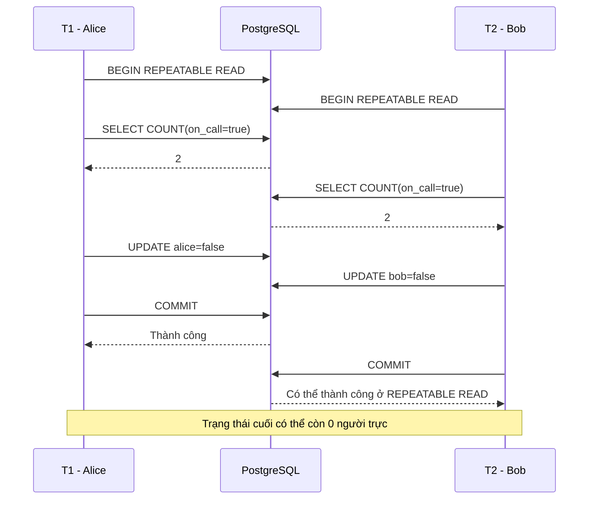
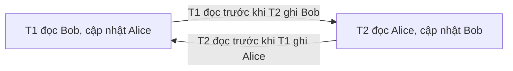

# Kiểm chứng mức cô lập bằng các lịch thực thi đồng thời

## 1. Vì sao phải kiểm chứng bằng lịch thực thi?

Một ứng dụng Java có thể cấu hình `READ COMMITTED`, `REPEATABLE READ` hoặc `SERIALIZABLE`, nhưng tên mức cô lập chỉ có ích khi ta biết **những lịch truy cập đồng thời nào được phép và những lịch nào phải bị ngăn**. Chạy thử hai truy vấn lần lượt trong một luồng thường không bộc lộ vấn đề: các bất thường xuất hiện khi nhiều transaction đọc, ghi, commit hoặc rollback xen kẽ.

Ví dụ, hai yêu cầu cùng đọc “đang có hai bác sĩ trực”, sau đó mỗi yêu cầu cho một bác sĩ nghỉ. Nếu cả hai transaction đều commit, hệ thống có thể không còn ai trực, mặc dù từng transaction đã kiểm tra điều kiện trước khi ghi. Việc một transaction đọc được trạng thái hợp lệ không chứng minh kết quả **của nhiều transaction cùng chạy** vẫn hợp lệ.

Trong chương **Tính cô lập** của **DATA_PERSISTENCE_FUNDAMENTALS**, mục tiêu là kiểm chứng cơ chế transaction và kiểm soát đồng thời ở ranh giới persistence: viết được lịch thực thi, dựng được thí nghiệm hai kết nối, phân biệt lỗi do isolation với lỗi do replication, hiểu kết quả commit/rollback và chọn mức bảo đảm phù hợp cho nghiệp vụ Java.

Sau bài này, người học cần làm được bốn việc:

1. Mô tả lịch thực thi bằng các thao tác đọc/ghi và ranh giới commit.
2. Dàn xếp thứ tự thực hiện đủ rõ để tái hiện non-repeatable read, phantom, read skew hoặc write skew.
3. Đối chiếu **điều được cấu hình** với **điều hệ lưu trữ thật sự thực hiện**.
4. Kiểm tra bất biến nghiệp vụ và kết quả cuối cùng, kể cả khi một transaction bị hủy và phải retry.

## 2. Cách đọc và ghi một lịch thực thi

Gọi `T1` và `T2` là hai transaction; `x`, `y` là dữ liệu. Quy ước:

| Ký hiệu | Ý nghĩa |
| --- | --- |
| `B1` | Transaction T1 bắt đầu |
| `R1(x)` | T1 đọc x |
| `W1(x = v)` | T1 ghi x thành v, có thể chưa commit |
| `C1` | T1 commit thành công |
| `A1` | T1 abort hoặc rollback |
| `R2(x)`, `W2(x = v)` | Các thao tác tương ứng của T2 |

Một lịch là **thứ tự xen kẽ** các thao tác, không chỉ là danh sách lệnh của từng transaction. Ví dụ:

```text
T1: B1 -> R1(x=10) ----------- R1(x=11) -> C1
T2:        B2 -> W2(x=11) -> C2

Thứ tự toàn cục: B1, R1(x=10), B2, W2(x=11), C2, R1(x=11), C1
```

Lịch này minh họa **non-repeatable read** nếu cả hai giá trị đều đã commit tại thời điểm được đọc. Để gọi chính xác một bất thường, phải ghi rõ **giá trị**, **thời điểm commit**, **mức cô lập thực tế** và **đường đọc**.

Hai lịch có cùng những câu SQL nhưng thứ tự khác nhau có thể cho kết quả khác. Vì vậy một kiểm thử đồng thời nên mô tả rõ điểm mà T1 phải tạm dừng để T2 kịp chạy, rồi chỉ tiếp tục khi điều kiện đã đạt được.

### Từ lịch đến bằng chứng

Có ba mức bằng chứng cần phân biệt:

- **Đã cấu hình:** ứng dụng gọi `setTransactionIsolation(...)` hoặc khai báo `@Transactional(isolation = ...)`.
- **Đã quan sát:** log cho thấy T1 đọc gì, T2 ghi gì, commit/rollback nào thành công và giá trị cuối là gì.
- **Đã kiểm chứng bảo đảm:** kết quả quan sát phù hợp với hợp đồng của DBMS, và lịch thực thi thực sự đủ để có thể làm lộ loại bất thường đang thử.

Một lần chạy không xảy ra bất thường chỉ chứng minh **lần chạy đó** không gặp bất thường. Muốn kết luận mức cô lập có ngăn một hiện tượng, phải kết hợp tài liệu của đúng DBMS/phiên bản, cách kiểm thử và nhiều lịch thực thi có kiểm soát.

## 3. Phân biệt các bất thường trước khi xây dựng thí nghiệm

| Hiện tượng | Lịch tối giản | Dấu hiệu then chốt |
| --- | --- | --- |
| **Dirty read** | `W1(x=11) → R2(x=11) → A1` | T2 đọc dữ liệu của T1 **trước commit**; T1 có thể rollback |
| **Non-repeatable read** | `R1(x=10) → W2(x=11) → C2 → R1(x=11)` | T1 đọc cùng bản ghi hai lần, sau một commit của T2 thì giá trị đổi |
| **Phantom** | `R1(P)=2 dòng → W2(thêm dòng thỏa P) → C2 → R1(P)=3 dòng` | Tập dòng thỏa một vị từ thay đổi giữa hai lần đọc |
| **Read skew** | `R1(x cũ) → W2(x,y) → C2 → R1(y mới)` | T1 ghép dữ liệu từ hai thời điểm và có thể thấy trạng thái không tồn tại |
| **Lost update ở tầng ứng dụng** | `R1(x=10), R2(x=10), W1(x=11), C1, W2(x=11), C2` | T2 dùng giá trị đọc cũ để ghi đè tác động của T1 |
| **Write skew** | `R1(x,y), R2(x,y), W1(x), W2(y), C1, C2` | Hai transaction sửa **hai dòng khác nhau** dựa trên điều kiện chung, làm sai bất biến |

Đây là những **lịch minh họa khả năng xảy ra**; hệ lưu trữ có thể khóa, buộc chờ, trả về phiên bản dữ liệu đã commit hoặc từ chối một transaction, khiến lịch yêu cầu không thể hoàn tất như mô tả.

Trong phân loại SQL truyền thống, READ UNCOMMITTED cho phép dirty read; READ COMMITTED ngăn dirty read nhưng có thể có non-repeatable read và phantom; REPEATABLE READ ngăn non-repeatable read theo phân loại chuẩn; SERIALIZABLE nhằm bảo đảm kết quả tương đương một thứ tự chạy tuần tự. Tuy nhiên tên isolation level không mô tả đầy đủ mọi bất thường như **write skew**, và triển khai của từng DBMS có thể mạnh hơn mức tối thiểu.

## 4. Thí nghiệm A: non-repeatable read ở READ COMMITTED

Ta dùng **PostgreSQL** làm hệ quản trị tham chiếu cho phần thí nghiệm. Trong PostgreSQL, `READ COMMITTED` sử dụng snapshot của dữ liệu đã commit theo từng câu lệnh `SELECT` thông thường; vì thế hai câu `SELECT` thuộc cùng một transaction có thể thấy hai phiên bản khác nhau.

Chuẩn bị dữ liệu (chạy một lần và commit trước thí nghiệm):

```sql
CREATE TABLE demo_balance (
    account_id TEXT PRIMARY KEY,
    balance BIGINT NOT NULL
);

INSERT INTO demo_balance(account_id, balance)
VALUES ('A', 100), ('B', 100);
```

Mở **hai session/kết nối riêng** và thực hiện đúng thứ tự:

| Bước | Session T1: báo cáo | Session T2: chuyển tiền |
| --- | --- | --- |
| 1 | `BEGIN ISOLATION LEVEL READ COMMITTED READ ONLY;` | — |
| 2 | `SELECT balance ... WHERE account_id = 'A';` → **100** | — |
| 3 | Tạm dừng T1 | `BEGIN;` |
| 4 | — | `UPDATE demo_balance SET balance = 50 WHERE account_id = 'A';` |
| 5 | — | `UPDATE demo_balance SET balance = 150 WHERE account_id = 'B';` |
| 6 | — | `COMMIT;` |
| 7 | `SELECT balance ... WHERE account_id = 'B';` → **150** | — |
| 8 | `COMMIT;` | — |

T1 thu được 100 + 150 = **250**, trong khi tổng hai tài khoản ở mọi trạng thái đã commit của T2 là **200**. Đây là một ví dụ **read skew** khi ghép hai câu truy vấn từ hai snapshot khác nhau; riêng việc đọc lại A sau bước 6 và thấy 50 sẽ chứng minh **non-repeatable read**.

Thay mức cô lập của T1 bằng:

```sql
BEGIN ISOLATION LEVEL REPEATABLE READ READ ONLY;
SELECT balance FROM demo_balance WHERE account_id = 'A';
-- Cho T2 chuyển tiền và COMMIT tại đây.
SELECT balance FROM demo_balance WHERE account_id = 'B';
COMMIT;
```

Trong PostgreSQL, khi snapshot của T1 đã hình thành ở lần đọc đầu, lần đọc B trong cùng transaction nhìn vào snapshot đó; T1 thấy A=100, B=100. Điều này bảo vệ **sự nhất quán nội bộ của báo cáo**, nhưng **không bảo đảm snapshot phản ánh các ghi xảy ra sau khi nó được tạo**.

**Cạm bẫy thực nghiệm:** nếu T2 commit **trước** câu `SELECT` đầu tiên của T1, cả hai lần đọc của T1 có thể thấy trạng thái mới. Khi đó thí nghiệm không tái hiện được lịch cần kiểm tra.

## 5. Thí nghiệm B: phantom từ một truy vấn theo điều kiện

Đặt dữ liệu bắt đầu là hai đơn ở trạng thái `PENDING`:

```sql
CREATE TABLE demo_orders (
    order_id INTEGER PRIMARY KEY,
    status TEXT NOT NULL
);

INSERT INTO demo_orders(order_id, status)
VALUES (1, 'PENDING'), (2, 'PENDING');
```

Lịch kiểm chứng:

```text
T1 (READ COMMITTED): BEGIN
T1: SELECT COUNT(*) FROM demo_orders WHERE status = 'PENDING'; -- 2
T2: BEGIN
T2: INSERT INTO demo_orders VALUES (3, 'PENDING');
T2: COMMIT
T1: SELECT COUNT(*) FROM demo_orders WHERE status = 'PENDING'; -- 3
T1: COMMIT
```

T1 không hề đọc dữ liệu chưa commit. Nó thấy **tập bản ghi thỏa điều kiện thay đổi** vì T2 đã commit thêm một hàng: đó là phantom.

Khi chạy lại với `REPEATABLE READ` trên PostgreSQL, nếu T1 đã có snapshot trước khi T2 insert, cả hai phép đếm thông thường trong T1 sẽ thấy cùng hai bản ghi cũ. **Đừng suy rộng** quy tắc snapshot này sang mọi DBMS chỉ dựa vào tên `REPEATABLE READ`.

## 6. Thí nghiệm C: write skew dù không có dirty read

Một phòng trực có hai bác sĩ `alice` và `bob`. Bất biến nghiệp vụ là **phải luôn có ít nhất một người trực**. Mỗi bác sĩ được xin nghỉ nếu tại thời điểm kiểm tra vẫn còn hơn một người đang trực.

Khởi tạo trạng thái:

```sql
CREATE TABLE demo_doctors (
    doctor_id TEXT PRIMARY KEY,
    on_call BOOLEAN NOT NULL
);

INSERT INTO demo_doctors(doctor_id, on_call)
VALUES ('alice', TRUE), ('bob', TRUE);
```

Hai transaction T1 và T2 cùng chạy `REPEATABLE READ` của PostgreSQL:

| Bước | T1 — Alice nghỉ | T2 — Bob nghỉ |
| --- | --- | --- |
| 1 | `BEGIN ISOLATION LEVEL REPEATABLE READ;` | `BEGIN ISOLATION LEVEL REPEATABLE READ;` |
| 2 | `SELECT COUNT(*) ... WHERE on_call = TRUE;` → **2** | — |
| 3 | — | `SELECT COUNT(*) ... WHERE on_call = TRUE;` → **2** |
| 4 | `UPDATE demo_doctors SET on_call = FALSE WHERE doctor_id = 'alice';` | — |
| 5 | — | `UPDATE demo_doctors SET on_call = FALSE WHERE doctor_id = 'bob';` |
| 6 | `COMMIT;` → thành công | — |
| 7 | — | `COMMIT;` → có thể thành công |
| 8 | **Kiểm tra cuối:** `SELECT COUNT(*) ... WHERE on_call = TRUE;` → **0** | |

Cả hai transaction đều đọc snapshot có hai bác sĩ trực. Chúng cập nhật **hai dòng khác nhau**, nên PostgreSQL `REPEATABLE READ` dựa trên snapshot không nhất thiết phát hiện xung đột ghi cùng dòng. Nếu cả hai commit, bất biến “ít nhất một bác sĩ trực” bị vi phạm. Đây là **write skew**.



Quan hệ phụ thuộc ở đây tạo một vòng:

- T1 đọc trạng thái Bob còn trực, nhưng T2 lại thay đổi trạng thái Bob. Nếu muốn giải thích kết quả theo một thứ tự tuần tự, có một quan hệ **đọc trước ghi** từ T1 sang T2.
- T2 đọc trạng thái Alice còn trực, nhưng T1 lại thay đổi trạng thái Alice. Tương tự có quan hệ từ T2 sang T1.

Hai quan hệ tạo **chu trình**, nên lịch mà *cả hai commit* với kết quả như trên không thể là một lịch serializable hợp lệ.

### Chạy lại ở SERIALIZABLE

Lặp đúng thí nghiệm trên, chỉ đổi cả hai transaction thành:

```sql
BEGIN ISOLATION LEVEL SERIALIZABLE;
SELECT COUNT(*) FROM demo_doctors WHERE on_call = TRUE;
-- Nếu kết quả > 1, cập nhật hàng của bác sĩ tương ứng.
-- Sau khi cả hai transaction đều đã đọc, mới cho chúng UPDATE và COMMIT.
```

PostgreSQL triển khai **Serializable Snapshot Isolation (SSI)**; trong lịch cạnh tranh gây write skew này, hệ thống phải ngăn **cả hai giao dịch commit cùng nhau** với trạng thái không tuần tự hóa được. Một transaction có thể nhận lỗi `serialization_failure`, SQLSTATE **40001**, trong lúc thực thi hoặc lúc commit. Ứng dụng phải rollback và **retry toàn bộ transaction** để đọc trạng thái mới. Sau khi transaction còn lại commit, transaction retry sẽ thấy chỉ còn một bác sĩ trực và không cho người cuối cùng nghỉ.

Một retry chỉ thực hiện lại lệnh `UPDATE`, giữ quyết định `COUNT=2` từ lần đọc cũ, là **sai**. Khi gặp xung đột serialization, phải đọc lại điều kiện nghiệp vụ trong transaction mới.

> SERIALIZABLE bảo đảm một thứ tự logic tương đương chạy tuần tự cho những transaction đã commit; nó không tự thay thế việc khai báo bất biến nghiệp vụ. Nếu cùng có đường ghi khác cố tình bỏ qua quy tắc “phải còn người trực”, một transaction chạy tuần tự vẫn có thể vi phạm quy tắc đó.

## 7. Một harness Java/JDBC để khóa đúng lịch thực thi

Trong thí nghiệm trên, nếu T1 đọc và commit hoàn tất **trước** khi T2 bắt đầu đọc, lỗi write skew có thể không xảy ra. Cần chủ động để **cả hai đã đọc** rồi mới cho cập nhật. `Thread.sleep(...)` không phải cách kiểm soát đáng tin cậy: độ trễ máy, pool và mạng làm thứ tự thay đổi.

`CyclicBarrier` giúp hai worker chỉ bước qua điểm đọc khi cả hai đã tới đó. Dưới đây là harness dùng **hai kết nối riêng**, một connection cho mỗi transaction. `DataSource` được truyền vào và phải trỏ tới PostgreSQL thử nghiệm có bảng `demo_doctors` đã khởi tạo.

```java
import java.sql.Connection;
import java.sql.PreparedStatement;
import java.sql.ResultSet;
import java.sql.SQLException;
import java.util.List;
import java.util.concurrent.CyclicBarrier;
import java.util.concurrent.ExecutorService;
import java.util.concurrent.Executors;
import java.util.concurrent.Future;
import java.util.concurrent.TimeUnit;
import javax.sql.DataSource;

public final class IsolationSchedule {
    private IsolationSchedule() {}

    public static List<String> run(DataSource dataSource, int isolation)
            throws Exception {
        CyclicBarrier bothHaveRead = new CyclicBarrier(2);
        ExecutorService executor = Executors.newFixedThreadPool(2);
        try {
            Future<String> alice = executor.submit(
                    () -> takeOffCall(dataSource, isolation, "alice", bothHaveRead));
            Future<String> bob = executor.submit(
                    () -> takeOffCall(dataSource, isolation, "bob", bothHaveRead));

            return List.of(
                    alice.get(20, TimeUnit.SECONDS),
                    bob.get(20, TimeUnit.SECONDS));
        } finally {
            executor.shutdownNow();
        }
    }

    private static String takeOffCall(
            DataSource dataSource, int isolation, String doctor,
            CyclicBarrier bothHaveRead) throws Exception {
        try (Connection connection = dataSource.getConnection()) {
            connection.setTransactionIsolation(isolation);
            connection.setAutoCommit(false);

            try {
                int onCall;
                try (PreparedStatement statement = connection.prepareStatement(
                        "SELECT COUNT(*) FROM demo_doctors WHERE on_call = TRUE");
                     ResultSet rows = statement.executeQuery()) {
                    rows.next();
                    onCall = rows.getInt(1);
                }

                // Bắt buộc T1 và T2 đọc trước khi bất kỳ bên nào UPDATE.
                bothHaveRead.await(5, TimeUnit.SECONDS);

                if (onCall > 1) {
                    try (PreparedStatement update = connection.prepareStatement(
                            "UPDATE demo_doctors SET on_call = FALSE " +
                            "WHERE doctor_id = ? AND on_call = TRUE")) {
                        update.setString(1, doctor);
                        update.executeUpdate();
                    }
                }

                connection.commit();
                return doctor + ": COMMITTED";
            } catch (Exception failure) {
                try {
                    connection.rollback();
                } catch (SQLException rollbackFailure) {
                    failure.addSuppressed(rollbackFailure);
                }

                if (failure instanceof SQLException sql
                        && "40001".equals(sql.getSQLState())) {
                    return doctor + ": SERIALIZATION_FAILURE";
                }
                throw failure;
            }
        }
    }
}
```

Chạy hai lượt độc lập, **reset dữ liệu về Alice=true và Bob=true trước mỗi lượt**:

```java
// Lượt 1: PostgreSQL REPEATABLE READ.
List<String> repeatableRead = IsolationSchedule.run(
        dataSource, Connection.TRANSACTION_REPEATABLE_READ);

// Sau khi khôi phục cả hai bác sĩ on_call = true:
List<String> serializable = IsolationSchedule.run(
        dataSource, Connection.TRANSACTION_SERIALIZABLE);
```

Kiểm tra kết quả trong một transaction **mới** sau khi cả hai worker kết thúc:

```sql
SELECT COUNT(*) AS on_call_count
FROM demo_doctors
WHERE on_call = TRUE;
```

Kỳ vọng với lịch và PostgreSQL đã mô tả:

- Ở `REPEATABLE READ`, hai transaction cập nhật hai hàng khác nhau có thể cùng `COMMIT`; số người trực còn **0**, minh họa write skew.
- Ở `SERIALIZABLE`, không được có kết quả **cả hai commit và còn 0 người trực** từ lịch này. Thường sẽ có một worker nhận `40001`; ít nhất một người vẫn trực. Cần retry transaction lỗi để ra quyết định trên snapshot mới.
- Nếu một worker lỗi vì timeout, kết nối hoặc deadlock không thuộc lỗi mong đợi, ghi nhận **đúng loại lỗi**, không gộp thành bằng chứng về tính serializable.

Harness là công cụ minh họa lịch. Để kiểm thử tự động ổn định trong CI, bổ sung bước reset bằng transaction riêng, xác nhận giá trị ban đầu, assert cả **outcome** lẫn **bất biến cuối**, thu thập log và đặt giới hạn thời gian. Không giả định thứ tự hai worker được scheduler quyết định là cố định.

## 8. Lost update và cách kiểm chứng điểm ghi

Không phải mọi vấn đề đồng thời đều giải quyết bằng cách “tăng mức cô lập” một cách mù quáng. Xét bộ đếm `views = 10`:

```text
T1: SELECT views -> 10
T2: SELECT views -> 10
T1: UPDATE counters SET views = 11 ...; COMMIT
T2: UPDATE counters SET views = 11 ...; COMMIT
Cuối cùng views = 11, dù có hai yêu cầu tăng.
```

Nếu T2 tính `11` trong Java từ lần đọc cũ và sau đó ghi hằng số `11`, cập nhật của T1 bị mất về mặt ý nghĩa nghiệp vụ. Ở PostgreSQL `READ COMMITTED`, lịch kiểu này có thể diễn ra vì hai câu `UPDATE` dùng giá trị đã tính tại ứng dụng; hệ quản trị không tự biết mục tiêu thực sự là “cộng thêm 1 hai lần”.

Nếu nghiệp vụ chỉ yêu cầu tăng bộ đếm nguyên tử, một giải pháp thường thích hợp hơn là:

```sql
UPDATE counters
SET views = views + 1
WHERE counter_id = 'home';
```

Nếu phải đọc rồi quyết định nhiều trường, có thể dùng **optimistic locking**:

```sql
UPDATE counters
SET views = :new_value,
    version = version + 1
WHERE counter_id = :id
  AND version = :version_read;
```

Nếu số dòng cập nhật bằng **0**, có xung đột hoặc dữ liệu đã thay đổi; ứng dụng phải lấy trạng thái mới và quyết định lại theo quy tắc nghiệp vụ. Thí nghiệm phải ghi nhận số hàng bị tác động và giá trị cuối, không chỉ xác nhận rằng câu SQL “không báo lỗi”.

## 9. Từ lịch quan sát đến serializability

Một lịch gọi là **serial** nếu toàn bộ thao tác của từng transaction diễn ra liền nhau, không xen kẽ. Một lịch **serializable** nếu hiệu ứng của nó tương đương một lịch serial theo định nghĩa của mô hình đang xét.

Để phân tích một lịch, ta có thể vẽ **đồ thị phụ thuộc** với các đỉnh là transaction và cạnh là các ràng buộc thứ tự phát sinh từ đọc/ghi:



Với ví dụ write skew, hai chiều phụ thuộc đọc–ghi tạo vòng, cho thấy vì sao **cả hai commit** không tương thích với một thứ tự tuần tự hợp lệ.

Một điểm cần phân biệt: các đồ thị **conflict serializability** cổ điển trên lịch các thao tác và đồ thị phụ thuộc của lịch MVCC có cách biểu diễn khác nhau, nhất là khi phiên bản và các cạnh **read–write anti-dependency** tham gia. Ở bài toán thực tế, công cụ phân tích đồ thị giúp hiểu nguyên nhân; kết luận về cơ chế ngăn một lịch vẫn phải dựa vào hợp đồng isolation và kết quả thí nghiệm của DBMS.

**Serializable không nhất thiết là linearizable.** Serializable yêu cầu kết quả có thể sắp xếp theo một thứ tự tuần tự; linearizability còn ràng buộc thứ tự thời gian thực của các thao tác. Khi API yêu cầu transaction vừa commit phải lập tức được mọi phép đọc sau đó nhìn thấy theo một thứ tự thời gian thực toàn cục, cần xem thêm bảo đảm đọc, replication và mức nhất quán của chính hệ lưu trữ.

## 10. Không đồng nhất isolation với replication lag

Hãy tách ba bài toán:

| Quan sát | Nguyên nhân có thể | Điều phải kiểm chứng |
| --- | --- | --- |
| Hai câu `SELECT` cùng transaction thấy hai giá trị đã commit khác nhau | Snapshot theo câu lệnh ở `READ COMMITTED` | Isolation thực tế, ranh giới transaction và lịch commit |
| Hai transaction riêng đều đọc điều kiện đúng rồi ghi ra trạng thái sai | Write skew hoặc lỗi kiểm tra–ghi cạnh tranh | Bất biến, hàng bị đọc/ghi, outcome commit, isolation/constraint |
| Đọc replica không thấy dữ liệu vừa commit ở primary | Sao chép bất đồng bộ hoặc đường đọc không đáp ứng read-your-writes | Vị trí đọc, thời điểm đồng bộ và phiên bản đã áp dụng |

Một transaction `REPEATABLE READ` trên replica bị chậm có thể đọc **ổn định nhưng cũ**. Tăng isolation không làm bản sao tự bắt kịp primary. Ngược lại, đưa mọi phép đọc về primary không tự ngăn write skew nếu transaction ghi không có cơ chế kiểm soát cạnh tranh phù hợp.

Khi thiết kế persistence Java, hãy xác định riêng **bất biến của giao dịch**, **snapshot cần quan sát** và **độ mới cần thiết của nguồn dữ liệu**.

## 11. Các yếu tố khiến kiểm thử đồng thời cho kết luận sai

1. **Dùng cùng connection cho cả T1 và T2.** Một JDBC `Connection` thông thường là một phiên giao dịch, không đại diện cho hai transaction đang cạnh tranh độc lập.
2. **Quên `setAutoCommit(false)`.** Khi mỗi câu lệnh tự commit, lịch thu được không có ranh giới transaction như dự định.
3. **Tạo snapshot quá muộn.** Ở PostgreSQL `REPEATABLE READ`, snapshot được thiết lập khi transaction thực hiện câu lệnh cần snapshot đầu tiên; chỉ gọi `BEGIN` ở cả hai bên chưa bảo đảm chúng đã đọc cùng trạng thái.
4. **Chỉ dùng `sleep` để xếp lịch.** Sự khác nhau về tải và tốc độ gây race không kiểm soát được; dùng `CountDownLatch` hoặc `CyclicBarrier` kèm timeout và log.
5. **Không ghi lại commit/rollback và SQLSTATE.** Chỉ nhìn kết quả `SELECT` dễ bỏ qua việc một transaction đã bị DBMS abort do serialization hoặc deadlock.
6. **Không reset dữ liệu giữa các lần chạy.** Lần test sau có điều kiện đầu khác lần trước và không còn kiểm chứng cùng một lịch.
7. **Đọc kết quả từ replica/cache.** Số liệu cuối có thể chưa đồng bộ, dẫn tới đánh giá sai kết quả của các transaction trên primary.
8. **Giữ khóa trong lúc barrier chờ nhau.** Lịch thử nghiệm có thể tự gây deadlock hoặc timeout. Hãy tính đến cơ chế khóa của DBMS và chỉ dựng các điểm đồng bộ phù hợp.
9. **Nhầm mức cô lập đã yêu cầu với mức thực thi.** PostgreSQL xử lý `READ UNCOMMITTED` như `READ COMMITTED`; SQL Server, MySQL InnoDB và PostgreSQL có những lựa chọn khóa/MVCC khác nhau ngay cả khi cùng dùng nhãn isolation.
10. **Mặc định mọi xung đột có thể retry riêng câu cuối.** Với serialization failure, phải thực hiện lại **toàn bộ transaction**, kể cả đọc và quyết định; các tác động ngoài DB phải được thiết kế idempotent hoặc tổ chức qua cơ chế thích hợp.

Khi dùng Spring, `@Transactional(isolation = ...)` chỉ có tác dụng theo transaction manager và cách gọi thực tế; một phương thức tham gia transaction đã tồn tại có thể kế thừa isolation trước đó. Kiểm thử nên xác nhận đường gọi đi qua proxy/interceptor phù hợp, đúng `DataSource` và đúng connection, thay vì chỉ nhìn annotation.

## 12. Quy trình kiểm chứng dành cho một nghiệp vụ thật

**Bước 1 — Phát biểu bất biến hoặc yêu cầu đọc.** Ví dụ: “số bác sĩ trực sau mọi commit phải từ 1 trở lên”, hoặc “hai giá trị trong báo cáo phải thuộc cùng một snapshot”.

**Bước 2 — Vẽ lịch có thể làm sai yêu cầu.** Xác định rõ T1/T2 đọc hàng nào, cập nhật hàng nào, thời điểm commit và vị trí cần cho hai transaction cùng quan sát trạng thái cũ.

**Bước 3 — Chọn DBMS và mô tả cấu hình.** Ghi phiên bản, storage engine, isolation level, giao thức transaction, phương thức đọc, cấu hình row versioning và kiểu replica nếu có.

**Bước 4 — Dàn xếp lịch bằng hai kết nối thật.** Dùng barrier/latch để tạo thứ tự mong muốn, có timeout và log từng mốc. Tránh gọi API bên ngoài trong transaction thử nghiệm.

**Bước 5 — Ghi nhận ba loại kết quả:** giá trị quan sát ở mỗi lần đọc, outcome commit/rollback (và SQLSTATE), trạng thái cuối sau khi mọi transaction kết thúc.

**Bước 6 — Đối chiếu với hợp đồng và thử mức khác.** Với PostgreSQL, chạy cùng một kịch bản write skew ở `REPEATABLE READ` rồi `SERIALIZABLE`; với báo cáo đa câu lệnh, thử `READ COMMITTED` và `REPEATABLE READ`.

**Bước 7 — Chọn giải pháp có thể kiểm chứng được.** Nếu bất biến thuộc một hàng, một `UPDATE ... WHERE ...` có điều kiện hoặc constraint có thể đơn giản hơn một giao thức khóa phức tạp. Nếu bất biến đa hàng, cân nhắc khóa phù hợp, tổ chức lại dữ liệu, ràng buộc vật lý hoặc `SERIALIZABLE` cùng retry.

**Bước 8 — Đưa thành phép kiểm thử hồi quy.** Kiểm tra đúng bất biến và đường xử lý lỗi; không ràng buộc test vào một thứ tự thread ngẫu nhiên hoặc một thời gian chờ cố định.

## 13. Bài tập tự kiểm tra

**Câu 1.** T1 đọc `price=100`. T2 sửa giá thành 120 và commit; T1 đọc lại giá thành 120. Dữ liệu T1 đọc đều đã commit. Đây là dirty read hay non-repeatable read? Phải dựng thêm điều gì để gọi đó là dirty read?

**Câu 2.** T1 ở `REPEATABLE READ` trên PostgreSQL đọc hai giá trị rồi thấy cùng snapshot, nhưng người dùng nói thông tin “chưa cập nhật”. Điều này đủ chứng minh mức cô lập hoạt động sai không?

**Câu 3.** Trong thí nghiệm hai bác sĩ, T1 và T2 ở `SERIALIZABLE` đều có `SELECT COUNT(*) = 2`. T1 commit; T2 bị lỗi `40001`. Có nên chỉ gọi lại `UPDATE bob SET on_call=FALSE` hay không?

**Câu 4.** Một test tạo hai thread rồi `sleep(100)` trước lệnh `UPDATE`. Chạy 20 lần không có write skew. Có đủ chứng minh rằng isolation level ngăn write skew không?

**Câu 5.** Hai lệnh tăng bộ đếm ở READ COMMITTED cùng dùng câu `UPDATE counters SET views = views + 1` trên cùng một hàng. Có giống lịch hai request cùng đọc `views=10` trong Java rồi cùng ghi `views=11` không?

**Gợi ý trả lời:**

1. **Non-repeatable read.** Dirty read đòi T1 thấy giá trị T2 ghi **khi T2 chưa commit** (và có thể rollback).
2. **Không.** Snapshot nhất quán có thể là snapshot cũ; cần kiểm tra thời điểm tạo snapshot và việc đọc primary hay replica.
3. **Không.** Retry phải mở transaction mới, **đọc lại số bác sĩ trực**, tính lại điều kiện và chỉ ghi nếu còn hợp lệ.
4. **Không.** Sleep không chứng minh hai transaction thực sự đọc trước khi ghi. Cần barrier sau bước đọc và ghi log mốc/commit.
5. **Không.** `SET views = views + 1` để DB cập nhật trên giá trị hàng tại điểm ghi, trong khi `SET views = 11` từ phép tính Java cũ có thể ghi đè ý nghĩa của một lần tăng khác.

## Kết luận

Mức cô lập phải được kiểm chứng qua **lịch thực thi đồng thời có kiểm soát**, không chỉ qua cấu hình hoặc một truy vấn đơn lẻ. Đối với mỗi kịch bản, hãy ghi rõ hai transaction đọc gì, ghi gì, commit hay rollback ra sao, và **trạng thái cuối có giữ được bất biến nghiệp vụ không**. Dùng nhiều kết nối, barrier, SQLSTATE và phép kiểm tra sau commit để biến các khái niệm như non-repeatable read, phantom và write skew thành kết quả quan sát được.

Trong thiết kế persistence cho Java, chọn isolation level theo yêu cầu thực tế, kiểm chứng trên DBMS mục tiêu và xử lý retry toàn bộ transaction khi xảy ra serialization failure. Khi cần cả độ mới từ replica và tính đúng đắn khi ghi, hãy xác định hai hợp đồng riêng để tránh tưởng rằng một isolation level có thể giải quyết mọi dạng nhất quán.
