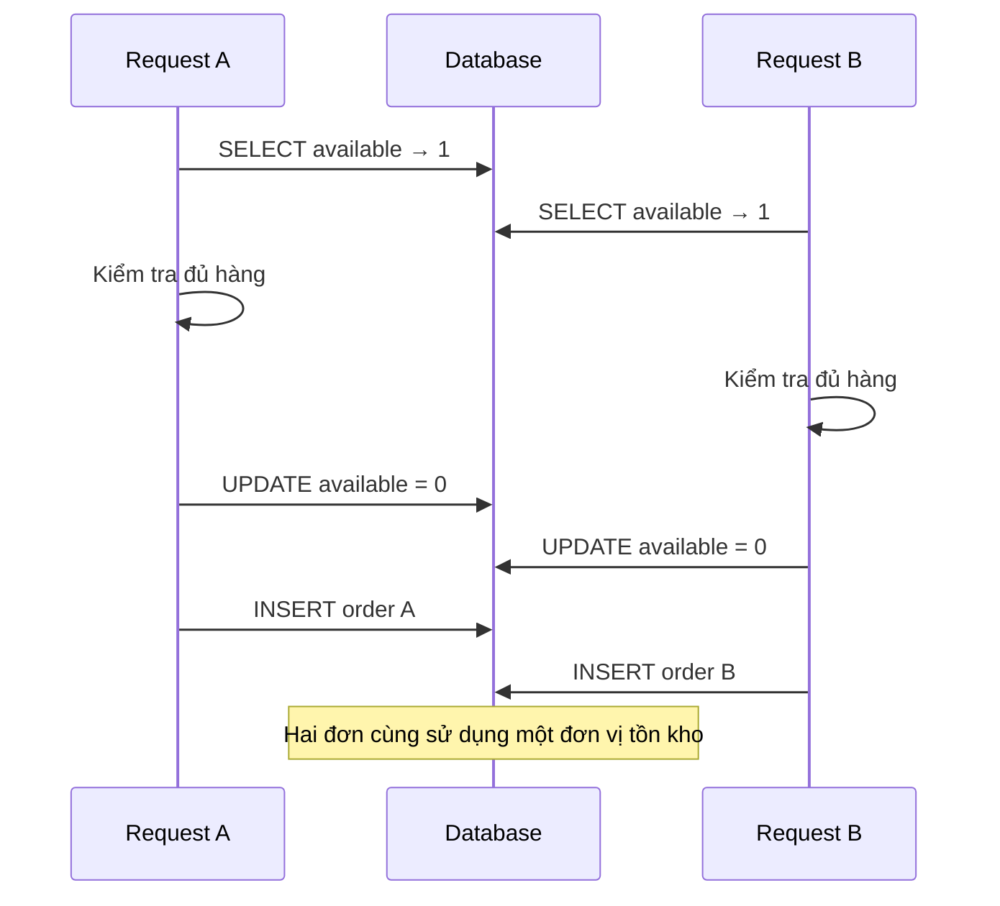

# Cuộc đua giữa đọc, kiểm tra điều kiện và cập nhật

Trong chương **Kiểm soát đồng thời** của **DATA_PERSISTENCE_FUNDAMENTALS**, một lỗi phổ biến ở tầng persistence là chương trình **đọc một giá trị, kiểm tra điều kiện rồi mới cập nhật** nhưng quên rằng dữ liệu có thể đã bị giao dịch khác thay đổi ở giữa các bước. Đây là kiểu *check-then-act race* hoặc *time-of-check to time-of-use* (**TOCTOU**) trên dữ liệu bền vững.

Một ứng dụng Java cần biết ranh giới giao dịch, mô hình dữ liệu, cách viết SQL và mức cô lập để giữ đúng các bất biến nghiệp vụ khi nhiều yêu cầu xử lý cùng lúc. Mục tiêu bài này là nhận diện cuộc đua, phân biệt những dạng sai lệch nó gây ra và chọn biện pháp phù hợp: **cập nhật có điều kiện tại database**, ràng buộc dữ liệu, khóa bi quan, khóa lạc quan hoặc mức cô lập mạnh hơn.

## 1. Vấn đề bắt đầu từ đâu?

Giả sử kho hàng chỉ còn **1 sản phẩm**, nhưng hai khách A và B đặt mua đồng thời. Một cách viết dễ gặp:

```java
Product product = repository.findById(productId);
if (product.getAvailable() >= 1) {
    repository.updateAvailable(productId, product.getAvailable() - 1);
    orderRepository.createOrder(productId, customerId);
}
```

Ý định là “chỉ nhận đơn khi còn hàng”. Nhưng đoạn mã thực hiện **ba bước rời rạc**:

1. Đọc số lượng tồn (`available`).
2. Kiểm tra `available >= 1` trên dữ liệu vừa đọc.
3. Ghi số lượng mới và tạo đơn.

Giữa bước 2 và bước 3, giao dịch khác vẫn có thể cập nhật chính sản phẩm đó. Kết quả kiểm tra ở Java chỉ đúng **tại thời điểm đọc**, không phải lời bảo đảm cho lần ghi sau.

### 1.1. Lịch chạy xen kẽ

Ban đầu `available = 1`:

| Thời điểm | Yêu cầu A | Yêu cầu B | Tồn kho trong DB |
| --- | --- | --- | ---: |
| T0 | — | — | 1 |
| T1 | `SELECT available` → 1 | — | 1 |
| T2 | — | `SELECT available` → 1 | 1 |
| T3 | Kiểm tra `1 >= 1` → đúng | — | 1 |
| T4 | — | Kiểm tra `1 >= 1` → đúng | 1 |
| T5 | `UPDATE ... SET available = 0` | — | 0 |
| T6 | — | `UPDATE ... SET available = 0` | 0 |
| T7 | Tạo đơn A | Tạo đơn B | 0 nhưng có **2 đơn** |

Số tồn sau cùng không âm, nhưng hệ thống đã nhận hai đơn cho một sản phẩm. Một ràng buộc `CHECK (available >= 0)` **không phát hiện được** lỗi nghiệp vụ này vì cả hai lần cập nhật đều ghi số `0`.



Sơ đồ là một lịch chạy **có thể xảy ra**, không hàm ý mọi hệ quản trị hoặc mọi mức cô lập đều cho phép cùng lịch đó hoàn tất. Ví dụ, mức `SERIALIZABLE` có thể hủy một giao dịch. Điều quan trọng là code đọc rồi kiểm tra ở Java **không tự tạo bảo đảm đồng thời**.

## 2. Phân biệt các kiểu lỗi trong cuộc đua

| Hiện tượng | Điều xảy ra | Ví dụ | Nguyên nhân |
| --- | --- | --- | --- |
| **TOCTOU / check-then-act** | Điều kiện hợp lệ lúc đọc nhưng có thể hết hợp lệ lúc ghi | Hai khách cùng thấy còn hàng | Kiểm tra và hành động không là một bước nguyên tử |
| **Lost update** (*mất cập nhật*) | Một lần ghi dựa trên dữ liệu cũ ghi đè ảnh hưởng của lần ghi khác | Hai người cùng tăng bộ đếm từ 5 lên 6, thay vì 7 | Ghi lại giá trị đã tính từ bản đọc cũ |
| **Overselling / vi phạm bất biến** | Trạng thái cuối hoặc hiệu ứng nghiệp vụ vượt giới hạn | Một đơn vị hàng được bán hai lần | Chưa có cơ chế ràng buộc chấp nhận yêu cầu |
| **Write skew** (*ghi lệch*) | Hai giao dịch đọc cùng điều kiện tổng thể nhưng ghi các hàng khác nhau, kết hợp lại phá bất biến | Hai bác sĩ đồng thời tự rút khỏi ca trực | Điều kiện nhiều hàng không được bảo vệ bằng khóa/kiểm soát phù hợp |
| **Duplicate creation** | Hai yêu cầu cùng kiểm tra “chưa tồn tại”, rồi cùng tạo | Hai tài khoản dùng cùng username | “Kiểm tra trước” không thay thế `UNIQUE` |

Một lỗi có thể thuộc nhiều nhóm. Lịch bán vượt tồn ở mục 1 có **dạng lost update** trên giá trị tồn nhưng hậu quả quan trọng nhất là **hai đơn cùng được chấp nhận**. Sửa lỗi ghi đè mà không giới hạn quyền tạo đơn vẫn có thể khiến bất biến bị phá.

### 2.1. `UPDATE` tương đối có đủ không?

So sánh hai câu SQL:

```sql
-- Ghi đè bằng giá trị Java tính từ dữ liệu cũ:
UPDATE products SET available = 0 WHERE id = 101;

-- Biến đổi từ giá trị hiện tại tại DB:
UPDATE products SET available = available - 1 WHERE id = 101;
```

Câu thứ hai tránh dạng ghi đè mất cập nhật của câu đầu trong những hệ quản trị xử lý xung đột ghi đúng, nhưng **vẫn không kiểm tra có đủ hàng**. Nếu hai giao dịch đều trừ một từ `1`, kết quả có thể xuống `-1` khi không có constraint. Khi có `CHECK (available >= 0)`, một câu lệnh có thể thất bại, nhưng ứng dụng phải xử lý lỗi và rollback các thay đổi liên quan.

Để kiểm tra điều kiện và cập nhật **cùng một thao tác tại DB**, cần đưa điều kiện vào chính câu lệnh thay đổi dữ liệu.

## 3. Cách ưu tiên khi có thể: cập nhật SQL có điều kiện

Một bảng tồn kho đơn giản dùng trong các ví dụ PostgreSQL:

```sql
CREATE TABLE products (
    id        BIGINT PRIMARY KEY,
    available INTEGER NOT NULL CHECK (available >= 0)
);

INSERT INTO products (id, available) VALUES (101, 1);
```

Cách giữ bất biến **không bán quá tồn** là:

```sql
UPDATE products
   SET available = available - 1
 WHERE id = 101
   AND available >= 1;
```

Ứng dụng phải kiểm tra **số hàng được cập nhật**:

- `1` hàng: một lần trừ kho đã thành công; có thể thực hiện các bước nghiệp vụ khác trong **cùng transaction**.
- `0` hàng: không tìm thấy sản phẩm hoặc tồn kho không đủ; không được tạo đơn thành công.
- Lỗi DB: xử lý theo mã lỗi và rollback transaction nếu cần; không coi đó là đặt hàng thành công.

Trong PostgreSQL ở mức `READ COMMITTED`, nếu hai giao dịch đồng thời thực hiện `UPDATE` trên cùng hàng, một giao dịch có thể chờ giao dịch còn lại, rồi **đánh giá lại điều kiện `WHERE`** trên phiên bản hàng mới. Với `available = 1`, một câu lệnh thành công và câu còn lại cập nhật `0` hàng (giả sử giao dịch thứ nhất commit). Ở hệ quản trị/mức cô lập khác, xung đột có thể báo lỗi thay vì trả `0`; ứng dụng cần xử lý đúng cả hai trường hợp.

```sql
-- Tham số hóa cho yêu cầu đặt qty sản phẩm:
UPDATE products
   SET available = available - :qty
 WHERE id = :product_id
   AND available >= :qty;
```

Ứng dụng cần kiểm tra `qty > 0` trước khi chạy để tránh trừ số âm; ràng buộc hoặc kiểu dữ liệu phù hợp ở database có thể bổ sung lớp bảo vệ. Dùng `UPDATE ... RETURNING available` trong PostgreSQL nếu cần nhận lại số tồn mới **chỉ khi lệnh thực sự cập nhật hàng**.

### 3.1. Đủ điều kiện trừ kho chưa có nghĩa đã tạo đơn an toàn

Trừ kho và ghi đơn hàng phải thuộc **cùng transaction** để tránh trường hợp trừ kho thành công nhưng ghi đơn lỗi:

```text
BEGIN
    UPDATE products
       SET available = available - :qty
     WHERE id = :product_id AND available >= :qty
    → yêu cầu đúng 1 hàng

    INSERT INTO orders(request_id, product_id, quantity, ...)
    VALUES (:request_id, :product_id, :qty, ...)
COMMIT
```

Nếu câu `INSERT` thất bại, phải rollback cả lần trừ kho. Khi client mất kết nối lúc commit, trạng thái có thể **chưa xác định ở phía client**; không tự động chạy lại nghiệp vụ mà chưa đối chiếu mã yêu cầu duy nhất và thiết kế idempotency.

### 3.2. Khi nào điều kiện trong `UPDATE` là đủ?

Mẫu này phù hợp khi bất biến có thể diễn đạt trên **hàng đang cập nhật**, ví dụ số dư không âm, số lượng tồn không âm, hoặc trạng thái đang là `PENDING` trước khi chuyển sang `PAID`:

```sql
UPDATE orders
   SET status = 'PAID'
 WHERE id = :order_id
   AND status = 'PENDING';
```

Số hàng ảnh hưởng phải được kiểm tra: nếu trả `0`, đơn đã chuyển trạng thái hoặc không tồn tại. Đối với bất biến liên quan **nhiều hàng, số lượng bản ghi hoặc tài nguyên ngoài database**, một câu `UPDATE` trên một hàng có thể chưa đủ; cần cân nhắc khóa, constraint, serialization hoặc mô hình dữ liệu phù hợp.

## 4. Khóa lạc quan: phát hiện dữ liệu đã thay đổi

**Optimistic locking** thích hợp khi tranh chấp tương đối hiếm và ứng dụng có thể phát hiện thay đổi rồi tải lại/thử lại. Thay vì giữ khóa trong khoảng thời gian ứng dụng đọc, xử lý rồi ghi, mỗi hàng có một trường phiên bản.

```sql
ALTER TABLE products
ADD COLUMN version BIGINT NOT NULL DEFAULT 0;
```

Luồng cơ bản:

1. Đọc `id`, `available`, `version` của sản phẩm. Giả sử phiên bản là `7`.
2. Tính toán theo dữ liệu đã đọc.
3. Khi ghi, yêu cầu `version` vẫn là `7`; đồng thời tăng version thành `8`.
4. Kiểm tra số hàng cập nhật. Nếu `0`, dữ liệu không còn khớp điều kiện ban đầu; phải đọc lại hoặc báo xung đột, **không giả vờ ghi thành công**.

```sql
-- Cả hai biến thể điều kiện được kiểm tra tại thời điểm UPDATE.
UPDATE products
   SET available = available - :qty,
       version = version + 1
 WHERE id = :product_id
   AND version = :version_read
   AND available >= :qty;
```

Với ví dụ `available = 1`, `version = 7`, hai người đều đọc phiên bản `7`. Người đầu cập nhật thành `available = 0`, `version = 8`. Người thứ hai không thể dùng phiên bản cũ để ghi thành công; kết quả là `0` hàng (hoặc lỗi xung đột tùy DB/mức cô lập).

So với câu `UPDATE ... AND available >= :qty` ở mục 3, điều kiện `version` giúp phát hiện **mọi thay đổi có tham gia cơ chế tăng version**, không chỉ thay đổi tồn kho. Nhưng nó cũng có thể tạo thêm xung đột do các thay đổi không trực tiếp liên quan đến quy tắc tồn kho. Trong trường hợp chỉ cần decrement khi đủ hàng, câu `UPDATE` có điều kiện thường đơn giản hơn.

**Quy tắc quan trọng:** mọi đường ghi có thể làm dữ liệu liên quan thay đổi phải tăng version nhất quán. Nếu một script hoặc repository khác cập nhật trực tiếp mà không tăng version, cơ chế optimistic locking có thể bị vô hiệu.

### 4.1. Liên hệ JPA/Hibernate

Với JPA, có thể khai báo trường `@Version`:

```java
@Entity
public class Product {
    @Id
    private Long id;

    @Version
    private Long version;

    @Column(nullable = false)
    private int available;

    // Getter, setter và constructor lược bỏ.
}
```

Provider có thể phát sinh câu `UPDATE` kèm điều kiện phiên bản. Khi phát hiện xung đột, nó thường báo lỗi như `OptimisticLockException` (hoặc ngoại lệ tương ứng được Spring chuyển đổi). Lỗi có thể xuất hiện lúc `flush` hoặc commit, không nhất thiết ngay ở dòng Java đổi trường. Giao dịch bị lỗi phải rollback; muốn thử lại, hãy **tạo transaction mới và đọc lại dữ liệu**, tránh retry bằng entity đang giữ phiên bản cũ.

`@Version` không tự bảo đảm kiểm tra đúng quy tắc tồn kho nếu ứng dụng không thực hiện kiểm tra số lượng hợp lệ; phải đặt điều kiện nghiệp vụ và ràng buộc DB tương ứng. Các bulk update JPQL/SQL và đường ghi bên ngoài ORM cũng cần được thiết kế để không bỏ qua cơ chế version.

## 5. Khóa bi quan: khóa hàng trước khi kiểm tra

**Pessimistic locking** sử dụng khóa do database quản lý để những giao dịch có xung đột không thể cùng thay đổi hàng được bảo vệ mà không đồng bộ. Với PostgreSQL, một mẫu minh họa là:

```sql
BEGIN;

SELECT available
FROM products
WHERE id = 101
FOR UPDATE;

-- Ứng dụng kiểm tra available và quyết định có đặt hàng không.
UPDATE products
   SET available = available - 1
 WHERE id = 101;

INSERT INTO orders (request_id, product_id, quantity)
VALUES ('11111111-1111-1111-1111-111111111111', 101, 1);

COMMIT;
```

**Không thực hiện vô điều kiện** hai lệnh cuối: chỉ trừ tồn và tạo đơn nếu kết quả đọc dưới khóa cho biết đủ hàng. Khi hàng đã bị một transaction khác khóa, `SELECT ... FOR UPDATE` có thể phải đợi transaction kia kết thúc. Sau khi giành được khóa, transaction đọc dữ liệu theo quy tắc của DB/mức cô lập rồi mới kiểm tra điều kiện.

Điểm cần tránh: nếu dùng `SELECT ... FOR UPDATE` khi `autoCommit = true` và transaction đã kết thúc ngay sau câu SELECT, khóa không còn bảo vệ đoạn kiểm tra/cập nhật tại Java. Muốn khóa có tác dụng, **SELECT, kiểm tra và UPDATE phải trong một transaction liên tục**, sử dụng đúng kết nối/giao dịch.

### 5.1. Khi nào nên khóa trước?

Khóa bi quan có ích khi phải đọc nhiều trường rồi ra quyết định phức tạp, tranh chấp cao, hoặc phải đảm bảo một thứ tự xử lý trên tập hàng đã xác định. Ví dụ:

- Cập nhật nhiều cột liên quan của cùng một tài khoản.
- Chuyển tiền có khóa tài khoản theo thứ tự ID nhất quán.
- Xử lý một hàng công việc mà không muốn hai worker cùng nhận (một số DB hỗ trợ `SKIP LOCKED` để xây queue).

Tuy nhiên, khóa kéo dài làm tăng thời gian chờ, deadlock và chiếm kết nối. Khi chỉ cần “trừ số lượng nếu còn đủ”, **một `UPDATE` có điều kiện** thường gọn và dễ vận hành hơn việc SELECT rồi khóa trước.

`SELECT ... FOR UPDATE` chỉ khóa những hàng thực sự phù hợp theo cơ chế DB; nó **không tự bảo vệ mọi điều kiện về tập các hàng chưa tồn tại**. Để cấm hai đơn cùng dùng một mã duy nhất, cần constraint `UNIQUE`, không chỉ tìm trước rồi khóa một danh sách kết quả rỗng.

## 6. Kiểm tra “chưa tồn tại” rồi INSERT cũng là một cuộc đua

Ví dụ hai request cùng tạo username `"linh"`:

```text
T1: SELECT 1 FROM users WHERE username = 'linh'  → chưa có
T2: SELECT 1 FROM users WHERE username = 'linh'  → chưa có
T1: INSERT username='linh'
T2: INSERT username='linh'
```

Nếu hệ thống không có ràng buộc ở database, hai bản ghi trùng có thể được tạo. Kể cả kiểm tra trong service với `@Transactional`, một giao dịch không nhất thiết nhìn thấy thay đổi chưa commit của giao dịch kia và cả hai có thể vượt qua câu `SELECT`.

**Đặt bất biến ở DB**:

```sql
CREATE TABLE users (
    id BIGINT GENERATED ALWAYS AS IDENTITY PRIMARY KEY,
    username VARCHAR(100) NOT NULL UNIQUE
);
```

Sau đó thử `INSERT` trực tiếp và xử lý xung đột unique. Với PostgreSQL có thể dùng:

```sql
INSERT INTO users (username)
VALUES ('linh')
ON CONFLICT (username) DO NOTHING
RETURNING id;
```

Nếu trả về một hàng, ứng dụng đã tạo user. Nếu không trả hàng, giá trị trùng đã tồn tại, có thể báo lỗi “username đã được sử dụng”. Nếu cần cập nhật khi trùng, cân nhắc `ON CONFLICT ... DO UPDATE` với quy tắc nghiệp vụ rõ ràng; không tự suy luận rằng mọi bản ghi trùng đều nên bị ghi đè.

**Bài học:** kiểm tra trước có ích để thông báo sớm cho người dùng, nhưng **không thay thế constraint**. Với bất biến dựa trên tập bản ghi, hãy ưu tiên database constraint (`UNIQUE`, `CHECK`, foreign key, hoặc ràng buộc đặc thù DB). Một số bất biến phức tạp cần đổi mô hình dữ liệu, khóa trên một hàng đại diện hoặc transaction cô lập mạnh.

## 7. Bất biến nhiều hàng: hiện tượng write skew

Giả sử một bệnh viện yêu cầu **luôn có ít nhất một bác sĩ trực**, và hai bác sĩ A, B đều đang trực. Mỗi người muốn nghỉ, ứng dụng kiểm tra số người còn trực trước khi cập nhật hàng của **chính mình**:

```text
Trạng thái đầu: A = on_call, B = on_call

T1 đọc COUNT(on_call) = 2
T2 đọc COUNT(on_call) = 2
T1 thấy còn người khác → UPDATE A = off_call
T2 thấy còn người khác → UPDATE B = off_call

Kết quả sau cùng: không còn ai trực.
```

Hai transaction **ghi hai hàng khác nhau**, nên cơ chế chỉ ngăn hai writer ghi đè cùng một hàng có thể chưa đủ. Đây là ví dụ *write skew*: mỗi transaction thấy điều kiện tổng thể hợp lệ theo snapshot của mình, nhưng tổng hợp hai thay đổi lại phá bất biến.

Cách khắc phục phụ thuộc mô hình dữ liệu và DB:

1. Chuyển quy tắc thành một thao tác trên **một hàng đại diện** (ví dụ hàng số lượng người trực) rồi kiểm tra/cập nhật có điều kiện, nếu cách duy trì hàng đại diện nhất quán.
2. Khóa trước **toàn bộ các hàng đang tham gia quyết định** theo thứ tự thống nhất và giữ khóa tới khi hoàn tất kiểm tra/ghi.
3. Dùng **`SERIALIZABLE`** khi DB có cơ chế phát hiện lịch thực thi không thể tuần tự hóa, đồng thời **retry toàn bộ giao dịch** khi gặp lỗi serialization.
4. Thiết kế constraint hoặc cơ chế đảm bảo bất biến tại DB nếu khả thi.

Lưu ý `SELECT COUNT(*)` thông thường không khóa tất cả thay đổi của tập dữ liệu, và ngay cả `SELECT ... FOR UPDATE` cũng có giới hạn khi điều kiện liên quan tới hàng chưa tồn tại. Không có một câu khóa hàng phổ quát bảo vệ mọi dạng điều kiện tổng hợp.

## 8. Mức cô lập giao dịch có giải quyết được cuộc đua?

**Isolation level** quy định những trạng thái giao dịch có thể quan sát và kiểu bất thường mà database cho phép. Tuy nhiên, việc đặt `@Transactional` hoặc bắt đầu một transaction **không tự động** biến ba bước “đọc → kiểm tra → ghi” thành thao tác nguyên tử theo quy tắc nghiệp vụ.

| Mức cô lập SQL | Góc nhìn thực tế đối với cuộc đua | Điều cần kiểm tra |
| --- | --- | --- |
| `READ UNCOMMITTED` | Có thể cho phép đọc thay đổi chưa commit, tùy DB; một số hệ quản trị thực thi mạnh hơn mức này | Đừng giả định cùng mức cô lập có cùng hành vi trên mọi DB |
| `READ COMMITTED` | Tránh đọc bẩn; mỗi câu lệnh có thể thấy trạng thái commit mới hơn câu trước | Đọc/kiểm tra trước rồi ghi sau vẫn có khe hở giữa các câu lệnh |
| `REPEATABLE READ` | Các lần đọc có thể nhìn một snapshot ổn định hơn; mức bảo đảm cụ thể khác nhau giữa DB | Snapshot ổn định không đồng nghĩa bất biến liên quan nhiều hàng luôn được bảo vệ |
| `SERIALIZABLE` | Kết quả các giao dịch hoàn tất tương đương một lịch tuần tự, theo cơ chế DB | Giao dịch có thể bị hủy khi xung đột; caller phải xử lý retry |

Ví dụ với PostgreSQL:

- Ở `READ COMMITTED`, câu `UPDATE ... WHERE available >= :qty` trên một hàng được database đồng bộ với các cập nhật cạnh tranh và kiểm tra lại điều kiện phù hợp khi cần. Đây là cơ sở giúp hai yêu cầu không cùng trừ thành công một đơn vị tồn.
- Ở `REPEATABLE READ`, PostgreSQL cung cấp snapshot isolation và có thể báo lỗi serialization khi một giao dịch cố cập nhật hàng đã bị transaction khác thay đổi sau snapshot; nhưng các bất biến nhiều hàng có thể vẫn gặp write skew.
- Ở `SERIALIZABLE`, PostgreSQL có thể phát hiện những phụ thuộc gây lịch không tuần tự hóa và hủy một trong các giao dịch. Ứng dụng phải có chiến lược **retry toàn bộ transaction** khi gặp SQLSTATE `40001`.

Các nhận định trên nêu rõ **PostgreSQL** vì MySQL/InnoDB, SQL Server và Oracle có chi tiết khóa, snapshot, hành vi xung đột khác nhau. Không nên suy từ tên mức cô lập ra một lịch chạy chính xác mà không kiểm tra tài liệu và truy vấn thực tế của hệ quản trị đang dùng.

**`SERIALIZABLE` không có nghĩa mọi yêu cầu sẽ luôn thành công:** nó có thể từ chối một số giao dịch để giữ tính đúng đắn. Ngoài ra, logic nghiệp vụ vẫn phải thực thi đầy đủ điều kiện và xử lý retry đúng; serialization không tạo ra các constraint mà ứng dụng chưa định nghĩa.

## 9. Ví dụ Java JDBC: kiểm tra và ghi trên cùng transaction

Ví dụ sau dùng một câu **conditional UPDATE** để quyết định có nhận đơn, rồi ghi bản ghi đơn hàng trên **cùng kết nối JDBC**. Các câu SQL có cú pháp phù hợp PostgreSQL; các tên tham số dạng `:qty` ở các mục trước chỉ là ký hiệu minh họa, còn JDBC thật dùng dấu `?`.

Lược đồ đơn hàng bổ sung:

```sql
CREATE TABLE orders (
    request_id UUID PRIMARY KEY,
    product_id BIGINT NOT NULL REFERENCES products(id),
    quantity INTEGER NOT NULL CHECK (quantity > 0)
);
```

`request_id` là định danh của một yêu cầu nghiệp vụ, giúp database từ chối tạo hai đơn có cùng mã. Mã Java:

```java
import java.sql.Connection;
import java.sql.PreparedStatement;
import java.sql.SQLException;
import java.util.Objects;
import java.util.UUID;
import javax.sql.DataSource;

public final class ReservationService {
    private final DataSource dataSource;

    public ReservationService(DataSource dataSource) {
        this.dataSource = dataSource;
    }

    public boolean reserve(long productId, int qty, UUID requestId)
            throws SQLException {
        if (qty <= 0) {
            throw new IllegalArgumentException("Quantity must be positive");
        }
        Objects.requireNonNull(requestId, "requestId");

        try (Connection c = dataSource.getConnection()) {
            // Giả định DataSource cấp kết nối chưa có transaction
            // và được cấu hình autoCommit=true.
            if (!c.getAutoCommit()) {
                throw new SQLException("Expected autoCommit=true");
            }
            c.setAutoCommit(false);

            try {
                int updated;
                String decreaseStock = """
                    UPDATE products
                       SET available = available - ?
                     WHERE id = ? AND available >= ?
                    """;
                try (PreparedStatement ps = c.prepareStatement(decreaseStock)) {
                    ps.setInt(1, qty);
                    ps.setLong(2, productId);
                    ps.setInt(3, qty);
                    updated = ps.executeUpdate();
                }

                if (updated != 1) {
                    c.rollback();
                    return false; // Không đủ hàng hoặc không có sản phẩm.
                }

                String createOrder = """
                    INSERT INTO orders(request_id, product_id, quantity)
                    VALUES (?, ?, ?)
                    """;
                try (PreparedStatement ps = c.prepareStatement(createOrder)) {
                    ps.setObject(1, requestId);
                    ps.setLong(2, productId);
                    ps.setInt(3, qty);
                    ps.executeUpdate();
                }

                c.commit();
                return true;
            } catch (SQLException | RuntimeException failure) {
                try {
                    c.rollback();
                } catch (SQLException rollbackFailure) {
                    failure.addSuppressed(rollbackFailure);
                }
                throw failure;
            }
            // try-with-resources đóng connection logic của caller.
        }
    }
}
```

### 9.1. Vì sao kết quả `executeUpdate()` quan trọng?

`executeUpdate()` trả số hàng bị tác động với kiểu câu `UPDATE` đơn giản trên một hàng xác định. Ứng dụng chỉ được coi là đã trừ kho khi kết quả đúng `1`. Trường hợp `0` là **một nhánh nghiệp vụ cần xử lý**; không thể tiếp tục tạo đơn chỉ vì câu lệnh không phát sinh exception.

Việc cập nhật và tạo đơn cùng một transaction giải quyết trường hợp **trừ kho rồi INSERT lỗi**: rollback phải đưa cả hai bước trở lại trạng thái trước khi giao dịch. Trong mã mẫu, `Connection` thuộc về service; `PreparedStatement` thuộc từng khối `try-with-resources`. Không giao kết nối này cho các luồng khác hoặc repository có thể tự commit/close.

### 9.2. Giới hạn về idempotency và trạng thái commit

`PRIMARY KEY (request_id)` ngăn tạo hai bản ghi có cùng mã, và lỗi trùng khóa làm giao dịch mới rollback cả phần trừ kho vừa thực hiện. Nhưng ví dụ **chưa hoàn chỉnh chính sách trả kết quả idempotent**: khi gọi lại yêu cầu cũ, nếu hết hàng, phương thức có thể trả `false` trước khi kiểm tra mã đã được xử lý thành công; nếu trùng khóa khi còn hàng, nó ném exception. Ứng dụng thực tế cần tra cứu **trạng thái yêu cầu đã ghi bền vững** và trả lại kết quả đã có, sau khi xác thực mã yêu cầu gắn với đúng nội dung nghiệp vụ.

Khi lỗi xảy ra trong hoặc sau `commit()`, client có thể không biết database đã commit hay chưa. Thử `rollback()` không chứng minh transaction chưa được commit. Trước khi thử lại với cùng `requestId`, caller phải đối chiếu trạng thái trên DB; thao tác đọc trạng thái này cần được thiết kế phù hợp với cơ chế retry và độ sẵn sàng của hệ thống.

### 9.3. Nếu dùng Spring và JPA

Với Spring, có thể đặt `@Transactional` ở service và dùng `JdbcTemplate.update(...)` hoặc repository JPA được transaction manager điều phối. Vẫn phải bảo đảm **kiểm tra số hàng bị cập nhật** hay xử lý `OptimisticLockException`, không dựa đơn thuần vào annotation:

```java
@Transactional
public void reserveProduct(long productId, int qty) {
    if (qty <= 0) {
        throw new IllegalArgumentException("Quantity must be positive");
    }

    int changed = jdbcTemplate.update(
        "UPDATE products SET available = available - ? " +
        "WHERE id = ? AND available >= ?",
        qty, productId, qty
    );
    if (changed != 1) {
        throw new IllegalStateException("Insufficient stock");
    }

    // Gọi repository ghi đơn hàng trong cùng transaction Spring.
}
```

Nếu một đoạn code bắt ngoại lệ trên rồi **nuốt ngoại lệ** để phương thức `@Transactional` trả về bình thường, transaction manager có thể commit những thay đổi đã thực hiện trước đó (tùy trạng thái rollback-only và cấu hình). Hãy để lỗi kích hoạt rollback hoặc đánh dấu rollback một cách có chủ đích theo quy tắc nghiệp vụ.

## 10. Kiểm thử cuộc đua bằng hai transaction thực sự

Lỗi đồng thời thường **không xuất hiện** trong unit test chỉ gọi tuần tự các phương thức repository hoặc mock database. Cần có integration test dùng hai kết nối/giao dịch độc lập tới một DB phù hợp môi trường chạy thật.

### 10.1. Thí nghiệm với hai phiên PostgreSQL

Khởi tạo lại sản phẩm `101` có `available = 1` trong môi trường thử nghiệm. Mở hai phiên SQL độc lập với isolation `READ COMMITTED`.

Phiên A:

```sql
BEGIN;

UPDATE products
   SET available = available - 1
 WHERE id = 101 AND available >= 1;
-- 1 hàng được cập nhật; chưa COMMIT để giữ transaction mở.
```

Trước khi A commit, phiên B bắt đầu:

```sql
BEGIN;

UPDATE products
   SET available = available - 1
 WHERE id = 101 AND available >= 1;
-- Có thể chờ khóa do phiên A đang giữ.
```

Sau đó cho phiên A chạy `COMMIT`. Phiên B tiếp tục và theo hành vi PostgreSQL `READ COMMITTED` sẽ đánh giá lại điều kiện trên dữ liệu phù hợp. Khi `available = 0`, phiên B cập nhật **0 hàng**. Kết thúc phiên B bằng `ROLLBACK` hoặc `COMMIT` (vì không có thay đổi) và xác nhận số tồn vẫn là `0`.

Nếu thay câu lệnh bằng `UPDATE products SET available = 0 WHERE id = 101` trong cả hai phiên, có thể có **hai lần cập nhật báo thành công**, nhưng tồn kho vẫn là `0`. Điều này minh họa vì sao “câu SQL chạy thành công” và “đặt hàng được chấp nhận hợp lệ” là hai điều khác nhau.

### 10.2. Kiểm thử ở tầng Java

Tình huống kiểm thử cần bảo đảm:

1. Khởi tạo sản phẩm có `available = 1`.
2. Khởi chạy hai lời gọi `reserve(productId, 1, requestId)` đồng thời với **hai `requestId` khác nhau**, sử dụng hai kết nối riêng.
3. Sau khi cả hai hoàn tất, đúng **một** yêu cầu nhận hàng, số tồn bằng `0`, và chỉ có **một** bản ghi đơn hàng.
4. Giả lập lỗi ở bước `INSERT orders` sau khi đã trừ kho: transaction phải rollback, số tồn không bị mất.
5. Tạo hai yêu cầu có **cùng** `requestId`: DB không được có hai bản ghi cùng mã; ứng dụng phải xử lý kết quả lặp lại theo chính sách idempotency.

Có thể dùng `CountDownLatch` hoặc `CyclicBarrier` để đồng bộ điểm bắt đầu hai tác vụ Java, nhưng **bắt đầu cùng lúc không bảo đảm luôn tái hiện mọi lịch chạy lỗi**. Để kiểm tra mẫu đọc–kiểm tra–ghi bị lỗi, có thể cố ý đặt điểm đồng bộ **sau khi cả hai giao dịch đã đọc** và trước khi chúng ghi. Với mẫu `UPDATE` có điều kiện, nên quan sát đồng thời cả kết quả số hàng ảnh hưởng lẫn trạng thái bền vững sau commit.

Trong các test đồng thời, nên dùng database thực hoặc môi trường tương thích hành vi locking/isolation, đặt timeout để không treo test vô hạn và luôn đóng connection/transaction. Một DB giả lập in-memory có thể không có cùng hành vi khóa và snapshot như DB triển khai.

## 11. Chọn giải pháp theo dạng bất biến

| Bài toán | Giải pháp thường ưu tiên | Đừng bỏ qua |
| --- | --- | --- |
| Trừ tồn khi đủ hàng | `UPDATE ... SET available = available - ? WHERE available >= ?`, kiểm tra affected rows | Cùng transaction với ghi đơn; `CHECK` bảo vệ dữ liệu |
| Chuyển `PENDING` → `PAID` đúng một lần | Conditional `UPDATE` kèm trạng thái cũ | Không thực hiện side effect ngoài DB hai lần nếu retry |
| Ghi đối tượng có nguy cơ bị sửa trong lúc người dùng chỉnh form | Optimistic locking bằng `version` / JPA `@Version` | Tất cả đường ghi đều duy trì version; xử lý xung đột rõ ràng |
| Đọc nhiều trường rồi thực hiện chuỗi cập nhật cần giữ hàng ổn định | `SELECT ... FOR UPDATE` và transaction ngắn | Thứ tự khóa ổn định, deadlock, connection pool |
| Chỉ cho phép một tên đăng nhập/mã yêu cầu | `UNIQUE`, `INSERT`, xử lý trùng khóa | Kiểm tra “chưa tồn tại” trước INSERT không đủ |
| Bất biến liên quan tổng hợp nhiều hàng | Constraint hoặc thiết kế lại mô hình; locking thích hợp; `SERIALIZABLE` khi cần | Write skew, phantom, serialization failure, retry |
| Đồng bộ DB với API/message broker | Outbox, idempotency và cơ chế phối hợp nghiệp vụ phù hợp | Transaction DB không rollback hệ thống bên ngoài |

**Không có một biện pháp áp dụng cho mọi cuộc đua.** Một câu `UPDATE` có điều kiện trên một hàng thường là lựa chọn trực tiếp nhất khi bất biến có thể diễn đạt tại hàng đó. `UNIQUE` là tuyến phòng thủ đúng cho tính duy nhất. Khi điều kiện phụ thuộc nhiều hàng hoặc một trạng thái dài hạn, phải kết hợp mô hình dữ liệu, mức cô lập và phương thức quản lý transaction.

### 11.1. Các sai lầm cần tránh

- **Tin rằng `@Transactional` tự khóa mọi bản đọc.** Annotation chỉ định phạm vi transaction; hiệu lực bảo vệ còn phụ thuộc SQL, isolation và cơ chế khóa.
- **Dựa vào `synchronized` trong Java để chống tranh chấp DB.** Nó chỉ đồng bộ trong phạm vi đối tượng/JVM tương ứng; nhiều instance của ứng dụng, worker khác hoặc câu SQL ngoài ứng dụng không chịu cùng khóa đó.
- **Chỉ kiểm tra điều kiện bằng `SELECT`, rồi `INSERT`/`UPDATE` không điều kiện.** Khoảng thời gian giữa hai câu SQL cho phép dữ liệu bị thay đổi.
- **Bỏ qua số hàng ảnh hưởng.** `UPDATE` ảnh hưởng `0` hàng không có nghĩa là đã thành công.
- **Giữ transaction mở khi gọi API ngoài hoặc chờ người dùng.** Điều này làm tăng thời gian giữ khóa/kết nối mà vẫn không tạo atomicity cho hệ thống bên ngoài.
- **Retry câu SQL cuối cùng sau deadlock hoặc serialization failure.** Nhiều hệ quản trị yêu cầu rollback và chạy lại **toàn bộ transaction** với dữ liệu vừa đọc.
- **Retry mù quáng khi không rõ kết quả commit.** Dùng idempotency key/mã yêu cầu bền vững và truy vấn trạng thái trước khi quyết định thực hiện lại.

## 12. Quy trình thực hiện khi gặp một đoạn read–check–update

Khi review code persistence Java, có thể dùng trình tự:

1. **Ghi rõ bất biến nghiệp vụ.** Ví dụ `available >= 0` *và* tổng số đơn được chấp nhận không vượt số lượng hàng có thể bán.
2. **Liệt kê các câu SQL và điểm đọc dữ liệu.** Phân biệt dữ liệu dùng để hiển thị với dữ liệu được dùng quyết định một cập nhật.
3. **Vẽ lịch chạy của ít nhất hai giao dịch.** Cho cả hai cùng đọc trạng thái cũ trước khi một trong hai ghi; tìm xem điều kiện đã kiểm tra có thể bị vô hiệu hay không.
4. **Đưa kiểm tra đến nơi có thể thực thi nguyên tử.** Nếu bất biến trên một hàng, thử conditional `UPDATE`; nếu tính duy nhất, đặt `UNIQUE`; nếu có phiên bản, dùng compare-and-swap.
5. **Chọn transaction boundary.** Gom các lệnh phải cùng commit/rollback; xác định tầng nào sở hữu connection và cách xử lý lỗi.
6. **Xem xét tranh chấp nhiều hàng và isolation.** Kiểm tra write skew, thứ tự khóa, chi phí chờ, deadlock và retry.
7. **Xác minh bằng integration test đồng thời.** Chỉ kết luận khi đã kiểm tra cả dữ liệu cuối cùng và phản hồi của từng yêu cầu trên DB tương ứng môi trường triển khai.

### Tự kiểm tra

**Câu hỏi 1.** Kho còn một sản phẩm, hai request cùng đọc `1`, sau đó đều chạy `UPDATE products SET available = 0`. Ràng buộc `CHECK (available >= 0)` có đủ để ngăn nhận hai đơn không?

**Gợi ý:** Không. Tồn kho cuối cùng là `0` nên constraint vẫn hợp lệ. Cần điều kiện ở lệnh cập nhật và chỉ tạo đơn nếu lệnh thực sự trừ kho thành công.

**Câu hỏi 2.** Tại sao `UPDATE products SET available = available - 1 WHERE id = ?` vẫn có thể sai?

**Gợi ý:** Câu lệnh tránh tính toán từ bản đọc cũ, nhưng thiếu `AND available >= 1`; nếu hai giao dịch cùng trừ, số tồn có thể âm hoặc câu lệnh thứ hai gặp lỗi constraint.

**Câu hỏi 3.** Hai người cùng muốn tạo username `linh`. Vì sao không nên chỉ `SELECT` trước khi `INSERT`?

**Gợi ý:** Hai transaction có thể cùng thấy chưa tồn tại. Đặt `UNIQUE` ở DB và xử lý lỗi trùng khóa; phép kiểm tra trước chỉ phục vụ trải nghiệm, không tạo bảo đảm duy nhất.

**Câu hỏi 4.** Hai bác sĩ cùng tự rút khỏi ca trực sau khi mỗi người thấy còn hai người trực. Khóa một hàng bác sĩ đang sửa có đủ không?

**Gợi ý:** Không nhất thiết. Hai giao dịch cập nhật các hàng khác nhau. Cần bảo vệ điều kiện tổng thể bằng thiết kế constraint, khóa đủ các hàng liên quan hoặc `SERIALIZABLE` và xử lý retry.

**Câu hỏi 5.** `@Version` hoặc conditional `UPDATE` báo `0` hàng ảnh hưởng. Có nên bỏ qua và coi là thành công?

**Gợi ý:** Không. Đây là tín hiệu dữ liệu đã thay đổi hoặc không còn thỏa điều kiện. Ứng dụng phải báo xung đột/hết hàng hoặc đọc lại và thử trong transaction mới khi an toàn.

**Điểm cần ghi nhớ:** **Đọc đúng tại một thời điểm không đồng nghĩa với được phép ghi ở thời điểm sau đó.** Để tránh cuộc đua giữa đọc, kiểm tra và cập nhật, hãy diễn đạt bất biến ở database và buộc bước ghi xác nhận điều kiện còn đúng, sau đó kiểm tra kết quả và quản lý toàn bộ thay đổi trong một phạm vi giao dịch phù hợp.


