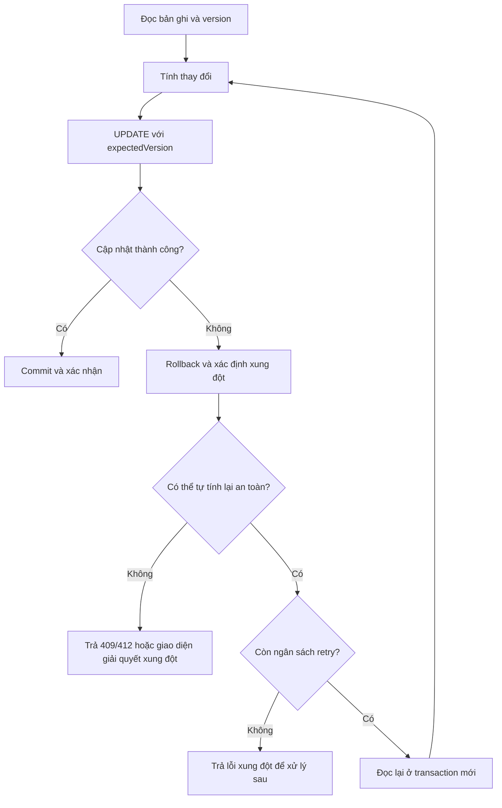

# Khóa lạc quan bằng cột phiên bản

Một người dùng mở màn hình chỉnh sửa tài liệu. Trong khi người đó còn đọc và sửa, một đồng nghiệp đã cập nhật cùng tài liệu rồi lưu. Nếu thao tác lưu của người đầu tiên ghi đè toàn bộ bản ghi, nội dung mới của đồng nghiệp có thể biến mất mà ứng dụng không báo lỗi. Tình huống tương tự xuất hiện khi hai yêu cầu cùng giảm tồn kho hoặc khi nhiều tiến trình cùng cập nhật một bản ghi nghiệp vụ.

**Khóa lạc quan bằng cột phiên bản** (*version-based optimistic locking*) giải quyết vấn đề này bằng một quy tắc đơn giản: **chỉ cho phép cập nhật khi bản ghi vẫn có đúng phiên bản mà tác vụ đã đọc**. Nếu ai đó đã sửa trước, lần ghi sau được báo là xung đột; ứng dụng có cơ hội tải lại dữ liệu, tính lại, gộp thay đổi hoặc yêu cầu người dùng quyết định.

Bài thuộc chương **Kiểm soát đồng thời** của module **DATA_PERSISTENCE_FUNDAMENTALS**, tập trung vào thiết kế persistence an toàn cho Java bằng SQL, JDBC và JPA. Cần phân biệt việc phát hiện xung đột của ứng dụng với mức cô lập và cơ chế khóa bên trong cơ sở dữ liệu: chúng bổ trợ cho nhau nhưng không đồng nhất.

## 1. Từ mất cập nhật đến khóa lạc quan

Giả sử bảng `products` chứa một dòng:

```text
id = 42
stock = 10
version = 7
```

Hai giao dịch A và B cùng đọc giá trị trên, mỗi giao dịch muốn xuất 2 sản phẩm. Cả hai đều tính được `newStock = 8`. Nếu mỗi giao dịch chỉ thực hiện:

```sql
UPDATE products SET stock = 8 WHERE id = 42;
```

và hệ quản trị cho phép cả hai cập nhật thành công, kết quả cuối là `stock = 8` dù đã xác nhận hai lần xuất, tổng cộng 4 sản phẩm. Đây là **lost update**: lần ghi thứ hai dùng dữ liệu cũ và ghi đè hiệu quả của lần ghi trước.

Thêm một điều kiện kiểm tra phiên bản:

```sql
UPDATE products
SET stock = 8,
    version = version + 1
WHERE id = 42
  AND version = 7;
```

Lúc này chỉ tác vụ đầu tiên cập nhật thành công và tăng `version` từ `7` thành `8`. Tác vụ thứ hai dùng điều kiện `version = 7` sẽ không còn tìm thấy dòng phù hợp sau khi thay đổi của tác vụ đầu được xác nhận. Kết quả ghi của B là **0 dòng**, hoặc trong một số hệ/mức cô lập là lỗi xung đột giao dịch cần rollback.

Nếu B muốn xuất thêm 2 sản phẩm, nó có thể tải lại `stock = 8, version = 8`, kiểm tra nghiệp vụ và thử thao tác mới để đưa tồn kho xuống `6`. Với màn hình sửa văn bản, việc tự động ghi lại nội dung cũ thường không phù hợp: cần thông báo cho người dùng hoặc gộp thay đổi có chủ đích.

### Lịch thực thi có kiểm tra phiên bản

```mermaid
sequenceDiagram
    participant A as Tác vụ A
    participant DB as Database
    participant B as Tác vụ B
    A->>DB: SELECT stock, version
    DB-->>A: 10, 7
    B->>DB: SELECT stock, version
    DB-->>B: 10, 7
    A->>DB: UPDATE ... WHERE version = 7
    DB-->>A: 1 dòng; version thành 8
    A->>DB: COMMIT
    B->>DB: UPDATE ... WHERE version = 7
    DB-->>B: 0 dòng hoặc lỗi xung đột
    Note over B: Hủy tác vụ cũ; tải lại và quyết định xử lý
```

Các bước trên chỉ minh họa kết quả logic. Tại thời điểm hai cập nhật thực sự đồng thời, hệ quản trị có thể cho một thao tác chờ khóa hoặc báo lỗi serialization; không nên suy rằng mọi DB đều trả `0` trong mọi mức cô lập. Điểm quan trọng là **không chấp nhận cả hai lần ghi dựa trên cùng phiên bản cũ**.

## 2. Cột `version` có vai trò gì?

`version` là một dấu mốc thay đổi của **một bản ghi hoặc một đơn vị dữ liệu được bảo vệ**. Mỗi lần sửa hợp lệ, ứng dụng hoặc ORM làm phiên bản tiến lên. Một tác vụ ghi mang theo phiên bản nó đã thấy; database dùng phiên bản đó để quyết định liệu dữ liệu còn phù hợp để sửa hay không.

Ví dụ thiết kế bảng:

```sql
CREATE TABLE products (
    id BIGINT PRIMARY KEY,
    name VARCHAR(200) NOT NULL,
    stock INTEGER NOT NULL CHECK (stock >= 0),
    version BIGINT NOT NULL DEFAULT 0
);
```

Nguyên tắc cần giữ:

1. **Mỗi bản ghi có phiên bản khởi tạo hợp lệ**, chẳng hạn `0`, và `version` không được `NULL` nếu dùng để so khớp bằng `=`.
2. **Mọi đường ghi cần được kiểm soát**: khi cập nhật dữ liệu nằm trong phạm vi bảo vệ, phải kiểm tra phiên bản cũ và tăng phiên bản nếu ghi thành công. Script quản trị, native SQL, batch job và ORM đều phải tuân thủ cùng quy tắc.
3. **So sánh và cập nhật phải là một thao tác nguyên tử tại database**. Không đủ nếu ứng dụng `SELECT version` rồi tự quyết định `UPDATE` ở một câu riêng mà thiếu điều kiện `WHERE version = ?`.
4. **Phiên bản không phải thời gian thực**. Số `8` chỉ có nghĩa bản ghi đã tiến thêm một phiên so với `7`; không thể dùng nó để suy ra thời điểm cập nhật giữa nhiều bảng hoặc nhiều cơ sở dữ liệu.
5. **Phạm vi phiên bản phải khớp với bất biến cần bảo vệ**. Một phiên bản trên hàng `products` bảo vệ hàng đó; nó không tự bảo vệ các ràng buộc trải qua nhiều hàng nếu các giao dịch cập nhật những hàng khác nhau.

Chọn `BIGINT` giúp có không gian phiên bản lớn cho các hệ thống ghi thường xuyên. Cần một chính sách xử lý trường hợp vượt giới hạn số hoặc tái tạo bản ghi với ID cũ; trên thực tế nên tránh reset phiên bản làm một tác vụ cũ vô tình trùng điều kiện với bản ghi mới.

### Vì sao không chỉ dùng `updated_at`?

Một số hệ thống kiểm tra `updated_at` thay cho `version`, nhưng timestamp có các rủi ro: độ phân giải không đủ để phân biệt hai lần ghi gần nhau, thay đổi đồng hồ, và cách biểu diễn/làm tròn thời gian giữa ứng dụng với database. Có thể sử dụng timestamp nếu cơ chế so sánh được định nghĩa chặt chẽ và DB bảo đảm nó thay đổi phù hợp, nhưng **cột version số nguyên** thường rõ ràng hơn cho kiểm soát đồng thời.

## 3. Phép ghi cốt lõi: compare-and-swap tại database

Một mẫu SQL tổng quát:

```sql
UPDATE documents
SET title = :newTitle,
    body = :newBody,
    version = version + 1
WHERE id = :documentId
  AND version = :expectedVersion;
```

Đây là ý tưởng **compare-and-swap (CAS)**: so phiên bản mong đợi, chỉ thay dữ liệu và tiến phiên bản khi điều kiện còn đúng. Database xử lý việc xét `WHERE` và cập nhật trong một câu SQL, không có khoảng trống để một thao tác Java chen vào giữa hai bước đó.

| Số dòng bị ảnh hưởng | Cách hiểu | Việc ứng dụng nên làm |
| --- | --- | --- |
| `1` | Đã cập nhật đúng một dòng thỏa ID và phiên bản | Tiếp tục nghiệp vụ trong transaction và commit khi mọi bước đạt |
| `0` | Bản ghi không tồn tại, đã đổi phiên bản hoặc không thỏa điều kiện phụ | Xem là chưa cập nhật; xác định loại lỗi nếu cần, rồi báo xung đột/không tìm thấy/điều kiện nghiệp vụ |
| Lớn hơn `1` | Bất thường khi `id` là khóa duy nhất | Kiểm tra lược đồ hoặc câu SQL; không âm thầm coi là thành công |

Một `UPDATE` có điều kiện nghiệp vụ còn có thể bảo vệ tồn kho:

```sql
UPDATE products
SET stock = stock - :quantity,
    version = version + 1
WHERE id = :productId
  AND version = :expectedVersion
  AND stock >= :quantity;
```

Nếu `UPDATE` ảnh hưởng `0` dòng, chưa thể kết luận chắc chắn “đã có người sửa”: có thể là hết hàng hoặc ID không tồn tại. Để trả lỗi chi tiết, ứng dụng có thể tải trạng thái mới sau khi rollback hoặc trong một giao dịch phù hợp, rồi diễn giải. Trạng thái đọc lại vẫn có thể thay đổi ngay sau đó; **kết quả CAS** mới là quyết định chính xác về việc lần ghi vừa rồi có được chấp nhận hay không.

### Khóa lạc quan có nghĩa không dùng khóa?

Không. Một câu `UPDATE` vẫn sử dụng các cơ chế đồng bộ nội bộ của database (thường gồm khóa ghi hoặc phát hiện xung đột). “Lạc quan” nghĩa là **ứng dụng không chủ động khóa bản ghi từ lúc đọc để dành quyền ghi cho mình**; nó giả định xung đột hiếm, rồi kiểm tra điều kiện khi thực sự ghi.

## 4. So sánh ba cách cập nhật cùng một dữ liệu

| Cách làm | Hành vi khi nhiều yêu cầu cạnh tranh | Phù hợp khi |
| --- | --- | --- |
| **Đọc rồi ghi giá trị tuyệt đối**, không kiểm tra phiên bản | Có thể mất cập nhật tùy isolation/engine | Chỉ khi nghiệp vụ chấp nhận “lần ghi sau thắng” hoặc đã có cơ chế bảo vệ khác |
| **Cập nhật nguyên tử**: `SET counter = counter + 1` | Database phối hợp phép tăng/giảm mà không dựa vào bản đọc cũ ở Java | Bộ đếm, tồn kho có điều kiện, phép tăng/giảm đơn giản |
| **Khóa lạc quan bằng version** | Phát hiện khi người khác đã sửa kể từ bản đọc; một lần ghi cũ phải bị từ chối | Chỉnh sửa biểu mẫu, nhiều trường phụ thuộc nhau, trạng thái phải không bị ghi đè |

Ví dụ, tăng số lượt xem thường chỉ cần:

```sql
UPDATE articles SET view_count = view_count + 1 WHERE id = :id;
```

Thêm kiểm tra version cho **mọi** lượt xem có thể làm nhiều tác vụ thất bại không cần thiết khi bản ghi quá nóng. Ngược lại, nếu người dùng đã xem một biểu mẫu rồi chỉnh sửa nhiều trường, câu `UPDATE` dựa trên `expectedVersion` cho phép phát hiện sự thay đổi diễn ra trong thời gian họ thao tác.

Cách tốt nhất phụ thuộc vào **ý nghĩa nghiệp vụ**, không chỉ vào việc viết ít câu SQL.

## 5. Ví dụ Java/JDBC: cập nhật tài liệu có kiểm tra phiên bản

Giả sử bảng `documents(id, title, version)` có `id` là khóa chính, `version BIGINT NOT NULL`. Một API đã cung cấp cho người dùng phiên bản của tài liệu khi họ mở màn hình chỉnh sửa. Khi lưu, người dùng gửi lại `id`, `newTitle` và `expectedVersion`.

Đoạn sau sử dụng **một câu cập nhật có điều kiện**, rồi ghi lịch sử thay đổi **trong cùng giao dịch**. Việc ghi lịch sử là ví dụ cho thấy cơ chế version có thể nằm trong một transaction bao trùm nhiều câu SQL. Cấu trúc bảng lịch sử được giả định là `document_history(document_id, title, resulting_version)`.

```java
import java.sql.Connection;
import java.sql.PreparedStatement;
import java.sql.SQLException;
import java.util.Objects;
import javax.sql.DataSource;

public final class DocumentService {
    private final DataSource dataSource;

    public DocumentService(DataSource dataSource) {
        this.dataSource = Objects.requireNonNull(dataSource);
    }

    public void rename(long id, String newTitle, long expectedVersion)
            throws SQLException {
        if (id <= 0 || expectedVersion < 0 ||
                newTitle == null || newTitle.isBlank()) {
            throw new IllegalArgumentException("Dữ liệu yêu cầu không hợp lệ");
        }

        try (Connection connection = dataSource.getConnection()) {
            connection.setAutoCommit(false);
            try {
                try (PreparedStatement update = connection.prepareStatement(
                        "UPDATE documents " +
                        "SET title = ?, version = version + 1 " +
                        "WHERE id = ? AND version = ?")) {
                    update.setString(1, newTitle);
                    update.setLong(2, id);
                    update.setLong(3, expectedVersion);
                    if (update.executeUpdate() != 1) {
                        throw new OptimisticConflictException(
                                "Tài liệu không còn ở phiên bản đã đọc");
                    }
                }

                try (PreparedStatement insert = connection.prepareStatement(
                        "INSERT INTO document_history " +
                        "(document_id, title, resulting_version) VALUES (?, ?, ?)")) {
                    insert.setLong(1, id);
                    insert.setString(2, newTitle);
                    insert.setLong(3, expectedVersion + 1);
                    insert.executeUpdate();
                }

                connection.commit();
            } catch (SQLException | RuntimeException failure) {
                try {
                    connection.rollback();
                } catch (SQLException rollbackFailure) {
                    failure.addSuppressed(rollbackFailure);
                }
                throw failure;
            }
        }
    }

    public static final class OptimisticConflictException
            extends RuntimeException {
        public OptimisticConflictException(String message) {
            super(message);
        }
    }
}
```

Điểm cần chú ý:

- `expectedVersion` đến từ **bản dữ liệu người dùng đã đọc trước đó**, không phải một lần lấy version mới rồi bỏ qua thời điểm người dùng bắt đầu sửa. Nếu service luôn đọc version mới nhất và ghi ngay, nó có thể không phát hiện rằng form phía người dùng đã cũ.
- Kiểm tra `executeUpdate()` là bắt buộc. Nếu bỏ qua số dòng cập nhật, service có thể ghi lịch sử hoặc trả thành công dù tài liệu không thay đổi.
- Tăng `version` trong chính câu `UPDATE` giúp thao tác kiểm tra và thay đổi diễn ra cùng nhau.
- Lịch sử và bản ghi chính phải được commit/rollback chung. Nếu ghi lịch sử lỗi, thay đổi tiêu đề cũng bị rollback.
- `try-with-resources` đóng statement và connection. Với connection pool, hệ thống phải bảo đảm connection được trả lại ở trạng thái phù hợp để tái sử dụng.
- Ví dụ giả định phiên bản không ở sát giới hạn `BIGINT`, bảng lịch sử có thiết kế phù hợp và một yêu cầu `rename` chỉ được gọi sau khi đã kiểm tra quyền truy cập.

Nếu database trả lỗi serialization hoặc deadlock thay vì `0` dòng, nhánh `SQLException` cũng rollback. Chương trình phải phân loại lỗi để quyết định nên báo xung đột, retry hay chuyển lỗi hạ tầng. Lỗi xảy ra đúng lúc `commit()` có thể làm trạng thái commit **không rõ**; với nghiệp vụ quan trọng cần mã yêu cầu duy nhất và cơ chế đối soát trước khi thử lại.

## 6. JPA/Hibernate: `@Version` tự quản lý phiên bản

Jakarta Persistence cung cấp annotation `@Version` để ORM theo dõi và kiểm tra phiên bản khi cập nhật hoặc xóa entity có quản lý.

```java
import jakarta.persistence.Entity;
import jakarta.persistence.Id;
import jakarta.persistence.Version;

@Entity
public class Document {
    @Id
    private Long id;

    private String title;

    @Version
    private Long version;

    protected Document() { } // Dành cho JPA

    public Long getVersion() { return version; }

    public void rename(String newTitle) {
        if (newTitle == null || newTitle.isBlank()) {
            throw new IllegalArgumentException("Tiêu đề không hợp lệ");
        }
        this.title = newTitle;
    }
}
```

Khi entity được quản lý bị thay đổi, provider thường tạo cập nhật có điều kiện tương đương:

```sql
UPDATE documents
SET title = ?, version = ?
WHERE id = ? AND version = ?;
```

Nếu không có dòng nào phù hợp, JPA provider phát hiện xung đột phiên bản và có thể ném `OptimisticLockException` (hoặc một ngoại lệ tương ứng đã được framework chuyển đổi). Ngoại lệ có thể xuất hiện **lúc flush hoặc commit**, không nhất thiết ngay tại lệnh gán trường.

### Phân biệt xung đột giữa hai request với dữ liệu cũ trên trình duyệt

Giả sử người dùng mở form vào sáng thứ Hai với `version = 12`, nhưng tài liệu đã được một người khác sửa lên phiên bản `13` vào buổi chiều. Đến tối người đầu mới bấm lưu. Nếu service gọi `find()` lấy bản mới nhất `version = 13` rồi áp tiêu đề cũ từ form, ORM có thể thấy không có transaction nào khác cạnh tranh trong **thời gian ngắn của request lưu** và cho commit thành công.

Do đó, nếu cần bảo vệ thời gian **người dùng chỉnh sửa**, endpoint phải truyền phiên bản đã đọc trên form và service phải kiểm tra nó:

```java
import jakarta.persistence.EntityManager;
import jakarta.persistence.PersistenceContext;
import jakarta.transaction.Transactional;
import java.util.Objects;

public class DocumentApplicationService {
    @PersistenceContext
    private EntityManager em;

    @Transactional
    public void rename(long id, String title, long expectedVersion) {
        Document document = em.find(Document.class, id);
        if (document == null) {
            throw new IllegalArgumentException("Không tìm thấy tài liệu");
        }
        if (!Objects.equals(document.getVersion(), expectedVersion)) {
            throw new IllegalStateException("Dữ liệu trên form đã cũ");
        }
        document.rename(title);
        // Provider kiểm tra version thêm lần nữa khi flush/commit.
    }
}
```

Trong ví dụ, `@Transactional` là `jakarta.transaction.Transactional`; với Spring có thể dùng `org.springframework.transaction.annotation.Transactional` và transaction manager tương ứng. Class service cần được container quản lý đúng cấu hình. So sánh version từ client phát hiện form cũ, còn điều kiện version của ORM khi flush/commit chặn giao dịch khác sửa trong lúc request đang chạy.

**Không tự tăng `version` bằng mã Java khi dùng entity `@Version` được quản lý**, trừ khi đang dùng một cơ chế được provider cho phép rõ ràng. ORM có trách nhiệm quản lý cột này. Khi ứng dụng dùng native SQL hoặc bulk update riêng, không nên mặc định provider sẽ tăng version hoặc đồng bộ trạng thái entity đang được giữ trong persistence context.

## 7. Xử lý xung đột: thông báo, gộp hay thử lại?

Phát hiện xung đột chỉ là **bước đầu tiên**. Phản ứng tiếp theo phải dựa trên ý nghĩa nghiệp vụ.

| Nghiệp vụ | Xử lý phù hợp khi version thay đổi | Vì sao |
| --- | --- | --- |
| Người dùng chỉnh sửa mô tả dài | Hiển thị dữ liệu mới, cho so sánh/gộp và xác nhận | Tự động ghi lại nội dung cũ có thể xóa sửa đổi của người khác |
| Trừ tồn kho một số lượng | Tải số lượng và version mới, kiểm tra đủ hàng rồi tính lại | Giá trị mới phụ thuộc trạng thái mới nhất |
| Cập nhật trạng thái đơn hàng | Kiểm tra lại chuyển trạng thái có còn hợp lệ không | Trạng thái có thể đã chuyển từ `PENDING` sang `CANCELLED` |
| Tăng bộ đếm | Cân nhắc cập nhật SQL nguyên tử thay vì CAS version | Retry khi xung đột liên tục có thể tốn hơn phép tăng đơn giản |
| Yêu cầu tạo thanh toán hoặc gửi email | Tra cứu theo mã yêu cầu và xử lý idempotent trước khi retry | Không được tạo hiệu ứng phụ trùng lặp |

Một quy trình quyết định thường là:



**Không được** thay điều kiện `WHERE version = :expectedVersion` bằng version mới nhất chỉ để buộc thao tác cũ “thành công”. Làm như vậy bỏ mất ý nghĩa của optimistic locking.

### Retry phải có điều kiện

Với thao tác có thể tính lại như “giảm kho 1 đơn vị” và không có hiệu ứng bên ngoài, có thể dùng vòng retry hữu hạn:

1. Bắt đầu một **transaction mới** cho mỗi lần thử.
2. Đọc dữ liệu và phiên bản hiện tại, kiểm tra lại bất biến nghiệp vụ.
3. Thực hiện ghi CAS và các cập nhật liên quan, commit nếu hợp lệ.
4. Nếu là lỗi xung đột có thể retry, rollback, chờ một khoảng nhỏ có *jitter* nếu cần rồi thử lại.
5. Dừng sau số lần đã định và trả kết quả có thể xử lý; không retry vô hạn.

Trong Spring, tránh retry bằng vòng lặp nằm **bên trong một phương thức `@Transactional` đã lỗi**: transaction hiện tại có thể đã bị đánh dấu rollback-only hoặc persistence context đang không còn nhất quán. Retry nên được điều phối ngoài ranh giới transaction, mỗi lần gọi đi vào một transaction mới.

Một số lỗi khóa/serialization có thể được DB trả về dưới dạng ngoại lệ khác với lỗi version 0 dòng. Phân loại theo hệ DB và driver/framework, không lấy mọi `SQLException` làm tín hiệu để retry.

## 8. Tương tác với isolation level và khóa của database

Optimistic locking vận hành **trên** cơ chế transaction của database. Khi nhiều phiên cùng chạy, một update có điều kiện vẫn phải tương tác với khóa, snapshot và quy tắc phát hiện xung đột của engine.

| Bối cảnh | Hành vi cần hiểu |
| --- | --- |
| `READ COMMITTED` | Một câu `UPDATE ... WHERE version = ?` thường có thể chờ giao dịch đang sửa cùng dòng, rồi xét lại điều kiện theo cơ chế của engine; một writer cũ có thể cập nhật 0 dòng |
| `REPEATABLE READ` | Cách xử lý xung đột khác nhau giữa các hệ DB; PostgreSQL có thể báo serialization failure trong khi các engine khác dùng quy tắc snapshot/locking khác |
| `SERIALIZABLE` | DB bảo vệ kết quả tương đương một lịch tuần tự của các giao dịch đã commit nhưng có thể phải từ chối giao dịch, khiến ứng dụng cần retry |
| `SELECT ... FOR UPDATE` | Là một cách khóa bi quan ở thời điểm đọc; tạo hành vi chờ/khóa khác với kiểm tra version khi ghi |

Điều quan trọng là **không dựa vào tên mức cô lập để bỏ qua kiểm tra phiên bản** khi use case yêu cầu phát hiện việc dữ liệu thay đổi kể từ lúc người dùng mở form. Một giao dịch `SERIALIZABLE` khi lưu vẫn có thể đọc phiên bản mới nhất và hợp lệ về mặt lịch tuần tự, trong khi form người dùng đã cũ từ nhiều phút trước. `expectedVersion` giữ thông tin về bản mà người dùng đã xem.

Đồng thời, không nên gọi optimistic locking là bảo đảm giao dịch phân tán. Một hàng `version` ở database A không thể tự chặn một dịch vụ khác cập nhật ở database B mà không có giao thức phối hợp.

## 9. Phạm vi bảo vệ: một bản ghi, nhiều trường, nhiều bản ghi

### Cập nhật hai trường khác nhau trên cùng bản ghi

Giả sử hai tác vụ cùng mở hồ sơ khách hàng `version = 4`. A sửa tên, B sửa số điện thoại. Dù hai trường khác nhau, nếu cả hai dùng cùng `version`, chỉ một tác vụ cập nhật ngay được; tác vụ còn lại gặp xung đột. Đó là **xung đột thô ở cấp hàng**: an toàn trước ghi đè toàn bản ghi, nhưng có thể làm giảm khả năng cập nhật đồng thời.

Nếu cần cho phép các trường độc lập thay đổi mà không xung đột, có thể:

- Chỉ cập nhật đúng cột thực sự thay đổi bằng câu SQL có điều kiện thích hợp.
- Tách các nhóm dữ liệu độc lập thành những hàng hoặc aggregate có ranh giới phiên bản riêng.
- Áp chính sách gộp thay đổi xác định rõ khi có nhiều chỉnh sửa song song.

Mỗi lựa chọn phải giữ các quy tắc liên trường. Nếu `startDate <= endDate`, việc cho hai trường này cập nhật hoàn toàn độc lập có thể phá vỡ bất biến.

### Ràng buộc trải nhiều bản ghi

Hai bác sĩ có cùng lịch trực. Mỗi người thấy vẫn còn người kia đang trực, rồi cập nhật trạng thái **của chính mình** thành nghỉ. Nếu mỗi hàng có một `version`, cả hai cập nhật có thể thành công vì chúng sửa **hai hàng khác nhau**, trong khi quy tắc “phải còn ít nhất một bác sĩ trực” đã bị phá vỡ. Đây là ví dụ **write skew**.

Để bảo vệ bất biến nhiều hàng, cần dùng thêm cơ chế phù hợp: kiểm tra ở cùng điểm tranh chấp (chẳng hạn một hàng đại diện cho lịch trực), khóa các hàng liên quan, ràng buộc DB có thể biểu diễn, hoặc transaction `SERIALIZABLE` cùng xử lý retry. Version trên một hàng chỉ bảo vệ phạm vi hàng đó.

### Xóa bản ghi

Nếu muốn tránh xóa một tài liệu đã có người khác sửa, cũng có thể áp CAS:

```sql
DELETE FROM documents
WHERE id = :documentId
  AND version = :expectedVersion;
```

Kiểm tra số dòng xóa tương tự `UPDATE`. Với xóa mềm, cập nhật `deleted = TRUE, version = version + 1` theo điều kiện version phù hợp. Nếu dùng ORM, kiểm tra semantics `@Version` cho thao tác `remove` theo provider.

## 10. Bulk update, SQL ngoài ORM và migration

Một nguyên nhân phổ biến làm version mất tác dụng là **một đường ghi không tăng version**.

Ví dụ trong một ứng dụng JPA có `@Version`, một batch job chạy SQL:

```sql
UPDATE documents SET title = 'Tên chuẩn hóa' WHERE id = 42;
```

Nếu câu này **không thay đổi `version`**, một người dùng vẫn đang giữ `expectedVersion = 5` có thể ghi CAS với `version = 5` thành công, dù dữ liệu đã bị batch job sửa. Cơ chế bảo vệ đã bị bỏ qua.

Đường ghi bên ngoài ORM phải tuân thủ quy tắc phiên bản:

```sql
UPDATE documents
SET title = :newTitle,
    version = version + 1
WHERE id = :documentId
  AND version = :expectedVersion;
```

Nếu job cố ý ghi đè theo chính sách quản trị, ít nhất nó vẫn phải **tăng version** để các client cũ biết dữ liệu đã đổi. Cần tránh một nửa hệ thống dùng version còn nửa kia bỏ qua nó.

Các vấn đề thường gặp khi triển khai:

| Tình huống | Nguy cơ | Cách xử lý |
| --- | --- | --- |
| JPQL bulk `UPDATE` hoặc native SQL | Có thể đi vòng qua dirty checking và kiểm tra `@Version` của entity | Thêm điều kiện/tăng version chủ động; kiểm soát persistence context |
| Batch job thay đổi nhiều hàng | Bỏ qua phiên bản hoặc gây xung đột hàng loạt | Quy định chính sách update và retry rõ ràng cho từng loại job |
| Cache giữ entity cũ | Cache trả giá trị/version không còn mới | Đồng bộ/invalidate cache theo cơ chế của ứng dụng; CAS vẫn là hàng rào cuối |
| Import dữ liệu có sẵn | Cột version `NULL` hoặc thiếu thống nhất | Migration thêm cột, backfill, đặt `NOT NULL` và kiểm tra đường ghi |
| Tạo lại bản ghi cùng ID | Tác vụ cũ có thể trùng version khởi tạo mới | Xem xét ID không tái sử dụng, generation token hoặc chiến lược tombstone |
| Tự sửa `@Version` trên managed entity | Trạng thái quản lý của ORM có thể không nhất quán | Để provider quản lý version khi qua JPA; xử lý SQL ngoài ORM theo quy tắc riêng |

Khi thêm cột `version` cho bảng đang hoạt động, cần xem xét migration cuốn chiếu giữa các phiên bản ứng dụng. Một giai đoạn mà instance cũ vẫn cập nhật không tăng version có thể làm tính năng mới mất bảo đảm. Nên có kế hoạch tương thích và kiểm soát toàn bộ writer trước khi coi optimistic locking là đã được triển khai đầy đủ.

## 11. API và trải nghiệm người dùng khi dữ liệu đã cũ

Khi người dùng sửa dữ liệu trong nhiều phút, version cần đi từ bước đọc dữ liệu đến bước gửi lệnh cập nhật.

Ví dụ một API tự thiết kế trả dữ liệu như sau:

```json
{
  "id": 42,
  "title": "Bản nháp",
  "version": 7
}
```

Khi lưu, client gửi lại `expectedVersion = 7`. Server dùng nó trong điều kiện `WHERE`; nếu có xung đột, server trả mã lỗi phù hợp cùng thông tin để client tải lại. Không nên “chữa” xung đột bằng cách để server đọc version mới nhất rồi ghi nội dung cũ lên trên.

HTTP còn có cơ chế **conditional request** với `ETag` và `If-Match`. Ví dụ:

```http
GET /documents/42

HTTP/1.1 200 OK
ETag: "document-42-v7"
```

Sau đó:

```http
PUT /documents/42
If-Match: "document-42-v7"
Content-Type: application/json

{"title":"Bản đề xuất mới"}
```

Server ánh xạ ETag mạnh đã phát hành sang trạng thái tài nguyên tương ứng và chỉ chấp nhận cập nhật khi điều kiện còn đúng. Với precondition `If-Match` không còn đúng, phản hồi phổ biến theo HTTP là **`412 Precondition Failed`**; khi API dùng trường version tự định nghĩa, **`409 Conflict`** cũng thường phù hợp cho xung đột nghiệp vụ. Nếu API yêu cầu mọi cập nhật phải có precondition, có thể dùng **`428 Precondition Required`** cho yêu cầu thiếu điều kiện.

ETag là validator cho **biểu diễn tài nguyên HTTP**; cách ánh xạ nó sang version database cần được thiết kế cẩn thận. Một ETag phụ thuộc phiên bản, quyền, nội dung biểu diễn hoặc encoding theo thiết kế của API, và `If-Match` sử dụng quy tắc so sánh mạnh. Không nên coi chuỗi ví dụ trên là chuẩn chung bắt buộc cho mọi API.

Với tài liệu có thể bị sửa song song, giao diện nên trình bày rõ **bản người dùng đang sửa**, **bản mới nhất** và lựa chọn hợp lý (tải lại, sao chép chỉnh sửa, giải quyết xung đột). Một lỗi 409/412 mà không giữ bản nháp của người dùng sẽ khiến cơ chế đồng thời an toàn về dữ liệu nhưng trải nghiệm không tốt.

## 12. Giám sát xung đột và hiệu năng

Optimistic locking không giữ khóa dài từ lúc người dùng đọc dữ liệu cho đến khi họ bấm lưu. Tuy nhiên, nó vẫn có chi phí:

- Phải lưu cột version và tăng version khi ghi.
- Các yêu cầu có version cũ phải xử lý thất bại, tải lại hoặc tính lại.
- Bản ghi nóng có thể tạo tỷ lệ conflict cao; retry liên tục làm tăng SQL và độ trễ.
- Transaction vẫn cần được thiết kế ngắn. Một lần ghi CAS không xóa bỏ nhu cầu giải phóng connection, rollback lỗi và giám sát lock wait.

Các chỉ số nên theo dõi theo use case:

| Chỉ số | Câu hỏi giúp trả lời |
| --- | --- |
| Số và tỷ lệ xung đột optimistic lock | Người dùng/tác vụ có thường đụng cùng bản ghi không? |
| Số lần retry và tỷ lệ retry thành công | Retry có thực sự giải quyết vấn đề hay chỉ tăng tải? |
| Độ trễ p95/p99 của cập nhật | Xung đột và lần thử thêm ảnh hưởng người dùng ra sao? |
| Số `UPDATE` ảnh hưởng 0 dòng | Có nhiều dữ liệu cũ, điều kiện nghiệp vụ không đạt hoặc ID sai? |
| Deadlock, serialization failure, lock wait | Có tranh chấp ở mức DB ngoài kiểm tra version không? |
| Tỷ lệ hoàn tất chỉnh sửa sau khi gặp conflict | Người dùng có thể khôi phục/gộp bản nháp hay thường bỏ cuộc? |

Không phải mọi `UPDATE` 0 dòng là lỗi version; muốn đo tỷ lệ conflict chính xác cần phân loại nguyên nhân. Log nên có correlation ID, loại nghiệp vụ, ID tài nguyên, expected version, mã lỗi và thời gian, đồng thời tránh ghi nội dung nhạy cảm.

## 13. Kiểm thử đúng cơ chế version-based optimistic locking

Một unit test kiểm tra câu SQL có chứa chữ `version` là chưa đủ. Cần ít nhất một bài kiểm thử tích hợp trên database thực, với hai kết nối hoặc hai transaction độc lập, để kiểm tra hành vi ghi cạnh tranh.

### Kịch bản hai tác vụ cùng sửa một hàng

1. Khởi tạo `documents(id=42, title='A', version=7)`.
2. Tác vụ T1 và T2 cùng đọc `version=7`.
3. T1 cập nhật theo điều kiện `WHERE version=7`, ghi `title='B'` rồi commit.
4. T2 thử cập nhật bằng `version=7` để ghi `title='C'`.
5. T2 phải bị từ chối (`0` dòng, lỗi optimistic lock hoặc serialization failure tùy engine/isolation), sau đó rollback nếu cần.
6. Đọc lại: dữ liệu phải giữ `title='B'`, version mới là `8` trong mô hình tăng mỗi lần ghi một đơn vị.

### Kịch bản xung đột với biểu mẫu cũ

Người dùng đã mở `version=7`. Sau đó một request khác cập nhật lên `8` và commit. Request lưu của người dùng đi vào một **transaction hoàn toàn mới**, nhưng vẫn gửi `expectedVersion=7`. Kết quả phải là xung đột. Kịch bản này đặc biệt quan trọng với service sử dụng JPA vì nó kiểm tra việc **truyền phiên bản từ client**, chứ không chỉ cơ chế ORM phát hiện hai request đồng thời trong vài mili giây.

### Kịch bản lỗi giữa các bước của transaction

Nếu thay đổi bản ghi chính và ghi audit cùng transaction, chủ động khiến câu `INSERT` audit thất bại. Sau rollback, `title` và `version` đều phải giữ nguyên. Không được để bản ghi chính tăng phiên bản nhưng nghiệp vụ liên quan chưa hoàn tất.

### Kịch bản đường ghi bỏ qua ORM

Cho một truy vấn batch/native SQL sửa bản ghi, sau đó thử cập nhật bằng version cũ. Nếu batch job là writer hợp lệ, phiên bản cần đã tăng để yêu cầu cũ thất bại. Đây là cách phát hiện lỗ hổng thường bị bỏ qua khi chỉ test repository JPA.

### Kịch bản retry

Tạo xung đột có kiểm soát rồi xác minh việc retry:

- Mở **transaction mới** cho lần thử tiếp theo.
- Đọc lại phiên bản và dữ liệu trước khi tính lại.
- Dừng đúng giới hạn số lần và trả lỗi phù hợp khi liên tục tranh chấp.
- Không tạo hai bản ghi nghiệp vụ hoặc phát hai hiệu ứng bên ngoài vì retry.

Có thể dùng `CountDownLatch` hoặc barrier trong Java để điều khiển thứ tự đọc và ghi; tránh phụ thuộc hoàn toàn vào `Thread.sleep()` để tạo race. Testcontainers hoặc database tích hợp cùng loại với môi trường triển khai giúp xác minh semantics đúng của engine.

## 14. Sai lầm thường gặp

| Sai lầm | Hệ quả | Cách sửa |
| --- | --- | --- |
| `SELECT version` rồi `UPDATE` không có `WHERE version` | Có khoảng xen kẽ giữa kiểm tra và ghi | Kết hợp so sánh phiên bản ngay trong câu ghi |
| Không kiểm tra số dòng cập nhật | Xung đột bị báo thành công | Xử lý `0` dòng và rollback/phân loại rõ |
| Chỉ dùng `@Version` nhưng không nhận version của form từ client | Có thể ghi đè thay đổi xảy ra trong thời gian người dùng sửa | Truyền `expectedVersion` và so trước khi chỉnh entity |
| Native SQL/bulk job sửa dữ liệu nhưng không tăng version | Các client cũ vẫn vượt qua CAS | Đồng nhất quy tắc ghi giữa mọi writer |
| Retry xung đột mà không đọc lại | Lặp lại thao tác trên bản cũ, tiếp tục thất bại | Tạo transaction mới, đọc và tính lại |
| Retry thanh toán, email hoặc gọi ngoài DB như một phần của vòng lặp | Hiệu ứng bên ngoài có thể bị lặp | Idempotency, outbox hoặc điều phối riêng |
| Dùng một version để bảo vệ bất biến trên nhiều hàng không liên quan | Vẫn có thể gặp write skew | Bổ sung khóa/ràng buộc/Serializable hoặc điểm tranh chấp chung |
| Coi version là đồng hồ hoặc số thứ tự toàn hệ thống | Suy diễn sai thời gian/thứ tự giữa bản ghi | Hiểu version chỉ theo đơn vị dữ liệu được bảo vệ |
| Tăng version chỉ ở một số loại cập nhật | Đường ghi khác không được phát hiện | Thống nhất phạm vi bảo vệ và mọi đường ghi |
| Luôn tăng mức cô lập lên `SERIALIZABLE` để thay version trên form | Tăng chi phí nhưng không lưu được bản form mà người dùng đã đọc trước request | Dùng expectedVersion cho lịch sử chỉnh sửa; chọn isolation riêng cho giao dịch |

## 15. Bài tập thực hành

Giả sử bảng:

```sql
CREATE TABLE tickets (
    id BIGINT PRIMARY KEY,
    available INTEGER NOT NULL CHECK (available >= 0),
    version BIGINT NOT NULL DEFAULT 0
);

INSERT INTO tickets(id, available, version) VALUES (100, 5, 3);
```

Hai yêu cầu U1 và U2 đều muốn giữ **4 vé**, cùng đã đọc `available=5, version=3`.

**Câu hỏi**

1. Viết câu `UPDATE` bảo đảm chỉ giữ vé nếu `version` vẫn đúng và còn đủ vé.
2. Nếu U1 cập nhật và commit trước, phiên bản và số vé còn lại là bao nhiêu?
3. Khi U2 dùng `expectedVersion=3`, điều gì xảy ra?
4. U2 có nên lấy version mới rồi cố giữ tiếp 4 vé mà bỏ qua điều kiện số vé còn lại không?
5. Khi ghi bản ghi `reservations` sau khi trừ vé, cần đặt các thao tác trong ranh giới giao dịch như thế nào?

**Gợi ý lời giải**

```sql
UPDATE tickets
SET available = available - :quantity,
    version = version + 1
WHERE id = :ticketId
  AND version = :expectedVersion
  AND available >= :quantity;
```

U1 truyền `quantity=4, ticketId=100, expectedVersion=3` và cập nhật thành công đúng một dòng: `available=1, version=4`. U2 với version cũ không thể được chấp nhận và phải nhận xung đột hoặc lỗi tương đương. Sau khi tải lại, U2 thấy chỉ còn **1** vé; yêu cầu giữ 4 vé không còn hợp lệ, nên phải thông báo hết chỗ. Việc trừ vé và tạo reservation cần **cùng một transaction**, kèm ràng buộc ID yêu cầu duy nhất để tránh giữ vé trùng khi request được gửi lại.

## 16. Những điều cần ghi nhớ

- **Version là dấu mốc của bản ghi đã đọc.** Chỉ cập nhật khi `expectedVersion` vẫn bằng version hiện tại.
- **CAS trong một câu SQL** (`UPDATE ... WHERE id = ? AND version = ?`) bảo vệ khoảng trống giữa việc kiểm tra và ghi; phải tăng phiên bản và kiểm tra số dòng cập nhật.
- **JPA `@Version`** quản lý phiên bản của entity, nhưng với form mở lâu phải truyền version từ client để phát hiện dữ liệu cũ **trước thời điểm request lưu**.
- **Xung đột được phát hiện không phải là một cập nhật thành công.** Cần báo lỗi, gộp thay đổi hoặc đọc lại và thử lại an toàn trong transaction mới.
- **Mọi đường ghi** (ORM, JDBC, native SQL, job, migration) phải tuân thủ cùng chính sách phiên bản.
- **Một version bảo vệ phạm vi dữ liệu tương ứng**, không mặc nhiên giữ nguyên bất biến giữa nhiều hàng hoặc giữa các hệ thống.
- **Chọn đúng công cụ:** với phép tăng/giảm đơn giản có thể ưu tiên SQL atomic; với chỉnh sửa dựa trên bản đã đọc ưu tiên version; với logic cần giữ khóa có thể dùng pessimistic locking; với ràng buộc nhiều hàng cần chiến lược cô lập phù hợp.

Khóa lạc quan giúp ứng dụng Java phát hiện và xử lý một thay đổi xảy ra **kể từ lúc dữ liệu được đọc**, mà không phải giữ khóa trong toàn bộ thời gian người dùng hoặc tiến trình suy nghĩ. Chất lượng thiết kế phụ thuộc vào việc xác định đúng phạm vi phiên bản, truyền phiên bản qua các tầng, xử lý xung đột có chủ đích và kiểm tra lại bằng các giao dịch cạnh tranh thật.
