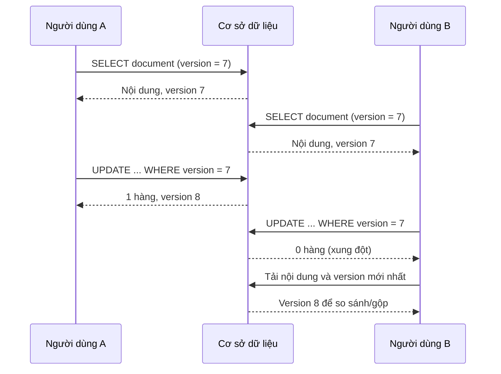

# Cập nhật có điều kiện và so sánh phiên bản

Trong chương **Kiểm soát đồng thời** của mô-đun **DATA_PERSISTENCE_FUNDAMENTALS**, chúng ta tìm hiểu hai kỹ thuật nền tảng khi nhiều yêu cầu cùng sửa dữ liệu: **cập nhật có điều kiện** (*conditional update*) và **so sánh phiên bản** (*version check*, thường dùng cho *optimistic locking*). Cả hai đều cho phép ứng dụng Java đưa một phần quan trọng của quyết định ghi dữ liệu xuống cơ sở dữ liệu, nơi việc kiểm tra và sửa một hàng có thể được thực hiện như **một thao tác nguyên tử**.

Chọn được mô hình dữ liệu và viết đúng câu lệnh SQL chưa đủ để bảo đảm tính đúng đắn. Khi hai người dùng cùng đặt hàng, rút tiền hoặc chỉnh sửa tài liệu, dữ liệu có thể đã thay đổi **sau lần ứng dụng đọc nhưng trước lần ứng dụng ghi**. Cần xác định rõ khi nào được phép cập nhật, khi nào phải báo xung đột và khi nào phải thực hiện lại toàn bộ giao dịch.

## 1. Vấn đề: đọc, tính toán rồi ghi đè

Giả sử một sản phẩm có **5 đơn vị hàng tồn**. Hai yêu cầu đặt mua độc lập, mỗi yêu cầu cần **4 đơn vị**. Một cách cài đặt thiếu an toàn là:

```text
available = SELECT available FROM inventory WHERE sku = 'BOOK-1';
if (available >= 4) {
    UPDATE inventory SET available = available - 4
    WHERE sku = 'BOOK-1';
}
```

Đoạn giả mã trông hợp lý nhưng việc kiểm tra và cập nhật nằm ở **hai thời điểm khác nhau**. Giữa chúng, một giao dịch khác có thể đã mua hàng.

| Thời điểm | Giao dịch T1 | Giao dịch T2 | Tồn kho đã commit |
| --- | --- | --- | --- |
| T0 | | | 5 |
| T1 | Đọc tồn kho = 5, quyết định mua 4 | | 5 |
| T2 | | Đọc tồn kho = 5, quyết định mua 4 | 5 |
| T3 | Trừ 4 và commit | | 1 |
| T4 | | Trừ tiếp 4 và commit, nếu không có điều kiện bảo vệ | **−3** |

Nếu bảng cho phép tồn kho âm, kết quả cuối phá vỡ bất biến `available >= 0`. Nếu có ràng buộc `CHECK (available >= 0)`, cơ sở dữ liệu có thể từ chối lần cập nhật thứ hai; đó là lớp bảo vệ quan trọng, nhưng ứng dụng vẫn cần xử lý thất bại thành một kết quả nghiệp vụ rõ ràng.

Một biến thể khác cũng nguy hiểm là Java tính số mới rồi ghi hằng số:

```sql
-- Cả hai request đều đọc được 5.
UPDATE inventory SET available = 1 WHERE sku = 'BOOK-1';
```

Hai lần ghi cùng số 1 có thể khiến hệ thống **chấp nhận hai đơn hàng** dù tồn kho chỉ giảm một lần: đây là kiểu *lost update* hoặc quyết định dựa trên dữ liệu cũ. Điều cần bảo vệ là **điều kiện hợp lệ ngay tại thời điểm ghi**, không chỉ tại thời điểm đọc trước đó.

## 2. Cập nhật có điều kiện: kiểm tra và thay đổi trong một câu SQL

**Cập nhật có điều kiện** đặt tiêu chí nghiệp vụ trực tiếp trong mệnh đề `WHERE` của câu `UPDATE`. Cơ sở dữ liệu chỉ cập nhật những hàng thỏa điều kiện khi thao tác được thực hiện theo cơ chế đồng thời của nó.

Ví dụ với PostgreSQL:

```sql
CREATE TABLE inventory (
    sku       TEXT PRIMARY KEY,
    available INTEGER NOT NULL CHECK (available >= 0),
    version   BIGINT NOT NULL DEFAULT 0 CHECK (version >= 0)
);

INSERT INTO inventory (sku, available, version)
VALUES ('BOOK-1', 5, 0);

-- Một yêu cầu cần mua 4 đơn vị:
UPDATE inventory
SET available = available - 4,
    version = version + 1
WHERE sku = 'BOOK-1'
  AND available >= 4;
```

**Phải kiểm tra số hàng được cập nhật.** Với khóa chính `sku`, kết quả mong đợi là:

- **1 hàng:** yêu cầu đã vượt qua điều kiện tại thời điểm cập nhật; nếu đang trong transaction còn các bước khác, kết quả cuối chỉ được coi là hoàn tất **sau khi commit thành công**.
- **0 hàng:** không có hàng phù hợp, vì sản phẩm không tồn tại hoặc không đủ tồn kho tại thời điểm được kiểm tra; không được coi như đã giữ hàng thành công.
- **Lỗi SQL:** cần xử lý theo loại lỗi; lỗi khóa, timeout, deadlock hoặc lỗi kết nối không tương đương với kết quả 0 hàng.

Ở PostgreSQL, có thể lấy kết quả cập nhật trong cùng câu lệnh:

```sql
UPDATE inventory
SET available = available - 4,
    version = version + 1
WHERE sku = 'BOOK-1'
  AND available >= 4
RETURNING sku, available, version;
```

Nếu điều kiện không thỏa, `RETURNING` trả **không có hàng nào**. Lưu ý `RETURNING` là cú pháp PostgreSQL (một số CSDL khác có cú pháp tương tự hoặc khác); không nên xem nó là SQL di động cho mọi hệ quản trị.

### Tại sao hai yêu cầu đồng thời không cùng mua được 4 đơn vị?

Với PostgreSQL ở mức `READ COMMITTED`, một lệnh `UPDATE` ghi hàng sẽ phối hợp bằng cơ chế khóa hàng. Khi hai giao dịch cùng cập nhật một hàng, giao dịch đến sau có thể phải chờ giao dịch trước. Sau khi giao dịch trước commit, điều kiện `WHERE available >= 4` được **đánh giá lại** trên phiên bản hàng phù hợp trước khi cập nhật.

```text
Tồn kho ban đầu: 5

T1: UPDATE ... WHERE available >= 4
    ⇒ 1 hàng; tồn kho 5 → 1; COMMIT

T2: UPDATE ... WHERE available >= 4
    ⇒ chờ nếu cần, rồi kiểm tra lại available = 1
    ⇒ 0 hàng; không được giữ hàng
```

Trong PostgreSQL ở mức `REPEATABLE READ` hoặc `SERIALIZABLE`, một lịch ghi cạnh tranh có thể dẫn đến **serialization failure** thay vì trả 0 hàng. Cách xử lý phải dựa trên trạng thái lỗi và mức cô lập thực tế. Với các hệ quản trị khác, chi tiết chờ khóa, cách đánh giá lại điều kiện và báo lỗi có thể khác; luôn xác nhận behavior của DBMS/driver được triển khai.

**Không cần đọc tồn kho trước chỉ để quyết định có thể trừ hay không.** Một câu `UPDATE ... WHERE available >= ?` có thể làm cả hai việc, tránh khoảng hở giữa kiểm tra và ghi. Nếu giao diện cần hiển thị tồn kho, lần đọc phục vụ hiển thị chỉ mang tính tham khảo; quyết định đặt hàng vẫn phải dựa vào kết quả cập nhật có điều kiện.

### Các dạng cập nhật có điều kiện thường gặp

| Bất biến nghiệp vụ | Câu lệnh tiêu biểu | Cần kiểm tra |
| --- | --- | --- |
| Tồn kho không âm | `UPDATE inventory SET available = available - ? WHERE sku = ? AND available >= ?` | Một hàng được cập nhật |
| Số dư không âm | `UPDATE accounts SET balance = balance - ? WHERE id = ? AND balance >= ?` | Một hàng được cập nhật |
| Chỉ chuyển trạng thái hợp lệ | `UPDATE orders SET status = 'PAID' WHERE id = ? AND status = 'PENDING'` | Một hàng được cập nhật |
| Nhận một công việc đang chờ | `UPDATE jobs SET status = 'RUNNING' WHERE id = ? AND status = 'READY'` | Một hàng được cập nhật |
| Đăng ký lượt sử dụng còn hạn mức | `UPDATE quotas SET remaining = remaining - 1 WHERE id = ? AND remaining > 0` | Một hàng được cập nhật |

Các ví dụ biểu diễn bất biến trên **cùng một hàng**. Chúng phù hợp khi điều kiện và dữ liệu cần sửa đều có thể được đặt trong một lần ghi. Nếu quy tắc nằm trên **nhiều hàng**, một câu `UPDATE` đơn lẻ chưa chắc bảo vệ đủ; phần sau sẽ phân tích giới hạn này.

## 3. So sánh phiên bản: phát hiện dữ liệu đã thay đổi

Điều kiện `available >= 4` giúp bảo vệ một giới hạn nghiệp vụ. Nhưng với chỉnh sửa tài liệu, bài toán thường là **ngăn người dùng vô tình ghi đè nội dung đã có người khác sửa**.

Giả sử hai người cùng mở tài liệu, cả hai đọc `version = 7`. Người thứ nhất sửa tiêu đề, người thứ hai sửa nội dung trên bản cũ. Nếu cả hai gửi `UPDATE documents SET body = ? WHERE id = ?`, lần cập nhật sau có thể âm thầm ghi đè kết quả trước.

**So sánh phiên bản** thêm một cột phiên bản tăng dần và yêu cầu lần ghi phải mang theo giá trị phiên bản mà người sửa đã đọc:

```sql
CREATE TABLE documents (
    id      BIGINT PRIMARY KEY,
    title   TEXT NOT NULL,
    body    TEXT NOT NULL,
    version BIGINT NOT NULL DEFAULT 0 CHECK (version >= 0)
);

INSERT INTO documents (id, title, body, version)
VALUES (42, 'Kế hoạch', 'Bản ban đầu', 7);

-- Người dùng đọc dữ liệu:
SELECT id, title, body, version
FROM documents
WHERE id = 42;
-- version = 7
```

Khi ghi, câu lệnh phải so sánh với `version` đã đọc và **tăng phiên bản trong cùng câu UPDATE**:

```sql
UPDATE documents
SET body = 'Nội dung đã sửa',
    version = version + 1
WHERE id = 42
  AND version = 7;
-- 1 hàng: chấp nhận chỉnh sửa, version thành 8.
-- 0 hàng: tài liệu không tồn tại hoặc phiên bản đã thay đổi.
```

Đây là một dạng **compare-and-set (CAS)** ở cấp hàng: “chỉ đặt giá trị mới nếu trạng thái kiểm soát vẫn bằng giá trị tôi đã quan sát”. Trong ứng dụng, nó thường được gọi là **optimistic locking** (khóa lạc quan) dù thường không giữ khóa độc quyền dài hạn **trong suốt thời gian người dùng đang chỉnh sửa**.

### Lịch hai người cùng sửa

| Thời điểm | Người dùng A | Người dùng B | Phiên bản trong CSDL |
| --- | --- | --- | --- |
| 1 | Đọc tài liệu phiên bản **7** | | 7 |
| 2 | | Đọc tài liệu phiên bản **7** | 7 |
| 3 | `UPDATE ... WHERE version = 7` → 1 hàng; commit | | **8** |
| 4 | | `UPDATE ... WHERE version = 7` → 0 hàng | **8** |
| 5 | Đã lưu thay đổi | B phải tải bản mới/giải quyết xung đột | **8** |

Lần ghi của B bị từ chối có kiểm soát. B vẫn có thể lấy lại bản mới nhất và quyết định **gộp chỉnh sửa**, sửa lại trên phiên bản 8, hoặc yêu cầu người dùng xác nhận. Ứng dụng không nên tự động lặp lại y nguyên câu `UPDATE` với phiên bản mới nếu điều đó có thể xóa nội dung A vừa thay đổi.



### Vì sao phải tăng phiên bản?

Nếu chỉ so sánh một trường nội dung, có thể gặp vấn đề **ABA**:

```text
Người dùng B đọc status = 'DRAFT' (version 4)
Người dùng A đổi DRAFT → REVIEW → DRAFT (version 6)
B kiểm tra status vẫn là DRAFT nên tưởng không có gì thay đổi
```

So sánh riêng giá trị `status` không phát hiện được lịch thay đổi ở giữa. So sánh `version = 4` sẽ thất bại vì hiện tại là 6, **nếu mọi cập nhật liên quan đều tăng phiên bản**. Không được tự ý đặt lại version về 0 khi chỉnh sửa, nhập dữ liệu hoặc migration. Cần chọn kiểu đủ rộng, giám sát tràn số trong các hệ thống có vòng đời dài và định nghĩa rõ quy tắc tăng version.

**Phiên bản theo hàng không có nghĩa là số thứ tự toàn cục của cả cơ sở dữ liệu.** Nó chỉ là dấu hiệu thay đổi của một đối tượng mà giao thức cập nhật cùng tuân thủ.

## 4. Cập nhật có điều kiện và so sánh phiên bản giống, khác gì?

Cả hai đều có mô hình:

```text
UPDATE bảng
SET dữ liệu_mới = ...
WHERE khóa_chính = ...
  AND điều_kiện_bảo_vệ;

Nếu số hàng = 1: phép ghi vượt qua điều kiện
Nếu số hàng = 0: điều kiện không còn đúng, hoặc bản ghi không tồn tại
```

Khác biệt chính nằm ở **điều kiện bảo vệ**:

| Tiêu chí | Điều kiện nghiệp vụ trong `WHERE` | So sánh phiên bản trong `WHERE` |
| --- | --- | --- |
| Câu hỏi | “Dữ liệu **hiện tại** có cho phép thao tác này?” | “Dữ liệu **còn giống lần tôi đọc** không?” |
| Ví dụ | `available >= requestedQuantity` | `version = expectedVersion` |
| Phù hợp | Giữ hàng, trừ hạn mức, chuyển trạng thái | Sửa tài liệu, cập nhật cấu hình, form chỉnh sửa lâu |
| Thông tin cần gửi từ client | Số lượng, mã đối tượng, yêu cầu nghiệp vụ | Nội dung sửa **và phiên bản đã đọc** |
| Khi 0 hàng | Không đủ điều kiện hoặc không tìm thấy hàng | Phiên bản cũ hoặc không tìm thấy hàng |
| Xung đột | Có thể trả kết quả hết hàng/hết hạn mức | Thường cần thông báo xung đột và tải lại dữ liệu |

Hai kỹ thuật có thể được **kết hợp** để bảo vệ cả tính hợp lệ của thao tác và việc ghi dựa trên trạng thái đã biết:

```sql
-- Ví dụ kiểm soát tồn kho và yêu cầu phiên bản khớp:
UPDATE inventory
SET available = available - 2,
    version = version + 1
WHERE sku = 'BOOK-1'
  AND available >= 2
  AND version = 8;
```

Việc kết hợp phù hợp khi yêu cầu nghiệp vụ **bắt buộc dựa trên đúng phiên bản đã đọc**. Với thao tác trừ tồn kho đơn thuần, `version = ?` có thể tạo ra **xung đột không cần thiết**: hàng còn đủ nhưng đã được cập nhật bởi yêu cầu khác. Khi đó, chỉ kiểm tra số lượng hiện tại có thể phù hợp hơn. Hãy chọn điều kiện theo bất biến, không tự động thêm mọi cơ chế vào mọi câu lệnh.

## 5. SQL phải được dùng thế nào để tránh khoảng hở kiểm tra–ghi?

### 5.1. Không dùng hai câu lệnh độc lập để giả lập điều kiện

Mẫu dễ lỗi:

```sql
SELECT available FROM inventory WHERE sku = 'BOOK-1';
-- Java kiểm tra available >= 4.
UPDATE inventory SET available = available - 4 WHERE sku = 'BOOK-1';
```

Ở `READ COMMITTED`, hai câu lệnh này có thể quan sát các thời điểm khác nhau. Đặt chúng trong cùng một transaction vẫn **không tự động giữ nguyên giá trị đã đọc**, nếu không có thêm cơ chế khóa, mức cô lập phù hợp hoặc kiểm tra ngay lúc ghi.

Mẫu có thể bảo vệ một bất biến trên hàng:

```sql
UPDATE inventory
SET available = available - 4
WHERE sku = 'BOOK-1' AND available >= 4;
```

### 5.2. Đặt điều kiện vào cùng lệnh UPDATE

Hãy viết điều kiện dựa trên **giá trị hiện tại trong cơ sở dữ liệu**, ví dụ `available = available - ?` thay vì tính số mới từ một bản sao có thể đã cũ trong Java. Nếu buộc phải đọc trước để chuẩn bị giá trị, thêm `version = expectedVersion` hoặc kỹ thuật khóa thích hợp để phát hiện thay đổi.

Với chuyển trạng thái, nên mã hóa trạng thái nguồn:

```sql
UPDATE orders
SET status = 'PAID'
WHERE id = 9001
  AND status = 'PENDING';
```

Nếu câu lệnh ảnh hưởng 0 hàng, có thể đơn đã thanh toán, bị hủy hoặc không tồn tại. Không nên phát sự kiện “đã thanh toán” dựa trên việc SQL chạy **không ném lỗi**; phải biết có cập nhật hợp lệ và đã commit.

### 5.3. Ràng buộc CSDL vẫn cần thiết

`CHECK (available >= 0)`, `NOT NULL`, `UNIQUE` và `FOREIGN KEY` giúp cơ sở dữ liệu từ chối trạng thái sai từ những đường ghi chưa dùng đúng kỹ thuật điều kiện. Một ràng buộc là **tầng bảo vệ dữ liệu**, còn `UPDATE ... WHERE ...` là **giao thức nghiệp vụ** để quyết định thao tác nào được phép.

Không thể chỉ trông vào một câu `CHECK` trên một hàng để giữ mọi bất biến xuyên nhiều hàng. Ví dụ “mỗi ca trực có ít nhất một bác sĩ”, “lớp học tối đa 30 người” hoặc “tổng tiền của một nhóm giao dịch không vượt hạn mức” cần cấu trúc dữ liệu và chiến lược đồng thời bổ sung.

## 6. Ví dụ JDBC: đặt hàng bằng một câu UPDATE có điều kiện

Để kiểm tra kết quả, JDBC cung cấp `PreparedStatement.executeUpdate()` trả về **số hàng bị tác động** (với câu UPDATE), còn `SQLException` được xử lý riêng.

Ví dụ một repository có một câu lệnh cập nhật:

```java
import java.sql.Connection;
import java.sql.PreparedStatement;
import java.sql.SQLException;
import javax.sql.DataSource;

public final class InventoryRepository {
    private final DataSource dataSource;

    public InventoryRepository(DataSource dataSource) {
        this.dataSource = dataSource;
    }

    // Độc lập ngoài transaction framework; kết nối được cấu hình auto-commit.
    public boolean reserve(String sku, int quantity) throws SQLException {
        if (sku == null || sku.isBlank() || quantity <= 0) {
            throw new IllegalArgumentException("Yeu cau giu hang khong hop le");
        }

        String sql = """
            UPDATE inventory
            SET available = available - ?,
                version = version + 1
            WHERE sku = ? AND available >= ?
            """;

        try (Connection connection = dataSource.getConnection();
             PreparedStatement statement = connection.prepareStatement(sql)) {
            statement.setInt(1, quantity);
            statement.setString(2, sku);
            statement.setInt(3, quantity);

            int affected = statement.executeUpdate();
            return affected == 1;
        }
    }
}
```

Ví dụ dùng Java có hỗ trợ *text block*. Phương thức trên giả định **kết nối do DataSource bàn giao có `autoCommit = true`**, để mỗi lệnh là một transaction riêng. Nếu kết nối nằm trong transaction do framework quản lý, không được tự ý đổi `autoCommit` hoặc kết luận cập nhật đã bền vững trước khi transaction cha commit. Cần thống nhất trách nhiệm quản lý transaction theo kiến trúc thực tế.

Với schema có khóa chính `sku`, một câu `UPDATE` chỉ nên tác động 0 hoặc 1 hàng. Nếu mã nghiệp vụ kỳ vọng **chính xác một hàng** mà nhận giá trị khác, nên coi đó là dấu hiệu sai phạm vi truy vấn hoặc sai thiết kế schema, thay vì bỏ qua.

**Hạn chế của ví dụ:** `false` có nghĩa là **không có hàng phù hợp**, chứ chưa phân biệt SKU không tồn tại và hết hàng. Một truy vấn kiểm tra sau đó có thể phục vụ thông báo cho người dùng, nhưng quyết định giữ hàng vẫn phải dựa trên kết quả cập nhật trước. Nếu lỗi mạng khiến client không biết commit đã thành công hay chưa, không thể quy kết kết quả đó là `false`.

### Nếu cần ghi thêm đơn hàng thì sao?

Giữ tồn kho và tạo đơn hàng thường phải **cùng commit hoặc cùng rollback**. Khi ấy ranh giới transaction phải bao quanh cả hai thay đổi:

```text
BEGIN
  UPDATE inventory
    SET available = available - :qty
    WHERE sku = :sku AND available >= :qty;
  kiểm tra số hàng được cập nhật = 1
  nếu không: ROLLBACK, trả kết quả hết hàng/không tồn tại

  INSERT INTO orders (request_id, sku, qty, status)
    VALUES (:requestId, :sku, :qty, 'PENDING');
  COMMIT
```

Nếu `INSERT` thất bại, phải rollback cả lần trừ tồn kho. Với JDBC, thường dùng `connection.setAutoCommit(false)`, `commit()` khi hoàn tất và `rollback()` khi lỗi, kèm đóng kết nối bằng `try-with-resources`. Trường hợp `commit()` mất phản hồi vì đứt kết nối, client có thể **không biết** transaction đã commit hay chưa; cần một `request_id` duy nhất, cơ chế tra cứu trạng thái và quy tắc idempotency trước khi gửi lại yêu cầu.

## 7. Ví dụ JDBC: chỉnh sửa tài liệu với expectedVersion

Đối với form chỉnh sửa, client cần lưu phiên bản đã đọc cùng với nội dung người dùng đang chỉnh sửa. Ví dụ:

```json
{
  "documentId": 42,
  "expectedVersion": 7,
  "newBody": "Nội dung đã chỉnh sửa"
}
```

Repository có thể trả số hàng được cập nhật hoặc một kiểu kết quả mô tả trạng thái. Ví dụ đơn giản:

```java
import java.sql.Connection;
import java.sql.PreparedStatement;
import java.sql.SQLException;
import javax.sql.DataSource;

public final class DocumentRepository {
    private final DataSource dataSource;

    public DocumentRepository(DataSource dataSource) {
        this.dataSource = dataSource;
    }

    // false: không có hàng thỏa id + version.
    public boolean replaceBody(long id, long expectedVersion, String newBody)
            throws SQLException {
        if (expectedVersion < 0 || newBody == null) {
            throw new IllegalArgumentException("Du lieu khong hop le");
        }

        String sql = """
            UPDATE documents
            SET body = ?, version = version + 1
            WHERE id = ? AND version = ?
            """;

        try (Connection connection = dataSource.getConnection();
             PreparedStatement statement = connection.prepareStatement(sql)) {
            statement.setString(1, newBody);
            statement.setLong(2, id);
            statement.setLong(3, expectedVersion);

            return statement.executeUpdate() == 1;
        }
    }
}
```

Đoạn mã cũng dựa trên cấu hình auto-commit của kết nối độc lập. Nếu việc sửa tài liệu còn phải ghi lịch sử, kiểm tra quyền cập nhật bằng dữ liệu trong CSDL hoặc tạo outbox event, đặt chúng trong **cùng transaction**. Khi có thêm phép đọc và điều kiện phụ thuộc nhiều hàng, phải đánh giá lại mức cô lập/khóa của cả transaction chứ không chỉ câu UPDATE phiên bản.

Ở lớp ứng dụng:

1. Client gửi `expectedVersion` lấy từ lần tải tài liệu.
2. Repository chạy câu `UPDATE` với điều kiện trên khóa chính **và** version.
3. Nếu trả **1**, transaction commit rồi trả dữ liệu/phiên bản mới.
4. Nếu trả **0**, kiểm tra tài liệu còn tồn tại không; nếu có thì đó là **xung đột phiên bản**, trả thông tin thích hợp để client tải lại và so sánh.
5. Nếu SQL ném lỗi, xử lý riêng theo nguyên nhân; không đồng nhất exception với xung đột phiên bản.

Với API HTTP, xung đột sửa dữ liệu có thể biểu diễn bằng **`409 Conflict`**. Nếu dùng giao thức điều kiện HTTP như **`If-Match`** với ETag, yêu cầu không còn khớp thường được diễn đạt bằng **`412 Precondition Failed`**. Cần ánh xạ ETag và kiểm tra phiên bản nhất quán ở tầng persistence; kiểm tra header ở tầng web mà không bảo vệ câu SQL vẫn có race condition.

## 8. Khi dùng JPA/Hibernate và Spring

JPA hỗ trợ optimistic locking qua annotation **`@Version`**. Khi một entity được quản lý thay đổi và flush, provider dùng phiên bản để phát hiện xung đột và quản lý giá trị version theo cơ chế của nó.

Ví dụ khai báo entity:

```java
import jakarta.persistence.Column;
import jakarta.persistence.Entity;
import jakarta.persistence.Id;
import jakarta.persistence.Table;
import jakarta.persistence.Version;

@Entity
@Table(name = "documents")
public class Document {
    @Id
    private Long id;

    @Column(nullable = false)
    private String title;

    @Column(nullable = false)
    private String body;

    @Version
    private long version;

    protected Document() {
    }

    public void replaceBody(String newBody) {
        if (newBody == null) {
            throw new IllegalArgumentException("Body cannot be null");
        }
        this.body = newBody;
    }
}
```

Ví dụ dịch vụ:

```java
import jakarta.persistence.EntityManager;
import jakarta.persistence.PersistenceContext;
import org.springframework.stereotype.Service;
import org.springframework.transaction.annotation.Transactional;

@Service
public class DocumentService {
    @PersistenceContext
    private EntityManager entityManager;

    @Transactional
    public void replaceBody(long documentId, String newBody) {
        Document document = entityManager.find(Document.class, documentId);
        if (document == null) {
            throw new IllegalArgumentException("Document not found");
        }
        document.replaceBody(newBody);
        // Provider tự flush khi cần và kiểm tra version trên update.
    }
}
```

Đây là minh họa cho **hai transaction đồng thời sửa cùng entity đã được đọc**, chẳng hạn hai service call cùng đọc phiên bản trước khi một trong hai commit. Với **form chỉnh sửa kéo dài qua nhiều HTTP request**, phương thức ví dụ tải **phiên bản mới nhất** rồi ghi sẽ **không tự biết** client đã từng đọc phiên bản nào trước đó. Khi đó, API phải nhận **expectedVersion** của client và đối chiếu nó trong transaction, hoặc dùng cơ chế merge/optimistic lock rõ ràng, để tránh việc ghi đè nội dung cũ.

Cần chú ý:

- `@Version` kiểm soát các thay đổi do **persistence provider quản lý**. Các câu JPQL/SQL bulk update hoặc SQL chạy trực tiếp có thể **bỏ qua** quy trình tự động kiểm tra/tăng version; phải thiết kế riêng nếu vẫn dùng các đường ghi đó.
- Xung đột có thể chỉ xuất hiện tại lúc `flush()` hoặc `commit()`, chứ không nhất thiết lúc gọi setter. JPA thường báo `OptimisticLockException`; Spring có thể chuyển thành ngoại lệ truy cập dữ liệu tương ứng.
- Một transaction đã thất bại vì optimistic locking thường phải rollback; nếu thử lại, tạo **transaction mới** và đọc lại trạng thái trước khi quyết định.
- Không chỉnh tay thuộc tính `@Version` như một trường nghiệp vụ bình thường; để provider quản lý vòng đời phiên bản theo quy ước.
- Khi dùng Hibernate/Spring, xác định rõ phiên bản framework và cơ chế quản lý transaction. Không giả định một annotation tự giải quyết các bất biến xuyên nhiều entity.

## 9. Xử lý kết quả, xung đột và retry

Điểm quan trọng nhất là **không gộp mọi trường hợp không thành công thành một nhánh retry vô hạn**:

| Kết quả | Ý nghĩa có thể có | Hành động hợp lý |
| --- | --- | --- |
| UPDATE tác động **1 hàng** | Điều kiện hợp lệ tại thời điểm cập nhật | Hoàn tất các bước transaction, commit, rồi mới xác nhận thành công |
| UPDATE tác động **0 hàng** với điều kiện tồn kho | Không đủ hàng hoặc mã không tồn tại | Trả kết quả nghiệp vụ; tra cứu thêm nếu cần phân biệt nguyên nhân |
| UPDATE tác động **0 hàng** với điều kiện version | Bản ghi bị xóa hoặc version đã thay đổi | Kiểm tra hiện trạng; báo xung đột hoặc cho người dùng gộp thay đổi |
| SQLSTATE **`40001`** trong PostgreSQL | Transaction bị từ chối để đảm bảo tuần tự hóa | Rollback, retry **toàn bộ giao dịch** với giới hạn và độ trễ hợp lý |
| SQLSTATE **`40P01`** trong PostgreSQL | Deadlock | Rollback; có thể retry transaction tùy tính chất nghiệp vụ |
| Mất kết nối khi gửi `COMMIT` | Kết quả có thể **không xác định** đối với client | Đối soát theo mã yêu cầu duy nhất trước khi phát lại |
| Vi phạm `UNIQUE` hoặc `CHECK` | Ràng buộc dữ liệu từ chối thay đổi | Phân loại lỗi nghiệp vụ hoặc lỗi lập trình; không retry mù |

### Retry khi nào?

**Nên xem xét retry** nếu có một xung đột ngắn hạn và nghiệp vụ có thể tính lại an toàn: lỗi serialization, deadlock hoặc một thao tác tranh chấp dữ liệu có cơ chế thử lại rõ ràng. Retry phải bao gồm **các bước đọc, kiểm tra, tính toán và ghi trong một transaction mới**, không chỉ lặp câu lệnh cuối.

**Không tự động retry bằng cách bỏ qua phiên bản cũ** đối với thao tác người dùng sửa tài liệu. Nếu A đã đổi nội dung, lần retry tự động với version mới của B có thể xóa sửa đổi của A. Thay vào đó, trả xung đột hoặc áp dụng một thuật toán gộp đã được xác định.

**Không retry không giới hạn:** tranh chấp cao trên một hàng nóng có thể làm hệ thống tạo thêm tải. Cần giới hạn số lần thử, dùng backoff/jitter hợp lý, theo dõi số lần xung đột và cho biết trạng thái thất bại rõ ràng khi hết lượt thử.

### Idempotency khác optimistic locking

Một yêu cầu đặt hàng có thể được gửi lại sau timeout. Nếu client không nhận được phản hồi, lần đầu **có thể đã commit**; gửi tiếp câu trừ tồn kho có điều kiện sẽ trừ thêm lần nữa nếu vẫn còn hàng.

**Optimistic locking chỉ phát hiện việc sửa dựa trên phiên bản cũ.** Nó không tự biết hai lần gửi có phải **cùng một ý định mua hàng**. Để chống thao tác lặp, dùng mã `request_id` duy nhất, lưu kết quả nghiệp vụ cùng transaction và kiểm tra trước khi thực hiện lại. Khi phải phát sự kiện qua message broker, cân nhắc transactional outbox và consumer idempotent.

## 10. Giới hạn: bất biến trên nhiều hàng và write skew

Điều kiện trong một câu `UPDATE` và cột version của từng hàng **không tự bảo vệ mọi quy tắc toàn hệ thống**.

Ví dụ mỗi ca trực phải có **ít nhất một bác sĩ trực**. Hai bác sĩ cùng đọc số người trực = 2, sau đó mỗi người chuyển trạng thái của **chính mình** sang nghỉ:

```text
T1: đọc thấy An + Bình cùng trực
T2: đọc thấy An + Bình cùng trực

T1: UPDATE doctor SET on_call = false, version = version + 1
    WHERE doctor_id = An AND version = 7;    -- 1 hàng

T2: UPDATE doctor SET on_call = false, version = version + 1
    WHERE doctor_id = Bình AND version = 3;  -- 1 hàng

T1 và T2 đều có thể commit ⇒ không còn bác sĩ trực
```

Đây là **write skew**: hai giao dịch cập nhật **hai hàng khác nhau**, nên cả hai phép so sánh version **đều có thể thành công**. Muốn bảo vệ bất biến nhiều hàng, có thể:

- Dùng transaction `SERIALIZABLE` đúng nghĩa với retry toàn bộ giao dịch khi bị từ chối.
- Khóa **cùng một hàng đại diện** cho ca trực trước khi đọc số người còn trực, rồi quyết định/cập nhật trong cùng transaction với mức cô lập phù hợp.
- Tái cấu trúc dữ liệu để bất biến biểu diễn được qua một hàng tổng hợp, ví dụ bộ đếm và `UPDATE ... WHERE count > 1`; mọi đường ghi phải tuân thủ giao thức cập nhật bộ đếm.
- Dùng ràng buộc CSDL phù hợp, trigger hoặc thủ tục được kiểm soát nếu đặc thù quy tắc cho phép.

Cần phân biệt **phạm vi một hàng** với **phạm vi nhiều hàng**, cũng như **một CSDL** với **nhiều dịch vụ**. Một transaction cục bộ không tự đảm bảo cập nhật nguyên tử trên hệ thống bên ngoài.

## 11. Hiệu năng, chỉ mục và vận hành

Cập nhật có điều kiện thường giảm số lượt trao đổi so với “SELECT rồi UPDATE” và làm rõ điểm thành công. Nhưng nó không đồng nghĩa mọi tình huống đều không cần khóa hoặc không thể gây nghẽn:

1. **Lọc bằng khóa chính hoặc chỉ mục phù hợp.** Ví dụ `WHERE sku = ?` hoặc `WHERE id = ?` giúp giới hạn hàng mục tiêu. Nếu câu lệnh thiếu tiêu chí khóa, nó có thể cập nhật nhiều hàng ngoài ý muốn.
2. **Giữ transaction ngắn.** Hàng bị cập nhật thường chịu cơ chế khóa/điều phối ghi trong transaction. Tránh gọi HTTP hoặc chờ người dùng khi transaction đang mở.
3. **Xác định các hàng nóng.** Tồn kho cho một sản phẩm bán chạy, bộ đếm suất còn lại hoặc một hàng tổng hợp có thể bị nhiều giao dịch tranh chấp, tăng thời gian chờ.
4. **Theo dõi xung đột.** Thống kê số lần UPDATE trả 0 hàng theo lý do, lỗi deadlock, serialization failure, lock timeout và độ trễ transaction.
5. **Không trộn các đường ghi không cùng giao thức.** Nếu Java dùng `version` nhưng một job SQL sửa hàng mà không tăng version, optimistic locking có thể bỏ sót thay đổi.
6. **Thận trọng với batch/bulk update.** Kết quả cập nhật hàng loạt có cách báo số lượng khác nhau; cần kiểm tra từng bản ghi nếu nghiệp vụ đòi hỏi CAS từng đối tượng. Các bulk update ORM có thể bỏ qua `@Version`.
7. **Bảo vệ dữ liệu từ schema.** `CHECK`, `UNIQUE`, `FOREIGN KEY`, kiểu tiền tệ chính xác và migration an toàn giúp hạn chế lỗi từ những đường cập nhật không dự tính trước.

Đối với độ bền, việc một câu lệnh báo “1 hàng” trong một transaction đang mở mới cho biết **thao tác UPDATE chạy thành công trong transaction đó**. Chỉ sau commit thành công và theo bảo đảm lưu trữ đã cấu hình, ứng dụng mới nên coi nghiệp vụ đã hoàn tất. Mất phản hồi commit cần đối soát theo định danh yêu cầu, không suy luận chỉ từ mã lỗi.

## 12. Kiểm thử hai giao dịch cạnh tranh

Kiểm thử tuần tự thường không phát hiện lỗi nằm giữa thời điểm đọc và ghi. Để xác minh kỹ thuật này, dùng **hai kết nối độc lập** và kiểm soát thứ tự thực thi.

### Kịch bản A: giữ 4 đơn vị từ tồn kho 5

Khởi tạo `available = 5` cho cùng SKU, sau đó đồng thời gửi hai thao tác:

```sql
UPDATE inventory
SET available = available - 4,
    version = version + 1
WHERE sku = 'BOOK-1' AND available >= 4;
```

Sau khi cả hai giao dịch đã kết thúc:

- **Chỉ một yêu cầu được xác nhận thành công**; yêu cầu còn lại trả 0 hàng hoặc được xử lý sau một lỗi xung đột theo mức cô lập.
- Tồn kho cuối phải là **1**, không phải −3 và cũng không còn 5 nếu đã xác nhận thành công một yêu cầu.
- Không được ghi hai đơn hàng thành công cho cùng hai yêu cầu vượt tồn kho nếu mỗi thao tác đặt hàng cần giữ 4 đơn vị.

Nếu test dùng mức `READ COMMITTED` của PostgreSQL, thao tác đến sau thường chờ và đánh giá lại điều kiện. Nếu test dùng mức cao hơn, cần chấp nhận và xử lý lỗi serialization phù hợp; không viết test dựa trên giả định mọi DBMS đều trả đúng một kiểu lỗi.

### Kịch bản B: hai người chỉnh sửa phiên bản 7

Khởi tạo một tài liệu có `version = 7`, cho hai luồng đọc cùng phiên bản, rồi cùng chạy:

```sql
UPDATE documents
SET body = 'Bản sửa của người dùng',
    version = version + 1
WHERE id = 42 AND version = 7;
```

Kết quả kỳ vọng: một lần cập nhật thành công, lần còn lại trả 0 hàng hoặc gặp lỗi tranh chấp cần xử lý; **không có hai thay đổi âm thầm ghi đè nhau**. Phiên bản cuối là 8 nếu chỉ một thao tác được chấp nhận.

### Kịch bản C: phát hiện đường ghi bỏ qua version

Thử thực hiện một câu SQL trực tiếp làm đổi nội dung nhưng **không tăng version**:

```sql
UPDATE documents
SET body = 'Thay đổi từ job bên ngoài'
WHERE id = 42;
```

Một khách hàng đang giữ `expectedVersion = 7` vẫn có thể ghi thành công nếu version ở DB cũng còn 7. Test này chứng minh rằng **tính đúng đắn phụ thuộc mọi đường ghi cùng tuân thủ quy tắc version**. Cần sửa giao thức cập nhật của job, không chỉ sửa repository của ứng dụng chính.

### Kịch bản D: thao tác nhiều bước

Cho thao tác giữ hàng thành công nhưng cố ý làm bước ghi đơn hàng thất bại trong **cùng transaction**. Hãy kiểm tra tồn kho rollback về giá trị ban đầu. Nếu tạo đơn và giữ hàng dùng hai transaction khác nhau, kiểm thử phải phát hiện khả năng dữ liệu lệch; đó là lỗi ranh giới atomicity bên cạnh bài toán kiểm soát đồng thời.

## 13. Câu hỏi tự đánh giá

**1.** Hai request cùng đọc tồn kho 5, mỗi request muốn mua 4. Vì sao `SELECT available` rồi `UPDATE available = available - 4` có thể sai ở `READ COMMITTED`?

Vì sau lần `SELECT` của request thứ hai, request thứ nhất có thể đã commit và làm điều kiện mua 4 không còn đúng. Kiểm tra và cập nhật phải được bảo vệ cùng lúc, ví dụ `UPDATE ... WHERE available >= 4`.

**2.** Câu `UPDATE ... WHERE id = 42 AND version = 7` tác động 0 hàng. Có thể chắc chắn đó là xung đột phiên bản không?

Không. Bản ghi có thể không tồn tại hoặc đã bị xóa. Cần tra cứu trạng thái hiện tại để phân biệt, rồi trả kết quả nghiệp vụ phù hợp.

**3.** Tại sao `@Version` của JPA không luôn bảo vệ form người dùng đã mở từ 30 phút trước?

Nếu request cập nhật tải lại entity **mới nhất** và không so sánh với version mà client đã mở ban đầu, provider chỉ biết phiên bản của entity vừa tải. Phải mang `expectedVersion` qua ranh giới request và kiểm tra nó khi cập nhật.

**4.** Tại sao hai bác sĩ cùng nghỉ có thể vượt qua cả hai câu `UPDATE ... WHERE version = ?`?

Vì mỗi transaction sửa **một hàng khác nhau**. Version trên từng hàng không phát hiện quy tắc chung “ít nhất một người trực” bị vi phạm; cần bảo vệ bất biến nhiều hàng.

**5.** Khi yêu cầu thanh toán bị mất kết nối ở thời điểm commit, có nên thử lại toàn bộ thao tác ngay không?

Không được mặc định lần đầu thất bại. Trước hết cần đối soát theo mã yêu cầu duy nhất hoặc trạng thái giao dịch bền vững để tránh thực hiện nghiệp vụ hai lần.

## Kết luận

**Cập nhật có điều kiện** trả lời câu hỏi: *“Dữ liệu hiện tại còn thỏa điều kiện cho thao tác này không?”* **So sánh phiên bản** trả lời câu hỏi: *“Đối tượng còn ở phiên bản mà tôi đã đọc không?”* Cả hai sử dụng một câu `UPDATE` có điều kiện và đòi hỏi ứng dụng kiểm tra **số hàng được cập nhật**, xử lý riêng lỗi SQL và chỉ báo thành công nghiệp vụ sau khi transaction được commit.

Trong tầng persistence của Java, hãy chọn điều kiện dựa trên **bất biến thật của nghiệp vụ**, quản lý phiên bản nhất quán qua mọi đường ghi, xây ranh giới transaction đúng và kiểm thử các yêu cầu đồng thời. Những bất biến liên quan nhiều hàng hoặc nhiều hệ thống cần thêm cơ chế transaction, khóa, cô lập và idempotency phù hợp; không thể chỉ trông vào một cột version để thay thế toàn bộ thiết kế kiểm soát đồng thời.
