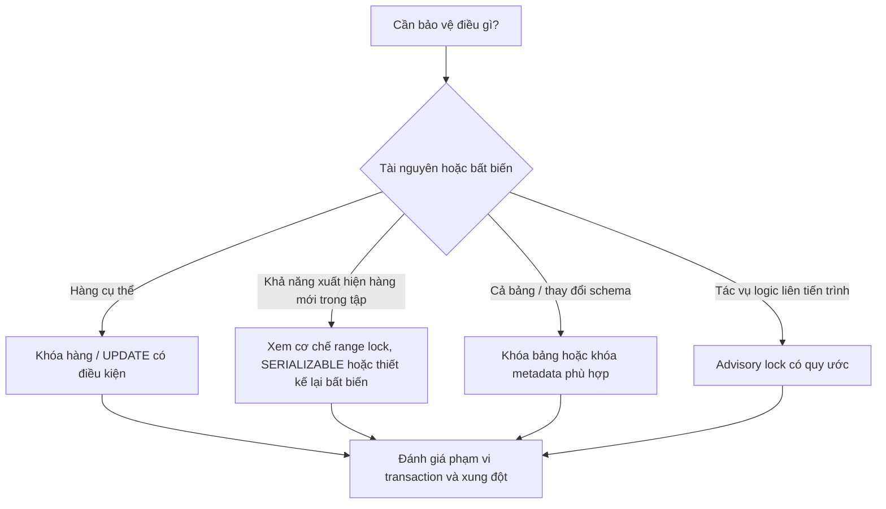

# Phân biệt khóa hàng, khóa phạm vi và khóa cấp cao hơn

## Mục tiêu học tập

Sau bài học, người học có thể:

- Phân biệt **khóa hàng**, **khóa phạm vi (range/gap/next-key lock)** và những khóa có phạm vi lớn hơn như khóa bảng hoặc khóa metadata, dựa vào tài nguyên được bảo vệ và mức độ xung đột.
- Giải thích vì sao khóa một vài hàng đã tồn tại **không đồng nghĩa** với khóa toàn bộ điều kiện `WHERE` hoặc những hàng có thể được thêm sau này.
- Nhận diện những điểm khác nhau giữa **PostgreSQL** và **MySQL/InnoDB** về cơ chế khóa phạm vi, snapshot và kiểm soát phantom read.
- Chọn cách bảo vệ một bất biến nghiệp vụ khi nhiều giao dịch Java đồng thời kiểm tra rồi cập nhật dữ liệu.
- Quan sát chờ khóa, giảm nguy cơ deadlock và thiết kế transaction JDBC/Spring có ranh giới rõ ràng.

## 1. Vì sao cần phân biệt phạm vi của khóa?

Giả sử một ứng dụng Java quản lý đăng ký lớp học. Hai request cùng lúc kiểm tra số chỗ trống của lớp 42 rồi thêm học viên. Nếu cả hai đều đọc thấy còn một chỗ, cả hai có thể cùng quyết định đăng ký thành công và làm vượt giới hạn.

Giải pháp không chỉ nằm ở câu lệnh `SELECT` mà ở **tài nguyên nào cần được bảo vệ trong khoảng thời gian từ khi kiểm tra đến khi ghi**. Khóa trên một hàng lớp học, khóa trên các hàng đăng ký hiện có và khóa trên khoảng giá trị có thể chứa các đăng ký mới là những cơ chế khác nhau.

Một khóa (*lock*) là cách hệ quản trị điều phối những thao tác không tương thích trên cùng tài nguyên. Khi một giao dịch giữ khóa, giao dịch khác có thể phải chờ, nhận lỗi ngay hoặc được tiếp tục tùy loại khóa, chế độ khóa, mức cô lập và câu lệnh. Các hệ quản trị cũng sử dụng **MVCC** để cho phép nhiều lần đọc theo snapshot mà không cần chặn mọi writer.

Trong module `DATA_PERSISTENCE_FUNDAMENTALS`, hiểu khóa giúp người học thiết kế ranh giới persistence cho Java, bảo vệ giao dịch, lựa chọn mức cô lập và cân nhắc chi phí hiệu năng. Một kiểu khóa rất rộng có thể làm giảm tính đồng thời; một kiểu khóa quá hẹp có thể không bảo vệ được quy tắc nghiệp vụ cần giữ.

### Hai chiều cần tách riêng

**Phạm vi khóa (granularity/scope)** trả lời: *Khóa bao phủ tài nguyên nào?* Ví dụ một hàng, khoảng khóa trong index, một trang dữ liệu, cả bảng hoặc metadata của đối tượng.

**Chế độ khóa (mode)** trả lời: *Những thao tác nào xung đột với khóa đó?* Ví dụ một khóa chia sẻ có thể tương thích với khóa đọc khác nhưng xung đột với yêu cầu ghi; khóa độc quyền thường chặn nhiều thao tác xung đột hơn.

Vì vậy, nói “giao dịch đã khóa bảng” vẫn chưa đủ: cần biết khóa bảng ở **mode nào**. Tương tự, `SELECT ... FOR UPDATE` khóa hàng để phối hợp thao tác ghi, nhưng thường **không cấm các `SELECT` thông thường** đọc phiên bản đã commit theo MVCC.

## 2. Bức tranh tổng quát về các mức khóa

| Phạm vi | Tài nguyên được bảo vệ | Ví dụ điển hình | Lợi ích | Đổi lại |
| --- | --- | --- | --- | --- |
| **Hàng (row/record)** | Một hoặc nhiều hàng đã được nhận diện | `SELECT ... FOR UPDATE WHERE id = ?` | Giữ xung đột gần dữ liệu cần sửa | Không tự ngăn hàng mới xuất hiện thỏa một điều kiện |
| **Phạm vi khóa trong index (range/gap/next-key)** | Những bản ghi và/hoặc khoảng trống giữa các khóa index | InnoDB `SELECT ... FOR UPDATE` theo khoảng tại `REPEATABLE READ` | Có thể ngăn chèn hàng vào vùng đang được khóa | Phụ thuộc DBMS, index, query plan, isolation; tăng chờ khóa |
| **Trang/bảng/partition** | Tập tài nguyên lớn hơn một hàng | Khóa bảng khi DDL hoặc khóa tường minh | Hữu ích khi cần phối hợp trên phạm vi rộng | Có thể giảm mức xử lý đồng thời của các giao dịch khác |
| **Schema/metadata** | Cấu trúc, định nghĩa đối tượng | DDL thay đổi cột, index, bảng | Giữ thao tác thay đổi cấu trúc nhất quán | Có thể chặn truy vấn hoặc DML trong lúc thay đổi schema |
| **Khóa logic/advisory** | Khóa do ứng dụng tự định danh | Khóa theo `job_id`, `tenant_id` | Đồng bộ công việc không gắn trực tiếp với một hàng | Chỉ hiệu quả khi mọi tác nhân tuân thủ cùng quy ước |

Đây là **các nhóm khái niệm**, không phải danh mục cú pháp chung cho mọi DBMS. PostgreSQL không tự cung cấp một lệnh “khóa khoảng trống của index” tương đương gap/next-key lock của InnoDB; SQL Server có key-range locks trong một số chế độ; cơ chế khóa cấp trang hoặc tự nâng cấp khóa cũng khác nhau giữa các hệ quản trị.



## 3. Khóa hàng: bảo vệ bản ghi đã xác định

### 3.1. `SELECT ... FOR UPDATE` trong PostgreSQL

Xét bảng tồn kho, mỗi mã sản phẩm có một hàng:

```sql
-- PostgreSQL: chỉ chạy ví dụ trên cơ sở dữ liệu thử nghiệm.
CREATE TABLE warehouse_stock (
    sku TEXT PRIMARY KEY,
    available INTEGER NOT NULL CHECK (available >= 0)
);

INSERT INTO warehouse_stock (sku, available)
VALUES ('BOOK-01', 4), ('PEN-01', 20);
```

Giao dịch T1 muốn kiểm tra số lượng `BOOK-01` và giữ hàng này trong khi quyết định trừ tồn kho:

```sql
-- Phiên A / T1
BEGIN;
SELECT available
FROM warehouse_stock
WHERE sku = 'BOOK-01'
FOR UPDATE;
-- Nhận 4 và giữ khóa hàng BOOK-01 cho tới khi kết thúc giao dịch.

UPDATE warehouse_stock
SET available = available - 1
WHERE sku = 'BOOK-01';

-- Giữ transaction mở để thử tương tác với phiên B,
-- rồi COMMIT khi đã quan sát xong.
COMMIT;
```

Nếu T2 yêu cầu `UPDATE` chính hàng `BOOK-01` trong lúc T1 đang giữ khóa, T2 phải chờ hoặc thất bại theo chính sách timeout. Nhưng T2 vẫn có thể sửa **hàng khác**, chẳng hạn `PEN-01`, nếu không có xung đột khác. Một câu `SELECT` bình thường đọc `BOOK-01` trong PostgreSQL thường vẫn tiếp tục và thấy phiên bản phù hợp với snapshot của nó; nó không bị chặn chỉ vì T1 có row lock.

Ví dụ thực hành với hai connection:

```sql
-- Phiên A / T1: chạy đến đây và giữ giao dịch mở.
BEGIN;
SELECT available FROM warehouse_stock
WHERE sku = 'BOOK-01' FOR UPDATE;
-- Chờ phiên B thử thao tác, sau đó COMMIT.
COMMIT;
```

```sql
-- Phiên B / T2: chạy SAU SELECT FOR UPDATE của A,
-- nhưng TRƯỚC COMMIT của A.
BEGIN;
SET LOCAL lock_timeout = '1500ms';
UPDATE warehouse_stock
SET available = available - 1
WHERE sku = 'BOOK-01';
-- Nếu T1 chưa nhả khóa, dự kiến nhận lỗi lock timeout (SQLSTATE 55P03).
-- Sau lỗi trong PostgreSQL, transaction bị đánh dấu aborted:
ROLLBACK;
```

Hai phiên phải là **hai kết nối độc lập**. Chạy các khối theo thứ tự được chú thích; không chạy tất cả trong cùng một kết nối. Trong môi trường thử nghiệm có thể thay thao tác của T2 thành cập nhật `PEN-01` để quan sát trường hợp không xung đột.

### 3.2. `FOR UPDATE` không phải chế độ khóa hàng duy nhất

PostgreSQL có các mode khóa hàng quan trọng:

| Mode | Ý định sử dụng, mô tả giản lược | Lưu ý |
| --- | --- | --- |
| `FOR UPDATE` | Bảo vệ hàng sẽ được sửa/xóa; mode mạnh nhất trong nhóm khóa hàng này | Xung đột với các mode khóa hàng khác trên cùng hàng |
| `FOR NO KEY UPDATE` | Bảo vệ cập nhật hàng không thay đổi những giá trị khóa quan trọng cho FK | Yếu hơn `FOR UPDATE`, tương thích với `FOR KEY SHARE` |
| `FOR SHARE` | Chia sẻ khóa trên hàng đã đọc | Có thể cùng tồn tại với `FOR SHARE`/`FOR KEY SHARE`, nhưng chặn một số writer |
| `FOR KEY SHARE` | Bảo vệ khóa tham chiếu khỏi bị xóa hoặc đổi khóa gây mất tham chiếu | Ít hạn chế hơn `FOR SHARE`; không chặn `FOR NO KEY UPDATE` |

Cập nhật thông thường trong PostgreSQL tự lấy khóa hàng phù hợp với loại cập nhật; không phải lúc nào cũng cần `SELECT ... FOR UPDATE` trước. Một `UPDATE` có điều kiện có thể vừa kiểm tra vừa thay đổi dữ liệu trong **một câu lệnh nguyên tử**, giúp giảm khoảng thời gian giữa đọc và ghi:

```sql
UPDATE warehouse_stock
SET available = available - 1
WHERE sku = 'BOOK-01' AND available > 0
RETURNING sku, available;
```

Nếu trả về một hàng, thao tác giữ được một đơn vị tồn kho. Nếu không trả về hàng, có thể sản phẩm không tồn tại hoặc đã hết hàng; mã nghiệp vụ cần phân biệt theo yêu cầu. Ràng buộc `CHECK (available >= 0)` cung cấp thêm lớp bảo vệ tại database. Với nhiều writer cùng cập nhật **một hàng** ở `READ COMMITTED`, PostgreSQL điều phối xung đột trên hàng và kiểm tra lại điều kiện của `UPDATE` sau khi giao dịch trước kết thúc.

### 3.3. `NOWAIT` và `SKIP LOCKED` là chính sách xử lý khi gặp khóa

```sql
SELECT sku, available
FROM warehouse_stock
WHERE sku = 'BOOK-01'
FOR UPDATE NOWAIT;
-- Nếu không lấy được khóa ngay, báo lỗi thay vì chờ.
```

```sql
-- Minh họa mẫu cho worker lấy job ở trạng thái chờ:
SELECT id
FROM job_queue
WHERE status = 'READY'
ORDER BY id
FOR UPDATE SKIP LOCKED
LIMIT 10;
```

`NOWAIT` phù hợp khi người dùng cần biết nhanh rằng bản ghi đang bị thao tác. `SKIP LOCKED` phù hợp cho hàng đợi có nhiều worker, nơi có thể bỏ qua công việc người khác đang xử lý. Bảng `job_queue` ở đoạn thứ hai là một bảng giả định trong ứng dụng, **không** được tạo ở bài thực hành tồn kho phía trên.

`SKIP LOCKED` trả về một góc nhìn **có chủ đích bỏ qua các hàng đang bị khóa**; không nên dùng nó để tính tổng tiền, kiểm tra hết hàng hay xác nhận bất biến nghiệp vụ. Trong PostgreSQL, `NOWAIT` và `SKIP LOCKED` ở các mệnh đề khóa hàng tác động đến hành vi lấy **row lock**, nhưng yêu cầu khóa bảng đi kèm vẫn có thể phải chờ.

### 3.4. Giới hạn quan trọng của row lock

Giả sử truy vấn sau **không trả về hàng nào**:

```sql
BEGIN;
SELECT id
FROM registration
WHERE class_id = 42 AND student_id = 9001
FOR UPDATE;
-- Không có hàng phù hợp để lấy row lock.
```

PostgreSQL không vì câu lệnh đó mà khóa một “hàng tương lai” có thể mang `(42, 9001)`. Giao dịch khác vẫn có thể insert hàng như vậy, trừ khi có một ràng buộc hoặc cơ chế điều phối khác. Nếu quy tắc nghiệp vụ yêu cầu **mỗi học viên chỉ đăng ký một lần trong một lớp**, `UNIQUE (class_id, student_id)` mới là lớp bảo vệ đáng tin cậy ở database, kết hợp xử lý lỗi trùng khi ghi.

## 4. Khóa phạm vi: bảo vệ cả khoảng giá trị có thể nhận bản ghi mới

### 4.1. Tại sao chỉ khóa các hàng đã đọc lại chưa đủ?

T1 chạy:

```sql
SELECT id FROM ticket
WHERE event_id = 7 AND seat_no BETWEEN 100 AND 110;
```

Giả sử hiện có vé ghế 100 và 105. Nếu chỉ khóa **hai hàng hiện có** mà không bảo vệ những vị trí còn trống, T2 vẫn có thể thêm ghế 108. Khi T1 đọc lại cùng `WHERE`, tập kết quả có thể đổi. Đây là lý do một số DBMS sử dụng cơ chế khóa **khoảng khóa của index** khi cần ngăn hàng mới lọt vào predicate.

### 4.2. Gap lock và next-key lock của MySQL/InnoDB

Trong **MySQL/InnoDB**, một số *locking reads*, `UPDATE` hoặc `DELETE` theo phạm vi tại mức **`REPEATABLE READ`** dùng khóa trên các bản ghi index và khoảng trống lân cận:

- **Record lock** bảo vệ một bản ghi index.
- **Gap lock** bảo vệ khoảng trống giữa các bản ghi index, hoặc khoảng trước/sau những khóa trong index; nó nhằm ngăn thao tác chèn vào khoảng đó. Gap locks có quy tắc tương thích đặc biệt, nên không thể suy ra chúng giống hệt row exclusive locks.
- **Next-key lock** là kết hợp record lock và gap liên quan, giúp ngăn chèn hàng mới vào khoảng mà một lần quét index bảo vệ.

Ví dụ **dành riêng cho MySQL/InnoDB**, không chạy nguyên cú pháp tạo bảng này trên PostgreSQL:

```sql
CREATE TABLE ticket (
    id BIGINT PRIMARY KEY,
    event_id BIGINT NOT NULL,
    seat_no INT NOT NULL,
    KEY idx_event_seat (event_id, seat_no)
) ENGINE = InnoDB;

INSERT INTO ticket (id, event_id, seat_no)
VALUES (1, 7, 100), (2, 7, 105), (3, 7, 120);
```

Phiên A:

```sql
SET TRANSACTION ISOLATION LEVEL REPEATABLE READ;
START TRANSACTION;

SELECT id, seat_no FROM ticket
WHERE event_id = 7 AND seat_no BETWEEN 100 AND 110
FOR UPDATE;
-- Giữ transaction mở trong khi phiên B thử INSERT.
COMMIT;
```

Phiên B, thực hiện trong lúc phiên A giữ các khóa đọc phạm vi:

```sql
START TRANSACTION;
INSERT INTO ticket (id, event_id, seat_no)
VALUES (4, 7, 108);
-- Có thể phải chờ khóa khoảng index liên quan do phiên A giữ.
COMMIT;
```

Với InnoDB ở `REPEATABLE READ`, trong tình huống locking read theo phạm vi dùng index thích hợp, T2 có thể phải **chờ** vì vị trí ghế 108 nằm trong khoảng đã bị khóa. Phạm vi thực tế còn phụ thuộc index được optimizer dùng, cách quét và phiên bản/cấu hình DBMS. Không nên suy luận chính xác các gap bị khóa chỉ từ biểu thức `BETWEEN`; hãy xem execution plan và đo trên hệ đang vận hành.

Một số điểm dễ hiểu sai:

- Một `SELECT` thông thường ở InnoDB `REPEATABLE READ` thường là **consistent nonlocking read**, đọc snapshot; nó không mặc nhiên lấy next-key locks như `SELECT ... FOR UPDATE`.
- Tra cứu **đúng một khóa unique đầy đủ** trong những trường hợp phù hợp có thể chỉ cần record lock; không nên cho rằng mọi `FOR UPDATE` đều khóa cả gap.
- Ở `READ COMMITTED` của InnoDB, gap locking cho tìm kiếm và quét index thường được giảm/bỏ, nhưng vẫn có những trường hợp như kiểm tra khóa ngoại hoặc khóa trùng; đừng suy ra “không bao giờ có gap lock”.
- Nếu thiếu index phù hợp, optimizer có thể quét và khóa nhiều bản ghi hơn dự kiến. Index ảnh hưởng cả **hiệu năng** lẫn **phạm vi cạnh tranh khóa** trong những DBMS có cơ chế locking theo index.

### 4.3. PostgreSQL không có gap/next-key locking tương đương

PostgreSQL `SELECT ... FOR UPDATE` khóa **hàng được chọn**, không tự ngăn các giao dịch khác chèn hàng mới phù hợp một điều kiện chưa có hàng để khóa. Ngay cả khi predicate lọc trên index B-tree, điều đó không biến câu lệnh thành một khóa khoảng trống kiểu InnoDB.

Ở PostgreSQL:

- **`READ COMMITTED`**: mỗi câu `SELECT` thông thường có snapshot mới, nên có thể thấy phantom giữa hai lần đọc.
- **`REPEATABLE READ`**: các lần đọc trong cùng transaction theo snapshot ổn định; không quan sát phantom theo kiểu đọc lại, nhưng hai giao dịch đọc–ghi vẫn có thể tạo bất thường **write skew**.
- **`SERIALIZABLE`**: dùng **Serializable Snapshot Isolation (SSI)** và các dấu vết phụ thuộc kiểu **SIREAD/predicate lock** để phát hiện lịch có nguy cơ không tuần tự hóa được. Những predicate locks này **không hoạt động như gap lock chặn mọi `INSERT`**; một giao dịch có thể bị hủy bằng lỗi `SQLSTATE 40001` và ứng dụng phải retry toàn bộ transaction.

Do đó, nói “PostgreSQL có predicate lock nên `SELECT` sẽ chặn `INSERT` trong khoảng đó” là sai. Tên gọi giống nhau về ý tưởng bảo vệ predicate, nhưng **cách thực thi và hành vi chờ/hủy giao dịch khác nhau**.

### 4.4. Điều kiện tổng hợp phức tạp

Các điều kiện `COUNT(*)`, `SUM(...)`, `NOT EXISTS`, `JOIN` hay kiểm tra “không có đơn chưa thanh toán” thường không tương ứng với đúng một hàng để `FOR UPDATE`. Với bất biến dạng **số lượng tối đa**, **không tồn tại bản ghi trùng** hoặc **tổng cộng không vượt hạn mức**, hãy xác định rõ thiết kế dữ liệu và phương án điều phối phần ghi; đừng xem row lock trên kết quả hiện có là cách khóa mọi giá trị tương lai.

## 5. Khóa cấp cao hơn: bảng, metadata và khóa logic

### 5.1. Table lock không đồng nghĩa “khóa toàn bộ việc đọc”

Nhiều câu SQL trong PostgreSQL lấy **table-level lock** ở một mode thích hợp, kể cả câu đang sửa một hàng. Ví dụ:

- `SELECT ... FOR UPDATE` thường lấy **`ROW SHARE`** trên bảng và khóa những hàng được chọn.
- `INSERT`, `UPDATE`, `DELETE` thường lấy **`ROW EXCLUSIVE`** trên bảng cùng với các khóa hàng cần thiết.
- Nhiều thao tác `ALTER TABLE` cần **`ACCESS EXCLUSIVE`**, mode rất mạnh có thể chặn cả `SELECT` thông thường, tùy dạng DDL.

Tên `ROW SHARE` hoặc `ROW EXCLUSIVE` là **tên mode của table lock**, không phải lời khẳng định rằng lock ấy chỉ nằm trên hàng. Các mode table lock có ma trận tương thích riêng; vì vậy một table-level lock có thể cùng tồn tại với nhiều truy vấn đọc/ghi khác.

Khi thật sự muốn ngăn các transaction khác sửa dữ liệu của **cả bảng** trong thời gian ngắn, PostgreSQL hỗ trợ `LOCK TABLE` với mode cụ thể. Ví dụ:

```sql
-- PostgreSQL: chỉ minh họa trên môi trường thử nghiệm.
BEGIN;
LOCK TABLE warehouse_stock IN SHARE MODE;
-- Các giao dịch muốn INSERT/UPDATE/DELETE sẽ cần ROW EXCLUSIVE,
-- xung đột với SHARE và có thể phải chờ.
SELECT SUM(available) FROM warehouse_stock;
COMMIT;
```

Trong ví dụ này, `SHARE MODE` vẫn tương thích với nhiều người đọc. Nó **không phải** chế độ khóa bảng mạnh nhất. Dùng một table lock rộng có thể tạo nút thắt cho toàn hệ thống nếu người dùng giữ transaction quá lâu; không nên dùng nó làm giải pháp mặc định chỉ vì chưa xác định được hàng đại diện cho bất biến nghiệp vụ.

### 5.2. Khóa metadata khi tiến hóa schema

Việc sửa tên cột, thay kiểu dữ liệu, thêm ràng buộc hoặc tạo/xóa chỉ mục có thể cần khóa để bảo vệ định nghĩa bảng và trạng thái triển khai. Những khóa này ảnh hưởng đến việc **tiến hóa schema** và thời gian chờ của truy vấn ứng dụng:

```sql
-- Ví dụ PostgreSQL có thể cần ACCESS EXCLUSIVE tùy thao tác ALTER.
ALTER TABLE warehouse_stock
ADD COLUMN updated_at TIMESTAMPTZ;
```

Không suy ra mọi DDL dùng cùng mode khóa. Một số thao tác như `CREATE INDEX CONCURRENTLY` ở PostgreSQL được thiết kế để giảm mức cản trở DML, đổi lại có giới hạn vận hành riêng. MySQL có **metadata locks** cho các hoạt động truy vấn và DDL. Vì vậy migration Flyway/Liquibase cần được đánh giá không chỉ về thời gian thực thi mà còn về **khả năng chặn traffic** và phương án rollback.

### 5.3. Lock escalation và khác biệt giữa DBMS

Một số DBMS, tiêu biểu là **SQL Server**, có thể **nâng cấp số lượng khóa nhỏ thành khóa trên tài nguyên lớn hơn** trong những điều kiện nhất định để giảm chi phí quản lý khóa. PostgreSQL **không có cơ chế lock escalation hàng → bảng tự động theo cách thông dụng đó**. Tác động của việc quét nhiều hàng trong PostgreSQL vẫn cần xem xét, nhưng không nên chép nguyên quy tắc lock escalation của hệ khác vào đây.

Trong InnoDB, record/gap/next-key locks gắn chặt với index; ở hệ có khóa theo trang hoặc partition, phạm vi và ma trận xung đột lại khác. Khi thấy một thao tác “đụng một hàng nhưng nhiều request bị chặn”, cần tra **mode table lock, index được dùng, giao dịch mở lâu hoặc metadata lock**, không vội kết luận cơ sở dữ liệu đã khóa toàn bảng.

### 5.4. Advisory lock: phối hợp theo quy ước ứng dụng

PostgreSQL có advisory lock để ứng dụng tự định danh một tài nguyên logic:

```sql
BEGIN;
SELECT pg_advisory_xact_lock(42);
-- Chỉ một transaction dùng cùng advisory key với chế độ không tương thích
-- được thực hiện công việc bảo vệ tại một thời điểm.
COMMIT;
```

`pg_advisory_xact_lock` là **transaction-scoped advisory lock**, tự giải phóng khi transaction kết thúc. Nó **không tự khóa các hàng** của bảng có `class_id = 42`; tất cả tác nhân cần tuân thủ cùng quy ước khóa. Khóa theo session (`pg_advisory_lock`) có vòng đời khác và có thể bị giữ lại ngoài transaction nếu quản lý connection pool sai. Với nghiệp vụ có thể diễn đạt bằng `UNIQUE`, `CHECK` hoặc cập nhật có điều kiện, ràng buộc trong database thường là lớp bảo vệ trực tiếp dễ kiểm chứng hơn.

## 6. Bài toán thực tế: chọn đúng khóa cho giới hạn đăng ký

Một lớp học có tối đa 3 chỗ, hiện đã duyệt 2 học viên. Hai request đồng thời:

```text
T1: SELECT COUNT(*) ... WHERE class_id = 42 AND status = 'APPROVED'  -> 2
T2: SELECT COUNT(*) ... WHERE class_id = 42 AND status = 'APPROVED'  -> 2
T1: thấy còn chỗ, INSERT APPROVED mới
T2: thấy còn chỗ, INSERT APPROVED mới
T1/T2: COMMIT -> có thể thành 4 học viên / 3 chỗ
```

Đây là **lỗi kiểm tra rồi ghi (*check-then-act*)**. Hai giao dịch có thể phá bất biến dù mỗi giao dịch tự đọc một snapshot nhất quán. Lỗi này không đòi hỏi một giao dịch phải đọc lại để quan sát phantom; đó là lý do cần phân biệt **ổn định của kết quả đọc** và **an toàn của quyết định ghi**.

### 6.1. Vì sao khóa các đăng ký hiện có không đủ?

Nếu T1 khóa hai hàng đăng ký đang `APPROVED` rồi đếm, T2 vẫn có thể thêm một **hàng đăng ký mới** nếu không có quy tắc khóa nào bảo vệ thao tác insert đó. Khóa hàng của PostgreSQL không biến predicate `class_id = 42 AND status = 'APPROVED'` thành một khoảng khóa ngăn người khác chèn thêm.

### 6.2. Thiết kế hàng đại diện cho sức chứa

Một phương án đơn giản là lưu sức chứa và số chỗ đã giữ trên **cùng một hàng**; mọi luồng duyệt đăng ký phải cập nhật hàng đó trong cùng giao dịch với việc ghi đăng ký.

```sql
-- PostgreSQL, ví dụ độc lập với bảng thử nghiệm ở mục 3.
CREATE TABLE class_capacity (
    class_id BIGINT PRIMARY KEY,
    capacity INTEGER NOT NULL CHECK (capacity >= 0),
    reserved INTEGER NOT NULL DEFAULT 0,
    CHECK (reserved >= 0 AND reserved <= capacity)
);

CREATE TABLE class_registration (
    id BIGINT GENERATED ALWAYS AS IDENTITY PRIMARY KEY,
    class_id BIGINT NOT NULL REFERENCES class_capacity(class_id),
    student_id BIGINT NOT NULL,
    status TEXT NOT NULL CHECK (status IN ('APPROVED', 'CANCELLED')),
    UNIQUE (class_id, student_id)
);

INSERT INTO class_capacity (class_id, capacity, reserved)
VALUES (42, 3, 2);
```

Giữ chỗ bằng **một `UPDATE` có điều kiện**:

```sql
BEGIN;

UPDATE class_capacity
SET reserved = reserved + 1
WHERE class_id = 42 AND reserved < capacity
RETURNING reserved;
-- Có hàng trả về: đã giữ được một chỗ.
-- Không có hàng: hết chỗ hoặc lớp không tồn tại; không INSERT.

-- Chỉ INSERT khi UPDATE trả về đúng một hàng.
INSERT INTO class_registration (class_id, student_id, status)
VALUES (42, 9001, 'APPROVED');

COMMIT;
```

**Các câu lệnh trên là mô hình một luồng thành công**: khi triển khai thật, câu `INSERT` **phải được bỏ qua nếu `UPDATE` không trả về hàng**. Nếu insert gặp lỗi (ví dụ học viên đã đăng ký), rollback toàn bộ transaction để hoàn tác việc tăng `reserved`. Khi hủy/đổi lớp, logic nghiệp vụ phải cập nhật `reserved` tương ứng; không được cho một luồng khác insert trực tiếp mà bỏ qua cơ chế này.

Ở PostgreSQL `READ COMMITTED`, các request cùng cập nhật một hàng `class_capacity` được phối hợp qua khóa hàng và điều kiện `reserved < capacity`. Request thứ hai phải xử lý kết quả sau khi request trước commit; nhờ đó không thể tăng vượt `capacity` qua chính con đường cập nhật được định nghĩa. `CHECK` là lớp bảo vệ bổ sung, còn `UNIQUE` xử lý quy tắc một học viên đăng ký một lớp.

### 6.3. Khóa một hàng cha làm điểm tuần tự hóa

Nếu không dùng bộ đếm, một phương án khác là **khóa hàng lớp học** trước khi kiểm tra `COUNT(*)` rồi thêm đăng ký. Mọi luồng ghi phải tuân theo cùng thứ tự: `SELECT ... FROM class WHERE id = ? FOR UPDATE` → đếm đăng ký → quyết định ghi → commit. Đây là khóa **hàng đại diện cho lớp**, không phải khóa các khoảng index. Giải pháp chỉ đúng khi mọi luồng cạnh tranh đều tuân thủ quy tắc; đọc snapshot và mức cô lập của DBMS vẫn phải được xét, nhất là khi dùng mức cô lập giữ snapshot cũ.

### 6.4. `SERIALIZABLE` và retry

Nếu quy tắc cần được kiểm tra qua nhiều bảng, nhiều predicate mà khó gói vào một hàng cập nhật, PostgreSQL `SERIALIZABLE` có thể phát hiện lịch không tuần tự hóa được và hủy một giao dịch bằng `SQLSTATE 40001`. Ứng dụng cần retry **toàn bộ transaction**, bao gồm lần đọc điều kiện và quyết định ghi, với giới hạn retry và xử lý idempotency. Không chỉ chạy lại câu `INSERT` sau khi thất bại.

`SERIALIZABLE` không có nghĩa mọi writer phải chờ nhau như một khóa bảng lớn. PostgreSQL có thể cho chúng thực thi trên snapshot và phát hiện xung đột để từ chối một giao dịch. Khóa hàng, khóa phạm vi và serializable isolation là **những cơ chế liên quan nhưng không thể hoán đổi một cách máy móc**.

## 7. Ví dụ Java/JDBC: giao dịch đặt chỗ có bảo vệ bất biến

Ví dụ sau dùng mô hình `class_capacity` / `class_registration` đã định nghĩa. Nó trả về `false` khi hết chỗ hoặc lớp không tồn tại, và rollback khi không thể ghi đăng ký. Cần dùng **cùng connection** cho cập nhật sức chứa và ghi đăng ký.

```java
import java.sql.Connection;
import java.sql.PreparedStatement;
import java.sql.ResultSet;
import java.sql.SQLException;
import javax.sql.DataSource;

public final class RegistrationService {
    private final DataSource dataSource;

    public RegistrationService(DataSource dataSource) {
        this.dataSource = dataSource;
    }

    public boolean approve(long classId, long studentId) throws SQLException {
        try (Connection connection = dataSource.getConnection()) {
            connection.setTransactionIsolation(Connection.TRANSACTION_READ_COMMITTED);
            connection.setAutoCommit(false);

            try {
                boolean slotReserved;
                try (PreparedStatement update = connection.prepareStatement(
                        "UPDATE class_capacity "
                        + "SET reserved = reserved + 1 "
                        + "WHERE class_id = ? AND reserved < capacity "
                        + "RETURNING reserved")) {
                    update.setLong(1, classId);
                    try (ResultSet rows = update.executeQuery()) {
                        slotReserved = rows.next();
                    }
                }

                if (!slotReserved) {
                    connection.rollback();
                    return false;
                }

                try (PreparedStatement insert = connection.prepareStatement(
                        "INSERT INTO class_registration "
                        + "(class_id, student_id, status) "
                        + "VALUES (?, ?, 'APPROVED')")) {
                    insert.setLong(1, classId);
                    insert.setLong(2, studentId);
                    insert.executeUpdate();
                }

                connection.commit();
                return true;
            } catch (SQLException | RuntimeException error) {
                try {
                    connection.rollback();
                } catch (SQLException rollbackError) {
                    error.addSuppressed(rollbackError);
                }
                throw error;
            }
        }
    }
}
```

Những điểm kỹ thuật cần lưu ý:

- Đổi isolation **trước khi transaction bắt đầu**, theo khả năng của driver/DBMS. Mã trên được thiết kế cho PostgreSQL; `RETURNING` và cách JDBC nhận kết quả có thể khác ở DBMS khác.
- `PreparedStatement` truyền tham số an toàn, nhưng không tự bảo vệ cạnh tranh ghi. Bảo vệ chính nằm ở `UPDATE` có điều kiện, khóa hàng và constraint trong database.
- Mỗi lần xử lý chỉ giữ transaction mở đủ lâu để cập nhật sức chứa và insert. Không gọi API ngoài, đợi người dùng nhập liệu hoặc gửi email trong lúc đang giữ khóa.
- Nếu `UNIQUE` bị vi phạm hoặc kết nối gặp lỗi, toàn bộ transaction rollback; việc chuyển lỗi SQL thành phản hồi nghiệp vụ (đã đăng ký, hết chỗ, tạm thời bận) cần xử lý rõ ở tầng dịch vụ.
- Trong ứng dụng dùng connection pool, cấu hình transaction manager và cách khôi phục isolation/autocommit khi trả connection về pool phải được kiểm soát. Với Spring, có thể đặt ranh giới tại service bằng `@Transactional`, bảo đảm các repository tham gia cùng transaction.

### Khi nào dùng optimistic locking thay cho row lock?

Nếu dữ liệu ít bị tranh chấp, có thể dùng cột `version` và câu `UPDATE ... WHERE id = ? AND version = ?`, sau đó kiểm tra số hàng bị sửa. Đây là **optimistic concurrency control**: phát hiện một writer đã thay đổi hàng giữa lúc đọc và ghi, thay vì giữ khóa trong suốt thời gian chờ tính toán. Nhưng khóa phiên bản của **một hàng** không ngăn hai transaction thêm **hai hàng khác nhau** cùng thỏa một predicate; bất biến đa hàng vẫn cần cơ chế tương ứng.

## 8. Deadlock, thời gian chờ và khả năng quan sát

### 8.1. Deadlock đến từ thứ tự lấy khóa ngược nhau

Ví dụ T1 khóa tài khoản A rồi muốn khóa B; T2 khóa B rồi muốn khóa A:

```text
T1: lock A ---- cần lock B ---- chờ T2
T2: lock B ---- cần lock A ---- chờ T1
```

Đây là **deadlock**: một vòng chờ mà cả hai không thể cùng tiếp tục. PostgreSQL có cơ chế phát hiện và hủy một giao dịch với lỗi `SQLSTATE 40P01` (`deadlock_detected`). Ứng dụng phải rollback giao dịch bị hủy và có thể retry toàn bộ công việc nếu thao tác có tính retry an toàn.

Để giảm nguy cơ, các giao dịch cùng loại nên **lấy khóa theo thứ tự nhất quán** (ví dụ khóa tài khoản có ID nhỏ trước, rồi ID lớn), giữ transaction ngắn và tránh nâng độ rộng khóa không cần thiết. `lock_timeout` giúp giới hạn thời gian chờ nhưng **không chữa nguyên nhân** của deadlock hay bảo vệ bất biến thay cho constraint.

### 8.2. Quan sát truy vấn bị chặn trong PostgreSQL

```sql
SELECT
    a.pid,
    a.state,
    a.wait_event_type,
    a.wait_event,
    a.xact_start,
    pg_blocking_pids(a.pid) AS blocking_pids,
    left(a.query, 180) AS query_sample
FROM pg_stat_activity AS a
WHERE a.datname = current_database()
  AND a.wait_event_type = 'Lock'
ORDER BY a.xact_start NULLS LAST;
```

Truy vấn hỗ trợ tìm **phiên đang chờ**, giao dịch mở từ lúc nào và PID nào đang chặn. Quyền truy cập có thể giới hạn chi tiết hiển thị. Có thể tham khảo thêm `pg_locks` để xem các mode/loại tài nguyên (`relation`, `transactionid`, `tuple`, `advisory`...), nhưng **không được giả định mọi row lock hiện ra như một hàng `tuple` dễ đọc**: PostgreSQL ghi nhiều thông tin khóa hàng trên chính tuple; quá trình chờ có thể biểu hiện dưới dạng chờ khóa transaction ID.

Để giới hạn việc chờ khóa trong một giao dịch thử nghiệm:

```sql
BEGIN;
SET LOCAL lock_timeout = '2s';
-- Thực hiện truy vấn có thể bị chặn ở đây.
COMMIT;
```

`lock_timeout` kiểm soát thời gian chờ lấy khóa, còn `statement_timeout` kiểm soát thời gian thực thi câu lệnh rộng hơn. Một lỗi SQL trong transaction PostgreSQL thường yêu cầu rollback trước khi tiếp tục dùng transaction đó. Theo dõi p95/p99 latency, tỷ lệ timeout, deadlock, số lần retry và độ dài transaction giúp phát hiện những thay đổi phạm vi khóa đang làm giảm thông lượng.

## 9. Bảng lựa chọn cơ chế theo yêu cầu nghiệp vụ

| Yêu cầu | Điểm bảo vệ nên cân nhắc | Vì sao |
| --- | --- | --- |
| Trừ số lượng tồn kho của **một SKU** | `UPDATE ... WHERE available > 0 RETURNING` hoặc row lock trên SKU | Mọi writer cùng tranh chấp trên một hàng đại diện |
| Cập nhật nhiều tài khoản theo thứ tự | Row locks với thứ tự lấy khóa nhất quán | Hạn chế deadlock và giữ giao dịch rõ ràng |
| Một người chỉ có **một vé trong sự kiện** | `UNIQUE (event_id, user_id)` | Ngăn trùng ngay tại database, kể cả khi hai request cùng thấy “chưa có vé” |
| Tối đa N chỗ của lớp | Hàng đếm sức chứa + `UPDATE` có điều kiện; hoặc `SERIALIZABLE` kèm retry | Bảo vệ bất biến tổng hợp thay vì chỉ khóa các hàng đang tồn tại |
| Đọc lặp lại tập kết quả ổn định trên PostgreSQL | `REPEATABLE READ` cho một transaction chỉ đọc | Dùng cùng snapshot qua nhiều câu `SELECT` |
| Chặn insert vào một **khoảng index** trên InnoDB | Xem `REPEATABLE READ` + locking read và next-key/gap locks | Cơ chế gắn với index, isolation và cách quét của InnoDB |
| Thay đổi schema | Kế hoạch DDL/migration theo mode table/metadata lock | Giảm thời gian chặn ứng dụng và chuẩn bị rollback |
| Nhiều worker lấy job | `FOR UPDATE SKIP LOCKED` khi phù hợp | Cho phép worker bỏ qua job đã bị khóa; không dùng để tính toán nhất quán |

Không có câu trả lời “luôn dùng khóa lớn hơn cho an toàn”. Khóa quá rộng có thể gây nghẽn lưu lượng, trong khi khóa quá hẹp bỏ sót dữ liệu hoặc predicate cần bảo vệ. Hãy bắt đầu từ **bất biến**, thiết kế dữ liệu cho phép bảo vệ bất biến bằng constraint hoặc cập nhật nguyên tử, rồi chọn isolation/khóa phù hợp với DBMS và workload.

## 10. Bài tập thực hành và câu hỏi tự kiểm tra

**Bài 1 — Khóa hàng:** T1 `SELECT ... FOR UPDATE WHERE sku = 'A'` và giữ giao dịch mở. T2 muốn cập nhật SKU `'B'`. T2 có nhất thiết bị chặn bởi row lock trên `'A'` không? Nếu T2 sửa `'A'` thì sao?

**Bài 2 — Khóa phạm vi:** T1 ở PostgreSQL `READ COMMITTED` chạy `SELECT ... WHERE price BETWEEN 100 AND 200 FOR UPDATE`. Hiện chưa có sản phẩm giá 150. T2 có thể insert sản phẩm giá 150 không? Thêm index trên `price` có tự chặn insert đó không?

**Bài 3 — Khác biệt DBMS:** T1 dùng InnoDB `REPEATABLE READ`, `SELECT ... WHERE event_id = 7 AND seat_no BETWEEN 100 AND 110 FOR UPDATE` trên index phù hợp. Vì sao T2 insert ghế 108 có thể phải chờ dù ghế đó chưa tồn tại lúc T1 đọc?

**Bài 4 — Cấp bảng:** Ở PostgreSQL, `ROW SHARE` là row lock hay tên mode của table lock? `LOCK TABLE ... IN SHARE MODE` thường xung đột với các thao tác ghi nào?

**Bài 5 — Bất biến:** Có 2/3 chỗ đã đăng ký. Hai giao dịch cùng đọc `COUNT(*) = 2` rồi cùng insert một hàng mới trên PostgreSQL `REPEATABLE READ`. Có thể thành 4/3 dù hai giao dịch không nhìn thấy phantom read không? Nêu một giải pháp.

**Bài 6 — Deadlock:** T1 khóa A trước B, T2 khóa B trước A. Hãy mô tả cách giảm nguy cơ deadlock và xử lý lỗi khi nó vẫn xảy ra.

### Gợi ý đáp án

1. **Không nhất thiết**: row lock trên A không chặn thao tác độc lập trên B nếu không có xung đột khác. T2 sửa A sẽ phải chờ hoặc nhận lỗi theo timeout/policy.
2. **Có thể insert**: PostgreSQL row lock bảo vệ các hàng được chọn chứ không tự khóa những hàng tương lai phù hợp predicate. Index trên `price` không tự thay đổi semantics của khóa.
3. InnoDB có thể dùng **next-key/gap locks** trên khoảng index được quét, bảo vệ vị trí của những khóa chưa tồn tại và khiến insert vào khoảng phải chờ. Cần kiểm chứng theo index, query plan và isolation thật.
4. `ROW SHARE` là **tên mode khóa ở cấp bảng**. `SHARE MODE` của PostgreSQL xung đột với `ROW EXCLUSIVE` mà `INSERT`, `UPDATE`, `DELETE` thường lấy.
5. **Có thể**: cùng nhìn snapshot trước đó rồi ghi hai hàng khác nhau là vấn đề bất biến đa hàng/*write skew*. Dùng hàng sức chứa với `UPDATE ... WHERE reserved < capacity`, hoặc thiết kế tương đương; có thể cân nhắc `SERIALIZABLE` cùng retry toàn transaction.
6. Khóa mọi tài nguyên theo **thứ tự cố định**, giữ transaction ngắn; khi xảy ra deadlock, rollback giao dịch bị hủy và retry toàn transaction nếu thao tác an toàn để retry.

## 11. Checklist khi đưa vào ứng dụng Java

- [ ] Xác định **hàng, predicate hoặc bất biến** cần bảo vệ trước khi chọn khóa.
- [ ] Biết chính xác **DBMS, isolation và chế độ khóa** mà câu SQL thực sự sử dụng.
- [ ] Phân biệt khóa trên hàng hiện có với khả năng **chèn hàng mới vào một khoảng giá trị**.
- [ ] Ưu tiên constraint hoặc `UPDATE` có điều kiện cho bất biến có thể mô hình hóa trực tiếp trong DB.
- [ ] Kiểm soát thời gian giữ transaction, thứ tự lấy khóa, timeout và chính sách retry.
- [ ] Kiểm tra SQL thực của ORM/JDBC, index và query plan nếu DBMS khóa theo phạm vi index.
- [ ] Có cách quan sát chờ khóa, deadlock và ảnh hưởng của migration/DDL ở production.
- [ ] Kiểm thử tối thiểu **hai kết nối đồng thời** với thứ tự thao tác được kiểm soát.

**Ghi nhớ:** **Khóa hàng** phối hợp thao tác trên các bản ghi đã xác định; **khóa phạm vi** ở những DBMS hỗ trợ có thể bảo vệ cả khoảng giá trị của index; **khóa cấp cao hơn** phối hợp trên bảng, metadata hoặc tài nguyên logic nhưng có thể tạo cạnh tranh rộng hơn. Cơ chế chính xác phụ thuộc DBMS và isolation. Trong persistence cho Java, bảo vệ tính đúng đắn bắt đầu từ **bất biến nghiệp vụ và ranh giới transaction**, sau đó mới quyết định khóa nào đủ hẹp để giữ hiệu năng và đủ mạnh để đảm bảo an toàn dữ liệu.
