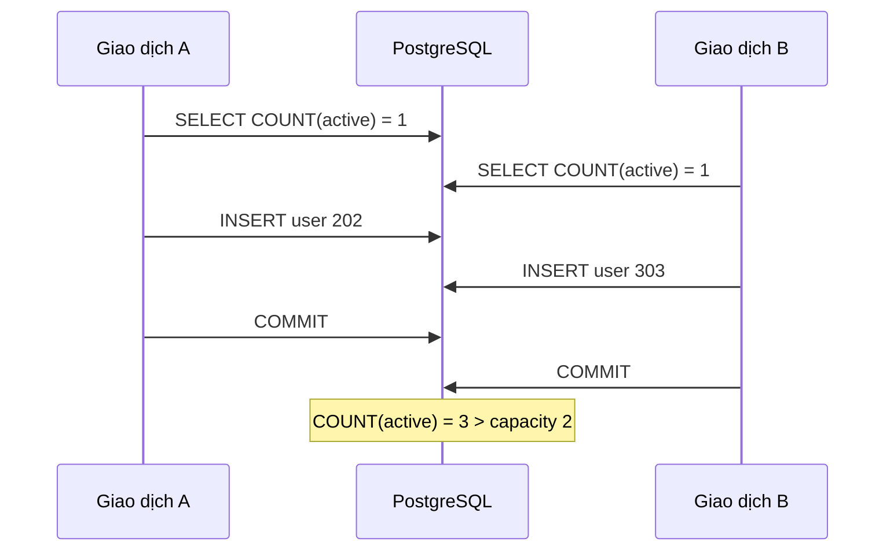

# Giữ các bất biến liên quan nhiều bản ghi

> **Chương:** Kiểm soát đồng thời  
> **Phạm vi:** `DATA_PERSISTENCE_FUNDAMENTALS` — từ mô hình dữ liệu và lược đồ đến truy vấn, chỉ mục, giao dịch, tính cô lập và kiểm soát đồng thời; ứng dụng Java phải duy trì các ràng buộc nghiệp vụ khi nhiều yêu cầu truy cập dữ liệu cùng lúc, kể cả khi xảy ra lỗi hoặc tiến hóa schema.

## Mục tiêu học tập

Sau bài này, người học có thể:

1. Phát biểu một **bất biến dữ liệu** (*data invariant*) liên quan nhiều hàng hoặc nhiều bảng và xác định các đường ghi có khả năng phá vỡ bất biến.
2. Tái hiện lỗi **check-then-act**, **phantom** và **write skew** khi nhiều giao dịch cùng đọc điều kiện tổng hợp rồi cập nhật dữ liệu.
3. Chọn đúng cơ chế bảo vệ: ràng buộc cơ sở dữ liệu, cập nhật nguyên tử có điều kiện, khóa hàng đại diện, optimistic concurrency hoặc mức cô lập `SERIALIZABLE`.
4. Viết transaction PostgreSQL và mã Java/Spring JDBC bảo vệ giới hạn tổng hợp, xử lý rollback, xung đột và lần gọi lại.
5. Thiết kế kiểm thử cạnh tranh, triển khai migration và giám sát hiệu năng của các cơ chế bảo vệ bất biến.

## 1. Bất biến liên quan nhiều bản ghi là gì?

**Bất biến** là điều kiện phải luôn đúng với dữ liệu đã commit, bất kể người dùng thao tác theo thứ tự nào. Một số bất biến kiểm tra được trên một hàng: `balance >= 0`, `quantity > 0`, `start_time < end_time`. Một số khác liên quan **nhiều hàng hoặc nhiều bảng**:

| Nghiệp vụ | Bất biến phải giữ | Vì sao không thể chỉ xét một hàng? |
| --- | --- | --- |
| Nhóm học có giới hạn thành viên | `COUNT(active_members) <= group.capacity` | Đếm nhiều hàng `membership` và so với hàng `group`. |
| Phòng trực bệnh viện | Mỗi ca luôn có ít nhất một bác sĩ trực | Phải xét tập hàng bác sĩ của ca. |
| Đặt phòng | Không có hai đặt chỗ được xác nhận cùng phòng và chồng lấn thời gian | Phải so sánh một booking mới với các booking khác. |
| Chuyển tiền | Tiền bị trừ và cộng tương ứng; bút toán đối ứng cân bằng | Cập nhật nhiều tài khoản và nhiều dòng sổ cái. |
| Giới hạn ngân sách | Tổng chi phí các khoản đã duyệt không vượt ngân sách dự án | Một dòng chi phí có thể hợp lệ nhưng tổng nhiều dòng vượt giới hạn. |

Ví dụ, một nhóm có sức chứa 2 người và hiện có 1 thành viên. Yêu cầu “thêm người vào nhóm” chỉ được thành công nếu **sau khi commit**, số thành viên đang hoạt động không vượt 2. Đây là quy tắc áp dụng cho **tập thành viên**, không riêng một hàng mới.

Không thể suy ra từ việc mỗi `INSERT` hợp lệ mà tổng thể vẫn hợp lệ. Mỗi người dùng thao tác qua giao diện, API, tác vụ nền, lệnh nhập dữ liệu hoặc các phiên bản ứng dụng khác nhau đều có thể thay đổi cùng bất biến. Vì vậy, ranh giới kiểm soát phải nằm ở tầng persistence được chia sẻ và phải có một giao thức ghi nhất quán.

## 2. Vì sao “kiểm tra trước khi ghi” vẫn có thể làm hỏng dữ liệu?

Xét lược đồ ban đầu:

```sql
-- PostgreSQL
CREATE TABLE study_group (
    id BIGINT PRIMARY KEY,
    capacity INTEGER NOT NULL CHECK (capacity > 0)
);

CREATE TABLE group_member (
    group_id BIGINT NOT NULL REFERENCES study_group(id),
    user_id BIGINT NOT NULL,
    active BOOLEAN NOT NULL DEFAULT TRUE,
    PRIMARY KEY (group_id, user_id)
);

INSERT INTO study_group(id, capacity) VALUES (7, 2);
INSERT INTO group_member(group_id, user_id, active)
VALUES (7, 101, TRUE);
```

Một cách triển khai dễ mắc lỗi:

```sql
BEGIN;

SELECT capacity FROM study_group WHERE id = 7; -- 2
SELECT COUNT(*) FROM group_member
WHERE group_id = 7 AND active = TRUE;            -- 1

-- Nếu COUNT < capacity:
INSERT INTO group_member(group_id, user_id) VALUES (7, 202);
COMMIT;
```

Ở đây transaction vẫn có `BEGIN`/`COMMIT`, nhưng hai yêu cầu thêm người khác nhau có thể xen kẽ:

| Thời điểm | Giao dịch A: thêm user 202 | Giao dịch B: thêm user 303 |
| --- | --- | --- |
| T1 | Đọc `capacity = 2`, `count = 1` | |
| T2 | | Đọc `capacity = 2`, `count = 1` |
| T3 | `INSERT (7, 202)` | |
| T4 | | `INSERT (7, 303)` |
| T5 | `COMMIT` | |
| T6 | | `COMMIT` |
| **Kết quả** | | **3 thành viên hoạt động trong nhóm sức chứa 2** |

Hai giao dịch chèn **hai khóa chính khác nhau**, nên `PRIMARY KEY(group_id, user_id)` không phát hiện xung đột. Mỗi giao dịch riêng lẻ thấy nhóm còn chỗ, nhưng phép đếm của nó đã cũ khi commit.

Đây là lỗi **check-then-act**: quyết định ghi dựa vào kết quả đọc có thể bị giao dịch khác làm mất hiệu lực. Trong PostgreSQL `READ COMMITTED`, truy vấn kiểm tra lại có thể thấy kết quả mới ở câu lệnh sau, nhưng đoạn mã trên **không đọc lại trước khi ghi**. Trong `REPEATABLE READ`, các truy vấn thông thường nhìn snapshot ổn định; hai transaction ghi hai hàng khác nhau vẫn có thể cùng commit, tạo **write skew** đối với bất biến tổng hợp.



**Tính nguyên tử không đồng nghĩa với tính cô lập đủ mạnh.** Transaction bảo đảm các thay đổi bên trong được commit/rollback cùng nhau, nhưng không tự khiến những phép kiểm tra tổng hợp của các transaction khác nhau trở nên tuần tự.

## 3. Nhận diện bất biến, phạm vi khóa và tất cả đường ghi

Trước khi chọn câu SQL hoặc mức cô lập, cần phát biểu chính xác điều kiện sau commit:

> Với mỗi nhóm `g`, số thành viên hoạt động của `g` không được lớn hơn `g.capacity`.

Viết theo ký hiệu:

\[
0 \le \sum_{m:\,m.group\_id=g.id} \mathbf{1}(m.active)
\le g.capacity
\]

Tiếp theo xác định:

- **Dữ liệu đọc:** `study_group.capacity` và các hàng `group_member` có `group_id = g.id`, `active = TRUE`.
- **Dữ liệu ghi:** thêm thành viên, kích hoạt lại, chuyển thành viên sang nhóm khác, hủy kích hoạt, xóa thành viên; cập nhật sức chứa nhóm.
- **Phạm vi cạnh tranh:** mọi transaction tác động **cùng nhóm** phải phối hợp; giao dịch thuộc nhóm khác có thể chạy độc lập.
- **Đường ngoài ứng dụng:** script import, job nền, migration, giao diện quản trị, trigger và phiên bản ứng dụng cũ có thể bỏ qua quy tắc nếu không được kiểm soát.

Đặc biệt, điều kiện như “không có bản ghi nào thỏa `WHERE ...`” hay “đang có ít hơn N bản ghi” nói đến **cả các hàng có thể được chèn trong tương lai**. Khóa các hàng đã tồn tại chưa chắc bảo vệ được khoảng trống này.

Một bất biến có thể được biểu diễn bằng ràng buộc SQL sẵn có thì nên ưu tiên ràng buộc đó. Với bất biến tổng hợp chưa thể khai báo trực tiếp, cần thiết kế các transaction **cùng tranh chấp một tài nguyên đại diện** hoặc dùng cơ chế phát hiện xung đột đọc-ghi đủ mạnh.

## 4. Ưu tiên ràng buộc dữ liệu khi có thể

Một số quy tắc nhiều hàng có thể đưa xuống database bằng cấu trúc ràng buộc phù hợp:

| Quy tắc | Cách bảo vệ ở PostgreSQL | Giới hạn |
| --- | --- | --- |
| Một tài khoản chỉ có một email chuẩn hóa trong một tenant | `UNIQUE(tenant_id, email_key)` | Phải xác định chuẩn hóa, `NULL` và collation. |
| Một nhóm có tối đa một trưởng nhóm đang hoạt động | Partial unique index trên `(group_id) WHERE active AND role = 'LEADER'` | Bảo đảm “tối đa một”, **không bảo đảm** “ít nhất một”. |
| Đặt cùng phòng không chồng khoảng thời gian được xác nhận | Exclusion constraint trên khoảng thời gian | Cần kiểu khoảng, toán tử và chỉ mục hỗ trợ phù hợp. |
| Thành viên phải thuộc nhóm tồn tại | `FOREIGN KEY(group_id)` | Không giới hạn số thành viên của nhóm. |
| Sức chứa của hàng nhóm phải dương | `CHECK(capacity > 0)` | Chỉ kiểm tra hàng nhóm; không đếm các hàng thành viên. |

Ví dụ không cho quá một trưởng nhóm:

```sql
-- Ví dụ thay thế/điều chỉnh lược đồ khi có cột role.
CREATE UNIQUE INDEX ux_one_active_leader_per_group
ON group_member (group_id)
WHERE active = TRUE AND role = 'LEADER';
```

SQL trên giả định bảng có cột `role` và là **minh họa độc lập**, không chạy trực tiếp trên bảng `group_member` mẫu ở phần 2 vì bảng đó chưa khai báo `role`. Nếu áp vào hệ thống thật, hãy thêm/migrate cột và xử lý dữ liệu cũ trước khi tạo index.

Đối với đặt lịch theo khoảng thời gian, PostgreSQL hỗ trợ *exclusion constraint*:

```sql
-- Ví dụ độc lập: cần quyền cài extension btree_gist.
CREATE EXTENSION IF NOT EXISTS btree_gist;

CREATE TABLE room_booking (
    id BIGINT GENERATED ALWAYS AS IDENTITY PRIMARY KEY,
    room_id BIGINT NOT NULL,
    starts_at TIMESTAMPTZ NOT NULL,
    ends_at TIMESTAMPTZ NOT NULL,
    status TEXT NOT NULL CHECK (status IN ('PENDING', 'CONFIRMED', 'CANCELLED')),
    CHECK (starts_at < ends_at),
    CONSTRAINT ex_no_confirmed_booking_overlap
        EXCLUDE USING gist (
            room_id WITH =,
            tstzrange(starts_at, ends_at, '[)') WITH &&
        )
        WHERE (status = 'CONFIRMED')
);
```

Hai booking cùng phòng được xác nhận và có khoảng `[start, end)` chồng lấn sẽ xung đột; khoảng nửa mở cho phép một booking bắt đầu đúng lúc booking trước kết thúc. Đây là biện pháp mạnh hơn kiểm tra `SELECT` rồi `INSERT` khi quy tắc khớp với toán tử/ràng buộc DB.

**Không cố diễn đạt tổng nhiều hàng trong một `CHECK` thông thường.** `CHECK` của PostgreSQL chỉ phù hợp với điều kiện trên hàng đang được kiểm tra; nó không tự bảo vệ `COUNT(group_member) <= capacity`. Trigger có thể đóng gói logic ghi phức tạp, nhưng trigger tự truy vấn `COUNT` mà không có phối hợp concurrency vẫn có thể chịu cùng race condition.

## 5. Giải pháp A: khóa hàng đại diện trước khi đếm và ghi

Để giữ giới hạn thành viên, dùng chính hàng `study_group` làm **hàng đại diện** (*guard row*). Mọi transaction có khả năng thay đổi số thành viên hoặc sức chứa nhóm phải khóa hàng này **trước** khi kiểm tra điều kiện và sửa các hàng thành viên.

Ở PostgreSQL `READ COMMITTED`:

```sql
BEGIN ISOLATION LEVEL READ COMMITTED;

-- Chặn các transaction cùng tuân thủ giao thức trên nhóm 7.
SELECT capacity
FROM study_group
WHERE id = 7
FOR UPDATE;

-- Sau khi lấy được khóa, đọc count trong statement mới.
SELECT COUNT(*) AS active_members
FROM group_member
WHERE group_id = 7 AND active = TRUE;

-- Ứng dụng xác nhận có hàng nhóm và count < capacity.
-- Chỉ khi điều kiện đạt:
INSERT INTO group_member (group_id, user_id, active)
VALUES (7, 202, TRUE);

COMMIT;
```

Đây là **đường thành công**, có nhánh điều kiện do ứng dụng điều khiển. Nếu nhóm không tồn tại hoặc số thành viên đã đạt sức chứa, ứng dụng cần `ROLLBACK` (hoặc kết thúc transaction mà không ghi) và trả kết quả nghiệp vụ. Không được chạy `INSERT` vô điều kiện sau hai câu `SELECT`.

Khi hai yêu cầu cùng xin thêm thành viên nhóm 7:

1. Giao dịch A giữ khóa hàng `study_group(7)`.
2. Giao dịch B phải đợi ở `SELECT ... FOR UPDATE`.
3. A đọc số thành viên, chèn người thứ hai, rồi commit và nhả khóa.
4. B lấy được khóa; trong `READ COMMITTED`, câu `SELECT COUNT` **tiếp theo** nhìn thấy bản ghi A đã commit.
5. B phát hiện nhóm đầy và không chèn. Sau các commit, số người không vượt sức chứa.

**Điều kiện thành công:** mọi đường ghi ảnh hưởng bất biến của nhóm phải lấy cùng khóa theo cùng thứ tự, bao gồm cả thao tác giảm `capacity`, kích hoạt lại hoặc chuyển người vào nhóm. Một lệnh import chèn trực tiếp vào `group_member` mà không khóa `study_group` có thể phá vỡ bảo đảm này.

Lưu ý thực thi:

- `SELECT ... FOR UPDATE` chỉ khóa hàng nhóm tồn tại. Nếu không tìm thấy nhóm, không có khóa nào được đặt trên một hàng nhóm tưởng tượng; phải kiểm tra kết quả truy vấn.
- Chọn cùng một **thứ tự khóa** nếu thao tác chạm nhiều nhóm, ví dụ chuyển thành viên từ nhóm 7 sang nhóm 9 luôn khóa theo `group_id` tăng dần. Điều này giảm deadlock.
- Không giữ transaction trong khi gửi email, gọi dịch vụ HTTP hoặc chờ người dùng; khóa tồn tại đến cuối transaction và có thể làm hàng chờ phình to.
- Kỹ thuật đọc sau khi lấy khóa được mô tả ở đây cho PostgreSQL `READ COMMITTED`. Không mặc định có thể dùng cùng cách dưới `REPEATABLE READ`: snapshot đã hình thành trước đó không tự được làm mới sau khi chờ khóa.

Nếu thường xuyên đếm thành viên, chỉ mục `(group_id) WHERE active = TRUE` có thể giảm số hàng phải quét:

```sql
CREATE INDEX ix_group_member_active_by_group
ON group_member (group_id)
WHERE active = TRUE;
```

Chỉ mục giúp truy vấn nhanh hơn nhưng **không tự thực thi giới hạn sức chứa**.

## 6. Giải pháp B: biến bất biến tổng hợp thành cập nhật nguyên tử trên một hàng

Nếu việc đếm mỗi lần quá tốn chi phí, có thể **vật chất hóa số lượng đang dùng** (*materialized counter*) trong hàng nhóm. Khi đó mỗi lần thêm người cần “đặt trước một chỗ” bằng **một câu cập nhật có điều kiện**.

Đây là một thiết kế thay thế cho lược đồ phần 2, có cột `occupied` và ràng buộc hàng:

```sql
CREATE TABLE member_group (
    id BIGINT PRIMARY KEY,
    capacity INTEGER NOT NULL CHECK (capacity > 0),
    occupied INTEGER NOT NULL DEFAULT 0,
    CHECK (occupied >= 0 AND occupied <= capacity)
);

CREATE TABLE membership (
    id BIGINT GENERATED ALWAYS AS IDENTITY PRIMARY KEY,
    group_id BIGINT NOT NULL REFERENCES member_group(id),
    user_id BIGINT NOT NULL,
    active BOOLEAN NOT NULL DEFAULT TRUE
);

CREATE UNIQUE INDEX ux_active_membership
ON membership (group_id, user_id)
WHERE active = TRUE;

INSERT INTO member_group(id, capacity, occupied) VALUES (7, 2, 1);
INSERT INTO membership(group_id, user_id, active)
VALUES (7, 101, TRUE);
```

Trong ví dụ này, ứng dụng cần giữ **hai bất biến**:

\[
0 \le \text{occupied} \le \text{capacity}
\]

và

\[
\text{occupied} =
\operatorname{COUNT}(\text{membership đang active của nhóm})
\]

Ràng buộc `CHECK` chỉ bảo vệ bất biến thứ nhất; bất biến thứ hai phụ thuộc việc **tất cả đường ghi cùng cập nhật bộ đếm và membership trong một transaction**.

### 6.1. Thêm thành viên

```sql
BEGIN;

UPDATE member_group
SET occupied = occupied + 1
WHERE id = 7
  AND occupied < capacity
RETURNING occupied;

-- Phải nhận được đúng một hàng: đã giữ được chỗ.
-- Nếu không có hàng, ROLLBACK và trả lỗi nhóm đầy/không tồn tại.

INSERT INTO membership (group_id, user_id, active)
VALUES (7, 202, TRUE);

COMMIT;
```

Trong PostgreSQL `READ COMMITTED`, khi hai `UPDATE` cùng chạm hàng `member_group(7)`, một giao dịch đợi giao dịch kia và điều kiện `occupied < capacity` được đánh giá trên phiên bản phù hợp sau khi đợi. Nếu đã đầy, `UPDATE` thứ hai ảnh hưởng **0 hàng**.

Nếu `INSERT` thất bại vì trùng `(group_id, user_id)` hoặc lỗi khác, rollback cũng hoàn tác lượt tăng `occupied`. Vì vậy **không được** nuốt lỗi trùng rồi commit làm tăng bộ đếm mà không có membership. Nếu muốn xử lý lần gọi lại idempotent, cần xác định yêu cầu cũ và trả kết quả phù hợp, không tự động bỏ qua lỗi với `ON CONFLICT DO NOTHING` sau khi đã tăng đếm.

### 6.2. Hủy kích hoạt thành viên

Hủy kích hoạt phải giảm bộ đếm **đúng một lần**, trong cùng transaction:

```sql
BEGIN;

-- Khóa nhóm trước, thống nhất thứ tự khóa với thao tác thêm.
SELECT id FROM member_group WHERE id = 7 FOR UPDATE;

UPDATE membership
SET active = FALSE
WHERE group_id = 7 AND user_id = 101 AND active = TRUE
RETURNING id;

-- Chỉ khi UPDATE trả đúng một hàng thì mới giảm occupied.
UPDATE member_group
SET occupied = occupied - 1
WHERE id = 7 AND occupied > 0;

COMMIT;
```

Đây cũng là mô tả **nhánh có một thành viên đang hoạt động**; không chạy câu giảm `occupied` nếu `UPDATE membership` trả 0 hàng. Nếu lệnh giảm không ảnh hưởng đúng một hàng, rollback và điều tra dữ liệu không nhất quán. Một yêu cầu hủy lặp lại không được trừ hai lần.

Nếu dùng **xóa mềm**, khôi phục membership từ `active = FALSE` lên `TRUE` cũng cần đặt chỗ trước; thay đổi `capacity` phải tôn trọng `occupied`. Khi chuyển thành viên giữa hai nhóm, thực hiện giảm và tăng tương ứng trong **một transaction**, khóa cả hai nhóm theo thứ tự xác định.

### 6.3. Đánh đổi khi lưu bộ đếm

Ưu điểm là kiểm tra giới hạn không cần `COUNT(*)` trên bảng membership lớn; tất cả yêu cầu cùng nhóm cạnh tranh ở một hàng rõ ràng. Đổi lại, ứng dụng phải chịu trách nhiệm duy trì bộ đếm qua mọi đường ghi. Các thao tác sửa dữ liệu trực tiếp, migration, trigger hoặc job nền bỏ quên bộ đếm có thể làm `occupied` lệch khỏi thực tế.

Nên có truy vấn đối soát định kỳ và cảnh báo, **không dùng đối soát để thay thế bảo vệ tại lúc ghi**:

```sql
SELECT g.id, g.occupied,
       COUNT(m.id) AS actual_active_members
FROM member_group AS g
LEFT JOIN membership AS m
  ON m.group_id = g.id AND m.active = TRUE
GROUP BY g.id, g.occupied
HAVING g.occupied <> COUNT(m.id);
```

Đối soát nên chạy trên dữ liệu đã commit với kỳ vọng nhất quán phù hợp; ở môi trường đang ghi liên tục, snapshot và thời điểm lấy số liệu cần được xác định rõ để tránh cảnh báo giả.

## 7. Giải pháp C: SERIALIZABLE và retry toàn bộ giao dịch

Nếu bất biến rất khó biểu diễn bằng một hàng guard hoặc câu cập nhật có điều kiện, mức cô lập `SERIALIZABLE` giúp hệ quản trị bảo đảm các transaction **commit thành công** cho kết quả tương đương một thứ tự chạy tuần tự.

Trong PostgreSQL, `SERIALIZABLE` sử dụng Serializable Snapshot Isolation (SSI): tiếp tục đọc theo MVCC nhưng còn theo dõi các phụ thuộc đọc-ghi có thể tạo lịch không tuần tự hóa được. Khi gặp cấu trúc xung đột nguy hiểm, PostgreSQL có thể **hủy một transaction với SQLSTATE `40001`** để bảo vệ tính đúng đắn.

Ví dụ áp dụng cho lược đồ `study_group` / `group_member` của phần 2:

```sql
BEGIN ISOLATION LEVEL SERIALIZABLE;

SELECT capacity FROM study_group WHERE id = 7;
SELECT COUNT(*) AS active_members
FROM group_member
WHERE group_id = 7 AND active = TRUE;

-- Nếu nhóm tồn tại và active_members < capacity,
-- INSERT một thành viên; nếu không, ROLLBACK và trả lỗi nghiệp vụ.
INSERT INTO group_member (group_id, user_id, active)
VALUES (7, 202, TRUE);

COMMIT;
```

Hai transaction cùng thấy còn một chỗ rồi cố chèn hai thành viên khác nhau **không thể đều commit để tạo 3 thành viên** nếu lịch là không serializable và các đường ghi liên quan tuân thủ điều kiện. PostgreSQL có thể từ chối transaction thứ hai bằng lỗi serialization.

Không thể sửa đơn giản bằng cách retry riêng `INSERT`: **phải mở transaction mới**, đọc lại `capacity` và `COUNT(*)`, đánh giá lại điều kiện, rồi mới quyết định chèn. Sau khi transaction A đã thêm người thứ hai, transaction retry sẽ thấy nhóm đầy và từ chối theo nghiệp vụ.

Chi phí cần cân nhắc là phát hiện xung đột, khả năng rollback/retry và gia tăng áp lực khi transaction dài hoặc các truy vấn đọc một phạm vi rộng. Đường ghi khác sử dụng mức cô lập yếu hơn hoặc bỏ qua logic kiểm tra cần được đánh giá riêng; không thể dựa vào một transaction serializable để mặc nhiên bảo vệ mọi thao tác từ ứng dụng khác.

**Đừng đánh đồng `REPEATABLE READ` với `SERIALIZABLE`.** Ở PostgreSQL, `REPEATABLE READ` duy trì snapshot và thường ngăn cập nhật đồng thời cùng một hàng trên snapshot cũ, nhưng vẫn có thể cho phép *write skew* khi các giao dịch cập nhật các hàng khác nhau sau khi đọc một điều kiện chung.

## 8. Giải pháp D: optimistic concurrency bằng phiên bản

Với tải tranh chấp không quá lớn, một hàng đại diện có cột `version` có thể dùng cho **compare-and-set (CAS)**:

```sql
-- Giả định study_group đã có cột version BIGINT NOT NULL DEFAULT 0.
-- Ứng dụng đọc version cùng capacity và COUNT trong transaction.
UPDATE study_group
SET version = version + 1
WHERE id = 7 AND version = :expected_version;
-- Nếu số hàng cập nhật = 0: có thay đổi cạnh tranh; rollback và retry.
```

Sau khi xác nhận phiên bản chưa đổi, ứng dụng chèn membership trong **cùng transaction** rồi commit. Để giao thức có hiệu lực, **mọi transaction làm thay đổi tập thành viên hoặc capacity phải cập nhật cùng version**, và phải rollback nếu CAS thất bại. Nếu một đường ghi quên tăng version, phép kiểm tra cũ có thể vẫn “thành công” và gây vượt giới hạn.

Ở PostgreSQL `READ COMMITTED`, `UPDATE` CAS cạnh tranh trên cùng hàng được phối hợp bởi khóa hàng và điều kiện lọc lại; transaction thua phải đọc lại trạng thái trong lần thử mới. Đây là phương án thích hợp khi cần thể hiện xung đột bằng phiên bản, nhưng không tránh hoàn toàn việc chờ khóa hàng và phải tính đến các lần retry.

Một **`@Version` của JPA** trên hàng `membership` riêng lẻ không thể tự phát hiện xung đột khi hai transaction tạo **hai membership mới khác nhau**. Nếu dùng optimistic locking cho bất biến tập hợp, phải có phiên bản chung cho tập hợp đó, chẳng hạn phiên bản của `study_group`.

## 9. Triển khai trong Java với transaction đúng ranh giới

Ví dụ Spring JDBC dưới đây dùng **giải pháp bộ đếm** ở phần 6. Mỗi lần thêm thành viên cần tăng `occupied` và tạo một hàng `membership` trong **một transaction**:

```java
import org.springframework.jdbc.core.JdbcTemplate;
import org.springframework.stereotype.Service;
import org.springframework.transaction.annotation.Isolation;
import org.springframework.transaction.annotation.Transactional;

@Service
public class MembershipService {
    private final JdbcTemplate jdbc;

    public MembershipService(JdbcTemplate jdbc) {
        this.jdbc = jdbc;
    }

    @Transactional(isolation = Isolation.READ_COMMITTED)
    public void join(long groupId, long userId) {
        int reserved = jdbc.update(
            """
            UPDATE member_group
            SET occupied = occupied + 1
            WHERE id = ? AND occupied < capacity
            """,
            groupId
        );

        if (reserved != 1) {
            throw new IllegalStateException("Group is full or missing");
        }

        // Có unique index (group_id, user_id) WHERE active = TRUE.
        // INSERT thất bại sẽ khiến transaction rollback,
        // cả lượt tăng occupied cũng bị hoàn tác.
        int inserted = jdbc.update(
            """
            INSERT INTO membership (group_id, user_id, active)
            VALUES (?, ?, TRUE)
            """,
            groupId, userId
        );

        if (inserted != 1) {
            throw new IllegalStateException("Membership not inserted");
        }
    }
}
```

Hành vi cần kiểm chứng:

1. `JdbcTemplate` và transaction manager của Spring phải dùng đúng `DataSource` được quản lý; cả hai câu SQL phải tham gia cùng transaction.
2. Trong cấu hình proxy thường gặp, gọi `this.join(...)` từ chính class có thể **bỏ qua proxy `@Transactional`**. Gọi service qua bean do Spring quản lý.
3. Spring mặc định rollback khi ném `RuntimeException` hoặc `Error`. Với *checked exception* cần thiết kế `rollbackFor` hoặc quy tắc tương đương, không bắt lỗi rồi trả “thành công” khiến transaction commit.
4. Vi phạm unique khi thêm trùng thành viên cần được phân loại đúng constraint. Đừng trả “nhóm đầy” cho mọi lỗi SQL; những lỗi khác có thể là trùng người, mất kết nối hoặc vi phạm khóa ngoại.
5. Nếu cần tính **idempotency**, sử dụng khóa yêu cầu bền vững, lưu kết quả đã xử lý và kiểm tra khi gọi lại. Retry vô điều kiện sau lỗi kết nối gần `COMMIT` có thể gây tác động lặp, vì client chưa chắc biết transaction trước đã commit hay chưa.
6. Không gọi API bên ngoài hoặc gửi thông báo trong lúc đang giữ khóa bộ đếm rồi cho rằng rollback DB sẽ thu hồi tác động đó. Dùng cơ chế sau commit hoặc *transactional outbox* nếu cần phát sự kiện đáng tin cậy.

Với giải pháp `SERIALIZABLE`, luồng retry nên nằm **bên ngoài phương thức `@Transactional`**, để mỗi nỗ lực mở một transaction mới. Khi gặp SQLSTATE `40001`, rollback và thử lại **toàn bộ** phần đọc, kiểm tra và ghi; khi gặp “nhóm đầy”, trả lỗi nghiệp vụ thay vì retry. Giới hạn số lần thử, có backoff phù hợp và ghi nhận chỉ số để phát hiện điểm tranh chấp.

## 10. Những sai lầm phổ biến khi bảo vệ bất biến nhiều hàng

| Cách làm dễ sai | Vì sao chưa đủ | Cách sửa theo mục đích |
| --- | --- | --- |
| `SELECT COUNT` rồi `INSERT` trong transaction mặc định | Giao dịch khác có thể chèn trong khoảng giữa hai bước. | Khóa guard row, cập nhật bộ đếm có điều kiện, hoặc `SERIALIZABLE` cùng retry. |
| Khóa các hàng membership hiện có bằng `FOR UPDATE` | Không khóa được các hàng tương lai; khi tập rỗng không có hàng nào để khóa. | Khóa hàng nhóm đại diện tồn tại, hoặc dùng mức cô lập/constraint bảo vệ phạm vi. |
| Chỉ đặt `UNIQUE(group_id, user_id)` | Ngăn cùng người tham gia trùng, không giới hạn **tổng số người khác nhau**. | Thêm cơ chế bảo vệ tổng thành viên. |
| Dùng `CHECK(capacity >= 0)` | Chỉ bảo vệ giá trị trên hàng nhóm. | Bảo vệ liên hệ giữa `capacity` và các hàng thành viên bằng transaction phù hợp. |
| Dùng `synchronized` trong Java | Chỉ đồng bộ các thread dùng chung lock trong một tiến trình; nhiều instance vẫn cạnh tranh. | Đặt cơ chế đồng bộ ở DB/hạ tầng chia sẻ. |
| Dùng `REPEATABLE READ` và tin rằng mọi bất biến đều an toàn | Snapshot ổn định chưa đủ ngăn write skew. | Phân tích read set/write set; thiết kế xung đột chung hoặc `SERIALIZABLE`. |
| Giữ bộ đếm nhưng `INSERT` thất bại vẫn commit | `occupied` lệch so với thành viên thực tế. | Cập nhật bộ đếm và membership trong cùng transaction; rollback khi có lỗi. |
| Retry duy nhất câu SQL vừa thất bại | Điều kiện nghiệp vụ đã đọc có thể cũ. | Retry toàn bộ transaction, đọc lại điều kiện. |
| Khóa nhóm theo thứ tự bất kỳ khi chuyển nhiều nhóm | Tăng nguy cơ deadlock do các luồng giữ khóa ngược nhau. | Khóa các nhóm theo thứ tự `id` cố định. |

**Về việc khóa một câu `COUNT`:** PostgreSQL không cho gắn `FOR UPDATE` trực tiếp vào một kết quả aggregate theo cách “khóa số đếm”. Kể cả khóa các hàng đang thỏa điều kiện, bài toán còn bao gồm khả năng xuất hiện hàng mới (*phantom*). Đó là lý do cần một đối tượng đại diện hoặc cơ chế bảo vệ tập/điều kiện ở mức DB.

## 11. Migration, đối soát, hiệu năng và bảo mật

Đưa một bất biến mới vào hệ thống đang chạy không chỉ là thêm SQL. Một lộ trình an toàn cần:

1. **Kiểm tra dữ liệu hiện tại:** nhóm nào đã vượt `capacity`, membership nào bị trùng, bản ghi xóa mềm nào tính vào số lượng? Xác định quy tắc nghiệp vụ và cách xử lý ngoại lệ trước khi thêm ràng buộc.
2. **Thống nhất các đường ghi:** nếu thêm `occupied`, mọi service, batch, import và phiên bản ứng dụng cũ phải chuyển sang giao thức cập nhật chung; cần tính đến thời gian chạy song song của các phiên bản trong lúc rollout.
3. **Khởi tạo và đối soát bộ đếm:** tính từ dữ liệu đã commit, ngăn hoặc phối hợp các thao tác ghi trong thời điểm backfill, kiểm tra chênh lệch trước khi xem `occupied` là nguồn quyết định.
4. **Bổ sung chỉ mục và ràng buộc phù hợp:** ví dụ khóa ngoại, unique index, index lọc `active`; đo tác động tăng I/O và chi phí ghi. Không thêm nhiều chỉ mục trùng lặp.
5. **Thử nghiệm tải thật:** đo độ trễ, lock wait, deadlock, tỷ lệ `40001`, rollback và throughput khi nhiều request cùng tác động một nhóm “nóng”. Một hàng guard hoặc counter có thể trở thành điểm nghẽn nếu hàng nghìn giao dịch cùng tranh chấp.
6. **Theo dõi sau triển khai:** ghi nhận lỗi theo loại, cấu hình timeout hợp lý, đo bất biến bằng truy vấn đối soát và chuẩn bị phương án xử lý dữ liệu lệch. Kiểm tra cả khả năng khôi phục từ backup.

Quản trị quyền cũng ảnh hưởng trực tiếp đến tính đúng đắn: nếu ứng dụng chỉ được thao tác dữ liệu thông qua API hay stored procedure được kiểm soát, có thể giảm nguy cơ đường ghi bỏ qua giao thức. Nhưng phân quyền, ràng buộc và transaction vẫn cần kết hợp: một transaction nhất quán chưa chắc được người dùng có quyền thực hiện.

Khi dữ liệu phân tán trên **nhiều shard** hoặc **nhiều cơ sở dữ liệu độc lập**, khóa một hàng guard trong một shard **không tự bảo vệ** bất biến tổng toàn hệ thống. Khi đó phải thiết kế phạm vi bất biến theo shard, bộ điều phối, transaction phân tán phù hợp hoặc quy trình nhất quán cuối cùng có trạng thái đặt chỗ/bù trừ rõ ràng. Không giả định mọi DBMS có cùng mức cô lập và cùng cách thực thi `SELECT ... FOR UPDATE`.

## 12. Bài thực hành: nhóm đủ chỗ khi có nhiều yêu cầu đồng thời

**Bối cảnh:** nhóm 7 có `capacity = 2`, một thành viên đang hoạt động. Ba người khác cùng gửi yêu cầu tham gia. API có thể chạy trên nhiều instance Java; mỗi request có transaction riêng.

**Yêu cầu triển khai:**

1. Xây dựng lược đồ `member_group` và `membership` như phần 6, có khóa ngoại, chỉ mục unique cho membership đang hoạt động và ràng buộc `0 <= occupied <= capacity`.
2. Viết `join(groupId, userId)` dùng một câu `UPDATE ... WHERE occupied < capacity` và một câu `INSERT` trong cùng transaction.
3. Viết `leave(groupId, userId)`, khóa hàng nhóm trước; chỉ giảm `occupied` nếu đã thực sự chuyển một membership đang hoạt động thành không hoạt động.
4. Tổ chức các request song song bằng các transaction riêng trong môi trường thử nghiệm; xác minh số người thành công và kết quả cuối sau commit.
5. Cố tình gây lỗi khi `INSERT membership` sau khi giữ chỗ, rồi kiểm tra rollback đã đưa `occupied` về giá trị ban đầu.

| Trường hợp kiểm thử | Kết quả phải đạt |
| --- | --- |
| Ba người khác nhau xin vào một nhóm còn 1 chỗ | Chỉ **một** giao dịch thêm thành viên thành công; `occupied = 2` và số membership active = 2. |
| Cùng một user gửi hai yêu cầu tham gia | Tối đa một membership active; mọi lượt tăng `occupied` bị rollback nếu `INSERT` không thành công. |
| Thành viên hủy tham gia hai lần | Lần đầu giảm đúng 1, lần sau không giảm nữa. |
| Thêm thành viên rồi gây lỗi SQL trước commit | Không để lại membership hay lượt tăng bộ đếm của transaction thất bại. |
| Giảm `capacity` thấp hơn `occupied` | Bị từ chối bởi `CHECK`; không commit trạng thái vượt sức chứa. |
| Chuyển thành viên giữa hai nhóm trong một transaction | Chỗ của cả hai nhóm được cập nhật nguyên tử; khóa nhóm theo thứ tự cố định để giảm deadlock. |

**Câu hỏi tự đánh giá**

1. Vì sao unique index trên `(group_id, user_id)` vẫn cho phép một nhóm vượt sức chứa?
2. Trong `READ COMMITTED`, khi nào một `SELECT ... FOR UPDATE` trên hàng nhóm đủ bảo vệ phép đếm thành viên? Điều kiện nào bắt buộc các đường ghi khác cùng tuân thủ?
3. Vì sao chỉ khóa những hàng `membership` đang tồn tại không ngăn được thêm thành viên mới?
4. Nếu transaction đã tăng `occupied` nhưng `INSERT` trùng user, ứng dụng cần xử lý thế nào?
5. Khi nào lựa chọn `SERIALIZABLE` có lợi hơn thiết kế một hàng counter? Chi phí của retry nằm ở đâu?
6. Việc chuyển một thành viên giữa hai nhóm phải khóa những hàng nào và theo thứ tự gì?
7. Nếu script nhập liệu cập nhật membership nhưng không cập nhật counter, những cơ chế nào phát hiện và những cơ chế nào ngăn lỗi này?
8. Nếu client mất kết nối đúng lúc commit, vì sao không thể coi lần gọi lại là một giao dịch mới hoàn toàn mà không kiểm tra trạng thái trước đó?

## Ghi nhớ

Bất biến liên quan nhiều bản ghi là **quy tắc của cả một tập dữ liệu đã commit**. Giao dịch và snapshot có thể giúp một thao tác đọc/ghi nhất quán bên trong, nhưng **đọc rồi ghi** ở các transaction đồng thời vẫn có thể vượt giới hạn, tạo dữ liệu chồng lấn hoặc phá điều kiện tổng hợp.

Muốn giữ bất biến, hãy mô tả chính xác điều kiện nghiệp vụ, xác định mọi đường ghi liên quan, ưu tiên ràng buộc DB khi diễn đạt được, hoặc khiến các transaction cạnh tranh trên **cùng hàng đại diện/bộ đếm**. Với quy tắc phức tạp, cân nhắc `SERIALIZABLE` và retry toàn bộ transaction. Java cần giữ các thao tác trong cùng transaction, rollback khi có lỗi, xử lý idempotency và kiểm thử cạnh tranh trên DBMS thực tế.
