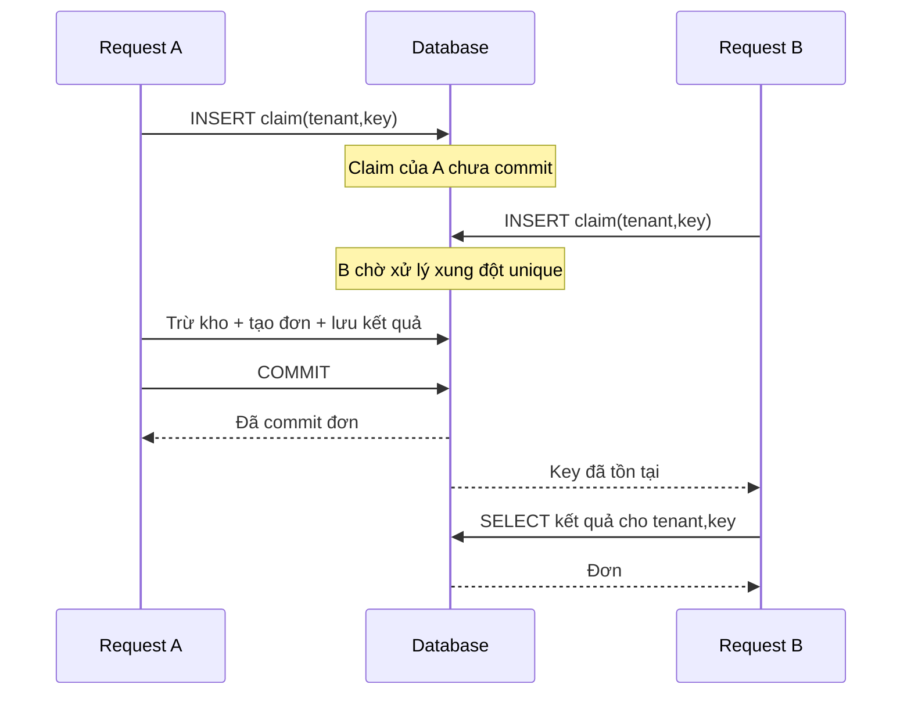
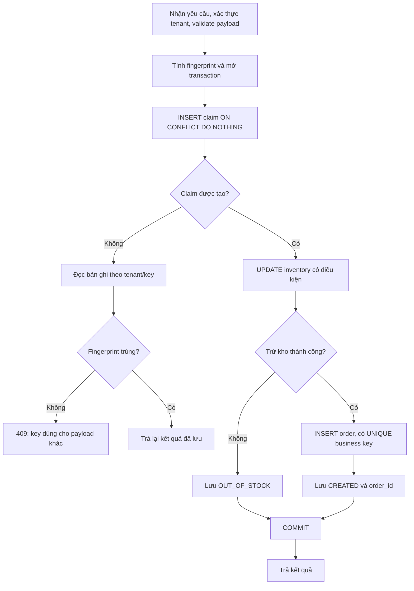
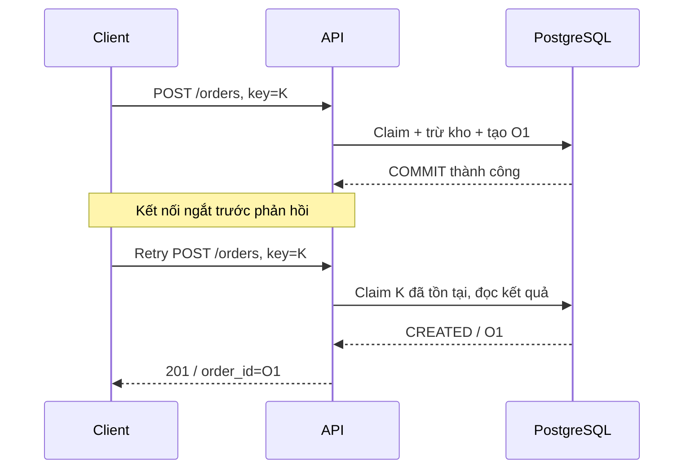

# Xử lý yêu cầu trùng lặp bằng định danh thao tác và ràng buộc dữ liệu

## 1. Vì sao một thao tác nghiệp vụ có thể được gửi nhiều lần?

Trong ứng dụng có lưu trữ dữ liệu bền vững, cùng một yêu cầu đặt hàng, thanh toán hoặc tạo hồ sơ có thể đến máy chủ **nhiều hơn một lần**, dù người dùng chỉ muốn thực hiện **một thao tác nghiệp vụ**.

Những nguyên nhân thường gặp:

- Người dùng nhấn nút “Đặt hàng” hai lần hoặc làm mới trang sau khi gửi biểu mẫu.
- Client hoặc API gateway tự động retry khi hết thời gian chờ.
- Máy chủ đã `COMMIT` vào database nhưng mất kết nối trước khi trả phản hồi; client không biết giao dịch đã thành công.
- Một thông điệp được giao lại cho consumer sau lỗi hoặc sau khi consumer restart.
- Hai instance ứng dụng cùng nhận yêu cầu trùng trong lúc chạy đồng thời.

Giả sử hệ thống chỉ còn một sản phẩm. Client gửi lệnh đặt 1 sản phẩm và nhận timeout. Nếu nó gửi lại cùng lệnh, hệ thống phải biết **đây là lần thử lại của cùng đơn hàng** hay là **một đơn hàng mới thực sự**. Không có quy tắc nhận diện, thao tác có thể bị tính hai lần, tạo hai đơn hoặc phát hai lần tác động ra bên ngoài.

Chủ đề này thuộc chương **Kiểm soát đồng thời** của module **DATA_PERSISTENCE_FUNDAMENTALS**. Khi thiết kế ranh giới persistence trong Java, cần kết hợp **định danh thao tác**, **ràng buộc duy nhất của dữ liệu**, **giao dịch nguyên tử**, xử lý lỗi kết nối và quy tắc retry để bảo vệ bất biến nghiệp vụ.

> Mục tiêu không phải ngăn client gửi nhiều HTTP request. Mục tiêu là để **nhiều lần gửi cùng một ý định không tạo ra nhiều tác động nghiệp vụ ngoài mong muốn**, kể cả khi chúng đến đồng thời.

## 2. Phân biệt request, thao tác nghiệp vụ và tác động

| Khái niệm | Ví dụ | Vai trò |
| --- | --- | --- |
| **Request** | Một lần gọi `POST /orders` qua HTTP | Có thể lặp lại do mạng, người dùng hoặc retry |
| **Thao tác nghiệp vụ** (*logical operation*) | “Tạo đơn hàng X cho khách A” | Một ý định cần định danh nhất quán xuyên các lần thử |
| **Idempotency key** | `order-attempt-84c...` | Khóa do client cung cấp hoặc hai bên thỏa thuận để nhận diện **cùng thao tác** |
| **Business key** | `client_order_ref = cart-checkout-739` | Khóa nhận diện thực thể/sự kiện nghiệp vụ, thường nên có ràng buộc unique |
| **Request fingerprint** | SHA-256 của các trường đầu vào được chuẩn hóa | Phát hiện cùng key bị dùng cho **nội dung khác nhau** |
| **Resource ID** | `order_id` UUID do server cấp | Nhận diện đơn hàng đã tạo, dùng khi truy vấn/trả kết quả |
| **Event ID** | ID của sự kiện `OrderCreated` | Consumer dùng để nhận diện thông điệp được gửi lại |

**Idempotent** nghĩa là lặp lại một thao tác theo cùng định danh không làm thay đổi kết quả nghiệp vụ thêm lần nữa. Tuy nhiên, hệ thống mạng hoặc broker có thể vẫn phân phối nhiều lần; việc xử lý trùng cần được thiết kế tại **nơi ghi có thẩm quyền**.

Không nên gọi mọi cơ chế là “exactly once”. Trong thực tế, thường ta kết hợp **at-least-once delivery** với **idempotent processing** để đạt tác động nghiệp vụ quan sát được một lần trong phạm vi đã xác định. Không có cơ sở để suy ra một transaction ở một database tự làm mọi API hoặc hệ thống bên ngoài chỉ thực hiện đúng một lần.

### Tại sao chỉ so sánh nội dung request là chưa đủ?

Hai đơn hàng độc lập có thể có cùng `sku`, số lượng và địa chỉ giao hàng. Nếu chỉ dùng hash của payload để khử trùng lặp, hệ thống có nguy cơ **gộp nhầm hai ý định hợp lệ**. Ngược lại, cùng một thao tác retry có thể được gửi với thứ tự trường JSON khác nhau, khiến phép so sánh chuỗi raw khác nhau dù ý nghĩa không đổi.

Giải pháp là **định nghĩa danh tính thao tác một cách tường minh**, sau đó dùng fingerprint để ngăn tái sử dụng danh tính ấy với payload không tương thích.

## 3. Bất biến và hợp đồng idempotency

Một API tạo đơn hàng có thể định nghĩa các quy tắc sau:

1. Trong phạm vi một `tenant_id` và một `idempotency_key`, chỉ có **một kết quả được chấp nhận** cho cùng một thao tác.
2. Nếu cùng key và cùng payload chuẩn hóa được gửi lại sau khi kết thúc, API trả về **kết quả của lần xử lý đầu**, gồm mã trạng thái và mã định danh đơn hàng, mà không trừ kho thêm lần nữa.
3. Nếu cùng key nhưng payload khác, API trả về một lỗi xung đột như **HTTP 409 Conflict**; không được âm thầm chuyển key đó sang ý định mới.
4. Nếu nhiều request cùng key đến đồng thời, **chỉ một request được quyền thực hiện tác động**; các request còn lại đợi/đọc kết quả hoặc nhận tín hiệu retry rõ ràng.
5. Nếu thao tác thất bại **trước commit**, dữ liệu không được ở trạng thái nửa chừng. Lần retry có thể thực hiện lại; nếu kết quả đã commit nhưng phản hồi mất, retry phải truy xuất được kết quả ấy.
6. Bất biến của đơn hàng và tồn kho vẫn phải được bảo vệ **độc lập** với idempotency key.

Có thể mô tả hai ràng buộc khác nhau:

```text
UNIQUE(tenant_id, idempotency_key)   -- một kết quả cho một lần định danh thao tác
UNIQUE(tenant_id, client_order_ref) -- một đơn hàng cho một mã đơn nghiệp vụ
```

Ràng buộc thứ nhất ngăn việc xử lý lại **cùng khóa thao tác**. Ràng buộc thứ hai bảo vệ sự duy nhất của **đơn hàng**, kể cả khi client cố ý hoặc vô tình đổi idempotency key giữa các lần thử.

**Phạm vi khóa là một phần của hợp đồng.** Khóa nên được gắn với tenant/chủ thể đã xác thực và loại thao tác; nếu cùng key được cho phép trên nhiều endpoint, phải xác định rõ các endpoint chia sẻ hay tách namespace. Không dựa vào một mã do client gửi để xác thực danh tính người dùng.

## 4. Vì sao `SELECT` kiểm tra trước rồi `INSERT` vẫn bị trùng?

Một cách triển khai dễ mắc lỗi:

```java
if (!requestRepository.existsByIdempotencyKey(key)) {
    orderRepository.insertOrder(order);
    requestRepository.markCompleted(key);
}
```

Hai instance có thể cùng chạy theo lịch:

| Thời điểm | Instance A | Instance B |
| --- | --- | --- |
| T1 | `SELECT key` → chưa có | — |
| T2 | — | `SELECT key` → chưa có |
| T3 | `INSERT order A` | — |
| T4 | — | `INSERT order B` |
| T5 | `COMMIT` | `COMMIT` |

Nếu database không có ràng buộc phù hợp, **hai đơn hàng có thể cùng được tạo**. Vì check và write là hai thao tác riêng, câu trả lời “chưa có” ở T1 không còn là sự thật chắc chắn ở T4.

Đây là lỗi **time-of-check to time-of-use (TOCTOU)**. `synchronized` hoặc một map trong bộ nhớ chỉ có tác dụng trong phạm vi một JVM; nó không phối hợp các instance khác, cũng không tồn tại bền vững qua restart.

**Điểm quyết định đúng** nằm tại ràng buộc dữ liệu: database phải giải quyết cạnh tranh khi hai transaction cùng muốn chiếm cùng một khóa. Một transaction có thể chờ, bị từ chối do unique constraint hoặc được hướng tới kết quả đã tồn tại.



Nếu A rollback trước commit, B có thể giành claim và xử lý yêu cầu. Điều này bảo đảm không tạo một hàng claim “mồ côi” chỉ vì lần xử lý trước bị hủy, với điều kiện claim và mọi thay đổi nghiệp vụ nằm trong **cùng transaction**.

## 5. Lược đồ PostgreSQL: ràng buộc vừa định danh vừa bảo vệ nghiệp vụ

Ví dụ dưới đây dùng **PostgreSQL**. Cú pháp `ON CONFLICT`, `RETURNING` và SQLSTATE minh họa là đặc thù của hệ quản trị này; khi dùng MySQL, SQL Server hoặc database khác, phải điều chỉnh cơ chế và kiểm tra lại ngữ nghĩa.

```sql
CREATE TABLE inventory (
    tenant_id UUID NOT NULL,
    sku TEXT NOT NULL,
    available INTEGER NOT NULL CHECK (available >= 0),
    PRIMARY KEY (tenant_id, sku)
);

CREATE TABLE orders (
    order_id UUID PRIMARY KEY,
    tenant_id UUID NOT NULL,
    client_order_ref TEXT NOT NULL,
    sku TEXT NOT NULL,
    quantity INTEGER NOT NULL CHECK (quantity > 0),
    UNIQUE (tenant_id, client_order_ref),
    FOREIGN KEY (tenant_id, sku) REFERENCES inventory (tenant_id, sku)
);

CREATE TABLE idempotency_requests (
    tenant_id UUID NOT NULL,
    idempotency_key VARCHAR(128) NOT NULL,
    request_fingerprint CHAR(64) NOT NULL,
    state TEXT NOT NULL DEFAULT 'PROCESSING',
    http_status INTEGER,
    order_id UUID REFERENCES orders(order_id),
    created_at TIMESTAMPTZ NOT NULL DEFAULT CURRENT_TIMESTAMP,
    PRIMARY KEY (tenant_id, idempotency_key),
    CHECK (state IN ('PROCESSING', 'CREATED', 'OUT_OF_STOCK')),
    CHECK (
        (state = 'PROCESSING' AND http_status IS NULL AND order_id IS NULL)
        OR
        (state = 'CREATED' AND http_status = 201 AND order_id IS NOT NULL)
        OR
        (state = 'OUT_OF_STOCK' AND http_status = 409 AND order_id IS NULL)
    )
);
```

Các ràng buộc có tác dụng riêng:

- `PRIMARY KEY (tenant_id, idempotency_key)`: giới hạn một hàng cho mỗi khóa thao tác **trong từng tenant**.
- `UNIQUE (tenant_id, client_order_ref)`: ngăn tạo hai đơn có cùng mã nghiệp vụ ngay cả khi client gửi **hai idempotency key khác nhau**.
- `CHECK (available >= 0)` và câu cập nhật có điều kiện: bảo vệ bất biến tồn kho ở nơi ghi dữ liệu.
- `FOREIGN KEY`: đơn hàng phải tham chiếu một sản phẩm có tồn tại trong phạm vi tenant.
- `state`, `http_status` và `order_id`: lưu **kết quả đã xác nhận** để trả lại khi retry, thay vì tạo một đơn mới.

Trong thiết kế này, `PROCESSING` chỉ tồn tại bên trong transaction **chưa commit**; code sẽ chuyển sang `CREATED` hoặc `OUT_OF_STOCK` trước khi commit. Nếu giao dịch bị hủy, hàng claim chưa commit cũng bị rollback. Một hệ thống lưu trạng thái `PROCESSING` bằng **transaction riêng đã commit** cần thêm cơ chế lease, timeout, takeover và xử lý crash; đừng dùng logic trong bài cho thiết kế khác đó mà không bổ sung quy trình phục hồi.

### Yêu cầu fingerprint

Fingerprint phải được tính từ những trường có ý nghĩa nghiệp vụ: ví dụ tên thao tác/phiên bản API, `tenant_id`, `client_order_ref`, `sku` và `quantity`. Cần thống nhất cách chuẩn hóa trường văn bản, thứ tự trường, Unicode, chữ hoa/chữ thường và kiểu số. **Không** hash trực tiếp JSON nhận được nếu thứ tự property hoặc biểu diễn số có thể thay đổi mà vẫn tương đương.

Fingerprint dùng để **phát hiện payload không tương thích**, không phải cơ chế xác thực. SHA-256 có rủi ro va chạm lý thuyết rất thấp nhưng không biến hash thành bằng chứng danh tính hay thay thế authorization. Với dữ liệu nhạy cảm, tránh ghi nguyên payload vào log; dùng định danh và metadata tối thiểu.

## 6. Thuật toán transaction: giành claim, thực thi, lưu kết quả

Quy trình xử lý một `POST /orders`:



Các bước ghi **claim**, **trừ tồn kho**, **tạo đơn** và **lưu kết quả** phải thuộc **cùng một transaction**, dùng cùng connection tới database có thẩm quyền. Nếu bước tạo đơn thất bại, rollback sẽ hoàn tác cả việc trừ kho và claim.

Trong PostgreSQL ở `READ COMMITTED`, có thể giành claim bằng:

```sql
INSERT INTO idempotency_requests
    (tenant_id, idempotency_key, request_fingerprint)
VALUES (:tenant_id, :key, :fingerprint)
ON CONFLICT (tenant_id, idempotency_key) DO NOTHING
RETURNING idempotency_key;
```

- Có một dòng trả về → transaction này sở hữu claim, được phép thực thi tác động.
- Không có dòng trả về → một hàng cùng khóa đã tồn tại sau khi PostgreSQL giải quyết tranh chấp; đọc lại kết quả ở **câu lệnh mới**, so fingerprint và trả lại kết quả.
- Nếu transaction cạnh tranh chưa kết thúc, lệnh có thể phải chờ. Cần timeout và chính sách retry phù hợp.
- Nếu transaction đang giữ claim rollback, yêu cầu khác có thể thành công khi chèn claim; không được kết luận “khóa đã dùng” chỉ từ một lỗi timeout.

**Chi tiết quan trọng về MVCC:** với `INSERT ... ON CONFLICT DO NOTHING` trong PostgreSQL `READ COMMITTED`, xung đột unique có thể liên quan một hàng chưa hiển thị cho snapshot ban đầu của câu lệnh. Vì vậy nhánh duplicate cần một **`SELECT` mới sau khi câu lệnh INSERT hoàn tất**, không coi việc “không RETURNING” là đã có dữ liệu để đọc trong cùng statement. Nếu dùng isolation level khác hoặc transaction trải dài qua nhiều statement, phải xem lại quy tắc snapshot.

Sau khi giành claim, trừ kho bằng thao tác **nguyên tử**:

```sql
UPDATE inventory
SET available = available - :quantity
WHERE tenant_id = :tenant_id
  AND sku = :sku
  AND available >= :quantity;
```

`executeUpdate()` trả **1** nghĩa là trừ kho thành công; **0** nghĩa là không có dòng phù hợp hoặc không đủ tồn kho. Thiết kế API cần phân biệt lỗi “không có SKU” với “không đủ hàng” nếu hợp đồng nghiệp vụ đòi hỏi, nhưng **không** được tạo đơn khi số hàng cập nhật bằng 0.

## 7. Ví dụ Java/JDBC: nhiều request trả cùng một kết quả

Đoạn mã sau dành cho PostgreSQL, Java 17+ và cấu trúc bảng ở phần trước. Nó minh họa đầy đủ **ranh giới transaction**. Phần HTTP controller sẽ chuyển `KeyConflict` thành HTTP 409, còn `OrderResult` thành response đã lưu. Ví dụ không triển khai authentication; `tenantId` phải do tầng xác thực cung cấp, không được tin trực tiếp vào tenant do client tự khai.

```java
import java.io.ByteArrayOutputStream;
import java.io.DataOutputStream;
import java.io.IOException;
import java.security.MessageDigest;
import java.security.NoSuchAlgorithmException;
import java.sql.Connection;
import java.sql.PreparedStatement;
import java.sql.ResultSet;
import java.sql.SQLException;
import java.util.HexFormat;
import java.util.UUID;
import javax.sql.DataSource;

public final class OrderService {
    private final DataSource dataSource;

    public record Command(
            UUID tenantId,
            String idempotencyKey,
            String clientOrderRef,
            String sku,
            int quantity) {}

    public record OrderResult(int httpStatus, String state, UUID orderId) {}

    public static final class KeyConflict extends RuntimeException {
        public KeyConflict() {
            super("Idempotency key reused with a different request");
        }
    }

    public OrderService(DataSource dataSource) {
        this.dataSource = dataSource;
    }

    public OrderResult place(Command command) throws SQLException {
        validate(command);
        String fingerprint = fingerprint(command);

        try (Connection connection = dataSource.getConnection()) {
            connection.setTransactionIsolation(Connection.TRANSACTION_READ_COMMITTED);
            connection.setAutoCommit(false);

            try {
                if (!claim(connection, command, fingerprint)) {
                    OrderResult previous = loadExisting(connection, command, fingerprint);
                    connection.commit();
                    return previous;
                }

                OrderResult result;
                if (!decrementStock(connection, command)) {
                    result = new OrderResult(409, "OUT_OF_STOCK", null);
                } else {
                    UUID orderId = UUID.randomUUID();
                    createOrder(connection, command, orderId);
                    result = new OrderResult(201, "CREATED", orderId);
                }

                saveResult(connection, command, result);
                connection.commit();
                return result;
            } catch (SQLException | RuntimeException failure) {
                try {
                    connection.rollback();
                } catch (SQLException rollbackFailure) {
                    failure.addSuppressed(rollbackFailure);
                }
                throw failure;
            }
        }
    }

    private static void validate(Command c) {
        if (c == null || c.tenantId() == null
                || c.idempotencyKey() == null
                || c.idempotencyKey().isBlank()
                || c.idempotencyKey().length() > 128
                || c.clientOrderRef() == null
                || c.clientOrderRef().isBlank()
                || c.sku() == null || c.sku().isBlank()
                || c.quantity() <= 0) {
            throw new IllegalArgumentException("Invalid order command");
        }
    }

    // Thứ tự trường cố định, định dạng có độ dài: không nối chuỗi bằng '|'.
    private static String fingerprint(Command c) {
        try {
            ByteArrayOutputStream bytes = new ByteArrayOutputStream();
            try (DataOutputStream data = new DataOutputStream(bytes)) {
                data.writeUTF("place-order/v1");
                data.writeUTF(c.tenantId().toString());
                data.writeUTF(c.clientOrderRef());
                data.writeUTF(c.sku());
                data.writeInt(c.quantity());
            }
            MessageDigest digest = MessageDigest.getInstance("SHA-256");
            return HexFormat.of().formatHex(digest.digest(bytes.toByteArray()));
        } catch (IOException | NoSuchAlgorithmException e) {
            throw new IllegalStateException("Cannot calculate fingerprint", e);
        }
    }

    private static boolean claim(
            Connection c, Command command, String fingerprint) throws SQLException {
        String sql = """
            INSERT INTO idempotency_requests
                (tenant_id, idempotency_key, request_fingerprint)
            VALUES (?, ?, ?)
            ON CONFLICT (tenant_id, idempotency_key) DO NOTHING
            RETURNING idempotency_key
            """;
        try (PreparedStatement statement = c.prepareStatement(sql)) {
            statement.setObject(1, command.tenantId());
            statement.setString(2, command.idempotencyKey());
            statement.setString(3, fingerprint);
            try (ResultSet rows = statement.executeQuery()) {
                return rows.next();
            }
        }
    }

    private static OrderResult loadExisting(
            Connection c, Command command, String fingerprint) throws SQLException {
        String sql = """
            SELECT request_fingerprint, state, http_status, order_id
            FROM idempotency_requests
            WHERE tenant_id = ? AND idempotency_key = ?
            """;
        try (PreparedStatement statement = c.prepareStatement(sql)) {
            statement.setObject(1, command.tenantId());
            statement.setString(2, command.idempotencyKey());
            try (ResultSet rows = statement.executeQuery()) {
                if (!rows.next()) {
                    throw new SQLException("Idempotency result not visible");
                }
                if (!fingerprint.equals(rows.getString("request_fingerprint"))) {
                    throw new KeyConflict();
                }
                String state = rows.getString("state");
                if ("PROCESSING".equals(state)) {
                    throw new SQLException("Unexpected committed PROCESSING result");
                }
                return new OrderResult(
                        rows.getInt("http_status"),
                        state,
                        (UUID) rows.getObject("order_id"));
            }
        }
    }

    private static boolean decrementStock(Connection c, Command command)
            throws SQLException {
        String sql = """
            UPDATE inventory SET available = available - ?
            WHERE tenant_id = ? AND sku = ? AND available >= ?
            """;
        try (PreparedStatement statement = c.prepareStatement(sql)) {
            statement.setInt(1, command.quantity());
            statement.setObject(2, command.tenantId());
            statement.setString(3, command.sku());
            statement.setInt(4, command.quantity());
            return statement.executeUpdate() == 1;
        }
    }

    private static void createOrder(
            Connection c, Command command, UUID orderId) throws SQLException {
        String sql = """
            INSERT INTO orders
                (order_id, tenant_id, client_order_ref, sku, quantity)
            VALUES (?, ?, ?, ?, ?)
            """;
        try (PreparedStatement statement = c.prepareStatement(sql)) {
            statement.setObject(1, orderId);
            statement.setObject(2, command.tenantId());
            statement.setString(3, command.clientOrderRef());
            statement.setString(4, command.sku());
            statement.setInt(5, command.quantity());
            statement.executeUpdate();
        }
    }

    private static void saveResult(
            Connection c, Command command, OrderResult result) throws SQLException {
        String sql = """
            UPDATE idempotency_requests
            SET state = ?, http_status = ?, order_id = ?
            WHERE tenant_id = ? AND idempotency_key = ?
              AND state = 'PROCESSING'
            """;
        try (PreparedStatement statement = c.prepareStatement(sql)) {
            statement.setString(1, result.state());
            statement.setInt(2, result.httpStatus());
            statement.setObject(3, result.orderId());
            statement.setObject(4, command.tenantId());
            statement.setString(5, command.idempotencyKey());
            if (statement.executeUpdate() != 1) {
                throw new SQLException("Cannot finalize idempotency result");
            }
        }
    }
}
```

**Luồng thành công:** claim được tạo → trừ kho thành công → tạo đơn → lưu trạng thái `CREATED` cùng `order_id` → commit. Lần retry cùng key sẽ đi vào `loadExisting(...)` và lấy lại chính kết quả đã lưu, không chạy `decrementStock(...)` lần nữa.

**Luồng hết hàng:** hệ thống lưu `OUT_OF_STOCK` và `http_status = 409` rồi commit. Cùng key được gửi lại sẽ trả kết quả hết hàng đã lưu, kể cả nếu sau đó tồn kho được bổ sung. Muốn **thử đặt một đơn mới**, client cần một ý định mới và key mới theo hợp đồng API.

**Luồng trùng business key với idempotency key khác:** ràng buộc `UNIQUE (tenant_id, client_order_ref)` ở bảng `orders` sẽ từ chối lần tạo thứ hai. Vì `createOrder(...)` nằm cùng transaction với `decrementStock(...)`, rollback khôi phục số lượng đã trừ. Service trên ném `SQLException`; API thực tế phải ánh xạ chính xác lỗi từ **constraint liên quan** thành kết quả nghiệp vụ (thường 409), không coi mọi SQLSTATE `23505` là cùng một lỗi.

**Giới hạn ví dụ:** đây là một đường ghi chạy trên PostgreSQL với transaction ngắn. Tầng API còn phải xử lý xác thực, giới hạn độ dài dữ liệu, ánh xạ lỗi, timeout, telemetry và chính sách retry. Nếu response cần nhiều trường bất biến như giá, thuế, địa chỉ hoặc bản chụp biểu phí, hãy lưu một **response snapshot** phù hợp trong record kết quả; không dựng lại phản hồi cũ từ các bảng có thể đã thay đổi.

## 8. Phân tích các lịch chạy đồng thời

### Lịch A: hai request cùng key, cùng payload

```text
T1: BEGIN
T1: INSERT claim(K, hash=P)       -- thành công, chưa commit
T2: BEGIN
T2: INSERT claim(K, hash=P)       -- chờ xung đột unique
T1: UPDATE inventory (-1)
T1: INSERT order(O1)
T1: UPDATE claim(K) = CREATED/O1
T1: COMMIT
T2: INSERT ... ON CONFLICT DO NOTHING -> 0 dòng
T2: SELECT claim(K) -> CREATED/O1
T2: COMMIT
```

Kết quả mong đợi: **một** đơn và **một** lần trừ kho. Phản hồi của T1 và T2 cùng tham chiếu `O1`. Nếu T2 đã timeout lúc chờ, retry sau đó với cùng key cũng phải nhận `O1`.

### Lịch B: hai request cùng key, payload khác

```text
T1: claim(K, fingerprint=P1) -> tạo order O1 -> COMMIT
T2: claim(K, fingerprint=P2) -> trùng key
T2: SELECT fingerprint=P1
T2: P2 != P1 -> 409 Conflict; không tạo order
```

Không được dùng “last write wins” để ghi đè fingerprint hoặc kết quả của T1. Phải xác định sự khác biệt payload **trước khi áp dụng tác động** từ T2.

### Lịch C: request đầu rollback

```text
T1: INSERT claim(K)      -- chưa commit
T2: INSERT claim(K)      -- chờ
T1: UPDATE inventory
T1: INSERT order -> lỗi, ROLLBACK
T2: hoàn tất INSERT claim(K) sau khi T1 rollback
T2: trừ kho và tạo order O2 -> COMMIT
```

Không có đơn `O1` đã commit từ T1. Transaction của T2 được phép trở thành lần thực thi thành công đầu tiên. Điều kiện là tất cả thay đổi của T1 được rollback **trong cùng database transaction**.

### Lịch D: commit thành công nhưng response thất lạc



Khi client thấy timeout, nó **không thể suy ra transaction đã thất bại**. Nếu server cũng mất kết nối ngay lúc gọi `commit()`, kết quả commit có thể **không xác định từ góc nhìn server**, ngay cả khi driver ném exception. Hướng phục hồi là tra cứu bằng khóa bền vững và retry với **cùng idempotency key**, không sinh key mới để “thử lại nhanh”.

## 9. Cùng idempotency key và cùng business key giải quyết hai lỗi khác nhau

Vì sao vẫn cần cả hai?

**Cùng key thao tác, hai request cạnh tranh:** bảng `idempotency_requests` chặn chạy hai lần. Điều này bao phủ retry của một lần gọi.

**Hai key thao tác khác nhau, cùng mã đơn nghiệp vụ:** bảng `orders` ngăn cùng `client_order_ref` tạo hai đơn. Điều này bao phủ trường hợp client làm mất key cũ nhưng vẫn giữ mã đơn, hoặc hai luồng khác nhau cùng cố tạo một thực thể.

**Hai key và hai mã đơn khác nhau, cùng sản phẩm:** đây có thể là **hai đơn hoàn toàn hợp lệ**. Ràng buộc business uniqueness không nên chặn nếu nghiệp vụ cho phép mua hai lần. `UPDATE inventory ... WHERE available >= quantity` bảo vệ tồn kho ở thời điểm ghi; còn tính duy nhất của mỗi đơn do khóa đơn kiểm soát.

Điều quan trọng là chọn **business key đúng nghĩa**. Không nên áp `UNIQUE (user_id, sku)` nếu một người được mua cùng sản phẩm nhiều lần. Ngược lại, hệ thống thu phí hội viên hàng tháng có thể cần `UNIQUE (user_id, billing_period, fee_type)` để ngăn thu cùng một khoản hai lần.

### Ví dụ định danh theo loại nghiệp vụ

| Nghiệp vụ | Định danh thao tác | Ràng buộc nghiệp vụ phù hợp |
| --- | --- | --- |
| Đặt hàng | Key của lần checkout | `UNIQUE(tenant_id, client_order_ref)` |
| Thu phí định kỳ | Key cho lần thực thi thu phí | `UNIQUE(customer_id, period, fee_type)` |
| Webhook thanh toán | `event_id` từ nhà cung cấp | `UNIQUE(provider, event_id)`; thêm business rule theo payment |
| Tạo hồ sơ theo mã bên ngoài | Key của yêu cầu tạo | `UNIQUE(tenant_id, external_ref)` |
| Ghi nhận chuyển khoản | `transfer_id` ổn định | `UNIQUE(tenant_id, transfer_id)`; sổ cái và đối ứng nguyên tử |

Với event hoặc webhook, **cùng event ID** có thể được giao lại nhiều lần. Nhưng cũng có khi **hai event ID khác nhau** phản ánh cùng một chuyển trạng thái nghiệp vụ. Vì thế cần vừa dedup theo event vừa có quy tắc trạng thái và unique key cho nghiệp vụ cần bảo vệ.

## 10. Xử lý trạng thái đang thực hiện và chính sách phản hồi

Không phải API nào cũng có thể giữ một transaction DB mở cho tới khi toàn bộ quy trình kết thúc. Có hai thiết kế cần phân biệt:

| Thiết kế | Cách giữ quyền xử lý | Hành vi khi crash | Yêu cầu bổ sung |
| --- | --- | --- | --- |
| **Claim và kết quả cùng transaction** (ví dụ bài này) | Unique constraint và row chưa commit | Rollback giải phóng claim; kết quả đã commit có thể replay | Transaction ngắn; không thực hiện HTTP dài trong transaction |
| **Ghi PROCESSING rồi commit, xử lý về sau** | Durable state/lease trong bảng công việc | Có thể còn trạng thái PROCESSING khi worker chết | Lease hết hạn, quyền takeover, kiểm soát ownership, phục hồi và idempotency ở bước thực thi |

Với transaction ngắn, request cạnh tranh cùng key có thể chờ kết quả hoặc nhận lỗi retryable khi lock timeout. Nếu API trả **HTTP 202 Accepted** cho công việc bất đồng bộ, cần cung cấp trạng thái hoặc endpoint tra cứu để client biết khi nào hoàn thành. Không trả `CREATED` trước khi giao dịch tạo đơn đã commit.

Với workflow dài, cần cơ chế “claim đang xử lý” có thời hạn và **fencing token / version** hoặc cách kiểm soát tương đương: worker cũ sau khi mất lease không được ghi đè kết quả của worker mới. Việc chỉ có cột `status='PROCESSING'` không giải quyết được lỗi crash hoặc hai worker cùng thức dậy.

## 11. Đưa tác động ra hệ thống bên ngoài một cách an toàn

Một DB transaction không thể tự rollback email đã gửi hay một API thanh toán đã được gọi. Ví dụ sai:

```text
BEGIN DB transaction
  Trừ kho
  Gọi payment API và bị timeout
  Lưu đơn
COMMIT hoặc ROLLBACK ?
```

Sau timeout, payment provider có thể đã thu tiền dù ứng dụng không nhận phản hồi. Nếu server retry bằng **một key thanh toán mới**, khách có nguy cơ bị thu tiền lần nữa. Cần thiết kế idempotency tại **ranh giới của payment provider**, dùng một payment operation ID ổn định và tuân thủ chính sách của nhà cung cấp.

Đối với phát sự kiện nội bộ, mô hình **transactional outbox** giúp lưu yêu cầu phát sự kiện cùng transaction tạo đơn:

```sql
CREATE TABLE outbox_events (
    event_id UUID PRIMARY KEY,
    tenant_id UUID NOT NULL,
    aggregate_id UUID NOT NULL,
    event_type TEXT NOT NULL,
    payload JSONB NOT NULL,
    created_at TIMESTAMPTZ NOT NULL DEFAULT CURRENT_TIMESTAMP
);

-- Trong cùng transaction với INSERT orders và cập nhật idempotency:
INSERT INTO outbox_events
    (event_id, tenant_id, aggregate_id, event_type, payload)
VALUES
    (:event_id, :tenant_id, :order_id, 'OrderCreated', :payload::jsonb);
```

Một publisher đọc outbox sau commit và có thể phát lại khi gặp lỗi. Consumer nên dùng `event_id` hoặc business key để xử lý idempotent:

```sql
INSERT INTO processed_events (consumer_name, event_id)
VALUES (:consumer_name, :event_id)
ON CONFLICT (consumer_name, event_id) DO NOTHING;
```

Đánh dấu đã xử lý **phải nằm cùng transaction** với tác động dữ liệu của consumer; nếu đánh dấu trước rồi crash trước khi làm việc, sự kiện sẽ bị bỏ sót. Đoạn SQL trên chỉ minh họa điều kiện dedup và giả định bảng `processed_events` đã có ràng buộc `UNIQUE(consumer_name, event_id)`. Thực tế còn phải quyết định xử lý song song, lỗi, dead-letter và lưu vết kết quả.

Outbox giải quyết việc **đưa sự kiện vào hàng đợi tin cậy** sau commit nguồn; nó không biến mọi hệ thống thành một transaction phân tán duy nhất. Khi gọi dịch vụ ngoài, cần định danh thao tác ổn định, điều phối trạng thái và xử lý kết quả bất định từ từng bên.

## 12. Vòng đời khóa, quyền truy cập và bảo mật

### Khóa sống bao lâu?

Giữ mọi idempotency key vĩnh viễn có thể làm bảng tăng không giới hạn. Nhưng xóa key quá sớm tạo khoảng trống cho một retry muộn **thực hiện lại tác động**. Cần định nghĩa:

- **Retry window**: client được phép retry trong bao lâu; timeout từ gateway, mobile offline và broker replay đều ảnh hưởng thời gian cần lưu.
- **Retention**: hệ thống giữ kết quả và fingerprint đủ lâu để xử lý retry trong cửa sổ đã công bố.
- **Sau khi hết hạn**: cùng key được xem là thao tác mới, bị từ chối hay tra cứu bằng một business key còn tồn tại? Quyết định này phải rõ với client.
- **Quy tắc dữ liệu bền vững**: các nghiệp vụ quan trọng như thu tiền có thể cần business ID và ràng buộc không hết hạn theo thời gian của kết quả idempotency.

Trong ví dụ đơn hàng, kể cả khi bản ghi idempotency cũ bị xóa, `UNIQUE(tenant_id, client_order_ref)` vẫn giúp ngăn tạo lại cùng mã đơn. Tuy nhiên, client có thể không nhận lại chính phản hồi cũ nếu bản ghi kết quả đã bị xóa; cần xác định khả năng tra cứu lại đơn theo business ID.

### Không để key trở thành đường truy cập chéo tenant

Một ID ngẫu nhiên khó đoán **không thay thế authentication/authorization**. Mọi truy vấn dedup phải lọc theo `tenant_id` đã xác thực; không tra cứu kết quả của tenant khác chỉ bằng `idempotency_key`. Giới hạn độ dài và định dạng key; cân nhắc rate limit để tránh client tạo vô số key mới làm phình bảng.

Không đưa thông tin nhạy cảm vào key hay log. Nếu lưu response snapshot, áp dụng phân quyền, chính sách mã hóa/lưu trữ và thời gian lưu phù hợp. Việc so sánh fingerprint không giúp ngăn request giả mạo nếu tầng xác thực đã bị bỏ qua.

## 13. Xử lý lỗi và retry không gây tác động lặp

| Tình huống | Trạng thái có thể có | Hướng xử lý |
| --- | --- | --- |
| Client timeout **trước** khi server xử lý | Chưa có claim | Gửi lại **cùng key**, cùng payload |
| Server rollback do lỗi DB tạm thời | Claim và thay đổi cùng transaction bị hủy | Retry cùng key sau backoff, có giới hạn số lần |
| Server commit nhưng mất response | Kết quả đã lưu bền vững | Retry/tra cứu cùng key để lấy kết quả cũ |
| Hai request đồng thời cùng key | Một request có quyền claim; request khác có thể chờ | Chờ kết quả, trả trạng thái đang xử lý hoặc hướng dẫn retry |
| Cùng key nhưng payload khác | Fingerprint không khớp | Trả 409, không ghi tác động mới |
| Hai key khác nhau nhưng cùng business ref | Unique business key bị tranh chấp | Rollback thao tác thứ hai; trả conflict hoặc truy xuất thực thể theo quy tắc API |
| Lỗi unique constraint | Cần xác định **constraint cụ thể** | Chỉ quy đổi lỗi đã nhận diện; không nuốt lỗi dữ liệu khác |
| DB ném lỗi ngay lúc commit | Outcome có thể không rõ đối với caller | Không suy ra “chưa commit”; xác minh bằng key sau khi kết nối được phục hồi |
| Cần gọi payment provider | Tác động nằm ngoài transaction DB | Key thanh toán ổn định, trạng thái và cơ chế reconciliation |

Trong PostgreSQL, lỗi `23505` chỉ nói rằng một ràng buộc unique bị vi phạm; ý nghĩa nghiệp vụ phụ thuộc **tên constraint**. Các lỗi `40001` (serialization failure), `40P01` (deadlock) và timeout thường cần chính sách retry giao dịch phù hợp, nhưng chỉ retry khi thao tác và tác động bên ngoài đã được thiết kế an toàn. Tránh retry vô hạn hoặc lặp lại với key mới mỗi lần.

Một nguyên tắc thực hành: **nếu không biết commit đã thành công hay chưa, không tự tạo một định danh thao tác mới.** Dùng định danh đã có để tra cứu hoặc gửi lại, rồi xử lý theo trạng thái quan sát được.

## 14. Kiểm thử đồng thời và kiểm chứng sau commit

Để chứng minh thiết kế có tác dụng, kiểm thử phải tạo **đồng thời thật** trên nhiều connection hoặc nhiều instance và xác nhận **bất biến cuối cùng**, không chỉ kiểm tra HTTP status.

### Bộ kịch bản tối thiểu

1. **Retry tuần tự:** gửi `K` với payload `P` hai lần; yêu cầu có cùng `order_id` và tồn kho chỉ giảm một lần.
2. **Tranh chấp cùng key:** khởi tạo hai request đồng thời với `K/P`; chỉ một request được tạo claim; request còn lại nhận cùng kết quả hoặc trạng thái retry theo hợp đồng.
3. **Cùng key khác payload:** gửi `K/P1` rồi `K/P2`; lần thứ hai bị từ chối và không thay đổi tồn kho.
4. **Khác key, cùng business ref:** gửi `K1/P` và `K2/P` có cùng `client_order_ref`; chỉ một đơn được commit. Kiểm tra rollback của transaction thua đã khôi phục mọi thay đổi tồn kho.
5. **Rollback sau khi trừ kho:** tạo lỗi có kiểm soát ở bước `INSERT orders`; transaction phải rollback claim và thay đổi kho; sau đó retry cùng key có thể thực thi thành công.
6. **Mất phản hồi sau commit:** cho transaction commit rồi giả lập mất response; retry cùng key phải lấy đúng kết quả cũ.
7. **Hết hàng:** trả `OUT_OF_STOCK` rồi bổ sung tồn kho; retry **cùng key** vẫn trả kết quả cũ, còn một ý định mới có key khác có thể tạo đơn.
8. **Sự kiện giao lại:** phát cùng `event_id` nhiều lần cho consumer; dữ liệu nghiệp vụ của consumer chỉ đổi một lần trong ranh giới đã thiết kế.

### Các phép khẳng định phải kiểm tra

```sql
-- Một thao tác theo key K chỉ có một kết quả.
SELECT COUNT(*) FROM idempotency_requests
WHERE tenant_id = :tenant_id AND idempotency_key = :key;

-- Một mã đơn nghiệp vụ chỉ có tối đa một đơn.
SELECT COUNT(*) FROM orders
WHERE tenant_id = :tenant_id AND client_order_ref = :client_order_ref;

-- Tồn kho không âm, kiểm tra sau khi các transaction đã kết thúc.
SELECT available FROM inventory
WHERE tenant_id = :tenant_id AND sku = :sku;
```

Với tồn kho ban đầu là 1 và hai request cùng `K/P`, kỳ vọng có **một** hàng kết quả, **một** đơn và số lượng còn **0**, chứ không phải số âm hoặc hai đơn. Với hai key khác nhau nhưng cùng mã nghiệp vụ, kỳ vọng cũng chỉ một đơn và một lần giảm kho.

Sử dụng `CountDownLatch` hoặc `CyclicBarrier` để tạo điểm đồng bộ ở các request test, với timeout rõ ràng; `Thread.sleep(...)` không bảo đảm thứ tự thực thi mong muốn. Thu thập log theo `tenant_id`, key, request correlation ID và transaction outcome; không log payload nhạy cảm. Nếu thấy lỗi timeout trong lúc tranh chấp unique, phân biệt nó với kết quả “đã xử lý trùng” và thực hiện kiểm tra lại.

### Khi nào cần SERIALIZABLE?

Với claim unique và cập nhật tồn kho có điều kiện trong **cùng một PostgreSQL transaction**, `READ COMMITTED` thường đủ cho hai bất biến cụ thể đã thiết kế. Mức cô lập cao hơn không thay thế unique constraint hay business key.

Nếu quy tắc liên quan **nhiều dòng hoặc nhiều thực thể** mà không thể bảo vệ bằng cập nhật nguyên tử, cần phân tích write skew, khóa, constraint hoặc `SERIALIZABLE` cùng retry toàn bộ transaction. Các thiết kế phân tán nhiều database có thêm vấn đề điều phối; một khóa idempotency ở một database không tự bảo vệ những nơi ghi nằm ngoài nó.

## 15. Những sai lầm thường gặp

- **Dựa vào nút bị disable trên UI:** người dùng vẫn có thể retry, gateway gửi lại hoặc hai instance nhận đồng thời.
- **Chỉ SELECT trước khi INSERT:** hai request đều có thể đọc “chưa tồn tại”; thiếu unique constraint sẽ tạo trùng.
- **Dùng lock trong bộ nhớ JVM:** không bảo vệ nhiều pod, restart hoặc consumer khác.
- **Dùng mỗi request UUID mới làm idempotency key:** retry sẽ trông như thao tác mới và bị xử lý lại.
- **Chỉ hash payload:** có thể gộp nhầm hai đơn độc lập có cùng nội dung.
- **Không so fingerprint:** cùng key bị tái sử dụng cho payload khác vẫn trả nhầm kết quả hoặc áp dụng tác động sai.
- **Commit claim trước, thực thi sau nhưng không có lease/recovery:** lỗi crash có thể giữ PROCESSING mãi.
- **Đặt claim và dữ liệu nghiệp vụ ở hai transaction riêng:** có thể tạo đơn nhưng mất record idempotency, hoặc giữ record mà chưa làm nghiệp vụ.
- **Gọi bên ngoài trong transaction rồi tin rollback thu hồi tác động:** DB không thể tự hoàn tác API thanh toán/email.
- **Nuốt mọi lỗi unique như “request đã chạy rồi”:** có thể che giấu lỗi constraint khác và đánh mất dữ liệu.
- **Xóa key quá sớm:** retry muộn có thể tái thực thi nếu không còn business constraint bảo vệ.
- **Quên tenant scope:** cùng key ở hai tenant có thể xung đột hoặc dữ liệu kết quả có thể bị lộ.

## 16. Bài tập tự kiểm tra

**Tình huống 1.** API chỉ kiểm tra `SELECT COUNT(*)` theo key rồi tạo đơn, nhưng bảng không có `UNIQUE`. Hai instance xử lý cùng key vào cùng thời điểm. Vì sao kiểm tra trước không đủ và cần thêm cơ chế gì?

**Tình huống 2.** Client gửi request tạo đơn với key `K`, máy chủ tạo đơn và commit, nhưng response bị mất. Client nên retry bằng `K` hay tạo một key khác?

**Tình huống 3.** Người dùng muốn đặt hai đơn hoàn toàn độc lập, cả hai đều mua 1 chiếc laptop và có địa chỉ giống nhau. Có nên dùng hash nội dung hai request làm khóa duy nhất toàn hệ thống không?

**Tình huống 4.** Hai request có **hai idempotency key khác nhau** nhưng cùng `client_order_ref`. Ràng buộc nào phải ngăn tạo hai đơn, và số lượng hàng bị trừ ở transaction thua phải ra sao?

**Tình huống 5.** Worker phát sự kiện `OrderCreated` rồi crash trước khi broker xác nhận. Khi khởi động lại, sự kiện có thể được phát thêm lần nữa. Cần bảo vệ gì tại consumer?

**Tình huống 6.** Một server đã gửi yêu cầu thu tiền tới payment provider nhưng bị timeout. Lệnh DB bị rollback. Việc gọi payment provider với một key khác có an toàn không?

**Gợi ý trả lời:**

1. Hai thao tác check–insert có khoảng hở tranh chấp. Cần unique constraint tại database, claim trong transaction và xử lý kết quả xung đột.
2. Retry với **chính key `K`** và cùng payload; server tra cứu, replay kết quả đã commit.
3. Không. Hash payload không thể phân biệt hai ý định độc lập; cần key thao tác riêng cho mỗi đơn.
4. `UNIQUE(tenant_id, client_order_ref)` bảo vệ thực thể đơn. Transaction thua phải rollback cả thao tác trừ kho trước đó.
5. Consumer dùng một định danh event ổn định và unique constraint/dedup transaction với tác động nghiệp vụ. Giao lại không được tạo tác động lần thứ hai.
6. Không thể kết luận an toàn; payment có thể đã thành công dù timeout. Cần key thanh toán ổn định, tra cứu/reconciliation và hợp đồng idempotency của provider.

## Kết luận

**Định danh thao tác** giúp nhận diện retry của cùng một ý định; **request fingerprint** ngăn tái sử dụng key với payload khác; **ràng buộc duy nhất của dữ liệu** khiến database phân xử tranh chấp giữa nhiều request; **transaction nguyên tử** giữ claim, tác động và kết quả nhất quán khi commit hoặc rollback. Kết hợp với business key và cập nhật có điều kiện, chúng giúp ứng dụng Java chống tạo đơn, trừ kho hoặc ghi nhận nghiệp vụ nhiều lần ngoài ý muốn.

Để thiết kế đúng, hãy phát biểu rõ phạm vi key, thời gian lưu, kết quả được replay, lỗi nào được retry và tác động nào nằm ngoài database. Kiểm thử với các request đồng thời và tình huống mất phản hồi sau commit; chính các trường hợp bất định ấy quyết định một cơ chế chống trùng có đáng tin cậy trong môi trường thực hay không.
