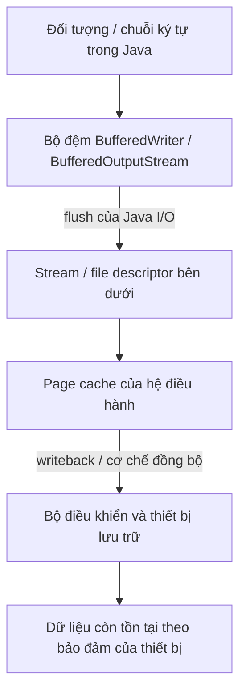
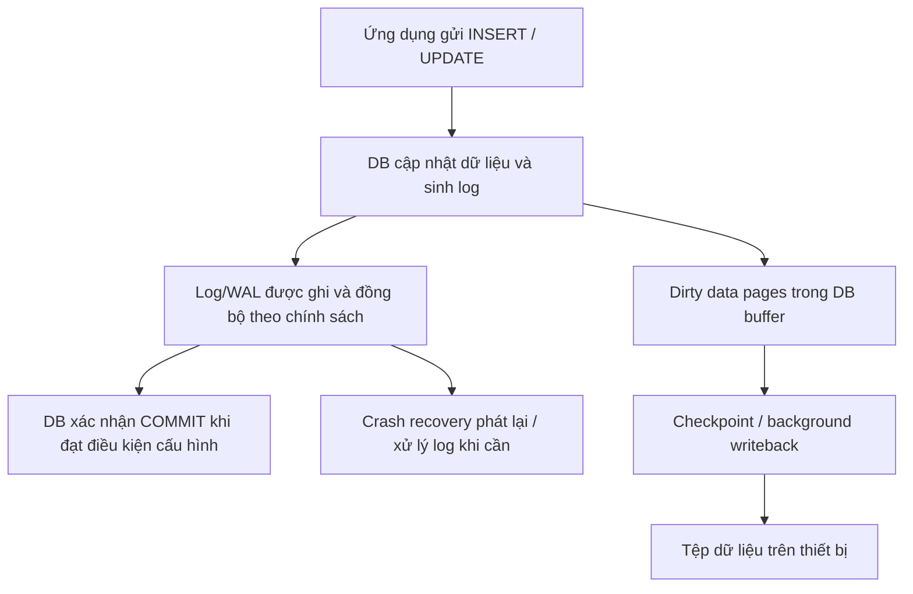
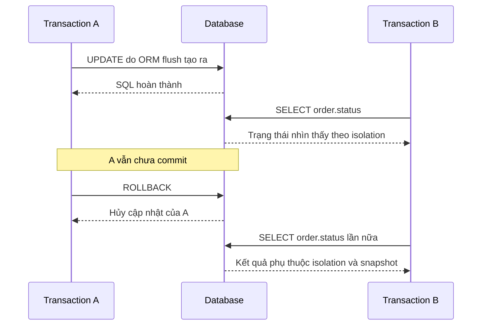

# Ý nghĩa của flush trong I/O và trong ORM

Một ứng dụng Java ghi dữ liệu vào tệp, gọi `flush()` rồi trả về “đã lưu”. Ở nơi khác, cùng ứng dụng gọi `entityManager.flush()` và cho rằng đơn hàng đã được commit. Cả hai suy luận đều có thể sai. Từ **flush** xuất hiện ở nhiều tầng của hệ thống lưu trữ, nhưng **đối tượng được đẩy đi, nơi nhận và mức bảo đảm** của từng thao tác khác nhau.

Trong chương **Độ bền dữ liệu** của module **DATA_PERSISTENCE_FUNDAMENTALS**, người học cần hiểu hành trình dữ liệu từ bộ nhớ ứng dụng đến hệ lưu trữ, giao dịch, nhật ký và thiết bị. Kiến thức này giúp thiết kế ranh giới persistence trong Java, giải thích vì sao dữ liệu có thể mất khi tiến trình hoặc máy chủ hỏng, xử lý lỗi khi lưu và tránh dùng sai các API có tên giống nhau.

**Thông điệp cốt lõi:** `flush()` thường có nghĩa “đẩy phần đang chờ xử lý từ một tầng sang tầng kế tiếp”. Nó **không tự động đồng nghĩa** với “giao dịch đã commit”, “dữ liệu đã ghi vật lý xuống ổ đĩa” hay “dữ liệu chắc chắn khôi phục được sau mất điện”. Muốn biết chính xác, phải hỏi **flush của thành phần nào, đẩy đến đâu, và điều kiện thành công là gì**.

## 1. Một từ, nhiều ranh giới

| Nơi dùng thuật ngữ | Ví dụ API hoặc cơ chế | Dữ liệu được đẩy đến đâu? | Điều chưa được bảo đảm chỉ nhờ thao tác này |
| --- | --- | --- | --- |
| **Java buffered I/O** | `BufferedOutputStream.flush()`, `Writer.flush()` | Từ bộ đệm ứng dụng xuống đối tượng stream/writer bên dưới | Dữ liệu chắc chắn nằm trên thiết bị lưu trữ bền vững |
| **Kênh tệp của Java** | `FileChannel.force(true)` | Yêu cầu đồng bộ các thay đổi tệp theo hợp đồng `FileChannel` với thiết bị lưu trữ | Tính nguyên tử của quy trình thay thế nhiều tệp, hoặc bảo đảm tuyệt đối trước mọi lỗi phần cứng |
| **Bộ đệm hệ điều hành** | Writeback, `fsync`/`fdatasync` trên nền tảng hỗ trợ | Đồng bộ dữ liệu/metadata đang chờ theo cơ chế hệ điều hành và tệp | Các ứng dụng khác hoặc toàn bộ giao dịch DB cũng đã được commit |
| **JPA/Hibernate ORM** | `EntityManager.flush()` | Đồng bộ thay đổi của persistence context thành thao tác SQL với database | `COMMIT` của transaction đã xảy ra |
| **Cơ sở dữ liệu / WAL** | Flush nhật ký hoặc log buffer | Chuyển bản ghi log qua các tầng lưu trữ theo cơ chế DB | Tất cả các trang dữ liệu đã phải được ghi ngay vào tệp dữ liệu |
| **JDBC transaction** | `Connection.commit()` | Yêu cầu DB hoàn tất transaction và xác nhận kết quả theo cấu hình | Bản sao ở vùng/nhà cung cấp khác luôn đã nhận dữ liệu, hay backup đã cập nhật |

Không nên suy ngữ nghĩa từ tên phương thức đơn lẻ. Ví dụ `BufferedWriter.flush()`, `FileChannel.force(true)`, `EntityManager.flush()` và `Connection.commit()` là **bốn thao tác khác nhau**.

## 2. Đường đi của dữ liệu khi ghi tệp

Một đường đi điển hình khi ứng dụng Java ghi tệp cục bộ:



Sơ đồ này mô tả hướng dịch chuyển khái niệm, không bắt buộc mọi triển khai đều có từng bộ đệm riêng. Ví dụ I/O trực tiếp, memory-mapped file, network filesystem, hệ điều hành và bộ nhớ đệm của ổ lưu trữ có các hành vi khác. Điểm cần nhớ là **rời khỏi bộ đệm của Java chưa đủ để kết luận dữ liệu đã nằm ở nơi bền vững nhất**.

### 2.1. `flush()` của `BufferedOutputStream` và `Writer`

```java
import java.io.BufferedOutputStream;
import java.io.IOException;
import java.nio.charset.StandardCharsets;
import java.nio.file.Files;
import java.nio.file.Path;

public class BufferedFileExample {
    public static void writeMessage(Path path) throws IOException {
        try (BufferedOutputStream out = new BufferedOutputStream(
                Files.newOutputStream(path))) {
            out.write("Đã nhận đơn hàng\n".getBytes(StandardCharsets.UTF_8));

            // Đẩy byte còn trong bộ đệm Java sang stream bên dưới.
            out.flush();

            // Không suy ra dữ liệu đã bền vững sau mất điện.
        } // close() giải phóng tài nguyên và thường hoàn tất việc flush.
    }
}
```

Với `BufferedOutputStream`, khi chưa đầy bộ đệm, `write()` có thể mới chỉ chép byte vào một mảng trong bộ nhớ của tiến trình. `flush()` buộc dữ liệu đang nằm trong bộ đệm được ghi xuống stream phía dưới. Nếu stream bên dưới là luồng tệp thông thường, hệ điều hành thường tiếp nhận byte qua page cache; việc ghi này **không tương đương** với một lệnh đồng bộ bộ nhớ đệm của hệ điều hành xuống thiết bị.

`Writer.flush()` có ý nghĩa tương tự ở tầng ghi ký tự: đẩy các ký tự/byte đã được writer mã hóa và đệm xuống tầng kế tiếp. `flush()` không phải luôn là thao tác **kết thúc định dạng**. Với định dạng nén, mã hóa hoặc một giao thức có phần kết, còn có thể cần `finish()`, `close()` hoặc thủ tục hoàn tất tương ứng để tạo ra một tệp/luồng hợp lệ.

### 2.2. `close()` có giống `flush()` không?

Nhiều stream/writer khi đóng sẽ flush dữ liệu còn đệm rồi giải phóng tài nguyên. Vì vậy, `try-with-resources` là cách cần thiết để không bỏ quên bước đóng. Tuy nhiên:

- `flush()` thường cho phép **tiếp tục** sử dụng stream sau đó; `close()` kết thúc việc sử dụng stream.
- Không phải mọi tài nguyên hay API đều có cùng hợp đồng về flush khi đóng; hãy xem tài liệu của loại stream cụ thể.
- Việc đóng tệp thành công **không mặc nhiên** có nghĩa hệ điều hành đã đồng bộ dữ liệu xuống thiết bị chịu mất điện.

Không nên “flush liên tục cho chắc chắn” sau từng byte: điều đó thường giảm lợi ích của bộ đệm mà không bổ sung bảo đảm về durability.

## 3. Muốn đồng bộ tệp xuống lưu trữ thì dùng cơ chế nào?

Trong Java NIO, `FileChannel.force(boolean metaData)` cung cấp một cơ chế yêu cầu đẩy các cập nhật của tệp ra thiết bị lưu trữ theo hợp đồng của `FileChannel`.

```java
import java.io.IOException;
import java.nio.ByteBuffer;
import java.nio.channels.FileChannel;
import java.nio.charset.StandardCharsets;
import java.nio.file.Path;
import java.nio.file.StandardOpenOption;

public class FileForceExample {
    public static void writeAndForce(Path path) throws IOException {
        ByteBuffer bytes = StandardCharsets.UTF_8.encode(
                "order-123: ACCEPTED\n");

        try (FileChannel channel = FileChannel.open(
                path,
                StandardOpenOption.CREATE,
                StandardOpenOption.WRITE,
                StandardOpenOption.TRUNCATE_EXISTING)) {
            while (bytes.hasRemaining()) {
                channel.write(bytes);
            }
            // Yêu cầu đồng bộ nội dung và metadata liên quan.
            channel.force(true);
        }
    }
}
```

Một số điểm cần phân biệt:

1. `force(false)` yêu cầu ghi các thay đổi nội dung tệp; `force(true)` còn yêu cầu cập nhật metadata của tệp theo hợp đồng của API. Metadata nào cần được đồng bộ và hành vi với thiết bị không cục bộ phụ thuộc nền tảng/hệ thống tệp.
2. `force()` áp dụng cho những cập nhật đi qua kênh tệp tương ứng; không nên tự coi nó là thao tác flush cho **mọi** bộ đệm khác đang ghi cùng tệp.
3. Nếu ứng dụng đang giữ dữ liệu trong `BufferedOutputStream` hoặc một `Writer`, cần đẩy bộ đệm đó qua `flush()` **trước khi** yêu cầu đồng bộ ở tầng file descriptor thích hợp. Thứ tự các tầng quyết định phần dữ liệu nào thực sự được yêu cầu đồng bộ.
4. Sự bền vững cuối cùng vẫn phụ thuộc thiết bị lưu trữ, filesystem, bộ đệm phần cứng, cấu hình cache và mức độ trung thực với lệnh đồng bộ.

Ví dụ trên **ghi đè tệp trực tiếp** để minh họa API; nó không bảo đảm cập nhật nguyên tử nếu tiến trình chết giữa lúc cắt ngắn tệp và ghi xong. Khi cần thay thế một tệp cấu hình hoặc dữ liệu quan trọng, mẫu thiết kế thường là ghi vào tệp tạm, đồng bộ nội dung tệp tạm, đổi tên/thay thế bằng cơ chế atomic move nếu filesystem hỗ trợ, và cân nhắc độ bền của metadata thư mục sau thao tác đổi tên. Việc đồng bộ thư mục hoặc bảo đảm đổi tên bền vững có tính phụ thuộc hệ điều hành, không phải một API Java đa nền tảng luôn thực hiện được giống nhau.

### Phân biệt “nhìn thấy được” và “bền vững”

Một tiến trình khác có thể đọc thấy byte mới từ page cache trước khi chúng được đồng bộ ra thiết bị. Nếu hệ điều hành hoặc nguồn điện gặp sự cố tại thời điểm đó, dữ liệu có thể không còn sau khi khởi động lại. **Đọc lại thành công ngay sau `flush()` không phải phép thử đủ để chứng minh khả năng sống sót sau mất điện.**

## 4. Flush của hệ điều hành và flush của cơ sở dữ liệu

Hệ điều hành thường dùng page cache để giảm số lần truy cập thiết bị. Một lệnh ghi thành công có thể mới cập nhật các trang bộ nhớ “dirty”, rồi tiến trình writeback ghi chúng về sau. Cơ chế như `fsync` hoặc `fdatasync` nhằm yêu cầu đồng bộ một phạm vi dữ liệu và metadata tương ứng; `FileChannel.force()` thể hiện nhu cầu gần tương tự từ Java trong giới hạn hợp đồng API và nền tảng.

Cơ sở dữ liệu có **bộ đệm riêng** (buffer pool/shared buffers), nhật ký giao dịch và chiến lược ghi trang khác với ứng dụng ghi tệp đơn giản. Vì vậy, “DB flush” có thể đề cập tới ít nhất hai việc khác nhau:

- Đẩy **log record/WAL** đã tạo vào đường lưu trữ bền vững ở điểm bắt buộc.
- Đẩy **dirty data pages** từ bộ đệm DB sang các tệp dữ liệu tại checkpoint, background writeback hoặc những thời điểm khác.

Hai thao tác này phục vụ các mục tiêu khác nhau. Với DB dùng **write-ahead logging (WAL)**, thiết kế thường yêu cầu log mô tả thay đổi được ghi đủ bền vững **trước khi** trang dữ liệu chứa thay đổi đó được ghi ra nơi lưu trữ bền vững. Tùy DB và cấu hình, commit có thể được xác nhận sau khi bản ghi commit trong log đạt mức đồng bộ yêu cầu, ngay cả khi trang dữ liệu thật còn nằm trong bộ đệm.



Sơ đồ là mô hình khái quát, không đại diện cho mọi storage engine. Các hệ dùng log có thể còn có undo, redo, log sequence number, checksum và quy trình phục hồi riêng. **Checkpoint không đồng nghĩa với commit của từng transaction**; checkpoint hỗ trợ rút ngắn hoặc quản lý công việc phục hồi và tiến trình ghi trang.

## 5. Commit liên hệ thế nào với tính bền vững?

Trong ACID, **Durability** là kỳ vọng rằng thay đổi đã commit tồn tại qua các lỗi thuộc phạm vi bảo đảm của hệ lưu trữ. Cần phân biệt ba trạng thái:

| Trạng thái | Mô tả | Có được trả lời “đã hoàn tất nghiệp vụ” không? |
| --- | --- | --- |
| **Đã gửi SQL / ORM flush xong** | DB đã nhận và xử lý các thao tác ghi trong transaction | Chưa đủ nếu transaction vẫn mở |
| **Đã commit và DB xác nhận** | Transaction được chấp nhận theo chính sách commit của DB | Thường có thể báo thành công, theo yêu cầu durability và cấu hình đã lựa chọn |
| **Đã sao lưu/nhân bản tới nơi khác** | Dữ liệu đã đến backup hoặc replica theo quy trình riêng | Là một mục tiêu bổ sung; không mặc nhiên đi kèm commit cục bộ |

Điều kiện để DB trả `COMMIT` thành công phụ thuộc engine, cấu hình đồng bộ log, replication, filesystem và thiết bị. Ví dụ một cấu hình cho phép **asynchronous commit** có thể trả thành công trước khi log được đồng bộ tới lưu trữ bền vững; khi máy chủ chết ngay sau đó vẫn có thể mất các transaction vừa được xác nhận. Trong cấu hình đồng bộ phù hợp, mục tiêu sẽ khác. Cũng phải phân biệt độ bền trên **một nút** với việc dữ liệu đã được xác nhận ở **nhiều nút**.

Do đó, ứng dụng muốn tuyên bố “đã lưu bền vững” cần hiểu **hợp đồng commit thực tế của database**, thay vì gọi thêm `flush()` của ORM một cách cảm tính.

### Tình huống kết quả commit không rõ

Nếu ứng dụng gửi `COMMIT` nhưng mất kết nối trước khi nhận phản hồi, transaction có thể đã commit ở database hoặc chưa. Một ngoại lệ mạng lúc này **không chứng minh rollback đã xảy ra**. Với nghiệp vụ thanh toán, chuyển tiền hay đặt hàng, cần mã yêu cầu duy nhất, ràng buộc chống trùng và cách tra cứu/đối soát trước khi retry.

## 6. Flush của ORM: đồng bộ persistence context thành SQL

JPA/Hibernate duy trì một **persistence context** chứa các entity đang được quản lý. Khi Java thay đổi các thuộc tính, ORM có thể theo dõi sự thay đổi trong bộ nhớ (*dirty checking*) và **chưa cần gửi `UPDATE` ngay tại lệnh gán**.

```java
Order order = entityManager.find(Order.class, orderId);
order.setStatus(OrderStatus.CONFIRMED);  // Đổi trạng thái object Java.
entityManager.flush();                  // Đồng bộ thay đổi tới DB bằng SQL.
// Transaction vẫn có thể chưa COMMIT!
```

`flush()` của `EntityManager` yêu cầu ORM đồng bộ những thay đổi đang chờ của persistence context với database theo các quy tắc của provider. Việc này có thể tạo `INSERT`, `UPDATE`, `DELETE`, và những thao tác liên quan như kiểm tra phiên bản. SQL thường được thực thi **bên trong transaction hiện tại**; transaction vẫn có thể được commit **hoặc rollback sau đó**.

### Ba trạng thái cần tách bạch

1. **Thay đổi ở Java:** một managed entity có thuộc tính mới; DB có thể chưa nhận SQL tương ứng.
2. **Sau ORM flush:** DB đã nhận/thực thi các câu SQL do ORM phát sinh theo hợp đồng provider, nhưng chúng vẫn thuộc transaction chưa commit.
3. **Sau commit thành công:** DB chấp nhận thay đổi; mức độ bền vững trước lỗi phụ thuộc chính sách lưu trữ và commit của DB.

Nhìn theo thời gian:

```text
BEGIN TRANSACTION
    entity.setStatus(CONFIRMED)  // Có thể chỉ mới dirty trong persistence context
    entityManager.flush()        // ORM gửi UPDATE / kiểm tra lỗi đến DB
    ...                          // Transaction vẫn mở
    COMMIT                       // Đánh dấu giao dịch hoàn tất
```

**Flush không giải phóng khóa đã được DB giữ cho transaction**, không bắt buộc các transaction khác thấy dữ liệu chưa commit và không tương đương `COMMIT`.

## 7. ORM flush xảy ra khi nào?

Với JPA, có thể gọi `EntityManager.flush()` một cách tường minh. Ngoài ra, tùy **flush mode**, ORM provider và loại truy vấn, việc flush còn xảy ra tự động:

| Thời điểm | Điều cần biết |
| --- | --- |
| **Trước khi hoàn tất transaction** | Với trạng thái được đồng bộ theo quy tắc bình thường, provider phải xử lý những thay đổi còn chờ để commit. Thường có flush trước commit. |
| **Trước một truy vấn cần kết quả nhất quán với thay đổi đang chờ** | `FlushModeType.AUTO` yêu cầu provider bảo đảm những thay đổi liên quan có thể ảnh hưởng đến kết quả truy vấn được phản ánh phù hợp; provider có thể flush hoặc dùng cách khác. |
| **Khi gọi `entityManager.flush()`** | Chủ động yêu cầu đồng bộ vào DB tại điểm đó; vẫn nằm trong transaction. |
| **Với `FlushModeType.COMMIT`** | Chủ yếu đồng bộ tại commit; tác động của các thay đổi chưa flush lên truy vấn trước commit có thể phụ thuộc provider và không nên được giả định. |

Lưu ý:

- Đừng suy rằng **mọi truy vấn SELECT** đều khiến ORM flush, hoặc rằng **không truy vấn nào** khiến flush. Hibernate còn có quy tắc cụ thể theo các query space, loại truy vấn và API sử dụng.
- `persist()` không đồng nghĩa `INSERT` luôn chờ đến lúc flush. Một số chiến lược sinh ID, đặc biệt ID do database cấp lúc insert, có thể khiến provider thực hiện câu SQL sớm để lấy ID.
- `remove()` hoặc thay đổi quan hệ entity cũng có thể tạo các SQL khác nhau khi flush; thứ tự thao tác phụ thuộc provider và ánh xạ.
- Dùng phương thức `saveAndFlush()` của Spring Data JPA thường kích hoạt flush trước khi trả về; **nó không tự commit** transaction đang hoạt động.
- `clear()` chỉ tách entity khỏi persistence context; nó **không** là cách khác để flush. `flush(); clear();` trong xử lý hàng loạt có ý nghĩa khác `clear()` đơn lẻ, vốn có thể làm mất những thay đổi chưa được đồng bộ.

## 8. Ví dụ JPA: flush thành công nhưng rollback sau đó

Đoạn mã sau thể hiện rõ khác biệt giữa flush và commit. Các entity `OrderEntity` và `AuditEntry` là các lớp JPA được ánh xạ phù hợp; đoạn mã tập trung vào vòng đời transaction:

```java
import jakarta.persistence.EntityManager;
import jakarta.persistence.PersistenceContext;
import org.springframework.stereotype.Service;
import org.springframework.transaction.annotation.Transactional;

@Service
public class OrderApplicationService {
    @PersistenceContext
    private EntityManager entityManager;

    @Transactional
    public void createOrderWithAudit(String requestId) {
        OrderEntity order = new OrderEntity(requestId);
        entityManager.persist(order);

        // Buộc ORM đồng bộ INSERT/UPDATE còn chờ sang database.
        entityManager.flush();

        // Tại đây transaction chưa commit.
        entityManager.persist(new AuditEntry(requestId, "CREATED"));

        // Minh họa lỗi nghiệp vụ sau khi đã flush.
        throw new IllegalStateException("Không đủ điều kiện xác nhận");
    }
}
```

Trong cấu hình Spring transaction thông thường, `IllegalStateException` là `RuntimeException`, nên transaction được rollback nếu lỗi đi ra khỏi phương thức qua transaction interceptor. **Bản ghi `OrderEntity` đã flush vẫn bị rollback cùng transaction**; bản ghi audit chưa flush cũng không được commit. Đây là kết quả mong đợi của tính nguyên tử, không phải lỗi mất độ bền dữ liệu.

Ở test, hãy chạy phương thức trong transaction thực sự được quản lý rồi **truy vấn bằng transaction/kết nối mới sau khi phương thức trả lỗi**. Không chỉ kiểm tra `flush()` không ném ngoại lệ rồi kết luận dữ liệu đã tồn tại bền vững.

### Vì sao có lúc cần flush sớm?

Flush tường minh có thể hữu ích khi cần:

- Phát hiện sớm ràng buộc `UNIQUE`, `NOT NULL`, khóa ngoại hoặc lỗi SQL được kiểm tra ngay lúc thực thi. **Ràng buộc hoãn đến commit** (*deferred constraints*) vẫn có thể chỉ báo lỗi ở commit.
- Phát hiện xung đột `@Version` hoặc lỗi cập nhật trước khi thực hiện thêm các bước trong cùng transaction, tùy provider.
- Bảo đảm một tập thay đổi cần xuất hiện trong truy vấn/SQL tiếp theo theo thiết kế của persistence context.
- Quản lý kích thước persistence context khi ghi hàng loạt bằng chiến lược flush/clear có chủ đích.

Flush sớm **không** bảo đảm mọi lỗi của transaction đã được phát hiện, cũng không giúp chuyển transaction sang trạng thái “đã thành công”.

## 9. JPA `@Version` và kiểm tra optimistic locking tại flush

Với entity có `@Version`, ORM thường tạo SQL cập nhật có điều kiện tương đương:

```sql
UPDATE products
SET name = :newName,
    version = :nextVersion
WHERE id = :id
  AND version = :previousVersion;
```

Nếu bản ghi đã bị thay đổi bởi transaction khác, lần `UPDATE` có thể cập nhật `0` dòng hoặc DB báo lỗi xung đột/serialization tùy engine và isolation. ORM chuyển tình huống thành ngoại lệ liên quan optimistic locking, có thể xuất hiện **tại `flush()` hoặc `commit()`**.

Hệ quả thiết kế:

1. Không nên bắt ngoại lệ xung đột tại `flush()` rồi tiếp tục commit như thể transaction bình thường. Với JPA, một lỗi persistence có thể khiến transaction bị đánh dấu rollback-only, persistence context không còn ở trạng thái thích hợp để tiếp tục.
2. Khi retry, cần **transaction mới** và đọc lại dữ liệu/phiên bản để tính lại; không chỉ gọi `flush()` lần thứ hai trên cùng trạng thái lỗi.
3. Một bulk update hoặc native SQL đi ngoài cơ chế version của ORM có thể khiến bảo đảm kiểm soát đồng thời bị phá vỡ nếu không tự kiểm tra/tăng version phù hợp.

Flush giúp **đưa xung đột ra ánh sáng sớm hơn**, chứ không giải quyết toàn bộ chiến lược retry, idempotency hoặc bảo đảm commit.

## 10. Flush, commit, rollback và dữ liệu nhìn thấy được

Giả sử transaction A vừa gọi ORM flush để cập nhật trạng thái một đơn hàng nhưng chưa commit. Transaction B dùng kết nối khác đọc đơn hàng.



Trong các mức cô lập thông dụng như `READ COMMITTED`, transaction B thường không thấy cập nhật **chưa commit** của A. Một số mức cô lập thấp hoặc cơ chế đặc biệt có quy tắc khác. Ngoài ra, ngay cả sau khi A commit, B có thể tiếp tục thấy snapshot cũ trong một transaction có snapshot ổn định; tính hiển thị cũng phụ thuộc isolation, chứ không chỉ sự kiện flush/commit.

| Thao tác của A | Tác động trong transaction A | Ý nghĩa với transaction B |
| --- | --- | --- |
| Sửa managed entity, chưa flush | Thay đổi có thể chỉ nằm trong persistence context | B không thấy object Java của A |
| `entityManager.flush()` | DB thực thi SQL chưa commit | B không được suy dữ liệu đã commit; còn tùy isolation |
| `connection.commit()` hoặc transaction manager commit thành công | Transaction A đã kết thúc thành công | B có thể đọc kết quả theo snapshot/isolation của B |
| `rollback()` sau flush | Những thay đổi thuộc transaction A bị hủy | B không nhận kết quả đã bị rollback như dữ liệu commit |

Một câu SQL đã chạy và trả thành công **khác** với một transaction đã thành công. Trong JDBC, `PreparedStatement.executeUpdate()` gửi thao tác đến database; trong ORM, `flush()` có thể phát sinh thao tác đó. Cả hai vẫn cần transaction được commit nếu muốn các thay đổi tồn tại như kết quả nghiệp vụ.

## 11. Đừng dùng flush để thay ranh giới giao dịch

Một lỗi phổ biến:

```java
@Transactional
public void confirmAndNotify(OrderEntity order) {
    order.setStatus(OrderStatus.CONFIRMED);
    entityManager.flush();

    // Sai lầm: nghĩ rằng dữ liệu đã commit và gửi thông báo.
    emailClient.sendConfirmation(order.getId());

    // Nếu transaction sau đó rollback, email đã gửi không được thu hồi.
}
```

Ngay cả khi `flush()` thực thi thành công, email nằm ngoài hệ quản trị DB không nằm trong transaction của DB. Nếu commit thất bại, người nhận có thể đã được thông báo về một đơn chưa được xác nhận.

Một hướng thiết kế đáng tin cậy hơn là **transactional outbox**:

1. Trong cùng một transaction, thay đổi trạng thái đơn hàng và tạo bản ghi `outbox_event` mô tả thông báo cần phát.
2. Commit transaction. Nếu rollback, cả trạng thái đơn và sự kiện outbox cùng bị hủy.
3. Một worker riêng đọc sự kiện đã commit và gửi email/message; nó ghi nhận đã xử lý theo cơ chế phù hợp.
4. Bên nhận hoặc bên gửi phải xử lý phát trùng có kiểm soát, vì gửi thành công rồi mất phản hồi có thể khiến sự kiện được thử lại.

Hướng này không khiến email và DB trở thành một giao dịch nguyên tử toàn cầu, nhưng loại bỏ khoảng hở “DB rollback mà sự kiện vẫn bị phát do gọi trước commit” bằng cách điều phối một cách có thể phục hồi.

## 12. Hiệu năng: flush quá sớm hoặc quá thường xuyên

Flush có chi phí: chuyển dữ liệu giữa các tầng, phát sinh SQL, round-trip mạng, khóa hàng, log I/O hoặc thao tác đồng bộ với thiết bị. Vì vậy cần đặt nó ở nơi có ý nghĩa.

### Với Java I/O

- Tận dụng kích thước bộ đệm phù hợp và để stream flush/close ở ranh giới hợp lý.
- Nếu ghi dữ liệu cần bảo đảm sau crash, dùng cơ chế đồng bộ tương ứng thay vì gọi `BufferedWriter.flush()` nhiều lần.
- `FileChannel.force(true)` sau từng dòng có thể rất đắt; cân nhắc nhóm ghi và yêu cầu độ bền, đồng thời hiểu mất mát tối đa có thể chấp nhận.

### Với JPA/Hibernate

- Gọi `flush()` sau từng `persist()` có thể làm giảm khả năng gom/batch SQL của provider, tăng số round-trip và thời gian transaction.
- Với các lô lớn, có thể flush và `clear()` theo lô để giới hạn số entity được quản lý trong bộ nhớ; tuy nhiên **flush/clear không commit**. Nếu toàn bộ lô vẫn dùng một transaction, khóa/log và khả năng rollback toàn lô vẫn có thể rất lớn.
- Muốn chia thành nhiều transaction nhỏ phải thiết kế checkpoint, bất biến nghiệp vụ, idempotency và xử lý khi chỉ một số lô đã commit.
- Đừng dùng `flush()` chỉ để lấy ID nếu chiến lược sinh ID đã cấp ID theo cách khác; một số chiến lược `IDENTITY` lại cần insert sớm. Kiểm tra hành vi provider/driver cụ thể.
- Các lần flush có thể làm lộ khóa ghi sớm hơn trong một transaction dài. Nếu giữ transaction mở để gọi HTTP hay tính toán lâu, xung đột có thể tăng lên.

Tối ưu đúng tầng: một câu SQL chậm cần tối ưu truy vấn/chỉ mục; một transaction dài cần xem lại ranh giới; writeback disk chậm cần xem I/O và cấu hình durability. Gọi thêm `flush()` thường không sửa được vấn đề của tầng khác.

## 13. Cách kiểm chứng từng lời khẳng định

### Thử nghiệm 1: Java buffer đã flush nhưng chưa chứng minh độ bền

1. Ghi dữ liệu vào `BufferedOutputStream`, gọi `flush()`.
2. Đọc lại dữ liệu bằng một handle khác và xác nhận byte đã có thể nhìn thấy.
3. Giải thích vì sao phép đọc này chỉ chứng minh **khả năng quan sát hiện tại**, không phải khả năng khôi phục sau mất điện.
4. So sánh với phiên bản dùng `FileChannel.force(true)` và ghi rõ các giới hạn theo nền tảng.

Không cố ý làm mất điện hoặc phá dữ liệu thực trong thử nghiệm. Những cam kết crash durability cần được đánh giá bằng tài liệu hệ điều hành, filesystem, storage và quy trình thử nghiệm phù hợp.

### Thử nghiệm 2: ORM flush nhưng rollback

1. Bắt đầu transaction thật trong ứng dụng test.
2. `persist()` một entity, gọi `flush()`, xác minh không có lỗi SQL ngay lúc đó.
3. Phát sinh ngoại lệ runtime để transaction rollback.
4. Mở **transaction/kết nối mới** và xác nhận entity đó không tồn tại như dữ liệu đã commit.

### Thử nghiệm 3: Lỗi ràng buộc ở flush hoặc commit

1. Tạo một tình huống vi phạm ràng buộc có thể được kiểm tra ngay khi SQL chạy, ví dụ `UNIQUE`.
2. Quan sát trường hợp ORM phát sinh lỗi khi `flush()`.
3. Nếu database hỗ trợ deferred constraint, thiết lập đúng trường hợp có thể trì hoãn kiểm tra đến commit rồi so sánh.
4. Kiểm tra transaction được rollback và không có dữ liệu một phần.

### Thử nghiệm 4: Hiển thị dữ liệu giữa hai transaction

1. Trong transaction A, thay đổi entity và `flush()` nhưng giữ transaction mở.
2. Trong transaction B độc lập, đọc bản ghi và ghi nhận kết quả theo isolation level đang dùng.
3. Cho A commit rồi đọc lại trong một transaction mới; lặp lại với A rollback.
4. Giải thích sự khác biệt giữa **ORM flush**, **commit**, **snapshot** và **độ bền sau crash**.

Trong Spring, lưu ý test mặc định `@Transactional` có thể rollback sau test, làm nhầm kết quả kiểm chứng commit. Cần chủ động thiết kế ranh giới transaction và kết nối độc lập cho mỗi phép đo.

## 14. Sai lầm thường gặp

| Sai lầm | Vì sao sai | Cách sửa |
| --- | --- | --- |
| `BufferedWriter.flush()` nghĩa là đã ghi bền vững xuống đĩa | Nó chủ yếu đẩy bộ đệm Java xuống tầng I/O phía dưới | Hiểu page cache và dùng cơ chế sync/force khi yêu cầu |
| `close()` bảo đảm chống mất điện | Close thường giải phóng tài nguyên, không đồng nghĩa fsync | Thiết kế riêng mức durability và crash recovery |
| `FileChannel.force(true)` làm ghi đè cả tệp trở nên nguyên tử | Force và atomic replacement là hai thuộc tính khác nhau | Dùng temp file, atomic move phù hợp và xử lý độ bền metadata |
| ORM `flush()` đồng nghĩa commit | SQL đã gửi vẫn thuộc transaction chưa hoàn tất | Đặt ranh giới commit/rollback đúng nơi |
| `saveAndFlush()` cho phép gửi email ngay như thể đã commit | Transaction có thể rollback sau khi phương thức trả về | Ghi outbox cùng transaction và phát sau commit |
| Không thấy lỗi ở flush nghĩa là commit chắc chắn thành công | Lỗi ràng buộc deferred, I/O hay transaction vẫn có thể xuất hiện về sau | Xử lý lỗi commit và trạng thái kết quả chưa rõ |
| Gọi flush để giải phóng entity khỏi persistence context | Flush không detach hoặc clear entity | Dùng `clear()` có chủ đích sau khi flush và xét transaction |
| Flush sau từng insert trong một batch lớn | Có thể phá lợi ích batching và tăng round-trip | Flush theo lô phù hợp, theo dõi bộ nhớ và thời gian transaction |
| Tăng isolation để làm `flush()` bền vững hơn | Isolation xử lý hiện tượng đồng thời, không tự đặt chính sách đồng bộ log | Cấu hình durability/commit của engine, đồng thời chọn isolation riêng |
| Retry thao tác sau lỗi mạng lúc commit mà không đối soát | Commit có thể đã thành công và gây xử lý trùng | Dùng idempotency key và tra cứu trạng thái trước retry |

## 15. Bài tập tổng hợp: “Đã flush thì an toàn chưa?”

Một dịch vụ Java xử lý đặt hàng theo trình tự:

```text
1. @Transactional bắt đầu
2. entityManager.persist(order)
3. entityManager.flush()
4. Ghi "ORDER_CREATED" vào BufferedWriter rồi writer.flush()
5. Gọi dịch vụ thanh toán bên ngoài
6. COMMIT transaction DB
7. Trả HTTP 200
```

Hãy trả lời:

1. Ở bước 3, liệu `order` đã commit chưa?
2. Ở bước 4, có thể khẳng định dòng log đã sống sót sau mất điện không?
3. Nếu thanh toán thành công ở bước 5 nhưng DB rollback ở bước 6, hai lệnh flush trước đó có cứu được tính nhất quán không?
4. Nếu mất kết nối lúc bước 6 đang commit, vì sao không nên tự động thực hiện lại toàn bộ bước 1–6?
5. Bạn sẽ thiết kế lại quy trình để mỗi thay đổi có thể khôi phục và đối soát như thế nào?

**Gợi ý lời giải:** `entityManager.flush()` đồng bộ SQL trong transaction đang mở, không commit. `writer.flush()` chỉ đẩy bộ đệm Java, không là bảo đảm fsync. Thanh toán thuộc hệ thống ngoài DB, nên rollback DB không thể thu hồi khoản đã thu; cần điều phối trạng thái `PENDING`/`PAID` và bù/đối soát, thường kết hợp outbox. Lỗi kết nối tại commit có thể khiến kết quả chưa rõ, nên cần mã yêu cầu duy nhất, truy vấn trạng thái và idempotency. Với log nghiệp vụ cần độ tin cậy cao, nên cân nhắc lưu sự kiện trong chính database transaction và phát từ outbox sau commit.

## 16. Ghi nhớ khi thiết kế persistence cho Java

- **Flush của Java I/O:** đẩy nội dung đang đệm xuống tầng stream phía dưới; không mặc định là đồng bộ với thiết bị.
- **Force/sync của hệ lưu trữ:** yêu cầu đồng bộ dữ liệu/metadata theo cơ chế của nền tảng; còn phụ thuộc filesystem và phần cứng, cũng không tự biến một nhóm thao tác thành giao dịch nguyên tử.
- **Flush của ORM:** chuyển những thay đổi trong persistence context thành SQL trong **transaction hiện tại**; không phải commit, không phải gọi `fsync` cho từng entity.
- **Commit của database:** là ranh giới chấp nhận giao dịch; bảo đảm durability cụ thể dựa trên cấu hình log, storage và replication.
- **Rollback sau flush vẫn hợp lệ:** dữ liệu đã được DB xử lý trong transaction có thể bị hủy nếu transaction chưa commit.
- **Lỗi có thể tới muộn:** một số ràng buộc, optimistic locking hoặc lỗi commit xuất hiện ở flush/commit tùy provider và engine; trạng thái commit không rõ phải được đối soát.
- **Thiết kế theo bất biến nghiệp vụ:** lưu dữ liệu và outbox trong một transaction khi cần, phát tác vụ ngoài database sau commit, dùng idempotency để xử lý lại an toàn.

Khi gặp một phương thức tên `flush`, hãy luôn xác định **tầng dữ liệu đang đệm**, **đích của thao tác đồng bộ** và **bảo đảm sau khi phương thức trả về**. Ba câu hỏi đó ngăn việc nhầm “đã đẩy dữ liệu đi” với “đã commit và bền vững”, giúp ứng dụng Java xử lý lỗi lưu trữ và giao dịch một cách chính xác hơn.
