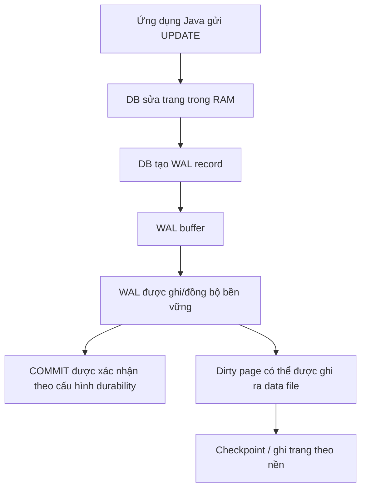
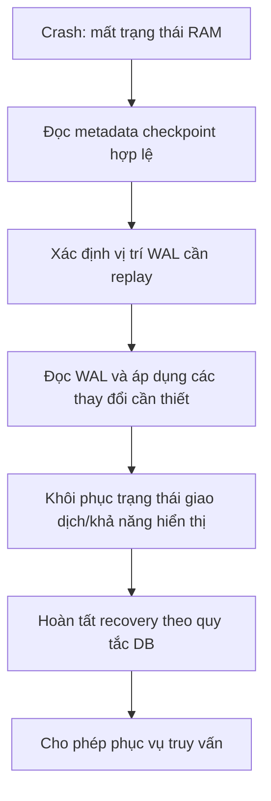
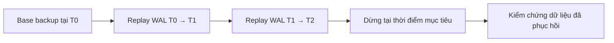

# Checkpoint và phục hồi từ nhật ký

Trong chương **Độ bền dữ liệu** của **DATA_PERSISTENCE_FUNDAMENTALS**, câu hỏi cốt lõi là: **vì sao database có thể xác nhận `COMMIT` dù chưa ghi mọi trang dữ liệu đã thay đổi xuống tệp bảng, và bằng cách nào nó khôi phục trạng thái đúng sau khi tiến trình hoặc máy chủ gặp sự cố?** Hai cơ chế thường phối hợp để giải quyết vấn đề này là **nhật ký ghi trước** (*Write-Ahead Logging*, WAL) và **checkpoint**.

Đối với tầng persistence của ứng dụng Java, hiểu WAL và checkpoint giúp giải thích độ bền của transaction, thời gian khởi động lại database, sự khác biệt giữa `COMMIT`, `flush`, sao lưu và phục hồi theo thời điểm, cũng như các đánh đổi hiệu năng khi ghi dữ liệu. Bài này trình bày nguyên lý chung của hệ quản trị giao dịch, sau đó dùng **PostgreSQL** làm ví dụ cụ thể. Các chi tiết của MySQL/InnoDB, SQL Server hay Oracle có thể khác và không nên đồng nhất với PostgreSQL.

## 1. Vì sao ghi dữ liệu xuống đĩa không đơn giản?

Một database thường không sửa trực tiếp tệp dữ liệu trên đĩa mỗi lần thực hiện `UPDATE`. Nó sử dụng **buffer pool/shared buffers** để giữ các trang (*pages*) dữ liệu trong bộ nhớ. Khi sửa một hàng, database có thể cập nhật trang trong RAM, khiến trang trở thành **dirty page**: nội dung trong bộ nhớ mới hơn bản lưu trong tệp dữ liệu.

Nếu bắt buộc ghi và đồng bộ mọi trang bảng xuống đĩa trước mỗi `COMMIT`, transaction nhỏ có thể phải đợi nhiều thao tác I/O ngẫu nhiên. Database cần một phương pháp cho phép ghi các thay đổi xuống bộ nhớ nhanh, nhưng vẫn có thể khôi phục dữ liệu khi RAM biến mất.

Ví dụ hai tài khoản cùng được cập nhật trong một transaction:

```sql
BEGIN;
UPDATE accounts SET balance = balance - 100 WHERE id = 1;
UPDATE accounts SET balance = balance + 100 WHERE id = 2;
COMMIT;
```

Các trang chứa hai tài khoản có thể được ghi ra tệp dữ liệu **ở hai thời điểm khác nhau**. Nếu tiến trình dừng giữa chừng, database không được để trạng thái sau phục hồi chỉ có bước trừ hoặc chỉ có bước cộng của một giao dịch đã commit.

### 1.1. Ba lớp trạng thái cần phân biệt

| Thành phần | Chứa gì? | Có thể mất khi tiến trình/OS gặp sự cố? |
| --- | --- | --- |
| Buffer/cache trong RAM của database | Trang dữ liệu đang đọc hoặc đã sửa | Có |
| Nhật ký giao dịch/WAL trên lưu trữ | Thông tin đủ để phục hồi thay đổi theo cơ chế DB | Bản chưa được đồng bộ bền vững có thể mất |
| Tệp dữ liệu trên lưu trữ | Các trang bảng/index được ghi ra theo thời gian | Có thể tụt sau trạng thái đã commit, hoặc gặp ghi trang dở dang |

Đặc biệt, **ghi vào bộ đệm của hệ điều hành** không nhất thiết đồng nghĩa dữ liệu đã bền vững sau mất điện. Điều kiện bền vững còn phụ thuộc `fsync`/đồng bộ I/O, thiết bị lưu trữ, cấu hình RAID/cache, hệ thống tệp và cơ chế chống mất điện.

## 2. Write-Ahead Logging: ghi nhật ký trước trang dữ liệu

**WAL** là nguyên tắc: **thông tin nhật ký cần để phục hồi một thay đổi phải được ghi bền vững trước khi trang dữ liệu mang thay đổi tương ứng được ghi bền vững**. Nói cách khác, trước khi database cho phép một dirty page cập nhật đến nơi lưu bền vững, nó phải bảo đảm những WAL record cần thiết đã được đưa đến điểm bền vững.

Khi transaction cập nhật dữ liệu, DB tạo các bản ghi WAL với thông tin phục hồi. Tùy DB, bản ghi có thể diễn đạt thay đổi ở cấp trang, thao tác, hoặc cấu trúc chuyên biệt. Đây không nhất thiết là nguyên văn câu SQL mà ứng dụng chạy.



Sơ đồ diễn tả **ràng buộc về độ bền**, không áp đặt thứ tự tuyệt đối giữa mọi hoạt động nền. Database có thể làm việc khác và ghi các trang trước hoặc sau khi xác nhận commit, miễn duy trì các quy tắc của cơ chế WAL. Chẳng hạn, transaction chưa commit vẫn có thể làm một số trang dữ liệu được ghi ra đĩa; quá trình recovery phải giữ các thay đổi chưa commit không trở thành dữ liệu nghiệp vụ đã được xác nhận.

### 2.1. Log Sequence Number (LSN)

Nhiều hệ quản trị có cách gán vị trí/thứ tự cho WAL record; trong PostgreSQL, vị trí này được biểu diễn bằng **LSN** (*Log Sequence Number*), thường thấy ở dạng như `0/16B6A20`. LSN giúp mô tả một vị trí trong luồng WAL, xác định WAL đã ghi tới đâu và vị trí cần bắt đầu phục hồi.

Ví dụ minh họa (các mốc LSN chỉ có mục đích giải thích, không phải log thực tế):

```text
LSN X1: WAL về UPDATE tài khoản A
LSN X2: WAL về UPDATE tài khoản B
LSN X3: WAL về COMMIT transaction

Data page A đã được ghi; data page B còn dirty trong RAM.
```

Nếu hệ thống dừng ngay sau đó, WAL bền vững tới `X3` có thể cho phép DB phục hồi phần cập nhật cần thiết cho B. **Khả năng phục hồi không phụ thuộc việc cả hai trang bảng đã được ghi xuống tệp trước khi commit**.

Trong PostgreSQL, `synchronous_commit=on` cùng cấu hình độ bền đúng thường yêu cầu WAL liên quan được đồng bộ cục bộ trước khi xác nhận commit; nếu cấu hình `synchronous_commit=off`, ứng dụng có thể được báo thành công trước khi commit record bền vững, nên một số transaction mới được xác nhận **có thể mất sau sự cố**. Những tùy chọn đồng bộ tới standby còn phụ thuộc cấu hình synchronous replication. Không nên xem một cấu hình bất kỳ là lời hứa chung cho mọi DB.

### 2.2. WAL bảo vệ trước điều gì?

WAL hỗ trợ database phục hồi sau **crash** của tiến trình hoặc máy chủ: khôi phục những thay đổi đã được ghi nhật ký phù hợp, xác định trạng thái transaction và tái lập trạng thái nhất quán. WAL cũng giúp hoạt động sao lưu/phục hồi theo thời điểm khi kết hợp đúng với base backup và lưu trữ các đoạn nhật ký cần thiết.

WAL không tự giải quyết mọi dạng mất mát:

- Nếu **cả data files và WAL đều bị mất hoặc hư hỏng** trên cùng thiết bị, không thể chỉ dựa vào WAL tại chỗ để dựng lại database.
- Nếu ứng dụng `DELETE` nhầm và commit hợp lệ, WAL sẽ phản ánh thao tác đó; crash recovery bình thường không “quay ngược” về trước thao tác đã commit.
- Nếu phần cứng không tôn trọng yêu cầu đồng bộ ghi, cam kết độ bền có thể bị ảnh hưởng.
- Log DB không tự hoàn tác email, HTTP request hoặc sự kiện đã được hệ thống khác xử lý.

Do đó, WAL cần được kết hợp với **backup, kiểm thử restore, kiểm tra tính toàn vẹn và kế hoạch phục hồi sự cố**.

## 3. Checkpoint là gì?

**Checkpoint** là một mốc phục hồi mà database tạo ra bằng cách phối hợp ghi các trang dữ liệu và ghi lại thông tin cần thiết để có thể **giới hạn lượng WAL phải đọc lại** sau crash. Thay vì luôn xem lại nhật ký từ lúc khởi tạo database, hệ quản trị có thể bắt đầu từ một vị trí phục hồi liên quan tới checkpoint hợp lệ.

Trong nhiều DB thực tế, checkpoint không có nghĩa **mọi transaction đều dừng** hoặc **toàn bộ dữ liệu được ghi ra ngay tại đúng một thời điểm**. Các hệ quản trị có thể triển khai **fuzzy checkpoint**: giao dịch vẫn tiếp tục chạy, các dirty page được ghi dần, và WAL/checkpoint metadata mô tả phạm vi an toàn cho recovery.

### 3.1. Tại sao không checkpoint sau mỗi câu SQL?

Một checkpoint có thể tạo nhiều I/O vì database phải ghi nhiều trang dirty và đồng bộ các tệp liên quan. Thực hiện quá thường xuyên làm tăng tải ghi, cạnh tranh I/O với truy vấn và có thể tạo thêm WAL trong những hệ thống dùng cơ chế ảnh trang đầy đủ. Ngược lại, checkpoint quá thưa khiến lượng WAL cần giữ và quãng replay sau crash có thể tăng.

| Checkpoint quá thường xuyên | Checkpoint quá thưa |
| --- | --- |
| Nhiều đợt ghi trang dirty, áp lực I/O cao | Phải giữ nhiều WAL hơn do vị trí phục hồi cũ |
| Có thể tăng số ảnh trang đầy đủ phải ghi trong WAL ở cấu hình tương ứng | Thời gian replay khi crash có thể dài hơn |
| Ít lợi ích khi các trang liên tục bị làm dirty lại | Khó khống chế dung lượng WAL nếu tốc độ ghi tăng |
| Dễ ảnh hưởng độ trễ của tải ghi khi bộ đệm/lưu trữ bị ép | Cần tính toán RTO và giới hạn dung lượng lưu trữ |

Checkpoint được thiết kế để **cân bằng chi phí ghi trong vận hành và lượng việc phải làm khi phục hồi**, thay vì chỉ tối đa tốc độ commit hay tối thiểu số lượng checkpoint.

### 3.2. Phân biệt checkpoint, commit và flush

| Hoạt động | Mục tiêu | Có nghĩa mọi dirty page đã ghi ra data file? |
| --- | --- | --- |
| `COMMIT` transaction | Xác nhận kết quả giao dịch theo chính sách DB | **Không** |
| Đồng bộ WAL (*WAL flush*) | Đưa WAL cần thiết tới mức bền vững theo cấu hình | **Không** |
| Ghi một dirty page | Chuyển bản trang đã sửa từ bộ nhớ ra lưu trữ | Chỉ trang đó |
| Checkpoint hoàn tất | Đánh dấu mốc phục hồi đã được bảo đảm theo cơ chế DB | Không hàm ý mọi trang mới phát sinh trong lúc checkpoint chạy đã sạch |
| Backup/restore | Tạo và sử dụng một bản dữ liệu có thể phục hồi | Là quy trình riêng, không thay bằng checkpoint |

**Điểm dễ nhầm:** `COMMIT` không đợi toàn bộ dữ liệu của transaction nằm trong tệp bảng; còn checkpoint không phải lệnh “commit tất cả transaction”. Những transaction chưa commit vẫn tuân theo quy tắc cô lập và kết thúc giao dịch riêng.

## 4. Từng bước phục hồi sau crash

Xét một trình tự minh họa:

```text
09:00  Checkpoint C0 hoàn tất; DB ghi nhận vị trí redo an toàn R0
09:02  T1 cập nhật đơn hàng A và COMMIT; WAL commit đã bền vững
09:03  Một số trang do T1 sửa chưa được ghi ra tệp dữ liệu
09:04  T2 cập nhật đơn hàng B nhưng chưa COMMIT
09:05  Database crash; toàn bộ buffer RAM biến mất
09:06  Database khởi động lại, xác định checkpoint hợp lệ và replay WAL
```

Sau khởi động lại, mục tiêu là:

- **Thay đổi đã commit của T1** vẫn phải có hiệu lực, kể cả khi tệp dữ liệu trước crash còn chứa bản cũ.
- **Thay đổi chưa commit của T2** không được xuất hiện như một giao dịch đã hoàn tất trong kết quả người dùng quan sát.
- Cấu trúc dữ liệu, chỉ mục và metadata được đưa về trạng thái nhất quán theo cơ chế recovery của DB.



Đối với PostgreSQL, khi cần crash recovery, tiến trình khởi động dựa vào thông tin checkpoint trong control file, sử dụng **redo location** tương ứng và đọc WAL để phục hồi dữ liệu/metadata. WAL record có cơ chế để tránh áp dụng sai một thay đổi đã được phản ánh lên trang. Một trang có thể chứa LSN cho biết trạng thái đã được cập nhật đến đâu, giúp replay nhận biết trường hợp không cần lặp lại một sửa đổi.

### 4.1. “Redo” và “undo” không đồng nghĩa ở mọi database

Trong lý thuyết hệ thống giao dịch, người ta thường mô tả crash recovery bằng hai mục tiêu:

- **Redo:** tái tạo những cập nhật cần thiết nhưng chưa hiện diện đầy đủ trên các trang lưu bền vững.
- **Undo:** loại bỏ hoặc làm vô hiệu ảnh hưởng của transaction chưa commit.

Một số thuật toán phục hồi điển hình như **ARIES** phân biệt các giai đoạn *analysis → redo → undo*, dựa trên transaction table, dirty page table và các dạng log record. Đây là mô hình hữu ích để hiểu **nguyên lý chung**, nhưng **không nên suy ra PostgreSQL triển khai nguyên xi thuật toán ARIES**.

PostgreSQL sử dụng WAL kết hợp **MVCC** (kiểm soát khả năng hiển thị của từng phiên bản hàng). Trong quá trình crash recovery, hệ thống có thể replay thay đổi vật lý, kể cả những thay đổi do transaction chưa commit tạo ra. Sau recovery, transaction chưa commit không được xem là committed, nên các phiên bản hàng của chúng **không trở thành dữ liệu hợp lệ có thể nhìn thấy** theo quy tắc MVCC; công việc dọn dẹp có thể được xử lý về sau. Do đó, giải thích “PostgreSQL tuần tự đọc WAL rồi đảo ngược bằng một undo log kiểu ARIES cho mọi update chưa commit” là không chính xác.

### 4.2. Checkpoint giúp giảm lượng việc replay

Giả sử 10 triệu thay đổi đã xảy ra kể từ khi database được tạo. Nếu mọi lần khởi động lại đều phải replay toàn bộ nhật ký lịch sử, thời gian recovery sẽ rất lớn. Checkpoint tạo một mốc chứng nhận trạng thái các trang dữ liệu đã được đẩy ra lưu trữ ở mức cần thiết; recovery có thể bắt đầu từ **redo pointer phù hợp**, thay vì từ bản ghi đầu tiên của toàn bộ đời database.

Không thể đơn giản giả định replay chỉ bắt đầu **sau** bản ghi “checkpoint hoàn tất” trong WAL. Với checkpoint chạy đồng thời, redo pointer có thể **sớm hơn vị trí bản ghi checkpoint**, bởi một số trang hoặc thao tác bắt đầu trước lúc checkpoint được ghi nhận vẫn cần WAL để hoàn tất recovery.

## 5. Checkpoint đang diễn ra mà server crash thì sao?

Đây là tình huống cho thấy checkpoint không đơn thuần là “lưu snapshot ngay lập tức”.

```text
Checkpoint C1 bắt đầu
   ├─ ghi một phần dirty pages
   ├─ tiếp tục ghi các trang còn lại
   ├─ transaction mới vẫn ghi WAL và thay đổi dữ liệu
   └─ server crash trước khi C1 hoàn tất
```

Database phải dựa trên **checkpoint trước đó đã hoàn tất hợp lệ** hoặc metadata/WAL được quy trình phục hồi của nó xác nhận an toàn. Nó không được coi một checkpoint đang dang dở là mốc bảo đảm chỉ vì một số trang dữ liệu đã được ghi ra.

Ở chiều ngược lại, trang dữ liệu đã được ghi trong checkpoint chưa hoàn tất không nhất thiết cần ghi lại lần nữa sau crash. WAL và thông tin về phiên bản trang giúp hệ quản trị xác định những bước redo thực sự cần áp dụng.

### 5.1. Fuzzy checkpoint và trang dirty sinh ra trong lúc checkpoint

Một checkpoint có thể bắt đầu khi trang P đang dirty, rồi trong lúc ghi P, một transaction khác lại sửa P hoặc một trang Q. Mốc checkpoint vẫn có thể được hoàn tất theo quy tắc của DB mà **không yêu cầu đóng băng mọi hoạt động ghi**. Phần thay đổi mới hơn mốc bảo đảm vẫn được bảo vệ bởi WAL và có thể cần replay nếu chưa được phản ánh trong tệp dữ liệu.

Vì vậy, biểu đồ hệ thống có thể cho thấy checkpoint thành công và vẫn còn dirty buffers ngay sau đó. Điều này **không tự chứng minh checkpoint lỗi**.

### 5.2. Torn page và ảnh trang đầy đủ

Thiết bị lưu trữ có thể không ghi nguyên tử toàn bộ trang database. Nếu mất điện giữa lúc ghi, một trang có thể bị **torn**: một phần là nội dung cũ, phần còn lại là nội dung mới.

PostgreSQL có tùy chọn `full_page_writes`. Khi bật, sau mỗi checkpoint, **lần đầu một trang được sửa và cần ghi WAL**, hệ thống có thể lưu ảnh trang đầy đủ (*full-page image*) trong WAL. Cơ chế này giúp khôi phục trang khi lần ghi tệp dữ liệu bị dở dang. Đó là một nguyên nhân khiến checkpoint quá thường xuyên có thể làm tăng lượng WAL, dù nhiều hoạt động khác cũng ảnh hưởng dung lượng.

Không nên tắt `full_page_writes` chỉ để giảm dung lượng WAL mà không đánh giá rõ rủi ro dữ liệu và khả năng của tầng lưu trữ. Tương tự, `fsync=off` có thể làm dữ liệu hư hỏng sau mất điện; đây không phải lựa chọn an toàn mặc định cho hệ thống production.

## 6. Checkpoint trong PostgreSQL

Phần này tập trung vào PostgreSQL. Các tên tham số và view thay đổi giữa phiên bản; khi triển khai thực tế cần đối chiếu với phiên bản đang vận hành.

### 6.1. Điều kiện nào kích hoạt checkpoint?

PostgreSQL có thể thực hiện checkpoint khi:

- Đã đến khoảng thời gian theo `checkpoint_timeout`.
- Khối lượng WAL tăng tới ngưỡng ảnh hưởng bởi `max_wal_size`. Đây là ngưỡng **mềm**, không phải bảo đảm kích thước thư mục WAL không bao giờ vượt giá trị đó.
- Có yêu cầu checkpoint tường minh hoặc một tình huống quản trị/vòng đời server yêu cầu mốc nhất quán.

`checkpoint_completion_target` kiểm soát mức độ **dàn trải công việc checkpoint** trong khoảng thời gian dự kiến, nhằm hạn chế dồn I/O vào một thời điểm. Tăng khoảng thời gian checkpoint không đồng nghĩa hiệu năng luôn tốt hơn: WAL giữ lâu hơn, tiêu thụ dung lượng và tăng khả năng thời gian phục hồi kéo dài.

Ví dụ đọc cấu hình (chỉ đọc, không thay đổi tham số):

```sql
SHOW checkpoint_timeout;
SHOW max_wal_size;
SHOW min_wal_size;
SHOW checkpoint_completion_target;
SHOW full_page_writes;
SHOW fsync;
SHOW synchronous_commit;
```

Các tham số này có quan hệ nhưng **không cùng một ý nghĩa**:

| Tham số | Tác động chính | Lưu ý |
| --- | --- | --- |
| `checkpoint_timeout` | Khoảng tối đa giữa các checkpoint theo thời gian | Ngưỡng WAL hoặc sự kiện khác có thể kích hoạt sớm hơn |
| `max_wal_size` | Mốc điều khiển checkpoint do áp lực WAL | Là mốc mềm; lưu giữ vì replication/archive có thể khiến dung lượng lớn hơn |
| `checkpoint_completion_target` | Phân bổ I/O checkpoint trong khoảng mục tiêu | Không thay thế đánh giá tốc độ đĩa và độ trễ |
| `full_page_writes` | Ghi ảnh trang để bảo vệ trước ghi trang dở dang | Có tác động tới lượng WAL |
| `fsync` | Yêu cầu đồng bộ ghi bền vững | Tắt có thể gây mất dữ liệu hoặc hư hỏng khi crash |
| `synchronous_commit` | Chính sách đợi độ bền/đồng bộ trước khi báo commit | Không đồng nghĩa dữ liệu đã flush hết vào tệp bảng |

### 6.2. Xem các vị trí WAL và trạng thái phục hồi

Trên primary PostgreSQL, khi có quyền phù hợp:

```sql
SELECT pg_current_wal_lsn();
SELECT pg_is_in_recovery();
```

`pg_current_wal_lsn()` báo vị trí WAL đang được ghi trên primary, **không phải lời cam kết mọi dữ liệu hay mọi WAL đến vị trí đó đều đã được đồng bộ bền vững**. `pg_is_in_recovery()` cho biết server đang ở recovery mode hay không (cũng hữu ích khi kiểm tra standby).

PostgreSQL cung cấp thông tin checkpoint qua hàm/view hệ thống, chẳng hạn:

```sql
-- Cần quyền phù hợp; dạng kết quả phụ thuộc phiên bản:
SELECT checkpoint_lsn, redo_lsn, checkpoint_time
FROM pg_control_checkpoint();
```

`checkpoint_lsn` và `redo_lsn` có ý nghĩa khác nhau: bản ghi checkpoint nằm tại một vị trí, còn recovery có thể phải bắt đầu từ vị trí redo **sớm hơn**. Đây là một trong những cách nhìn rõ vì sao checkpoint không phải thao tác chỉ cắt WAL từ đúng vị trí checkpoint trở đi.

Với PostgreSQL **17 trở lên**, view `pg_stat_checkpointer` cho biết thống kê hoạt động checkpoint; những phiên bản trước có các trường thống kê liên quan trong `pg_stat_bgwriter`. Không chạy nguyên một truy vấn từ phiên bản khác rồi diễn giải thiếu cột là “checkpoint hỏng”.

```sql
-- PostgreSQL 17+:
SELECT *
FROM pg_stat_checkpointer;
```

Các chỉ số thường đáng chú ý là số checkpoint theo thời gian/yêu cầu, thời gian ghi và đồng bộ, lượng buffer được ghi, tương quan với tốc độ phát sinh WAL và độ trễ truy vấn. Đọc chỉ số **theo khoảng thời gian** thay vì nhìn một bộ đếm lũy kế rồi rút ra kết luận về tải hiện tại.

### 6.3. Lệnh `CHECKPOINT` thủ công

PostgreSQL có lệnh:

```sql
CHECKPOINT;
```

Đây là lệnh điều hành làm phát sinh công việc ghi và đồng bộ, thường đòi hỏi quyền phù hợp. Nó hữu ích trong môi trường thí nghiệm hoặc một số tác vụ quản trị, nhưng **không nên được gọi sau mỗi transaction hay mỗi batch của ứng dụng Java**: checkpoint có chi phí I/O và không thay thế `COMMIT`.

Lệnh `pg_switch_wal()` dùng để yêu cầu chuyển WAL segment (khi được phép) **không phải là lệnh tạo checkpoint**. Hai thao tác này phục vụ mục đích khác nhau, dù đôi lúc cùng xuất hiện trong quy trình backup/archiving.

## 7. Crash recovery khác phục hồi từ backup và PITR

Khi database khởi động lại sau crash **và các tệp dữ liệu cùng WAL cần thiết còn nguyên**, nó có thể thực hiện **crash recovery** từ trạng thái local và nhật ký đang có. Trường hợp này khác với việc mất cả ổ đĩa, hỏng tệp dữ liệu nghiêm trọng hoặc muốn quay về trước một thao tác nghiệp vụ bị thực hiện nhầm.

| Tình huống | Mục tiêu | Thứ cần có |
| --- | --- | --- |
| Tiến trình DB bị kill / máy chủ mất điện, ổ lưu trữ vẫn nguyên | Khôi phục trạng thái giao dịch đúng ở thời điểm trước crash | Data files + WAL/metadata cần thiết còn khả dụng và bền vững |
| Đĩa lưu dữ liệu và WAL bị hỏng/mất | Phục hồi dịch vụ từ bản sao dữ liệu độc lập | Backup hợp lệ, WAL archive nếu phương pháp backup yêu cầu, quy trình restore |
| Người vận hành lỡ `DELETE` và commit | Quay về thời điểm trước lỗi | Backup + chuỗi WAL liên tục và point-in-time recovery (nếu cấu hình, thời điểm còn trong phạm vi lưu giữ) |
| Muốn dựng bản sao cho kiểm thử hoặc chuyển máy | Tạo hệ thống từ dữ liệu đã sao lưu | Base backup hoặc backup logic phù hợp với mục tiêu |
| Primary hỏng nhưng có standby | Chuyển dịch vụ tới bản sao | Thiết kế replication/failover, độ trễ đồng bộ và đánh giá mất dữ liệu tiềm năng |

**Checkpoint không phải backup.** Nó giúp database đánh dấu mốc phục hồi trên bộ tệp đang sử dụng; nếu cả bộ tệp bị mất thì mốc checkpoint cũng mất theo. Tương tự, chỉ giữ WAL mà không có base backup phù hợp không bảo đảm có thể khôi phục một database đã mất toàn bộ data files.

### 7.1. Khái niệm Point-in-Time Recovery (PITR)

**PITR** là phục hồi database tới một mốc thời gian hoặc vị trí WAL được hỗ trợ, thường thông qua:

1. Một **base backup nhất quán về khả năng phục hồi** với metadata liên quan.
2. **Chuỗi WAL liên tục** đủ để đi từ backup tới mục tiêu phục hồi, được lưu trữ theo chính sách archiving/retention.
3. Một môi trường restore và cấu hình cho PostgreSQL lấy WAL từ kho lưu trữ, replay tới mốc mục tiêu.
4. Bước kiểm tra kết quả, xác định timeline/đích khôi phục và quy trình đưa hệ thống phục vụ lại.



Ví dụ, backup được chụp vào ngày 20; đến ngày 22 một lệnh cập nhật nhầm được commit lúc 14:05. Nếu hệ thống lưu đầy đủ các đoạn WAL cần thiết từ backup tới trước 14:05 và cấu hình PITR đúng, có thể phục hồi một bản database tới thời điểm trước khi thao tác nhầm có hiệu lực. Mốc cần chọn phải dựa trên **thời điểm commit và thứ tự WAL thực tế**, chứ không chỉ suy theo thời điểm client gửi câu SQL.

Các lệnh/tệp cấu hình phục hồi PostgreSQL phụ thuộc phiên bản, phương thức backup và môi trường; đây là **quy trình quản trị riêng**, không được hiểu là có thể chạy `ROLLBACK` trên database đang phục vụ để đảo ngược một transaction đã commit từ hôm trước.

### 7.2. WAL archiving và giới hạn giữ nhật ký

Trên PostgreSQL, có thể xem một số cấu hình liên quan:

```sql
SHOW wal_level;
SHOW archive_mode;
SHOW max_wal_size;

-- Nếu có quyền đọc view thống kê:
SELECT * FROM pg_stat_archiver;
SELECT * FROM pg_stat_wal;
```

`archive_mode` và một cơ chế lưu trữ phù hợp có thể phục vụ lưu WAL segment đã hoàn tất để dùng cho backup/PITR. Việc `archive_mode` bật **không tự bảo đảm** archive hoạt động tốt; phải theo dõi số bản ghi lưu thành công, lỗi, tuổi của segment chưa được archive và khả năng đọc lại tệp đã lưu.

WAL cũ có thể được tái sử dụng/loại bỏ khi không còn cần cho crash recovery **và** các yêu cầu giữ khác đã được đáp ứng. Streaming replication, replication slots, archiving hoặc standby chậm có thể buộc primary giữ WAL lâu hơn mong đợi. Vì vậy, `max_wal_size` không phải giới hạn cứng cho dung lượng thư mục `pg_wal`. Đĩa đầy vì WAL bị giữ lại có thể làm database không tiếp tục xử lý ghi bình thường, dù checkpoint vẫn hoạt động.

Một **restartpoint** trên standby PostgreSQL có vai trò tương tự checkpoint cho phục hồi của standby khi replay WAL, nhưng bị ràng buộc bởi các điểm an toàn trong luồng WAL nhận từ primary. Không nên suy ra standby luôn tạo checkpoint độc lập giống primary theo đúng cùng nhịp thời gian.

### 7.3. RPO và RTO

Hai mục tiêu vận hành liên quan nhưng khác nhau:

- **RPO** (*Recovery Point Objective*): mức mất dữ liệu theo thời gian mà nghiệp vụ có thể chấp nhận. RPO gần 0 đòi hỏi chiến lược đồng bộ/backup/phục hồi phù hợp; checkpoint nhanh hơn **không tự** tạo RPO bằng 0.
- **RTO** (*Recovery Time Objective*): thời gian tối đa được phép mất để dịch vụ phục hồi hoạt động. Lượng WAL replay, tốc độ lưu trữ, kích thước database và quy trình đưa dịch vụ trở lại đều ảnh hưởng.

Checkpoint thường tác động tới **lượng việc crash recovery** và do đó có thể ảnh hưởng RTO. RPO còn phụ thuộc độ bền của commit, replication, backup/archiving và chính sách mất dữ liệu. Một hệ thống có thể khởi động lại nhanh nhưng đã mất dữ liệu mới nhất, hoặc giữ được toàn bộ giao dịch đã commit nhưng cần thời gian dài để phục hồi.

## 8. Từ `Connection.commit()` đến cam kết ở ứng dụng Java

Trong Java/JDBC:

```java
try (Connection c = dataSource.getConnection()) {
    c.setAutoCommit(false);
    try {
        updateAccount(c);
        insertBusinessEvent(c);
        c.commit();
    } catch (SQLException | RuntimeException failure) {
        try {
            c.rollback();
        } catch (SQLException rollbackFailure) {
            failure.addSuppressed(rollbackFailure);
        }
        throw failure;
    }
}
```

Đoạn mã trên minh họa **ranh giới transaction cục bộ**: hai thao tác ghi chạy trên cùng kết nối và cùng commit. Các hàm `updateAccount`/`insertBusinessEvent` là phương thức giả định của ứng dụng; kết nối đến từ `DataSource` đã được cấu hình phù hợp để không có giao dịch khác đang mở. `try-with-resources` quản lý việc trả kết nối, nhưng không thay thế logic commit/rollback.

Điểm liên quan đến durability nằm ở cách diễn giải kết quả của `commit()`:

| Kết quả phía Java | Có thể kết luận gì? | Điều cần cân nhắc |
| --- | --- | --- |
| `commit()` trả về thành công | DB đã xác nhận giao dịch theo **chính sách độ bền đang cấu hình** | Không suy ra mọi trang data file đã được checkpoint hoặc đã ghi xuống đĩa |
| `commit()` ném ngoại lệ do lỗi mạng/timeout | Client **không chắc** commit đã hay chưa hoàn tất tại DB | Không retry nghiệp vụ gây side effect một cách mù quáng |
| `rollback()` trả về thành công sau lỗi trước commit | Transaction trên kết nối đã được rollback theo DB/driver | Không đảo ngược hệ thống ngoài hoặc transaction đã commit trước đó |
| `rollback()` cũng lỗi | Trạng thái giao dịch/kết nối có thể không đáng tin | Ghi nhận cả lỗi gốc và lỗi rollback; loại bỏ/thu hồi kết nối theo quy trình pool |

**Độ bền của `commit()` không được suy từ riêng Java API.** Nó còn chịu ảnh hưởng của cấu hình DB, chế độ đồng bộ WAL, replica, thiết bị lưu trữ và việc xử lý sự cố. Trong PostgreSQL, `synchronous_commit=off` có thể giúp giảm thời gian chờ nhưng chấp nhận rủi ro mất một số transaction gần nhất khi crash. `fsync=off` làm rủi ro nghiêm trọng hơn, kể cả hư hỏng không thể tự phục hồi; không nên dùng chỉ để cải thiện benchmark cho môi trường cần độ bền.

### 8.1. Idempotency khi client không biết kết quả commit

Giả sử ứng dụng chuyển tiền từ A sang B:

1. Java gửi hai câu `UPDATE` và lệnh `COMMIT`.
2. DB thực hiện commit và gửi phản hồi.
3. Kết nối mạng đứt trước khi Java nhận được phản hồi.
4. Java báo timeout, nhưng trạng thái giao dịch ở DB **có thể đã thành công**.

Nếu Java đơn giản lặp lại yêu cầu chuyển tiền, tiền có thể bị chuyển **hai lần**. WAL/checkpoint bảo vệ tính nhất quán và độ bền ở phía DB, nhưng **không giải quyết tự động** vấn đề thông báo kết quả đã commit qua mạng.

Một mẫu thiết kế phù hợp là cấp `request_id` duy nhất cho mỗi thao tác nghiệp vụ, có bảng trạng thái/ràng buộc duy nhất và ghi nhận cùng transaction với thay đổi dữ liệu:

```sql
CREATE TABLE transfer_requests (
    request_id UUID PRIMARY KEY,
    from_account_id BIGINT NOT NULL,
    to_account_id BIGINT NOT NULL,
    amount NUMERIC(18, 2) NOT NULL CHECK (amount > 0),
    status VARCHAR(20) NOT NULL
);
```

Khi nhận lại cùng `request_id`, service phải **đối chiếu đúng nội dung yêu cầu** và tra cứu trạng thái bền vững của lần xử lý trước, thay vì thực hiện cập nhật thêm một lần. Để tránh việc hai request cùng mã cùng chạy đua, cần có thiết kế xử lý trùng khóa/khóa và transaction boundary rõ ràng. Với hệ thống có replica đọc chậm hơn primary, truy vấn xác định kết quả ngay sau lỗi commit phải xét tới độ trễ replication; đọc trên primary phù hợp có thể cần thiết để không kết luận sai là yêu cầu chưa tồn tại.

Đó là **idempotency ở tầng nghiệp vụ**. Nó bổ sung cho WAL/checkpoint nhưng không thay thế các bảo đảm transaction của database.

## 9. Quan sát checkpoint và WAL khi vận hành

Không nên điều chỉnh checkpoint chỉ từ giả định “checkpoint càng nhiều thì càng an toàn” hoặc “WAL càng ít thì commit càng nhanh”. Hãy đo trước những tín hiệu liên quan:

| Tín hiệu | Gợi ý cần kiểm tra | Hành động phân tích |
| --- | --- | --- |
| Checkpoint liên tục do lượng WAL | `max_wal_size`, tốc độ ghi WAL, giao dịch ghi hàng loạt | So sánh checkpoint theo thời gian với checkpoint do yêu cầu và tốc độ tạo WAL |
| Checkpoint có thời gian ghi/sync cao | Giới hạn I/O, lượng dirty buffers, tốc độ lưu trữ | Xem metric checkpoint, latency đĩa và độ trễ truy vấn trong cùng khoảng |
| Thư mục WAL tăng nhanh | Tốc độ ghi, archiver chậm/lỗi, replication slot, standby chậm | Xác định thành phần đang giữ WAL trước khi đổi giới hạn |
| Database khởi động lại lâu | Lượng WAL replay, thông lượng đĩa, thời gian xử lý startup/recovery | Đối chiếu log recovery với thời điểm checkpoint và lượng WAL cần phát lại |
| Độ trễ `COMMIT` cao | WAL flush/sync, thiết bị lưu trữ, cấu hình synchronous replication | Đo độ trễ commit, chờ WAL/replica; giữ nguyên yêu cầu độ bền của nghiệp vụ |
| Mất một số giao dịch gần nhất sau crash | Chính sách đồng bộ WAL/replication, storage cache | Kiểm tra hợp đồng durability, thiết kế RPO và hạ tầng lưu trữ |
| Sau crash dữ liệu/tệp bị lỗi | `fsync`, `full_page_writes`, phần cứng, hệ thống tệp, backup | Ưu tiên bảo toàn bằng chứng, kiểm tra và quy trình restore đã thử nghiệm |

### 9.1. Checklist chẩn đoán trên PostgreSQL

Trong môi trường được phép truy cập thống kê, có thể bắt đầu từ các truy vấn **chỉ đọc**:

```sql
SHOW server_version;
SHOW checkpoint_timeout;
SHOW checkpoint_completion_target;
SHOW max_wal_size;
SHOW full_page_writes;
SHOW fsync;
SHOW synchronous_commit;
SHOW archive_mode;

SELECT * FROM pg_stat_wal;
SELECT * FROM pg_stat_archiver;
```

Sau khi xác định phiên bản, xem view checkpoint tương ứng:

```sql
-- PostgreSQL 17 trở lên:
SELECT * FROM pg_stat_checkpointer;

-- PostgreSQL 16 trở về trước:
SELECT * FROM pg_stat_bgwriter;
```

Các câu lệnh trên có thể phụ thuộc quyền được cấp, và không phải mọi cột của `pg_stat_bgwriter` đều có cùng ý nghĩa giữa các phiên bản. Ngoài chỉ số SQL, cần xem database log, disk I/O, thời gian chờ transaction, độ trễ replication và trạng thái kho backup. Nên đo **mức thay đổi của bộ đếm trong khoảng thời gian**, không rút ra kết luận từ giá trị tích lũy kể từ lúc server khởi động/reset thống kê.

### 9.2. Những điều không nên tự động thực hiện

- Không gọi `CHECKPOINT` ở cuối mỗi request hoặc mỗi batch JDBC.
- Không giảm `max_wal_size` thật thấp mà chưa đánh giá khối lượng checkpoint và I/O.
- Không xóa thủ công các tệp WAL trong `pg_wal` để giải phóng dung lượng. Cần xử lý nguyên nhân giữ WAL qua các cơ chế quản trị phù hợp.
- Không tắt `fsync` hoặc `full_page_writes` vì mục đích benchmark rồi áp dụng nguyên cấu hình đó vào production.
- Không xem streaming replication là bản sao lưu có thể phục hồi mọi lỗi người dùng: lệnh xóa nhầm hợp lệ có thể được replication truyền sang standby.
- Không khẳng định RPO/RTO đạt yêu cầu khi chưa **thử restore và đo thời gian phục hồi** trên bộ dữ liệu có kích thước tương đương production.

## 10. Bài thực hành tư duy: sự cố giữa hai lần checkpoint

Giả sử database sử dụng WAL và chính sách đồng bộ commit đủ bền vững, có lịch như sau:

| Thời điểm | Sự kiện | Phần chắc chắn đã bền vững |
| --- | --- | --- |
| T0 | Checkpoint `C0` hoàn tất | Mốc phục hồi hợp lệ của `C0` |
| T1 | Transaction A cập nhật tài khoản, commit thành công | Các WAL record cần thiết cho A đã bền vững theo cấu hình |
| T2 | Một trang A sửa vẫn dirty trong buffer | Không cần suy ra trang đã ghi xuống tệp dữ liệu |
| T3 | Checkpoint `C1` bắt đầu và ghi một số trang | Chưa thể coi `C1` là checkpoint hoàn tất |
| T4 | Transaction B thay đổi trạng thái đơn, chưa commit | Không được coi B là giao dịch đã xác nhận |
| T5 | Server crash khi `C1` còn chạy | RAM mất; WAL/data files trên thiết bị vẫn còn |
| T6 | Server recovery | Dựa vào checkpoint hợp lệ và WAL cần thiết để phục hồi |

**Phân tích:**

1. **A có thể được phục hồi dù trang dữ liệu chưa flush không?** Có. WAL bền vững là cơ sở replay thay đổi đã commit khi cần.
2. **Có thể bắt đầu từ một vị trí bất kỳ của `C1` không?** Không. Recovery phải dùng checkpoint/metadata được DB xác nhận hợp lệ; checkpoint đang dở dang không tự tạo mốc mới đáng tin.
3. **B có được thấy như transaction đã commit không?** Không. Hệ thống phải bảo đảm thay đổi của transaction chưa commit không hiển thị như kết quả cuối hợp lệ sau phục hồi.
4. **Có cần replay mọi WAL record kể từ khi tạo DB không?** Thông thường không. Checkpoint cho phép giới hạn lượng WAL cần replay theo redo pointer an toàn.
5. **Nếu cả ổ đĩa data và WAL bị mất thì sao?** Không thể chỉ dùng checkpoint/WAL trên ổ đã mất. Cần backup khả dụng, chuỗi WAL archive nếu loại phục hồi yêu cầu, và quy trình restore đã kiểm chứng.

### 10.1. Thử nghiệm trên môi trường riêng

Trong một PostgreSQL **thử nghiệm**, có thể tạo bảng đơn giản:

```sql
CREATE TABLE durability_demo (
    id INTEGER PRIMARY KEY,
    counter INTEGER NOT NULL
);

INSERT INTO durability_demo (id, counter) VALUES (1, 0);

BEGIN;
UPDATE durability_demo SET counter = counter + 1 WHERE id = 1;
COMMIT;

SELECT counter FROM durability_demo WHERE id = 1;
SELECT pg_current_wal_lsn();
```

Muốn nghiên cứu crash recovery, cần dùng môi trường cô lập nơi người học có thể chủ động dừng không sạch tiến trình DB rồi khởi động lại và quan sát recovery log. **Không thử crash có chủ đích trên hệ thống đang phục vụ người dùng.** Trước và sau sự cố, kiểm tra dữ liệu đã commit còn chính xác; quan sát log startup và metric WAL/checkpoint. Một thí nghiệm không thể tự chứng minh mọi tình huống mất điện/phần cứng, nhưng giúp thấy vì sao database không cần flush tất cả trang bảng trước khi xác nhận transaction.

Để kiểm tra **phục hồi từ bản sao lưu**, cần một thí nghiệm tách biệt: tạo base backup, xác minh WAL archive liên tục, chọn mốc PITR, restore ra môi trường riêng và xác nhận dữ liệu ở thời điểm mục tiêu. Đừng xem việc khởi động lại thành công từ các tệp data/WAL tại chỗ là kiểm chứng đầy đủ cho kịch bản mất thiết bị lưu trữ.

## 11. Câu hỏi tự kiểm tra

**Câu 1.** Ứng dụng nhận thành công từ `Connection.commit()`, nhưng trang chứa dữ liệu vừa sửa vẫn dirty trong RAM. Có phải transaction chắc chắn sẽ mất nếu server crash không?

**Gợi ý:** Không. Với cấu hình durability phù hợp, WAL liên quan đã được đồng bộ bền vững để có thể replay trang sau crash. Kết quả phụ thuộc chính sách commit và hạ tầng lưu trữ; không đánh đồng trả lời commit với việc mọi data page đã ghi.

**Câu 2.** Vì sao checkpoint giúp rút ngắn crash recovery mà không phải là thao tác sao lưu?

**Gợi ý:** Nó xác lập mốc và vị trí WAL an toàn để hạn chế replay trên bộ tệp hiện tại, nhưng không tạo bản dữ liệu độc lập khi ổ đĩa/tệp dữ liệu bị mất.

**Câu 3.** Checkpoint đang ghi dở thì mất điện. Có thể coi checkpoint mới là hoàn tất không?

**Gợi ý:** Không. Recovery phải dựa vào checkpoint và metadata được xác nhận hợp lệ, có thể là checkpoint hoàn tất trước đó.

**Câu 4.** Vì sao không thể nói PostgreSQL luôn dùng đúng ba pha “analysis, redo, undo” của ARIES?

**Gợi ý:** Đây là mô hình lý thuyết của một thuật toán phục hồi. PostgreSQL dùng WAL kết hợp MVCC, xử lý khả năng hiển thị của transaction chưa commit mà không nhất thiết undo vật lý từng cập nhật theo mô hình ARIES.

**Câu 5.** Nếu lệnh `DELETE` nhầm đã commit hôm qua, chạy `CHECKPOINT` hoặc khởi động lại database có thể giúp quay về trước lệnh đó không?

**Gợi ý:** Không. Cần cơ chế khôi phục từ backup và WAL archive đủ để PITR tới trước thời điểm commit nhầm, hoặc phương án khắc phục nghiệp vụ phù hợp.

**Câu 6.** Đặt `synchronous_commit=off` có nghĩa database sẽ mất tính nhất quán mỗi lần crash không?

**Gợi ý:** Không nhất thiết. Cấu hình này có thể làm mất một số commit được client xác nhận gần thời điểm crash, nhưng PostgreSQL vẫn thiết kế recovery để duy trì trạng thái database nhất quán. Nó là đánh đổi về **độ bền của commit mới**, khác với việc chủ ý tắt các cơ chế bảo vệ quan trọng như `fsync`.

**Câu 7.** Vì sao một ứng dụng chuyển tiền cần idempotency key dù đã dùng WAL, checkpoint và transaction?

**Gợi ý:** Vì mạng có thể đứt sau khi DB commit nhưng trước khi client nhận kết quả. WAL không thể cho client biết chắc kết quả đã xác nhận qua kết nối bị mất. Mã yêu cầu duy nhất và tra cứu trạng thái bền vững ngăn chạy nghiệp vụ hai lần.

**Điểm cần ghi nhớ:** **WAL giúp ghi transaction bền vững mà không buộc mọi trang dữ liệu phải đồng bộ ngay; checkpoint giới hạn lượng nhật ký cần replay khi crash; backup và PITR bảo vệ trước những sự cố mà WAL tại chỗ không giải quyết được.** Với persistence Java, hãy hiểu cam kết của `commit()`, thiết kế idempotency khi mất kết nối và kiểm chứng khả năng khôi phục bằng thử nghiệm vận hành thực tế.


