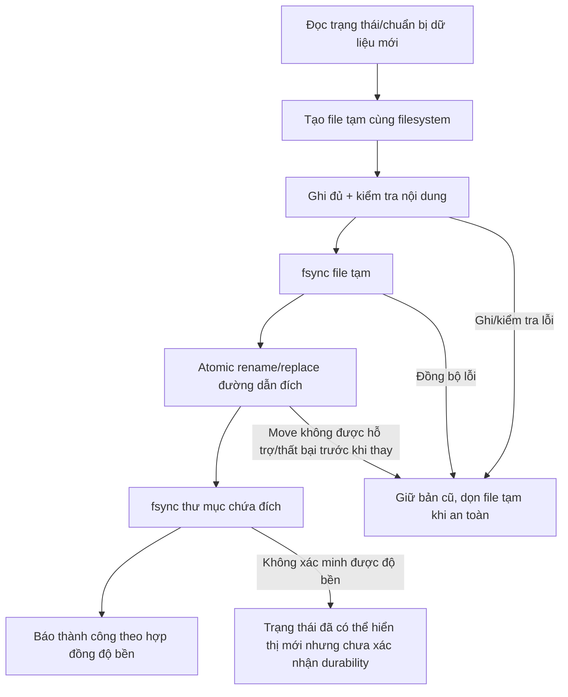

# Thay thế tệp theo thao tác nguyên tử và các điều kiện áp dụng

Khi ứng dụng Java lưu trạng thái vào một tệp JSON, YAML, CSV hoặc tệp cấu hình, cách đơn giản nhất là mở tệp hiện có rồi ghi đè. Cách này có một rủi ro nghiêm trọng: **tiến trình hoặc máy chủ có thể dừng sau khi tệp cũ bị cắt ngắn nhưng trước khi nội dung mới được ghi đủ**. Khi khởi động lại, ứng dụng có thể chỉ còn một tệp rỗng hoặc chứa nửa tài liệu.

**Thay thế tệp nguyên tử** (*atomic file replacement*) giải quyết vấn đề *hiển thị trạng thái một phần* bằng cách ghi bản mới vào một tệp tạm, sau đó đổi tên/thay thế mục nhập tệp đích bằng một thao tác hệ thống tệp có bảo đảm nguyên tử. Người mở đường dẫn đích sẽ nhìn thấy **bản cũ hoàn chỉnh hoặc bản mới hoàn chỉnh**, thay vì phần đầu của bản mới và phần cuối của bản cũ, nếu các điều kiện nguyên tử của hệ thống tệp được đáp ứng.

Đây là chủ đề thuộc chương **Độ bền dữ liệu** của mô-đun **DATA_PERSISTENCE_FUNDAMENTALS**. Mục tiêu chung là hiểu nguyên lý lưu trữ bền vững trong ứng dụng, từ mô hình dữ liệu, schema, truy vấn, chỉ mục và giao dịch đến cô lập, kiểm soát đồng thời và thiết kế ranh giới persistence trong Java. Kiến thức về thay thế tệp giúp ứng dụng quản lý lỗi I/O, khôi phục sau sự cố, tiến hóa định dạng dữ liệu và chọn đúng cơ chế đồng bộ cho các thành phần lưu trữ nhỏ. Bài học phân biệt rõ **tính nguyên tử khi thay đường dẫn** với **độ bền sau sự cố**, rồi đưa ra các điều kiện và giới hạn thực tế để dùng an toàn.

## 1. Vì sao ghi đè trực tiếp dễ làm hỏng dữ liệu?

Giả sử `settings.json` đang chứa cấu hình hợp lệ:

```json
{
  "version": 7,
  "featureEnabled": true,
  "retryLimit": 3
}
```

Ứng dụng mở file với chế độ `TRUNCATE_EXISTING`, ghi cấu hình mới rồi đóng file. Một lịch sự cố có thể là:

```text
T0  settings.json có phiên bản 7 hợp lệ
T1  Mở settings.json với TRUNCATE_EXISTING -> tệp có thể trở thành 0 byte
T2  Ghi được một phần JSON phiên bản 8
T3  Tiến trình chết / hết dung lượng / mất điện
T4  Ứng dụng khởi động lại -> đọc JSON bị cắt dở
```

Điểm nguy hiểm nằm ở chỗ **tệp đích chính là nơi đang được sửa trong khi nó cũng là bản được đọc và dùng để khôi phục**. Dù có thêm lệnh `flush` sau bước ghi, một sự cố *trước khi flush* vẫn có thể để lại bản không hoàn chỉnh. Cần thay đổi trình tự ghi, thay vì chỉ bổ sung một lệnh đồng bộ ở cuối.

Trong thực tế, một bản ghi hỏng có thể khiến cấu hình không tải được, checkpoint không thể tiếp tục, hoặc tệp trạng thái bị khởi tạo lại sai. Với dữ liệu quan trọng, việc ghi đè trực tiếp còn có thể phá hủy bản duy nhất đủ thông tin để phục hồi.

## 2. Phân biệt ba bảo đảm khác nhau

| Khái niệm | Điều được bảo đảm | Điều **không** tự được bảo đảm |
|---|---|---|
| **Ghi đầy đủ nội dung** | Bản mới được tạo và kiểm tra có đủ byte, đúng định dạng | Bản mới đã bền vững sau mất điện; người đọc chưa thấy dữ liệu bị ghi dở |
| **Thay thế nguyên tử** (*atomicity/atomic visibility*) | Thao tác đổi đường dẫn từ bản cũ sang bản mới diễn ra như một điểm chuyển trạng thái | Dữ liệu hoặc thay đổi tên tệp chắc chắn còn sau crash/mất điện |
| **Độ bền** (*durability*) | Sau khi báo thành công theo hợp đồng lưu trữ, dữ liệu có thể phục hồi qua các loại sự cố đã cam kết | Mọi bản sao, backup, máy dự phòng hay dịch vụ ngoài hệ thống đều đã cập nhật |

Ví dụ: một phép đổi tên có thể **nguyên tử với người đọc đang chạy** nhưng hệ thống vẫn chưa ghi bền vững thay đổi directory entry. Nếu mất điện đúng lúc, tên tệp có thể trở lại bản cũ hoặc trạng thái khác tùy hệ thống tệp và thứ tự ghi. Bởi vậy không thể xem `rename()` hay `Files.move(..., ATOMIC_MOVE)` là tương đương với một transaction đã được **fsync** đầy đủ.

**Tính nhất quán dữ liệu** cũng là một yêu cầu riêng: nếu ứng dụng tạo bản JSON mới sai schema, một phép thay thế nguyên tử vẫn có thể đưa bản JSON sai đó vào sử dụng nguyên vẹn. Cần xác thực nội dung trước khi xuất bản bản mới.

## 3. Quy trình chuẩn: tệp tạm, đồng bộ và thay thế

Với hệ thống tệp cục bộ hỗ trợ thay thế bằng rename nguyên tử và đồng bộ thư mục, trình tự thực hành thường là:

1. **Tạo tệp tạm riêng biệt trong cùng thư mục hoặc cùng hệ thống tệp với đích.** Tên tạm phải duy nhất để tránh đụng độ giữa các lần ghi.
2. **Ghi đầy đủ nội dung mới vào tệp tạm.** Xử lý ghi thiếu byte, lỗi dung lượng, xác thực cấu trúc hoặc checksum trước khi xuất bản.
3. **Đồng bộ nội dung và metadata cần thiết của tệp tạm** bằng thao tác tương đương `fsync`/`FileChannel.force(true)` trên nền tảng hỗ trợ.
4. **Thay đường dẫn đích bằng thao tác rename/move nguyên tử.** Không thay bằng thao tác copy rồi delete nếu yêu cầu là nhìn thấy một bản toàn vẹn.
5. **Đồng bộ thư mục cha** để tăng bảo đảm rằng thay đổi mục nhập thư mục (tên tệp trỏ đến phiên bản mới) được lưu bền vững, theo hợp đồng của hệ thống tệp. Chỉ sau đó mới báo thành công nếu yêu cầu là *crash-durable replacement*.



**Điều kiện quan trọng của sơ đồ:** bước 4 chỉ có bảo đảm nguyên tử nếu provider/OS/hệ thống tệp thực sự hỗ trợ thao tác đó với cặp đường dẫn và trạng thái đích đang dùng; bước 3 và 5 có bảo đảm độ bền đến đâu còn phụ thuộc phần cứng, hệ điều hành, cấu hình mount và loại lưu trữ. Đặc biệt, nếu thao tác ở bước 5 lỗi **sau khi bước 4 đã thành công**, không được nói với caller rằng "tệp cũ chắc chắn còn". Tệp mới có thể đã hiển thị và tồn tại trên đĩa nhưng chưa có xác nhận độ bền.

Đặt tệp tạm **ngay cạnh đích** là một thực hành tốt vì thường bảo đảm cùng filesystem và thư mục cần đồng bộ. Tuy nhiên cùng thư mục chưa thay thế được việc kiểm tra tính năng rename nguyên tử của provider.

## 4. Điều gì có thể xảy ra nếu crash ở từng thời điểm?

Giả sử phiên bản `V1` đã được ghi bền vững từ trước, ứng dụng đang xuất bản `V2` và không có writer nào khác. Trên một hệ thống tệp cục bộ triển khai đúng các thao tác đồng bộ:

| Điểm xảy ra sự cố | Tình trạng có thể quan sát | Cách hiểu an toàn |
|---|---|---|
| Trước khi tạo tệp tạm | Đích vẫn là `V1` | Chưa bắt đầu cập nhật |
| Đang ghi tệp tạm | Tệp tạm có thể rỗng, thiếu byte hoặc bị hỏng; `V1` vẫn là đích | Không dùng tệp tạm chưa hoàn tất để khôi phục |
| Sau khi `fsync` tệp tạm, trước rename | `V2` có thể nằm ở tên tạm; đường dẫn đích vẫn là `V1` | Cần dọn/đối soát file tạm; chưa xuất bản `V2` |
| Sau rename, trước đồng bộ thư mục cha | Khi hệ thống còn hoạt động, đích có thể là `V2`; sau crash, độ bền của thay đổi tên **chưa được xác nhận** | Không hứa `V2` chắc chắn tồn tại sau khởi động lại |
| Sau khi đồng bộ thư mục cha thành công | `V2` đã được xuất bản và đồng bộ theo hợp đồng filesystem/thiết bị | Có thể báo thành công nếu các điều kiện độ bền đều được đáp ứng |

Không nên suy ra rằng file luôn phục hồi chính xác về một trong hai phiên bản sau **mọi kiểu** sự cố trên **mọi** hệ thống tệp. Ví dụ: network filesystem, bộ nhớ đệm điều khiển đĩa không thực hiện flush đúng, lỗi firmware, lỗi phần cứng và hệ thống tệp có đặc tính crash consistency khác nhau đều làm phạm vi bảo đảm thay đổi. Quy trình trên là mẫu quan trọng, nhưng phải kiểm tra bảo đảm thực tế của nơi lưu trữ.

### Người đọc đang mở tệp có nhìn thấy bản mới ngay không?

Trên hệ thống POSIX có rename nguyên tử, một tiến trình đã **mở file descriptor** trỏ đến phiên bản `V1` có thể tiếp tục đọc `V1` sau khi đường dẫn được đổi sang `V2`; tiến trình **mở đường dẫn sau rename** sẽ thấy `V2`. Đây là cách nguyên tử ở **directory entry** hoạt động: các file descriptor đã mở không tự động "nhảy" sang inode mới.

```text
Reader A: open("settings.json") ------------> V1 (file descriptor cũ)
Writer:   ghi V2 vào .settings.tmp
Writer:   rename(.settings.tmp, settings.json)  [điểm chuyển]
Reader B: open("settings.json") ------------> V2 (mở mới)
Reader A: đọc tiếp --------------------------> V1 (vẫn là file cũ)
```

Tính nguyên tử **không có nghĩa mọi tiến trình ngay lập tức dùng chung bản mới**. Một process giữ file descriptor, bộ đệm dữ liệu hoặc object đã deserialize trong RAM phải có cơ chế reload/versioning nếu muốn áp dụng cấu hình mới. Trên Windows, cách xử lý tệp đang mở còn phụ thuộc các quyền chia sẻ/rename của handle; thao tác thay thế có thể thất bại khi file bị tiến trình khác mở không cho phép xóa hoặc đổi tên.

## 5. Những điều kiện bắt buộc và giới hạn áp dụng

### 5.1. Nguồn tạm và đích phải hỗ trợ rename nguyên tử với nhau

Việc đổi tên trên **cùng filesystem/volume** thường là điều kiện cốt lõi. Move khác filesystem có thể phải dùng **copy + delete**, vốn không nguyên tử: trong lúc copy, đích mới có thể chưa hoàn chỉnh, hoặc thao tác thất bại giữa chừng. Không dùng đường dẫn `/tmp` mặc định nếu đích nằm trên một mount/volume khác.

Ngay cả khi cùng volume, không phải provider nào cũng hỗ trợ atomic replace cho loại nguồn/đích đó. Java cho phép yêu cầu `StandardCopyOption.ATOMIC_MOVE` và **phải xử lý `AtomicMoveNotSupportedException`** nếu không thể thực hiện nguyên tử. Không âm thầm fallback sang move thường khi tính toàn vẹn là yêu cầu bắt buộc.

Với Java NIO, khi có `ATOMIC_MOVE`, các tùy chọn move khác có thể bị bỏ qua và **hành vi khi đích đã tồn tại là tùy implementation** theo hợp đồng API. Vì vậy kết hợp `ATOMIC_MOVE` với `REPLACE_EXISTING` **không bảo đảm** mọi provider thay thế đích tồn tại theo cách giống POSIX. Cần kiểm thử hệ thống tệp/OS mục tiêu và quy định rõ cách xử lý nếu provider báo lỗi hoặc từ chối thay thế.

### 5.2. Không mặc định rename nguyên tử cũng bền vững sau mất điện

Hai thao tác đồng bộ phục vụ hai loại thông tin:

- **Đồng bộ tệp tạm** để hệ thống cố gắng ghi bền vững nội dung và metadata liên quan của bản mới trước khi nó trở thành bản chính.
- **Đồng bộ thư mục cha sau rename** để hệ thống cố gắng ghi bền vững việc đổi directory entry sang bản mới.

Chỉ gọi `flush()` trên một `BufferedOutputStream` hoặc `Writer` thường mới đưa byte từ bộ đệm ứng dụng xuống lớp I/O bên dưới; nó **không tương đương** với bảo đảm flush bộ nhớ đệm của kernel và thiết bị lưu trữ. `FileChannel.force(true)` trong Java đưa ra yêu cầu ghi các cập nhật file xuống thiết bị lưu trữ và metadata, nhưng phạm vi bảo đảm được JDK nêu rõ hơn với **local storage**; network filesystem có thể không thực hiện các bảo đảm tương ứng.

**Đồng bộ thư mục** cũng không có API Java thuần hoàn toàn di động trên mọi OS/provider. Trên một số hệ POSIX có thể mở file descriptor của thư mục và `fsync` nó; `FileChannel.open(directory, READ)` không hoạt động trên mọi hệ điều hành hoặc provider. Nếu tầng ứng dụng không có cách xác minh việc đồng bộ thư mục theo nền tảng, hãy **ghi rõ rằng mới bảo đảm nguyên tử khi hiển thị** và chưa cam kết độ bền của việc thay tên sau crash.

Nếu thư mục cha vừa được **tạo mới**, việc `fsync` mỗi thư mục chứa file có thể chưa đủ để bảo đảm đường dẫn gồm các thư mục mới vẫn tồn tại sau crash. Cần cân nhắc đồng bộ các thư mục cấp trên chứa directory entry vừa tạo; mẫu đơn giản trong bài giả định **thư mục đích đã tồn tại và bền vững** từ trước.

### 5.3. Quyền truy cập, symlink, hard link và metadata

Khi thay file qua rename, thứ được đưa vào đường dẫn đích là **file object của bản tạm**. Nếu bản cũ có ACL, quyền POSIX, owner, timestamp, extended attributes hoặc một hard link khác, bản mới **không tự kế thừa tất cả metadata của bản cũ**. Đặc biệt, các hard link khác vẫn trỏ đến file object cũ và không cập nhật theo đường dẫn vừa thay.

Trước khi publish, ứng dụng phải xác định metadata nào cần giữ lại hoặc thiết lập mới: permissions, ownership, ACL, nhãn bảo mật, cách mã hóa và quyền đọc/ghi. Không nên tạo tệp tạm chứa bí mật trong thư mục cho phép người khác đọc hoặc sửa. `Files.createTempFile` dùng quy tắc permission của provider và không bảo đảm khớp file đích; khi cần, thiết lập quyền phù hợp **trước khi move**.

Nếu đường dẫn đích là **symbolic link**, rename có thể thay thế chính directory entry của symlink thay vì sửa file mà symlink trỏ tới. Đường dẫn có thể bị thay đổi bởi tác nhân khác giữa bước kiểm tra và rename (*TOCTOU*). Với dữ liệu nhạy cảm, phải dùng thư mục tin cậy do ứng dụng kiểm soát, kiểm tra chính sách symlink và cân nhắc cơ chế thao tác dựa trên directory handle/OS chuyên dụng. Không cho người dùng tùy ý chỉ định path dùng cho thao tác ghi tệp hệ thống.

### 5.4. Dung lượng, quota và lỗi ghi

Ghi bản mới vào tệp tạm yêu cầu **đủ dung lượng cho cả V1 và V2** trong giai đoạn chuyển đổi. Nếu hai phiên bản đều lớn, cần ước tính dung lượng trống, inode/quota, giới hạn filesystem và tác động của snapshot/backup. Lỗi `ENOSPC` hoặc quota có thể xuất hiện khi ghi, khi đồng bộ hoặc ở các thao tác metadata.

Trình tự an toàn là ghi đầy đủ, kiểm tra mọi exception, đồng bộ file rồi mới thay tên. Không xuất bản một bản chỉ vì hàm `write()` đã trả về vài byte. Với stream lớn, cần lặp đến khi ghi hết dữ liệu; với định dạng có checksum hoặc schema, xác minh nội dung tạm trước khi move. Việc đồng bộ file có thể làm lộ ra lỗi I/O muộn hơn so với thời điểm `write` trả về.

### 5.5. Tính nguyên tử của **một đường dẫn** không phải transaction nhiều file

Nếu một nghiệp vụ cần đồng bộ cả `accounts.json` và `ledger.json`, thay mỗi file một cách nguyên tử vẫn có khoảng giữa hai lần rename:

```text
replace(accounts.json) -> thành công
crash
replace(ledger.json)   -> chưa thực hiện
```

Sau crash, hệ thống có thể có **một file mới và một file cũ** dù từng lần thay file đều nguyên tử. Đây không phải một transaction ACID trên hai file. Nếu cần cập nhật nhiều thành phần như một đơn vị, có thể:

- Gom nội dung liên quan vào **một file snapshot** khi kích thước và tần suất cập nhật cho phép.
- Ghi các file dữ liệu **phiên bản bất biến**, rồi thay nguyên tử **một manifest/con trỏ phiên bản** sau khi bảo đảm dữ liệu tham chiếu đã bền vững; cần quy trình recovery và dọn phiên bản cũ.
- Dùng **cơ sở dữ liệu có transaction và WAL/journal** khi có nhiều record, ràng buộc, writer đồng thời hoặc nhu cầu truy vấn phong phú.

Manifest cũng phải tuân thủ quy trình đồng bộ file và thư mục; nếu manifest mới trỏ đến file chưa được ghi bền vững thì rename manifest nguyên tử vẫn chưa đủ.

## 6. Java NIO: ví dụ thay file theo hướng an toàn

Ví dụ dưới đây dành cho **file thông thường trên hệ thống tệp cục bộ**. Nó cố gắng ghi đủ byte, đồng bộ file tạm, yêu cầu move nguyên tử và đồng bộ thư mục cha nếu provider hỗ trợ mở và force trên thư mục. Đây là **mẫu có giả định nền tảng**, không phải bảo đảm xuyên mọi OS hoặc mọi loại storage.

```java
import java.io.IOException;
import java.nio.ByteBuffer;
import java.nio.channels.FileChannel;
import java.nio.file.AtomicMoveNotSupportedException;
import java.nio.file.Files;
import java.nio.file.Path;
import java.nio.file.StandardCopyOption;
import java.nio.file.StandardOpenOption;

public final class AtomicFileWriter {
    private AtomicFileWriter() {}

    public static void replace(Path target, byte[] content) throws IOException {
        Path absoluteTarget = target.toAbsolutePath().normalize();
        Path directory = absoluteTarget.getParent();
        if (directory == null) {
            throw new IOException("Target has no parent directory");
        }

        // Tạo file tạm ngay cạnh đích để tăng khả năng cùng filesystem.
        Path temp = Files.createTempFile(
                directory, "." + absoluteTarget.getFileName() + ".", ".tmp");

        try {
            try (FileChannel channel = FileChannel.open(
                    temp, StandardOpenOption.WRITE,
                    StandardOpenOption.TRUNCATE_EXISTING)) {
                ByteBuffer buffer = ByteBuffer.wrap(content);
                while (buffer.hasRemaining()) {
                    channel.write(buffer);
                }
                // Đồng bộ dữ liệu và metadata cần thiết của bản mới.
                channel.force(true);
            }

            // Trước khi move: thực hiện kiểm tra schema/checksum,
            // thiết lập permissions/ACL nếu nghiệp vụ yêu cầu.
            try {
                Files.move(temp, absoluteTarget,
                        StandardCopyOption.ATOMIC_MOVE,
                        StandardCopyOption.REPLACE_EXISTING);
            } catch (AtomicMoveNotSupportedException e) {
                // Không âm thầm copy + delete nếu yêu cầu atomicity.
                throw new IOException("Atomic replacement is unavailable", e);
            }

            // Cần hỗ trợ của OS/provider; có thể lỗi trên Windows/network FS.
            // Nếu bước này lỗi, bản mới CÓ THỂ đã được publish.
            try (FileChannel dir = FileChannel.open(
                    directory, StandardOpenOption.READ)) {
                dir.force(true);
            }
        } finally {
            // Nếu move thành công, tên temp thường không còn tồn tại.
            // Nếu chưa move, dọn file tạm còn sót.
            Files.deleteIfExists(temp);
        }
    }
}
```

**Cách dùng cho dữ liệu nhỏ đã được xác thực:**

```java
import java.nio.charset.StandardCharsets;
import java.nio.file.Path;

String json = """
        {"version": 8, "featureEnabled": false, "retryLimit": 5}
        """;
AtomicFileWriter.replace(
        Path.of("/var/lib/myapp/settings.json"),
        json.getBytes(StandardCharsets.UTF_8));
```

Mã dùng đường dẫn minh họa trên môi trường Unix; khi triển khai Windows, chọn thư mục dữ liệu phù hợp và kiểm tra hỗ trợ atomic replace và đồng bộ directory. `Files.createTempFile` tạo file mới nên metadata của file cũ **không tự được bảo toàn**. Mã không quản lý thay đổi cùng lúc từ nhiều writer và không bảo vệ path khỏi người dùng không tin cậy; các điều kiện đó phải được thiết kế thêm.

Điểm cần nhớ khi đưa ví dụ vào sản phẩm:

1. **`ATOMIC_MOVE` không đồng nghĩa `REPLACE_EXISTING` chắc chắn hoạt động trên mọi provider.** Khi đích tồn tại, Java để chi tiết xử lý cho implementation. Trường hợp bị từ chối phải được kiểm thử và xử lý rõ ràng; không dùng thao tác xóa đích trước rồi move tệp mới vì làm mất khoảng nguyên tử.
2. **Đồng bộ thư mục là bước phụ thuộc nền tảng.** Lỗi ở bước `FileChannel.open(directory)` hoặc `dir.force(true)` cần được đưa vào phân loại "đã có thể thay thế nhưng chưa xác minh durability"; không gắn nhãn rollback hoặc tự động ghi lại bằng operation ID mới.
3. **`finally` có thể gặp lỗi dọn dẹp.** Trong code sản phẩm, cần giữ nguyên exception gốc và đưa lỗi xóa temp vào dạng suppressed/log để nó không che mất nguyên nhân ban đầu. Có thể để một tác vụ recovery dọn file `.tmp` cũ sau khi đối chiếu.
4. **Không cố giữ cả file lớn trong RAM.** Với dữ liệu lớn, stream nội dung vào `FileChannel`, tính checksum từng phần và giữ transaction file ngắn. Vẫn phải bảo đảm ghi đủ, kiểm tra lỗi và đồng bộ file tạm trước khi move.
5. **Nếu ứng dụng cần bảo đảm crash-durable nghiêm ngặt,** phải xác minh thực tế khả năng `fsync` directory và semantics của thiết bị. Khi không có hỗ trợ phù hợp, từ chối cam kết độ bền hoặc sử dụng cơ chế lưu trữ khác có hợp đồng rõ ràng.

### Xử lý lỗi cần phản ánh đúng giai đoạn

| Giai đoạn lỗi | Điều có thể nói với caller | Hành động |
|---|---|---|
| Tạo hoặc ghi tệp tạm | Đích chưa được chủ động thay | Giữ bản cũ; dọn temp khi an toàn |
| `force(true)` của temp thất bại trước move | Bản mới chưa được chủ động publish | Không rename temp; xử lý I/O và dung lượng |
| Move báo không hỗ trợ nguyên tử | Không thể dùng quy trình atomic replacement này | Báo lỗi/chọn storage khác, không copy fallback âm thầm |
| Move lỗi khác hoặc kết nối/storage không ổn định | Kết quả cần kiểm tra theo loại lỗi và provider | Đối soát đường dẫn, phiên bản/checksum; không đoán chỉ từ exception |
| Move thành công nhưng `fsync` thư mục lỗi | Bản mới có thể đã hiển thị; độ bền sau crash chưa được xác nhận | Ghi nhận trạng thái chưa xác định về durability; kiểm tra và khôi phục khi cần |
| Move và đồng bộ thư mục đều thành công | Có thể báo hoàn tất theo hợp đồng storage | Ghi nhận version mới; tiếp tục nghiệp vụ |

Đừng nhầm việc **một lời gọi Java ném exception** với **đường dẫn đích chắc chắn không thay đổi**. Tương tự lỗi mất xác nhận `COMMIT` trong cơ sở dữ liệu, sự cố sau khi rename đã thực thi có thể để lại trạng thái đã chuyển nhưng caller không có xác nhận đủ mạnh.

## 7. Nhiều writer: atomic replace không tự ngăn mất cập nhật

Giả sử hai tiến trình cùng đọc `settings.json` ở version 7:

```text
Writer A đọc V7, tạo V8-A: đổi retryLimit
Writer B đọc V7, tạo V8-B: đổi featureEnabled

A: rename V8-A -> settings.json
B: rename V8-B -> settings.json

Kết quả: V8-B nguyên vẹn, nhưng thay đổi retryLimit của A bị mất.
```

**Hai thao tác rename đều có thể nguyên tử mà kết quả nghiệp vụ vẫn sai.** Đây là một dạng *lost update*. Atomic replacement bảo vệ người đọc khỏi file bị ghi dở; nó **không cung cấp** phép so sánh và thay thế có điều kiện (*compare-and-swap*) dựa trên nội dung cũ.

Các chiến lược phối hợp writer:

- **Một writer chịu trách nhiệm:** các tác nhân gửi lệnh qua cùng một tiến trình/queue quản lý tệp, có tuần tự hóa việc tạo phiên bản và publish.
- **Khóa giữa các writer:** khóa process hoặc OS file lock được tất cả writer tôn trọng; khóa phải bao phủ **đọc phiên bản, kiểm tra, tính nội dung mới và rename**. Với lock file, nên khóa một file khóa ổn định, tránh khóa inode của file đích rồi thay inode qua rename. Lưu ý file lock có đặc tính khác nhau theo OS, provider và network filesystem.
- **Kiểm soát phiên bản/optimistic concurrency:** lưu version/hash trong nội dung, chỉ cho phép ghi nếu kỳ vọng còn khớp. Tuy nhiên kiểm tra file rồi rename là hai thao tác riêng; **không an toàn khi có nhiều writer nếu không thêm primitive nguyên tử hoặc khóa phối hợp**. Một số kho đối tượng cung cấp conditional writes như `If-Match`/ETag nhưng đó là hợp đồng API khác, không phải tính chất mặc định của `Files.move`.

Với nhiều node cùng ghi trên network share, file locks và atomic rename có thể không đáp ứng các giả định mong muốn. Cần nghiên cứu đặc tính storage cụ thể hoặc chuyển dữ liệu cần cập nhật có điều kiện sang database/coordination service.

## 8. Khôi phục sau crash và vệ sinh tệp tạm

Nếu máy chết trước rename, thư mục có thể còn file như `.settings.json.123.tmp`. Không nên tự coi file tạm có timestamp mới nhất là bản cần phát hành. Nó có thể là **bản ghi thiếu byte**, từ một writer đã bị hủy, hoặc từ một cấu hình nghiệp vụ cũ.

Một quy trình recovery thận trọng:

1. **Đọc bản chính tại đường dẫn đích**, xác minh schema, checksum (nếu có), version và những bất biến liên quan.
2. **Liệt kê và kiểm tra temp cũ** do chính ứng dụng tạo, chỉ trong thư mục do ứng dụng quản lý. Không sử dụng tên do người dùng hoặc nội dung file temp làm lệnh hệ thống.
3. Nếu file chính hợp lệ, chỉ dọn temp sau khi chắc không có writer đang sử dụng; với nhiều tiến trình, cần giao thức khóa hoặc tuổi file/lease phù hợp.
4. Nếu bản chính không hợp lệ hoặc mất, phục hồi từ phiên bản/manifest/backup đã được xác minh theo chính sách recovery, không mù quáng rename một temp bất kỳ.
5. Ghi lại sự cố, trạng thái cuối và biện pháp xử lý. Với dữ liệu quan trọng, kiểm thử recovery dưới các điểm fail khác nhau trước khi đưa vào production.

**Tệp tạm không phải backup**. Sau rename, đường dẫn cũ có thể không còn trỏ đến inode dữ liệu trước đó; nếu muốn quay lui phiên bản, phải chủ động lưu snapshot/backup hoặc manifest trỏ đến các phiên bản bất biến. Một backup có chiến lược retention và kiểm tra khôi phục riêng.

## 9. Phân biệt local filesystem, network filesystem và object storage

| Môi trường | Có thể áp dụng mẫu atomic replacement? | Điều phải kiểm chứng |
|---|---|---|
| **Local POSIX filesystem** | Thường phù hợp khi rename cùng filesystem và fsync được hỗ trợ | Atomic replace thực tế, thứ tự `fsync` file/thư mục, mount/storage guarantees |
| **Windows/NTFS** | Có thể có thao tác thay thế nguyên tử trong các trường hợp được hỗ trợ | Hành vi với file đích đang mở, `ATOMIC_MOVE` khi đích tồn tại, API đồng bộ metadata/thư mục và quyền truy cập |
| **NFS/SMB/network filesystem** | Phụ thuộc giao thức, cấu hình server/client và provider | Rename semantics, cache coherence, độ bền của flush/fsync, mất kết nối, khóa liên node |
| **Object storage** | Thường không có một `rename()` filesystem đúng nghĩa | PUT/copy/delete, versioning, điều kiện ghi, khả năng quan sát và độ bền theo API dịch vụ |
| **Container với volume/bind mount** | Phụ thuộc filesystem thật phía dưới | Temp và đích có cùng mount không; volume driver, overlay, quyền và flush semantics |

Một mô phỏng filesystem của cloud object store có thể cung cấp thao tác "rename" bằng **copy đối tượng rồi delete đối tượng cũ**. Điều đó không tương đương phép thay thế directory entry nguyên tử của POSIX. Không lấy tên API `move` làm bằng chứng rằng storage có cùng bảo đảm. Với dữ liệu nghiệp vụ có nhiều bản ghi đồng thời, database hoặc log chuyên dụng thường có cơ chế WAL, transaction, snapshot và recovery dễ bảo đảm hơn.

## 10. Kiểm thử đúng điều cần bảo đảm

Một unit test chỉ chạy `Files.move(..., ATOMIC_MOVE)` thành công chưa đủ chứng minh an toàn. Cần xác định loại sự cố và quan sát mong muốn:

| Thí nghiệm | Cách kiểm tra | Bất biến cần quan sát |
|---|---|---|
| **Ghi tạm bị cắt giữa chừng** | Gây lỗi sau khi mới ghi một phần | Đường dẫn đích vẫn chứa bản cũ hợp lệ |
| **Thử atomic replace trên storage thật** | Chạy khi đích đã tồn tại và có reader đồng thời | Không có file đích trung gian bị ghi dở; xử lý rõ nếu `ATOMIC_MOVE` không được hỗ trợ |
| **Hai reader mở trước/sau rename** | Giữ handle cũ, mở handle mới sau khi rename | Mỗi reader nhìn thấy một bản đầy đủ; không kết luận cache nội bộ tự reload |
| **Hai writer dựa trên cùng V7** | Đồng bộ lịch đọc–publish bằng barrier | Không âm thầm mất cập nhật nếu nghiệp vụ yêu cầu serialize/compare-and-swap |
| **Sự cố sau rename, trước fsync directory** | Fault injection/kill process/power-failure testing có kiểm soát | Không báo crash-durable khi chưa đồng bộ; recovery không giả định trạng thái |
| **Hết dung lượng/quota** | Giới hạn storage thử nghiệm | Lỗi được báo; bản cũ không bị cắt dở |
| **Nhiều file liên quan** | Dừng giữa hai lần replace | Có chiến lược manifest/transaction/recovery, không giả định mọi file đổi cùng lúc |

Với crash consistency, **kill process không tương đương mất điện**: kernel có thể vẫn còn sống và sẽ flush dữ liệu đã nằm trong page cache. Muốn kiểm thử mất điện thật hoặc giả lập crash ở tầng filesystem, cần môi trường thử nghiệm phù hợp và đánh giá kết quả theo hợp đồng thiết bị; không thực hiện thí nghiệm phá hoại trên máy production.

Kiểm thử hiệu năng cũng quan trọng: `force(true)` và directory fsync có thể tăng latency và I/O sync, đặc biệt khi tần suất cập nhật lớn. Nếu một ứng dụng phải cập nhật hàng nghìn bản ghi mỗi giây, một file snapshot được thay qua rename mỗi lần có thể là lựa chọn kém phù hợp; cân nhắc WAL, append-only log, batching hoặc cơ sở dữ liệu được thiết kế cho trường hợp đó. Không bỏ bước đồng bộ âm thầm chỉ để đạt benchmark tốt hơn nếu ứng dụng vẫn tuyên bố bảo đảm độ bền.

## 11. Tình huống tích hợp: lưu checkpoint của tác vụ Java

Một worker định kỳ quét dữ liệu theo lô và ghi `checkpoint.json` gồm `lastProcessedId` và `schemaVersion`. Sau mỗi lô, nó muốn ghi checkpoint mới để lần khởi động sau tiếp tục từ vị trí đúng.

```json
{
  "schemaVersion": 2,
  "lastProcessedId": 12500,
  "batchCompletedAt": "2026-11-22T01:00:00Z"
}
```

Thiết kế hợp lý cho một worker duy nhất trên local filesystem đáng tin cậy:

1. Xác định thế nào là **một lô đã hoàn thành**; không ghi checkpoint tiến xa hơn trước khi tác động nghiệp vụ của lô được xác nhận.
2. Serialize checkpoint thành nội dung đầy đủ, có version và validation.
3. Ghi tệp tạm trong thư mục checkpoint, đồng bộ tệp, thay nguyên tử và đồng bộ directory entry theo nền tảng.
4. Nếu xảy ra lỗi sau bước rename mà chưa xác nhận durability, đọc lại version/ID đã lưu và đối soát; không coi lần ghi luôn thất bại hoặc luôn thành công.
5. Khi khởi động lại, xác minh nội dung checkpoint. Chấp nhận việc phải xử lý lại một lô nếu checkpoint cũ hơn thao tác nghiệp vụ đã hoàn tất, nên tác vụ downstream phải **idempotent**; nếu bắt buộc chính xác một lần, checkpoint và thay đổi nghiệp vụ cần chung một ranh giới transaction hoặc giao thức phối hợp mạnh hơn.

Điểm cuối cùng cho thấy atomic replace chỉ giải quyết **một lát cắt của độ bền**. Dù `checkpoint.json` luôn hoàn chỉnh, nếu việc cập nhật database và cập nhật checkpoint là hai thao tác độc lập, hệ thống vẫn có thể dừng giữa chúng. Thiết kế toàn hệ thống cần phân tích điểm khôi phục, lặp công việc và nhất quán giữa các kho dữ liệu.

## 12. Checklist thiết kế khi chọn atomic file replacement

- **Dữ liệu là một file độc lập?** Nếu cập nhật nhiều file có ràng buộc chung, cần transaction/manifest hoặc cơ chế recovery khác.
- **Reader cần nhìn thấy bản cũ hoặc bản mới nguyên vẹn?** Ghi vào temp và dùng atomic rename khi được hỗ trợ.
- **Temp và đích cùng filesystem, cùng provider?** Không để move tự chuyển thành copy+delete.
- **Đã xác thực bản mới và xử lý ghi thiếu byte?** Không publish nội dung sai schema hoặc chưa hoàn chỉnh.
- **Đã đồng bộ file tạm và directory entry theo hợp đồng storage?** Tách bảo đảm hiển thị nguyên tử với độ bền sau crash.
- **Metadata và quyền truy cập đã đúng?** Chú ý ACL, symlink, hard link, quyền của temp và thư mục chứa.
- **Có nhiều writer hoặc nhiều node?** Atomic rename đơn thuần không ngăn lost update; cần khóa/phiên bản/giao thức phối hợp.
- **Có thể mất xác nhận sau rename?** Dùng version/checksum và đối soát trước retry; không suy luận từ exception đơn lẻ.
- **Đã thử nghiệm trên đúng OS/storage/volume của production?** Hỗ trợ `ATOMIC_MOVE`, directory fsync và hành vi reader có thể khác môi trường phát triển.
- **Có kế hoạch backup và recovery?** Không coi temp hay rename là backup của phiên bản cũ.

**Thay thế tệp nguyên tử** là một kỹ thuật mạnh để tránh xuất bản dữ liệu bị ghi dở, đặc biệt phù hợp với cấu hình, snapshot nhỏ và checkpoint trên filesystem được kiểm soát. Muốn có **độ bền** thực sự, phải đi xa hơn thao tác rename: ghi đủ và xác thực bản mới, đồng bộ dữ liệu, thay đường dẫn nguyên tử trong điều kiện được hỗ trợ, đồng bộ metadata của thư mục và xử lý đúng các trạng thái chưa xác định sau sự cố. Trong thiết kế persistence cho Java, chính việc xác định rõ **ranh giới của bảo đảm** giúp chọn đúng lúc dùng file và đúng lúc cần transaction của cơ sở dữ liệu.
