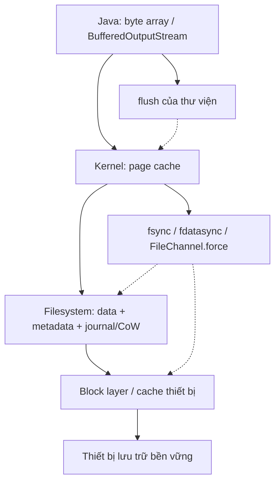
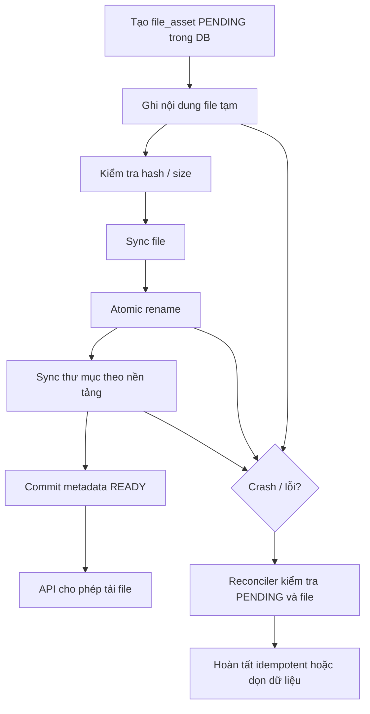

# Kiểm soát thứ tự ghi dữ liệu và siêu dữ liệu

## Mục tiêu học tập

Sau bài này, người học có thể:

- Phân biệt **dữ liệu (data)** với **siêu dữ liệu (metadata)** trên hệ thống file và trong cơ sở dữ liệu; giải thích tại sao cả hai cần được ghi theo thứ tự phù hợp.
- Mô tả đường đi của một thao tác ghi qua bộ đệm của ứng dụng, **page cache**, hệ thống file và thiết bị lưu trữ, cũng như ý nghĩa và giới hạn của `flush`, `fsync`, `fdatasync` và `FileChannel.force`.
- Xây dựng quy trình **ghi file tạm → đồng bộ nội dung → đổi tên nguyên tử → đồng bộ thư mục** để công bố một phiên bản file hoàn chỉnh, đồng thời nhận ra các điểm mất điện có thể làm thay đổi kết quả.
- Giải thích quy tắc **write-ahead logging (WAL)** và mối liên hệ giữa log, trang dữ liệu, commit, checkpoint và khôi phục sau sự cố.
- Thiết kế luồng lưu file và thông tin mô tả bằng Java/JDBC sao cho không công bố dữ liệu chưa sẵn sàng; nhận diện rủi ro khi một nghiệp vụ ghi vào cả database lẫn filesystem.
- Lập kế hoạch thử nghiệm lỗi và quan sát chi phí độ bền mà không nhầm **thao tác trả về thành công** với **dữ liệu chắc chắn tồn tại sau mọi kiểu sự cố**.

## 1. Độ bền không chỉ là gọi `write()` thành công

Một ứng dụng lưu hóa đơn PDF cùng thông tin trong cơ sở dữ liệu. Java vừa ghi xong nội dung `invoice-42.pdf`, API trả về HTTP `201`, rồi máy chủ mất điện. Sau khi khởi động lại, bản ghi hóa đơn còn trong database nhưng file PDF biến mất hoặc không mở được. Không nhất thiết có lỗi cú pháp SQL hay Java: ứng dụng có thể đã **công bố metadata trước khi nội dung file được ghi bền vững**.

Ngược lại, nếu file đã được ghi chắc chắn nhưng bản ghi mô tả chưa được commit, hệ thống có thể còn một file **mồ côi** mà không người dùng nào tìm thấy. Hai trường hợp đều bắt nguồn từ **thứ tự ghi và điểm công bố kết quả**.

Trong module `DATA_PERSISTENCE_FUNDAMENTALS`, người học thiết kế ranh giới persistence cho ứng dụng Java, bao gồm mô hình dữ liệu, giao dịch, lược đồ, truy vấn, bảo mật, sao lưu và tối ưu hiệu năng. Bài này tập trung vào câu hỏi cụ thể: **Khi một đối tượng có cả nội dung và thông tin mô tả, phải ghi và xác nhận chúng theo thứ tự nào để sau sự cố hệ thống không công bố trạng thái sai?**

Ta cần phân biệt ba mức kết quả:

| Mức quan sát | Điều đã xảy ra | Điều chưa thể suy ra |
| --- | --- | --- |
| API `write()` hoàn thành | Hệ điều hành đã nhận dữ liệu vào đường ghi, thường có thể nằm trong bộ đệm | Dữ liệu đã tới thiết bị lưu trữ bền vững |
| Một thao tác `flush` ở tầng ứng dụng hoàn thành | Dữ liệu được đẩy từ bộ đệm của thư viện/ứng dụng xuống tầng dưới | Bộ đệm kernel, controller và thiết bị đều đã bền vững |
| Đồng bộ bền vững thành công theo hợp đồng của hệ thống | Hệ điều hành đã yêu cầu lưu trữ dữ liệu cần thiết bằng cơ chế như `fsync` | Mọi phần cứng, filesystem, mạng và môi trường ảo hóa đều luôn tuân thủ đúng cam kết khi mất điện |

**Độ bền (durability)** là thuộc tính gắn với một mô hình lỗi và cam kết cụ thể. Phải phân biệt tiến trình Java bị dừng, hệ điều hành sập, máy mất điện, thiết bị hỏng và mất cả vùng lưu trữ; các tình huống đó không tương đương nhau. `fsync` hữu ích trước lỗi mất điện của một thiết bị tuân thủ hợp đồng flush, nhưng không thay thế replica, backup và kế hoạch phục hồi sau hỏng thiết bị.

## 2. Data, metadata và tên file là ba phần có liên hệ

### 2.1. Dữ liệu là nội dung; metadata mô tả cách nhận diện và sử dụng

Với một file bình thường, có thể phân biệt:

- **Data:** các byte nội dung của file, ví dụ nội dung PDF hoặc JSON.
- **Metadata của chính file:** kích thước, quyền truy cập, chủ sở hữu, timestamp, số hiệu inode hoặc thông tin cấu trúc tương đương tùy filesystem.
- **Metadata của thư mục:** ánh xạ tên `invoice-42.pdf` đến đối tượng file; tạo file, đổi tên và xóa file đều có thể thay đổi entry của thư mục.

Trong database, data có thể là các hàng nghiệp vụ và trang dữ liệu; metadata có thể là schema, index, catalog và trạng thái mô tả dữ liệu. Phân biệt **logic** với **vật lý** cũng quan trọng: một hàng `file_asset(id, path, status)` là dữ liệu của database, nhưng đối với file PDF nó lại đóng vai trò **metadata nghiệp vụ** mô tả vị trí và trạng thái công bố file.

Ví dụ:

```text
Nội dung file:          /assets/2026/invoice-42.pdf   (các byte PDF)
Directory entry:        tên invoice-42.pdf -> đối tượng file
Metadata trong DB:      invoice_id=42, path=..., status='READY', sha256=...
```

Để người dùng tải được hóa đơn, ba phần này cần khớp nhau. Nếu database đã nói `READY` nhưng directory entry chưa sống sót sau crash, ứng dụng trả về một đường dẫn không tồn tại. Nếu tên file tồn tại nhưng nội dung chưa được flush bền vững, người dùng có thể nhận file thiếu hoặc hỏng sau khi khởi động lại.

### 2.2. Vì sao metadata có thể bền vững khác thời điểm data?

Filesystem và thiết bị lưu trữ có thể gom, trì hoãn hoặc sắp xếp lại các lần ghi để tăng hiệu năng. Một `write()` cập nhật phần nội dung; thao tác `rename()` lại thay đổi entry thư mục; một lần ghi làm file dài hơn còn cần cập nhật thông tin kích thước. Nếu hệ thống sập giữa các điểm đó, chỉ một số thay đổi có thể tồn tại.

Do vậy, **thứ tự gọi hàm trong Java chưa mặc nhiên là thứ tự được ghi bền vững trên thiết bị**. Ứng dụng phải yêu cầu các rào chắn đồng bộ cần thiết và xác định rõ điểm nào được phép xác nhận cho client.

## 3. Các tầng bộ đệm và ý nghĩa của thao tác đồng bộ

Một lệnh ghi có thể đi qua nhiều tầng:



Sơ đồ là mô hình khái niệm: các bước cụ thể khác nhau theo OS, filesystem, driver, hệ thống ảo hóa và thiết bị. Bộ đệm ghi có thể tồn tại ở nhiều tầng; một thao tác `flush()` của `BufferedOutputStream` chỉ đẩy byte từ bộ đệm Java vào đường ghi tiếp theo, **không phải lời bảo đảm tương đương `fsync`**.

### Phân biệt các lệnh thường gặp

| Cơ chế | Vai trò chính | Giới hạn cần nhớ |
| --- | --- | --- |
| `OutputStream.flush()` | Đẩy dữ liệu đang nằm trong bộ đệm của stream | Không tự yêu cầu kernel và thiết bị ghi bền vững |
| `fsync(fd)` trên hệ POSIX | Yêu cầu đồng bộ dữ liệu file và metadata liên quan đến file theo hợp đồng OS | Không mặc nhiên đồng bộ entry thư mục do `rename`, `link` hay tạo tên mới |
| `fdatasync(fd)` | Đồng bộ data và metadata cần cho việc lấy lại dữ liệu, thường giảm một số ghi metadata không thiết yếu | Những metadata như kích thước file có thể vẫn phải đồng bộ; chi tiết do OS/filesystem quyết định |
| `FileChannel.force(true)` trong Java | Yêu cầu ghi các cập nhật nội dung và metadata của file qua channel xuống thiết bị theo cam kết API | Không phải API chuẩn để `fsync` thư mục; bảo đảm phụ thuộc loại thiết bị và hệ thống |
| `FileChannel.force(false)` | Ưu tiên đồng bộ nội dung file; metadata có thể không được buộc ghi cùng | Với file vừa được tạo hoặc tăng kích thước, cần hiểu rõ metadata cần thiết; dùng `true` khi muốn quy trình đơn giản, thận trọng |
| `rename` / `Files.move(..., ATOMIC_MOVE)` | Công bố tên file qua thay đổi namespace nguyên tử nếu filesystem hỗ trợ | **Atomicity trong quan sát tên** khác với **durability của thay đổi tên sau crash** |

Không thể dùng `Thread.sleep(1000)` để thay cho đồng bộ bền vững. Việc kernel thường tự đẩy dữ liệu xuống ổ đĩa sau một khoảng thời gian không tạo ra cam kết đúng cho thao tác vừa hoàn thành.

### Vì sao `force(true)` chưa giải quyết mọi vấn đề?

Giả sử Java tạo file mới, ghi xong và gọi `force(true)`. Nội dung và metadata *của file* đã được yêu cầu đồng bộ. Tuy nhiên, entry **tên file nằm trong thư mục cha** vẫn có thể cần một thao tác đồng bộ riêng để tồn tại chắc chắn sau sự cố. Ứng dụng phải quan tâm cả đối tượng file và thư mục chứa tên file.

Trên các hệ POSIX hỗ trợ, quy trình điển hình là `fsync(fd_file)` rồi `fsync(fd_directory)` sau khi tạo/đổi tên. Java NIO **không có một API đồng bộ thư mục đa nền tảng với bảo đảm tương đương trên mọi filesystem**. Một số môi trường Unix cho phép mở directory bằng `FileChannel` và gọi `force`, nhưng cách làm đó không được hỗ trợ hoặc có cùng ngữ nghĩa ở mọi nền tảng, đặc biệt trên Windows. Phần triển khai có yêu cầu độ bền nghiêm ngặt phải dựa trên hợp đồng nền tảng đã kiểm chứng hoặc thư viện native thích hợp.

## 4. Nguyên tắc: ghi dữ liệu trước khi công bố metadata tham chiếu

Trong trường hợp công bố một file mới dưới tên cuối cùng, chiến lược điển hình là:

```text
1. Tạo file tạm cùng filesystem với tên đích.
2. Ghi toàn bộ nội dung vào file tạm.
3. Đồng bộ nội dung và metadata cần thiết của file tạm.
4. Đổi tên/move nguyên tử file tạm thành tên công bố.
5. Đồng bộ thư mục chứa entry mới (và thư mục nguồn nếu khác thư mục).
6. Chỉ sau khi các điều kiện độ bền đã đạt, xác nhận trạng thái READY.
```

Quy trình này thường được gọi là **durable publish** hoặc **write-then-rename**. Nó giải quyết hai yêu cầu khác nhau:

1. **Không đọc nội dung đang ghi dở:** người đọc chỉ nhìn tên công bố sau khi file đã ghi xong; thay đổi tên được thực hiện nguyên tử nếu được hỗ trợ.
2. **Không làm mất công bố sau crash:** file và entry thư mục phải được đồng bộ theo giao ước của filesystem và thiết bị.

### Bảng các điểm có thể xảy ra crash

| Thời điểm xảy ra sự cố | Trạng thái mong đợi khi thiết kế đúng | Việc cần làm khi phục hồi |
| --- | --- | --- |
| Trước khi file tạm ghi hết | Chưa có tên file công bố; file tạm có thể thiếu hoặc không còn | Dọn file tạm, thử lại bằng ID ổn định |
| Sau khi ghi hết nhưng **trước** khi đồng bộ file | File tạm có thể chưa đủ byte bền vững | Không công bố; bỏ hoặc ghi lại file tạm |
| Sau khi `fsync` file nhưng **trước** `rename` | Nội dung file tạm đã được yêu cầu đồng bộ; tên cuối chưa xuất hiện | Dọn hoặc dùng lại file tạm sau khi kiểm tra checksum |
| Sau `rename` nhưng **trước** đồng bộ thư mục | Tên cuối có thể đã nhìn thấy trước crash nhưng tính bền vững của entry chưa được xác nhận | Kiểm tra sự tồn tại và nội dung khi khởi động lại; chưa coi là công bố bền vững |
| Sau `rename` và đồng bộ thư mục thành công | Trong phạm vi hợp đồng OS/filesystem/thiết bị, tên cuối và nội dung đã được công bố bền vững | Kiểm tra tích hợp, trạng thái DB và xử lý các phần còn dang dở |

Không nên khẳng định ở hàng thứ tư rằng *chắc chắn file cũ hoặc file mới sẽ còn* trên mọi filesystem sau mất điện; việc khôi phục phụ thuộc cơ chế journal/CoW và hợp đồng lưu trữ. **Atomic rename** giúp người đọc tránh nhìn trạng thái *nửa tên cũ, nửa tên mới* khi hệ thống đang vận hành, nhưng không tự chứng minh mọi thay đổi đã bền vững qua crash.

### Tạo mới, ghi đè và di chuyển giữa thư mục khác nhau

Quy trình trên đơn giản nhất khi dùng **tên đích mới, duy nhất**, không đè lên file đang sử dụng. Nếu thay thế file đang tồn tại, cần phân tích ngữ nghĩa của `ATOMIC_MOVE` trên provider cụ thể; khi kết hợp `ATOMIC_MOVE` với target đã tồn tại, hành vi thay thế có thể phụ thuộc implementation. Nếu di chuyển giữa hai thư mục, độ bền namespace có thể cần đồng bộ **cả thư mục nguồn và thư mục đích**. Nếu di chuyển qua **hai filesystem khác nhau**, atomic move có thể không được hỗ trợ.

Nếu yêu cầu tuyệt đối không bao giờ để người dùng thấy file thiếu, nên ưu tiên **tên phiên bản bất biến** như `invoice-42.v3.pdf` và thay đổi một metadata/pointer đã được quản lý riêng sau khi phiên bản mới hoàn chỉnh. Điều này giúp rollback và đối chiếu checksum rõ ràng hơn việc ghi trực tiếp đè lên nội dung cũ.

## 5. Minh họa Java NIO: ghi file tạm và công bố nguyên tử

Đoạn mã sau thực hiện phần **có thể biểu diễn bằng Java NIO đa nền tảng**: tạo file tạm trong thư mục đích, ghi toàn bộ byte, gọi `FileChannel.force(true)` và yêu cầu `ATOMIC_MOVE`. Ví dụ giả định tên đích duy nhất và chưa có; nếu không hỗ trợ atomic move, phương thức báo lỗi thay vì âm thầm chuyển sang copy/move không nguyên tử.

```java
import java.io.IOException;
import java.nio.ByteBuffer;
import java.nio.channels.FileChannel;
import java.nio.file.AtomicMoveNotSupportedException;
import java.nio.file.Files;
import java.nio.file.Path;
import java.nio.file.StandardCopyOption;
import java.nio.file.StandardOpenOption;
import java.util.UUID;

public final class FilePublisher {
    private FilePublisher() {}

    public static Path publishBytes(Path directory, byte[] payload)
            throws IOException {
        // directory phải tồn tại trên filesystem đã được cấu hình.
        // Không nhận trực tiếp tên file từ người dùng khi chưa xác thực.
        String name = UUID.randomUUID() + ".bin";
        Path target = directory.resolve(name);
        Path temp = Files.createTempFile(directory, ".upload-", ".tmp");

        try {
            try (FileChannel channel = FileChannel.open(
                    temp,
                    StandardOpenOption.WRITE,
                    StandardOpenOption.TRUNCATE_EXISTING)) {
                ByteBuffer buffer = ByteBuffer.wrap(payload);
                while (buffer.hasRemaining()) {
                    channel.write(buffer);
                }
                channel.force(true); // Yêu cầu đồng bộ data + metadata file.
            }

            // target mới, cùng thư mục/filesystem; không hạ cấp âm thầm.
            // Provider có thể ném AtomicMoveNotSupportedException.
            Files.move(temp, target, StandardCopyOption.ATOMIC_MOVE);

            // CẦN BỔ SUNG TRÊN NỀN TẢNG HỖ TRỢ:
            // đồng bộ thư mục cha để làm bền vững directory entry mới.
            // Java NIO không cam kết portable directory fsync.
            // Không xác nhận mức durability chống mất điện cho tới khi
            // bước này đã thành công theo hợp đồng triển khai.
            return target;
        } catch (AtomicMoveNotSupportedException error) {
            throw new IOException("Storage does not support atomic move", error);
        } finally {
            // Nếu move thành công, temp không còn; nếu thất bại thì dọn temp.
            Files.deleteIfExists(temp);
        }
    }
}
```

Đây là **khung triển khai**, chưa phải hàm công bố bảo đảm chống mất điện cho mọi hệ điều hành. Khi cần cam kết durable publish, bổ sung bước đồng bộ thư mục bằng khả năng của platform cụ thể; nếu môi trường không hỗ trợ cơ chế đã được xác nhận, **không phát biểu rằng API bảo đảm dữ liệu tồn tại sau power loss**. Ngoài ra:

- `Files.createTempFile` tạo file tạm có tên riêng; code không nên đặt temp trên filesystem khác rồi copy sang đích, vì copy không mang ngữ nghĩa của atomic rename.
- Mã dùng `byte[]` để dễ học; với file lớn, nên truyền dữ liệu theo luồng vào `FileChannel`, vừa ghi vừa tính hash và có giới hạn kích thước hợp lý.
- Không chấp nhận path do client cung cấp mà không kiểm tra, vì có thể gây **path traversal** hoặc ghi vào đường dẫn ngoài vùng được phép. Gợi ý dùng ID do server sinh, thư mục cấu hình sẵn và quyền truy cập tối thiểu.
- Khi xử lý lỗi thực tế, cần giữ lại **nguyên nhân gốc**; lỗi dọn file tạm trong `finally` cũng có thể phát sinh và cần chính sách ghi log/thu gom phù hợp.
- Nếu contract yêu cầu target **phải chưa tồn tại**, cần giải quyết tính duy nhất hoặc điều kiện tạo một cách chặt chẽ trên provider cụ thể. Không dựa vào một lần `Files.exists(target)` đơn lẻ để chặn race condition.

### Tách việc công bố dữ liệu khỏi ghi metadata nghiệp vụ

Không cập nhật `status = 'READY'` trong database chỉ vì `Files.move` trả về. Mã gọi phải biết khi nào bước đồng bộ directory entry đã hoàn tất, hoặc phải chọn một giao thức khác chịu được mất tên file và có thể tái tạo sau crash. Có thể lưu `sha256`, kích thước và ID phiên bản để phục hồi và kiểm chứng nội dung.

## 6. WAL: thứ tự ghi ở bên trong hệ quản trị cơ sở dữ liệu

Các hệ quản trị quan hệ có cơ chế quản lý độ bền riêng. Với **write-ahead logging (WAL)**, thay đổi trên trang dữ liệu được mô tả bằng bản ghi log trước khi trang dữ liệu đã sửa được phép ghi bền vững. Quy tắc nền tảng:

> **Log mô tả thay đổi phải bền vững trước khi trang dữ liệu tương ứng được ghi bền vững.**

Đây là **quy tắc write-ahead**. Nó không yêu cầu toàn bộ trang dữ liệu được ghi xuống ổ ngay tại thời điểm commit; database có thể giữ trang dirty trong bộ nhớ và ghi chúng sau. Khi khởi động lại, hệ thống có thể phát lại log để tái tạo những thay đổi đã commit nhưng chưa có mặt trong file dữ liệu.

```mermaid
sequenceDiagram
    participant App as Ứng dụng Java
    participant DB as Database engine
    participant WAL as WAL bền vững
    participant Data as Data pages
    App->>DB: BEGIN; UPDATE ...
    DB->>DB: Thay đổi trang trong buffer + tạo WAL record
    DB->>WAL: Ghi và flush WAL theo yêu cầu durability
    DB-->>App: COMMIT thành công theo cấu hình
    DB->>Data: Ghi các trang dirty khi thuận tiện/checkpoint
    Note over WAL,Data: Nếu crash trước khi trang data được ghi, recovery phát lại WAL
```

### 6.1. Vì sao không ghi trang dữ liệu trước, rồi mới ghi WAL?

Giả sử database ghi một trang dữ liệu mới có chứa trạng thái giao dịch, nhưng WAL tương ứng chưa bền vững và máy mất điện. Sau khởi động lại, cơ sở dữ liệu có thể thiếu thông tin để xác định hoặc phục hồi sự thay đổi đó đúng theo giao dịch. Vì vậy WAL được đồng bộ **trước** khi đẩy những trang dữ liệu phụ thuộc ra thiết bị.

Độ bền của commit còn phụ thuộc cấu hình: với PostgreSQL, `fsync = on` và `synchronous_commit = on` trong điều kiện lưu trữ tuân thủ flush, server thường đợi WAL cần thiết được ghi bền vững **trước khi báo commit thành công**. Nếu dùng `synchronous_commit = off`, PostgreSQL có thể xác nhận một transaction rồi vẫn mất một số commit gần nhất khi crash; đó là **đánh đổi durability lấy độ trễ ghi**, không phải cùng cam kết.

`fsync = off` là cấu hình nguy hiểm cho database production vì có thể gây mất tính toàn vẹn sau crash. Thiết lập `full_page_writes`, checksum và cơ chế ghi trang phục vụ những mục đích bảo vệ khác nhau; chúng không biến một storage device không tuân thủ flush thành an toàn tuyệt đối.

### 6.2. Commit, WAL flush, checkpoint và backup không giống nhau

| Thuật ngữ | Mục tiêu | Điều cần phân biệt |
| --- | --- | --- |
| **Commit** | Kết thúc giao dịch và xác nhận theo cam kết durability hiện hành | Không có nghĩa mọi trang dữ liệu đã ghi ra file ngay |
| **WAL flush** | Bảo vệ các bản ghi log cần thiết để có thể khôi phục | Phụ thuộc cấu hình synchronous commit và thiết bị lưu trữ |
| **Checkpoint** | Hạn chế công việc recovery bằng cách đưa trạng thái/nhật ký vào một mốc nhất quán | Không phải lệnh thay thế commit và không cần chờ checkpoint mới có độ bền chuẩn |
| **Backup/replication** | Tạo khả năng phục hồi khi mất thiết bị, vùng lưu trữ hoặc máy chủ | Không tự thay thế atomic transaction trên node hiện tại; cần kiểm thử khôi phục |

Người học có thể quan sát cấu hình PostgreSQL bằng những truy vấn **chỉ đọc**:

```sql
SHOW fsync;
SHOW synchronous_commit;
SHOW full_page_writes;
```

Không thay đổi các tham số này trên production chỉ để tạo ví dụ. Đồng thời cần phân biệt **local durable commit** với **commit đã có trên replica**: cơ chế synchronous replication, acknowledgement và phạm vi mất dữ liệu được cấu hình riêng.

### 6.3. WAL không làm cho filesystem bên ngoài tự tham gia transaction

WAL bảo vệ thay đổi do **database engine quản lý**. Một file PDF mà Java tự lưu dưới thư mục `/assets` không tự trở thành một phần trong cùng transaction của PostgreSQL. Khi `COMMIT` trong JDBC, database chỉ cam kết đối với trạng thái mà chính DB đang quản lý; nó không đồng thời gọi `fsync` file PDF, `rename` và `fsync` thư mục bên ngoài.

Đây là ranh giới rất thường bị bỏ sót khi xây dựng dịch vụ lưu trữ tệp, xử lý ảnh, tạo báo cáo hoặc xuất chứng từ.

## 7. Phối hợp file với metadata trong database

### 7.1. Hai thứ tự nguy hiểm

Giả sử ứng dụng lưu `file_asset(id, path, status)` trong database rồi ghi nội dung bên ngoài.

**Cách A — công bố metadata quá sớm:**

```text
1. INSERT file_asset(..., status = 'READY') vào DB.
2. COMMIT thành công.
3. Bắt đầu ghi file.
4. Máy mất điện giữa lúc ghi.
=> Metadata READY tồn tại nhưng file có thể mất/hỏng.
```

**Cách B — file xong nhưng metadata chưa commit:**

```text
1. Ghi, đồng bộ và công bố file hoàn chỉnh.
2. Chuẩn bị INSERT/UPDATE metadata vào DB.
3. Máy mất điện trước DB COMMIT.
=> File có thể còn nhưng không có bản ghi READY tham chiếu.
```

Cách B thường **dễ phục hồi hơn** nếu hệ thống dùng tên file ổn định theo ID, có cơ chế thu gom file mồ côi và không phục vụ file khi chưa có metadata READY. Nhưng nó vẫn **không phải một giao dịch nguyên tử chung** giữa filesystem và database.

### 7.2. Một giao thức thực tế: `PENDING` → `READY`

Thiết kế đơn giản với PostgreSQL:

```sql
CREATE TABLE file_asset (
    id UUID PRIMARY KEY,
    relative_path TEXT NOT NULL UNIQUE,
    byte_size BIGINT NOT NULL CHECK (byte_size >= 0),
    sha256_hex CHAR(64) NOT NULL,
    status TEXT NOT NULL CHECK (status IN ('PENDING', 'READY', 'FAILED')),
    created_at TIMESTAMPTZ NOT NULL DEFAULT now(),
    ready_at TIMESTAMPTZ
);
```

Quy trình:

1. **Tạo ID bền vững và metadata `PENDING`:** ghi trong một transaction DB; lưu kích thước/hash dự kiến nếu đã biết, hoặc cập nhật khi hoàn tất. Những API phục vụ tải về **chỉ trả bản ghi `READY`**.
2. **Tạo file tạm với ID và version riêng:** ghi nội dung, kiểm tra kích thước và checksum, đồng bộ file.
3. **Công bố tên file:** atomic rename/move trên cùng filesystem, đồng bộ directory entry theo hợp đồng của nền tảng.
4. **Chuyển `READY` trong transaction DB:** chỉ sau khi đã xác nhận độ bền cần thiết của file; cập nhật `ready_at` và các thuộc tính đã kiểm tra.
5. **Phục hồi sau lỗi:** tiến trình reconciliation tìm bản ghi `PENDING` quá hạn, kiểm tra file tương ứng, hoàn tất idempotent nếu hợp lệ hoặc dọn file/đánh dấu `FAILED`; xử lý file không có tham chiếu theo chính sách lưu giữ.



Một cách cập nhật metadata ở bước 4:

```sql
UPDATE file_asset
SET status = 'READY', ready_at = now()
WHERE id = ? AND status = 'PENDING';
-- Kiểm tra số hàng được cập nhật; dùng PreparedStatement trong Java.
```

Nếu bước `UPDATE` không sửa hàng nào, không coi thao tác là thành công: có thể file đã được finalize ở request khác, ID sai hoặc trạng thái không còn `PENDING`. Xử lý retry phải kiểm tra trạng thái hiện có và checksum trước khi quyết định. Để tránh file bị phục vụ trực tiếp ngoài API, đặt file ở thư mục không được web server public tự động và chỉ cấp quyền truy cập khi DB đã công bố `READY`.

### 7.3. Tình huống crash trong giao thức `PENDING` → `READY`

| Điểm crash | DB | Filesystem | Hướng phục hồi |
| --- | --- | --- | --- |
| Trước khi tạo `PENDING` | Không có bản ghi | Chưa ghi hoặc còn file tạm tùy triển khai | Dọn temp không có chủ |
| Sau DB `PENDING`, trước file hoàn chỉnh | `PENDING` | Thiếu file hoặc file tạm | Thử lại/dọn theo ID |
| Sau khi file công bố bền vững, trước DB `READY` | `PENDING` | File hoàn chỉnh | Reconciler kiểm tra checksum rồi chuyển READY hoặc dọn theo chính sách |
| Sau DB `READY` | `READY` | File đã công bố bền vững theo hợp đồng thiết bị | Cho tải; vẫn cần backup và giám sát lỗi phần cứng |

Một hàng `PENDING` bị treo không nên được bỏ qua mãi mãi. Hãy có job đối soát dùng **mốc tuổi**, **lease/owner** hoặc trạng thái xử lý để tránh dọn file của worker đang ghi dở. Khi có nhiều worker, phải xử lý đồng thời trên bản ghi trạng thái bằng điều kiện `WHERE` hoặc cơ chế lock phù hợp.

### 7.4. Khi nào nên lưu nội dung trực tiếp trong database?

Nếu kích thước, tần suất truy cập và chi phí phù hợp, lưu nội dung file dạng `bytea` hoặc một cơ chế blob được DB quản lý có thể đơn giản hóa **tính nguyên tử giữa metadata và nội dung**, vì cùng một transaction quản lý cả hai. Đổi lại, kích thước database, WAL, replication, backup và băng thông có thể tăng đáng kể. Quyết định cần dựa vào workload và yêu cầu sao lưu, không thể luôn kết luận lưu file ngoài DB tốt hơn.

Với object storage, cần tuân theo hợp đồng cụ thể của API tạo object, khả năng đọc sau ghi, versioning và retry. Không áp dụng nguyên mẫu `fsync` thư mục POSIX cho một dịch vụ object storage từ xa.

## 8. Các lỗi thường gặp khi triển khai

| Sai lầm | Vì sao sai | Cách sửa |
| --- | --- | --- |
| Dùng `flush()` của stream để chứng minh durability | Chỉ đẩy buffer Java xuống tầng dưới | Dùng API đồng bộ file và xác định bảo đảm của nền tảng |
| Ghi trực tiếp vào tên file đang được client đọc | Reader có thể gặp file thiếu byte hoặc phiên bản dở dang | Ghi file tạm, kiểm tra và công bố phiên bản hoàn chỉnh |
| Chỉ gọi `fsync` file mà bỏ directory entry | Tên vừa tạo/đổi có thể chưa bền vững | Đồng bộ thư mục theo giao ước OS/filesystem |
| Tin rằng `ATOMIC_MOVE` đồng nghĩa survive power loss | Atomic namespace operation không mặc nhiên là durable publication | Kết hợp sync file, rename và sync directory |
| `COMMIT` DB trước khi file sẵn sàng nhưng đặt `READY` | Metadata tham chiếu nội dung thiếu/hỏng | Dùng trạng thái `PENDING`, chỉ chuyển `READY` sau khi file hoàn chỉnh |
| Bỏ qua lỗi `IOException` hoặc `SQLException` | Thành công có thể bị báo nhầm, tạo trạng thái lệch | Ghi log, rollback transaction, retry idempotent, reconciliation |
| Tắt `fsync` database để tăng throughput | Giảm thời gian chờ nhưng phá cam kết durability và có thể gây corruption | Tối ưu theo workload/batching/IO và giữ cấu hình an toàn |
| Cho rằng RAID/replica thay thế backup | Sao chép có thể lan truyền xóa nhầm hoặc dữ liệu hỏng logic | Backup có version, kiểm thử restore và kế hoạch RPO/RTO |

### Lưu ý về bảo mật và tính toàn vẹn

Ngoài durability, cần bảo đảm dữ liệu không bị thay thế trái phép. Tên file do server sinh giúp giảm path traversal; checksum như SHA-256 giúp phát hiện byte không khớp giữa file và metadata, nhưng **checksum không tự tạo xác thực nguồn gốc** nếu cả file và checksum đều bị kẻ tấn công sửa. Kiểm soát quyền truy cập, mã hóa, quản lý khóa và audit log là những lớp bảo vệ riêng.

## 9. Hiệu năng: thứ tự ghi an toàn có chi phí gì?

`fsync` và đồng bộ directory entry có thể làm tăng độ trễ, nhất là ở workload nhiều file nhỏ. WAL cũng có chi phí ghi và flush; storage chậm hoặc replica chậm có thể làm tăng thời gian commit.

Các chỉ số nên quan sát:

| Chỉ số | Mục tiêu quan sát |
| --- | --- |
| p50/p95/p99 thời gian ghi file, `force` và publish | Xác định bước chiếm phần lớn độ trễ |
| p95/p99 thời gian `COMMIT` | Tách chi phí transaction và WAL |
| Số file tạm/mồ côi, số bản ghi `PENDING` quá hạn | Phát hiện lỗi giữa hai hệ thống lưu trữ |
| Throughput và độ sâu hàng đợi I/O | Phát hiện nghẽn khi đồng bộ nhiều file |
| WAL bytes/sec, checkpoint I/O, replication lag | Quan sát chi phí durability của database |
| Tỷ lệ lỗi `IOException`, `SQLSTATE` và retry | Phát hiện sự cố bị che bởi cơ chế thử lại |

Một số tối ưu có thể áp dụng **mà không bỏ cam kết durability**:

- Gộp nhiều thao tác nghiệp vụ nhỏ thành một giao dịch hợp lý để tận dụng **group commit** của database khi workload cho phép.
- Giới hạn số file được ghi đồng thời để tránh làm nghẽn thiết bị lưu trữ và kéo dài toàn bộ hàng đợi.
- Dùng tên file bất biến và chỉ cập nhật pointer/metadata sau khi hoàn tất; tránh ghi đè trực tiếp nhiều lần.
- Dùng luồng ghi và bộ đệm hợp lý cho file lớn; kiểm tra checksum trong quá trình ghi thay vì đọc file thêm nhiều lượt nếu không cần.
- Định nghĩa SLO độ trễ cùng RPO/RTO; không thay đổi tùy tiện `synchronous_commit`, `fsync` hoặc chính sách replication nếu chưa hiểu tác động đến mất dữ liệu.

Một ứng dụng có thể chọn mức độ bền **thấp hơn một cách có chủ đích** cho log thống kê có thể tái tạo, nhưng không nên vô tình áp dụng chính sách đó cho hóa đơn, chuyển khoản hoặc chứng từ cần kiểm toán. Lựa chọn là hợp đồng nghiệp vụ, cần mô tả rõ phạm vi dữ liệu có thể mất khi crash.

## 10. Kiểm thử sự cố và phục hồi

Độ bền khó xác nhận bằng unit test chỉ gọi `write()` và `read()`. Một bài test hữu ích phải xác định **điểm dừng**, **loại lỗi giả lập** và **bất biến sau khôi phục**. Với pipeline công bố file:

1. Dừng worker sau khi tạo file tạm nhưng trước khi ghi hết; xác minh API không nhìn thấy nội dung chưa hoàn chỉnh.
2. Gây lỗi sau khi ghi xong nhưng trước `force(true)`; xác minh chưa có trạng thái `READY`.
3. Gây lỗi ngay sau khi đồng bộ file nhưng trước `ATOMIC_MOVE`; kiểm tra job đối soát dọn/khôi phục file tạm.
4. Gây lỗi sau `ATOMIC_MOVE` nhưng trước đồng bộ directory entry; xác minh pipeline không coi kết quả là durable publish đã hoàn tất.
5. Gây lỗi sau khi file đã công bố bền vững nhưng trước DB `READY`; kiểm tra reconciler dựa trên ID, hash và kích thước.
6. Gây lỗi sau DB `READY`; kiểm tra file khớp checksum và có thể phục vụ, theo giả định storage còn nguyên vẹn.

Có thể dùng fault injection ở đúng các ranh giới phương thức để kiểm thử **logic khôi phục**. Tuy nhiên, `kill -9` một tiến trình ứng dụng không tương đương mất điện toàn máy: page cache của OS có thể vẫn còn và tiếp tục flush. Muốn kiểm chứng bảo đảm sau **power loss**, cần môi trường thử nghiệm chuyên biệt hoặc cơ chế mô phỏng/kiểm soát I/O phù hợp, không thử cắt điện máy production.

Với database, cần kiểm tra khả năng recover của transaction đã commit, tính nhất quán schema và thực hành **restore từ backup** trên môi trường tách biệt. Đừng chỉ đếm số bản backup đã tạo; phải xác minh có thể khôi phục và đáp ứng mục tiêu RPO/RTO thực tế.

## 11. Bài tập tình huống

**Tình huống A — PDF mất sau restart.** Java ghi `receipt.pdf` bằng `Files.write`, sau đó insert vào DB với `status='READY'` và trả HTTP `201`. Máy mất điện. Sau khởi động lại, DB có bản ghi nhưng không còn file. Hãy xác định hai ranh giới durability bị bỏ sót và đề xuất thứ tự mới.

**Tình huống B — Atomic rename đã đủ chưa?** Ứng dụng ghi file tạm, gọi `FileChannel.force(true)`, `Files.move(..., ATOMIC_MOVE)` và trả thành công ngay. Điều gì vẫn chưa được bảo đảm trong mô hình POSIX khi directory entry chưa được đồng bộ?

**Tình huống C — WAL và checkpoint.** PostgreSQL xác nhận `COMMIT` với cấu hình đồng bộ WAL phù hợp. Trang dữ liệu bị sửa chưa được checkpoint. Máy sập. Có nhất thiết mất giao dịch đó không? Giải thích vai trò của WAL.

**Tình huống D — File mồ côi.** File đã được công bố bền vững nhưng transaction chuyển metadata sang `READY` thất bại. Sau khi service khởi động lại, cần làm gì để phục hồi an toàn và tránh tạo hai bản ghi cho một file?

**Tình huống E — Retry và side effect.** Worker ghi file và metadata, sau đó gửi email thông báo. Một lỗi kết nối khiến worker không biết DB commit đã thành công chưa nên retry. Thiết kế gì giúp không gửi email hai lần?

### Gợi ý đáp án

1. `Files.write` không bảo đảm nội dung file và directory entry đều bền vững; đồng thời DB `READY` được commit trước khi hoàn tất file. Hãy dùng file tạm, sync file, atomic rename, sync directory theo platform, rồi mới commit READY hoặc áp dụng giao thức PENDING/READY có đối soát.
2. Entry tên cuối chưa có cam kết durability sau crash. Atomic rename bảo đảm quan sát nguyên tử trong lúc hệ thống hoạt động nhưng không đồng nghĩa entry thư mục chắc chắn còn sau power loss.
3. **Không nhất thiết mất**: WAL đã bền vững cho phép recovery phát lại thay đổi đã commit vào data pages, ngay cả khi checkpoint trước crash chưa ghi hết các trang đó.
4. Giữ trạng thái `PENDING`, kiểm tra file theo ID ổn định, kích thước và checksum. Reconciler có thể hoàn tất cập nhật `READY` bằng thao tác có điều kiện/idempotent hoặc dọn file theo chính sách, tránh tạo ID mới không cần thiết.
5. Ghi **outbox event** trong cùng DB transaction với thay đổi metadata; một worker riêng gửi email theo ID sự kiện, có xử lý idempotency/deduplication phía nhận. Nếu email đã gửi nhưng ack chưa lưu, outbox vẫn có thể retry nên phải thiết kế chống gửi trùng, không hứa exactly-once tuyệt đối chỉ nhờ outbox.

## 12. Checklist trước khi công bố dữ liệu bền vững

- [ ] Xác định rõ **loại lỗi** cần chịu được: process crash, OS crash, power loss, mất thiết bị hay mất vùng lưu trữ.
- [ ] Phân biệt data, metadata file, directory entry và metadata nghiệp vụ trong DB.
- [ ] Không coi `flush()` của thư viện hoặc `write()` hoàn thành là tương đương `fsync`.
- [ ] Ghi file tạm, đồng bộ nội dung, công bố nguyên tử trên cùng filesystem và đồng bộ entry thư mục khi hợp đồng nền tảng yêu cầu.
- [ ] Xác nhận môi trường Java/OS/filesystem/storage thực sự hỗ trợ các bảo đảm được mô tả; không tự động hạ cấp atomic/durable operation.
- [ ] Đặt metadata `READY` **sau khi** nội dung đã sẵn sàng; có cơ chế `PENDING`, retry idempotent và thu gom file mồ côi.
- [ ] Hiểu WAL flush, checkpoint và cấu hình commit durability của DB đang dùng.
- [ ] Bảo vệ các đường dẫn, quyền truy cập, kích thước file và checksum.
- [ ] Đo độ trễ sync/commit, giám sát file tạm và `PENDING` quá hạn; kiểm thử crash ở từng ranh giới.
- [ ] Có backup, kiểm thử khôi phục và công bố RPO/RTO đúng với nghiệp vụ.

**Ghi nhớ:** Thứ tự gọi các câu lệnh ghi **không mặc nhiên** là thứ tự tồn tại bền vững sau crash. Với file, phải phối hợp đồng bộ **nội dung và metadata của file**, công bố tên **nguyên tử**, rồi đồng bộ **directory entry** theo cam kết nền tảng. Với database, WAL và cấu hình commit quyết định cam kết khôi phục của transaction. Khi Java lưu nội dung ngoài database, cần một giao thức công bố metadata và đối soát rõ ràng để sau sự cố không đánh dấu dữ liệu thiếu hoặc hỏng là `READY`.
