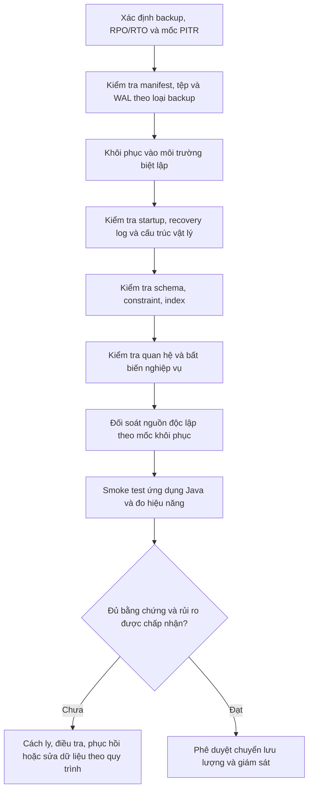

# Kiểm tra tính toàn vẹn sau khi khôi phục

> **Chương:** Độ bền dữ liệu  
> **Phạm vi:** `DATA_PERSISTENCE_FUNDAMENTALS` — hiểu lưu trữ dữ liệu bền vững trong ứng dụng; kết nối việc chọn mô hình dữ liệu, lược đồ, chỉ mục, truy vấn, giao dịch và mức cô lập với thiết kế persistence cho Java, xử lý lỗi, tiến hóa schema, bảo mật, sao lưu, khôi phục và tối ưu hiệu năng.

## Mục tiêu học tập

Sau bài này, người học có thể:

1. Phân biệt **khôi phục chạy được**, **toàn vẹn vật lý**, **toàn vẹn quan hệ**, **toàn vẹn nghiệp vụ** và **tính đầy đủ theo mục tiêu khôi phục**.
2. Thiết kế quy trình kiểm tra một bản khôi phục độc lập trước khi cho ứng dụng Java kết nối và nhận ghi mới.
3. Sử dụng công cụ và truy vấn PostgreSQL phù hợp để kiểm tra bản sao lưu, cấu trúc lưu trữ, constraint, chỉ mục, liên kết bảng và các bất biến dữ liệu.
4. Giải thích ý nghĩa của mốc khôi phục, `RPO`, `RTO` và cách đối soát với nguồn sự kiện bên ngoài mà không nhầm dữ liệu chưa được phục hồi với dữ liệu hỏng.
5. Tự động hóa các phép kiểm tra bằng Java/JDBC, phân loại lỗi và lưu bằng chứng để quyết định có đủ điều kiện đưa hệ thống trở lại phục vụ hay không.

## 1. Vì sao “restore thành công” chưa đủ?

Một tiến trình khôi phục có thể báo thành công và PostgreSQL có thể chấp nhận kết nối, nhưng dữ liệu vẫn chưa đáp ứng mong đợi của ứng dụng:

- Bản sao lưu được tạo **trước** một số giao dịch quan trọng; đây có thể là tổn thất dữ liệu phù hợp với mốc khôi phục đã chọn, nhưng cần nhận diện và đối soát.
- Một bảng có đủ bản ghi, song vài hàng mất quan hệ với bảng cha hoặc một ràng buộc chưa được kiểm tra lại.
- Chỉ mục hoặc trang dữ liệu có lỗi vật lý chưa lộ ra trong những câu truy vấn khởi động đơn giản.
- Một đơn hàng có tổng tiền lưu trong `purchase_order` khác tổng các dòng trong `purchase_order_line`.
- Ứng dụng được phục hồi lên một phiên bản schema không tương thích với phiên bản Java đang triển khai.
- Một thanh toán ở nhà cung cấp bên ngoài đã thành công, nhưng bản ghi xác nhận tại DB nằm **sau điểm khôi phục** và chưa xuất hiện.

**Tính toàn vẹn sau khôi phục** nghĩa là thu thập đủ bằng chứng rằng dữ liệu, cấu trúc và trạng thái nghiệp vụ của hệ thống khôi phục thỏa các điều kiện cần thiết **tại thời điểm phục hồi đã chọn**, trong phạm vi khả năng phát hiện của các phép kiểm tra.

Không có một lệnh `CHECK DATABASE` chung cho mọi DBMS có thể chứng minh mọi điều kiện nghiệp vụ đều đúng. Kiểm tra toàn vẹn là tập hợp nhiều bước có phạm vi, giả định và kết quả xác định.

### 1.1. Các lớp toàn vẹn cần phân biệt

| Lớp kiểm tra | Câu hỏi cần trả lời | Bằng chứng thường dùng | Giới hạn |
| --- | --- | --- | --- |
| **Bản sao lưu và chuỗi phục hồi** | Tệp backup, manifest và WAL cần thiết có sẵn, đọc được và khớp kỳ vọng? | Kiểm tra checksum/manifest, nhật ký backup, restore, WAL. | Backup hợp lệ chưa chứng minh ứng dụng chạy đúng sau restore. |
| **Vật lý** | Các trang dữ liệu, tệp và cấu trúc chỉ mục có lỗi mà công cụ DB nhận diện được không? | Kiểm tra page checksum nếu bật; `pg_amcheck` trong PostgreSQL. | Không phát hiện tất cả dạng hư hỏng, nhất là sai nghiệp vụ. |
| **Schema và ràng buộc** | Bảng/cột, khóa chính/ngoại, constraint, index có đúng phiên bản và trạng thái không? | Danh mục hệ thống; so với schema/migration kỳ vọng. | Constraint có thể không biểu diễn được bất biến nhiều hàng. |
| **Logic và nghiệp vụ** | Dữ liệu thỏa quan hệ và quy tắc thực tế không? | Truy vấn phát hiện orphan, bản ghi trùng, tổng lệch, trạng thái bất thường. | Phụ thuộc vào việc đặc tả nghiệp vụ đầy đủ. |
| **Đầy đủ theo mốc khôi phục** | Những giao dịch nào cần có và những giao dịch nào cần xử lý lại? | Mốc thời gian/LSN, nhật ký giao dịch, outbox và biên nhận độc lập. | Bản ghi sau điểm khôi phục có thể vắng mặt theo thiết kế. |
| **Tương thích ứng dụng** | Java service có thể đọc/ghi đúng theo hợp đồng persistence hiện tại? | Thử nghiệm kết nối, migration, nghiệp vụ và quyền trên bản sao thử nghiệm. | Thử nghiệm mẫu không chứng minh mọi đường đi đều đúng. |

Các lớp này bổ trợ cho nhau. Ví dụ, `pg_verifybackup` có thể xác minh một bản backup theo manifest, nhưng không thể xác định một khoản hoàn tiền đã được xử lý đúng quy tắc hay chưa.

## 2. Xác định “phải khôi phục đến đâu” trước khi đối chiếu

Để kết luận thiếu hay đủ dữ liệu, trước tiên phải biết **điểm phục hồi mục tiêu**. Hai khái niệm vận hành thường gặp:

- **RPO — Recovery Point Objective:** mức mất dữ liệu tối đa có thể chấp nhận theo thời gian hoặc một tiêu chí cam kết tương đương. Ví dụ, RPO 15 phút nghĩa là mục tiêu không mất quá 15 phút dữ liệu tính từ sự cố; không có nghĩa bản phục hồi thực tế chắc chắn đạt mục tiêu.
- **RTO — Recovery Time Objective:** thời lượng tối đa được phép để khôi phục khả năng phục vụ theo yêu cầu đã định nghĩa. Một bản khôi phục đúng dữ liệu nhưng mất nhiều giờ hơn RTO vẫn không đạt cam kết phục hồi.

Ngoài mục tiêu, cần ghi nhận **thực tế**: bản base backup nào, các WAL hoặc log nào đã áp dụng, mốc kết thúc phục hồi, timeline và trạng thái DB sau recovery. Với PostgreSQL point-in-time recovery (PITR), cấu hình thời điểm hoặc LSN phục hồi quyết định những thay đổi đã được phát lại. Cần phân biệt thời gian đồng hồ của ứng dụng, thời gian commit trên DB và thời gian ghi nhận ở nhà cung cấp bên ngoài.

Ví dụ sự cố xảy ra lúc 10:20, hệ thống được phục hồi đến trạng thái tương ứng khoảng 10:12:

| Sự kiện | Quan sát | Diễn giải |
| --- | --- | --- |
| Đơn hàng X commit lúc 10:05 | Có trong DB phục hồi | Phù hợp mốc khôi phục. |
| Đơn hàng Y commit lúc 10:17 | Không có trong DB phục hồi | Có thể là mất dữ liệu theo RPO, cần đối soát/xử lý lại; không mặc nhiên là lỗi vật lý. |
| Biên nhận thanh toán Y lúc 10:18 ở hệ thống bên ngoài | Nhà cung cấp báo thành công, DB không có Y | Là **sai lệch liên hệ hai hệ thống** cần quy trình hòa giải. |
| Bản ghi Z có `created_at = 10:02` nhưng commit lúc 10:15 | Có thể không hiện diện | Cột `created_at` không phải bằng chứng chắc chắn về thứ tự commit. |

Không nên dùng duy nhất `MAX(created_at)` để “chứng minh DB đã phục hồi đến 10:12”: timestamp ở hàng có thể do ứng dụng cấp, được sửa hoặc khác thời gian commit. Nên dùng metadata/phương tiện khôi phục đã được ghi nhận, cộng đối soát giao dịch có định danh bền vững.

**Một bất biến quan trọng:** đối chiếu phải áp dụng cho **cùng phạm vi dữ liệu, cùng phiên bản schema, cùng mốc thời gian logic**. So số hàng DB hôm nay với thống kê đã chụp sau điểm PITR sẽ tạo cảnh báo không có ý nghĩa nếu không hiệu chỉnh phạm vi.

## 3. Quy trình xác minh theo lớp

Khuyến nghị phục hồi vào **môi trường kiểm tra biệt lập** trước khi chuyển lưu lượng. Tránh để instance phục hồi thử nghiệm tự kết nối đến hàng đợi, email, thanh toán hoặc cổng thông tin ngoài và gây tác động thật.



Mỗi bước nên ghi **PASS / FAIL / INCONCLUSIVE** kèm thời điểm, phiên bản công cụ, phạm vi kiểm tra và đường dẫn log/bằng chứng. `INCONCLUSIVE` phù hợp khi không đủ dữ liệu đối chiếu, thiếu quyền chạy công cụ hoặc chỉ kiểm tra một phần.

**Thứ tự có chủ đích:** trước hết chứng minh tập tệp phục hồi đáng tin và DB có thể mở; sau đó kiểm tra cấu trúc, dữ liệu và hợp đồng nghiệp vụ; cuối cùng mới thử luồng ứng dụng/đưa vào phục vụ. Nếu kiểm tra vật lý phát hiện lỗi nghiêm trọng, cần ưu tiên điều tra bản backup và hệ thống lưu trữ trước khi dựa vào các phép tổng hợp SQL có thể bỏ sót hàng.

## 4. Kiểm tra bản sao lưu, WAL và tình trạng phục hồi

### 4.1. Phân biệt backup vật lý và backup logic

**Backup vật lý** của PostgreSQL chứa tệp cụm dữ liệu và cần cơ chế phục hồi WAL phù hợp để đạt trạng thái nhất quán. **Backup logic** như `pg_dump` chứa khai báo/schema và dữ liệu theo định dạng dump, được khôi phục bằng `psql` hoặc `pg_restore` tùy loại file. Công cụ xác minh của hai loại không giống nhau.

Với bản backup vật lý do `pg_basebackup` tạo **và có backup manifest**, có thể kiểm tra bản backup **trước** khi restore:

```bash
# Ví dụ chạy trên bản backup vật lý có manifest, chưa mở thành DB.
pg_verifybackup /backups/postgres/base_2026_11_22
```

`pg_verifybackup` so sánh tập tệp và nội dung với manifest, thực hiện những phép kiểm tra WAL trong phạm vi công cụ hỗ trợ. Tuy nhiên nó không chứng minh rằng toàn bộ chuỗi archive WAL cần cho mốc PITR đều có sẵn, không xác nhận bất biến nghiệp vụ và không thay thế thử restore thực tế. Nếu bản backup không có manifest hoặc được tạo bởi công cụ khác, cần dùng cơ chế kiểm tra do công cụ đó cung cấp.

Với backup logic định dạng custom/tar/directory, `pg_restore --list` có thể đọc danh mục đối tượng của dump:

```bash
# Liệt kê danh mục của một file custom-format đã được tạo trước đó.
pg_restore --list /backups/postgres/app_2026_11_22.dump
```

Đọc được danh mục **không bảo đảm** mọi dữ liệu trong dump đều hợp lệ. Phải khôi phục thử vào database biệt lập và kiểm tra schema, dữ liệu, constraint và log lỗi; kết quả restore không thành công phải được xử lý như một lỗi kiểm tra.

Trong cả hai trường hợp, ghi nhận danh tính backup, checksum nếu có, nguồn tạo, dung lượng, công cụ và phiên bản tương thích. Đối với PITR, kiểm tra có đủ base backup và chuỗi WAL cần thiết, phát hiện khoảng trống trong archive, và xem log thực tế của quá trình replay đến mốc đích.

### 4.2. Xác nhận quá trình restore thực sự hoàn tất

Thu thập log của công cụ restore/PostgreSQL, mã thoát, phiên bản PostgreSQL, cấu hình recovery, đường dẫn dữ liệu và thông tin timeline. Kiểm tra hệ thống đã đạt trạng thái phục hồi được mong đợi và không còn lỗi phục hồi hoặc tệp thiếu được báo trong log.

Sau khi instance khôi phục sẵn sàng phục vụ truy vấn đọc, thực hiện kiểm tra kết nối và thông tin cơ bản:

```sql
SELECT version();

SELECT current_database(), current_user, now();

SELECT pg_is_in_recovery() AS still_recovering;

SELECT pg_size_pretty(pg_database_size(current_database()))
       AS approximate_database_size;
```

`pg_is_in_recovery() = TRUE` cho biết server vẫn ở chế độ recovery/standby; nó **không tự xác nhận đã replay đến đúng điểm PITR**. Giá trị FALSE cũng không chứng minh bản khôi phục đầy đủ. Hãy kết hợp với recovery log, cấu hình target, timeline và bằng chứng nguồn của bản backup.

Kích thước database, số bảng hoặc việc kết nối thành công chỉ là chỉ dấu sanity. Một bảng bị thiếu một phần dữ liệu vẫn có thể có kích thước gần giống dự kiến.

## 5. Kiểm tra toàn vẹn vật lý của bản khôi phục

### 5.1. Page checksum

PostgreSQL có thể được cấu hình **data page checksums** ở cấp cụm. Khi được bật, checksum giúp phát hiện một số trường hợp trang dữ liệu bị biến đổi/hư hỏng. Checksum **không chứng minh nội dung nghiệp vụ đúng**, không chống được mọi dạng lỗi và không đồng nghĩa với kiểm tra toàn bộ bảng.

Trên **bản sao cluster đã dừng hẳn** và có bật page checksums, công cụ quản trị có thể kiểm tra:

```bash
# Chỉ dùng với bản sao PostgreSQL đã shutdown sạch;
# không chạy trên instance đang phục vụ.
pg_checksums --check -D /srv/pg-restore-cluster
```

Nếu cluster không bật checksums, bước này không thể cung cấp bằng chứng tương ứng. Công cụ/phiên bản PostgreSQL cũng phải tương thích; không bật/tắt checksum hay dừng một DB đang phục vụ chỉ để chạy thử trên production khi chưa có kế hoạch vận hành.

### 5.2. Kiểm tra bảng và chỉ mục bằng amcheck

PostgreSQL có tiện ích `pg_amcheck` để chạy các phép kiểm tra khả dụng của extension `amcheck` trên heap và B-tree indexes. Trên **database đã khôi phục, đang chạy và được cô lập**:

```bash
# Ví dụ: kết nối đến database phục hồi theo cấu hình kết nối an toàn.
pg_amcheck --database=app_restore
```

Xem mã thoát và toàn bộ thông báo để định vị relation/index có vấn đề. Các công cụ kiểm tra chỉ bao phủ những dạng cấu trúc và thuật toán chúng hỗ trợ; **kết quả sạch không bảo đảm không còn bất kỳ lỗi vật lý nào**. Một index lỗi có thể cần xây dựng lại theo quy trình sau khi điều tra; đừng tự động `REINDEX`/sửa dữ liệu trên bản chứng cứ duy nhất trước khi lưu thông tin phục vụ phân tích nguyên nhân.

**Tách phạm vi công cụ:** `pg_verifybackup` kiểm tra một *bản backup* có manifest; `pg_checksums` kiểm tra page checksums của *cluster dừng* khi được bật; `pg_amcheck` kiểm tra các cấu trúc được hỗ trợ trên *database đang chạy*. Không dùng các lệnh thay thế lẫn nhau hoặc suy diễn rằng một lệnh đã kiểm tra mọi bảng, mọi constraint và mọi giao dịch.

## 6. Kiểm tra schema, constraint và index

Một database có thể mở được nhưng có schema lệch với phiên bản mã Java hiện tại: thiếu cột, khóa ngoại chưa hợp lệ, unique index bị bỏ, kiểu dữ liệu đã thay đổi hoặc migration mới chạy được một phần.

Cần có **bản kê schema mong đợi** từ bản release/migration đã phát hành, thay vì suy ra rằng tất cả đối tượng còn trong DB đều đúng. Đối chiếu version migration, bảng, cột, kiểu, nullable, khóa chính, khóa ngoại, unique/exclusion constraint, index và extension cần dùng.

Với PostgreSQL, có thể tìm các `CHECK`/`FOREIGN KEY` được ghi nhận là chưa validate:

```sql
SELECT
    conrelid::regclass AS table_name,
    conname AS constraint_name,
    contype AS constraint_type,
    convalidated
FROM pg_constraint
WHERE connamespace = 'public'::regnamespace
  AND contype IN ('c', 'f')
  AND convalidated = FALSE
ORDER BY table_name, constraint_name;
```

Kết quả không rỗng **không tự kết luận dữ liệu hỏng**: `NOT VALID` có thể là trạng thái migration được chấp nhận tạm thời. Nhưng các hàng cũ chưa được chứng minh thỏa constraint đó. Phải so với kế hoạch schema và kiểm tra dữ liệu tương ứng.

Tìm index không sẵn sàng hoặc không hợp lệ:

```sql
SELECT
    i.indrelid::regclass AS table_name,
    i.indexrelid::regclass AS index_name,
    i.indisready,
    i.indisvalid
FROM pg_index AS i
WHERE NOT i.indisready OR NOT i.indisvalid
ORDER BY table_name, index_name;
```

Một chỉ mục chưa `VALID` có thể do quá trình build concurrent bị gián đoạn hoặc migration đang diễn ra. Nó cần được đối chiếu với manifest schema và trạng thái vận hành; không mặc định rằng mọi kết quả đều chỉ ra dữ liệu bảng đã sai.

**Không dùng kết quả `SELECT` thông thường để chứng minh index không có lỗi**; bộ tối ưu có thể chọn cách quét khác, hoặc truy vấn không chạm mọi trang. Để kiểm tra index, dùng công cụ chuyên dụng và phối hợp kiểm tra vật lý ở phần 5.

## 7. Kiểm tra tính toàn vẹn quan hệ bằng SQL

Ví dụ sau dùng hệ thống đơn hàng đơn giản, với giả định **không áp dụng giảm giá, thuế, phí vận chuyển hoặc hoàn tiền**. Tổng đơn hàng vì vậy phải bằng tổng số lượng nhân đơn giá của các dòng hàng.

```sql
CREATE TABLE customer (
    id BIGINT PRIMARY KEY,
    email_key TEXT NOT NULL UNIQUE
);

CREATE TABLE purchase_order (
    id BIGINT PRIMARY KEY,
    customer_id BIGINT NOT NULL REFERENCES customer(id),
    status TEXT NOT NULL CHECK (status IN ('NEW', 'PAID', 'CANCELLED')),
    total_amount NUMERIC(18, 2) NOT NULL CHECK (total_amount >= 0)
);

CREATE TABLE purchase_order_line (
    order_id BIGINT NOT NULL REFERENCES purchase_order(id),
    line_no INTEGER NOT NULL CHECK (line_no > 0),
    quantity INTEGER NOT NULL CHECK (quantity > 0),
    unit_price NUMERIC(18, 2) NOT NULL CHECK (unit_price >= 0),
    PRIMARY KEY (order_id, line_no)
);
```

**Đây là lược đồ minh họa quy tắc cần kiểm tra**, không phải yêu cầu tạo lại bảng trên database đã restore. Khi dùng với hệ thống thật, áp dụng truy vấn vào đúng tên bảng/cột và quy tắc giá thực tế. Những câu lệnh `CREATE TABLE` chỉ có tác dụng giải thích, không được chạy trên bản khôi phục cần bảo toàn bằng chứng.

### 7.1. Phát hiện bản ghi con không còn bản ghi cha

```sql
-- Những dòng đơn hàng không tìm được đơn hàng cha.
SELECT l.order_id, l.line_no
FROM purchase_order_line AS l
LEFT JOIN purchase_order AS o
       ON o.id = l.order_id
WHERE o.id IS NULL
ORDER BY l.order_id, l.line_no;
```

Nếu FK được thực thi và validate đúng, cơ sở dữ liệu thường đã ngăn tình huống này. Nhưng kiểm tra trực tiếp vẫn hữu ích khi dữ liệu từng được nhập với constraint vô hiệu, đã qua migration đặc biệt hoặc khi cần chứng cứ độc lập.

Tương tự, đơn hàng không tìm được khách hàng:

```sql
SELECT o.id, o.customer_id
FROM purchase_order AS o
LEFT JOIN customer AS c ON c.id = o.customer_id
WHERE c.id IS NULL;
```

Nếu những truy vấn này trả hàng, cần cách ly và điều tra: đó có thể là dữ liệu nguồn đã sai trước backup, restore/migration thiếu dữ liệu, hoặc ràng buộc từng bị bỏ qua. Đừng tùy tiện xóa hàng con để “làm sạch kết quả” khi chưa xác định ảnh hưởng nghiệp vụ.

### 7.2. Kiểm tra trùng khóa nghiệp vụ

```sql
SELECT email_key, COUNT(*) AS duplicates
FROM customer
GROUP BY email_key
HAVING COUNT(*) > 1
ORDER BY duplicates DESC;
```

Nếu unique constraint hợp lệ và dữ liệu được ghi hợp lệ, truy vấn phải trả rỗng. Tuy nhiên **trùng theo nghiệp vụ** có thể khác trùng theo SQL: `A@Example.com` và `a@example.com` có thể cần chuẩn hóa giống nhau tùy chính sách. Khi đó nên kiểm tra khóa đã chuẩn hóa, collation và quy tắc app chứ không chỉ nhìn cột hiển thị.

### 7.3. Đối chiếu tổng tiền lưu và tổng các dòng

```sql
SELECT
    o.id AS order_id,
    o.total_amount,
    COALESCE(SUM(l.quantity * l.unit_price), 0) AS computed_amount
FROM purchase_order AS o
LEFT JOIN purchase_order_line AS l ON l.order_id = o.id
GROUP BY o.id, o.total_amount
HAVING o.total_amount IS DISTINCT FROM
       COALESCE(SUM(l.quantity * l.unit_price), 0)
ORDER BY o.id;
```

`IS DISTINCT FROM` so sánh an toàn với `NULL`, dù `total_amount` trong mô hình này là `NOT NULL`. `COALESCE` khiến đơn không có dòng có tổng tính bằng 0; nếu chính sách yêu cầu **mọi đơn phải có ít nhất một dòng**, cần thêm truy vấn phát hiện đơn rỗng. Với nghiệp vụ có thuế, voucher, phí vận chuyển hay hoàn tiền, phải điều chỉnh công thức; không gọi một chênh lệch hợp lệ là hỏng dữ liệu.

### 7.4. Kiểm tra sự tồn tại bắt buộc của các tập con

```sql
-- Nếu mọi đơn PAID theo chính sách phải có ít nhất một dòng.
SELECT o.id
FROM purchase_order AS o
WHERE o.status = 'PAID'
  AND NOT EXISTS (
      SELECT 1
      FROM purchase_order_line AS l
      WHERE l.order_id = o.id
  );
```

Các phép kiểm tra cần được **định nghĩa từ bất biến nghiệp vụ thực tế**. Ví dụ có hệ thống cho phép đơn chưa thanh toán không có dòng trong lúc soạn, nhưng không cho phép đơn đã thanh toán rỗng. Điều kiện kiểm tra phải phản ánh đúng vòng đời trạng thái.

## 8. Đối soát tính đầy đủ và giao dịch ngoài DB

Các phép kiểm tra SQL ở phần 7 có thể đều PASS nhưng vẫn chưa đủ. Nếu cả bảng `purchase_order` và `purchase_order_line` cùng thiếu một đơn hàng do PITR trước mốc commit, mọi khóa ngoại và tổng tiền của **những hàng còn lại** vẫn đúng.

Để phát hiện phần đã mất, cần bằng chứng **độc lập với chính bản DB được khôi phục**:

- Nhật ký nhận yêu cầu với **request_id** bất biến, được lưu ở hệ thống có thời gian và retention xác định.
- Mã giao dịch/biên nhận của nhà cung cấp thanh toán, ngân hàng hoặc hệ thống giao hàng.
- Sự kiện trong hàng đợi hoặc outbox đã xuất ra môi trường ngoài DB với trạng thái xử lý đáng tin cậy.
- Báo cáo kiểm toán, watermark hoặc số tổng hợp có chữ ký/hash được tạo **trước sự cố**, được bảo quản độc lập.

Ví dụ đối soát thanh toán:

1. Xác định mốc khôi phục thực tế và danh sách `payment_id`/`request_id` bên nhà cung cấp trong khoảng cần đối soát.
2. So sánh với bản ghi giao dịch đã phục hồi bằng khóa định danh bền vững, không chỉ bằng tổng tiền hoặc timestamp.
3. Phân loại: đã có và khớp; có nhưng trạng thái/số tiền lệch; biên nhận ngoài có nhưng DB thiếu; DB có nhưng chưa đối chiếu được biên nhận ngoài.
4. Với giao dịch ngoài đã xác nhận thành công nhưng DB thiếu, dùng workflow hòa giải/idempotency để tái tạo trạng thái hợp lệ **theo bằng chứng**, không tự ý gọi lại thao tác thu tiền.
5. Lưu kết quả và quyết định nghiệp vụ cho từng trường hợp, bao gồm các trường hợp phải kiểm tra thủ công.

Các đối soát phải chú ý **giao dịch đang dở tại mốc khôi phục** và hành vi bất đồng bộ: một request có thể đã được nhận nhưng chưa commit, một message có thể đã gửi nhưng trạng thái xử lý chưa được ghi, một refund có thể diễn ra sau khi bản backup được tạo.

**So sánh số lượng bản ghi không đủ chứng minh tập bản ghi giống nhau.** Nếu cần so sánh phiên bản dữ liệu, hãy dùng khóa ổn định và đối chiếu từng thực thể hoặc hash/digest tạo từ dữ liệu được chuẩn hóa có thứ tự xác định. Digest phải được lưu độc lập trước sự cố và phải thống nhất cách biểu diễn kiểu số, `NULL`, Unicode và phiên bản schema. Một hash trùng hay số đếm trùng không thay thế mọi kiểm tra nghiệp vụ.

## 9. Kiểm tra ở tầng Java/JDBC

Một ứng dụng Java có thể chạy các truy vấn xác minh bằng **connection chỉ đọc** với snapshot nhất quán. Ví dụ dùng JDBC (Java 17+), áp dụng cho lược đồ đơn hàng ở phần 7:

```java
import javax.sql.DataSource;
import java.sql.Connection;
import java.sql.PreparedStatement;
import java.sql.ResultSet;
import java.sql.SQLException;

public final class RestoreIntegrityVerifier {
    private final DataSource dataSource;

    public RestoreIntegrityVerifier(DataSource dataSource) {
        this.dataSource = dataSource;
    }

    public record FindingCounts(long orphanLines, long mismatchedTotals) {
        public boolean passed() {
            return orphanLines == 0 && mismatchedTotals == 0;
        }
    }

    public FindingCounts verify() throws SQLException {
        try (Connection connection = dataSource.getConnection()) {
            // Thiết lập trước khi transaction bắt đầu.
            connection.setReadOnly(true);
            connection.setTransactionIsolation(
                    Connection.TRANSACTION_REPEATABLE_READ);
            connection.setAutoCommit(false);

            try {
                long orphans = count(connection, """
                    SELECT COUNT(*)
                    FROM purchase_order_line l
                    LEFT JOIN purchase_order o ON o.id = l.order_id
                    WHERE o.id IS NULL
                    """);

                long wrongTotals = count(connection, """
                    SELECT COUNT(*)
                    FROM (
                        SELECT o.id
                        FROM purchase_order o
                        LEFT JOIN purchase_order_line l
                          ON l.order_id = o.id
                        GROUP BY o.id, o.total_amount
                        HAVING o.total_amount IS DISTINCT FROM
                          COALESCE(SUM(l.quantity * l.unit_price), 0)
                    ) AS invalid_orders
                    """);

                // Transaction chỉ đọc: kết thúc và nhả snapshot.
                connection.rollback();
                return new FindingCounts(orphans, wrongTotals);
            } catch (SQLException | RuntimeException error) {
                try {
                    connection.rollback();
                } catch (SQLException rollbackError) {
                    error.addSuppressed(rollbackError);
                }
                throw error;
            }
        }
    }

    private long count(Connection connection, String sql)
            throws SQLException {
        try (PreparedStatement statement =
                     connection.prepareStatement(sql)) {
            statement.setQueryTimeout(60);
            try (ResultSet rs = statement.executeQuery()) {
                if (!rs.next()) {
                    throw new SQLException("Expected one count result");
                }
                return rs.getLong(1);
            }
        }
    }
}
```

**Cách sử dụng kết quả:** `FindingCounts.passed()` chỉ cho biết **hai phép kiểm tra minh họa** không tìm thấy lỗi trong snapshot đã đọc. Nó không đại diện cho chứng nhận toàn vẹn toàn database. Mỗi bất biến khác phải có câu truy vấn riêng và kết quả/cách giải thích phù hợp.

Với PostgreSQL, `REPEATABLE READ` giúp hai phép đếm thông thường sử dụng snapshot nhất quán. Nếu ứng dụng đang phục hồi thử nghiệm hoàn toàn biệt lập và đã đóng nhận ghi, nguy cơ dữ liệu thay đổi giữa các phép kiểm tra còn thấp hơn. `Connection.setReadOnly(true)` cần được xác nhận có hiệu lực trên DB/driver thực tế; nếu cần bảo đảm cứng, dùng quyền database chỉ đọc và mạng biệt lập. Không dùng account sản xuất có quyền ghi chỉ vì API JDBC gọi `setReadOnly`.

Khi dữ liệu lớn, các câu `COUNT`/join toàn bảng có thể tốn tài nguyên. Cần lập kế hoạch quét, timeout, chỉ mục, batch theo khóa và có cơ chế ghi kết quả từng phần. Nếu kiểm tra theo nhiều batch, xác định cách giữ cùng snapshot hoặc chấp nhận/tài liệu hóa sự khác biệt; không so sánh những batch được chụp ở các thời điểm khác nhau mà khẳng định chúng cùng phản ánh một trạng thái.

**Phân loại lỗi cho pipeline kiểm tra:**

| Kết quả | Diễn giải | Xử lý |
| --- | --- | --- |
| PASS | Phép kiểm tra chạy đủ phạm vi, không có vi phạm | Lưu bằng chứng và tiếp tục bước kế. |
| FAIL | Phát hiện hàng/trang/constraint vi phạm hoặc chênh lệch cần xử lý | Dừng quyết định chuyển lưu lượng, điều tra nguyên nhân. |
| INCONCLUSIVE | Timeout, lỗi kết nối, quyền hạn thiếu, mốc đối chiếu chưa đủ | Không đánh dấu PASS; chạy lại hoặc bổ sung bằng chứng. |

Không nên nuốt `SQLException`, biến timeout thành “0 hàng sai” hay tự động sửa dữ liệu khi phép kiểm tra đang chạy. Cần giữ log truy vấn, mã lỗi, thời điểm, định danh DB phục hồi và phạm vi kiểm tra nhưng hạn chế đưa thông tin nhạy cảm vào nhật ký.

## 10. Smoke test ứng dụng và tính tương thích schema

Sau khi kiểm tra dữ liệu bằng SQL, cần chứng minh **ứng dụng Java hiện tại** hiểu đúng schema được khôi phục:

1. Khởi động ứng dụng trên một **bản sao dùng cho thử nghiệm**, với cấu hình trỏ đến DB phục hồi thử và vô hiệu hóa tác động bên ngoài.
2. Kiểm tra trạng thái migration/version tương ứng với bản release dự kiến; tránh tự động chạy migration ghi dữ liệu trên bản bằng chứng.
3. Thử luồng **đọc**: lấy đơn hàng và các dòng, tìm theo khóa chính/unique key, phân trang, truy vấn dùng chỉ mục và dữ liệu Unicode.
4. Thử luồng **ghi và rollback** trên một bản sao có thể bỏ đi: tạo đơn nhiều dòng, cố tình gây lỗi giữa transaction rồi xác nhận không có dữ liệu ghi nửa chừng.
5. Thử xử lý reconnect, pool connection, transaction timeout và logic retry/idempotency cho giao dịch có thể bị gọi lại.
6. Đánh giá lại kế hoạch truy vấn, thống kê bảng, kích thước chỉ mục và độ trễ: sau restore, cache/stats/index có thể khác môi trường gốc, khiến truy vấn hợp lệ nhưng chậm.

**Không dùng smoke test ghi để thay đổi bản khôi phục lưu làm chứng cứ.** Nếu cần sửa schema, `ANALYZE`, `REINDEX` hoặc chạy migration, hãy làm trên bản sao phù hợp sau khi đã giữ lại trạng thái và log ban đầu, kèm phê duyệt/phương án có thể kiểm chứng.

Kiểm tra quyền truy cập cũng là một phần của khả năng phục vụ: ứng dụng có thể đọc dữ liệu nhưng thất bại khi chạy prepared statement hoặc `INSERT` vì thiếu quyền bảng, sequence, schema hoặc extension. Mặt khác, khôi phục không được vô tình mở rộng quyền truy cập hoặc làm lộ backup chứa dữ liệu cá nhân.

## 11. Thế nào là đủ để chuyển hệ thống trở lại phục vụ?

Quyết định chuyển lưu lượng nên dựa trên **tiêu chí đã thống nhất trước**, ví dụ:

| Tiêu chí | Bằng chứng tối thiểu |
| --- | --- |
| Mốc phục hồi phù hợp mục tiêu | Backup/restore log, điểm PITR, phần dữ liệu được xác định nằm ngoài phạm vi và đánh giá RPO thực tế. |
| Backup và cấu trúc vật lý khả dụng | Manifest/kiểm tra tệp khi áp dụng; kiểm tra vật lý theo khả năng công cụ; không còn lỗi nghiêm trọng chưa giải thích. |
| Schema hợp lệ | Migration/version, constraints và indexes đúng kỳ vọng; danh sách `NOT VALID`/index invalid có giải thích. |
| Quan hệ và nghiệp vụ đúng | Kết quả các truy vấn bất biến quan trọng, số lượng vi phạm bằng 0 hoặc ngoại lệ được phê duyệt/đối soát cụ thể. |
| Đối soát hệ thống ngoài | Danh sách giao dịch thiếu/lệch theo request ID, trạng thái xử lý và người chịu trách nhiệm. |
| Ứng dụng Java hoạt động | Smoke test trên bản sao, kiểm tra transaction, quyền, cấu hình, hàng đợi và kết nối. |
| Khả năng vận hành | RTO thực tế, tốc độ truy vấn, cảnh báo sau chuyển đổi, kế hoạch rollback/fallback và người xác nhận. |

**Bản báo cáo tối thiểu** nên ghi: `restore_run_id`, định danh/timestamp của backup, mốc PITR/timeline, phiên bản DB và application, môi trường, công cụ và lệnh đã dùng, các truy vấn kiểm tra, phạm vi/bộ lọc, số lượng lỗi theo từng bất biến, mã thoát/log, kết quả đối soát, đánh giá RPO/RTO, ngoại lệ còn mở và quyết định cuối cùng.

Nếu gặp FAIL hoặc INCONCLUSIVE đối với một bất biến quan trọng, cần tiếp tục điều tra; không nên đánh dấu “đã toàn vẹn” chỉ vì dashboard và endpoint health đều xanh. Việc sửa sai thường là một **quy trình phục hồi nghiệp vụ** có kiểm soát: chọn lại backup tốt hơn, replay WAL đúng mốc, phục hồi bản ghi từ nguồn độc lập hoặc chạy script sửa có kiểm chứng và đối soát sau sửa.

## 12. Thực hành: xác minh phục hồi hệ thống đơn hàng

**Bối cảnh:** tại 14:20, hệ thống đơn hàng gặp lỗi ổ lưu trữ. Đội vận hành khôi phục một bản backup và WAL vào database `app_restore`, ước tính đạt trạng thái khoảng 14:12. Nhà cung cấp thanh toán có thể đã ghi nhận các giao dịch giữa 14:12 và 14:20.

**Nhiệm vụ:**

1. Lập bảng xác minh `RPO`, `RTO` và mốc recovery dựa vào bằng chứng backup/WAL, không dựa riêng vào `MAX(created_at)`.
2. Xác định backup là loại vật lý hay logic. Chọn công cụ kiểm tra phù hợp và nêu giới hạn của từng công cụ.
3. Kiểm tra database mở được, đọc được schema, trạng thái các constraint/index cần thiết, và chạy phép kiểm tra vật lý theo tính năng được bật.
4. Áp dụng ba truy vấn trong phần 7: orphan order lines, trùng khóa nghiệp vụ và tổng tiền đơn hàng lệch. Ghi rõ giả định nghiệp vụ về giá, giảm giá và thuế.
5. So sánh `request_id` hoặc `payment_id` giữa DB phục hồi với danh sách biên nhận độc lập; lập danh sách giao dịch cần hòa giải thay vì thực hiện thanh toán lại tự động.
6. Chạy bộ JDBC read-only verifier và một số smoke test trên bản sao có thể bỏ đi; phân loại PASS/FAIL/INCONCLUSIVE.
7. Viết báo cáo kết luận có bằng chứng, phần chưa xác minh, rủi ro và phương án xử lý trước khi mở traffic.

**Câu hỏi tự đánh giá**

1. Vì sao `pg_verifybackup` PASS chưa chứng minh toàn vẹn nghiệp vụ sau khôi phục?
2. Tại sao trạng thái `pg_is_in_recovery() = FALSE` không đủ xác nhận đúng mốc PITR?
3. Nếu tất cả FK và unique constraint đều hợp lệ, vẫn có thể thiếu nguyên một đơn hàng không? Vì sao?
4. Khi nào kết quả “thiếu bản ghi” phản ánh RPO thay vì hư hỏng? Cần bằng chứng gì để phân biệt?
5. Vì sao cần kiểm tra `convalidated` và `indisvalid` khi đối chiếu schema?
6. Khi kiểm tra tổng giá đơn hàng, vì sao phải chốt cách tính thuế, giảm giá và phí vận chuyển trước?
7. Những tình huống nào pipeline kiểm tra phải trả `INCONCLUSIVE` thay vì `PASS`?
8. Tại sao thao tác sửa dữ liệu hoặc chạy migration trên bản khôi phục duy nhất có thể gây khó cho điều tra nguyên nhân?
9. Nếu nhà cung cấp thanh toán báo “thành công” nhưng DB không có payment, quy trình an toàn hơn việc gọi lại thanh toán là gì?

## Ghi nhớ

**Kiểm tra tính toàn vẹn sau khi khôi phục là một bài toán nhiều lớp.** Phải xác định chính xác mốc dữ liệu cần có, xác minh bản backup và quá trình recovery, kiểm tra cấu trúc vật lý, schema, quan hệ, bất biến nghiệp vụ, rồi đối soát bằng chứng độc lập cho những giao dịch ở ranh giới PITR. Mỗi phép kiểm tra đều có phạm vi và giới hạn; “DB mở được” hay “không thấy lỗi ở một truy vấn” không đồng nghĩa đã kiểm chứng toàn diện.

Với ứng dụng Java, hãy giữ môi trường xác minh biệt lập, dùng truy vấn có transaction và snapshot phù hợp, ghi nhận lỗi một cách có thể kiểm toán, chỉ thử ghi trên bản sao và tránh lặp tác động ngoài DB khi kết quả commit chưa chắc chắn. Chỉ đưa hệ thống trở lại phục vụ khi các bất biến quan trọng, mục tiêu phục hồi và kế hoạch xử lý sai lệch đều đã được đánh giá bằng bằng chứng.
