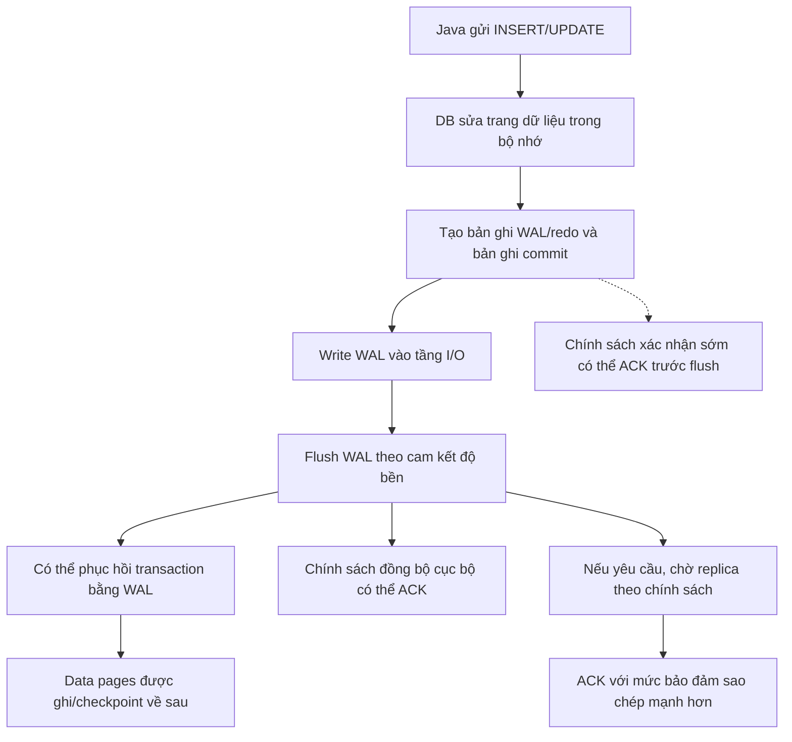
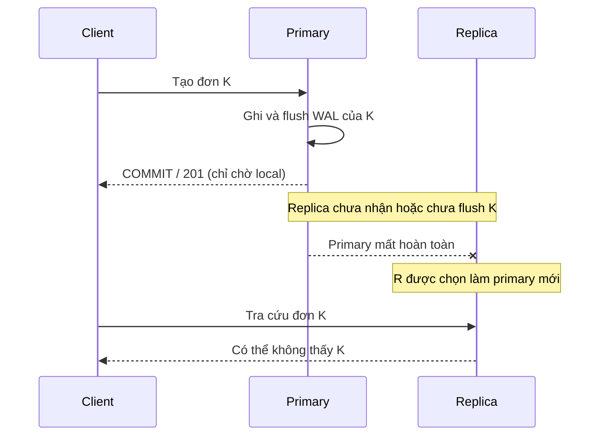
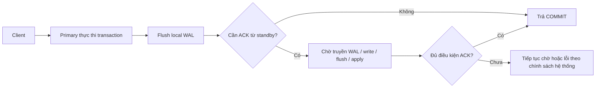
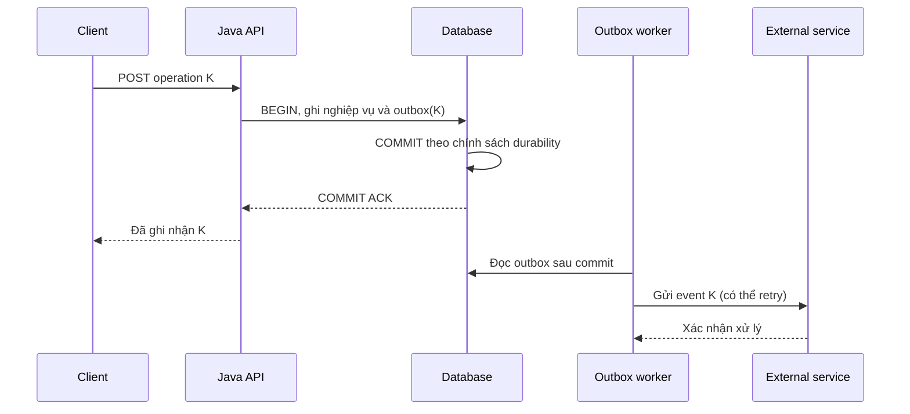

# Đánh đổi giữa xác nhận nhanh và mức bảo đảm độ bền

## 1. Khi nhận thông báo “thành công”, dữ liệu đã an toàn đến đâu?

Một người dùng thanh toán đơn hàng và nhận thông báo **“Đã ghi nhận”**. Ngay sau đó, máy chủ lưu trữ bị mất điện. Khi hệ thống khởi động lại, đơn hàng có còn không? Nếu máy chủ chính ngừng hoạt động và hệ thống chuyển sang bản sao, bản sao ấy có chứa giao dịch đã xác nhận không?

Câu trả lời phụ thuộc vào **điều kiện hệ thống phải hoàn thành trước khi trả lời thành công**, chứ không chỉ phụ thuộc vào việc ứng dụng đã gọi `COMMIT`. Có hệ thống chờ nhật ký giao dịch được đồng bộ xuống lưu trữ bền vững; có hệ thống trả lời sớm khi thay đổi mới nằm trong bộ nhớ hoặc bộ đệm hệ điều hành; có hệ thống còn phải chờ một hoặc nhiều bản sao từ xa.

Trong chương **Độ bền dữ liệu** của module **DATA_PERSISTENCE_FUNDAMENTALS**, chúng ta phân tích mối quan hệ giữa **độ trễ xác nhận** (*acknowledgement latency*) và **mức bảo đảm độ bền** (*durability guarantee*). Đây là nền tảng để thiết kế ranh giới persistence cho Java, xử lý lỗi kết nối, sao lưu, chuyển đổi nút chính và lựa chọn chính sách dữ liệu phù hợp với từng nghiệp vụ.

> **Câu hỏi thiết kế:** Trước khi báo “thành công”, hệ thống phải đợi thay đổi được ghi tới **đâu**, và cần sống sót trước **loại sự cố nào**?

## 2. Định nghĩa các mốc: đã xử lý, đã commit, đã lưu bền vững và đã sao chép

Các mốc dưới đây thường được nhắc đến cùng nhau, nhưng không phải là một:

| Mốc | Điều đã xảy ra | Điều không thể tự suy ra |
| --- | --- | --- |
| Ứng dụng nhận request | Request đã đến API | Database đã nhận hoặc ghi bất kỳ dữ liệu nào |
| SQL thực thi xong | Engine đã thực hiện một câu lệnh | Toàn bộ transaction đã commit |
| Transaction được commit về mặt logic | Thay đổi được chấp nhận theo cơ chế transaction của DBMS | Mọi thiết bị hoặc mọi replica đã lưu thay đổi bền vững |
| WAL/redo log được *write* | Bản ghi có thể mới nằm trong bộ đệm hệ điều hành hoặc tầng lưu trữ | Đã *flush* xuống miền lưu trữ bền vững theo cam kết |
| WAL/redo log được *flush/fsync* | DBMS đã yêu cầu đồng bộ bản ghi theo hợp đồng I/O của nó | Không còn rủi ro từ phần cứng lỗi, thiết bị báo sai hoặc mất cả nút |
| Replica nhận bản ghi | Một nút khác đã nhận dữ liệu | Replica đã flush, apply hoặc có thể phục vụ truy vấn thấy thay đổi |
| Replica đã apply | Replica đã áp dụng bản ghi vào trạng thái có thể truy vấn | Mọi replica khác đều đã bắt kịp hoặc failover chắc chắn chọn đúng replica đó |
| API trả HTTP 200/201 | Client đã nhận xác nhận ứng dụng | Mức độ bền nằm ngoài điều API và hạ tầng thực sự cam kết |

**ACK** (*acknowledgement*) là xác nhận tại một ranh giới giao tiếp cụ thể. ACK của TCP, ACK giữa các node, phản hồi `COMMIT` của database và HTTP 201 của API **không có cùng ý nghĩa**. Cần chỉ rõ ACK nào đang được đo hoặc hứa với người dùng.

Trong phần còn lại, “độ bền” có nghĩa **một thay đổi đã được xác nhận sẽ tiếp tục tồn tại trước các lớp sự cố được nêu rõ**. Một cam kết “không mất dữ liệu khi tiến trình DB crash” yếu hơn một cam kết “không mất dữ liệu khi toàn bộ máy hoặc cả vùng triển khai bị phá hủy”.

## 3. Mô hình WAL: vì sao có thể xác nhận trước khi ghi data page?

Nhiều cơ sở dữ liệu giao dịch sử dụng **write-ahead logging (WAL)** hoặc cơ chế **redo log**. Thay đổi dữ liệu được mô tả trong nhật ký; khi phục hồi sau sự cố, engine có thể dùng nhật ký đã lưu bền vững để tái tạo các thay đổi đã commit. Vì thế, database **không nhất thiết phải đồng bộ mọi data page của bảng xuống đĩa trước khi xác nhận transaction**.

Một đường đi khái quát:



Trong một triển khai cụ thể, thứ tự và các điểm chờ có thể khác sơ đồ này. Điều cốt lõi là **ghi trang dữ liệu, ghi nhật ký, flush nhật ký và xác nhận request là các sự kiện khác nhau**.

### Write không đồng nghĩa flush

Một lời gọi `write` có thể đưa bytes vào bộ đệm của hệ điều hành. Lời gọi `fsync` hoặc cơ chế đồng bộ tương đương yêu cầu hệ điều hành và thiết bị đưa dữ liệu tới miền bền vững theo giao diện được cam kết. Kết quả thực tế còn phụ thuộc storage stack, bộ đệm có nguồn điện dự phòng, trình điều khiển và việc phần cứng có tuân thủ lệnh flush hay không.

**Thử nghiệm chỉ kill tiến trình database** có thể chưa đủ để đánh giá cấu hình “xác nhận trước flush”: bộ đệm của OS vẫn còn và tiến trình khởi động lại có thể thấy dữ liệu. Để kiểm tra cam kết trước lỗi mất điện hoặc lỗi host, cần kịch bản phù hợp với loại sự cố đó.

### Group commit

Khi nhiều transaction được commit gần nhau, DBMS có thể gom các bản ghi WAL để cùng trả chi phí một lượt flush. **Group commit** cải thiện thông lượng và có thể giảm chi phí trung bình trên mỗi transaction nhưng không loại bỏ độ trễ và độ biến động của I/O. Không nên suy ra “flush mỗi commit” luôn tương đương “một lệnh I/O vật lý riêng cho mỗi request”.

## 4. Ba lịch thực thi cho cùng một lệnh tạo đơn

Giả sử API có một lệnh tạo đơn với định danh `operation_id = K`. Transaction tạo bản ghi đơn và sinh một commit record.

### Lịch A — xác nhận sớm, trước khi WAL được flush

```text
T0  Client gửi tạo đơn K
T1  DB thực thi INSERT, tạo WAL và commit record
T2  DB trả COMMIT thành công khi WAL còn chưa được flush bền vững
T3  API trả 201 "Đã tạo đơn K"
T4  Host mất điện đột ngột trước lần flush tiếp theo
T5  Khởi động lại: commit K có thể không còn
```

Đây là **cửa sổ mất dữ liệu đã được xác nhận**. Việc dữ liệu có mất thật hay không phụ thuộc WAL đã kịp được đồng bộ trước sự cố chưa. Cấu hình xác nhận sớm giúp giảm độ trễ commit nhưng chấp nhận rủi ro mất một số transaction gần đây khi xảy ra lỗi thuộc phạm vi rủi ro.

### Lịch B — chờ WAL được flush cục bộ

```text
T0  Client gửi tạo đơn K
T1  DB thực thi INSERT, tạo WAL và commit record
T2  DB flush WAL bền vững trên node chính theo cam kết I/O
T3  DB trả COMMIT; API trả 201
T4  Tiến trình hoặc hệ điều hành crash
T5  Khởi động lại cùng lưu trữ: DB có thể replay WAL của K
```

Thiết kế này nhắm tới khả năng phục hồi khi node còn giữ được **lưu trữ cục bộ đáng tin cậy**. Nếu cả thiết bị chứa WAL bị phá hủy hoặc volume không còn truy cập được, bảo đảm từ bản WAL cục bộ không cứu được dữ liệu. Vì thế “durable locally” chưa đồng nghĩa “durable across node loss”.

### Lịch C — node chính đã flush nhưng bản sao chưa theo kịp



Transaction K có thể **đã bền vững trên primary cũ** mà vẫn **mất khỏi trạng thái được phục vụ sau failover**, nếu primary cũ không thể phục hồi và hệ thống promote một replica chưa có K. Đây là khác biệt giữa **độ bền tại node** và **khả năng giữ dữ liệu qua failover**.

## 5. Phân loại sự cố trước khi nói đến bảo đảm độ bền

| Loại sự cố | Dữ liệu nào có nguy cơ? | Bảo vệ thường cần |
| --- | --- | --- |
| Tiến trình DB dừng, OS và volume còn | Trạng thái chỉ có trong bộ nhớ DB chưa được bảo vệ | WAL/recovery, quy tắc commit của DB |
| OS crash hoặc mất điện host | WAL mới chỉ ở bộ đệm không bền vững | Flush/fsync và storage tuân thủ cam kết |
| Hỏng ổ đĩa hoặc mất volume của primary | Bản sao dữ liệu chỉ nằm trên volume đó | Replication, storage redundancy, backup và restore đã kiểm thử |
| Primary chết trước khi replica bắt kịp | Các commit chưa tới replica được promote | Chính sách synchronous replication và failover đúng giao thức |
| Mất cả khu vực/vùng | Các bản sao cùng chịu rủi ro vùng | Phân tán vị trí địa lý theo mức rủi ro cần chịu |
| Xóa nhầm, lỗi ứng dụng, mã độc sửa dữ liệu | Dữ liệu sai có thể được sao chép sang mọi replica | Backup độc lập, PITR, quyền truy cập và diễn tập phục hồi |

**Sao chép không phải sao lưu.** Một lệnh `DELETE` sai được commit ở primary có thể lan tới các replica rất nhanh. Muốn trở lại trước điểm xảy ra lỗi, cần bản backup và nhật ký phục hồi phù hợp; mức replication ACK không thay thế chính sách khôi phục theo thời điểm (*point-in-time recovery*, PITR).

Hãy nói rõ giả định về thiết bị lưu trữ. Không có cấu hình `fsync` nào bảo đảm chống tất cả tình huống hỏng phần cứng, mất thông tin xác nhận hoặc lỗi vận hành vượt ra ngoài phạm vi hợp đồng I/O.

## 6. Đánh đổi giữa các chính sách xác nhận

| Chính sách | Thời điểm thường có thể ACK | Điểm mạnh | Rủi ro hoặc chi phí |
| --- | --- | --- | --- |
| Xác nhận trước flush WAL cục bộ | Khi commit record đã được chấp nhận ở tầng bộ đệm theo cơ chế DB | Độ trễ thấp hơn, ít phải chờ I/O mỗi commit | Có thể mất các commit vừa được xác nhận khi host/OS crash |
| Chờ flush WAL trên primary | Sau khi WAL của commit được đồng bộ cục bộ | Phục hồi tốt khi còn lưu trữ của primary | Phải chờ I/O; không tự bảo vệ failover sang replica chậm |
| Chờ replica ghi/nhận WAL | Sau khi một replica hoặc tập replica báo đã write/receive | Giảm khoảng cách đồng bộ so với chỉ local | Nếu replica chưa flush, vẫn có thể mất dữ liệu khi node/OS tương ứng crash |
| Chờ replica flush WAL | Sau khi số replica yêu cầu đã flush theo giao thức | Củng cố bảo đảm chống mất primary và sự cố riêng lẻ | Thêm độ trễ mạng + lưu trữ; commit có thể chờ khi replica không sẵn sàng |
| Chờ replica apply/đọc được | Sau khi trạng thái đã áp dụng ở bản sao được chọn | Hữu ích khi cần đọc ngay trên bản sao đó | Độ trễ lớn hơn, phụ thuộc khả năng replay; chưa nói mọi replica đã đồng bộ |
| Ghi theo giao thức quorum/consensus | Sau khi đạt điều kiện đa số hoặc chính sách cam kết của hệ | Có thể duy trì log thống nhất qua nhiều lỗi theo giả định của giao thức | Chi phí phối hợp, ảnh hưởng độ trễ và tính sẵn sàng khi mất quorum |

**Tên chế độ không đủ để kết luận độ bền.** “Synchronous replication”, “quorum write”, “ack=all” hay “committed” có ngữ nghĩa khác nhau giữa PostgreSQL, hệ NoSQL, log phân tán và các nền tảng dịch vụ. Cần đọc đúng điều kiện ACK của công nghệ, quorum có giao nhau không, node nào được phép promote và các bản sao đặt ở miền lỗi nào.

Chờ replica apply có thể giúp một phép đọc từ **replica cụ thể ấy** nhìn thấy bản ghi sau xác nhận. Nó **không tự tạo read-your-writes trên mọi replica**, vì các replica khác vẫn có thể chậm hoặc ứng dụng định tuyến sang nguồn khác.

## 7. PostgreSQL: ý nghĩa của `synchronous_commit`

PostgreSQL cung cấp tùy chọn `synchronous_commit` để chọn thời điểm commit có thể trả về thành công, từ đó đánh đổi độ trễ và mức bảo đảm.

| Giá trị | PostgreSQL chờ đến đâu? | Giới hạn cần nhớ |
| --- | --- | --- |
| `off` | Không cần đợi WAL của commit được flush cục bộ trước khi báo thành công | Một số transaction đã được báo commit có thể mất nếu database/OS crash trước khi WAL được flush |
| `local` | Chờ WAL commit được flush trên primary | Không chờ xác nhận đồng bộ từ standby |
| `remote_write` | Chờ WAL đã được write tới OS trên synchronous standby, ngoài nghĩa vụ cục bộ của commit | Write vào OS của standby chưa có nghĩa đã flush bền vững trên standby |
| `on` | Chờ WAL commit được flush cục bộ và, nếu cấu hình synchronous standby, được flush trên standby đồng bộ theo chính sách | Nếu không có synchronous standby được cấu hình, đây chủ yếu là cam kết flush cục bộ |
| `remote_apply` | Ngoài flush cần thiết, chờ standby đồng bộ áp dụng commit để có thể truy vấn thấy kết quả | Thêm độ trễ replay; không bao gồm các standby không thuộc điều kiện chờ |

Đây là mô tả khái quát trên PostgreSQL với đường ghi WAL thông thường. Cấu hình `synchronous_standby_names` và sự hiện diện của các standby đồng bộ quyết định các mức `remote_write`, `on`, `remote_apply` có thực sự chờ phản hồi từ standby hay không. Nếu không cấu hình standby đồng bộ, thay đổi tên chế độ **không tự tạo bảo đảm độ bền xuyên node**.

### Lựa chọn theo từng transaction

Ví dụ ghi một dữ liệu thống kê tạm chấp nhận mất một ít cập nhật khi crash:

```sql
BEGIN;
SET LOCAL synchronous_commit = 'off';

INSERT INTO view_counters(event_id, page_id, viewed_at)
VALUES (:event_id, :page_id, CURRENT_TIMESTAMP);

COMMIT;
```

Khi `COMMIT` trả về, bản ghi có thể **chưa được flush bền vững**. Đây chỉ là lựa chọn phù hợp nếu nghiệp vụ thật sự chấp nhận mất cập nhật gần đây trong phạm vi sự cố đã định. Lệnh `SET LOCAL` có hiệu lực trong transaction hiện tại và tránh vô tình áp dụng chính sách yếu cho request tiếp theo.

Ví dụ ghi sổ cái tài chính với mục tiêu flush local:

```sql
BEGIN;
SET LOCAL synchronous_commit = 'local';

INSERT INTO ledger_entries(entry_id, account_id, amount)
VALUES (:entry_id, :account_id, :amount);

COMMIT;
```

Đây là mức **local flush**, chưa đủ để suy ra không mất bản ghi khi primary mất hoàn toàn và failover sang một replica chậm. Nếu nghiệp vụ yêu cầu giữ các commit đã xác nhận qua failover, cần thiết kế **synchronous standby** và chính sách promote/fencing nhất quán với cam kết đó.

Ở một cụm có synchronous standby được cấu hình và khỏe mạnh, có thể chọn:

```sql
BEGIN;
SET LOCAL synchronous_commit = 'on';
-- Các thay đổi nghiệp vụ của transaction.
COMMIT;
```

Trong trường hợp này, `on` có thể chờ WAL được flush trên standby đồng bộ theo cấu hình; nếu không có standby đủ điều kiện phản hồi, commit có thể phải chờ. Tuy nhiên, **cấu hình synchronous replication không phải bảo đảm tự động của mọi triển khai PostgreSQL**. Quy trình failover vẫn phải tránh promote một node thiếu commit đã xác nhận và tránh split-brain khi primary cũ trở lại.

### Không đổi bừa cấu hình mặc định

- Đừng bật `off` trên toàn hệ thống chỉ vì một truy vấn thử nghiệm nhanh hơn; đánh giá mức mất dữ liệu chấp nhận được theo nghiệp vụ.
- Đừng tin rằng `remote_write` đồng nghĩa đã bền vững trên ổ của standby.
- Đừng tin rằng `remote_apply` đồng nghĩa mọi bản sao đều đang phục vụ dữ liệu mới.
- Hãy kiểm tra cả cấu hình primary, `synchronous_standby_names`, trạng thái standby, network, failover manager và storage layer.
- Nếu sử dụng pool, cẩn trọng với `SET` ở cấp session; `SET LOCAL` trong transaction có phạm vi rõ hơn cho ví dụ này.

## 8. MySQL/InnoDB: ví dụ cùng một đánh đổi với tên cấu hình khác

Ở MySQL InnoDB, `innodb_flush_log_at_trx_commit` điều chỉnh cách redo log được ghi và đồng bộ:

| Giá trị thường gặp | Hành vi điển hình | Rủi ro chính |
| --- | --- | --- |
| `1` | Redo log được ghi và flush tại commit theo chính sách InnoDB | Mạnh cho local crash recovery nếu OS/phần cứng thực thi flush đúng; trả chi phí đồng bộ |
| `2` | Ghi redo log vào bộ đệm OS tại commit, flush theo chu kỳ | Mất điện/OS crash có thể làm mất dữ liệu gần đây dù tiến trình riêng lẻ crash có thể vẫn giữ buffer OS |
| `0` | Việc ghi/flush redo log dựa trên chu kỳ nền | Có thể mất nhiều commit gần đây hơn trong sự cố phù hợp |

Các chu kỳ thường được mô tả theo đơn vị khoảng một giây, nhưng **không nên coi đó là giới hạn RPO cứng**: scheduler, I/O, tải và sự cố thực tế có thể làm khoảng mất dữ liệu khác đi. Cần kiểm tra tài liệu đúng phiên bản MySQL, cấu hình thực tế và chính sách binlog.

Nếu dùng binary log để phục hồi hoặc replication, chỉ cấu hình redo log là **chưa đủ** để mô tả bảo đảm toàn hệ thống. `sync_binlog`, cơ chế phối hợp commit giữa InnoDB và binary log, replica ACK và quy trình failover đều có thể ảnh hưởng khả năng giữ lại transaction đã xác nhận.

Đây là ví dụ cho thấy **hai DBMS có thể giải quyết cùng một đánh đổi bằng các tham số và điều kiện ACK khác nhau**; không nên sao chép con số cấu hình giữa các nền tảng.

## 9. Đọc bảng đánh đổi theo RPO, RTO và đường khôi phục

Hai mục tiêu phục hồi cần được phát biểu độc lập:

- **RPO (Recovery Point Objective):** lượng dữ liệu tối đa doanh nghiệp chấp nhận mất khi phục hồi, thường biểu diễn theo khoảng thời gian hoặc theo giao dịch.
- **RTO (Recovery Time Objective):** thời gian tối đa chấp nhận để dịch vụ hoạt động trở lại sau sự cố.

RPO được phép bằng **0 đối với các giao dịch đã xác nhận**, nếu thiết kế và phạm vi sự cố có khả năng đáp ứng. Nhưng “RPO = 0” là một **mục tiêu phải chứng minh**, không phải kết luận mặc định từ việc bật một cờ đồng bộ.

| Nghiệp vụ | Mất dữ liệu đã ACK có chấp nhận được? | Điểm chờ thường cần xem xét | Khôi phục cần thiết |
| --- | --- | --- | --- |
| Lượt xem hoặc chỉ số quan sát không trọng yếu | Có thể chấp nhận mất một phần | Ghi/flush bất đồng bộ có kiểm soát | Tái tổng hợp, thống kê bù |
| Dự thảo văn bản | Thường chỉ chấp nhận mất ít dữ liệu hoặc không mất các lần lưu được báo thành công | Ít nhất local durable commit theo cam kết UX | Backup/PITR, lịch sử phiên bản |
| Đặt hàng đã báo thành công | Thường khó chấp nhận mất đơn đã xác nhận | Durable commit và failover policy rõ ràng | Idempotency, outbox, khôi phục theo operation ID |
| Bút toán tài chính | Mất bút toán đã xác nhận thường không chấp nhận được | Cơ chế ghi bền vững phù hợp miền lỗi và kiểm soát đồng thời | Đối soát, backup độc lập, nhật ký bất biến, diễn tập restore |
| Sao chép cho tìm kiếm/phân tích | Có thể trễ trong giới hạn công bố | Tùy pipeline, không nhất thiết chờ apply trước API ACK | Replay sự kiện, rebuild projection |

Các gợi ý trên là **ví dụ lựa chọn kiến trúc**, không phải tiêu chuẩn bắt buộc cho mọi tổ chức. Một sản phẩm cần xác định nghĩa vụ nghiệp vụ, yêu cầu pháp lý, chi phí downtime, ranh giới miền lỗi và khả năng phục hồi thực tế.

### RPO mục tiêu khác RPO đo được

Một hệ thống có thể cấu hình primary chờ flush cục bộ và đặt tên mục tiêu “zero data loss”, nhưng nếu failover tự động chọn một replica thiếu transaction vừa commit, RPO quan sát qua endpoint mới **khác 0**. Muốn đo RPO, cần gây lỗi có kiểm soát, phục hồi theo đúng runbook và so sánh tập transaction đã ACK với tập transaction đọc được sau phục hồi.

## 10. Xác nhận nhanh cũng có thể làm giảm tính sẵn sàng khi đồng bộ chặt

Thêm điều kiện ACK là thêm điều kiện mà hệ thống phải chờ:



Nếu standby hoặc mạng chậm, **p95/p99 commit latency** có thể tăng dù CPU và ổ đĩa primary vẫn nhàn. Nếu một cụm cần quorum nhưng mất quorum, nó có thể không chấp nhận ghi mới để bảo vệ cam kết nhất quán/độ bền của giao thức. Đây là một đánh đổi giữa **độ trễ**, **mức chịu lỗi** và **tính sẵn sàng ghi**.

Không phải mọi thuật toán đồng thuận đều có cùng đặc tính; cần xác định có bao nhiêu bản sao, bao nhiêu ACK cần thiết, các ACK đó được lưu ở miền bền vững nào và hệ thống chọn leader mới thế nào. Số lượng bản sao đơn thuần không thay thế cách xây dựng giao thức ghi và failover.

### Biểu thức độ trễ để suy nghĩ, không phải công thức tính chính xác

Có thể tách ngân sách một request như sau:

```text
latency_api =
    latency_validate
  + latency_db_execute
  + latency_commit_ack
  + latency_response_network

latency_commit_ack phụ thuộc vào:
  local WAL flush
  + thời gian chờ các điều kiện replication nếu có
  + queueing / contention / scheduler
```

Các bước trong cơ sở dữ liệu **có thể chồng lấp**, batching hoặc chạy song song; biểu thức trên chỉ là **phân rã khái niệm**, không được dùng để cộng máy móc từng độ trễ mạng như thể luôn tuần tự. Khi so sánh, hãy đo trực tiếp latency của commit với các percentiles và tải thực tế.

## 11. Java/JDBC: chỉ báo thành công khi giao dịch đạt mức ACK đã chọn

Một phương thức Java thường gọi `Connection.commit()` và nếu không có lỗi thì trả thành công cho client. Tuy nhiên, mức bảo đảm mà commit cung cấp được xác định bởi **cấu hình của database và hạ tầng**, không phải bởi tên phương thức Java.

Ví dụ đơn giản dùng PostgreSQL và một bảng đơn hàng có `operation_id` duy nhất:

```sql
CREATE TABLE durable_orders (
    operation_id UUID PRIMARY KEY,
    payload_fingerprint CHAR(64) NOT NULL,
    order_id UUID NOT NULL UNIQUE,
    created_at TIMESTAMPTZ NOT NULL DEFAULT CURRENT_TIMESTAMP
);
```

```java
import java.sql.Connection;
import java.sql.PreparedStatement;
import java.sql.ResultSet;
import java.sql.SQLException;
import java.util.UUID;
import javax.sql.DataSource;

public final class DurableOrderRepository {
    private final DataSource dataSource;

    public DurableOrderRepository(DataSource dataSource) {
        this.dataSource = dataSource;
    }

    public UUID createOnce(UUID operationId, String fingerprint)
            throws SQLException {
        UUID candidateOrderId = UUID.randomUUID();
        try (Connection connection = dataSource.getConnection()) {
            connection.setAutoCommit(false);
            try {
                // Sử dụng chính sách commit được cấu hình cho transaction.
                // Ví dụ: SET LOCAL synchronous_commit = 'local' (PostgreSQL).
                int inserted;
                try (PreparedStatement insert = connection.prepareStatement("""
                        INSERT INTO durable_orders
                            (operation_id, payload_fingerprint, order_id)
                        VALUES (?, ?, ?)
                        ON CONFLICT (operation_id) DO NOTHING
                        """)) {
                    insert.setObject(1, operationId);
                    insert.setString(2, fingerprint);
                    insert.setObject(3, candidateOrderId);
                    inserted = insert.executeUpdate();
                }

                UUID effectiveOrderId;
                if (inserted == 1) {
                    effectiveOrderId = candidateOrderId;
                } else {
                    // Câu SELECT mới trên PostgreSQL READ COMMITTED.
                    try (PreparedStatement select = connection.prepareStatement("""
                            SELECT payload_fingerprint, order_id
                            FROM durable_orders WHERE operation_id = ?
                            """)) {
                        select.setObject(1, operationId);
                        try (ResultSet rows = select.executeQuery()) {
                            if (!rows.next()) {
                                throw new SQLException("Retryable missing outcome");
                            }
                            if (!fingerprint.equals(
                                    rows.getString("payload_fingerprint"))) {
                                throw new IllegalArgumentException(
                                        "Operation ID reused with different payload");
                            }
                            effectiveOrderId = (UUID) rows.getObject("order_id");
                        }
                    }
                }

                connection.commit();
                // Trả về thành công chỉ sau khi commit trả thành công.
                return effectiveOrderId;
            } catch (SQLException | RuntimeException failure) {
                try {
                    connection.rollback();
                } catch (SQLException rollbackError) {
                    failure.addSuppressed(rollbackError);
                }
                throw failure;
            }
        }
    }
}
```

Ví dụ giả định PostgreSQL ở `READ COMMITTED` và `fingerprint` là SHA-256 dạng hex đã được tạo từ payload chuẩn hóa. Trước khi dùng thực tế, cần validate `operationId`, `fingerprint`, thêm tenant scope nếu đa khách hàng, xử lý SQLSTATE và kiểm thử cạnh tranh. Mã tập trung vào **điểm commit** và **khả năng truy vấn lại cùng thao tác**, không phải một API đặt hàng hoàn chỉnh.

### Nếu `commit()` ném lỗi, không luôn được kết luận “chưa ghi”

Xét lịch:

```text
T0  Java gửi lệnh COMMIT tới PostgreSQL
T1  PostgreSQL commit theo chính sách đã cấu hình
T2  Kết nối mạng đứt trước khi phản hồi COMMIT về Java
T3  JDBC ném SQLException / timeout
T4  Client không rõ thao tác đã commit hay chưa
```

Tại T3, **rollback trong code không thể bảo đảm hoàn tác một commit đã xảy ra**. Ứng dụng cần phân biệt lỗi DB có kết quả rõ ràng (ví dụ transaction bị từ chối trước commit) với **commit outcome unknown** do mất kết nối/timed out. Không được tạo `operation_id` mới rồi gửi lại tác động một cách mù quáng.

Giải pháp phục hồi: client hoặc server sử dụng **cùng operation ID ổn định** để tra cứu và/hoặc retry idempotent tại database có thẩm quyền. Khi kết quả đã tồn tại và fingerprint khớp, trả lại cùng `order_id`; nếu chưa có, có thể xử lý theo chính sách retry và kiểm tra lại sau đó. Trong lúc failover hoặc replica chưa bắt kịp, **kết quả “không thấy record” từ một replica chậm chưa đủ để kết luận thao tác chưa từng commit**.

Nếu mức bảo đảm cấu hình cho phép **mất commit đã ACK sau crash**, idempotency key không thể khôi phục một transaction đã mất chỉ bằng cách “đọc lại”. Nó giúp nhận diện ý định và thực thi lại an toàn trong phạm vi các dữ liệu/nguồn có thẩm quyền còn tồn tại, nhưng bảo đảm độ bền vẫn phải đến từ chính hệ lưu trữ.

## 12. Phân biệt commit DB, HTTP ACK và tác động bên ngoài

Một giao dịch hoàn tất ở database không có nghĩa email đã gửi hoặc cổng thanh toán đã hoàn tất. Ngược lại, một lệnh thanh toán có thể đã thành công ở nhà cung cấp dù database nội bộ rollback.

Mô hình thường áp dụng:

1. Xử lý lệnh nghiệp vụ trong transaction DB: cập nhật dữ liệu, tạo record trạng thái và **ghi sự kiện vào outbox**.
2. Chỉ trả HTTP “đã ghi nhận” khi DB commit đáp ứng chính sách độ bền đã chọn.
3. Publisher chuyển sự kiện từ outbox đến hệ thống bên ngoài sau commit; có thể gửi lại khi gặp lỗi.
4. Consumer hoặc nhà cung cấp ngoài xử lý **idempotently** theo một operation/event ID ổn định.
5. Tách trạng thái **đã ghi nhận yêu cầu** khỏi **đã hoàn tất tất cả tác động** nếu workflow bất đồng bộ.



Transactional outbox cải thiện khả năng phát sự kiện từ DB nguồn **nếu commit và outbox record còn tồn tại**. Nó không bù đắp một cấu hình độ bền quá yếu khiến cả transaction và outbox record bị mất sau crash, cũng không thay thế khả năng đối soát với hệ thống bên ngoài.

## 13. Cách đo hiệu năng và mức an toàn theo cùng một kịch bản

Một benchmark chỉ báo số request/giây sẽ không trả lời được câu hỏi “đã mất bao nhiêu dữ liệu đã xác nhận sau sự cố”. Hãy đo **hai bộ chỉ tiêu song song**.

| Nhóm | Chỉ tiêu | Câu hỏi trả lời |
| --- | --- | --- |
| Hiệu năng | p50, p95, p99 `COMMIT` latency | Người dùng phải đợi bao lâu ở mỗi chế độ? |
| Hiệu năng | Throughput transaction/giây | Hệ thống xử lý bao nhiêu lệnh đã commit? |
| Tắc nghẽn | WAL flush wait, I/O latency, hàng đợi commit | Độ trễ phát sinh ở đâu? |
| Sao chép | Lag theo byte, thời gian, vị trí flush/apply | Replica còn thiếu bao nhiêu dữ liệu hoặc bao lâu? |
| Độ bền | Số `operation_id` đã được ACK nhưng thiếu sau recovery | Có mất transaction đã xác nhận không? |
| Khôi phục | RPO quan sát được, RTO thực tế | Mất bao nhiêu dữ liệu và mất bao lâu để phục vụ trở lại? |
| Đúng đắn | Duplicate/missing effects, số giao dịch reconciliation lỗi | Có tạo thêm/mất tác động nghiệp vụ do retry và failover không? |

### Thí nghiệm A: local synchronous commit so với asynchronous commit

1. Dùng môi trường **thử nghiệm riêng**, tạo hàng loạt transaction ghi với một `operation_id` duy nhất cho mỗi lệnh; ghi vào nhật ký **ngoài node đang thử** những ID đã được API báo thành công.
2. Chạy với chính sách PostgreSQL `synchronous_commit = on` trên một primary không cấu hình synchronous standby; đo độ trễ, throughput và độ trễ WAL flush.
3. Chạy cùng workload, dữ liệu ban đầu và điều kiện tải với `synchronous_commit = off`; đo lại.
4. Trong những lần chạy lặp độc lập, tạo sự cố ở các thời điểm khác nhau. **Kill tiến trình** và **mất cả OS/host** là hai loại sự cố khác nhau; không lấy kết quả của một loại để khẳng định loại còn lại.
5. Phục hồi database, so danh sách `operation_id` đã ACK với những hàng còn tồn tại. Ghi nhận sự cố, cách tạo lỗi, số giao dịch mất và thời gian phục hồi.

Không dùng lệnh cắt điện hoặc thao tác phá hủy trên hệ thống thật. Nếu công cụ thí nghiệm chỉ giả lập crash của tiến trình, hãy ghi rõ giới hạn đó: cách làm này có thể không tái hiện việc mất buffer của hệ điều hành.

### Thí nghiệm B: local commit so với synchronous standby qua failover

1. Dựng cụm thử nghiệm có primary và replica; xác minh **vị trí WAL được flush/applied** và cấu hình synchronous standby.
2. Cho primary ghi các ID duy nhất, đánh dấu rõ những ID đã được API ACK.
3. Thử chính sách chỉ local commit với replication bất đồng bộ; gây primary failure và promote replica theo quy trình dự định.
4. Chạy lại với chính sách chờ standby phù hợp; đảm bảo failover manager chỉ chọn nút thỏa điều kiện của cam kết, đồng thời ngăn primary cũ tiếp tục ghi sau khi mất quyền làm leader.
5. Đối chiếu tập ID sau failover, commit latency trước sự cố và thời gian gián đoạn dịch vụ. Nếu mô phỏng mạng phân vùng, ghi nhận hệ thống dừng ghi, chờ hay tiếp tục phục vụ như thế nào.

Việc một thử nghiệm không mất dữ liệu **không chứng minh** cấu hình đảm bảo zero loss cho mọi sự cố. Phải kết hợp đặc tả giao thức, lỗi được giả định, runbook failover và kết quả thử nghiệm lặp lại.

## 14. Cách quyết định trong thiết kế persistence Java

Trước khi chọn “xác nhận sớm” hoặc “chờ đồng bộ”, hãy trả lời theo thứ tự:

1. **Tác động đã ACK là gì?** Ghi dữ liệu vào DB, ghi nhận lệnh hay hoàn tất toàn bộ workflow? Văn bản API phải diễn đạt đúng.
2. **Dữ liệu nào không thể tạo lại?** Một lượt xem có thể tính lại khác với bút toán tài chính hoặc một lệnh thanh toán đã xác nhận.
3. **Miền lỗi cần chịu là gì?** Crash process, OS, disk, node, region hay lỗi vận hành xóa nhầm?
4. **Mất dữ liệu tối đa là bao nhiêu?** Chọn RPO theo nghiệp vụ; mục tiêu RPO=0 cho dữ liệu đã ACK cần thiết kế xác nhận và failover tương xứng.
5. **Người dùng chấp nhận chờ bao lâu?** Đặt ngân sách p95/p99 của API và đánh giá phần thời gian có thể dành cho local fsync hoặc ACK từ replica.
6. **Sự cố xảy ra khi commit đang chờ thì làm gì?** Có timeout, retry theo operation ID, thông báo kết quả chưa rõ và reconciliation hay không?
7. **Node mới có bảo toàn các ACK cũ không?** Kiểm tra thuật toán replication, tiêu chí chọn leader và fencing.
8. **Có thể phục hồi từ sai sót đã sao chép không?** Backup bất biến/độc lập, PITR, kiểm tra backup và định kỳ diễn tập restore.
9. **Có theo dõi được bảo đảm đã chọn không?** Đo WAL flush, replica lag, pending ACK, failover outcome, RPO/RTO và đối soát dữ liệu thực tế.

Hãy tách chính sách theo **loại dữ liệu** nếu DBMS và thiết kế cho phép. Một ứng dụng có thể chấp nhận xác nhận sớm cho telemetry có thể tái tạo nhưng yêu cầu xác nhận bền vững cho đơn hàng, thanh toán và sổ cái. Khi sử dụng nhiều chính sách trong cùng ứng dụng, cần đảm bảo một transaction không vô tình dùng cấu hình yếu của connection trước đó.

## 15. Những nhầm lẫn thường gặp

- **“API trả HTTP 201 nghĩa là dữ liệu đã được flush trên mọi node.”** HTTP status không mô tả vị trí WAL hoặc chế độ replication.
- **“Đã commit nghĩa là không thể mất dữ liệu sau mọi loại sự cố.”** Mức độ bền của commit phụ thuộc cấu hình và miền lỗi.
- **“WAL write và WAL fsync là một.”** Write có thể dừng ở bộ đệm chưa an toàn trước mất điện.
- **“Mỗi commit phải flush toàn bộ bảng.”** Nhiều DBMS phục hồi từ WAL, còn data page có thể ghi về sau.
- **“Có hai replica là đã chịu lỗi mất primary.”** Replica được promote có thể thiếu commit mới nhất; cấu hình và quy trình failover quyết định.
- **“Remote write nghĩa là đã durable trên ổ của standby.”** Remote write có thể chỉ tới OS buffer.
- **“ACK từ một bản sao là mọi bản sao đã bắt kịp.”** Phải biết số lượng và điều kiện ACK, cũng như từng trạng thái write/flush/apply.
- **“Synchronous commit thay thế backup.”** Lỗi xóa nhầm và dữ liệu sai cũng có thể được sao chép đồng bộ.
- **“Tăng thời gian `sleep` sau commit đủ bảo đảm độ bền.”** Thời gian chờ tùy ý không thay thế điều kiện flush hoặc replicated ACK.
- **“Nếu JDBC báo timeout, chắc chắn chưa commit.”** Lỗi trên đường phản hồi có thể làm kết quả commit không xác định từ phía client.
- **“Idempotency key tự khôi phục dữ liệu đã mất.”** Khóa giúp xử lý trùng và retry, nhưng không thay thế lưu trữ bền vững hoặc phục hồi dữ liệu.
- **“Chỉ đo TPS là đủ để chọn chế độ nhanh.”** Cần so sánh latency, rủi ro mất dữ liệu, RPO/RTO và hành vi khi node lỗi.

## 16. Bài tập tự kiểm tra

**Tình huống 1.** Ứng dụng bật xác nhận trước flush. Một transaction đã nhận HTTP 201 rồi host mất điện trước khi WAL được đồng bộ. Sau restart không còn bản ghi đó. Loại đánh đổi nào đã xảy ra, và vì sao không thể xem HTTP 201 là lời hứa chống mất điện nếu hợp đồng API không nêu thêm?

**Tình huống 2.** Database đã flush WAL cục bộ và ACK cho client. Primary mất hoàn toàn, replica chưa áp dụng hoặc chưa nhận đủ WAL được promote. Sau failover không thấy đơn hàng. Local durability có bảo đảm dữ liệu xuất hiện trên replica được promote không?

**Tình huống 3.** Nhóm bật `synchronous_commit = remote_write` trong PostgreSQL và cho rằng một ACK đồng nghĩa standby đã fsync WAL. Cách hiểu này đúng không?

**Tình huống 4.** Một workflow chỉ gửi email sau khi DB commit. Commit trả về nhưng ngay sau đó primary crash và không còn transaction do chế độ độ bền yếu. Outbox có tự bảo đảm email đúng một lần và khôi phục transaction không?

**Tình huống 5.** Java gọi `commit()`; server ghi thành công nhưng mạng đứt trước khi phản hồi về. Client nên tạo `operation_id` mới để gửi lại hay tiếp tục dùng định danh cũ? Khi dùng replica để kiểm tra, cần lưu ý gì?

**Tình huống 6.** Một ứng dụng muốn RPO=0 cho giao dịch đã ACK khi một node mất hoàn toàn nhưng vẫn muốn p99 commit rất thấp. Cần thảo luận và đo những yếu tố nào trước khi chọn kiến trúc?

**Gợi ý trả lời:**

1. Đó là rủi ro của **asynchronous/early commit acknowledgment**: tốc độ đổi lấy khả năng mất commit gần đây trước flush. HTTP 201 chỉ mang bảo đảm được hệ thống thiết kế và công bố.
2. **Không.** Flush cục bộ bảo vệ theo miền lưu trữ cục bộ; cần điều kiện đồng bộ và failover đúng để giữ commit qua mất primary.
3. **Không.** `remote_write` không tương đương `remote_flush`; cần xem cơ chế ghi vào OS và flush trên standby.
4. **Không.** Outbox chỉ bền khi transaction chứa nó bền; gửi ngoài DB vẫn phải idempotent và có reconciliation.
5. Dùng **cùng operation ID**, tra cứu/retry theo hợp đồng idempotency. Một replica chậm trả “không có” không chứng minh primary chưa commit.
6. Phải xác định miền lỗi và RPO/RTO, điều kiện quorum/synchronous ACK, khoảng cách mạng, p95/p99, storage fsync, chi phí và khả năng mất tính sẵn sàng ghi khi thiếu replica/quorum; kiểm chứng bằng failover test thực tế.

## Kết luận

**Xác nhận nhanh** làm giảm thời gian người dùng chờ bằng cách bỏ qua hoặc rút ngắn một số điều kiện đồng bộ, nhưng có thể làm tăng **khoảng mất dữ liệu đã được báo thành công** khi gặp sự cố. **Xác nhận bền vững hơn** đòi hỏi chờ WAL flush, replica flush/apply hoặc một giao thức cam kết phân tán theo phạm vi lỗi cần chịu, nên có chi phí về I/O, mạng, latency và đôi khi cả tính sẵn sàng.

Khi thiết kế persistence trong Java, đừng chọn chính sách chỉ bằng độ nhanh của `commit()`. Hãy xác định chính xác ý nghĩa ACK, loại sự cố phải chịu, RPO/RTO, nguồn dữ liệu sau failover, chiến lược retry bằng định danh thao tác và khả năng phục hồi từ backup. Chính những cam kết có thể **đo được và kiểm chứng được sau sự cố** mới cho phép lựa chọn đánh đổi phù hợp với nghiệp vụ.
