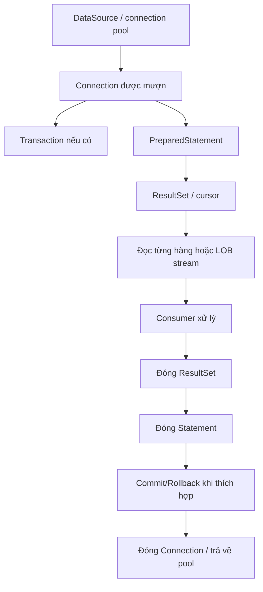

# Quản lý tài nguyên khi đọc dữ liệu theo luồng

Khi một câu truy vấn trả về hàng trăm nghìn hoặc hàng triệu bản ghi, ứng dụng có thể muốn **đọc và xử lý từng hàng hoặc từng nhóm hàng** thay vì tải toàn bộ kết quả vào bộ nhớ. Cách làm này thường được gọi là *streaming query results*. Tuy nhiên, việc dùng vòng lặp `ResultSet.next()` hay kiểu `Stream<T>` của Java **chưa đủ để khẳng định dữ liệu đang được tải dần từ cơ sở dữ liệu**: driver, DBMS, cấu hình fetch và ranh giới transaction mới quyết định cách dữ liệu thực sự được truyền và giữ trong bộ nhớ.

Quan trọng hơn, một luồng kết quả chưa đọc hết thường còn phụ thuộc vào **kết nối cơ sở dữ liệu, câu lệnh, cursor, transaction và tài nguyên phía server**. Nếu luồng được trả ra khỏi phạm vi sở hữu tài nguyên, không được đóng khi xảy ra exception hoặc bị giữ mở trong khi gọi mạng chậm, hệ thống có thể cạn connection pool, giữ snapshot/khóa quá lâu và khiến những request khác bị nghẽn.

Bài học thuộc chương **Kết nối và tài nguyên** của mô-đun **DATA_PERSISTENCE_FUNDAMENTALS**. Trong phạm vi học về lưu trữ dữ liệu bền vững, lược đồ, truy vấn, chỉ mục, giao dịch, cô lập và kiểm soát đồng thời, đây là kỹ năng thiết yếu khi thiết kế **ranh giới persistence cho Java**: điều khiển thời gian sống của tài nguyên, xử lý lỗi I/O, giảm tiêu thụ bộ nhớ và giữ hệ thống hoạt động ổn định. Các ví dụ tập trung vào JDBC và PostgreSQL; hành vi fetch/cursor cần kiểm tra lại với driver, DBMS và framework thực tế.

## 1. Đọc toàn bộ và đọc theo luồng khác nhau ở đâu?

Giả sử ứng dụng xuất báo cáo từ bảng `orders`:

```sql
CREATE TABLE orders (
    id           BIGINT PRIMARY KEY,
    customer_id  BIGINT NOT NULL,
    status       TEXT NOT NULL,
    total_amount NUMERIC(14, 2) NOT NULL,
    created_at   TIMESTAMPTZ NOT NULL
);

CREATE INDEX idx_orders_status_id ON orders (status, id);
```

Nếu dùng `List<Order>` chứa tất cả kết quả, lượng bộ nhớ tăng theo **tổng số bản ghi**; một báo cáo lớn dễ gây nhiều cấp phát đối tượng hoặc `OutOfMemoryError`:

```java
List<Order> allOrders = repository.findAll();
for (Order order : allOrders) {
    process(order);
}
```

Với xử lý theo luồng, ứng dụng tiêu thụ kết quả khi chúng được lấy ra:

```text
Database ──> driver / fetch batch ──> ResultSet.next() ──> xử lý một hàng
     ^                 |                                      |
     |            bộ đệm hữu hạn                       kết quả được ghi/gửi đi
     +──── connection, transaction và cursor còn sống trong lúc đọc ─────+
```

**Ưu điểm tiềm năng** là giới hạn bộ nhớ dùng cho các hàng ở phía Java và tránh phải chờ nhận hết dữ liệu trước khi bắt đầu xử lý. **Đánh đổi** là connection và các tài nguyên liên quan có thể bị giữ trong toàn bộ thời gian tiêu thụ kết quả. Nếu từng hàng mất nhiều thời gian để xử lý, luồng dữ liệu có thể kéo dài transaction và làm giảm số connection còn lại trong pool.

Phân biệt ba khái niệm:

| Khái niệm | Ý nghĩa | Điều không thể suy ra |
|---|---|---|
| **Lặp qua kết quả** | Gọi `ResultSet.next()` từng hàng | Driver chắc chắn không giữ sẵn toàn bộ kết quả |
| **Fetch theo nhóm / cursor** | Driver lấy kết quả dần theo cấu hình và khả năng của DBMS | Toàn bộ phía server dùng bộ nhớ hằng số hay query không phải sort/hash |
| **Java `Stream<T>`** | API tiêu thụ phần tử kiểu luồng/lazy | Tài nguyên JDBC tự đóng hoặc dữ liệu thực sự được fetch dần |

Không nên nhầm **streaming tại API** với **streaming end-to-end** từ DB đến consumer. Một ORM có thể trả `Stream<T>` nhưng đã materialize dữ liệu; một driver JDBC có thể trả `ResultSet` tuần tự nhưng đã tải nhiều hàng vào bộ nhớ client. Cần xác nhận hành vi trong môi trường thật.

## 2. Ai sở hữu `Connection`, `Statement`, `ResultSet` và luồng?

Trong JDBC, một truy vấn thường tạo chuỗi phụ thuộc:



Mỗi tài nguyên phải có **chủ sở hữu rõ ràng** và một phạm vi sử dụng giới hạn. Một mô hình thực dụng:

| Tài nguyên | Được dùng để làm gì? | Thời gian sống phù hợp | Rủi ro khi để mở |
|---|---|---|---|
| `Connection` | Phiên làm việc với DB, tham gia transaction | Trong một đơn vị công việc DB xác định | Cạn pool, transaction treo, không phục vụ được request mới |
| `PreparedStatement` | Thực thi truy vấn và giữ cấu hình fetch/timeout | Từ lúc chuẩn bị đến khi đọc xong kết quả | Giữ resource/handle trên driver hoặc server |
| `ResultSet` | Duyệt hàng trả về, có thể đại diện cho cursor | Chỉ trong phạm vi tiêu thụ kết quả | Cursor/statement/connection chưa giải phóng |
| `InputStream`/`Reader` của LOB | Đọc dữ liệu nhị phân hoặc văn bản lớn của một cột | Trong khi hàng và ResultSet còn hợp lệ | Lỗi đọc thiếu, tăng tài nguyên, dùng stream đã bị vô hiệu |
| `Stream<T>` của ORM | Duyệt entity/DTO theo luồng | Được tiêu thụ và đóng trong transaction đang hoạt động | Phụ thuộc vào persistence context/cursor đã hết hạn |

**`Connection.close()` trên kết nối do pool cấp** thường trả kết nối logic về pool thay vì đóng socket vật lý. Không vì vậy mà bỏ qua lệnh `close()`: nếu không trả connection, pool vẫn xem nó là đang được mượn. Cần dùng cùng một connection cho các câu lệnh thuộc cùng transaction và tránh chuyển connection/ResultSet giữa nhiều thread vì JDBC không có hợp đồng chung bảo đảm chúng an toàn khi dùng đồng thời.

Đóng `Statement` thường đóng `ResultSet` hiện hành của statement đó; đóng `Connection` cũng có thể khiến tài nguyên con bị hủy. Tuy nhiên, **đóng tường minh theo thứ tự và trách nhiệm sở hữu** giúp code rõ ràng, quản lý exception tốt hơn và không phụ thuộc vào việc dọn dẹp muộn của driver. `try-with-resources` là công cụ mặc định nên dùng.

## 3. Mẫu JDBC an toàn: tạo, tiêu thụ, đóng trong cùng phạm vi

Ví dụ dưới đây xử lý các đơn hàng theo trạng thái, đọc tăng dần theo khóa `id`. Đích xử lý là một callback **nhanh và có bộ nhớ hữu hạn**, chẳng hạn ghi vào một bộ tổng hợp hoặc output buffer cục bộ; không dùng callback này để gọi HTTP chậm trên từng hàng khi transaction vẫn mở.

```java
import java.math.BigDecimal;
import java.sql.Connection;
import java.sql.PreparedStatement;
import java.sql.ResultSet;
import java.sql.SQLException;
import java.util.function.Consumer;
import javax.sql.DataSource;

record OrderRow(long id, long customerId, BigDecimal totalAmount) {}

public final class OrderReader {
    private final DataSource dataSource;

    public OrderReader(DataSource dataSource) {
        this.dataSource = dataSource;
    }

    public long forEachOrder(String status, Consumer<OrderRow> consumer)
            throws SQLException {
        String sql = """
                SELECT id, customer_id, total_amount
                FROM orders
                WHERE status = ?
                ORDER BY id
                """;

        try (Connection connection = dataSource.getConnection()) {
            connection.setReadOnly(true);    // Trước khi bắt đầu công việc.
            connection.setAutoCommit(false); // PostgreSQL cần cho cursor fetch.
            long count = 0;

            try {
                try (PreparedStatement statement = connection.prepareStatement(
                        sql,
                        ResultSet.TYPE_FORWARD_ONLY,
                        ResultSet.CONCUR_READ_ONLY)) {
                    statement.setString(1, status);
                    statement.setFetchSize(256);
                    statement.setQueryTimeout(60); // Giới hạn theo hợp đồng driver.

                    try (ResultSet rows = statement.executeQuery()) {
                        while (rows.next()) {
                            OrderRow row = new OrderRow(
                                    rows.getLong("id"),
                                    rows.getLong("customer_id"),
                                    rows.getBigDecimal("total_amount"));
                            consumer.accept(row);
                            count++;
                        }
                    }
                }

                connection.commit();
                return count;
            } catch (SQLException | RuntimeException failure) {
                try {
                    connection.rollback();
                } catch (SQLException rollbackFailure) {
                    failure.addSuppressed(rollbackFailure);
                }
                throw failure;
            }
        }
    }
}
```

Trong ví dụ, `PreparedStatement` và `ResultSet` được đóng ngay cả khi mapping hoặc `consumer.accept(...)` ném exception; `Connection` cũng được đóng/hoàn trả khi thoát khỏi `try`. `setFetchSize(256)` đặt **gợi ý kích thước nhóm lấy hàng**, không phải giới hạn cứng cho mọi bộ đệm hoặc bộ nhớ của query. `setQueryTimeout(60)` phụ thuộc cách driver thực thi và không thay thế deadline cho **toàn bộ** quá trình xử lý.

`setReadOnly(true)` là gợi ý/thuộc tính của connection; cách thực thi phụ thuộc driver và DBMS. Vì hàm này chỉ đọc dữ liệu, việc `commit()` trong ví dụ kết thúc transaction/cursor. Ứng dụng thực tế có thể dùng `rollback()` để kết thúc một transaction chỉ đọc khi phù hợp với hợp đồng driver/pool, nhưng cần luôn chấm dứt transaction trước khi trả connection.

Đoạn code cố ý **không trả về `ResultSet` hoặc `Stream<OrderRow>`**. Thay vào đó, method kiểm soát toàn bộ vòng đời đọc và chuyển từng giá trị đã ánh xạ cho consumer. Đây là một mẫu dễ kiểm chứng: nơi mở kết nối cũng chịu trách nhiệm đóng nó.

### Vì sao callback cần hạn chế tác dụng phụ?

Nếu `consumer.accept(row)` gửi email, gọi REST API hoặc ghi hệ thống khác, một lỗi ở hàng thứ 100 không thể tự hoàn tác 99 tác dụng trước đó. `rollback()` của connection chỉ tác động lên transaction DB, **không rollback các dịch vụ ngoài**. Với luồng có tác dụng phụ, hãy thiết kế checkpoint, idempotency, outbox/queue hoặc xử lý theo lô có khôi phục riêng; không dựa vào việc một transaction chỉ đọc sẽ bảo vệ toàn bộ quy trình.

Nếu exception phát sinh trong `commit()` và có khả năng mất kết nối, ứng dụng không thể luôn suy ra trạng thái commit từ exception. Với ví dụ chỉ đọc, vấn đề chính thường là đóng tài nguyên và xác định trạng thái xử lý của consumer; với truy vấn có ghi, cần thêm cơ chế đối soát khi outcome commit không rõ.

## 4. `fetchSize`: tối ưu tài nguyên, không phải phép màu

Trong JDBC, `Statement.setFetchSize(int)` là một **gợi ý** về số dòng driver nên lấy trong mỗi lượt truy xuất. Theo hợp đồng JDBC chung, driver có quyền xử lý gợi ý khác nhau; không có bảo đảm mọi DB sẽ mở server cursor hoặc mọi ứng dụng luôn dùng đúng `fetchSize` hàng trong bộ nhớ.

### PostgreSQL JDBC: điều kiện cần chú ý

Với PostgreSQL JDBC phổ biến, để driver có thể dùng **cursor-based fetching** cho `ResultSet` forward-only, cần kiểm tra các điều kiện như:

1. Connection đang ở `autoCommit = false` trước khi thực thi truy vấn; PostgreSQL đóng cursor giao dịch khi transaction kết thúc.
2. Statement/ResultSet là loại **forward-only** và không yêu cầu khả năng cuộn tùy ý; dùng `TYPE_FORWARD_ONLY` trong mẫu.
3. Fetch size là số dương, ví dụ `128`, `256` hoặc `1000`; cấu hình mặc định `0` của pgJDBC thường đồng nghĩa lấy toàn bộ kết quả một lần.
4. Không dùng chế độ/trường hợp driver buộc materialize kết quả theo cách khác; cần kiểm tra cấu hình driver và kết quả đo thực tế.

```java
connection.setAutoCommit(false);

try (PreparedStatement statement = connection.prepareStatement(
        "SELECT id, customer_id FROM orders ORDER BY id",
        ResultSet.TYPE_FORWARD_ONLY,
        ResultSet.CONCUR_READ_ONLY)) {
    statement.setFetchSize(500);
    try (ResultSet result = statement.executeQuery()) {
        while (result.next()) {
            // Đọc và xử lý; không giữ tất cả các hàng trong List.
        }
    }
}
// Kết thúc transaction trước khi trả connection về pool.
```

Đoạn minh họa trên giả định connection sẽ được kết thúc transaction và đóng trong phạm vi bên ngoài. Không tách nó thành code hoàn chỉnh rồi bỏ quên bước `commit/rollback`.

Nếu `autoCommit = true`, PostgreSQL có thể không giữ được cursor qua các lượt fetch theo mô hình trên; driver có thể tải nhiều hoặc tất cả hàng hơn dự kiến. Đây là lỗi hay gặp khi phát triển thử với vài trăm dòng rồi chạy sản xuất với hàng triệu dòng.

### Khi thay DBMS hoặc driver

| Hệ | Điểm cần xác minh khi muốn đọc theo luồng |
|---|---|
| **PostgreSQL/pgJDBC** | Autocommit, loại ResultSet, `fetchSize`, cursor lifetime và transaction đang giữ snapshot |
| **MySQL Connector/J** | Cấu hình cursor fetch của driver, server-side prepared statements và fetch size dương trong chế độ tương ứng; một số cách streaming khác có hạn chế riêng |
| **SQL Server JDBC** | Cơ chế adaptive buffering, kiểu ResultSet, cách lấy LOB và ảnh hưởng của fetch settings |
| **Oracle JDBC** | Row prefetch/fetch size, bộ nhớ driver, LOB streaming và khả năng giữ cursor mở |
| **ORM/JPA** | `Stream<T>` có thực sự dùng cursor không, mức độ materialize entity và persistence context |

Ví dụ MySQL thường cần cấu hình `useCursorFetch=true` cùng các điều kiện sử dụng prepared statement phía server của Connector/J; một số cách streaming cũ dựa vào giá trị fetch size đặc biệt có quy tắc tiêu thụ/đóng riêng. Không sao chép một giá trị fetch size hay URL option giữa các driver rồi mặc định hành vi giống nhau.

### Chọn kích thước fetch bằng đo lường

**Nhóm quá nhỏ** làm tăng số lượt trao đổi DB–client và độ trễ. **Nhóm quá lớn** tăng bộ nhớ driver và thời gian xử lý mỗi lượt. Giá trị phù hợp phụ thuộc độ rộng hàng, network latency, khối lượng chuyển đổi dữ liệu và chi phí query. Hãy đo peak heap, số connection đang mượn, round trips (nếu có chỉ số), throughput và thời gian giữ transaction thay vì chọn một con số chung cho mọi workload.

Ngoài ra, dù Java nhận kết quả theo nhóm, server vẫn có thể cần **sort, hash, aggregate hoặc materialize** nhiều dữ liệu để thực hiện SQL. `ORDER BY` thiếu chỉ mục, join lớn hoặc truy vấn kết hợp phức tạp có thể tốn bộ nhớ/tệp tạm phía DB. Fetch size không thay thế việc kiểm tra execution plan và chỉ mục.

## 5. Luồng và transaction: vì sao phải tiêu thụ trước khi kết thúc?

Một cursor có thể phụ thuộc transaction và snapshot đang hoạt động. Với PostgreSQL ở `READ COMMITTED`, cursor/fetch cũng chịu những quy tắc riêng về tập kết quả của statement. Nếu đóng transaction hoặc connection trước khi đọc xong, các lần fetch tiếp theo có thể thất bại vì cursor đã đóng hoặc ResultSet không còn hợp lệ.

Ví dụ sai:

```java
public Stream<OrderRow> findOrders() throws SQLException {
    try (Connection connection = dataSource.getConnection();
         PreparedStatement statement = connection.prepareStatement(
                 "SELECT id, customer_id, total_amount FROM orders")) {
        ResultSet rows = statement.executeQuery();
        return convertLazily(rows); // SAI: statement/connection sắp bị đóng.
    }
}
```

Ngay khi method trả về, `try-with-resources` đóng statement và connection. Một stream thực sự lazy sẽ đọc một `ResultSet` **đã mất hiệu lực**. Nếu `convertLazily` đã lấy hết dữ liệu thành `List` trước khi trả, lỗi resource có thể không xuất hiện nhưng lại **mất mục tiêu streaming**.

Nếu bắt buộc có API trả `Stream<T>`, cần thiết kế **đối tượng sở hữu tài nguyên** (resource-owning stream/iterator) và yêu cầu caller đóng nó bằng `try-with-resources`. Việc `Stream.onClose(...)` chỉ gắn callback đóng tài nguyên; Java Stream **không tự động gọi `close()` sau một terminal operation** như `forEach`/`collect`. Phải quy định rõ ai đóng stream, kể cả khi tiêu thụ một phần hoặc xảy ra lỗi. Với JDBC, các `SQLException` bên trong iterator còn cần một chính sách chuyển/bao lỗi rõ ràng.

**Mẫu ưu tiên** là callback hoặc method nhận consumer và tiêu thụ ngay trong phạm vi sở hữu connection như phần 3, hoặc xử lý theo lô có transaction riêng. Những mẫu đó giảm nguy cơ caller quên đóng và dễ giới hạn thời gian giữ connection hơn.

## 6. Đọc `BLOB`, `CLOB` và luồng nội dung lớn

Ngoài nhiều hàng, một **cột dữ liệu lớn** cũng có thể được cung cấp qua `InputStream`/`Reader` thay vì nạp thành một mảng `byte[]` hoặc chuỗi lớn. Ví dụ:

```java
String sql = "SELECT payload FROM attachments WHERE id = ?";

try (Connection connection = dataSource.getConnection();
     PreparedStatement statement = connection.prepareStatement(sql)) {
    statement.setLong(1, attachmentId);

    try (ResultSet result = statement.executeQuery()) {
        if (result.next()) {
            try (InputStream input = result.getBinaryStream("payload")) {
                if (input != null) {
                    input.transferTo(outputStream);
                }
            }
        }
    }
}
```

`outputStream` là một stream do bên gọi quản lý; ví dụ không tự đóng nó. Trong ứng dụng thực tế cần import `java.io.InputStream`, xử lý `IOException` khi truyền dữ liệu, xác định giới hạn kích thước và quyền truy cập trước khi đọc. Nếu `payload` là `NULL`, `getBinaryStream` có thể trả `null` như đã kiểm tra.

**Vòng đời LOB stream phụ thuộc JDBC driver**: thường cần đọc nó trước khi dịch chuyển `ResultSet` sang hàng khác hoặc đóng ResultSet/Statement/Connection. Một số driver có thể materialize LOB vào bộ nhớ hoặc dùng cơ chế locator/stream phía server; không mặc định `getBinaryStream` luôn tiết kiệm bộ nhớ end-to-end. Nếu cần xử lý tệp rất lớn, cân nhắc lưu metadata trong DB và đối tượng nhị phân ở storage chuyên dụng, kèm cơ chế nhất quán và quyền truy cập phù hợp.

Không đưa một `InputStream` gắn với ResultSet ra khỏi transaction để controller/HTTP framework đọc sau. Nếu client tải chậm, connection có thể bị giữ mở trong toàn bộ thời gian truyền. Một giải pháp phổ biến là đọc và phân đoạn vào kho tạm được quản lý hoặc chuyển tác vụ xuất file sang background job, rồi phục vụ file theo cơ chế riêng với kiểm soát thời hạn và cleanup. Chọn giải pháp theo độ lớn dữ liệu, bảo mật và độ tươi của dữ liệu.

## 7. Spring Data JPA: `Stream<T>` gắn với transaction

Spring Data JPA có thể cung cấp các phương thức repository trả `Stream<T>` để tiêu thụ query result dần, tùy JPA provider và database. Ví dụ minh họa:

```java
public interface OrderRepository extends JpaRepository<Order, Long> {
    @Query("select o from Order o where o.status = :status order by o.id")
    Stream<Order> streamByStatus(@Param("status") OrderStatus status);
}

@Service
public class OrderExportService {
    private final OrderRepository repository;

    public OrderExportService(OrderRepository repository) {
        this.repository = repository;
    }

    @Transactional(readOnly = true)
    public void exportOrders(OrderStatus status, Consumer<ExportRow> rowConsumer) {
        try (Stream<Order> orders = repository.streamByStatus(status)) {
            orders.map(order -> new ExportRow(
                            order.getId(), order.getTotalAmount()))
                    .forEach(rowConsumer);
        }
    }
}

record ExportRow(Long id, BigDecimal totalAmount) {}
```

Ví dụ trên minh họa **phạm vi tài nguyên**; các kiểu `Order`, `OrderStatus` và thuộc tính trong entity phải được định nghĩa đúng theo dự án. Cần import `BigDecimal`, `Consumer`, `Stream` cùng các annotation và kiểu Spring Data JPA tương ứng. `rowConsumer` phải tiêu thụ dữ liệu trong lời gọi hiện tại, không giữ entity/lazy proxy để truy cập sau khi transaction đã đóng. Mẫu sử dụng `forEach` để thực hiện công việc mong muốn; không dùng `peek()` cho tác dụng phụ quan trọng vì tối ưu hóa pipeline có thể bỏ qua việc gọi `peek()` trong một số trường hợp.

**Điểm cốt lõi:** `@Transactional` phải thực sự có hiệu lực ở tầng service gọi repository; stream phải được **tiêu thụ và đóng trước khi transaction kết thúc**. Với Spring proxy thông thường, gọi method `@Transactional` qua `this.method()` (self-invocation) có thể bỏ qua interceptor. Nếu method trả Stream cho controller sau khi transaction kết thúc, câu lệnh và cursor có thể không còn hợp lệ. Các cơ chế trả dữ liệu lazy của ORM cũng có thể gặp `LazyInitializationException` nếu truy cập quan hệ chưa tải sau khi persistence context đóng.

### Persistence context cũng tiêu tốn bộ nhớ

JPA/Hibernate có **first-level persistence context** theo dõi các entity đã load. Ngay cả khi driver fetch theo nhóm, một phiên persistence context giữ nhiều entity được quản lý có thể tăng bộ nhớ theo số hàng đã duyệt. `@Transactional(readOnly = true)` và các hint đọc chỉ có tác dụng theo provider/cấu hình; **không phải cam kết chung rằng mọi entity sẽ bị loại khỏi cache sau khi xử lý**.

Khi dữ liệu rất lớn, cân nhắc:

- **Projection/DTO** chỉ chọn cột cần dùng, giảm số entity và quan hệ lazy phải tải.
- **Batch/scroll/cursor có kiểm soát** và chính sách làm sạch persistence context của provider; chỉ `clear()` khi đã hiểu việc detach entity và các phụ thuộc lazy.
- **Phân trang theo khóa** với nhiều transaction ngắn nếu cần tránh giữ persistence context/snapshot quá lâu.
- **JDBC trực tiếp** cho tác vụ xuất dữ liệu thuần đọc khi muốn kiểm soát cụ thể ResultSet/fetch size và tránh overhead ORM.

Một ứng dụng có thể sử dụng Hibernate `StatelessSession` hoặc cơ chế scroll riêng của provider, nhưng đó là API chuyên biệt và cần kiểm chứng tính đúng đắn về lifecycle, mapping và transaction theo phiên bản thư viện đang dùng.

## 8. Streaming ra HTTP: chậm nhất trong đường đi quyết định tuổi thọ connection

Khi một controller đọc DB rồi ghi từng hàng vào HTTP response, đường đi có thể trở thành:

```text
DB cursor -> JDBC -> CSV serialization -> HTTP socket -> client
     |                                            |
     +----------- connection còn bị giữ ----------+
```

Nếu client nhận dữ liệu rất chậm, proxy giới hạn bandwidth hoặc client ngắt giữa chừng, transaction có thể vẫn giữ connection cho đến khi pipeline phát hiện lỗi và dọn dẹp. Điều này đặc biệt nguy hiểm khi số lượng client tải xuất báo cáo lớn tăng đột ngột.

Các chiến lược thường dùng:

1. **Xuất theo lô vào một tệp tạm được quản lý** với quota, timeout và cleanup rõ ràng; đóng DB connection rồi mới phục vụ file cho HTTP client.
2. **Tạo tác vụ export bất đồng bộ** khi báo cáo lớn, lưu trạng thái và cho client tải kết quả sau khi hoàn thành; thiết kế idempotency và giới hạn thời gian giữ dữ liệu.
3. **Streaming trực tiếp có giới hạn** chỉ khi có kiểm soát số request đồng thời, thời gian tối đa, kích thước và khả năng xử lý cancel; bảo đảm đóng tài nguyên trên mọi đường lỗi.
4. **Chunk/batch theo keyset** để mỗi giao dịch DB ngắn rồi trả dần dữ liệu, chấp nhận và mô tả rõ ngữ nghĩa nhất quán của báo cáo qua nhiều transaction.

Đặc biệt, sau khi HTTP response đã bắt đầu gửi dữ liệu, ứng dụng có thể **không còn khả năng đổi status code** thành lỗi chuẩn nếu lần đọc DB tiếp theo thất bại. API export phải có hợp đồng riêng cho stream bị cắt giữa chừng, checksum/trailer hoặc tài liệu mô tả cách client phát hiện file chưa hoàn thành. Không mặc định rằng một transaction rollback có thể thu hồi dữ liệu đã truyền qua mạng.

## 9. Phân trang theo khóa thay thế cho một cursor sống rất lâu

Với các tác vụ lớn kéo dài nhiều phút hoặc nhiều giờ, giữ connection/cursor/transaction liên tục có thể không phù hợp. Một phương án khác là **keyset pagination**: đọc từng nhóm theo khóa đã xử lý rồi đóng tài nguyên sau mỗi nhóm.

```sql
SELECT id, customer_id, total_amount
FROM orders
WHERE status = :status
  AND id > :last_seen_id
ORDER BY id
LIMIT :batch_size;
```

Ở mỗi vòng, ứng dụng xử lý lô, lưu `last_seen_id` cuối cùng vào checkpoint tin cậy nếu cần rồi mới đọc lô tiếp theo. Có thể dùng chỉ mục `(status, id)` để DB truy xuất vùng dữ liệu cần lấy. Cách này giới hạn thời gian giữ connection và đơn giản hóa retry ở ranh giới từng lô; nhưng nó cũng có những đánh đổi:

- **Snapshot không giống nhau giữa các lô:** nếu đọc ở `READ COMMITTED` với transaction riêng, hàng có thể được thêm, xóa hoặc đổi `status` giữa hai lô.
- **Thứ tự khóa phải ổn định và đủ phân biệt:** nên dùng khóa duy nhất hoặc tổ hợp `(created_at, id)` với điều kiện keyset tương ứng; không dùng `OFFSET` lớn rồi kỳ vọng chi phí và tính ổn định giống keyset.
- **Checkpoint phải phản ánh tác động đã hoàn tất:** nếu cập nhật checkpoint trước khi xử lý lô xong, lần chạy sau có thể bỏ sót; nếu sau khi xử lý nhưng trước khi ghi checkpoint xảy ra lỗi, có thể xử lý lặp và cần idempotency.
- **Yêu cầu ảnh chụp nhất quán:** nếu bản báo cáo bắt buộc phản ánh **một snapshot duy nhất**, nhiều transaction ngắn không tự cung cấp bảo đảm này. Cần thiết kế export snapshot/cơ chế đồng bộ hoặc chấp nhận giữ một transaction có kiểm soát.

Trường hợp chỉ xuất dữ liệu và không sửa gì, một lần đọc theo cursor là hợp lý nếu thời gian, pool và snapshot đủ nhỏ. Ngược lại, xử lý batch dài kèm nhiều hệ thống ngoài DB thường dễ vận hành hơn với các ranh giới transaction ngắn, dữ liệu có thứ tự và recovery được thiết kế ngay từ đầu.

## 10. Backpressure, hủy yêu cầu và timeout

**Backpressure** là khả năng bên tiêu thụ báo rằng mình chỉ nhận được dữ liệu ở một tốc độ hữu hạn, để bên sản xuất không liên tục đẩy dữ liệu làm đầy bộ nhớ. Trong JDBC đồng bộ, vòng `ResultSet.next()` tự nhiên có nhịp kéo bởi consumer của thread hiện tại, nhưng driver **có thể đã fetch trước một nhóm hoặc toàn bộ kết quả**. Không gọi điều đó là backpressure end-to-end nếu chưa đo buffering và luồng dữ liệu thực tế.

Các nguy cơ cần xử lý ở production:

| Tình huống | Hậu quả | Hướng ứng phó |
|---|---|---|
| Consumer xử lý một hàng quá chậm | Connection/transaction bị giữ lâu, pool cạn | Giới hạn thời gian, tách tác dụng ngoài DB, xử lý theo lô |
| Query/fetch bị chặn do mạng hoặc DB | Thread chờ và tài nguyên chưa được trả về | Deadline tổng thể, query timeout, connection/network timeout theo driver |
| Client hủy export giữa chừng | Code không còn cần kết quả nhưng cursor vẫn mở | Propagate cancel đến vòng tiêu thụ, đóng stream/ResultSet/Statement/Connection |
| Dừng vòng lặp sau vài hàng | ResultSet còn hàng chưa đọc; cursor còn mở | `try-with-resources` đảm bảo đóng ngay cả khi `break`/return/exception |
| Consumer ném exception | Có thể có kết quả đã gửi ra ngoài DB | Dọn tài nguyên và ghi nhận tiến độ; idempotency/recovery nếu cần |
| Không đủ connection | Request mới phải chờ pool, tăng latency | Giới hạn số stream đồng thời, đặt pool timeout, đo thời gian giữ connection |

`Statement.setQueryTimeout(...)` thường áp dụng cho việc thực thi câu SQL theo hành vi của driver; không nhất thiết bao trùm toàn bộ thời gian Java xử lý kết quả. `Connection.setNetworkTimeout(...)` có hợp đồng riêng về chờ I/O và phụ thuộc driver; không xem một timeout đơn lẻ là cơ chế tổng thể cho mọi giai đoạn. Khi muốn hủy câu lệnh đang chạy, JDBC có `Statement.cancel()` nhưng hiệu lực và an toàn khi dùng giữa các thread cần tuân theo hợp đồng driver. Trong mọi trường hợp, **đóng tài nguyên ở `finally` hoặc `try-with-resources`** là yêu cầu nền tảng.

### R2DBC/reactive có tự động giải quyết tài nguyên không?

R2DBC cung cấp API bất đồng bộ theo `Publisher`/Reactive Streams và có mô hình demand/backpressure khác JDBC. Nhưng publisher cũng gắn với **connection, transaction và lifecycle**; nếu pipeline bị hủy hoặc lỗi, framework/driver phải được cấu hình để giải phóng connection. `Mono.usingWhen`/`Flux.usingWhen` hoặc transaction operator thích hợp có thể quản lý resource lifecycle. Đây là một lựa chọn kiến trúc riêng, **không phải chỉ chuyển từ JDBC `Stream<T>` sang `Flux<T>` là xong**.

Cần phân biệt reactive cancellation, commit/rollback khi cancellation, ranh giới transaction và hành vi timeout theo phiên bản framework. Dù dùng API nào, tiêu chí cuối cùng vẫn là: **tài nguyên được giải phóng sau success, error và cancel**.

## 11. Connection pool và chi phí của transaction đọc dài

Một pool có số connection hữu hạn. Nếu nhiều request cùng đọc hàng triệu bản ghi và mỗi request giữ một connection trong thời gian dài, số connection rảnh giảm nhanh; các thao tác đơn giản có thể phải chờ dù DB vẫn còn khả năng phục vụ. Tăng `maximumPoolSize` không luôn giải quyết gốc rễ: DB cũng có giới hạn connection, bộ nhớ và chi phí điều phối.

Ngoài pool, **transaction đọc dài** có thể gây tác động lên DB:

- **PostgreSQL/MVCC:** transaction giữ snapshot cũ lâu có thể cản trở việc dọn các row version không còn cần thiết, làm tăng bloat và chi phí vacuum trong một số tình huống. Một cursor với transaction mở lâu cần được theo dõi cụ thể.
- **Mức cô lập và khóa:** tùy DBMS và câu SQL, transaction đọc có thể giữ khóa hoặc tài nguyên snapshot ảnh hưởng tới writer, DDL hay dọn dẹp dữ liệu.
- **Cursor/statement phía server:** nhiều cursor còn mở có thể tiêu tốn tài nguyên, kể cả khi mỗi fetch batch nhỏ.
- **Network và CPU:** tuần tự đọc một lượng dữ liệu rất lớn có thể chiếm băng thông và CPU; giới hạn fetch size không giảm tổng số byte phải truyền.

Thiết kế hợp lý thường có **ngân sách tài nguyên** cho tác vụ xuất dữ liệu: số export đồng thời tối đa, hạn mức thời gian chạy, giới hạn số hàng/byte, chính sách timeout, metric và đường xử lý lỗi. Với báo cáo rất lớn, tách worker export khỏi pool phục vụ request tương tác có thể ngăn tác vụ dài chiếm hết capacity dành cho nghiệp vụ chính.

## 12. Chẩn đoán leak và theo dõi vận hành

Không phải mọi connection sử dụng lâu đều là leak. Cần phân biệt **tài nguyên bị bỏ quên không đóng** với **tài nguyên đang được giữ đúng logic nhưng quá lâu**. Cả hai đều có thể làm cạn pool, nhưng hướng khắc phục khác nhau.

Các chỉ số hữu ích:

| Chỉ số | Cách sử dụng |
|---|---|
| Pool active/idle/pending connections | Phát hiện pool cạn, request chờ mượn connection |
| Connection acquisition time | Đo độ trễ trước khi có connection để chạy truy vấn |
| Connection usage/hold time | Phát hiện stream hoặc transaction giữ connection quá lâu |
| Số cursor/statement còn mở | Phát hiện tài nguyên phía DB/driver không được đóng |
| Thời gian truy vấn và tổng thời gian export | Tách chi phí DB khỏi chi phí serialize/consumer |
| Lượng hàng/byte xử lý và throughput | Xác định việc stream đang đọc đều hay bị consumer chặn |
| Heap/GC, buffer allocation | Đánh giá liệu driver/ORM có materialize quá nhiều dữ liệu không |
| Cancel, timeout, lỗi giữa stream | Kiểm tra đường dọn tài nguyên và retry/recovery |

Pool như HikariCP có thể cung cấp metric và tính năng phát hiện connection sử dụng quá lâu (*leak detection threshold*), nhưng cảnh báo không tự chứng minh leak: một export hợp lệ chạy rất lâu cũng có thể bị gắn cờ. Kết hợp metric với trace, tên tác vụ và thời điểm mượn/trả connection để tìm nguyên nhân thực.

Ở PostgreSQL có thể quan sát `pg_stat_activity` để nhận diện session đang active, đang chờ hoặc `idle in transaction`; quyền xem thông tin tùy role:

```sql
SELECT pid, state, wait_event_type, wait_event,
       xact_start, query_start
FROM pg_stat_activity
WHERE datname = current_database()
ORDER BY xact_start NULLS LAST;
```

Đừng đưa nguyên văn SQL chứa tham số nhạy cảm hoặc dữ liệu cá nhân vào log/metric. Khi điều tra, gắn `request_id` hoặc `operation_id` an toàn, không lưu password hay access token trong tên metric có cardinality cao.

## 13. Kiểm thử có chủ đích: chứng minh tài nguyên được trả lại

Một bài test chỉ khẳng định đọc đủ 10 hàng là chưa đủ. Cần kiểm tra các **đường kết thúc khác nhau** của vòng đời stream:

| Kịch bản | Cách tạo tình huống | Điều cần xác minh |
|---|---|---|
| Đọc hết bình thường | Consume toàn bộ result | ResultSet, statement đóng; transaction kết thúc, connection trả pool |
| Consumer ném exception | Ném lỗi khi nhận hàng thứ N | Tài nguyên vẫn đóng, lỗi gốc không bị che bởi lỗi cleanup |
| Dừng giữa chừng | Consumer yêu cầu ngừng hoặc đạt giới hạn số hàng | Cursor đóng ngay, không phải đợi GC |
| Driver lỗi khi fetch lô tiếp theo | Ngắt kết nối hoặc fault injection phù hợp | Exception được báo đúng, connection hỏng không tái sử dụng sai |
| Client hủy HTTP export | Ngắt phía client khi đang gửi dữ liệu | Dừng vòng đọc theo hợp đồng framework và dọn transaction/connection |
| Nhiều luồng truy vấn đồng thời | Mở nhiều export hơn số connection của pool thử nghiệm | Có backpressure/timeout rõ, không treo vĩnh viễn |
| Một truy vấn rất lớn | Fixture đủ lớn, đo heap và GC | Không giữ toàn bộ kết quả trong collection hoặc persistence context |

Với PostgreSQL và pgJDBC, chạy trên dữ liệu đại diện, kiểm tra khác biệt giữa `fetchSize = 0` và giá trị dương khi tắt autocommit, đồng thời đo heap để xác nhận cấu hình có tác dụng. Một bài benchmark có một hàng rất nhỏ không phản ánh chi phí network hoặc bộ nhớ của báo cáo thật; nên dùng dữ liệu tương ứng về số lượng và kích thước cột.

Khi cần giữ tính nhất quán toàn bộ kết quả, kiểm thử thêm tình huống **giao dịch khác sửa hoặc chèn dữ liệu trong lúc stream đang chạy**. Hành vi quan sát được phụ thuộc DBMS, isolation, cursor và truy vấn. Quyết định nghiệp vụ phải chỉ rõ báo cáo cần một snapshot cố định hay chấp nhận các lô được đọc ở các thời điểm khác nhau.

## 14. Tình huống tổng hợp: xuất CSV một triệu đơn hàng

Một API Java phải xuất một triệu dòng `orders` sang CSV. Phiên bản ban đầu gọi `findAll()` và chuyển `List` sang chuỗi lớn, gây tăng heap. Đổi sang Spring Data `Stream<Order>` nhưng controller trả stream ra ngoài method `@Transactional`; sau khi request bắt đầu gửi, cursor đã bị đóng, phát sinh lỗi. Sau khi đưa toàn bộ tác vụ vào một transaction mới, client chậm khiến connection bị giữ hàng phút, làm pool cạn.

Hướng thiết kế thực dụng:

1. **Định nghĩa hợp đồng báo cáo:** một snapshot tại thời điểm bắt đầu hay dữ liệu thay đổi giữa các lô được chấp nhận; giới hạn số hàng, dữ liệu nhạy cảm và thời hạn file export.
2. **Dùng projection/DTO nhẹ**, chỉ chọn các cột CSV cần thiết; dùng JDBC cursor/fetch theo nhóm hoặc keyset pagination tùy yêu cầu snapshot.
3. **Tiêu thụ và đóng DB resource trong một worker có phạm vi rõ ràng**, xử lý lỗi và hủy; đẩy kết quả vào file export được quản lý với quota và đường cleanup phù hợp.
4. **Phục vụ file sau khi DB connection đã được trả về pool**; không để tốc độ tải của client quyết định tuổi thọ một cursor DB.
5. **Theo dõi pool usage, heap, tốc độ xuất và lỗi hủy**; thử ngắt client và gây lỗi giữa chừng để xác nhận cleanup/recovery.

Nếu yêu cầu bắt buộc phải stream trực tiếp DB → HTTP vì độ trễ, vẫn phải giới hạn số tác vụ đồng thời, bảo đảm lifecycle của transaction trải toàn bộ quá trình đọc, phản hồi đúng khi stream bị cắt và đóng resource kể cả khi client hủy. Với pipeline có xử lý trạng thái nghiệp vụ, cần thêm idempotency/checkpoint chứ không chỉ tối ưu đọc.

## 15. Nguyên tắc áp dụng trong lớp persistence

- **Ai mở thì phải xác định ai đóng:** `Connection`, `PreparedStatement`, `ResultSet`, `Stream<T>` và LOB stream cần phạm vi sở hữu rõ ràng.
- **Streaming không đồng nghĩa ít bộ nhớ nếu driver/ORM vẫn gom dữ liệu:** kiểm tra fetch size, cursor và persistence context trên DBMS thật.
- **Tiêu thụ kết quả trước khi kết thúc transaction** nếu luồng phụ thuộc cursor; không trả đối tượng lazy ra ngoài phạm vi đã đóng connection.
- **Không để tác vụ mạng chậm hoặc xử lý ngoài DB kéo dài transaction** khi có thể thiết kế batch, queue hoặc export file trung gian.
- **Thiết kế đường lỗi, hủy và timeout cùng với đường thành công:** dọn resource ngay cả khi mới đọc vài hàng hoặc consumer ném lỗi.
- **Theo dõi thời gian giữ connection, không chỉ thời gian SQL:** hiệu năng tổng thể phụ thuộc cả query, fetch, mapping, consumer và tốc độ client.
- **Chọn cursor dài hay nhiều batch ngắn theo yêu cầu nhất quán và khôi phục:** không có một cách duy nhất đúng cho mọi workload.

Đọc dữ liệu theo luồng giúp Java xử lý tập kết quả lớn một cách tiết kiệm bộ nhớ **khi driver thực sự fetch dần và ứng dụng không giữ lại toàn bộ dữ liệu**. Muốn giải pháp đáng tin cậy, phải quản lý trọn vẹn vòng đời connection, transaction, cursor và consumer. Một stream chạy đúng về mặt chức năng nhưng quên đóng, giữ snapshot quá lâu hoặc chiếm hết connection pool vẫn là lỗi thiết kế persistence nghiêm trọng.
