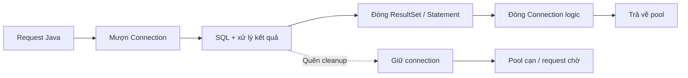
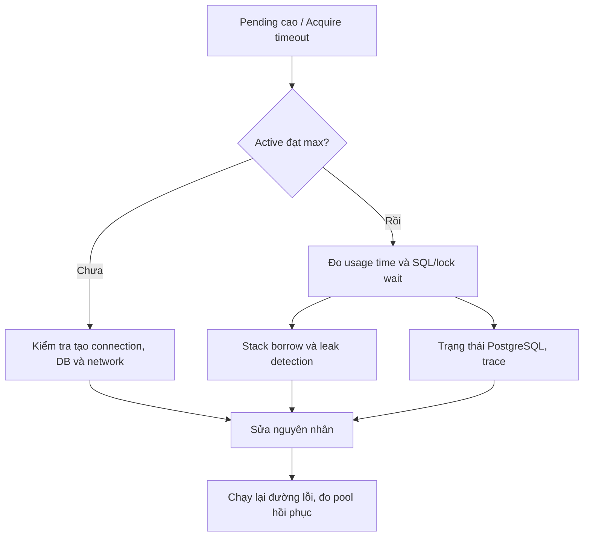

# Phát hiện rò rỉ kết nối và tài nguyên không được giải phóng

## Mục tiêu học tập

Sau bài này, người học có thể:

- Giải thích vòng đời của `Connection`, `PreparedStatement`, `ResultSet` và các tài nguyên persistence trong ứng dụng Java, kể cả khi dùng connection pool.
- Phân biệt **rò rỉ tài nguyên thực sự**, **giữ tài nguyên quá lâu**, **pool quá nhỏ** và **truy vấn chậm** bằng bằng chứng quan sát được.
- Dùng `try-with-resources`, `commit`/`rollback` và transaction manager để đóng tài nguyên trong cả đường thành công và đường lỗi.
- Đọc chỉ số pool, cảnh báo leak detection, trạng thái PostgreSQL và thông tin truy vết để xác định nơi giữ connection.
- Thiết kế kiểm thử có kiểm soát, theo dõi hiệu năng, tránh làm lộ thông tin nhạy cảm trong log.

## 1. Vì sao một connection không được trả có thể khiến dịch vụ ngừng đáp ứng?

Một API Java xử lý đơn hàng thường mượn kết nối JDBC từ **connection pool**, thực thi SQL rồi trả kết nối để request khác sử dụng. Giả sử pool có tối đa 20 connection. Nếu 20 request đã mượn nhưng không trả, request thứ 21 sẽ phải chờ; khi vượt thời gian chờ, pool có thể báo lỗi dù PostgreSQL vẫn chạy bình thường.

Đây là một vấn đề quan trọng của phần **Kết nối và tài nguyên** trong module `DATA_PERSISTENCE_FUNDAMENTALS`: việc thiết kế ranh giới persistence cho Java bao gồm quản lý transaction, lỗi kết nối, truy vấn, chỉ mục, đồng thời, độ bền và hiệu năng. Một hệ thống lưu dữ liệu đúng vẫn không thể phục vụ nếu đã cạn tài nguyên để kết nối với database.

**Connection leak** theo nghĩa ứng dụng là tình trạng mượn connection nhưng bỏ mất đường trả connection về pool khi công việc đã kết thúc. **Resource leak** rộng hơn: không đóng result set, statement, stream, session hoặc tài nguyên khác có vòng đời hạn chế. Rò rỉ có thể tích lũy chậm qua hàng nghìn request rồi mới xuất hiện thành timeout.



### `close()` của một connection trong pool nghĩa là gì?

Với một `Connection` do `DriverManager` tạo trực tiếp, `close()` thường đóng tài nguyên kết nối vật lý. Khi dùng pool như HikariCP, `close()` trên **proxy connection** thường có nghĩa là **trả kết nối logic về pool**, để kết nối vật lý được dùng tiếp hoặc được thay thế nếu không còn hợp lệ.

Ứng dụng nên **đóng đúng connection đã mượn** theo hợp đồng của `DataSource`. Không cất một đối tượng `Connection` vào biến tĩnh, singleton, cache hoặc `ThreadLocal` không có vòng đời quản lý rõ ràng. Pool mới là thành phần chịu trách nhiệm tái sử dụng socket và connection vật lý.

## 2. Leak, giữ lâu, query chậm và pool thiếu: triệu chứng có thể giống nhau

Chỉ thấy `activeConnections = maximumPoolSize` chưa đủ để kết luận code bị leak.

| Tình huống | Bản chất | Dấu hiệu cần điều tra |
| --- | --- | --- |
| **Leak thực sự** | Không trả resource ở một đường xử lý | Connection active không giảm sau khi request/job đã xong; stack mượn connection lặp lại |
| **Giữ connection quá lâu** | Công việc cuối cùng vẫn đóng nhưng làm HTTP, I/O hoặc xử lý nặng khi đã mượn | Usage duration cao; cảnh báo leak có thể được theo sau bằng thông báo connection đã trả |
| **Truy vấn chậm/lock wait** | Connection thực sự đang phục vụ hoặc chờ database | `pg_stat_activity` có query chạy/chờ khóa; SQL latency tăng |
| **Pool nhỏ trước tải đỉnh** | Nhiều request cùng cần connection hợp lệ | Pending tăng khi tải cao rồi giảm; không tích lũy connection bị giữ qua các đợt |
| **Lỗi mạng/DB không sẵn sàng** | Không mở/kiểm tra/duy trì connection | Timeout kết nối, lỗi TLS/TCP, pool không tạo được connection |
| **Transaction treo** | `BEGIN` mà chưa `COMMIT`/`ROLLBACK` | `idle in transaction` kéo dài, có thể giữ khóa hoặc snapshot |

Một connection **idle trong pool** là connection vật lý có thể vẫn xuất hiện trong PostgreSQL nhưng hiện không được ứng dụng mượn. Một connection **active/borrowed ở pool** không nhất thiết đang chạy SQL; ngược lại, `state = 'active'` của PostgreSQL chỉ backend hiện đang thực thi một lệnh. Cần ghép dữ liệu từ **hai đầu**.

Result set hoặc statement chưa đóng có thể giữ cursor, bộ nhớ và tài nguyên ở driver/backend. Đóng connection đôi khi dọn gián tiếp các tài nguyên đó, nhưng không nên xem đây là hợp đồng thay cho việc đóng đúng từng resource theo quyền sở hữu.

## 3. Những lỗi JDBC dễ tạo rò rỉ

### 3.1. Chỉ đóng ở đường thành công

```java
// VÍ DỤ SAI: không dùng trong ứng dụng.
public String findEmailBad(DataSource dataSource, long id)
        throws SQLException {
    Connection connection = dataSource.getConnection();
    PreparedStatement statement = connection.prepareStatement(
            "SELECT email FROM customer WHERE id = ?");
    statement.setLong(1, id);
    ResultSet rows = statement.executeQuery();
    String result = rows.next() ? rows.getString(1) : null;
    rows.close();
    statement.close();
    connection.close();
    return result;
}
```

Nếu `prepareStatement`, `executeQuery`, `next` hoặc mapper phát sinh ngoại lệ, `close()` cuối hàm không chạy. Nếu `prepareStatement` thất bại, statement còn chưa tồn tại để đóng, còn connection đã bị mượn. Garbage collector không cung cấp thời điểm dọn resource đủ xác định để thay cho `close()`.

### 3.2. Trả về sớm và thoát do exception

```java
// VÍ DỤ SAI: return bỏ qua close; Statement cũng không được giữ để đóng.
Connection connection = dataSource.getConnection();
ResultSet rows = connection.createStatement()
        .executeQuery("SELECT id FROM customer WHERE active = true");
if (!rows.next()) {
    return Optional.empty();
}
connection.close();
```

Các nhánh `return`, `throw`, timeout, xử lý dữ liệu không hợp lệ, hủy request hoặc exception khi rollback đều phải có đường giải phóng tài nguyên.

### 3.3. Các nguyên nhân khác

- `setAutoCommit(false)` rồi bỏ qua `commit`/`rollback` khi gặp lỗi; transaction hoặc các khóa có thể còn mở.
- Trả `ResultSet`/`Stream` ra khỏi phương thức trong khi không xác định ai sẽ đóng và khi nào.
- Mở connection trước khi gọi HTTP, gửi email, xử lý file lớn hoặc chờ khóa: **giữ lâu** có thể làm cạn pool dù cuối cùng có `close()`.
- Đặt connection trong `ThreadLocal` mà không `remove()` khi thread pool tái sử dụng thread.
- Gọi trực tiếp `dataSource.getConnection()` trong Spring service rồi mặc định transaction manager sẽ dọn mọi connection tự mở.
- Đóng tài nguyên ở cuối vòng lặp nhưng một nhánh `continue`/`break` hoặc exception bỏ qua cleanup.

## 4. Đóng đúng bằng `try-with-resources`

### 4.1. Truy vấn chỉ đọc

Java đóng các resource khai báo trong `try-with-resources` theo **thứ tự ngược lại**, kể cả khi gặp `return` hoặc exception. Nếu đóng resource phụ cũng gây lỗi, Java có thể giữ lỗi đó dưới dạng **suppressed exception** thay vì che mất lỗi gốc.

```java
import java.sql.Connection;
import java.sql.PreparedStatement;
import java.sql.ResultSet;
import java.sql.SQLException;
import java.util.Optional;
import javax.sql.DataSource;

record Customer(long id, String email) {}

public final class CustomerRepository {
    private final DataSource dataSource;

    public CustomerRepository(DataSource dataSource) {
        this.dataSource = dataSource;
    }

    public Optional<Customer> findById(long id) throws SQLException {
        String sql = "SELECT id, email FROM customer WHERE id = ?";

        try (Connection connection = dataSource.getConnection();
             PreparedStatement statement = connection.prepareStatement(sql)) {
            statement.setLong(1, id);
            try (ResultSet rows = statement.executeQuery()) {
                if (!rows.next()) {
                    return Optional.empty();
                }
                return Optional.of(new Customer(
                        rows.getLong("id"),
                        rows.getString("email")));
            }
        }
    }
}
```

Thứ tự giải phóng là `ResultSet` → `PreparedStatement` → `Connection`. Kể cả khi không tìm thấy khách hàng, connection vẫn được trả.

**Quyền sở hữu (ownership):** thành phần nào trực tiếp mượn connection phải bảo đảm trả nó, trừ khi đã chuyển trách nhiệm cho một API có hợp đồng rõ ràng. Không tùy tiện đóng connection do transaction manager cấp và vẫn đang quản lý trong một repository con.

### 4.2. Giao dịch có nhiều bước

`try-with-resources` đảm bảo connection đóng, nhưng giao dịch vẫn phải kết thúc chủ động bằng `commit` hoặc `rollback`. Ví dụ hai câu SQL trên cùng connection:

```java
import java.math.BigDecimal;
import java.sql.Connection;
import java.sql.PreparedStatement;
import java.sql.SQLException;
import javax.sql.DataSource;

public final class TransferRepository {
    private final DataSource dataSource;

    public TransferRepository(DataSource dataSource) {
        this.dataSource = dataSource;
    }

    public void transfer(long from, long to, BigDecimal amount)
            throws SQLException {
        if (amount == null || amount.signum() <= 0 || from == to) {
            throw new IllegalArgumentException("Invalid transfer");
        }
        try (Connection connection = dataSource.getConnection()) {
            connection.setAutoCommit(false);
            try {
                int debited;
                try (PreparedStatement debit = connection.prepareStatement(
                        "UPDATE account SET balance = balance - ? " +
                        "WHERE id = ? AND balance >= ?")) {
                    debit.setBigDecimal(1, amount);
                    debit.setLong(2, from);
                    debit.setBigDecimal(3, amount);
                    debited = debit.executeUpdate();
                }
                if (debited != 1) {
                    throw new SQLException("Source missing or insufficient balance");
                }
                int credited;
                try (PreparedStatement credit = connection.prepareStatement(
                        "UPDATE account SET balance = balance + ? WHERE id = ?")) {
                    credit.setBigDecimal(1, amount);
                    credit.setLong(2, to);
                    credited = credit.executeUpdate();
                }
                if (credited != 1) {
                    throw new SQLException("Destination account not found");
                }
                connection.commit();
            } catch (SQLException | RuntimeException original) {
                try {
                    connection.rollback();
                } catch (SQLException rollbackError) {
                    original.addSuppressed(rollbackError);
                }
                throw original;
            }
        }
    }
}
```

Ví dụ giả định bảng `account(id, balance)` và tập trung vào vòng đời resource, không phải thiết kế đầy đủ cho hệ thống chuyển tiền. Nghiệp vụ thực còn cần kiểm soát đồng thời, idempotency, xử lý deadlock và bảo đảm các ràng buộc khác. Pool proxy thường quản lý việc phục hồi các thuộc tính như `autoCommit` khi trả connection; với transaction manager khác cần tuân thủ hợp đồng riêng.

### 4.3. ResultSet và đọc dữ liệu theo luồng

Một `ResultSet` có thể giữ cursor, network buffer, connection và transaction đến khi đọc xong. Không trả trực tiếp `ResultSet` ra HTTP controller rồi hy vọng một tầng khác tự đóng. Với stream từ ORM, **consumer** phải biết ai đóng nó.

```java
public long countActiveCustomers(DataSource dataSource) throws SQLException {
    String sql = "SELECT id FROM customer WHERE active = true";
    try (Connection connection = dataSource.getConnection();
         PreparedStatement statement = connection.prepareStatement(sql);
         ResultSet rows = statement.executeQuery()) {
        long count = 0;
        while (rows.next()) {
            count++;
        }
        return count;
    }
}
```

Đây chỉ là ví dụ vòng đời resource; để đếm hàng thật, truy vấn `SELECT COUNT(*)` thường hiệu quả hơn. Với dữ liệu lớn, cần xem fetch size, server-side cursor, cancel/timeout và hành vi cụ thể của JDBC driver.

## 5. Spring/JPA: ranh giới tài nguyên là ranh giới transaction

Spring Data JPA thường dùng `EntityManager`, JDBC connection và transaction do framework quản lý. Ví dụ:

```java
@Service
public class OrderQueryService {
    private final OrderRepository orderRepository;

    public OrderQueryService(OrderRepository orderRepository) {
        this.orderRepository = orderRepository;
    }

    @Transactional(readOnly = true)
    public List<OrderSummary> findRecent(long tenantId) {
        return orderRepository.findRecentSummaries(tenantId);
    }
}
```

Đây là mẫu cấu trúc với repository/projection giả định. `@Transactional` có hiệu lực khi lời gọi đi qua transaction interceptor/proxy theo cấu hình Spring. Lời gọi nội bộ `this.method()` có thể **không đi qua proxy**, vì thế annotation không tạo ranh giới như tưởng tượng.

Các tình huống cần chú ý:

- **JPA stream:** với repository trả `Stream<T>`, tiêu thụ và đóng stream trong transaction đang mở; có thể dùng `try (Stream<Order> rows = repository.streamBy...) { ... }`. Không trả stream sống tới tầng HTTP không có trách nhiệm đóng.
- **Lazy loading:** đọc quan hệ lazy sau khi context đã đóng có thể gây lỗi. Kéo dài transaction qua rendering/response để chữa triệu chứng có thể làm resource giữ lâu. Ưu tiên DTO, projection hoặc fetch plan phù hợp.
- **Open Session in View:** persistence context có thể kéo dài tới lúc render response. Không mặc định nó luôn giữ JDBC connection suốt thời gian đó: cần đo thời điểm mượn/trả thật.
- **Async/reactive:** không mặc định transaction context của thread gọi đi theo tác vụ `@Async`; R2DBC có cách quản lý tài nguyên và transaction reactive riêng, không dùng nguyên mẫu JDBC chặn luồng.
- **JDBC tự mở trong transaction:** ưu tiên API được Spring quản lý như `JdbcTemplate` khi muốn tham gia transaction hiện có, thay vì tự mượn thêm một connection rồi để resource không có chủ.

Một phương thức có transaction nên chủ yếu thực hiện công việc cần database. Gọi HTTP, gửi email, ngủ chờ retry hoặc xử lý file lớn trong transaction có thể khiến pool cạn dù mọi nhánh code cuối cùng có đóng connection.

## 6. Metric của pool: đọc đồng thời, không suy luận từ một con số

| Metric | Ý nghĩa | Tín hiệu đáng điều tra |
| --- | --- | --- |
| **Active / in-use** | Connection đang được ứng dụng mượn | Giữ gần tối đa lâu dù traffic đã giảm |
| **Idle / available** | Connection đã sẵn để cho mượn | Bằng 0 kéo dài, đồng thời active tối đa |
| **Pending / awaiting** | Request/thread chờ mượn connection | Tăng liên tục, gây acquisition timeout |
| **Acquire duration** | Thời gian chờ lấy được connection | p95/p99 tăng khi tranh chấp pool |
| **Usage duration** | Thời gian caller giữ connection | p95/p99 tăng khi SQL/transaction lâu hoặc bị giữ ngoài DB |
| **Creation failures/timeouts** | Lỗi tạo/mượn connection | Có thể chỉ ra DB, mạng hoặc xác thực gặp sự cố |

Ví dụ pool tối đa 10 connection:

| Thời điểm | Active | Idle | Pending | Diễn giải sơ bộ |
| --- | ---: | ---: | ---: | --- |
| 09:00, tải thấp | 2 | 8 | 0 | Bình thường |
| 09:01, batch chạy | 10 | 0 | 12 | Pool bận; có thể do tải hợp lệ hoặc SQL chậm |
| 09:02, batch xong | 3 | 7 | 0 | Connection được trả, nghiêng về tải đỉnh/giữ lâu |
| 09:20, ít traffic | 10 | 0 | 18 | Nghi leak, transaction treo hoặc backend chậm kéo dài |

**Không có ngưỡng active đơn lẻ chứng minh leak.** Phải so cùng thời điểm với throughput, số request, query latency và thời gian giữ connection.

### Ví dụ cấu hình HikariCP trong Spring Boot

```yaml
spring:
  datasource:
    hikari:
      pool-name: order-pool
      maximum-pool-size: 20
      connection-timeout: 3000
      leak-detection-threshold: 10000
```

Các giá trị chỉ minh họa, không phải khuyến nghị mặc định cho mọi môi trường. `leak-detection-threshold` là thời gian (ms) connection bị mượn trước khi HikariCP cảnh báo về **apparent/possible leak**; giá trị `0` vô hiệu hóa. Cảnh báo **không chứng minh chắc chắn** connection bị thất lạc mãi mãi. Nếu sau đó connection được trả, HikariCP có thể ghi thông báo rằng connection từng bị báo nghi rò rỉ đã được trả lại.

Stack trace leak detection thường chỉ vị trí **mượn connection**, nên cần ghép với trace request, thời gian SQL và ranh giới transaction để tìm nơi giữ lâu. Với Micrometer/Spring Boot Actuator đã bật metrics, có thể quan sát họ `hikaricp.connections` gồm active, idle, pending, acquire và usage; tên metric/tag cần kiểm tra trong phiên bản đang triển khai. Bảo vệ endpoint quản trị để không công khai thông tin nội bộ.

## 7. Truy vết kết nối phía PostgreSQL

### Gắn dấu nhận diện ứng dụng

Một backend PostgreSQL có thể đến từ web service, batch, công cụ quản trị hoặc microservice khác. Cấu hình `application_name` phù hợp ở JDBC driver/connection pool để phân loại theo dịch vụ hoặc instance. Không đặt mật khẩu, token, email khách hàng hay dữ liệu nhạy cảm vào tên nhận diện.

```sql
SELECT
    pid,
    usename,
    application_name,
    state,
    wait_event_type,
    wait_event,
    backend_start,
    xact_start,
    state_change,
    now() - xact_start AS transaction_age,
    left(query, 160) AS query_sample
FROM pg_stat_activity
WHERE datname = current_database()
  AND backend_type = 'client backend'
ORDER BY xact_start NULLS LAST, state_change NULLS LAST;
```

Quyền database có thể giới hạn chi tiết của phiên khác. Trường `query` đôi khi chứa literal nhạy cảm, nên cần phân quyền đọc và che dữ liệu trước khi chia sẻ log hoặc ảnh chụp.

| Trạng thái PostgreSQL | Ý nghĩa cần kiểm tra |
| --- | --- |
| `active` | Backend đang chạy một câu SQL; nếu lâu, kiểm tra execution plan, I/O, lock wait |
| `idle in transaction` | Transaction chưa kết thúc nhưng phiên không chạy SQL; có thể giữ snapshot/khóa và cản trở VACUUM |
| `idle` | Backend rảnh; hoàn toàn có thể là connection vật lý hợp lệ đang nằm trong pool |
| `wait_event_type = 'Lock'` | Có thể bị transaction khác chặn; tìm tác nhân chặn trước khi tăng pool |

Để tìm backend đang đợi khóa:

```sql
SELECT
    a.pid,
    a.application_name,
    a.state,
    a.wait_event_type,
    a.wait_event,
    now() - a.xact_start AS transaction_age,
    pg_blocking_pids(a.pid) AS blocking_pids
FROM pg_stat_activity AS a
WHERE a.datname = current_database()
  AND a.wait_event_type = 'Lock'
ORDER BY a.xact_start NULLS LAST;
```

Không tự động gọi `pg_terminate_backend()` chỉ vì một phiên tồn tại lâu: có thể hủy công việc hợp lệ. Trước hết tìm chủ sở hữu, tuổi giao dịch, tác vụ đang xử lý và chính sách ứng cứu.

### Vì sao đếm backend không đồng nghĩa đếm connection đang mượn?

Pool có thể duy trì 15 connection vật lý nhưng chỉ 2 đang được ứng dụng mượn; PostgreSQL vẫn hiển thị 15 backend, trong đó 13 là `idle`. Ngược lại, Java có thể đã mượn connection để xử lý CPU nhưng chưa gửi SQL, khiến backend trông như `idle`. Database còn phục vụ nhiều instance và pool khác nhau. Do đó, phải ghép dấu `application_name`, số connection đang mượn theo từng pool và thông tin borrow/return.

## 8. Quy trình điều tra sự cố mượn connection timeout

Giả sử API bắt đầu báo “Connection is not available, request timed out” sau vài phút chạy batch:

1. **Xác nhận vị trí lỗi:** ghi thời điểm, tên pool và request; phân biệt timeout **mượn connection** với timeout khi chạy SQL hoặc commit.
2. **Chụp metric cùng thời điểm:** active, idle, pending, acquire/usage duration, throughput, connection creation failure, CPU/I/O DB và tổng backend.
3. **Nhóm cảnh báo leak detection:** đối chiếu stack trace vị trí mượn với request và kiểm tra connection có được trả sau đó hay không.
4. **Kiểm tra transaction dài:** xem `pg_stat_activity`, `pg_blocking_pids()` và tracing; phân biệt SQL/lock wait với HTTP hoặc xử lý CPU khi đã mượn.
5. **Đọc code nghi vấn:** tìm return sớm, ngoại lệ khi tạo statement, lỗi mapper, streaming, rollback, timeout và cancellation.
6. **Tái hiện trong test:** dùng tải hữu hạn và đường lỗi cụ thể để quan sát pool có trở lại bình thường sau khi công việc kết thúc.
7. **Đo lại sau sửa:** so p95 acquire/usage, pending, timeout và cảnh báo leak trong cửa sổ workload đại diện.



Các bước này giúp tìm bằng chứng, không tự động kết luận leak khi active cao. Query chậm, lock wait, request đang chờ HTTP và leak thật có thể xuất hiện đồng thời.

## 9. Kiểm thử leak trên các đường lỗi

Một test chỉ chạy repository thành công khó phát hiện connection bị bỏ quên ở một nhánh hiếm. Các trường hợp nên có:

| Tình huống | Tác nhân kích hoạt | Điều cần xác minh |
| --- | --- | --- |
| Truy vấn trả 0 hàng | `return` sớm | Result set, statement, connection đều được đóng/trả |
| SQL sai hoặc vi phạm constraint | `SQLException` khi thực thi | Có cleanup, transaction rollback và trả connection |
| Mapper/parser gặp lỗi | Runtime exception sau khi mở result set | Resource được đóng và lỗi gốc được bảo toàn |
| Client hủy request | Đang đọc stream hoặc SQL | Có chính sách cancel/timeout và resource được giải phóng |
| Giao dịch chờ khóa | Lock wait hoặc deadlock | Phân biệt chờ thực tế với leak, rollback sau lỗi |
| Batch dài | Connection được mượn nhiều phút | Đo thời gian giữ và giảm thời gian ngoài DB khi có thể |

Trong JDBC trực tiếp, có thể dùng `DataSource`/`Connection` wrapper đếm số lần mượn và đóng proxy, hoặc quan sát metric `active` sau khi toàn bộ công việc hoàn tất. Không yêu cầu số backend PostgreSQL về 0, vì pool có thể giữ connection vật lý `idle` cho lần dùng kế tiếp.

Nếu dùng mock, test phải kiểm tra **hành vi khi gặp lỗi**: `executeQuery()` ném exception vẫn trả connection; mapper lỗi vẫn đóng statement/result set; commit lỗi có đường rollback phù hợp và tài nguyên được giải phóng. Test chỉ mô phỏng đúng đường thành công của implementation mà không kích hoạt nhánh lỗi chưa chứng minh được gì.

Trong môi trường tích hợp riêng, có thể giới hạn pool ở 2 connection và tạo một lượng request hữu hạn với cả đường lỗi. Sau khi mọi future/thread kết thúc một cách xác định, số connection **đang mượn** phải trở lại mức bình thường. Dùng latch hoặc công cụ đồng bộ khi kiểm thử race condition; không phụ thuộc hoàn toàn vào `Thread.sleep` và việc các luồng tình cờ chạy đúng lúc.

## 10. Kích thước pool và thời gian giữ connection

Pool quá nhỏ khiến request chờ dù không có leak. Pool quá lớn có thể đẩy PostgreSQL tới giới hạn `max_connections`, tăng memory cho backend, context switching và tranh chấp khóa. **Tăng `maximumPoolSize` không sửa leak**; nó chỉ trì hoãn thời điểm mọi slot bị chiếm.

Một ước lượng trong tải tương đối ổn định dựa trên Little's Law:

\[
L \approx \lambda \times W
\]

Trong đó:

- `L` là số connection trung bình đang được mượn;
- `λ` là số đơn vị công việc thật sự cần DB mỗi giây;
- `W` là thời gian **mượn connection** trung bình, tính bằng giây.

Ví dụ có 100 công việc cần database mỗi giây, mỗi công việc giữ connection trung bình 0,1 giây, thì trung bình gần 10 connection đang mượn. Đây chỉ là **ước lượng trung bình**, không phải phép tính chính xác pool size. Tải theo đợt, thời gian p95/p99, lock wait, số instance, batch và năng lực thực của database đều ảnh hưởng.

| Cơ chế | Vai trò | Không thay thế |
| --- | --- | --- |
| Pool `connectionTimeout` | Giới hạn thời gian chờ mượn | Cleanup connection đang bị code giữ |
| `maxLifetime` | Giới hạn tuổi connection vật lý trước khi thay khi có thể | Không cắt ngay mọi connection đang mượn, không chữa leak |
| `idleTimeout` | Loại connection vật lý idle dư theo chính sách pool | Không kết thúc transaction đang được dùng |
| Statement/query timeout | Giới hạn thời gian thực thi SQL | Không tự buộc mọi caller đóng connection |
| Transaction timeout | Hạn chế thời lượng transaction theo cơ chế framework/DBMS | Không thay cleanup resource tự mở |
| Leak detection | Cảnh báo khi connection giữ quá ngưỡng | Không chứng minh chắc chắn leak hoặc tự sửa mã |

Lập ngân sách **tổng connection của các instance, batch, migration và công cụ quản trị** so với năng lực DB. Khi SQL timeout, Java vẫn phải kết thúc transaction và giải phóng resource; timeout không đồng nghĩa tài nguyên tự được dọn hết.

## 11. Tình huống: pool cạn sau khi tích hợp dịch vụ ngoài

Một dịch vụ đặt hàng có pool 20 connection. Trước bản phát hành, giao dịch cập nhật đơn và commit trong khoảng 40 ms. Sau bản phát hành, lập trình viên gọi HTTP tới hãng vận chuyển trong service method `@Transactional`; lời gọi đôi khi mất 3 giây.

```text
09:00  Throughput ổn định; DB update nhanh
09:01  Hikari active = 20, idle = 0, pending tăng
09:02  Một số request acquire connection timeout
09:03  Leak detection báo stack mượn connection
09:04  Connection lần lượt được trả sau khi HTTP hoàn tất
```

**Nhận định:** đây có thể là **giữ connection quá lâu**, vì connection cuối cùng được trả. Tuy vậy, pool vẫn bị cạn dưới tải. Phải kiểm tra thời điểm connection thật sự được mượn: với một số cấu hình JPA/transaction manager, thời điểm transaction bắt đầu khác thời điểm JDBC connection được lấy.

**Hướng sửa:** nếu nghiệp vụ cho phép, tách HTTP call khỏi đoạn đang giữ connection/transaction, commit thay đổi DB trong một transaction ngắn, rồi điều phối trạng thái giữa các bước qua idempotency hoặc outbox nếu cần đảm bảo xử lý sau commit. Đặt timeout HTTP, retry riêng và tránh giữ row lock/connection trong lúc chờ mạng.

Nếu cảnh báo xuất hiện ở cùng vị trí mượn connection mà **không có sự kiện trả về**, pool active không hồi phục kể cả sau khi job đã xong, hãy ưu tiên tìm nhánh code bỏ qua cleanup.

## 12. Câu hỏi tự kiểm tra

**Câu 1.** Pool giữ 15 connection vật lý, PostgreSQL hiển thị 15 session `idle`, nhưng HikariCP báo chỉ có 2 connection active. Có thể kết luận 13 connection bị leak không?

**Câu 2.** Một phương thức JDBC có `return` ngay sau khi `ResultSet.next()` trả `false`. `Connection.close()` nằm ở cuối hàm. Nguyên nhân gây leak là gì và sửa thế nào?

**Câu 3.** HikariCP cảnh báo possible connection leak sau 10 giây; 5 giây sau lại ghi connection đã được trả. Kết luận chắc chắn có leak không? Cần đo thêm gì?

**Câu 4.** Pool hết slot có thể do query chậm 8 giây hoặc một nhánh exception quên `close()`. Hãy nêu bằng chứng giúp phân biệt.

**Câu 5.** Một backend PostgreSQL có `state = 'idle in transaction'` nhiều phút. Vì sao cần điều tra dù không có SQL đang chạy?

**Câu 6.** Tăng pool từ 20 lên 100 khiến timeout tạm giảm, sau đó lại cạn. Vấn đề có thể là gì và vì sao chỉ tăng pool có thể làm database quá tải?

### Gợi ý đáp án

1. **Không.** Session `idle` có thể là connection đang nằm trong pool, sẵn sàng tái sử dụng. Cần xem metric active/usage/pending và request thực tế.
2. `return` bỏ qua `close()`, nên connection/statement/result set có thể bị giữ. Dùng `try-with-resources` cho các resource do phương thức sở hữu.
3. Cảnh báo chỉ nói connection giữ lâu hơn ngưỡng; log tiếp theo cho thấy nó **đã trở lại pool**. Cần xem thời gian transaction/SQL/HTTP, p95 usage và pending.
4. Query chậm thường có thời gian SQL cao hoặc query/lock wait trong PostgreSQL và được trả sau khi kết thúc. Leak thường giữ connection active sau khi job xong, có stack borrow và nhánh code thiếu cleanup. Kiểm tra cả hai đầu.
5. Transaction mở có thể giữ snapshot, khóa hoặc tài nguyên khác, ảnh hưởng VACUUM và writer; connection cũng có thể đang được mượn nên giảm slot khả dụng.
6. Pool lớn hơn có thể chỉ tạo thêm chỗ cho leak tích lũy; nhiều backend còn tăng memory và cạnh tranh của DB. Sửa đường cleanup/giảm thời gian giữ trước, rồi đo tải để chọn pool size phù hợp.

## 13. Checklist triển khai trong ứng dụng Java

- [ ] Mọi `Connection` do code trực tiếp mượn đều có đường đóng/trả khi thành công, return sớm, exception và cancellation.
- [ ] `ResultSet`, `PreparedStatement`, `Stream` và session có chủ sở hữu và điểm đóng rõ ràng.
- [ ] Transaction được `commit`/`rollback` rõ ràng, không giữ mở trong lúc chờ HTTP hoặc xử lý file kéo dài.
- [ ] Ranh giới Spring/JPA/JDBC nhất quán; không giữ connection sống trong singleton, cache hoặc thread pool thiếu cleanup.
- [ ] Giám sát active, idle, pending, acquire/usage latency, timeout và tổng số connection từ mọi instance.
- [ ] Leak detection được đặt ngưỡng có ý nghĩa; cảnh báo đối chiếu với thông báo connection đã trả.
- [ ] Khi pool cạn, kiểm tra query chậm, `pg_stat_activity`, lock wait và `idle in transaction` trước khi kết luận nguyên nhân.
- [ ] Cấu hình timeout và cleanup sau timeout; retry đúng phạm vi transaction, không lặp tác dụng phụ ngoài DB.
- [ ] Kiểm thử các nhánh exception, mapper lỗi và hủy request với cơ chế đồng bộ có kiểm soát.
- [ ] Không ghi credential, SQL nhạy cảm hoặc dữ liệu cá nhân vào log/metrics/tracing công khai.
- [ ] Điều chỉnh pool theo tải thực đo và ngân sách kết nối của toàn hệ thống.

**Ghi nhớ:** Cạn pool là **triệu chứng**. Muốn kết luận rò rỉ phải có bằng chứng connection hoặc tài nguyên đã được mượn nhưng **không được trả đúng vòng đời**; query chậm, transaction dài và tải cao có thể cho biểu hiện tương tự. Trong persistence cho Java, **quyền sở hữu rõ ràng, `try-with-resources` hoặc transaction manager**, metric từ pool, quan sát database và kiểm thử đường lỗi giúp xác định và xử lý vấn đề có căn cứ.
