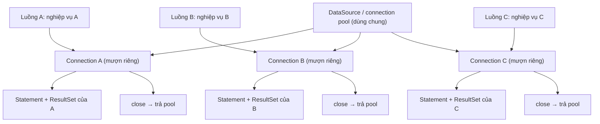
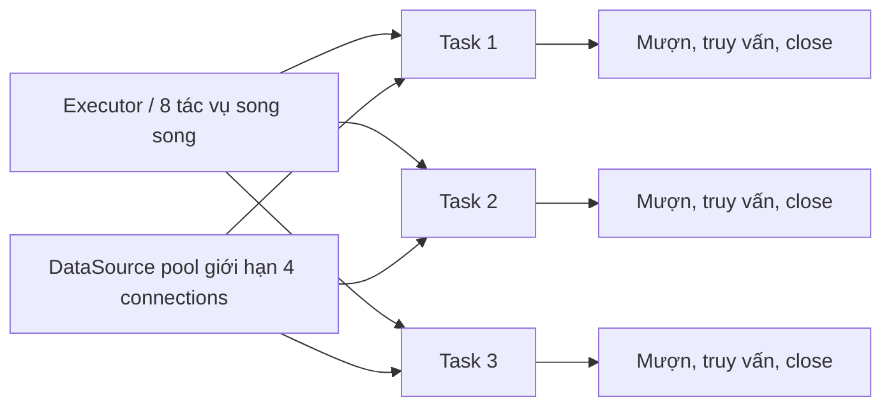

# Giới hạn chia sẻ tài nguyên truy cập dữ liệu giữa các luồng

Trong chương **Kết nối và tài nguyên** của module **DATA_PERSISTENCE_FUNDAMENTALS**, một câu hỏi thiết kế quan trọng là: **nhiều luồng Java có thể dùng chung đối tượng nào khi truy cập cơ sở dữ liệu, và đối tượng nào phải được giới hạn trong một tác vụ hoặc giao dịch?**

Ví dụ, một ứng dụng web có hàng trăm request đồng thời. Các request có thể dùng chung `DataSource` quản lý pool kết nối, nhưng sẽ nguy hiểm nếu dùng chung một `Connection` đang chạy transaction, một `PreparedStatement` chứa tham số có thể thay đổi hoặc một `ResultSet` đang duyệt dữ liệu. Hậu quả có thể là lỗi truy vấn khó tái hiện, lẫn tham số giữa hai request, commit nhầm thao tác của nhau, hết kết nối hoặc trả kết quả không nhất quán.

Với Java persistence, hiểu quyền sở hữu tài nguyên và ranh giới đồng thời giúp thiết kế repository, kiểm soát transaction, xử lý lỗi kết nối và tối ưu hiệu năng trong điều kiện tải thực. Bài này tập trung vào **JDBC**, connection pool, **JPA/Hibernate**, Spring và các luồng bất đồng bộ; những ví dụ cụ thể về driver hoặc framework được ghi rõ khi cần.

## 1. Bài toán: hai luồng cùng sử dụng một kết nối

Giả sử một service giữ một kết nối JDBC trong một field của đối tượng singleton:

```java
public final class UnsafeOrderService {
    private final Connection sharedConnection;

    public UnsafeOrderService(Connection connection) {
        this.sharedConnection = connection;
    }

    public void updateOrder(long orderId, String state) throws SQLException {
        String sql = "UPDATE orders SET status = ? WHERE id = ?";
        try (PreparedStatement ps = sharedConnection.prepareStatement(sql)) {
            ps.setString(1, state);
            ps.setLong(2, orderId);
            ps.executeUpdate();
        }
    }
}
```

Nếu hai HTTP request gọi `updateOrder` đồng thời, cả hai sẽ sử dụng cùng một **phiên database**. Việc chúng tạo hai `PreparedStatement` khác nhau không tạo ra hai giao dịch độc lập, bởi trạng thái transaction thuộc về `Connection`.

Một lịch chạy rủi ro khi `autoCommit=false`:

| Thời điểm | Luồng A | Luồng B | Trạng thái |
| --- | --- | --- | --- |
| T1 | `UPDATE` đơn A | — | Cùng một connection có thay đổi chưa commit |
| T2 | — | `UPDATE` đơn B | Hai thay đổi có thể đang thuộc cùng transaction |
| T3 | — | `commit()` | B có thể commit **cả thay đổi của A** |
| T4 | A gặp lỗi, gọi `rollback()` | — | Không thể undo phần đã commit ở T3 |

Kết quả chính xác khi nhiều thao tác cùng diễn ra trên một `Connection` còn phụ thuộc driver, giao thức và cơ chế xử lý đồng thời. **Không được coi lịch trên là bảo đảm rằng driver sẽ cho phép các lệnh chạy song song**; một số driver có thể tuần tự hóa, chặn hoặc báo lỗi. Điểm quan trọng vẫn là: **đồng bộ hóa việc gọi phương thức trên cùng connection không mang lại giao dịch độc lập cho mỗi request**.

Ngay cả khi đã dùng `synchronized` để tránh hai luồng thao tác cùng lúc trên một connection, nếu luồng A bắt đầu transaction nhưng B vẫn được chạy trước khi A kết thúc, chúng có thể chia sẻ trạng thái giao dịch. Muốn thực sự độc lập, cần **một ngữ cảnh giao dịch riêng cho mỗi đơn vị công việc**, thường bằng một kết nối được pool cấp riêng trong suốt phạm vi giao dịch.

## 2. Phân loại tài nguyên: được chia sẻ đến mức nào?

Không có một quy tắc “mọi đối tượng database đều thread-safe” áp dụng cho toàn bộ Java persistence. Cần phân biệt đối tượng quản lý nguồn tài nguyên và đối tượng đang giữ **trạng thái thao tác**.

| Đối tượng / tài nguyên | Phạm vi chia sẻ khuyến nghị | Lý do |
| --- | --- | --- |
| `DataSource` pool được triển khai hỗ trợ concurrent access | **Dùng chung** ở cấp ứng dụng | Quản lý các lượt mượn kết nối, được thiết kế phục vụ nhiều luồng |
| `Connection` JDBC | **Một chủ sở hữu tại một thời điểm**, gắn với tác vụ/giao dịch | Chứa trạng thái session, `autoCommit`, isolation và transaction |
| `Statement` / `PreparedStatement` / `CallableStatement` | **Không chia sẻ khi đang sử dụng** giữa các luồng | Có tham số, kết quả, batch và trạng thái thực thi thay đổi được |
| `ResultSet` | **Không chia sẻ cursor đang duyệt** giữa các luồng | Vị trí cursor, vòng đời và dữ liệu liên kết với statement/connection |
| `DatabaseMetaData` / `ResultSetMetaData` | Xét theo vòng đời của connection/result set và hợp đồng driver | Không suy diễn thread-safety cho object có tham chiếu tài nguyên sống |
| `EntityManagerFactory` của JPA | Có thể **chia sẻ**, thường là singleton | Factory được thiết kế tạo/cấp các persistence context |
| `EntityManager` hoặc Hibernate `Session` | **Một phạm vi công việc/giao dịch**, không dùng đồng thời bởi nhiều luồng | Giữ persistence context, first-level cache, dirty checking |
| Spring Data repository bean được framework quản lý | Có thể dùng chung bean theo cách cấu hình chuẩn | Thường là proxy/delegate tới tài nguyên gắn với transaction hiện tại; không làm các entity/session bên dưới thành thread-safe |
| Đối tượng kết quả đã copy thành immutable DTO | Có thể chia sẻ nếu thật sự bất biến | Không còn giữ cursor hoặc transaction DB đang mở |

**Chú ý:** `DataSource` chỉ có thể được chia sẻ an toàn theo hợp đồng của implementation cụ thể; phần lớn connection pool phổ biến được thiết kế cho trường hợp này. Một `DataSource` tự viết có trạng thái mutable vẫn cần đánh giá thread-safety. Ngược lại, không nên khẳng định JDBC API bảo đảm `Connection` và các statement thread-safe trên mọi driver.

### 2.1. Factory được chia sẻ, session được giới hạn

Có thể hình dung sự khác biệt như sau:



Trong sơ đồ, **các luồng không cần một kết nối vật lý cố định suốt đời**. Luồng A mượn connection cho một phạm vi công việc, hoàn thành rồi trả pool; sau đó luồng B hoặc C có thể mượn lại **cùng kết nối vật lý** trong một lượt mượn khác. Pool phải quản lý việc cấp phát và làm sạch trạng thái theo hợp đồng của nó.

## 3. Vì sao không nên chia sẻ `Connection` đang hoạt động?

`Connection` chứa trạng thái có thể ảnh hưởng tất cả statement chạy qua nó:

- **Trạng thái giao dịch:** `autoCommit`, các thay đổi chưa commit, `commit()`, `rollback()`, savepoint.
- **Mức cô lập:** `setTransactionIsolation(...)`; thay đổi có thể ảnh hưởng hành vi đọc/ghi của các statement khác trên cùng phiên.
- **Trạng thái session:** schema hiện tại, các biến session, các bảng tạm, tùy chọn client hoặc DB.
- **Vòng đời tài nguyên:** statement/cursor liên quan, lệnh cancel, lỗi kết nối và hành vi `close()`.

Nếu một luồng thay đổi `autoCommit` hoặc isolation, luồng khác đang dùng cùng connection có thể chịu ảnh hưởng. Nếu một luồng đóng connection trong lúc luồng khác đang đọc `ResultSet`, thao tác đọc có thể lỗi. Một số driver chỉ cho phép một luồng giao tiếp với kết nối ở một thời điểm; ngay cả khi driver hỗ trợ nhiều statement, **điều đó không tương đương có nhiều transaction độc lập**.

Ví dụ lỗi rất khó nhận thấy là lưu `Connection` trong một repository singleton:

```java
// Không nên:
public final class CustomerRepository {
    private final Connection connection;

    public CustomerRepository(DataSource ds) throws SQLException {
        this.connection = ds.getConnection();
    }
}
```

Repository này mượn kết nối một lần rồi giữ lâu dài. Nó vừa có nguy cơ bị nhiều luồng sử dụng, vừa không trả connection về pool giữa các request, khiến pool mất một slot. Nếu connection bị ngắt do mạng, repository còn giữ tham chiếu tới kết nối hỏng. **Nên lưu `DataSource` (hoặc abstraction có chức năng cấp kết nối) thay vì lưu connection dùng lâu dài.**

### 3.1. `Connection.close()` trong pool có nghĩa gì?

Với pool thông dụng, lời gọi `close()` trên **logical connection** là hành động trả lượt mượn về pool; nó không nhất thiết đóng kết nối TCP vật lý. Pool thường có cơ chế reset `autoCommit`, isolation hoặc rollback giao dịch còn dở, nhưng chi tiết thay đổi theo implementation/cấu hình.

Ứng dụng không được dựa vào việc “pool sẽ tự sửa mọi sai lầm”: chủ sở hữu transaction nên commit/rollback rõ ràng, đóng statement và result set, và không giao connection cho một tác vụ tiếp tục sử dụng sau khi đã `close()`.

Trong môi trường có framework transaction, việc tự mở và đóng connection ngoài transaction manager có thể tạo một **giao dịch khác** với giao dịch service đang sử dụng. Cần dùng cơ chế lấy kết nối tương thích với transaction manager của ứng dụng.

## 4. `PreparedStatement` và `ResultSet`: trạng thái thay đổi theo lần gọi

Một `PreparedStatement` chứa **tham số đang được bind**, thông tin batch và trạng thái thực thi. Nếu hai luồng cùng thay đổi các tham số trên một statement, một truy vấn có thể sử dụng giá trị không thuộc về request của mình.

```java
// Mã minh họa SAI nếu ps được chia sẻ giữa hai luồng.
void findOrder(PreparedStatement ps, long id) throws SQLException {
    ps.setLong(1, id);
    try (ResultSet rs = ps.executeQuery()) {
        // Đọc dữ liệu ...
    }
}
```

Giả sử A gọi `setLong(1, 100)`, B gọi `setLong(1, 200)` trước khi A gọi `executeQuery()`. Tùy driver, A có thể chạy với tham số `200`, gặp lỗi hoặc chịu một hành vi thực thi không mong muốn. Việc `PreparedStatement` được tạo một lần để “tiết kiệm prepare” không biến nó thành tài nguyên an toàn để mọi request dùng chung.

`ResultSet` cũng thường là **cursor có trạng thái**:

```java
while (rs.next()) {
    long id = rs.getLong("id");
    // Vị trí con trỏ thay đổi sau mỗi lần gọi next().
}
```

Nếu một luồng gọi `rs.next()` trong lúc luồng khác gọi `rs.getLong()`, không có bảo đảm rằng cả hai đang đọc cùng một hàng. Ngoài ra, đóng statement thường đóng result set liên quan; thực thi lại statement có thể làm đóng result set hiện tại theo quy tắc JDBC.

Do vậy:

- Tạo `PreparedStatement` và `ResultSet` **bên trong phạm vi dùng kết nối**.
- Đóng `ResultSet` trước hoặc cùng lúc đóng `PreparedStatement`, rồi mới trả `Connection` khi caller sở hữu connection đó.
- **Không trả `ResultSet`, `Stream` còn lazy trên database, hoặc ORM entity phụ thuộc lazy loading** cho nơi sẽ dùng sau khi transaction/connection đóng mà không có thiết kế vòng đời phù hợp.
- Nếu cần truyền dữ liệu qua các luồng, hãy **materialize** kết quả thành DTO không còn tham chiếu tới cursor/phiên DB, và kiểm soát tính bất biến của DTO.

### 4.1. Caching statement có khác với chia sẻ statement?

Nhiều driver/pool có thể hỗ trợ **prepared statement caching**. Đây thường là cơ chế tái sử dụng tài nguyên trong phạm vi kết nối hoặc phía driver/server theo hợp đồng riêng; không có nghĩa ứng dụng cần giữ một biến `static PreparedStatement` và phát nó cho mọi request.

Giá trị của cache phải được đo với workload thật: số loại SQL, số connection, kích thước cache, bộ nhớ máy chủ và lợi ích của prepare. Không bật cache hoặc tăng kích thước vô hạn chỉ vì muốn giảm thao tác tạo đối tượng Java.

## 5. Mẫu JDBC an toàn: một lần mượn kết nối cho một thao tác

Một repository có thể chia sẻ `DataSource` nhưng **mượn và trả kết nối trong mỗi đơn vị công việc**:

```java
import java.sql.Connection;
import java.sql.PreparedStatement;
import java.sql.ResultSet;
import java.sql.SQLException;
import java.util.ArrayList;
import java.util.List;
import javax.sql.DataSource;

public final class OrderReader {
    private final DataSource dataSource;

    public OrderReader(DataSource dataSource) {
        this.dataSource = dataSource;
    }

    public List<OrderSummary> findRecent(long customerId, int limit)
            throws SQLException {
        if (limit < 1 || limit > 100) {
            throw new IllegalArgumentException("limit out of range");
        }

        String sql = """
            SELECT id, status
            FROM orders
            WHERE customer_id = ?
            ORDER BY created_at DESC, id DESC
            LIMIT ?
            """;

        List<OrderSummary> rows = new ArrayList<>();
        try (Connection c = dataSource.getConnection();
             PreparedStatement ps = c.prepareStatement(sql)) {
            ps.setLong(1, customerId);
            ps.setInt(2, limit);
            ps.setQueryTimeout(5); // Giây; hỗ trợ và độ chính xác tùy driver.

            try (ResultSet rs = ps.executeQuery()) {
                while (rs.next()) {
                    rows.add(new OrderSummary(
                        rs.getLong("id"),
                        rs.getString("status")
                    ));
                }
            }
        }
        return List.copyOf(rows); // Danh sách không cho sửa cấu trúc.
    }

    public record OrderSummary(long id, String status) {}
}
```

Với mã này, nhiều luồng **có thể gọi `findRecent` đồng thời trên cùng một `OrderReader`**, miễn `DataSource` hỗ trợ concurrent access. Mỗi lần gọi lấy một connection riêng trong phạm vi mượn và tạo một statement/result set riêng. Các biến cục bộ thuộc về lần gọi của từng luồng.

`List.copyOf` ngăn sửa cấu trúc danh sách; trong ví dụ `OrderSummary` là record chỉ chứa `long` và `String`, nên dữ liệu chuyển qua luồng không giữ connection hay trạng thái mutable của database. Với DTO chứa array, collection mutable hoặc entity JPA, phải đánh giá tính bất biến của **toàn bộ cây đối tượng**.

`setQueryTimeout` là một lớp giới hạn thời gian câu SQL theo JDBC, nhưng không nên coi đây là giới hạn tổng thời gian chờ: việc **đợi lấy connection từ pool** xảy ra trước `prepareStatement()` và cần timeout riêng ở cấu hình pool. Tùy driver, timeout query còn có giới hạn về độ chính xác và khả năng hủy câu lệnh đang chạy.

### 5.1. Một transaction nhiều repository phải dùng chung ngữ cảnh

Nếu nghiệp vụ cần hai bước nguyên tử, service phải sở hữu ranh giới transaction. Trong JDBC thủ công, hai repository **nhận cùng `Connection` từ service**, thay vì mỗi repository gọi `getConnection()`:

```java
public void transfer(DataSource ds, long from, long to, long amount)
        throws SQLException {
    try (Connection c = ds.getConnection()) {
        if (!c.getAutoCommit()) {
            throw new SQLException("Expected fresh autoCommit=true");
        }
        c.setAutoCommit(false);

        try {
            accountRepository.debit(c, from, amount);
            accountRepository.credit(c, to, amount);
            c.commit();
        } catch (SQLException | RuntimeException failure) {
            try {
                c.rollback();
            } catch (SQLException rollbackFailure) {
                failure.addSuppressed(rollbackFailure);
            }
            throw failure;
        }
    }
}
```

Đây là mã minh họa; `accountRepository` và các phương thức `debit/credit` do ứng dụng cài đặt, còn `DataSource` được giả định cung cấp connection chưa có transaction mở. Trong hệ thống thật cần thiết kế đầy đủ kiểm tra số dư, trạng thái commit không rõ khi lỗi mạng, idempotency và chính sách reset của pool.

Ở ví dụ này, **chung connection là đúng vì hai repository được gọi tuần tự trong cùng một transaction do service điều phối**. Không được suy diễn thành “có thể đưa connection đó cho hai worker chạy song song”. Transaction cục bộ JDBC có một ngữ cảnh chung; nếu cần tính nguyên tử của cả hai bước, thường giữ chúng trong một transaction với các thao tác SQL được thực thi và điều phối rõ ràng.

## 6. Chạy nhiều tác vụ song song: mỗi tác vụ mượn kết nối riêng

Khi công việc độc lập có thể thực thi song song, cách phổ biến là **chia sẻ pool**, để từng tác vụ mượn connection trong thời gian nó thật sự cần:



Nếu có 8 tác vụ đồng thời nhưng pool chỉ cấp tối đa 4 connection, một số tác vụ phải **chờ** tài nguyên. Đây là hành vi bình thường để giới hạn tải đồng thời lên DB, miễn thời gian chờ được kiểm soát và không dẫn đến nghẽn tài nguyên kéo dài.

Ví dụ ứng dụng xử lý độc lập nhiều khách hàng bằng `ExecutorService`:

```java
ExecutorService executor = Executors.newFixedThreadPool(4);
try {
    List<Future<List<OrderReader.OrderSummary>>> futures =
        new ArrayList<>();

    for (long customerId : customerIds) {
        futures.add(executor.submit(() ->
            orderReader.findRecent(customerId, 20)
        ));
    }

    for (Future<List<OrderReader.OrderSummary>> future : futures) {
        List<OrderReader.OrderSummary> result = future.get();
        consume(result); // Xử lý DTO, không giữ ResultSet.
    }
} finally {
    executor.shutdown();
}
```

Trong ví dụ, `orderReader.findRecent(...)` mượn connection **bên trong tác vụ** rồi đóng trước khi trả DTO. `Future.get()` có thể ném `ExecutionException` bao lỗi từ task hoặc `InterruptedException`; caller cần có chính sách timeout, hủy, khôi phục interrupt và xử lý task còn chạy theo yêu cầu ứng dụng. `shutdown()` ngăn nhận tác vụ mới nhưng **không đợi tất cả tác vụ kết thúc**; với service sống lâu, executor thường được quản lý theo vòng đời ứng dụng và cần cơ chế shutdown có kiểm soát thay vì tạo mới cho mỗi request.

**Không dùng ví dụ này để chạy hai nửa của cùng một giao dịch nguyên tử.** Mỗi task sẽ có connection/transaction riêng, không có một lời gọi `commit()` duy nhất bảo đảm mọi tác vụ cùng thành công hoặc cùng rollback. Nếu nghiệp vụ yêu cầu tính nguyên tử qua nhiều thao tác DB, cần thiết kế lại ranh giới công việc hoặc dùng cơ chế điều phối phù hợp.

### 6.1. `CompletableFuture` và truy vấn chặn luồng

Một mẫu dễ gây hiểu lầm:

```java
CompletableFuture<Order> future =
    CompletableFuture.supplyAsync(() -> repository.findOrder(orderId));
```

`supplyAsync` không truyền ngữ cảnh transaction của caller một cách tự động. Nếu không truyền `Executor`, phương thức này thường dùng common fork-join pool, không nhất thiết là nơi phù hợp để chạy số lượng lớn truy vấn JDBC **chặn luồng**. Nên dùng executor được giới hạn và quản lý riêng cho workload blocking, cùng pool connection có cấu hình phù hợp.

Đưa công việc JDBC sang executor giúp caller không phải trực tiếp đợi tại cùng luồng, nhưng **không biến JDBC thành giao tiếp database non-blocking**. Tác vụ vẫn có thể phải đợi lấy connection, đợi network hoặc đợi khóa tại DB.

## 7. Ranh giới transaction và Spring: ngữ cảnh thường gắn với luồng

Trong Spring dùng transaction management kiểu imperative, ngữ cảnh transaction thường được **liên kết với luồng đang thực thi** qua cơ chế quản lý tài nguyên của framework. Một service `@Transactional` và các repository được cấu hình đúng có thể tham gia cùng transaction trên luồng đó:

```java
@Service
public class OrderService {
    private final OrderRepository orders;
    private final InventoryRepository inventory;

    public OrderService(OrderRepository orders, InventoryRepository inventory) {
        this.orders = orders;
        this.inventory = inventory;
    }

    @Transactional
    public void placeOrder(long productId, int qty) {
        int changed = inventory.decreaseIfAvailable(productId, qty);
        if (changed != 1) {
            throw new IllegalStateException("Insufficient stock");
        }
        orders.insert(productId, qty);
        // Hai repository tham gia transaction do Spring điều phối,
        // nếu cấu hình dùng đúng transaction manager/tài nguyên.
    }
}
```

Những phương thức repository trong ví dụ là API giả định. Với Spring JDBC hoặc JPA cấu hình chuẩn, framework điều phối tài nguyên trong transaction; **repository không cần và không nên tự `commit` hoặc `close` connection do framework quản lý**.

### 7.1. Chuyển sang luồng khác giữa chừng thì sao?

Một lỗi dễ mắc:

```java
@Transactional
public void placeOrder(long productId, int qty) {
    inventory.decreaseIfAvailable(productId, qty);

    CompletableFuture.runAsync(() -> {
        orderRepository.insert(productId, qty);
    });
    // Method trả về; transaction ngoài có thể commit.
}
```

Tác vụ `runAsync` thường chạy trong **luồng khác**. Transaction imperative của caller **không tự động được truyền sang luồng đó**. Hơn nữa, `placeOrder()` có thể kết thúc và commit trước khi task bất đồng bộ hoàn thành. Như vậy, trừ kho và tạo đơn không còn được bảo đảm nguyên tử.

Không nên “sửa” bằng cách lấy đối tượng `Connection` hoặc `EntityManager` của transaction ngoài rồi truyền thẳng cho task: tài nguyên và trạng thái giao dịch đó không được thiết kế để hai luồng sử dụng đồng thời. Nếu hai bước phải cùng commit, hãy thực hiện chúng trong một transaction được điều phối rõ ràng; nếu cần bất đồng bộ, thiết kế **hai đơn vị công việc độc lập** cùng cơ chế xử lý nhất quán như outbox, idempotency hoặc saga khi phù hợp.

Tương tự, `@Async`, scheduled task, callback và event listener không được giả định tự kế thừa transaction của luồng đã gọi chúng. Cần kiểm tra rõ thời điểm task chạy, transaction mới được mở hay không, và failure/retry có ảnh hưởng bước khác thế nào. Trong Spring proxy-based transaction, self-invocation còn có thể bỏ qua interceptor `@Transactional` hoặc `@Async` nếu lời gọi không đi qua proxy.

### 7.2. Không đồng nhất với reactive transaction

Trong ứng dụng reactive, ví dụ Spring WebFlux với R2DBC, transaction context có thể được truyền thông qua **reactive context**, không dùng cùng nguyên tắc liên kết luồng của JDBC imperative. Không nên tự áp dụng quy tắc `ThreadLocal` của JDBC lên reactive pipeline, cũng không nên đưa một JDBC `Connection` vào luồng reactive rồi coi nó thành tài nguyên non-blocking.

## 8. `EntityManager`, Hibernate `Session` và persistence context

Với JPA/Hibernate, tài nguyên trạng thái quan trọng không chỉ là JDBC `Connection`: `EntityManager`/`Session` còn giữ **persistence context** (first-level cache), quản lý các entity đang được theo dõi, dirty checking, flush và vòng đời transaction.

```java
// Không nên tạo một EntityManager rồi chia sẻ nó để nhiều thread ghi đồng thời:
EntityManager sharedEntityManager = entityManagerFactory.createEntityManager();

// Thread A và B cùng dùng sharedEntityManager.find/persist/flush...
```

Một `EntityManager` không được mặc nhiên xem là thread-safe. Hai luồng cùng sửa entity được quản lý có thể gây sai lệch dirty checking, lẫn trạng thái first-level cache hoặc lỗi khi `flush`. Hibernate `Session` cũng được thiết kế như một đơn vị công việc cần giới hạn phạm vi, **không phải nơi chia sẻ phiên làm việc cho các request đồng thời**.

Ngược lại, `EntityManagerFactory` được thiết kế để chia sẻ và tạo ra `EntityManager` trong những phạm vi thích hợp. Khi dùng Spring/JPA, một field được inject với `@PersistenceContext` thường là **proxy do Spring quản lý**: proxy có thể điều phối tới `EntityManager` phù hợp với transaction hiện tại. Việc nhiều bean gọi qua proxy không có nghĩa cùng một **`EntityManager` thực** nên được truyền qua các luồng.

| Đối tượng | Cách dùng phù hợp |
| --- | --- |
| `EntityManagerFactory` | Được quản lý vòng đời ứng dụng, chia sẻ để tạo/cấp `EntityManager` |
| `EntityManager` thực | Dùng trong một đơn vị công việc/transaction; đóng khi do ứng dụng tự tạo |
| Spring shared `EntityManager` proxy | Có thể inject vào bean theo cách framework hỗ trợ; mỗi luồng/transaction nhận ngữ cảnh phù hợp |
| Managed JPA entity | Có thể bị thay đổi, có lazy associations và gắn với context; không tự động an toàn khi chia sẻ giữa luồng |
| Immutable DTO/projection | Phù hợp để truyền giữa luồng sau khi đã lấy hết dữ liệu cần dùng |

### 8.1. Lazy loading và chia sẻ dữ liệu sau transaction

Ví dụ một controller lấy entity rồi gửi sang tác vụ khác:

```java
Order order = orderRepository.findById(id).orElseThrow();
CompletableFuture.runAsync(() -> {
    // Có thể truy cập collection lazy khi EntityManager đã đóng,
    // gây LazyInitializationException hoặc truy cập trạng thái không an toàn.
    process(order.getItems());
});
```

Không nên dựa vào việc `order` là đối tượng Java thông thường để suy ra nó độc lập với database. Một entity có thể chứa proxy và collection lazy; các truy cập sau khi transaction đóng có thể thất bại, còn truy cập từ nhiều luồng khi context đang mở có thể không an toàn.

Thay vào đó, lấy projection/DTO có đủ dữ liệu cần thiết **trong transaction của luồng sở hữu nó**, rồi truyền DTO bất biến:

```java
public record OrderItemView(long productId, int quantity) {}
public record OrderView(long id, List<OrderItemView> items) {
    public OrderView {
        items = List.copyOf(items);
    }
}
```

Đoạn record là một phần thiết kế DTO; cần bảo đảm `OrderItemView` và các trường con cũng không chứa trạng thái mutable/lazy. `List.copyOf` bảo vệ cấu trúc danh sách, không tự biến mọi phần tử mutable thành bất biến.

## 9. Virtual threads không làm connection trở thành tài nguyên vô hạn

Java 21 đưa **virtual threads** vào sử dụng chính thức, giúp chạy nhiều tác vụ theo phong cách blocking với chi phí quản lý luồng thường thấp hơn platform threads ở nhiều workload I/O. Tuy nhiên:

- Virtual thread **không tạo thêm kết nối vật lý tới DB**. Mỗi JDBC transaction đang chạy vẫn cần connection theo hợp đồng pool.
- Nếu có 10.000 virtual threads cùng muốn truy cập DB và pool chỉ cho phép 20 connection, phần lớn tác vụ sẽ phải **chờ checkout**; thông lượng DB không tự tăng 500 lần.
- Không nên mượn connection rồi giữ trong lúc tác vụ chờ API ngoài, chờ người dùng hoặc ngủ lâu; connection pool là tài nguyên hạn chế.
- Không dùng `ThreadLocal<Connection>` như một cache kết nối sống suốt đời luồng. Với virtual threads tạo thường xuyên, điều đó vừa có thể gây leak/giữ connection quá lâu, vừa làm quản lý giao dịch và cleanup khó kiểm soát.
- Một số driver, thao tác native hoặc đoạn mã đồng bộ có thể gây chi phí khác nhau khi chạy virtual threads; cần benchmark và theo dõi trên JDK/driver thực tế, không suy ra mọi JDBC call đều có khả năng scale vô hạn.

Ví dụ nguyên tắc mượn connection **trong tác vụ** vẫn giống nhau:

```java
try (ExecutorService executor = Executors.newVirtualThreadPerTaskExecutor()) {
    List<Future<Integer>> jobs = new ArrayList<>();
    for (long customerId : customerIds) {
        jobs.add(executor.submit(() -> {
            // queryCount() tự mượn và đóng connection trong task.
            return orderReader.queryCount(customerId);
        }));
    }
    for (Future<Integer> job : jobs) {
        System.out.println(job.get());
    }
}
```

Ví dụ này cần **Java 21 trở lên**; `queryCount` là phương thức minh họa được thiết kế theo mẫu mượn/trả tài nguyên ở mục 5. `ExecutorService` trong Java hiện đại hỗ trợ `AutoCloseable`; khi đóng executor, cần xem hành vi chờ và cancellation phù hợp với yêu cầu thời gian của ứng dụng. Không được dựa vào số virtual threads để bỏ qua giới hạn lượng request chạy tới DB.

## 10. Kích thước connection pool và giới hạn đồng thời

Không phải cứ có nhiều request là tăng `maximumPoolSize` đến hàng trăm hoặc hàng nghìn sẽ tốt hơn. Mỗi kết nối vật lý thường tiêu thụ bộ nhớ, socket và tài nguyên phía DB. Nhiều truy vấn hoạt động đồng thời còn tranh chấp CPU, I/O, khóa và bộ nhớ. Một pool quá lớn có thể làm DB chậm hơn hoặc vượt giới hạn kết nối của server.

### 10.1. Phân biệt ba loại thời gian

Khi quan sát một truy vấn, cần phân biệt:

1. **Thời gian chờ lấy connection** (*connection acquisition / pool wait*): task chờ vì pool đã cấp hết slot.
2. **Thời gian giữ connection** (*connection hold time*): từ lúc mượn tới lúc trả; gồm thời gian truy vấn, đợi khóa, xử lý Java khi còn mượn, commit/rollback.
3. **Thời gian thực thi database** (*query/transaction execution*): DB chạy SQL, đợi I/O, khóa hoặc các tác vụ server.

Nếu truy vấn SQL chỉ tốn 5 ms nhưng request giữ connection trong 2 giây vì xử lý file hoặc gọi HTTP ở giữa, pool sẽ cạn nhanh dù câu SQL tối ưu. Giảm **thời gian giữ connection** có thể có lợi hơn chỉ tăng kích thước pool.

Theo một dạng ứng dụng của **định luật Little**, trong hệ thống ổn định:

\[
L \approx \lambda \times W,
\]

trong đó \(L\) là số công việc đang giữ tài nguyên trung bình, \(\lambda\) là tốc độ công việc và \(W\) là thời gian giữ tài nguyên trung bình. Ví dụ **minh họa**, nếu có 200 thao tác DB mỗi giây và mỗi thao tác giữ connection trung bình 0,05 giây, số lượt mượn đồng thời trung bình xấp xỉ \(200 \times 0{,}05 = 10\).

Con số **10 chỉ là trung bình**, không phải kích thước pool tối ưu. Burst traffic, phân bố độ trễ ở đuôi, giao dịch dài, số instance ứng dụng, loại workload, tài nguyên DB và giới hạn server đều quan trọng. Cần kiểm thử tải để lựa chọn pool size và số worker, không dựa vào một công thức duy nhất.

### 10.2. Tổng kết nối của nhiều instance

Giả sử có 6 instance ứng dụng, mỗi instance cấu hình pool tối đa 30 connections; về lý thuyết các pool có thể cùng yêu cầu tới **180 kết nối** phía DB, chưa kể tiến trình quản trị, các dịch vụ khác hoặc connection của replica. Việc mở rộng số pod/server ứng dụng có thể làm vượt giới hạn DB dù cấu hình pool của từng instance không đổi.

Khi mở rộng, hãy cân đối:

- Số request vào từng instance và mức song song thực sự chạm DB.
- Số connection tối đa DB cho phép và phần dự phòng cho quản trị/phục hồi.
- Tải CPU/I/O và khả năng xử lý truy vấn khi nhiều connection cùng hoạt động.
- Giới hạn checkout timeout và chính sách trả lỗi/giảm tải khi pool đã bão hòa.
- Khả năng có **hai lượt mượn đồng thời trong một request**, như khi gọi `REQUIRES_NEW` trong Spring hoặc tự mượn connection ở tầng sâu.

Nếu một request đang giữ connection A, sau đó cố mượn connection B trong khi pool đã cạn vì các request khác cũng làm vậy, có thể xuất hiện tình trạng chờ kéo dài hoặc bế tắc tài nguyên. Thiết kế transaction và propagation phải tính tới nhu cầu kết nối lồng nhau, không chỉ số lượng request ở tầng HTTP.

### 10.3. Timeout cần đặt ở nhiều ranh giới

| Giới hạn | Thường áp dụng ở đâu | Điều nó bảo vệ |
| --- | --- | --- |
| Pool connection acquisition timeout | Connection pool | Không chờ vô hạn khi không có connection rảnh |
| Network/connect timeout | Driver / mạng | Giảm thời gian treo khi kết nối DB không phản hồi |
| Statement/query timeout | JDBC `setQueryTimeout`, DB hoặc framework | Giới hạn truy vấn chạy quá lâu theo cơ chế được hỗ trợ |
| Lock wait timeout | DB hoặc transaction | Không chờ khóa vô hạn |
| Transaction timeout | Transaction manager / DB | Giới hạn thời gian của một đơn vị giao dịch |
| Request/job deadline | HTTP server / executor / job worker | Cho phép hệ thống áp dụng hủy/giảm tải ở tầng nghiệp vụ |

Không giả định timeout ở một tầng **tự hủy ngay lập tức và thu hồi an toàn mọi tài nguyên** ở tầng khác. Chẳng hạn, `Future.cancel(true)` yêu cầu interrupt tác vụ nhưng việc driver JDBC có phản ứng kịp thời hay không còn phụ thuộc implementation. Nếu tác vụ bị hủy, phải bảo đảm nhánh kết thúc vẫn giải phóng statement/connection khi có thể và các transaction chưa hoàn tất được xử lý theo hợp đồng.

## 11. Các mẫu lỗi khó phát hiện

### 11.1. `ThreadLocal<Connection>` không có cleanup rõ ràng

```java
private static final ThreadLocal<Connection> CURRENT = new ThreadLocal<>();

void open(DataSource ds) throws SQLException {
    CURRENT.set(ds.getConnection());
}
```

Đoạn trên tạo nguy cơ **rò connection** nếu không có cơ chế `close()` và `remove()` chắc chắn trong `finally`. Với thread pool, cùng một worker thread có thể phục vụ nhiều request kế tiếp; trạng thái còn sót có thể bị request sau sử dụng nhầm. Với virtual threads, giữ kết nối theo vòng đời luồng có thể tiêu thụ kết nối không cần thiết.

Framework transaction có thể dùng `ThreadLocal` **nội bộ** một cách có kiểm soát, gắn với phạm vi transaction và cleanup. Điều đó **không phải lý do** để application code tự tạo kho kết nối toàn cục bằng `ThreadLocal`.

### 11.2. Trả `Stream`/cursor khi kết nối đã đóng

```java
Stream<Order> findOrders() {
    try (Connection c = dataSource.getConnection()) {
        // Sai về thiết kế: tạo Stream lazy dựa trên ResultSet
        // rồi trả ra ngoài khi c đã bị close.
        return createLazyStreamFromDatabase(c);
    }
}
```

Hàm `createLazyStreamFromDatabase` chỉ là ví dụ giả định. Dữ liệu chưa được lấy hết mà connection đã đóng sẽ khiến phần tiêu thụ stream sau đó gặp lỗi hoặc có hành vi không mong muốn. Nếu muốn stream lượng dữ liệu lớn, phải thiết kế API giữ phạm vi kết nối/transaction **bao trọn thời gian tiêu thụ**, có cơ chế đóng stream và giới hạn thời gian đọc; hoặc phân trang và trả DTO đã materialize.

### 11.3. Gọi API ngoài khi vẫn giữ connection

```text
Mượn Connection
  -> SELECT dữ liệu
  -> đợi HTTP API khác 3 giây
  -> UPDATE/COMMIT
Trả Connection
```

Nếu 100 request làm vậy cùng lúc, pool dễ bão hòa dù truy vấn rất ngắn. Hãy thu hẹp phạm vi mượn/giao dịch tới những thao tác cần DB, đồng thời cân nhắc tính nhất quán khi tách bước gọi API ngoài. Với yêu cầu phải phối hợp commit dữ liệu và phát event, dùng các thiết kế như transactional outbox thay vì giữ DB transaction xuyên qua mạng.

### 11.4. Dùng `synchronized` để “bảo vệ” một connection toàn cục

```java
public synchronized void save(Order order) {
    // Mọi request xếp hàng để dùng một connection cố định.
}
```

`synchronized` có thể ngăn một số cuộc gọi đồng thời trên **một đối tượng Java**, nhưng nó biến toàn bộ truy cập DB thành nút nghẽn tuần tự; còn không bảo vệ khỏi các instance JVM khác. Nếu transaction kéo dài qua nhiều phương thức và không được khóa đúng **toàn bộ phạm vi**, các request vẫn có thể chia sẻ trạng thái transaction. Cách xử lý thông thường là pool cấp các kết nối riêng theo lượt mượn và để DB thực hiện kiểm soát đồng thời dữ liệu.

### 11.5. Nuốt ngoại lệ rồi trả connection khi transaction còn dở

```java
try {
    updateData(connection);
} catch (SQLException ignored) {
    // Không rollback, không báo lỗi và tiếp tục dùng connection.
}
```

Một số DB đánh dấu transaction vào trạng thái thất bại sau lỗi SQL, yêu cầu rollback trước khi tiếp tục. Kể cả nơi có thể tiếp tục, việc nuốt lỗi dễ làm nghiệp vụ ghi thiếu bước hoặc báo thành công sai. Chủ sở hữu transaction cần quy định rõ commit/rollback, bảo toàn lỗi gốc và không trả kết nối với trạng thái không xác định mà không có cleanup phù hợp.

## 12. Kiểm thử và quan sát khả năng chia sẻ an toàn

Một unit test chỉ gọi repository tuần tự thường không phát hiện lỗi lẫn tài nguyên giữa các luồng. Các kiểm thử phù hợp nên chạy với **database và driver tương ứng môi trường triển khai**, hoặc môi trường integration tương đương về hành vi transaction, kết nối và isolation.

### 12.1. Các ca kiểm thử nên có

1. **Nhiều request đọc độc lập:** gọi repository singleton đồng thời với các tham số khác nhau; xác nhận mọi kết quả gắn đúng request, không bị lẫn tham số.
2. **Độc lập transaction:** một giao dịch rollback sau khi giao dịch khác commit; xác nhận rollback của A không hủy hoặc commit dữ liệu của B khi chúng phải độc lập.
3. **Pool nhỏ, tải lớn:** đặt pool tối đa rất nhỏ trong môi trường test, chạy nhiều tác vụ và kiểm tra thời gian chờ, timeout, thứ tự hoàn tất; không để test treo vô hạn.
4. **Lỗi giữa chừng:** gây exception trong `ResultSet` processing hoặc sau một lệnh `UPDATE`; xác nhận `PreparedStatement`, `ResultSet` và connection được đóng/trả, transaction rollback khi cần.
5. **Task bất đồng bộ:** chạy `@Async` hoặc `CompletableFuture`, xác nhận caller không giả định transaction tự truyền qua thread boundary.
6. **JPA lazy entity:** đóng transaction trước khi chuyển dữ liệu cho worker; kiểm tra API trả DTO đầy đủ và không phụ thuộc persistence context đã đóng.
7. **Cancellation và shutdown:** hủy job đang chờ pool hoặc đang truy vấn; đo số connection trở về trạng thái rảnh và xử lý kết nối lỗi.

Để kích hoạt các lịch chạy cạnh tranh có chủ đích, có thể dùng `CountDownLatch` hoặc `CyclicBarrier` đặt trước thời điểm đọc, sau khi đọc hoặc trước commit. **Bắt đầu hai thread cùng lúc không bảo đảm tái hiện mọi race condition**: cần chèn điểm đồng bộ đúng chỗ và kiểm tra dữ liệu cuối cùng, thay vì chỉ kiểm tra không có exception.

### 12.2. Chỉ số cần theo dõi khi vận hành

| Chỉ số | Dấu hiệu cần chú ý | Cách điều tra |
| --- | --- | --- |
| Active/idle/pending connections của pool | Active chạm giới hạn, pending tăng | Thời gian giữ connection, query chậm, transaction dài |
| Connection acquisition time | Request chờ pool lâu | Pool size, số instance, lượng truy vấn đồng thời, DB load |
| Connection timeout count | Hệ thống không cấp connection kịp | Quá tải, leak, deadlock do mượn lồng nhau |
| Leak detection (nếu pool hỗ trợ) | Connection được giữ vượt ngưỡng | Xem stack trace và vòng đời task; leak detection là tín hiệu, không phải bằng chứng tuyệt đối |
| Transaction duration/rollback count | Transaction kéo dài, lỗi nhiều | Công việc ngoài DB trong transaction, deadlock, lock wait |
| DB active sessions/locks | Session chờ khóa hoặc CPU/I/O cao | Query plan, transaction cạnh tranh, cấu hình DB |
| Lỗi `Connection closed`, cursor hoặc lazy loading | Tài nguyên được dùng sau phạm vi sống | API trả `ResultSet`/entity lazy hoặc đóng nhầm từ luồng khác |

Với các pool như HikariCP, tên metric có thể khác tùy cấu hình xuất metric và phiên bản. Luôn đối chiếu chỉ số pool với chỉ số DB; một pool có nhiều kết nối rảnh không giải thích được mọi trường hợp SQL chậm, trong khi DB có CPU bão hòa vẫn có thể chậm dù pool còn dư.

### 12.3. Checklist trước khi đưa vào production

- Thành phần **dùng chung** là factory, pool, repository bean hoặc service không giữ kết nối/cursor mutable toàn cục.
- Mỗi thao tác JDBC có **chủ sở hữu connection** rõ ràng, với `try-with-resources` hoặc transaction manager điều phối đóng tài nguyên.
- `PreparedStatement`, `ResultSet` và `EntityManager` thực được giới hạn trong vòng đời phù hợp; không truyền live cursor/transaction qua luồng.
- Transaction nhiều repository dùng chung **đúng ngữ cảnh** và không bị split khi chuyển sang executor.
- Pool, executor, timeout, giới hạn database và số instance đã được cân bằng trên tải thực tế.
- Có quy tắc rollback, retry, idempotency và xử lý kết quả commit chưa rõ khi mất kết nối.
- Test đồng thời, kiểm tra lỗi và quan sát metric đã được đưa vào quy trình phát triển/vận hành.

## 13. Câu hỏi tự kiểm tra

**Câu hỏi 1.** Nhiều HTTP request có thể dùng chung một `HikariDataSource` nhưng không nên dùng chung một JDBC `Connection` đang có transaction. Tại sao?

**Gợi ý:** Pool được thiết kế điều phối nhiều lượt mượn connection; bản thân connection giữ trạng thái session/transaction mà các request cần tách biệt. Một luồng commit/rollback trên connection chung có thể ảnh hưởng thao tác của luồng khác.

**Câu hỏi 2.** Nếu mỗi luồng tạo `PreparedStatement` riêng nhưng cùng sử dụng một `Connection`, các transaction đã độc lập chưa?

**Gợi ý:** Chưa. Transaction gắn với connection; hai statement riêng không tạo hai transaction độc lập.

**Câu hỏi 3.** Vì sao không nên trả `ResultSet` từ repository ra controller rồi đóng connection ngay trong repository?

**Gợi ý:** `ResultSet` gắn với statement/connection còn sống. Đóng trước khi consumer đọc hết gây lỗi; nên map thành DTO khi connection còn mở hoặc thiết kế phạm vi stream rõ ràng.

**Câu hỏi 4.** Một phương thức `@Transactional` gọi `CompletableFuture.runAsync(...)` để ghi bảng khác. Liệu thao tác async tự động nằm trong cùng transaction?

**Gợi ý:** Thông thường không với Spring imperative transaction management. Ngữ cảnh giao dịch không tự lan qua ranh giới thread; cần thiết kế riêng hoặc thực thi tuần tự trong cùng transaction.

**Câu hỏi 5.** Tăng số virtual threads từ 100 lên 10.000 có làm pool JDBC 20 connections thực thi đồng thời 10.000 SQL command không?

**Gợi ý:** Không. Pool giới hạn số connection được mượn; phần lớn tác vụ sẽ đợi. Thông lượng còn phụ thuộc tài nguyên DB và chi phí truy vấn.

**Câu hỏi 6.** Khi pool bão hòa, chỉ tăng `maximumPoolSize` là đủ chưa?

**Gợi ý:** Chưa. Cần tìm thời gian giữ connection, truy vấn/chờ khóa, tác vụ giữ connection khi gọi mạng, tổng số kết nối của các instance và khả năng DB xử lý tải. Pool quá lớn có thể làm hệ thống chậm hơn.

**Điểm cần ghi nhớ:** **Chia sẻ `DataSource` hoặc factory để cấp phát tài nguyên; giới hạn `Connection`, statement, cursor và persistence context theo phạm vi công việc mà chúng phục vụ.** Ranh giới sở hữu rõ ràng, pool có giới hạn, transaction được điều phối đúng và kiểm thử đồng thời là nền tảng giúp Java persistence hoạt động ổn định dưới tải.


