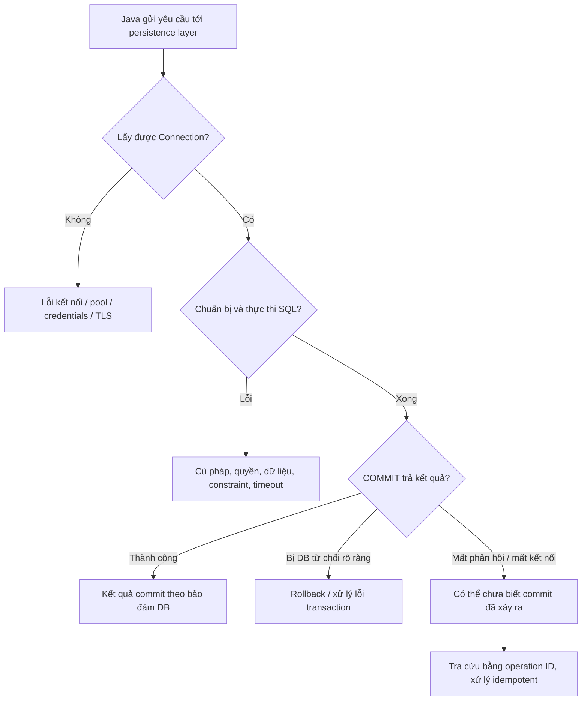
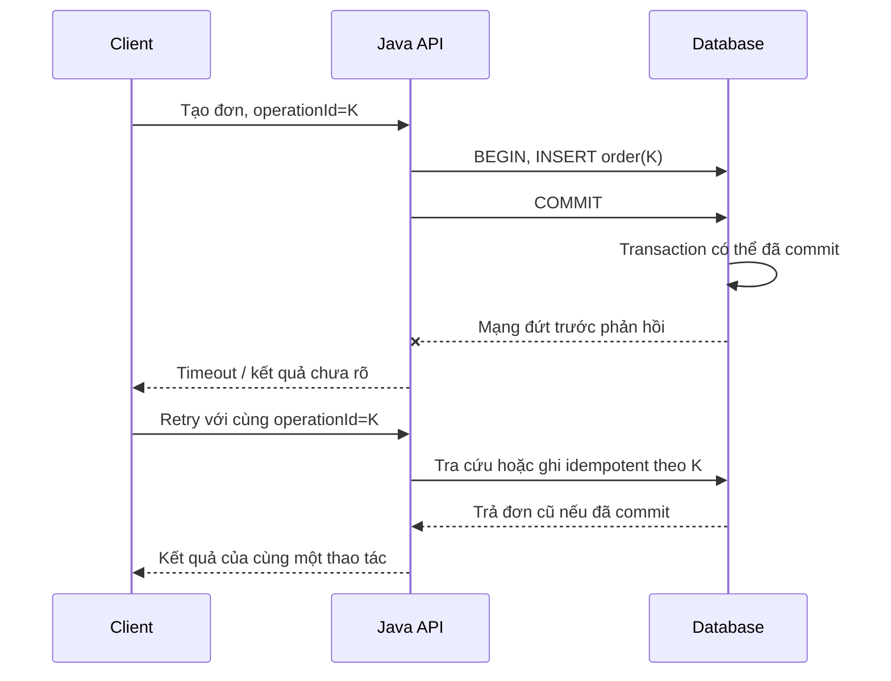

# Phân loại lỗi kết nối, xác thực, truy vấn và dữ liệu

## 1. Một lỗi database có thể xuất phát từ đâu?

Ứng dụng Java gọi database để đăng nhập, xem đơn hàng hoặc trừ tồn kho. Khi một thao tác thất bại, thông báo chung “Database error” không đủ để quyết định phải xử lý thế nào. Lỗi có thể đến từ **đường kết nối**, **danh tính và quyền truy cập**, **câu truy vấn**, hoặc **giá trị/ràng buộc dữ liệu**. Những nguyên nhân đó dẫn đến hành động khắc phục rất khác nhau.

Ví dụ:

- Không kết nối được tới máy chủ database vì mất mạng: cần kiểm tra mạng, endpoint, timeout và tính sẵn sàng của dịch vụ.
- Sai mật khẩu tài khoản dịch vụ: retry với cùng mật khẩu thường chỉ tạo thêm lưu lượng lỗi.
- Truy vấn dùng tên cột không tồn tại sau khi triển khai schema mới: phải sửa SQL hoặc phối hợp phiên bản ứng dụng và migration.
- Người dùng nhập số lượng âm hoặc hai request cố ghi cùng mã đơn: cần kiểm tra dữ liệu đầu vào, constraint và quy tắc xử lý cạnh tranh.

Bài học thuộc chương **Lỗi và thử lại** của module **DATA_PERSISTENCE_FUNDAMENTALS**. Nó kết nối việc thiết kế persistence boundary trong Java với cơ chế truy vấn, giao dịch, kiểm soát đồng thời, bảo mật, quản lý kết nối và vận hành hệ thống lưu trữ bền vững.

Mục tiêu là **chẩn đoán đúng lớp lỗi, xác định kết quả transaction, rồi mới quyết định có retry hay không**. Một số lỗi có thể hết khi thử lại; các lỗi khác sẽ lặp vô hạn nếu không thay đổi dữ liệu, cấu hình hoặc mã chương trình.

## 2. Bốn nhóm lỗi chính

| Nhóm | Dấu hiệu thường thấy | Ví dụ | Hướng xử lý đầu tiên |
| --- | --- | --- | --- |
| **Kết nối** (*connection*) | Không tạo được hoặc mất connection, timeout kết nối | DNS sai, máy chủ không sẵn sàng, kết nối TCP bị ngắt, TLS thất bại | Xác định lỗi xảy ra khi lấy kết nối, gửi SQL hay nhận kết quả; kiểm tra hạ tầng và sức khỏe connection |
| **Xác thực và phân quyền** (*authentication/authorization*) | Không xác minh được danh tính DB hoặc không được phép truy cập đối tượng | Sai tài khoản/mật khẩu, tài khoản hết quyền, thiếu `SELECT` trên bảng | Xác minh cấu hình secret, vai trò DB và quyền tối thiểu; không retry mù |
| **Truy vấn** (*query*) | SQL sai hoặc tham chiếu đối tượng không hợp lệ; truy vấn bị hủy/vượt giới hạn thời gian | Sai cú pháp, tên cột không tồn tại, schema drift, query timeout | Kiểm tra câu lệnh, phiên bản schema, tham số và execution plan; phân biệt lỗi SQL với timeout |
| **Dữ liệu** (*data*) | Giá trị sai kiểu/độ dài/phạm vi hoặc vi phạm constraint | Chuỗi quá dài, số vượt phạm vi, khóa ngoại sai, trùng `UNIQUE` | Kiểm tra input, bất biến nghiệp vụ, constraint và cạnh tranh ghi |

Đây là **bốn nhóm phục vụ chẩn đoán**, không có nghĩa mọi lỗi JDBC nằm gọn trong bốn ngăn độc lập. Chẳng hạn, `serialization_failure` do cạnh tranh transaction, `deadlock`, quá tải connection pool hoặc thiếu tài nguyên DB đều cần **nhánh xử lý riêng**. Một lỗi cũng có thể biểu hiện ở tầng khác với nguyên nhân gốc: migration chưa chạy tạo lỗi truy vấn; một gateway timeout có thể che giấu việc SQL đã chạy và commit thành công.

### Xác định thao tác đã đi tới đâu



Không được coi lỗi kết nối trong lúc **mở connection** giống lỗi kết nối **sau khi đã gửi COMMIT**. Trường hợp thứ hai có thể để lại kết quả **không xác định từ góc nhìn ứng dụng**.

## 3. Lỗi kết nối: từ network tới connection pool

Một lỗi kết nối có thể xuất hiện khi ứng dụng gọi `DataSource.getConnection()`, đang gửi câu lệnh, đang chờ kết quả hoặc lúc `commit()`.

### Các nguyên nhân điển hình

1. **Endpoint và mạng:** địa chỉ host/port sai, DNS lỗi, firewall chặn, NAT hoặc proxy ngắt kết nối, kết nối TCP bị reset.
2. **Máy chủ database:** DB đang khởi động, failover, bảo trì, đóng cổng, vượt giới hạn kết nối hoặc từ chối kết nối mới.
3. **TLS:** chứng chỉ không hợp lệ/hết hạn, cấu hình trust store hoặc TLS không tương thích. Tùy driver, lỗi có thể xuất hiện dưới dạng `SQLException` với cause là lỗi SSL.
4. **Pool phía ứng dụng:** hết connection rảnh, transaction giữ connection quá lâu, connection leak, pool acquisition timeout hoặc connection đã bị phía server đóng.
5. **Mất kết nối khi đang thực thi:** DB có thể đã chạy một phần hoặc toàn bộ thao tác trước khi Java nhận lỗi. Đặc biệt nguy hiểm khi client không nhận phản hồi commit.

**Pool timeout chưa chắc là database mất mạng.** Khi pool có tối đa 20 connection nhưng 20 request đang giữ connection, request thứ 21 có thể timeout ngay tại ứng dụng dù DB vẫn hoạt động. Cách khắc phục là kiểm tra thời gian giữ connection, transaction bị treo, concurrency, giới hạn pool và năng lực DB; chỉ tăng pool size có thể chuyển nút nghẽn sang database.

### Cần kiểm tra và ghi lại những gì?

| Kiểm tra | Mục đích |
| --- | --- |
| Lỗi xảy ra ở `getConnection`, `execute` hay `commit` | Ước lượng thao tác nào đã được gửi tới DB |
| SQLSTATE, vendor error code, cause của exception | Phân biệt kết nối, từ chối đăng nhập, quá tải và timeout |
| Pool active/idle/pending, thời gian chờ connection | Phát hiện pool exhaustion hoặc giữ connection quá lâu |
| Trạng thái DB, restart/failover và network path | Tìm nguyên nhân hạ tầng |
| Connect timeout, socket/read timeout, statement timeout | Biết tầng nào quyết định ngắt chờ |
| Operation ID và outcome đã được lưu bền vững | Phục hồi khi phản hồi bị mất |

Đặt timeout có chủ đích: timeout lấy connection từ pool, timeout bắt tay/kết nối, timeout đọc socket và timeout của từng statement là **các cơ chế khác nhau**. Lỗi timeout không tự khẳng định DB đã hủy công việc hoặc rollback. Khi kết nối có trạng thái không rõ, không đưa nó vào đường xử lý tiếp tục transaction như thể vẫn khỏe mạnh; để driver/pool loại bỏ hoặc xác minh và khôi phục theo hợp đồng.

## 4. Lỗi xác thực và lỗi phân quyền là hai vấn đề khác nhau

**Authentication** là xác minh *ai* đang kết nối. **Authorization** là xác định danh tính đã được xác thực *được phép làm gì*.

### 4.1. Xác thực thất bại

Ví dụ tài khoản ứng dụng dùng secret sai, mật khẩu đã được xoay nhưng ứng dụng chưa cập nhật, hoặc chính sách xác thực của server không chấp nhận phương thức client sử dụng.

Trong PostgreSQL, những lỗi như `28P01` (*invalid_password*) thuộc lớp SQLSTATE `28`. Thay đổi giá trị timeout hay retry liên tục với cùng thông tin xác thực thường không giúp ích. Cần kiểm tra phiên bản secret được triển khai, principal, phương thức xác thực và đúng endpoint đang kết nối.

Không ghi password, token, JDBC URL có chứa credential hoặc dữ liệu secret vào log. Thông báo cho người dùng cuối nên mô tả lỗi dịch vụ ở mức phù hợp; chi tiết xác thực DB dành cho log vận hành được bảo vệ.

### 4.2. Phân quyền bị từ chối

Một connection có thể đăng nhập thành công nhưng truy vấn:

```sql
SELECT salary FROM employee_payroll;
```

bị từ chối vì role ứng dụng không có quyền `SELECT` trên bảng hoặc cột tương ứng. Trong PostgreSQL, `42501` (*insufficient_privilege*) thuộc lớp SQLSTATE **42** (*syntax error or access rule violation*), dù nguyên nhân thực chất là **quyền**, không phải cú pháp.

Phân quyền có thể phụ thuộc:

- Quyền kết nối database, quyền sử dụng schema, quyền trên bảng, sequence, function hoặc view.
- Vai trò hiện tại, role inheritance, `SET ROLE` và chính sách kiểm soát ở tầng dữ liệu.
- Row-level security (RLS) hoặc các quy tắc tenant scope; kết quả thiếu dòng đôi khi là hành vi phân quyền có chủ đích, không nhất thiết là lỗi SQL.
- Quy trình migration: object mới chưa được cấp quyền cho account của ứng dụng.

**Đừng khắc phục bằng quyền superuser.** Hãy xác định quyền thiếu và cấp đúng phạm vi cần thiết, qua quy trình quản lý schema/role của hệ thống.

### 4.3. Phân biệt quyền DB và xác thực người dùng ứng dụng

HTTP 401/403 cho người dùng ứng dụng **không tương đương** SQLSTATE `28` hoặc `42501`. Phần lớn ứng dụng dùng một service account để kết nối database; người dùng được xác thực ở API trước, còn quyền xem/sửa từng bản ghi được thực thi qua logic nghiệp vụ, query scope và chính sách DB nếu áp dụng.

Không trả nguyên lỗi truy cập DB cho khách hàng như một lời giải thích rằng “người dùng không có quyền” khi thực tế service account hoặc migration cấu hình sai.

## 5. Lỗi truy vấn: sai câu SQL, sai schema hay chạy quá lâu?

Một truy vấn có thể thất bại dù connection khỏe và đã xác thực.

| Ví dụ PostgreSQL | SQLSTATE | Giải thích | Khắc phục điển hình |
| --- | --- | --- | --- |
| `SELEC * FROM orders` | `42601` | Sai cú pháp SQL (*syntax_error*) | Sửa câu SQL/cơ chế sinh query |
| `SELECT * FROM orderz` | `42P01` | Bảng hoặc relation không tồn tại (*undefined_table*) | Kiểm tra migration, schema, `search_path` và tên đối tượng |
| `SELECT bad_column FROM orders` | `42703` | Cột không tồn tại (*undefined_column*) | Đồng bộ mã ứng dụng với schema |
| `SELECT ...` thiếu quyền | `42501` | Phân quyền; không đơn thuần là lỗi cú pháp | Cấp quyền phù hợp, kiểm tra role |
| Statement bị giới hạn thời gian/hủy | `57014` | Query canceled; có thể do timeout hoặc yêu cầu hủy | Phân biệt nguyên nhân, xem plan và timeout |

### Lỗi cấu trúc query và schema

Các lỗi cú pháp, bảng/cột không tồn tại hoặc kiểu tham số SQL sai thường là **lỗi xác định của mã ứng dụng hoặc schema**. Retry cùng câu SQL trên cùng schema không sửa được chúng. Cần kiểm tra trình tự migration, tương thích phiên bản, schema mặc định và kiểm thử integration.

Khi database thay đổi schema theo nhiều phiên bản ứng dụng, cần tiến hóa schema có tương thích, ví dụ **expand–migrate–contract**: thêm cấu trúc mới trước, triển khai ứng dụng dùng cấu trúc đó, chuyển dữ liệu, rồi chỉ xóa cấu trúc cũ sau khi các phiên bản phụ thuộc đã ngừng hoạt động.

### Query timeout không nhất thiết là câu SQL sai

Một câu `SELECT` hoàn toàn hợp lệ có thể vượt `statement_timeout` vì lock wait, quét quá nhiều dữ liệu, thiếu chỉ mục hoặc tải I/O cao. Trước khi retry cần xem execution plan, độ lớn dữ liệu, thời gian lock, CPU, I/O và ngân sách request. Nếu tiếp tục retry dồn dập lên một DB đang quá tải, ứng dụng có thể gây **retry storm**.

Chú ý khác biệt:

- **Syntax/semantic error:** lặp lại cùng câu SQL thường thất bại như cũ.
- **Timeout hoặc hủy statement:** cần xác định DB còn xử lý không, transaction có bị đánh dấu lỗi không và có tác động nào đã commit chưa.
- **Query trả 0 dòng:** thường là một kết quả hợp lệ, không phải `SQLException`. Ứng dụng quyết định đó là “không tìm thấy”, “không đủ tồn kho” hay trạng thái nghiệp vụ khác.

## 6. Lỗi dữ liệu: chuyển kiểu và ràng buộc toàn vẹn

Lỗi dữ liệu thường xuất hiện khi giá trị gửi tới database **không nằm trong miền cho phép** hoặc **làm vi phạm quy tắc dữ liệu đã khai báo**.

### 6.1. Lỗi giá trị/kiểu dữ liệu — lớp SQLSTATE 22

Ví dụ:

- Chuỗi vượt kích thước cột: PostgreSQL `22001` (*string_data_right_truncation*).
- Giá trị số vượt phạm vi kiểu dữ liệu: `22003` (*numeric_value_out_of_range*).
- Chuỗi không thể chuyển sang kiểu đích, chẳng hạn một UUID hoặc số không hợp lệ: trong một số phép chuyển đổi PostgreSQL trả `22P02` (*invalid_text_representation*).

Ví dụ SQL:

```sql
CREATE TABLE demo_customers (
    customer_id BIGINT PRIMARY KEY,
    nickname VARCHAR(5) NOT NULL
);

-- Có thể thất bại vì nickname vượt giới hạn 5 ký tự.
INSERT INTO demo_customers(customer_id, nickname)
VALUES (1, 'longer-name');
```

Phản hồi đúng là sửa input hoặc giới hạn/thiết kế schema theo yêu cầu nghiệp vụ. Retry với **cùng dữ liệu** sẽ không làm chuỗi ngắn đi hoặc số nằm lại trong giới hạn.

### 6.2. Lỗi ràng buộc toàn vẹn — lớp SQLSTATE 23

```sql
CREATE TABLE demo_inventory (
    sku TEXT PRIMARY KEY,
    available INTEGER NOT NULL CHECK (available >= 0)
);

CREATE TABLE demo_orders (
    order_id UUID PRIMARY KEY,
    sku TEXT NOT NULL REFERENCES demo_inventory(sku),
    quantity INTEGER NOT NULL CHECK (quantity > 0)
);
```

| SQLSTATE PostgreSQL | Ý nghĩa | Ví dụ |
| --- | --- | --- |
| `23505` | `unique_violation` | Hai request cố tạo cùng `order_id` |
| `23503` | `foreign_key_violation` | Đơn tham chiếu `sku` chưa tồn tại |
| `23502` | `not_null_violation` | Thiếu giá trị cột bắt buộc |
| `23514` | `check_violation` | `quantity <= 0` hoặc `available < 0` |

Trong bảng này, việc có `UNIQUE` không chỉ giúp “bắt lỗi dữ liệu”. Nó còn **điều phối cạnh tranh**: hai transaction cùng chèn một khóa có thể cùng thấy “chưa tồn tại” trước khi ghi, nhưng unique constraint buộc database phân xử và ngăn cả hai commit với cùng giá trị.

**Không xử lý mọi `23505` như yêu cầu đã thực hiện thành công.** Phải biết **tên constraint bị vi phạm**, khóa nghiệp vụ nào đang trùng, và nội dung request có tương thích với lần xử lý trước không. Nếu là retry cùng `operation_id`, ứng dụng có thể tra cứu kết quả cũ và trả lại; nếu hai yêu cầu khác nhau đòi cùng một business key, cần trả conflict phù hợp. Không bỏ qua lỗi unique rồi giả vờ đơn hàng đã được tạo.

### 6.3. Kiểm tra ở Java và constraint trong DB bổ sung cho nhau

Java nên validate input để phản hồi rõ ràng, nhưng vẫn cần constraint ở database vì:

- Có nhiều đường ghi, batch job hoặc service khác nhau.
- Hai transaction có thể cạnh tranh sau bước validate.
- Lỗi ứng dụng hoặc migration có thể đưa dữ liệu không hợp lệ vào đường ghi.

Ví dụ câu lệnh **nguyên tử** bảo vệ tồn kho:

```sql
UPDATE demo_inventory
SET available = available - :quantity
WHERE sku = :sku
  AND available >= :quantity;
```

Nếu số dòng được cập nhật bằng 0, đó là một **kết quả nghiệp vụ cần giải thích**, không nhất thiết là exception. Đừng tự động retry vô hạn vì “chưa trừ được hàng”: dữ liệu có thể thật sự không đủ.

## 7. SQLSTATE: một lớp phân loại có cấu trúc

JDBC `SQLException.getSQLState()` trả về mã trạng thái SQL, thường là chuỗi **5 ký tự**. Hai ký tự đầu biểu thị **lớp lỗi**; các ký tự còn lại phân loại cụ thể hơn. Đây là công cụ hữu ích hơn việc dò chuỗi thông báo tự nhiên, nhưng phải hiểu **DBMS và driver cụ thể**.

| Lớp / mã PostgreSQL | Nhóm chẩn đoán | Cách hiểu khi xử lý |
| --- | --- | --- |
| `08***`, ví dụ `08006` | Kết nối | Connection failure; kiểm tra nguồn, thời điểm lỗi và khả năng commit chưa rõ |
| `28***`, ví dụ `28P01` | Xác thực | Đăng nhập/authorization specification không hợp lệ; sửa cấu hình và secret |
| `42501` | Phân quyền | Không đủ quyền truy cập object; thuộc lớp `42` |
| `42***`, ví dụ `42601`, `42P01`, `42703` | Truy vấn / schema | Sai cú pháp, bảng/cột chưa có; sửa mã hoặc migration |
| `22***`, ví dụ `22001`, `22P02` | Giá trị/kiểu dữ liệu | Dữ liệu vượt giới hạn hoặc không thể chuyển đổi |
| `23***`, ví dụ `23505`, `23503` | Constraint | Ràng buộc dữ liệu bị vi phạm; cần biết constraint cụ thể |
| `40001` | Cạnh tranh transaction | Serialization failure; thường cần rollback và retry **toàn transaction** |
| `40P01` | Cạnh tranh transaction | Deadlock detected; DB đã chọn transaction nạn nhân |
| `55P03` | Lock | Không lấy được lock theo chính sách; xem lock wait và timeout |
| `53300` | Tài nguyên | Quá nhiều connection phía DB |
| `57014` | Statement bị hủy | Có thể do timeout hoặc cancel; cần biết tầng khởi phát |
| `25P02` | Transaction hiện tại đã lỗi | Trong PostgreSQL, phải rollback; cần tìm exception đầu tiên đã làm transaction thất bại |

Các mã ví dụ chi tiết ở bảng này là của **PostgreSQL**. Chẳng hạn MySQL thường dùng `23000` cho một số vi phạm constraint và có thêm vendor error code; không thể lấy `23505` làm dấu hiệu trùng khóa phổ quát cho mọi DBMS.

**SQLSTATE cũng có thể rỗng hoặc không đầy đủ** tùy driver và đường lỗi. Với những trường hợp đó, hãy kết hợp loại `SQLException`, vendor code, nguyên nhân lồng nhau, thời điểm thất bại và log DB. Không phân loại bằng cách tìm từ “duplicate” hay “connection” trong `getMessage()`: chuỗi thông báo có thể thay đổi theo driver, phiên bản và ngôn ngữ.

## 8. JDBC: đọc đúng chuỗi SQLException

`SQLException` cung cấp một số thông tin quan trọng:

- `getSQLState()`: mã SQLSTATE nếu driver trả về.
- `getErrorCode()`: mã vendor, có ý nghĩa trong ngữ cảnh DBMS.
- `getNextException()`: chuỗi các lỗi SQL liên quan, nhất là khi nhiều câu lệnh hoặc batch operation thất bại.
- `getCause()`: ngoại lệ gốc ở tầng thấp, có thể cho thấy socket, SSL hoặc I/O.
- Kiểu exception: `SQLTransientException`, `SQLNonTransientException`, `SQLRecoverableException` và các lớp con cụ thể.

Ví dụ, `SQLIntegrityConstraintViolationException` thường chỉ lỗi constraint, `SQLInvalidAuthorizationSpecException` thể hiện vấn đề thông tin xác thực/ủy quyền, `SQLSyntaxErrorException` cho lỗi SQL, `SQLTransientConnectionException` cho lỗi kết nối có tính tạm thời. Tuy nhiên **driver không bị buộc phải chọn đúng subtype mà ứng dụng kỳ vọng cho mọi mã lỗi**. Không nên dựa duy nhất vào `instanceof`.

### Một hàm phân loại để chọn bước chẩn đoán

Đoạn mã Java 17 sau minh họa một chính sách phân loại dựa trên **SQLSTATE PostgreSQL**. Đây là lớp chẩn đoán, **không phải engine tự retry**:

```java
import java.sql.SQLException;

public final class DatabaseFailureClassifier {
    public enum Kind {
        CONNECTION,
        AUTHENTICATION,
        AUTHORIZATION,
        QUERY_DEFINITION,
        INVALID_VALUE,
        INTEGRITY_CONSTRAINT,
        TRANSACTION_CONFLICT,
        LOCK_CONFLICT,
        RESOURCE_EXHAUSTED,
        QUERY_CANCELLED,
        FAILED_TRANSACTION_STATE,
        UNKNOWN
    }

    private DatabaseFailureClassifier() {}

    public static Kind classify(SQLException error) {
        // Ưu tiên mã trạng thái có cấu trúc hơn thông báo exception.
        for (SQLException current = error; current != null;
                current = current.getNextException()) {
            String state = current.getSQLState();
            if (state == null || state.length() != 5) {
                continue;
            }

            if ("40001".equals(state) || "40P01".equals(state)) {
                return Kind.TRANSACTION_CONFLICT;
            }
            if ("55P03".equals(state)) {
                return Kind.LOCK_CONFLICT;
            }
            if ("53300".equals(state)) {
                return Kind.RESOURCE_EXHAUSTED;
            }
            if ("57014".equals(state)) {
                return Kind.QUERY_CANCELLED;
            }
            if ("25P02".equals(state)) {
                return Kind.FAILED_TRANSACTION_STATE;
            }
            if ("42501".equals(state)) {
                return Kind.AUTHORIZATION;
            }
            if (state.startsWith("08")) {
                return Kind.CONNECTION;
            }
            if (state.startsWith("28")) {
                return Kind.AUTHENTICATION;
            }
            if (state.startsWith("42")) {
                return Kind.QUERY_DEFINITION;
            }
            if (state.startsWith("22")) {
                return Kind.INVALID_VALUE;
            }
            if (state.startsWith("23")) {
                return Kind.INTEGRITY_CONSTRAINT;
            }
        }
        return Kind.UNKNOWN;
    }
}
```

Ví dụ trên ưu tiên mã được phân loại đầu tiên trong chuỗi exception. Một hệ thống sản xuất nên **ghi nhận toàn bộ chuỗi**, bảo vệ dữ liệu nhạy cảm và quyết định chính sách theo ngữ cảnh. `25P02` thường chỉ là **hậu quả** của lỗi đầu tiên trong transaction; nếu chỉ log mã cuối cùng, ta dễ mất nguyên nhân gốc.

Đặc biệt, hàm phân loại **không thể kết luận retry an toàn chỉ dựa vào `Kind.CONNECTION`**. Cần biết lỗi xảy ra khi nào và thao tác có tính idempotent hay không.

## 9. Phân biệt lỗi có thể thử lại với lỗi phải sửa

“Transient” nghĩa là nguyên nhân *có khả năng* biến mất sau một thời gian; “retry-safe” nghĩa là **lặp lại đúng thao tác không gây tác động nghiệp vụ ngoài mong muốn**. Hai khái niệm này không đồng nghĩa.

| Loại lỗi | Có tự động retry không? | Lý do |
| --- | --- | --- |
| Sai mật khẩu `28P01` | **Không** | Lặp lại cùng credential không sửa được nguyên nhân |
| Thiếu quyền `42501` | **Không** | Cần sửa quyền/role |
| Sai cú pháp `42601` hoặc thiếu bảng `42P01` | **Không** | Cần sửa SQL hoặc schema/migration |
| Chuỗi quá dài `22001` / vi phạm `CHECK` | **Không** với cùng input | Dữ liệu chưa thỏa ràng buộc |
| Trùng `UNIQUE` `23505` | **Theo hợp đồng nghiệp vụ** | Có thể là retry cùng operation ID hoặc xung đột giữa hai ý định khác nhau |
| `40001` / `40P01` | **Có thể**, retry cả transaction | Phải đọc và quyết định lại, giới hạn số lần, backoff |
| Lock timeout `55P03` hoặc DB quá tải | **Có điều kiện** | Retry có thể tăng tải; cần giới hạn, jitter và quan sát áp lực |
| Mất kết nối trước khi gửi SQL | **Có điều kiện** | Nếu chắc chắn chưa gửi tác động, có thể lấy connection mới |
| Mất kết nối sau khi gửi `COMMIT` | **Không retry mù** | Outcome có thể đã commit; tra cứu/idempotency |
| Statement/query timeout `57014` | **Có điều kiện** | Cần xác định câu SQL, cancel/transaction state và tác động đã ghi |

Một kế hoạch retry hợp lý gồm **giới hạn lần thử**, **ngân sách thời gian tổng**, **backoff có jitter**, dấu hiệu overload và khả năng **dừng sớm** khi DB không sẵn sàng. Cần tránh để hàng nghìn request đang lỗi cùng retry ngay khi server vừa khởi động lại.

Với transaction, nếu gặp serialization failure, cần **bắt đầu transaction mới**, đọc lại các điều kiện nghiệp vụ và chạy lại toàn bộ phần thay đổi. Chỉ gọi lại câu `UPDATE` cuối cùng trên một quyết định được tính từ snapshot cũ có thể làm hỏng bất biến.

## 10. Lỗi kết nối quanh COMMIT: kết quả có thể chưa xác định

Đây là trường hợp nguy hiểm nhất nếu ứng dụng phản ứng bằng cách “thử lại một lệnh tạo đơn mới”.



Nếu JDBC ném `SQLException` lúc `commit()`, ứng dụng biết **không nhận được xác nhận hoàn chỉnh**, nhưng không phải lúc nào cũng biết database đã commit hay chưa. Gọi `rollback()` trong `catch` là thao tác dọn dẹp hợp lý khi có thể; nó **không thể hoàn tác một commit đã hoàn tất trên server**.

Để xử lý được kết quả chưa rõ:

1. Client hoặc API tạo **operation ID ổn định** cho một ý định nghiệp vụ.
2. Database dùng `UNIQUE` trên operation ID (theo tenant/phạm vi phù hợp); ghi dấu kết quả trong cùng transaction với tác động.
3. Khi mất phản hồi, tra cứu từ **nguồn dữ liệu có thẩm quyền**, hoặc retry idempotent với **cùng operation ID và cùng payload**.
4. Nếu cùng ID nhưng payload khác, báo xung đột; không gộp hai yêu cầu độc lập.
5. Với các tác động nằm ngoài DB (thanh toán, email, webhook), dùng cơ chế idempotency và đối soát riêng theo ranh giới từng hệ thống.

Đọc từ replica bị chậm mà không thấy `K` **không chứng minh** primary chưa commit. Nếu chính sách durability/failover cho phép mất một commit đã xác nhận, ID giúp nhận diện và điều phối lại ý định, nhưng **không tự khôi phục dữ liệu đã mất**.

## 11. Ranh giới transaction Java/JDBC: giữ thông tin gốc khi lỗi

Ví dụ dưới đây minh họa một thao tác cập nhật trong transaction. Nó dùng `PreparedStatement` để truyền tham số, rollback khi thất bại và giữ cả lỗi rollback để chẩn đoán.

```java
import java.sql.Connection;
import java.sql.PreparedStatement;
import java.sql.SQLException;
import java.util.UUID;
import javax.sql.DataSource;

public final class AccountRepository {
    private final DataSource dataSource;

    public AccountRepository(DataSource dataSource) {
        this.dataSource = dataSource;
    }

    public void updateDisplayName(UUID accountId, String displayName)
            throws SQLException {
        if (accountId == null || displayName == null
                || displayName.isBlank()) {
            throw new IllegalArgumentException("Invalid account data");
        }

        try (Connection connection = dataSource.getConnection()) {
            connection.setAutoCommit(false);
            try (PreparedStatement statement = connection.prepareStatement(
                    "UPDATE accounts SET display_name = ? WHERE id = ?")) {
                statement.setString(1, displayName);
                statement.setObject(2, accountId);
                int updated = statement.executeUpdate();
                if (updated != 1) {
                    // Không có account (0) là kết quả nghiệp vụ, không phải lỗi kết nối.
                    throw new IllegalArgumentException("Account not found");
                }
                connection.commit();
            } catch (SQLException | RuntimeException failure) {
                try {
                    connection.rollback();
                } catch (SQLException rollbackFailure) {
                    failure.addSuppressed(rollbackFailure);
                }
                throw failure;
            }
        }
    }
}
```

Các giới hạn của ví dụ cần nêu rõ:

- `setAutoCommit(false)` tạo ranh giới transaction; ứng dụng quản lý connection riêng, không tự trộn với transaction được một framework khác quản lý.
- `PreparedStatement` giúp truyền tham số có kiểu và tránh ghép trực tiếp chuỗi SQL từ input. Nó **không** làm mọi dữ liệu tự hợp lệ: độ dài cột, `CHECK`, `UNIQUE` và khóa ngoại vẫn có thể từ chối.
- `updated == 0` cần được ánh xạ thành “không tìm thấy” hoặc xung đột theo hợp đồng của repository; không nhất thiết phải retry.
- `rollback()` có thể thất bại nếu connection đã mất. Phải giữ exception ban đầu và thông tin phụ để chẩn đoán.
- Nếu lỗi xảy ra ở `commit()`, vẫn cần xác định **commit outcome unknown** trước khi retry một thao tác có tác dụng ghi.
- Nếu connection đến từ pool, phải đảm bảo pool và transaction manager khôi phục trạng thái connection khi trả lại; không giả định mọi cấu hình pool có hành vi giống nhau.

### Spring Framework: phân loại đúng bên dưới lớp exception được dịch

Ứng dụng Spring Data/JPA thường thấy `DataAccessException` hoặc các lớp con thay vì `SQLException` trực tiếp. Ví dụ `DuplicateKeyException` có thể biểu diễn vi phạm khóa duy nhất, trong khi `CannotGetJdbcConnectionException` phản ánh việc không lấy được connection.

Tuy nhiên, ánh xạ phụ thuộc driver, provider, transaction manager và cơ chế exception translation. Khi cần chẩn đoán sâu, hãy lấy **SQLSTATE và vendor code của nguyên nhân SQL gốc**, đồng thời quan sát ranh giới `@Transactional`. Đừng tự động retry dựa vào tên một exception wrapper nếu không xác định transaction đã kết thúc ra sao.

Một số lỗi được ném ở **thời điểm flush hoặc commit**, không phải ngay lúc gọi phương thức repository. Việc bắt lỗi chỉ quanh câu `save(...)` có thể bỏ sót giai đoạn DB thật sự kiểm tra constraint.

## 12. Ánh xạ lỗi sang API và log vận hành

Không nên trả nguyên SQL lỗi cho người dùng cuối vì có thể lộ schema, tham số và thông tin hệ thống. API nên ánh xạ thành **mã lỗi có tính nghiệp vụ**, trong khi log giữ chẩn đoán kỹ thuật ở mức đã làm sạch.

| Kết quả ở DB | Phản hồi API có thể phù hợp | Điều kiện |
| --- | --- | --- |
| Dữ liệu người dùng không hợp lệ | HTTP 400 hoặc 422 | Có thể giải thích input nào sai theo hợp đồng |
| Không tìm thấy record | HTTP 404 | Bản ghi không tồn tại hoặc không được lộ theo chính sách API |
| Trùng business key | HTTP 409 | Đã xác định rõ constraint và đây là xung đột nghiệp vụ |
| Retry cùng idempotency key đã hoàn tất | Trả lại kết quả trước đó | Đã xác minh cùng ý định/payload |
| Lỗi schema, thiếu quyền service account | 500 và cảnh báo vận hành | Lỗi triển khai/cấu hình phía server |
| DB tạm thời không sẵn sàng | 503 hoặc mã phù hợp hợp đồng API | Không báo thao tác ghi chắc chắn thất bại nếu kết quả chưa rõ |
| Timeout, lock hoặc serialization conflict | Mã phù hợp ngữ nghĩa và khả năng retry | Thông báo hướng xử lý an toàn, retry có giới hạn |

Các HTTP status là **gợi ý thiết kế**, không phải phép ánh xạ máy móc từ SQLSTATE. Ví dụ `23505` có thể tương ứng 409, hoặc là tín hiệu trả lại kết quả idempotent thành công; `57014` có thể là timeout nội bộ nhưng không phải lỗi client.

### Dữ liệu log nên có

Ghi nhận có cấu trúc: `operation_id`, correlation ID, tên thao tác repository, giai đoạn `CONNECT/EXECUTE/COMMIT`, SQLSTATE, vendor error code, tên constraint **nếu an toàn**, số lần retry, DB role/endpoint logic, thời gian chờ connection, statement duration và outcome transaction. Với dữ liệu nhạy cảm, ghi đủ để chẩn đoán nhưng **không** log mật khẩu, token, toàn bộ payload cá nhân hoặc SQL có giá trị bí mật.

Theo dõi tỷ lệ lỗi theo **nhóm nguyên nhân** và **giai đoạn** giúp phân biệt sự cố hạ tầng, lỗi triển khai và lỗi đầu vào. Một đợt tăng `42P01` sau deploy cần được xử lý khác đợt tăng `08006` khi failover.

## 13. Kiểm thử các nhóm lỗi ở đúng ranh giới

Một bộ kiểm thử có ích cần xác nhận **lỗi được phân loại chính xác, transaction được dọn dẹp, và API không gây tác động lặp**.

### Kiểm thử kết nối

Trong môi trường thử nghiệm, cấu hình endpoint không phục vụ hoặc giả lập DB ngắt kết nối khi lấy connection. Kiểm tra timeout và log. Với lỗi trong lúc commit, giả lập **mất phản hồi sau khi server có thể đã commit**; kiểm tra việc retry dùng cùng operation ID.

### Kiểm thử xác thực và phân quyền

Sử dụng tài khoản thử nghiệm có credential sai để quan sát lỗi đăng nhập. Dùng role hợp lệ nhưng thiếu `SELECT` trên bảng thử nghiệm để quan sát lỗi phân quyền. Xác nhận hệ thống không retry liên tục, không lộ secret và có thông báo vận hành phù hợp.

### Kiểm thử truy vấn

Chạy một câu truy vấn sai cú pháp hoặc gọi cột không tồn tại trong database thử nghiệm. Thử query timeout và lock wait riêng để phân biệt sai SQL với chậm thực thi. Kiểm tra rằng ứng dụng báo lỗi cấu hình/triển khai hợp lý, không tự retry vô hạn.

### Kiểm thử dữ liệu và cạnh tranh

Thử chuỗi quá dài, `NOT NULL`, `CHECK`, khóa ngoại và trùng `UNIQUE`. Với kiểm tra trùng key, gửi **hai request đồng thời** từ hai connection để phát hiện lỗ hổng `SELECT` rồi `INSERT`. Kiểm tra sau commit rằng chỉ một thực thể được tạo và transaction bị từ chối không để lại thay đổi dở dang.

### Kiểm thử transaction lỗi

Trong PostgreSQL, sau một statement thất bại trong transaction, một truy vấn tiếp theo có thể trả `25P02` cho tới khi rollback. Kiểm tra mã ứng dụng rollback đúng cách và không che mất exception đầu tiên. Tạo lỗi `40001` hoặc deadlock có kiểm soát, xác minh ứng dụng retry **toàn transaction** trong giới hạn cho phép, không chỉ retry statement cuối.

## 14. Quy trình chẩn đoán một lỗi production

1. **Xác định thao tác:** service nào, operation ID nào, đường đọc/ghi nào, DB primary hay replica.
2. **Xác định giai đoạn:** lỗi khi tạo connection, thực thi query, flush ORM hay commit.
3. **Thu thập bằng chứng:** SQLSTATE, vendor code, exception chain, logs DB/pool, trạng thái transaction và lịch retry.
4. **Phân loại:** kết nối, xác thực/phân quyền, truy vấn, dữ liệu/constraint, cạnh tranh hoặc tài nguyên.
5. **Xác minh kết quả nghiệp vụ:** có record đã commit không? Có nguy cơ commit outcome unknown không? Có thể tra cứu bằng khóa thao tác không?
6. **Chọn hướng xử lý:** sửa cấu hình/migration/input hoặc retry có giới hạn và idempotency nếu thật sự an toàn.
7. **Kiểm chứng sau sửa:** dựng lại lỗi bằng integration test, kiểm tra bất biến dữ liệu và cảnh báo có phân nhóm để phát hiện tái diễn.

Một lỗi duy nhất có thể xuất hiện dưới nhiều lớp bọc. Ví dụ `CannotGetJdbcConnectionException` có thể bắt nguồn từ pool timeout, DNS, TLS hoặc DB không nhận connection; không nên coi tất cả là cùng một nguyên nhân chỉ vì lớp exception ở tầng Spring giống nhau.

## 15. Bài tập tự kiểm tra

**Tình huống 1.** API Java nhận `SQLSTATE 28P01` khi mới tạo connection. Nên retry liên tục với cùng credential hay kiểm tra thành phần nào?

**Tình huống 2.** Sau khi deploy, query báo `42P01`. DB vẫn hoạt động và các truy vấn khác bình thường. Đây là lỗi kết nối hay truy vấn/schema? Cần kiểm tra điều gì?

**Tình huống 3.** Hai request cùng tạo đơn với cùng `client_order_ref`. Database trả `23505` cho một request. Có nên biến mọi lỗi `23505` thành “đã tạo đơn thành công” không?

**Tình huống 4.** Client gọi tạo đơn, server chạy `COMMIT` nhưng JDBC timeout trước khi nhận phản hồi. Client muốn tạo operation ID mới để gửi lại. Điều gì nguy hiểm?

**Tình huống 5.** PostgreSQL trả `40001` khi hai transaction cạnh tranh cập nhật hạn mức. Ứng dụng chỉ retry câu `UPDATE` cuối nhưng giữ dữ liệu kiểm tra hạn mức ở lần đọc cũ. Sai ở đâu?

**Tình huống 6.** Tất cả request đang chờ connection từ pool rồi timeout, nhưng DB không ghi nhận lỗi mạng. Có thể là vấn đề gì và cần đo chỉ số nào?

**Tình huống 7.** Một câu `INSERT` bị `23514`, rồi tất cả truy vấn tiếp theo trong cùng transaction bị `25P02`. Nên xử lý lỗi nào trước và cần thao tác gì với transaction?

**Gợi ý trả lời:**

1. `28P01` là lỗi xác thực ở PostgreSQL: kiểm tra principal, secret, xoay khóa và phương thức xác thực. Retry cùng credential không giải quyết.
2. Đây là lỗi truy vấn/schema: kiểm tra migration, đối tượng/bảng tồn tại, `search_path` và tương thích phiên bản code.
3. Không. Phải xác định constraint, business key và xem có phải retry cùng một ý định hay xung đột thật sự.
4. Commit có thể đã thành công; key mới có thể tạo thao tác lặp. Cần giữ operation ID, tra cứu kết quả hoặc retry idempotent.
5. Retry serialization failure phải mở transaction mới và đọc lại điều kiện nghiệp vụ; dùng snapshot cũ có thể vi phạm bất biến.
6. Có thể pool đã cạn, connection bị giữ quá lâu hoặc bị leak. Đo active/idle/pending, thời gian chờ và thời gian giữ connection.
7. `23514` là nguyên nhân ban đầu (vi phạm `CHECK`); `25P02` là hậu quả transaction đã ở trạng thái lỗi. Phải rollback rồi mới thực hiện transaction mới.

## Kết luận

**Lỗi kết nối** cần chẩn đoán đường truyền, pool và trạng thái transaction; **lỗi xác thực/phân quyền** cần sửa danh tính hoặc quyền; **lỗi truy vấn** cần kiểm tra SQL, schema và timeout; **lỗi dữ liệu** cần kiểm tra input, kiểu và constraint. Các lỗi cạnh tranh như serialization failure hoặc deadlock tạo thêm nhu cầu retry, nhưng retry chỉ an toàn khi ranh giới nghiệp vụ và thao tác ghi đã được thiết kế đúng.

Trong **DATA_PERSISTENCE_FUNDAMENTALS**, xử lý lỗi tốt bắt đầu từ việc **xác định giai đoạn, đọc mã SQLSTATE và đối chiếu kết quả đã commit**. Với Java/JDBC, hãy giữ exception gốc, rollback khi cần, phân biệt lỗi vĩnh viễn với lỗi tạm thời và không coi mất phản hồi `COMMIT` là bằng chứng thao tác chưa xảy ra. Bằng cách đó, ứng dụng vừa dễ vận hành vừa bảo vệ được tính toàn vẹn của dữ liệu khi có sự cố và thử lại.
