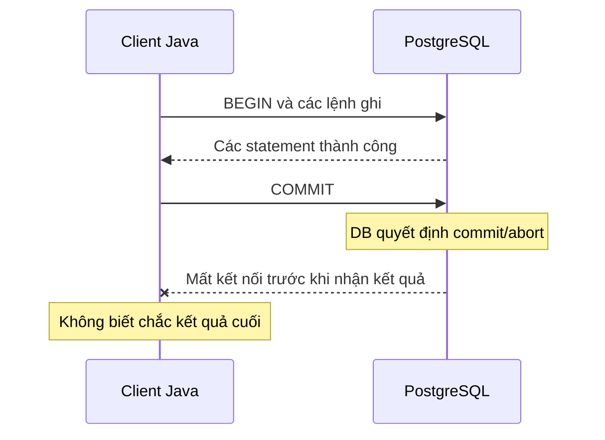
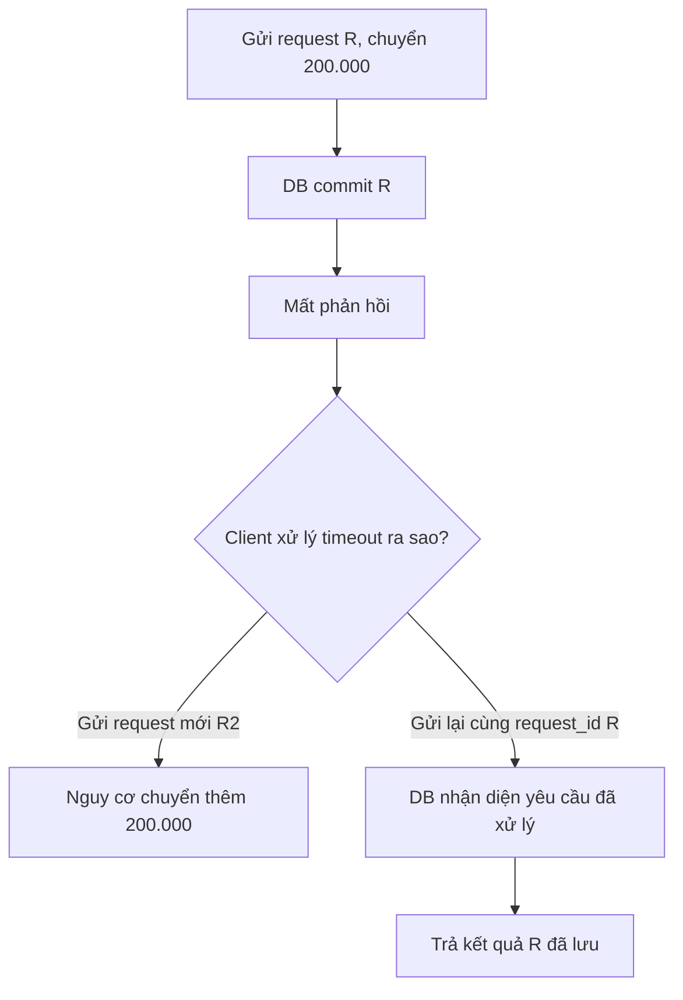

# Trạng thái chưa xác định khi mất kết nối lúc commit

> **Chương:** Lỗi và thử lại  
> **Phạm vi:** `DATA_PERSISTENCE_FUNDAMENTALS` — hiểu lưu trữ dữ liệu bền vững và ranh giới persistence cho ứng dụng Java; thiết kế giao dịch, xử lý lỗi kết nối, tính cô lập, kiểm soát đồng thời, bảo mật, sao lưu và vận hành có thể phục hồi.

## Mục tiêu học tập

Sau bài này, người học có thể:

1. Giải thích tại sao mất kết nối hoặc timeout **trong lúc `COMMIT`** có thể khiến ứng dụng không biết chắc giao dịch đã commit hay rollback.
2. Phân biệt **kết quả giao dịch chưa xác định** với lỗi nghiệp vụ được từ chối rõ ràng, lỗi serialization/deadlock và tình huống commit đã được xác nhận.
3. Thiết kế thao tác ghi có **khóa idempotency bền vững**, dữ liệu đầu vào được kiểm tra nhất quán và kết quả được lưu **trong cùng transaction** với tác động nghiệp vụ.
4. Xây dựng quy trình xác minh bằng kết nối mới và retry với **cùng khóa yêu cầu** mà không tạo thêm thanh toán, đơn hàng hoặc chuyển tiền.
5. Áp dụng nguyên tắc trên vào Java/JDBC, Spring `@Transactional`, hàng đợi/outbox, giám sát và kiểm thử lỗi ở đúng ranh giới commit.

## 1. Vấn đề: database có thể đã commit nhưng ứng dụng không biết

Xét API chuyển 200.000 đồng từ tài khoản A sang B. Ứng dụng đã chạy các câu `UPDATE` và `INSERT` trong cùng giao dịch, rồi gửi lệnh `COMMIT` tới PostgreSQL. Ngay sau đó, kết nối mạng bị ngắt. Phía Java chỉ nhận được `SQLException` hoặc thông báo timeout.

Có ít nhất hai khả năng quan trọng:

- **Giao dịch chưa được commit:** lệnh `COMMIT` chưa đến server, hoặc transaction bị hủy. Khi kết nối/session kết thúc và DB xử lý xong, các thay đổi chưa commit không trở thành dữ liệu đã commit.
- **Giao dịch đã commit:** PostgreSQL đã hoàn tất commit theo cấu hình độ bền hiện tại, nhưng thông báo thành công không đến được Java. Các thay đổi đã tồn tại dù client thấy lỗi.

Hai trường hợp có thể tạo cùng một biểu hiện ở phía client: **“mất kết nối khi chờ kết quả”**. Không thể suy ra từ chính lỗi mạng rằng tiền đã chuyển hoặc chưa chuyển.



Đây là **trạng thái chưa xác định** (*commit outcome unknown*, *in-doubt outcome*) ở góc nhìn client. Nó là vấn đề **biết kết quả** trong một hệ thống phân tán: ứng dụng và database là hai tiến trình trao đổi thông tin qua một kênh có thể hỏng.

**Điểm then chốt:** `COMMIT` có thể đã thành công mặc dù phương thức Java ném exception. Việc gọi `rollback()` trên một connection đã hỏng không thể thu hồi transaction đã commit, cũng không chứng minh nó chưa commit.

## 2. Xác định chính xác loại lỗi trước khi quyết định retry

Không phải mọi lỗi giao dịch đều là trạng thái chưa xác định.

| Thời điểm và tín hiệu | Có thể kết luận điều gì? | Hành động phù hợp |
| --- | --- | --- |
| Đầu vào không hợp lệ, DB chưa nhận thao tác ghi | Yêu cầu bị từ chối trước khi giao dịch ghi bắt đầu | Trả lỗi nghiệp vụ; không retry tự động. |
| DB trả lỗi ràng buộc `UNIQUE` hoặc `CHECK` rõ ràng trước commit | Statement bị từ chối; phải rollback transaction theo cơ chế DB/framework | Giải thích lỗi nghiệp vụ/thiết kế; không mặc định retry. |
| PostgreSQL thông báo rõ `40001` (*serialization_failure*) hoặc `40P01` (*deadlock_detected*) | Giao dịch bị DB chọn hủy theo cơ chế kiểm soát đồng thời | Rollback, rồi có thể retry **toàn bộ transaction** trong lần mới. |
| Java nhận xác nhận `COMMIT` thành công | Theo cấu hình DB, giao dịch đã commit thành công | Trả kết quả thành công; không ghi lại lần nữa. |
| Mất kết nối/timeout quanh thời điểm gửi `COMMIT` | **Chưa biết** lệnh có được server nhận và commit hay không | Xác minh bằng kết nối mới và khóa yêu cầu; không tự động tạo yêu cầu mới. |
| DB đã commit, nhưng HTTP response đến client bị mất | Backend có thể biết đã commit; client gọi API chưa biết | Retry cùng khóa idempotency, trả lại kết quả đã lưu. |
| Có lỗi khi gọi hệ thống thanh toán ngoài DB | Kết quả ngoài hệ thống có thể cũng chưa rõ | Đối soát theo mã giao dịch tại nhà cung cấp; không gọi lại theo cách tạo giao dịch mới. |

Trong JDBC, loại `SQLException`, `SQLState` hoặc dấu hiệu kết nối hỏng giúp **phân loại lỗi và quyết định điều tra**, nhưng một mã lỗi kết nối tự nó không phải bằng chứng chắc chắn về commit. Việc timeout có thể xảy ra trước khi lệnh được gửi, trong khi server xử lý, sau khi server commit, hoặc khi client chờ dữ liệu trả về. Cần đặt lỗi vào **giai đoạn thực hiện** và kiểm tra kết quả bằng trạng thái bền vững.

Một transaction đã bị PostgreSQL hủy với tín hiệu xác định khác với một transaction **không thể biết kết quả**. Chiến lược retry của hai nhóm vì vậy khác nhau: lỗi serialization thường cho phép chạy lại toàn bộ logic; lỗi commit chưa rõ đòi hỏi **đối soát hoặc cùng một khóa idempotency** trước khi khởi tạo tác động có khả năng lặp.

### 2.1. Vì sao transaction nguyên tử chưa đủ?

Atomicity bảo đảm rằng bên trong một database, toàn bộ thao tác của transaction được công nhận cùng nhau hoặc bị rollback. Ví dụ một transaction chuyển tiền không được để lại mỗi bước trừ tiền mà thiếu bước cộng tiền, nếu tất cả bước thuộc đúng transaction.

Tuy nhiên, atomicity **không bảo đảm client nhận được câu trả lời**. DB có thể lưu cả hai bước một cách nguyên tử trong khi Java mất kết nối vào khoảnh khắc commit. Vì thế:

- **Bất biến dữ liệu:** không chuyển tiền một phía.
- **Bất biến của yêu cầu:** cùng một `request_id` không được gây chuyển tiền hai lần.
- **Khả năng quan sát:** ứng dụng có thể xác định hoặc tiếp tục đối soát kết quả của một yêu cầu sau sự cố.

Ba yêu cầu này liên quan nhưng cần những cơ chế bổ sung cho nhau.

## 3. Một lần retry có thể gây hậu quả gì?

Giả sử request chuyển tiền có số tiền 200.000, nhưng client không gán mã yêu cầu ổn định:

1. Ứng dụng ghi trừ 200.000 ở A và cộng 200.000 ở B, DB commit thành công.
2. Phản hồi thành công bị mất trên mạng.
3. Client thấy timeout và gửi lại một request **mới** với cùng thông tin chuyển tiền.
4. Database xử lý request thứ hai như một lệnh hợp lệ khác, trừ/cộng thêm 200.000.

Tổng tiền của hai tài khoản vẫn không đổi sau mỗi transaction; ràng buộc `CHECK (balance >= 0)` và khóa ngoại đều có thể hoàn toàn hợp lệ. Nhưng người dùng bị chuyển **hai lần**.



**Retry phải giữ nguyên danh tính thao tác**, thay vì chỉ giữ nguyên các trường `from_account`, `to_account` và `amount`. Hai chuyển tiền giống nhau có thể là hai hành động hợp pháp khác nhau; không thể dùng `(from, to, amount)` làm khóa duy nhất một cách tùy tiện.

## 4. Nguyên tắc thiết kế: một mã yêu cầu, một kết quả bền vững

Một thiết kế có thể đối soát sau sự cố cần tối thiểu:

1. **Khóa idempotency ổn định:** `request_id` duy nhất cho một ý định nghiệp vụ. Client tạo và giữ khóa trước lần gửi đầu tiên, hoặc backend cấp khóa rồi trả cho client **trước khi tạo tác động**.
2. **Ràng buộc `UNIQUE`/`PRIMARY KEY` ở DB:** mọi instance Java và mọi worker cùng chịu một quy tắc duy nhất; `synchronized` trong một JVM không giải quyết nhiều instance.
3. **Ràng buộc nội dung:** lưu các trường nghiệp vụ hoặc hash chuẩn hóa của payload. Cùng `request_id` với payload khác phải bị từ chối, ví dụ HTTP `409 Conflict`.
4. **Lưu kết quả nghiệp vụ trong cùng transaction:** thao tác chuyển tiền và hàng kết quả `SUCCEEDED` hoặc `REJECTED` được commit cùng nhau; tránh tình trạng tác động đã commit nhưng không có dấu vết để nhận diện.
5. **Đọc lại được:** một kết nối mới có thể truy vấn `request_id` sau lỗi để lấy kết quả. Không phụ thuộc bộ nhớ RAM, log ứng dụng hoặc session JDBC đã hỏng làm nguồn sự thật duy nhất.
6. **Thử lại có kiểm soát:** nếu chưa biết kết quả, retry **cùng khóa** qua giao thức có ràng buộc duy nhất. Nếu vẫn không thể kết luận, trả trạng thái đang xác minh và tiếp tục đối soát theo chính sách.

Không nhầm **idempotency** với việc “bỏ qua tất cả lỗi trùng”. Khóa yêu cầu trùng mà payload khác là một xung đột nghiệp vụ hoặc dấu hiệu sử dụng khóa sai; cần phát hiện trước khi trả kết quả cũ.

### 4.1. Bất biến cần bảo vệ

Cho request `R` và tác động `E(R)` lên database:

\[
\text{Số lần tác động của cùng request } R \leq 1
\]

Đây là bất biến **cục bộ trong database có cùng khóa duy nhất và transaction**. Nó không tự mở rộng sang email, ngân hàng, HTTP hoặc database khác. Đối với hệ thống ngoài, cần thêm cơ chế phối hợp/idempotency riêng.

## 5. Mô hình PostgreSQL cho thao tác chuyển tiền có thể đối soát

Lược đồ minh họa:

```sql
CREATE TABLE account (
    id BIGINT PRIMARY KEY,
    balance NUMERIC(18, 2) NOT NULL CHECK (balance >= 0)
);

CREATE TABLE transfer_request (
    request_id UUID PRIMARY KEY,
    from_account_id BIGINT NOT NULL REFERENCES account(id),
    to_account_id BIGINT NOT NULL REFERENCES account(id),
    amount NUMERIC(18, 2) NOT NULL CHECK (amount > 0),
    state TEXT NOT NULL CHECK (
        state IN ('PROCESSING', 'SUCCEEDED', 'REJECTED')
    ),
    reason TEXT,
    created_at TIMESTAMPTZ NOT NULL DEFAULT now(),
    finished_at TIMESTAMPTZ,
    CHECK (from_account_id <> to_account_id)
);

CREATE TABLE transfer_entry (
    request_id UUID NOT NULL REFERENCES transfer_request(request_id),
    account_id BIGINT NOT NULL REFERENCES account(id),
    delta NUMERIC(18, 2) NOT NULL,
    PRIMARY KEY (request_id, account_id)
);

INSERT INTO account(id, balance)
VALUES (101, 500000.00), (202, 300000.00);
```

`request_id` đại diện cho **một ý định chuyển tiền**, không phải mỗi lần HTTP retry. Các cột `from_account_id`, `to_account_id` và `amount` là thông tin để xác nhận cùng khóa được gửi lại với đúng yêu cầu cũ. `transfer_entry` tạo dấu vết từng biến động tài khoản, cần được ghi cùng transaction với `account` và `transfer_request`.

Trong ví dụ này, `PROCESSING` chỉ xuất hiện **bên trong giao dịch chưa commit**. Trước khi commit thành công, code phải chuyển sang `SUCCEEDED` hoặc `REJECTED`. Nếu transaction rollback, hàng `PROCESSING` cũng biến mất. Bởi vậy một hàng `PROCESSING` đã commit trong mô hình này là tín hiệu code không tuân thủ giao thức hoặc cần điều tra; một thiết kế workflow nhiều transaction có thể chủ động cho phép trạng thái đang xử lý được commit, nhưng cần giao thức riêng.

### 5.1. Nhận khóa và ghi tác động trong cùng transaction

Thuật toán PostgreSQL `READ COMMITTED`:

```sql
BEGIN ISOLATION LEVEL READ COMMITTED;

-- 1. Đăng ký khóa ở đầu transaction.
INSERT INTO transfer_request
    (request_id, from_account_id, to_account_id, amount, state)
VALUES
    ('00000000-0000-4000-8000-000000000042', 101, 202,
     200000.00, 'PROCESSING')
ON CONFLICT (request_id) DO NOTHING
RETURNING request_id;

-- 2a. Nếu RETURNING không có hàng:
--     Yêu cầu này đã có khóa được commit ở giao dịch khác.
--     Dùng statement mới SELECT theo request_id, so sánh toàn bộ payload,
--     trả kết quả đã lưu, KHÔNG cập nhật tài khoản lần nữa.
--
-- 2b. Nếu INSERT trả một hàng: giao dịch này sở hữu khóa.
--     Khóa hai tài khoản theo thứ tự id tăng dần trước khi đánh giá số dư:
SELECT id, balance
FROM account
WHERE id IN (101, 202)
ORDER BY id
FOR UPDATE;

-- 3. Kiểm tra có đủ hai tài khoản, nguồn còn đủ 200000.
--    Nếu không đủ tiền, UPDATE state='REJECTED', reason và COMMIT
--    kết quả từ chối; KHÔNG chạy các UPDATE/INSERT bên dưới.

UPDATE account
SET balance = balance - 200000.00
WHERE id = 101 AND balance >= 200000.00;

UPDATE account
SET balance = balance + 200000.00
WHERE id = 202;

-- Phải xác nhận mỗi UPDATE thực sự tác động đúng 1 hàng.
INSERT INTO transfer_entry(request_id, account_id, delta)
VALUES
    ('00000000-0000-4000-8000-000000000042', 101, -200000.00),
    ('00000000-0000-4000-8000-000000000042', 202,  200000.00);

UPDATE transfer_request
SET state = 'SUCCEEDED',
    finished_at = now()
WHERE request_id = '00000000-0000-4000-8000-000000000042';

COMMIT;
```

Đây là **đường thành công có điều kiện**, không phải script SQL chạy tự động mọi nhánh. Ứng dụng phải dừng, commit kết quả từ chối hoặc rollback đúng lúc. Nếu thiếu tài khoản, ghi lỗi giữa chừng hoặc số hàng ảnh hưởng không đúng kỳ vọng, rollback toàn transaction. Lỗi nghiệp vụ “không đủ tiền” có thể được **lưu làm `REJECTED` và commit như một kết quả cuối** để những lần retry cùng khóa nhận lại đúng quyết định ban đầu.

**Khi hai yêu cầu dùng cùng khóa chạy đồng thời:** unique index trên `request_id` khiến giao dịch đến sau phải phân xử với giao dịch đang nắm khóa. Trong `READ COMMITTED`, `INSERT ... ON CONFLICT DO NOTHING` có thể phải đợi giao dịch đầu. Nếu giao dịch đầu **commit**, giao dịch sau không chèn thêm khóa, và statement `SELECT` tiếp theo có thể đọc kết quả đã commit; nếu giao dịch đầu **rollback**, giao dịch sau có thể chèn và thực hiện yêu cầu. Nếu có lock timeout hoặc kết nối lỗi khi chờ, không được mặc định rằng request chưa được xử lý: hãy giữ nguyên khóa và đối soát.

### 5.2. Tra cứu kết quả với kết nối mới

```sql
SELECT
    request_id,
    from_account_id,
    to_account_id,
    amount,
    state,
    reason,
    finished_at
FROM transfer_request
WHERE request_id = '00000000-0000-4000-8000-000000000042';
```

Kết quả:

| Quan sát từ DB | Có thể suy luận | Bước tiếp theo |
| --- | --- | --- |
| Một hàng `SUCCEEDED`, payload trùng | Transaction đã lưu kết quả thành công | Trả lại kết quả thành công, không ghi lần hai. |
| Một hàng `REJECTED`, payload trùng | Transaction đã lưu kết quả bị từ chối | Trả đúng lý do đã lưu; không tính lại thành một request mới. |
| Có hàng nhưng payload khác | Khóa bị dùng lại cho ý định khác | Từ chối xung đột; không dùng kết quả cũ cho nội dung mới. |
| Không tìm thấy hàng | **Chưa thể kết luận riêng từ truy vấn này** rằng commit cũ đã thất bại | Retry cùng khóa bằng giao thức unique claim, hoặc chờ/đối soát thêm. |
| Có hàng `PROCESSING` đã commit | Không đúng giao thức một transaction của ví dụ, hoặc là workflow nhiều bước riêng | Điều tra trạng thái/protocol; không mặc định thành công. |
| Không thể kết nối để đọc | Vẫn chưa xác định được kết quả | Trả pending/unknown, giữ khóa; tiếp tục đối soát có kiểm soát. |

Tại sao **“không có hàng” chưa chắc là rollback**? Truy vấn đọc có thể xảy ra khi transaction trước vẫn đang xử lý và chưa công bố hàng; server hoặc kết nối có thể đang chuyển trạng thái. Vì thế, chỉ kiểm tra `SELECT` một lần rồi gửi lệnh ghi với **khóa mới** là nguy hiểm. Gửi lại **cùng khóa** qua ràng buộc duy nhất cho phép database phân xử cuối cùng.

## 6. Java và Spring: lỗi commit có thể phát sinh ngoài thân phương thức

Trong Spring, `@Transactional` thường do proxy và transaction manager điều phối. Phần thân phương thức có thể chạy xong bình thường nhưng **commit thật sự diễn ra khi lời gọi qua proxy chuẩn bị trả kết quả**. Nếu mất kết nối lúc đó, lỗi có thể được ném ra **sau khi body đã kết thúc**.

Do đó:

- Bắt exception **chỉ quanh `jdbc.update(...)` trong phương thức `@Transactional`** không đủ để nhận diện lỗi ở commit.
- Không đặt lời gọi API bên ngoài giữa các bước ghi rồi nghĩ rằng rollback database sẽ hoàn tác được API đó.
- Lớp điều phối gọi bean transactional phải phân biệt lỗi nghiệp vụ, lỗi transaction đã xác định và kết quả commit có thể chưa rõ.
- Khi kết quả commit chưa rõ, không mở một transfer mới với `UUID.randomUUID()` rồi thử lại.

### 6.1. Ví dụ service có khóa idempotency

Ví dụ Java 17+ với Spring JDBC dưới đây thực hiện giao thức trong phần 5; giả định `JdbcTemplate` tham gia đúng transaction manager của PostgreSQL:

```java
import java.math.BigDecimal;
import java.util.UUID;

import org.springframework.jdbc.core.JdbcTemplate;
import org.springframework.stereotype.Service;
import org.springframework.transaction.annotation.Isolation;
import org.springframework.transaction.annotation.Transactional;

record TransferCommand(
        UUID requestId, long fromId, long toId, BigDecimal amount) {}

record TransferResult(String state, String reason) {}

@Service
public class TransferTransactionService {
    private final JdbcTemplate jdbc;

    public TransferTransactionService(JdbcTemplate jdbc) {
        this.jdbc = jdbc;
    }

    private record Stored(
        long fromId, long toId, BigDecimal amount,
        String state, String reason) {}

    @Transactional(isolation = Isolation.READ_COMMITTED)
    public TransferResult execute(TransferCommand cmd) {
        if (cmd.requestId() == null || cmd.fromId() == cmd.toId()
                || cmd.amount() == null || cmd.amount().signum() <= 0
                || cmd.amount().scale() > 2) {
            throw new IllegalArgumentException("Invalid request");
        }

        int claimed = jdbc.update("""
            INSERT INTO transfer_request
              (request_id, from_account_id, to_account_id, amount, state)
            VALUES (?, ?, ?, ?, 'PROCESSING')
            ON CONFLICT (request_id) DO NOTHING
            """,
            cmd.requestId(), cmd.fromId(), cmd.toId(), cmd.amount());

        if (claimed == 0) {
            // Một statement mới tại READ COMMITTED sau khi phân xử xung đột.
            Stored previous = jdbc.queryForObject("""
                SELECT from_account_id, to_account_id,
                       amount, state, reason
                FROM transfer_request
                WHERE request_id = ?
                """,
                (rs, row) -> new Stored(
                    rs.getLong(1), rs.getLong(2),
                    rs.getBigDecimal(3), rs.getString(4), rs.getString(5)),
                cmd.requestId());

            if (previous == null
                    || previous.fromId() != cmd.fromId()
                    || previous.toId() != cmd.toId()
                    || previous.amount().compareTo(cmd.amount()) != 0) {
                throw new IllegalArgumentException(
                    "Idempotency key reused with different payload");
            }
            if (!previous.state().equals("SUCCEEDED")
                    && !previous.state().equals("REJECTED")) {
                throw new IllegalStateException(
                    "Persisted operation is not in final state");
            }
            return new TransferResult(
                previous.state(), previous.reason());
        }

        // Khóa hai tài khoản theo thứ tự cố định để giảm deadlock.
        long first = Math.min(cmd.fromId(), cmd.toId());
        long second = Math.max(cmd.fromId(), cmd.toId());
        BigDecimal firstBalance = jdbc.queryForObject(
            "SELECT balance FROM account WHERE id = ? FOR UPDATE",
            BigDecimal.class, first);
        BigDecimal secondBalance = jdbc.queryForObject(
            "SELECT balance FROM account WHERE id = ? FOR UPDATE",
            BigDecimal.class, second);

        BigDecimal sourceBalance = cmd.fromId() == first
                ? firstBalance : secondBalance;
        if (sourceBalance.compareTo(cmd.amount()) < 0) {
            jdbc.update("""
                UPDATE transfer_request
                SET state = 'REJECTED',
                    reason = 'INSUFFICIENT_FUNDS', finished_at = now()
                WHERE request_id = ?
                """, cmd.requestId());
            return new TransferResult(
                "REJECTED", "INSUFFICIENT_FUNDS");
        }

        int debited = jdbc.update("""
            UPDATE account SET balance = balance - ?
            WHERE id = ? AND balance >= ?
            """,
            cmd.amount(), cmd.fromId(), cmd.amount());
        int credited = jdbc.update("""
            UPDATE account SET balance = balance + ?
            WHERE id = ?
            """,
            cmd.amount(), cmd.toId());
        if (debited != 1 || credited != 1) {
            // RuntimeException mặc định khiến Spring rollback toàn bộ.
            throw new IllegalStateException("Unexpected account update");
        }

        jdbc.update("""
            INSERT INTO transfer_entry (request_id, account_id, delta)
            VALUES (?, ?, ?), (?, ?, ?)
            """,
            cmd.requestId(), cmd.fromId(), cmd.amount().negate(),
            cmd.requestId(), cmd.toId(), cmd.amount());
        jdbc.update("""
            UPDATE transfer_request
            SET state = 'SUCCEEDED', finished_at = now()
            WHERE request_id = ?
            """, cmd.requestId());
        return new TransferResult("SUCCEEDED", null);
    }
}
```

Trong nhánh đầu tiên nhận khóa, thao tác debit, credit, bút toán và kết quả đều commit **cùng nhau**. Nếu có lỗi trước commit, transaction bị rollback. Nếu commit thành công nhưng thông báo bị mất, lần gọi sau với **cùng `requestId`** sẽ đọc hàng kết quả đã lưu và không ghi thêm tác động.

Ví dụ sử dụng `IllegalArgumentException` cho trường hợp dùng lại khóa sai payload; ở API thực tế nên ánh xạ thành lỗi nghiệp vụ riêng (thường `409`), phân biệt với đầu vào không hợp lệ và lỗi hạ tầng. Trạng thái `REJECTED` là **kết quả cuối được commit có chủ đích** cho lỗi không đủ tiền; những lỗi SQL bất ngờ phải rollback và không để lại một bản ghi từ chối giả.

Giới hạn của ví dụ:

- Chỉ minh họa một cơ sở dữ liệu PostgreSQL, hai tài khoản đã tồn tại và tiền với tối đa hai chữ số thập phân. Hệ thống thật cần xác thực người chuyển, loại tiền, hạn mức, phong tỏa, tài khoản bị đóng và chính sách phí/hoàn tiền.
- Khi `queryForObject` không tìm thấy tài khoản, Spring sẽ ném ngoại lệ và rollback. Không chuyển sự kiện này thành “số dư bằng 0”.
- Nếu mã giao dịch có nhiều đường ghi ngoài service này (job, import, API khác), tất cả phải tuân thủ cùng giao thức. Một bảng `transfer_request` duy nhất không tự bảo đảm mọi đường ghi đúng.
- Đoạn code không tự cung cấp endpoint kiểm tra trạng thái và không triển khai việc nhận diện lỗi commit ở tầng giao thức; đây là trách nhiệm của lớp điều phối bên ngoài transaction.
- Quy tắc rollback mặc định của Spring xử lý `RuntimeException`/`Error`; checked exception cần cấu hình `rollbackFor` phù hợp khi dùng.
- Thực tế có thể cần lưu kết quả phản hồi đầy đủ (mã transfer, trạng thái, timestamp) và phiên bản cấu trúc payload để trả lại chính xác cho retry, thay vì chỉ `state`/`reason`.

### 6.2. Phân tách transaction và lớp điều phối

Luồng ứng dụng có thể thiết kế như sau:

```text
HTTP /transfer với request_id R và payload P
  |
  v
Lớp điều phối (chưa có transaction)
  |
  +--> Gọi bean @Transactional: execute(R, P)
  |       |
  |       +--> Trả SUCCEEDED / REJECTED đã commit
  |       |
  |       +--> Ném lỗi xác định (validation, conflict, rollback)
  |       |
  |       +--> Mất kết nối khi COMMIT: kết quả có thể chưa rõ
  |
  +--> Nếu kết quả commit chưa rõ:
          Mở kết nối/transaction đọc MỚI
          Tra cứu transfer_request(request_id = R)
          Nếu tìm thấy kết quả cuối + đúng payload: trả kết quả
          Nếu chưa có kết quả / không kết nối được:
             trả trạng thái "đang xác minh",
             giữ R cho lần retry/đối soát tiếp theo
```

Không tự động coi mọi `DataAccessException` là lỗi commit chưa xác định: một lỗi constraint hoặc SQL sai cú pháp có ý nghĩa khác. Cơ chế phân loại phải căn cứ vị trí lỗi, mã SQLSTATE/chẩn đoán từ DB, trạng thái transaction và log; khi không có đủ bằng chứng, **giữ kết quả là chưa xác định** và bảo toàn khóa yêu cầu.

**Trong Spring, retry bên trong cùng phương thức `@Transactional` thường sai:** transaction có thể đã bị đánh dấu rollback-only hoặc commit sẽ xảy ra ở lớp proxy sau khi thân phương thức trả về. Retry/đối soát cần được điều phối **ngoài ranh giới transaction**, để mỗi lần thử là một transaction mới với cùng khóa bền vững.

## 7. Cách đối soát sau khi kết nối mất lúc commit

Một thuật toán thực tế:

1. **Giữ khóa gốc `R` và payload `P`:** từ phía client, job hoặc thông điệp đã được ghi bền vững. Không đổi `R` chỉ vì timeout.
2. **Không tin trạng thái connection cũ:** lấy connection mới từ pool; nếu connection cũ lỗi nghiêm trọng, cần loại nó khỏi pool theo cơ chế driver/pool đang dùng.
3. **Đọc theo khóa `R`:** nếu có kết quả cuối được commit và payload khớp, trả đúng kết quả đó.
4. **Nếu chưa có hàng, không khẳng định rollback:** transaction cũ có thể chưa kết thúc. Khi tiếp tục, dùng lại `R` trong thao tác tạo có ràng buộc duy nhất; cơ chế conflict sẽ phân xử khi transaction cũ commit/rollback.
5. **Nếu gặp lock timeout, DB vẫn chưa sẵn sàng hoặc thiếu thông tin:** trả trạng thái chưa xác định/pending và tiếp tục đối soát sau, theo deadline/backoff giới hạn.
6. **Lưu vết quyết định:** `request_id`, tình huống lỗi, thời điểm kiểm tra, số lần retry, kết quả đã xác minh và nguồn bằng chứng. Tránh ghi thông tin nhạy cảm như tài khoản/credentials ở mức log không cần thiết.

Một API có thể dùng các kết quả:

| Phản hồi API | Ý nghĩa do hệ thống định nghĩa |
| --- | --- |
| `200 OK` hoặc `201 Created` | Đã xác nhận kết quả thành công và có thể trả mã tham chiếu bền vững. |
| `409 Conflict` | Cùng khóa yêu cầu nhưng payload khác, hoặc xung đột nghiệp vụ cần phản hồi riêng. |
| `202 Accepted` kèm `request_id` và đường tra cứu trạng thái | Hệ thống đã nhận yêu cầu hoặc chưa thể xác định kết quả cuối; **không hứa** transaction đã commit hay đang xử lý. |
| `4xx` lỗi nghiệp vụ xác định | Dữ liệu không hợp lệ hoặc một quyết định từ chối đã được ghi nhận/kiểm chứng. |
| `5xx` / timeout không có kết quả cuối | Client phải coi kết quả là **có thể đã xảy ra**, chỉ retry cùng khóa idempotency. |

Mã HTTP là lựa chọn thiết kế API; điều quan trọng là **hợp đồng rõ ràng**: trạng thái “pending/unknown” không được trình bày là giao dịch đã hoàn tất. Nếu dùng endpoint `GET /transfers/{request_id}`, cần xác thực và phân quyền để người dùng không dò kết quả của người khác bằng UUID.

### 7.1. Cần giữ idempotency key trong bao lâu?

Khóa phải tồn tại **ít nhất bằng khoảng thời gian hệ thống có thể nhận lại cùng yêu cầu hoặc phải đối soát kết quả**, theo hợp đồng API và retention nghiệp vụ. Nếu xóa khóa quá sớm, một retry rất muộn có thể tạo tác động mới. Với tiền hoặc nghiệp vụ quan trọng, cần có lịch sử giao dịch bền vững và chính sách lưu trữ/kiểm toán; nếu dữ liệu cũ chuyển sang kho lưu trữ, cơ chế nhận diện khóa cũ cũng phải được thiết kế tương ứng.

Không mặc định rằng TTL 24 giờ thích hợp cho mọi hệ thống. Việc chọn TTL cần xem xét thời gian retry của client, hàng đợi, offline/mobile, khôi phục sau sự cố và nghĩa vụ lưu trữ. Khóa UUID không thay thế xác thực/phân quyền; có khóa của người khác không cho phép xem hay thực hiện thao tác thuộc người đó.

## 8. “Exactly once” có thể bảo đảm tới đâu?

Trong **một database**, unique key cộng với transaction và kết quả được lưu cùng nhau có thể đạt tác động nghiệp vụ **tối đa một lần cho mỗi khóa yêu cầu**. Tuy nhiên:

- Không thể đảm bảo một thông điệp mạng/HTTP được gửi **đúng một lần**; client có thể gửi lại, timeout và nhận phản hồi lặp.
- Một transaction database **không tự bao phủ** thanh toán, email, event bus hay DB khác.
- “Một lần xử lý” ở handler không tương đương “một lần tạo tác động”; ứng dụng phải chịu được việc handler được chạy nhiều lần.

Để chuyển sự kiện sau commit, có thể dùng **transactional outbox**:

```sql
CREATE TABLE transfer_outbox (
    event_id UUID PRIMARY KEY,
    request_id UUID NOT NULL UNIQUE
        REFERENCES transfer_request(request_id),
    event_type TEXT NOT NULL,
    payload JSONB NOT NULL,
    delivered_at TIMESTAMPTZ
);

-- Trong CÙNG transaction chuyển tiền thành công:
INSERT INTO transfer_outbox
    (event_id, request_id, event_type, payload)
VALUES
    ('00000000-0000-4000-8000-000000000043',
     '00000000-0000-4000-8000-000000000042',
     'TRANSFER_SUCCEEDED',
     '{"request_id":"00000000-0000-4000-8000-000000000042"}'::jsonb);
```

Worker nền đọc outbox đã commit và phát sự kiện. Nếu worker gửi thành công rồi chết trước khi đánh dấu `delivered_at`, sự kiện có thể được gửi lại: phía nhận cần xử lý idempotent theo `event_id`/`request_id`. Một `UNIQUE(request_id)` trong bảng outbox phù hợp với **mô hình ví dụ một event cho một transfer**; hệ thống có nhiều loại event cho cùng giao dịch cần khóa nghiệp vụ khác.

Nếu phải gọi **nhà cung cấp thanh toán**, hãy dùng mã idempotency của chính nhà cung cấp nếu họ hỗ trợ, lưu mã tham chiếu và quy trình truy vấn trạng thái của họ. Khi kết nối mất lúc gọi API thanh toán, đối soát với trạng thái của provider trước khi tự động thu tiền lần nữa. Database và provider có thể có hai “commit outcome” riêng biệt; một khóa trong bảng nội bộ không đủ chứng minh provider chưa nhận lệnh.

## 9. Độ bền COMMIT và sự khác nhau giữa xác nhận với lưu trữ

Trạng thái commit chưa xác định là vấn đề **quan sát kết quả**, còn độ bền sau commit liên quan cấu hình lưu trữ và phục hồi:

- PostgreSQL dựa vào **WAL (write-ahead log)** và cơ chế đồng bộ xuống lưu trữ để duy trì commit theo mức cấu hình.
- Nếu `synchronous_commit` được cấu hình khác nhau, ý nghĩa về thời điểm client nhận xác nhận so với ghi bền vững cục bộ hoặc xác nhận từ standby cũng có thể khác.
- Replication bất đồng bộ có thể khiến một transaction đã được primary xác nhận **chưa xuất hiện ở standby** vừa được promote sau sự cố; đó là một bài toán RPO/failover riêng.
- Khi xảy ra lỗi máy chủ, cần khôi phục/đối soát theo bản ghi giao dịch bền vững và timeline thực tế, không dựa vào giả định rằng “HTTP đã 200 thì replica nào cũng có dữ liệu”.

Không thay đổi `synchronous_commit` hoặc chính sách replication chỉ để che vấn đề mất phản hồi. Kể cả khi commit được xác nhận bền vững đúng cấu hình, **thông điệp xác nhận vẫn có thể bị mất trên mạng**. Idempotency và đối soát vẫn cần thiết.

## 10. Kiểm thử sự cố tại ranh giới commit

Kiểm thử cần phân biệt lỗi database **trước commit**, lỗi tại commit và lỗi **sau khi đã commit nhưng trước khi trả HTTP response**. Chỉ tắt mạng ngẫu nhiên mà không đồng bộ thời điểm có thể không chạm đúng tình huống.

| Kịch bản | Cách mô phỏng | Kết quả cần xác minh |
| --- | --- | --- |
| Ghi lỗi trước `COMMIT` | Cố tình vi phạm constraint giữa các câu ghi | Transaction rollback, không có tác động một phần, khóa chưa commit không còn. |
| Hai request cùng `request_id` chạy đồng thời | Hai kết nối/transaction khác nhau cùng tạo `transfer_request` | Chỉ một tác động; request còn lại đọc kết quả sau khi conflict được phân xử. |
| DB commit rồi mất HTTP response | Server commit xong, cố tình ngắt trước lúc gửi response | Client retry cùng khóa; không phát sinh transfer thứ hai. |
| Mất kết nối ngay khi client chờ `COMMIT` | Fault-injection qua proxy/network hoặc hook kiểm thử ở đường commit | Kết quả client là unknown cho đến khi đối soát; không suy luận rollback từ IOException/SQLException. |
| Server rollback trước khi commit được áp dụng | Gây lỗi có thể chứng minh rollback/abort | Retry cùng khóa có thể thực hiện khi phù hợp; chỉ một kết quả cuối được commit. |
| Cùng khóa nhưng payload khác | Gửi lại với số tiền/nguồn/đích đã thay | Bị từ chối xung đột; không trả nhầm kết quả cho payload mới. |
| Không thể tra cứu sau lỗi | Ngắt cả kết nối dùng để đối soát | Hệ thống giữ unknown/pending, không sinh khóa mới; retry đối soát có giới hạn. |
| Provider thanh toán đã thực hiện nhưng backend mất kết nối | Giả lập provider lưu lệnh rồi mất response | Đối soát theo provider transaction/idempotency key, không thu tiền lần hai. |

Nên kiểm chứng **bất biến sau mọi kết quả cuối**: tổng tiền trước/sau, hai bút toán đối ứng, duy nhất một `transfer_request` theo `request_id` và kết quả trả lại giống nhau ở mọi lần retry cùng payload. Một phép kiểm thử chỉ xác nhận “API trả 500” không chứng minh thiết kế an toàn.

Trong môi trường vận hành, theo dõi tỷ lệ kết nối lỗi tại commit, số yêu cầu kết quả chưa rõ, thời gian đối soát, số lần retry, khóa idempotency xung đột payload và số sự kiện outbox được phát lại. Cần có cảnh báo cho yêu cầu quá thời hạn đối soát, thay vì để “pending” tồn tại vĩnh viễn mà không ai nhận trách nhiệm.

## 11. Những sai lầm thường gặp

| Cách xử lý dễ sai | Vì sao nguy hiểm | Cách tiếp cận phù hợp |
| --- | --- | --- |
| Gặp `SQLException` khi commit thì khẳng định rollback | DB có thể đã commit và chỉ mất phản hồi | Ghi outcome unknown, xác minh bằng trạng thái bền vững. |
| Gửi lại thao tác với `request_id` mới | Có thể tạo chuyển tiền/đơn hàng thứ hai | Gửi lại cùng khóa gốc và cùng payload. |
| Chỉ tra `SELECT` một lần, không thấy hàng thì tạo yêu cầu mới | Transaction cũ có thể chưa commit nhưng vẫn đang xử lý | Giữ cùng unique key; để DB phân xử hoặc tiếp tục đối soát. |
| Dùng `synchronized` trong một ứng dụng Java | Không phối hợp các instance, worker hoặc process khác | Unique constraint trong DB chung; transaction có ranh giới đúng. |
| Ghi `transfer_request` sau khi commit tiền bằng transaction khác | Tiền có thể đã chuyển nhưng không có dấu vết nhận diện request | Ghi tác động, sổ cái, trạng thái và outbox trong cùng transaction. |
| Lưu `request_id` trong cache RAM duy nhất | Mất cache hoặc restart làm quên yêu cầu đã xử lý | Sử dụng ràng buộc và kết quả bền vững trong persistence. |
| Dùng lại khóa với payload khác | Có thể trả kết quả cũ cho thao tác không liên quan | So sánh payload chuẩn hóa, trả lỗi xung đột. |
| Tự động retry lỗi mọi loại | Lỗi nghiệp vụ có thể lặp vô hạn; retry tác động ngoài DB gây trùng | Phân loại lỗi, retry có điều kiện và deadline. |
| Bắt lỗi trong thân `@Transactional` rồi nghĩ đã bao phủ commit | Commit có thể diễn ra khi proxy kết thúc lời gọi | Điều phối lỗi và đối soát ở ngoài transaction. |
| Nhầm at-least-once message với exactly-once effect | Message/outbox có thể được gửi lại | Consumer idempotent, lưu trạng thái xử lý bền vững. |

## 12. Bài thực hành: xử lý một lệnh chuyển tiền không rõ kết quả

**Bối cảnh:** người dùng gửi lệnh chuyển 200.000 với `request_id = R`. Hai bước cập nhật số dư và bút toán chạy trong một transaction. Kết nối PostgreSQL bị mất đúng lúc backend chờ phản hồi `COMMIT`. Client không biết kết quả và tự động gửi lại sau 2 giây.

**Yêu cầu thực hành:**

1. Tạo các bảng `account`, `transfer_request` và `transfer_entry`, khai báo `PRIMARY KEY(request_id)` và các `CHECK`/FK phù hợp.
2. Viết service có `@Transactional` xử lý một lệnh chuyển tiền, ghi `request_id` và trạng thái cuối trong cùng transaction với cập nhật tài khoản.
3. Tạo hai kết nối độc lập để chạy đồng thời **cùng khóa**; chứng minh không thể có hai transfer thành công cho một `request_id`.
4. Mô phỏng tình huống commit thành công nhưng mất HTTP response; gửi lại cùng khóa và so sánh số dư, bút toán, hàng transfer trước/sau retry.
5. Mô phỏng lỗi rollback trước commit; kiểm chứng cùng khóa có thể được xử lý lại an toàn và không còn dữ liệu nửa chừng.
6. Thử gửi cùng khóa với số tiền khác và kiểm chứng API trả lỗi xung đột.
7. Viết endpoint tra cứu trạng thái theo `request_id`, có xác thực/quyền truy cập, trả `SUCCEEDED`/`REJECTED` hoặc trạng thái chưa xác định theo bằng chứng hiện có.
8. Đánh dấu trường hợp **không thể đối soát vì database chưa sẵn sàng** là unknown/pending và thiết kế cơ chế theo dõi đến khi có kết luận.

**Câu hỏi tự kiểm tra**

1. Vì sao Java nhận exception từ `Connection.commit()` nhưng điều đó chưa chứng minh DB đã rollback?
2. Nếu `SELECT transfer_request WHERE request_id = R` trả rỗng sau một timeout, ứng dụng có được phép tạo request mới `R2` không? Vì sao?
3. Lý do nào khiến mã idempotency cần tồn tại trong database chứ không chỉ trong RAM?
4. Khi lần retry cùng `R` đến trong lúc giao dịch đầu chưa commit, ràng buộc unique và `ON CONFLICT` xử lý thế nào?
5. Vì sao trạng thái `REJECTED` đôi khi nên được lưu làm kết quả cuối thay vì rollback cả bản ghi request?
6. Kết quả nào của giao dịch phải nằm trong cùng transaction để lần retry không thực hiện lại tác động?
7. Vì sao thêm `@Retryable` ngay trên phương thức `@Transactional` mà không kiểm soát thứ tự proxy có thể dẫn tới hành vi sai?
8. Nếu gửi email hoặc gọi provider thanh toán trong transaction rồi commit thất bại, liệu rollback có thu hồi được tác động bên ngoài không?
9. Mất phản hồi HTTP **sau commit** khác với mất kết nối DB **trong commit** ở phía server như thế nào? Tại sao client vẫn cần idempotency trong cả hai trường hợp?
10. Vì sao xác nhận WAL/replica và đối soát kết quả theo request ID là hai vấn đề liên quan nhưng không thay thế nhau?

## Ghi nhớ

**Mất kết nối khi commit không đồng nghĩa giao dịch thất bại.** Database có thể đã commit trong khi Java chỉ nhìn thấy timeout hoặc lỗi mạng. Phân biệt outcome **đã xác nhận commit**, **đã xác nhận abort/rollback** và **chưa xác định** là điều kiện đầu tiên để xử lý retry đúng.

Với những thao tác không được thực hiện hai lần, hãy đặt **khóa idempotency bền vững** trong schema, lưu payload và kết quả trong **cùng transaction** với tác động nghiệp vụ, rồi dùng kết nối mới để đối soát khi mất phản hồi. Nếu chưa có đủ bằng chứng, tiếp tục dùng **cùng khóa** qua cơ chế unique conflict hoặc trả trạng thái đang xác minh; không tạo giao dịch mới chỉ vì chưa nhận được câu trả lời. Những tác động bên ngoài database cần outbox, idempotency tại bên nhận và quy trình đối soát riêng.
