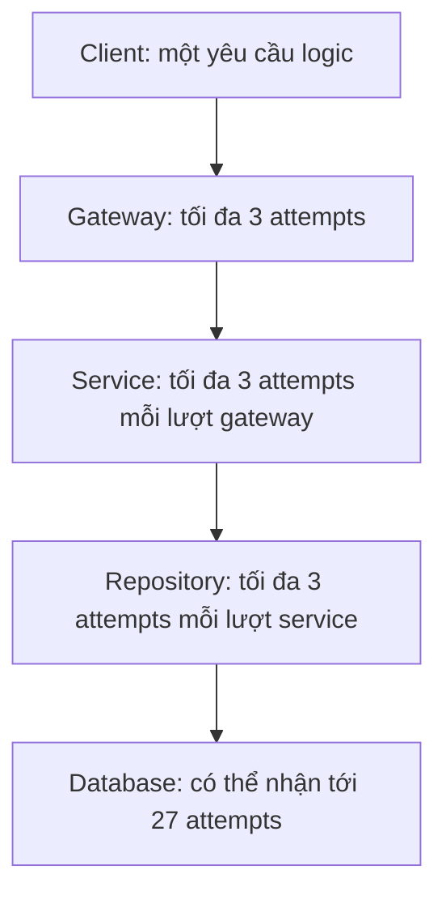

# Giãn cách, độ ngẫu nhiên và giới hạn số lần thử lại

Một ứng dụng Java có thể gặp lỗi tạm thời khi truy vấn hoặc ghi dữ liệu: deadlock, xung đột serialization, hết connection trong pool, mạng gián đoạn hoặc dịch vụ phụ thuộc đang quá tải. **Thử lại (retry)** giúp vượt qua một số sự cố ngắn hạn, nhưng retry ngay lập tức và không giới hạn thường khiến nhiều request cùng tranh chấp tài nguyên, làm hệ thống chậm hơn hoặc tiếp tục thất bại.

Bài thuộc chương **Lỗi và thử lại** của mô-đun **DATA_PERSISTENCE_FUNDAMENTALS**, hướng đến việc hiểu lưu trữ bền vững từ schema, truy vấn, chỉ mục tới transaction, cô lập, kiểm soát đồng thời, cùng ranh giới persistence của Java, lỗi kết nối, bảo mật, sao lưu và hiệu năng. Trọng tâm là ba quyết định của retry: **đợi bao lâu trước lần kế tiếp (backoff), phân tán thời điểm retry ra sao (jitter), và dừng lúc nào (attempt/deadline/budget)**. Mọi chính sách còn phải giữ đúng bất biến nghiệp vụ khi có lỗi tại `COMMIT`.

Ví dụ dưới đây dùng Java và PostgreSQL để minh họa. SQLSTATE, timeout, cách driver xử lý lỗi và khả năng lặp lại thao tác phải được kiểm tra trên DBMS thực tế.

## 1. Vì sao retry liên tục có thể làm sự cố nặng hơn?

Giả sử 100 request đồng thời cố cập nhật cùng một nhóm hàng. Các transaction bị hủy vì xung đột. Nếu tất cả retry ngay:

```text
T0:          100 transaction xung đột, thất bại
T0 + 0 ms:   cả 100 request gửi SQL trở lại
T0 + 1 ms:   tiếp tục tranh chấp trên các hàng đó
T0 + 2 ms:   nhiều request lại retry; lock wait và connection tăng
```

Retry **không tạo thêm năng lực cho database**; mỗi attempt dùng thêm CPU, I/O, network và kết nối. Khi hệ thống đã quá tải, tải do retry có thể làm cả những request mới vốn hợp lệ phải chờ.

Chính sách retry cần xử lý bốn lớp: phân loại lỗi đủ điều kiện retry, điều chỉnh khoảng chờ bằng backoff, ngẫu nhiên hóa bằng jitter, và đặt điểm dừng theo cả số lần lẫn thời gian/tải. Chỉ gọi `Thread.sleep()` sau mọi `SQLException` là một vòng lặp dễ gây hại.

## 2. Trước tiên: lỗi có thể phục hồi và thao tác có an toàn để lặp lại không?

**Retryable error** và **retry-safe operation** là hai điều kiện riêng biệt. Một lỗi kết nối có thể tạm thời, nhưng transaction trước đó có thể đã commit mà caller chưa nhận được xác nhận.

| Tình huống | Có nên retry? | Điều kiện |
|---|---|---|
| PostgreSQL `40001` (*serialization_failure*) | Thường có | DB đã từ chối giao dịch; mở **transaction mới** và thực hiện lại toàn bộ thao tác đọc–quyết định–ghi |
| PostgreSQL `40P01` (*deadlock_detected*) | Thường có | Giao dịch bị DB hủy; retry có giới hạn, giữ nguyên định danh thao tác nghiệp vụ |
| Chờ khóa quá lâu/lock timeout | Tùy nguyên nhân | Xác định trạng thái transaction, độ dài lock wait và tải hiện tại trước khi thử lại |
| Pool acquisition timeout | Thận trọng | Có thể là hệ thống đang quá tải; ưu tiên concurrency limit, fail fast hoặc hàng đợi |
| SQLSTATE lớp `08` (kết nối lỗi) | **Cần xác định kết quả** | Nếu mất kết nối lúc commit, không thể mặc định rằng transaction chưa được commit |
| `23505` (*unique_violation*) | Thường không | Sửa dữ liệu, xử lý xung đột nghiệp vụ; nếu là khóa idempotency thì đọc kết quả cũ |
| Sai cú pháp, sai kiểu đầu vào, thiếu quyền | Không | Đợi thêm không sửa được nguyên nhân |
| HTTP `429`, `503` từ dependency | Có thể | Tôn trọng `Retry-After` và chỉ thử lại request có ngữ nghĩa an toàn |

Đặc biệt, có ba giai đoạn cần phân biệt: **trước commit**, **trong commit** và **sau commit**. Khi DB xác nhận hủy transaction vì serialization/deadlock, có thể mở transaction mới. Khi `commit()` đã được gửi nhưng response bị mất, kết quả tại DB là **không xác định với caller**. `rollback()` trên kết nối cũ, HTTP timeout hoặc một `SQLException` không chứng minh giao dịch đã rollback.

Với tác vụ tạo đơn hàng, trừ tiền hoặc gọi hệ thống thanh toán, cần **operation ID ổn định, ràng buộc unique/idempotency và quy trình đối soát** trước khi phát lại thao tác. Backoff chỉ kiểm soát thời điểm thử lại; nó không tự ngăn tác dụng nghiệp vụ trùng lặp.

## 3. Backoff cố định và backoff lũy thừa

**Fixed backoff** đặt cùng một khoảng chờ sau mỗi lần lỗi, ví dụ 200 ms. Cách này dễ triển khai nhưng dễ khiến các client gặp lỗi đồng thời **cùng thức dậy** ở mốc 200, 400, 600 ms.

**Exponential backoff** tăng khoảng chờ sau các lỗi liên tiếp. Gọi `k` là **số attempt đã thất bại**, bắt đầu từ `k = 1`, `baseDelay` là khoảng chờ ban đầu và `maxDelay` là trần:

\[
d_k = \min(d_{max},\ d_{base} \times 2^{k-1})
\]

Với `baseDelay = 100 ms`, `maxDelay = 1.600 ms`:

| Attempt vừa lỗi | Delay danh nghĩa trước attempt kế tiếp |
|---|---:|
| 1 | 100 ms |
| 2 | 200 ms |
| 3 | 400 ms |
| 4 | 800 ms |
| 5 | 1.600 ms |
| 6 | 1.600 ms (chạm trần) |

Mức trần giúp tránh khoảng chờ kéo dài vô hạn, **nhưng không giới hạn tổng số attempt**: một vòng lặp retry ở mức trần vẫn có thể chạy mãi. Khi triển khai phép nhân/dịch bit trong Java, phải tránh tràn số; tính delay theo từng bước và dừng tại cap thay vì sử dụng `base * (1L << k)` không kiểm soát.

Backoff tăng dần giúp backend có thời gian phục hồi và giảm tần suất thử của những request liên tục thất bại. Tuy nhiên, khi hàng nghìn client đều tính cùng một dãy delay, chỉ backoff vẫn chưa đủ giảm đỉnh tải.

## 4. Jitter: tránh hàng loạt client retry cùng một thời điểm

**Jitter** thêm ngẫu nhiên vào khoảng đợi, nhằm tránh *thundering herd* hoặc *retry storm* khi nhiều request thất bại cùng lúc. Với `d_k` là delay danh nghĩa đã áp dụng cap, có các chiến lược:

| Chiến lược | Cách tính minh họa | Đánh đổi |
|---|---|---|
| Không jitter | `wait = d_k` | Dự đoán được nhưng dễ đồng bộ giữa các client |
| **Full jitter** | `wait = Uniform(0, d_k)` | Phân tán mạnh nhưng đôi khi có khoảng nghỉ gần 0 |
| **Equal jitter** | `wait = d_k/2 + Uniform(0, d_k/2)` | Có khoảng nghỉ tối thiểu, phân tán ít hơn |
| **Decorrelated jitter** | `wait_k = min(maxDelay, Uniform(baseDelay, 3 * wait_(k-1)))` | Phụ thuộc delay trước đó; phải giới hạn phép nhân và xác định giá trị khởi đầu |

`Uniform(a, b)` biểu thị lấy số ngẫu nhiên trong khoảng `[a, b]` theo đơn vị nhất quán. Trong Java, `ThreadLocalRandom.nextLong(origin, bound)` sử dụng **cận trên loại trừ**. Nếu muốn chọn một số nguyên mili giây từ 0 đến 100 kể cả 100, dùng `nextLong(101)`, sau khi đảm bảo không có overflow.

Ví dụ với `d_k = 800 ms`: không jitter khiến mọi client chờ 800 ms; full jitter phân phối trong khoảng 0–800 ms; equal jitter phân phối trong khoảng 400–800 ms. **Exponential backoff có cap + full jitter** là điểm khởi đầu hợp lý cho nhiều lỗi tranh chấp ngắn. Với hệ cần tối thiểu một khoảng nghỉ, dùng equal jitter hoặc sàn thời gian chờ; nếu server trả `Retry-After`, cần xét giới hạn đó riêng.

Jitter không làm DB nhanh hơn và không bảo đảm hai client không bao giờ retry cùng lúc. Hiệu quả phải được xác minh bằng throughput, độ trễ và mức tranh chấp thực tế.

## 5. Đặt điểm dừng: số attempt, deadline và ngân sách tải

| Cấu hình | Ý nghĩa | Ví dụ |
|---|---|---|
| `maxAttempts = 5` | Tối đa **5 lần chạy**, gồm lần đầu | Có thể có nhiều nhất 4 khoảng chờ |
| `maxRetries = 5` | Tối đa **5 lần chạy lại**, chưa kể lần đầu | Có thể có 6 lần chạy |
| `maxDelay = 2 s` | Trần cho **một khoảng chờ** | Không giới hạn tổng thời gian |
| `maxElapsed = 5 s` | Deadline tương đối từ khi bắt đầu | Gồm thời gian thực thi lẫn chờ |
| `retryBudget` cấp dịch vụ | Giới hạn tải do retry phát sinh | Dừng retry khi đã sử dụng hết quota chung |

Tổng thời gian gần đúng:

\[
T_{total} = \sum_{i=1}^{N} T_{attempt,i}
          + \sum_{i=1}^{N-1} T_{wait,i}
\]

Vì vậy cần kết hợp **maxAttempts** với **deadline tổng**, cùng timeout dành cho acquisition/query/network của từng attempt. Chỉ kiểm tra deadline ở đầu vòng lặp không thể tự ngắt một SQL call đang bị driver chặn lâu. Những timeout thực tế phải được truyền đến JDBC/transaction manager hoặc cơ chế hủy phù hợp.

Khi request chỉ còn 70 ms trước deadline mà công thức delay trả 800 ms, không nên ngủ đủ 800 ms. Giới hạn thời gian đợi theo phần ngân sách còn lại, kiểm tra lại deadline trước attempt tiếp theo, và dừng sớm nếu không còn thời gian thực hiện một attempt có ích. Với khoảng thời gian, dùng đồng hồ **đơn điệu** như `System.nanoTime()`; không lấy thời gian tường (`currentTimeMillis`) để đo elapsed vì đồng hồ hệ thống có thể được hiệu chỉnh.

### Retry budget khác gì max attempts?

Max attempts bảo vệ **một yêu cầu**; retry budget bảo vệ **toàn dịch vụ**. Nếu 1.000 request đều được phép thử 4 lần, chúng có thể tạo 4.000 lượt gọi DB, tức 3.000 lượt phát sinh thêm. Có thể dùng token bucket dành cho retry hoặc giới hạn tỷ lệ retry theo lượng request gốc trong một cửa sổ. Khi budget cạn, **từ chối retry mới** để backend có cơ hội phục hồi.

## 6. Ví dụ Java: retry transaction đã bị hủy, full jitter và deadline

Mẫu sau cố ý chỉ retry PostgreSQL SQLSTATE `40001`/`40P01`, là các lỗi cho biết **transaction đó bị DB hủy**. Callback được truyền vào phải mở **một transaction mới cho mỗi attempt**, xử lý rollback/commit/cleanup trước khi trả về và không thực hiện tác dụng ngoài DB không idempotent.

```java
import java.sql.SQLException;
import java.time.Duration;
import java.util.concurrent.ThreadLocalRandom;
import java.util.concurrent.TimeUnit;

public final class TransactionRetry {
    private static final int MAX_ATTEMPTS = 4; // Gồm lần đầu.
    private static final long BASE_DELAY_MS = 100;
    private static final long MAX_DELAY_MS = 800;
    private static final long BUDGET_NS = Duration.ofSeconds(3).toNanos();

    private TransactionRetry() {}

    @FunctionalInterface
    public interface SqlTransaction<T> {
        T executeOnce() throws SQLException;
    }

    public static <T> T execute(SqlTransaction<T> transaction)
            throws SQLException, InterruptedException {
        long startedAt = System.nanoTime();

        for (int attempt = 1; attempt <= MAX_ATTEMPTS; attempt++) {
            if (attempt > 1 && System.nanoTime() - startedAt >= BUDGET_NS) {
                throw new SQLException("Retry deadline exceeded");
            }

            try {
                return transaction.executeOnce();
            } catch (SQLException failure) {
                if (!knownAbortedTransaction(failure) || attempt == MAX_ATTEMPTS) {
                    throw failure;
                }

                long remainingNs = BUDGET_NS - (System.nanoTime() - startedAt);
                if (remainingNs <= 0) {
                    throw failure;
                }

                long upperMs = cappedDelayMs(attempt);
                long jitterMs = ThreadLocalRandom.current().nextLong(upperMs + 1);
                long sleepNs = Math.min(
                        TimeUnit.MILLISECONDS.toNanos(jitterMs), remainingNs);

                try {
                    TimeUnit.NANOSECONDS.sleep(sleepNs);
                } catch (InterruptedException interrupted) {
                    Thread.currentThread().interrupt();
                    throw interrupted;
                }
            }
        }

        throw new IllegalStateException("Unreachable retry state");
    }

    private static boolean knownAbortedTransaction(SQLException failure) {
        String state = failure.getSQLState();
        return "40001".equals(state) || "40P01".equals(state);
    }

    private static long cappedDelayMs(int failedAttempt) {
        long delay = BASE_DELAY_MS;
        for (int k = 1; k < failedAttempt; k++) {
            if (delay >= MAX_DELAY_MS / 2) {
                return MAX_DELAY_MS;
            }
            delay *= 2;
        }
        return Math.min(delay, MAX_DELAY_MS);
    }
}
```

Sau attempt thất bại thứ `k`, hàm lấy delay danh nghĩa `min(cap, base * 2^(k-1))` rồi chọn ngẫu nhiên số mili giây từ **0 đến trần** (full jitter). Các hằng số trên nhỏ nên `upperMs + 1` an toàn; nếu viết thư viện cấu hình tổng quát cần kiểm tra `Long.MAX_VALUE`, giá trị âm và ranh giới khi chuyển `Duration` sang số nguyên. Scheduler có thể đánh thức thread trễ hơn khoảng chờ mong muốn; lần tiếp theo vẫn phải kiểm tra deadline.

Ví dụ cách gọi minh họa:

```java
// createOrderInNewTransaction mở transaction mới cho MỖI lần gọi,
// commit hoặc rollback trước khi trả về, và không tự gửi email/payment.
OrderReceipt receipt = TransactionRetry.execute(
        () -> service.createOrderInNewTransaction(command, operationId));
```

`OrderReceipt`, `service`, `command`, `operationId` là thành phần nghiệp vụ do dự án định nghĩa. Với Spring, đảm bảo một transaction **mới** được tạo bên trong từng attempt bằng transaction manager/proxy đúng cách, ví dụ `TransactionTemplate` hoặc một ranh giới `REQUIRES_NEW` thực sự đi qua proxy. Đặt toàn bộ vòng retry **bên trong một `@Transactional` duy nhất** có thể khiến các attempt chạy lại trong transaction đã bị đánh dấu rollback, không đạt mục tiêu.

Các giới hạn của mã minh họa: deadline chỉ được kiểm tra **giữa các attempt**, không tự dừng một truy vấn JDBC đang bị treo; cần timeout truy vấn/kết nối phù hợp. Mã chỉ nhận diện hai SQLSTATE xác định bị hủy, **không tự retry lỗi kết nối** vì commit có thể đã thành công. Callback phải phân biệt lỗi commit, lỗi rollback và lỗi khi đóng connection; không để lỗi cleanup che mất kết quả commit đã được xác nhận. Nếu callback gọi dịch vụ ngoài DB, phải có idempotency/outbox phù hợp trước khi cho phép retry.

## 7. Retry toàn bộ đơn vị nghiệp vụ, không lặp câu SQL cuối cùng

Khi PostgreSQL báo deadlock hoặc serialization failure, **toàn bộ transaction** đã thất bại. Các giá trị từng đọc trong transaction đó có thể không còn hợp lệ. Retry đúng phải mở transaction mới và thực hiện lại cả các bước đọc, kiểm tra, tính toán và ghi.

Ví dụ một nghiệp vụ chuyển tiền:

```text
BEGIN
  đọc số dư nguồn và trạng thái tài khoản đích
  kiểm tra số dư và hạn mức giao dịch
  ghi bút toán và cập nhật hai tài khoản
COMMIT
```

Nếu `COMMIT` được PostgreSQL **từ chối với `40001`**, không được giữ lại số dư hoặc kết luận kiểm tra của attempt cũ để chỉ chạy lại câu `UPDATE`. Lần thử mới phải đọc lại dữ liệu và tính lại toàn bộ quyết định. Bất biến quan trọng nên có lớp bảo vệ bổ sung tại DB, ví dụ constraint, khóa hàng hoặc `UPDATE ... WHERE balance >= amount` kèm kiểm tra số hàng thực sự cập nhật.

Nếu `COMMIT` thất bại vì mất kết nối và **không có phản hồi đáng tin cậy**, không thể áp dụng quy tắc trên một cách mù quáng: transaction trước có thể đã được commit. Một `operation_id` được cấp từ đầu yêu cầu và giữ nguyên trong mọi attempt giúp đối soát:

```sql
CREATE TABLE orders (
    id BIGINT GENERATED ALWAYS AS IDENTITY PRIMARY KEY,
    operation_id UUID NOT NULL UNIQUE,
    request_hash TEXT NOT NULL,
    status TEXT NOT NULL
);

-- Trên kết nối mới, khi cần đối soát:
SELECT id, request_hash, status
FROM orders
WHERE operation_id = :operation_id;
```

`:operation_id` minh họa named parameter của một thư viện SQL; với JDBC thuần dùng `?` và bind UUID phù hợp. Nếu đã có đơn cùng `operation_id` và cùng request hash, trả về kết quả cũ; cùng ID nhưng nội dung khác cần báo xung đột. Nếu chưa thấy bản ghi, **một lần SELECT rỗng chưa tự chứng minh request cũ chắc chắn thất bại**: có thể còn transaction đang chạy hoặc dữ liệu replica chưa bắt kịp. Cần ràng buộc unique tại nguồn dữ liệu có thẩm quyền, retry với **cùng operation ID** khi được phép, hoặc chuyển sang trạng thái chờ đối soát.

Một hệ thống gửi sự kiện sau khi lưu đơn cũng cần giải quyết tình huống DB commit thành công nhưng publish thất bại. Có thể lưu outbox trong cùng transaction với đơn và để worker phát sự kiện lại bằng event ID ổn định; consumer phải khử trùng lặp. **Backoff không cung cấp exactly-once**, và rollback DB không hoàn tác email, HTTP request hoặc thanh toán đã xảy ra ở ngoài DB.

## 8. Retry ở nhiều tầng và hiện tượng khuếch đại tải

Nếu mỗi tầng đều tự retry, tải thực tế có thể tăng theo cấp số nhân. Ví dụ gateway thử tối đa 3 lần, service A thử 3 lần và repository thử 3 lần: **một request logic có thể tạo tới `3 × 3 × 3 = 27` lượt gọi database**.



Điều này đặc biệt nguy hiểm lúc DB đang lỗi hoặc pool cạn. Cần chọn **tầng sở hữu chính sách retry** phù hợp với ranh giới transaction và khả năng phân loại outcome; truyền **deadline**, request ID và ngân sách qua các tầng, tránh các lớp tự động lặp cùng thao tác mà không biết nhau.

Với một API có nghiệp vụ ghi dữ liệu, tầng orchestration biết operation ID và ranh giới transaction thường là nơi quyết định có retry hay không. Driver hoặc pool có thể tự thực hiện một số thao tác phục hồi kết nối, nhưng không nên mặc định những thao tác đó an toàn với mọi câu lệnh ghi. Khi dùng framework resilience (Spring Retry, Resilience4j hoặc công cụ tương đương), cần kiểm tra cấu hình kết hợp với transaction management, đặc biệt thứ tự interceptor retry/transaction và propagation.

## 9. Phối hợp retry budget, concurrency limit và circuit breaker

Backoff và `maxAttempts` bảo vệ từng request. Khi nhiều request đồng thời gặp lỗi, cần thêm giới hạn **toàn hệ thống**:

- **Retry budget:** giới hạn số retry bổ sung trong một khoảng thời gian, chẳng hạn token bucket được cấp token theo request gốc hoặc theo chính sách tải được phép. Khi hết token, ngừng retry ngay cả khi request cá nhân còn lượt.
- **Concurrency limit / bulkhead:** giới hạn số transaction đang chạy, số request đang chờ connection hoặc số tác vụ xuất dữ liệu để tránh pool và DB bị chiếm hết.
- **Circuit breaker:** khi backend liên tục lỗi hoặc latency vượt ngưỡng, tạm từ chối request hoặc chuyển sang chế độ thăm dò giới hạn để giảm tải lên dependency.
- **Admission control và hàng đợi hữu hạn:** không nhận vô hạn công việc mới khi hệ thống không còn năng lực xử lý.

Các cơ chế này có mục tiêu khác nhau. Circuit breaker không thay thế idempotency; giới hạn concurrency không quyết định một transaction đã commit hay chưa; retry budget không thay thế deadline. Phối hợp chúng giúp tránh tình huống retry có ích cho một request nhưng gây suy giảm cho toàn dịch vụ.

### Phân biệt Retry-After với jitter

Một dependency HTTP có thể trả `429 Too Many Requests` hoặc `503 Service Unavailable` kèm `Retry-After` để yêu cầu client đợi:

```http
HTTP/1.1 429 Too Many Requests
Retry-After: 3
```

Giá trị có thể là số giây hoặc ngày giờ theo định dạng HTTP. Nếu server yêu cầu đợi ba giây, không được dùng full jitter 100 ms để thử lại gần như tức thì. Hãy ưu tiên thỏa mãn khoảng chờ do server thông báo (khi hợp lệ), giới hạn theo deadline hiện có; nếu không còn đủ ngân sách thì **dừng và phản hồi caller**. Với giá trị ngày, chú ý sai lệch đồng hồ và tính hợp lệ của header; có thể dùng thông tin thời gian phản hồi phù hợp khi xác định khoảng đợi.

Thời điểm được phép gửi lại khác với việc request có **ngữ nghĩa an toàn để gửi lại**. HTTP `POST` có thể đã gây tác dụng trước khi client nhận lỗi; cần khóa idempotency hoặc giao thức đối soát của dịch vụ đó. Đừng tự coi `503` hay timeout là bằng chứng giao dịch không xảy ra.

## 10. Timeout và cancellation là một phần của chính sách retry

Một request có deadline 3 giây không thể dành 3 giây để chờ backoff rồi tiếp tục chạy một truy vấn không có timeout. Cần phân bổ thời gian cho **lấy connection**, **thực thi SQL**, **đợi khóa**, **đợi backoff** và **trả kết quả** theo ngân sách còn lại.

Ví dụ PostgreSQL/JDBC có thể dùng các cơ chế với phạm vi khác nhau:

| Cơ chế | Phạm vi tác động | Lưu ý |
|---|---|---|
| Timeout lấy connection từ pool | Thời gian chờ có connection | Pool thiếu capacity là dấu hiệu quá tải, không nên tăng retry thiếu kiểm soát |
| `Statement.setQueryTimeout(...)` | Thời gian thực thi theo hợp đồng JDBC driver | Không mặc nhiên bao trùm thời gian Java xử lý sau truy vấn |
| PostgreSQL `lock_timeout` | Chờ lấy khóa tại DB | Có thể đưa transaction vào trạng thái lỗi cần rollback |
| PostgreSQL `statement_timeout` | Thời gian statement tại DB | Phải kiểm tra cấu hình theo transaction/session và loại câu SQL |
| `Connection.setNetworkTimeout(...)` | Chờ I/O network theo hỗ trợ của driver | Không đồng nghĩa đảm bảo rollback hay xác định outcome commit |
| Deadline nghiệp vụ | Thời gian tổng từ request đến phản hồi | Cần kiểm tra giữa các attempt và truyền vào các bước con |

Khi bị interrupt hoặc request bị cancel, vòng lặp phải dừng và trả lại tài nguyên. Java `Thread.sleep` ném `InterruptedException` và xóa trạng thái interrupt; nếu bắt ngoại lệ để tiếp tục xử lý, cần khôi phục `Thread.currentThread().interrupt()` và **không thực hiện thêm attempt**. Trong mô hình bất đồng bộ/reactive, phải xử lý signal cancel và đóng connection/transaction đúng hợp đồng framework. Không đặt một retry vô hạn trong thread phục vụ request HTTP.

## 11. Đo hiệu quả của retry và phát hiện retry storm

Retry có thể che một backend đang hoạt động kém: người dùng cuối chỉ thấy một số request thành công, trong khi lượng SQL và độ trễ đã tăng mạnh. Vì vậy nên theo dõi đồng thời:

| Metric | Câu hỏi cần trả lời |
|---|---|
| Request logic và tổng số attempt | Có bao nhiêu lượt SQL phát sinh thêm vì retry? |
| Retry theo SQLSTATE, lỗi kết nối hoặc HTTP status | Loại sự cố nào đang tăng? |
| Thành công ở attempt thứ 1, 2, 3... | Retry có tăng tỷ lệ thành công thực tế không? |
| p50/p95/p99 end-to-end latency | Retry có khiến những request thành công trở nên quá chậm không? |
| Delay thực tế và số lần đụng cap | Chính sách backoff/jitter có đúng cấu hình không? |
| Dừng vì attempts/deadline/budget/circuit breaker | Hệ thống bảo vệ tải ở điểm nào? |
| Pool active/pending, lock wait, deadlock | Retry có làm tăng tranh chấp và cạn tài nguyên không? |
| Số lần outcome commit không xác định và phải đối soát | Có rủi ro ghi trùng hoặc mất xác nhận không? |

Log nên chứa mã lỗi, attempt number, thời gian đã qua, thời gian chờ được chọn và operation ID/trace ID hợp lệ. Không ghi mật khẩu, token, PII hoặc payload nhạy cảm. Không đưa operation ID riêng của từng request vào nhãn metric có cardinality cao; sử dụng log/trace để truy vết.

## 12. Kiểm thử policy bằng tình huống có kiểm soát

| Kịch bản | Điều cần xác minh |
|---|---|
| Hai attempt gặp `40001`, attempt tiếp thành công | Tổng 3 attempts; mỗi lần là transaction mới; dữ liệu cuối đúng |
| Lỗi `23505` hoặc lỗi đầu vào | Không retry; trả lỗi nghiệp vụ sớm |
| `maxAttempts = 4`, mọi attempt lỗi | Có đúng **4 lần chạy** và nhiều nhất **3 khoảng đợi** |
| Gần hết deadline | Không khởi động attempt mới quá hạn; không ngủ vượt thời gian còn lại |
| Random chọn biên 0 và delay cap | Full jitter luôn trong khoảng, không âm/tràn số |
| Thread bị interrupt khi chờ | Dừng vòng retry, giữ trạng thái interrupt |
| Mất kết nối lúc `COMMIT` | Không tự phát lại ghi với operation ID mới; chuyển sang đối soát |
| Nhiều client cùng lỗi | Retry phân tán hơn, budget và concurrency limit giữ tải trong giới hạn |

Để unit test có tính quyết định, tách **nguồn ngẫu nhiên, đồng hồ và thao tác ngủ** thành các dependency có thể điều khiển. Điều đó cho phép kiểm tra lịch retry mà không chờ thời gian thật hoặc phụ thuộc may rủi. Với xung đột transaction, dùng integration test trên PostgreSQL để xác nhận SQLSTATE, commit/rollback và retry transaction mới. Kiểm thử kết quả nghiệp vụ sau các lần retry quan trọng hơn việc chỉ kiểm tra hàm tính delay.

Tránh sử dụng `Thread.sleep` trong test để *hy vọng* các giao dịch đụng nhau đúng thời điểm. Nên đồng bộ hai kết nối bằng barrier/latch hoặc cơ chế điều phối test. Với lỗi mạng và commit outcome không xác định, cần fault injection ở môi trường thử nghiệm thích hợp; không gây gián đoạn database production.

## 13. Tình huống tổng hợp: đặt hàng trong giờ cao điểm

Một API Java tạo đơn hàng và cập nhật tồn kho. Trong giờ cao điểm, transaction có thể nhận `40001` vì các cập nhật cạnh tranh. Phiên bản đầu tiên retry ngay trong một method `@Transactional`, nên transaction lỗi không được thay thế; đồng thời client retry HTTP sau timeout làm xuất hiện đơn hàng trùng.

Thiết kế có kiểm soát:

1. Client cấp **operation ID** cho yêu cầu logic và giữ nguyên qua mọi lần gửi lại. DB áp đặt `UNIQUE (operation_id)` và lưu request hash để phát hiện ID dùng lại với nội dung khác.
2. Mỗi attempt mở **transaction mới**, đọc lại tồn kho và các điều kiện nghiệp vụ, cập nhật dữ liệu và outbox cùng transaction. Chỉ retry nếu transaction được DB xác nhận đã bị hủy và không có tác dụng ngoài DB chưa được kiểm soát.
3. Dùng backoff lũy thừa có cap cùng jitter, `maxAttempts`, deadline và retry budget chung. Tính thời gian chờ theo phần ngân sách còn lại.
4. Nếu `COMMIT` bị mất xác nhận, **đối soát** theo operation ID từ nguồn authoritative; không tự tạo đơn mới với ID khác.
5. Sau khi vượt giới hạn, trả lỗi theo hợp đồng hoặc chuyển sang xử lý hàng đợi có trạng thái, tránh tiếp tục retry trong request đã hết thời hạn.
6. Đo tỷ lệ thành công sau retry, p95/p99, lock wait và pool usage để điều chỉnh chính sách theo hiệu quả thực tế.

Nếu có thanh toán hoặc thông báo, phải thiết kế idempotency và quy trình phục hồi riêng cho hệ thống ngoài DB. Việc thêm jitter chỉ làm giảm đỉnh tải, **không biến nhiều hệ thống thành một transaction nguyên tử**.

## 14. Nguyên tắc cần nhớ

- **Phân loại lỗi và trạng thái commit trước khi retry**: transaction chắc chắn bị hủy khác hoàn toàn với commit outcome không xác định.
- **Retry lại toàn bộ quyết định trong transaction mới**, không tái sử dụng dữ liệu đã đọc trong attempt lỗi hoặc dùng lại transaction đã rollback.
- **Backoff có cap + jitter** giúp giảm tần suất và sự đồng bộ giữa các retry; không thay thế giới hạn tải.
- **Giới hạn số attempt, deadline và timeout mỗi bước**; dừng khi có cancel/interrupt hoặc backend yêu cầu chờ vượt quá deadline.
- **Phối hợp retry budget, concurrency limit và circuit breaker** khi nhiều request có thể cùng lỗi; tránh khuếch đại retry ở nhiều tầng.
- **Duy trì operation ID và idempotency** cho thao tác ghi, đặc biệt khi không biết chắc giao dịch trước đã commit hay chưa.
- **Đo cả tỷ lệ thành công và chi phí retry**: độ trễ, lock wait, pool usage, tổng số attempt và số thao tác cần đối soát.

Một cơ chế retry đúng phải biết **khi nào được thử lại, đợi bao lâu, phân tán các lần thử ra sao và khi nào phải dừng**. Trong lớp persistence của Java, giá trị của retry nằm ở khả năng phục hồi sự cố tạm thời trong khi vẫn giữ bất biến nghiệp vụ, kiểm soát thời gian phản hồi và tránh gây thêm quá tải lên hệ thống lưu trữ.
