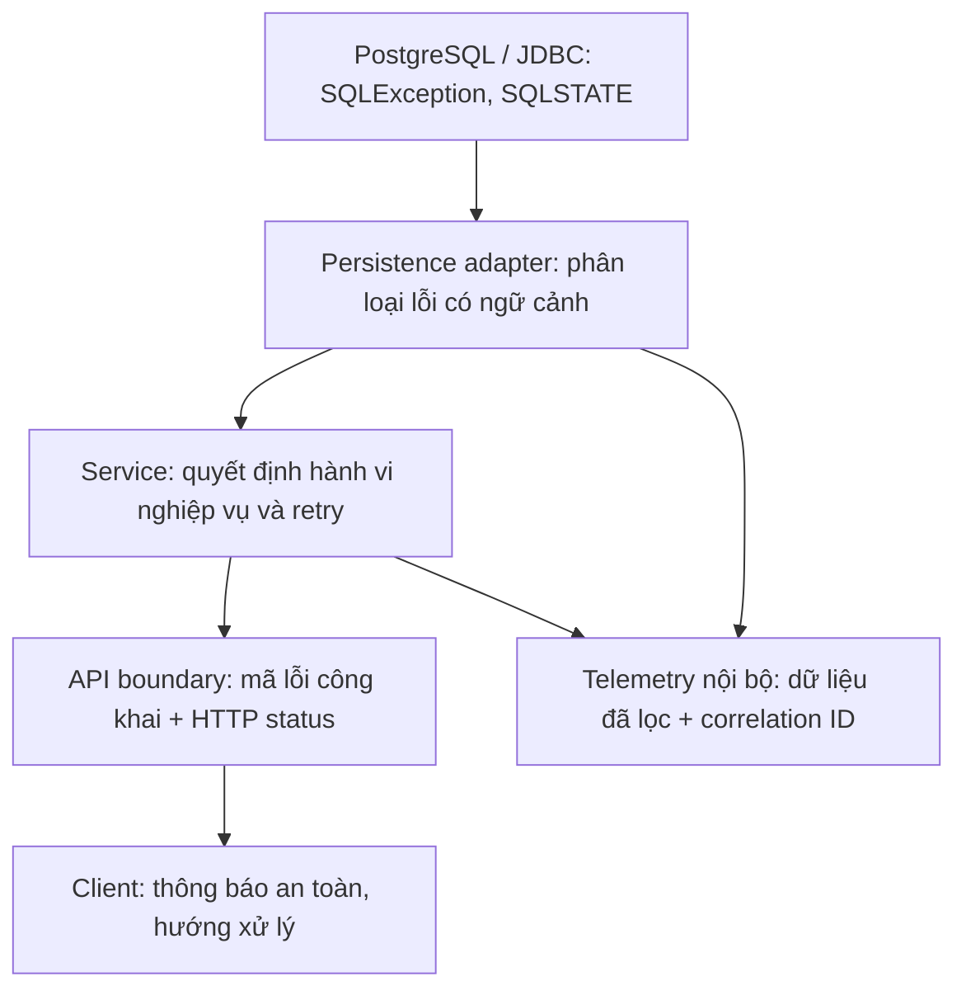

# Báo lỗi phù hợp cho tầng nghiệp vụ mà không lộ chi tiết nhạy cảm

Trong chương **Lỗi và thử lại** thuộc **DATA_PERSISTENCE_FUNDAMENTALS**, một nguyên tắc thiết kế quan trọng là: **lỗi xảy ra ở tầng lưu trữ dữ liệu cần được chuyển thành thông tin mà tầng nghiệp vụ có thể xử lý, nhưng không được vô tình tiết lộ cấu trúc cơ sở dữ liệu hoặc dữ liệu nhạy cảm ra bên ngoài**.

Ứng dụng Java có thể nhận `SQLException` khi vi phạm ràng buộc, tranh chấp giao dịch, hết kết nối, timeout hoặc gặp sự cố khi `COMMIT`. Nếu service chỉ chuyển nguyên `exception.getMessage()` lên HTTP response, client có thể nhìn thấy SQL, tên bảng/cột, constraint, giá trị tham số hoặc chi tiết về hạ tầng. Nếu ngược lại, service bắt mọi ngoại lệ rồi trả về `"Thao tác thất bại"`, nó có thể đánh mất sự khác biệt giữa **người dùng nhập sai**, **dữ liệu đã thay đổi**, **hệ thống đang tạm gián đoạn** và **kết quả commit chưa rõ**.

Bài học này xây dựng một hợp đồng lỗi phù hợp với ranh giới persistence Java: phân loại lỗi có ngữ cảnh, chuyển sang mã lỗi ổn định cho nghiệp vụ/API, giữ nguyên nhân để điều tra nội bộ, quyết định retry an toàn và kiểm chứng rằng đường trả lỗi không làm lộ dữ liệu.

## 1. Lỗi có nhiều đối tượng nhận, không chỉ một thông báo

Một lỗi DB có ít nhất ba cách diễn đạt khác nhau:

| Người nhận | Cần biết | Không nên nhận |
| --- | --- | --- |
| **Service / tầng nghiệp vụ** | Loại lỗi, thao tác nào thất bại, có thể xử lý hoặc thử lại không, trạng thái commit có rõ không | Chi tiết phụ thuộc driver khi không cần thiết |
| **API client / người dùng** | Mã lỗi công khai ổn định, thông báo ngắn dễ hiểu, hướng xử lý được phép, mã tham chiếu để hỗ trợ | SQL, stack trace, hostname DB, username kết nối, thông tin của người khác |
| **Vận hành / điều tra nội bộ** | Correlation ID, tên thao tác đã chuẩn hóa, loại lỗi, SQLSTATE, thời lượng, điểm lỗi, dấu hiệu retry | Password, access token, dữ liệu cá nhân nguyên văn, toàn bộ tham số SQL nhạy cảm |

Mỗi tầng có một trách nhiệm riêng:



**Thông báo công khai và thông tin điều tra nội bộ không phải cùng một chuỗi.** Cách thiết kế an toàn là tạo mã lỗi có cấu trúc và thông điệp công khai do ứng dụng sở hữu, thay vì tái sử dụng văn bản lỗi do database/driver sinh ra.

### 1.1. Tình huống điển hình

Giả sử hệ thống đăng ký tài khoản gọi:

```sql
INSERT INTO users(email, password_hash)
VALUES (?, ?);
```

Database trả lỗi trùng unique key trên `users.email`. Một thông điệp JDBC có thể chứa tên constraint, dữ liệu xung đột hoặc chi tiết phụ thuộc phiên bản/driver. Những chi tiết này hữu ích để phân tích nhưng **không được mặc nhiên dùng làm HTTP response**:

```text
Không nên trả cho client:
  "duplicate key value violates unique constraint users_email_key ..."

Có thể trả khi sản phẩm cho phép xác nhận tình trạng email:
  code: "EMAIL_ALREADY_REGISTERED"
  message: "Email này đã được sử dụng."

Nếu nguy cơ dò tài khoản cao (ví dụ endpoint khôi phục mật khẩu):
  message: "Nếu thông tin phù hợp, hướng dẫn sẽ được gửi tới bạn."
```

Thông báo công khai phụ thuộc **quy tắc sản phẩm và chính sách bảo mật**, không chỉ SQLSTATE. Một lỗi unique trong quy trình đăng ký và trong quy trình lưu khóa idempotency có thể cần hai cách xử lý hoàn toàn khác nhau.

## 2. Phân loại lỗi trước khi chuyển thành lỗi nghiệp vụ

Không phải ngoại lệ persistence nào cũng có nghĩa là một “business error”. Nên phân biệt **lỗi nghiệp vụ đã dự kiến**, **xung đột do đồng thời**, **sự cố hạ tầng** và **lỗi lập trình/mô hình dữ liệu**.

| Nhóm | Ví dụ | Điều service cần quyết định |
| --- | --- | --- |
| **Kiểm tra đầu vào** | Số lượng đặt hàng nhỏ hơn hoặc bằng 0 | Từ chối sớm ở application layer, không cần gửi SQL |
| **Kết quả nghiệp vụ không thỏa điều kiện** | `UPDATE ... WHERE available >= ?` ảnh hưởng 0 hàng | Trả `OUT_OF_STOCK` hoặc xử lý tình huống không tồn tại theo chính sách |
| **Vi phạm toàn vẹn dữ liệu** | Unique, foreign key, NOT NULL, CHECK | Có phải xung đột nghiệp vụ đã biết, dữ liệu sai do lập trình, hay trạng thái thay đổi? |
| **Xung đột đồng thời** | Serialization failure, deadlock, optimistic lock conflict | Có thể retry toàn bộ transaction không; sau bao nhiêu lần thì báo thất bại? |
| **Tạm mất khả dụng** | Không lấy được connection, timeout kết nối, DB unavailable | Có được retry không, khi nào giảm tải hoặc trả thông báo tạm gián đoạn? |
| **Không chắc kết quả** | Mất mạng trong lúc `commit()` | Phải tra cứu kết quả bền vững trước khi lặp lại thao tác |
| **Lỗi không dự kiến** | SQL sai, thiếu cột sau migration, permission DB bị cấu hình sai | Báo lỗi hệ thống chung, cảnh báo vận hành; không biến thành lỗi nhập liệu |

Ví dụ `UPDATE` có điều kiện:

```sql
UPDATE products
SET available = available - ?
WHERE id = ? AND available >= ?;
```

Nếu số hàng cập nhật là `0`, đây có thể là **kết quả có điều kiện đã được thiết kế** chứ không phải `SQLException`. Service cần biết có đủ hàng hay sản phẩm có tồn tại không (nếu được phép tiết lộ), từ đó tạo lỗi nghiệp vụ. Ngược lại, mọi lỗi constraint đều chuyển thành `OUT_OF_STOCK` là sai; ràng buộc không liên quan có thể phản ánh lỗi dữ liệu hoặc bug.

### 2.1. Error code phải độc lập với lời văn

Mã lỗi như `OUT_OF_STOCK`, `ORDER_STATE_CONFLICT`, `DATA_ACCESS_UNAVAILABLE` là phần của hợp đồng giữa service và client; thông điệp hiển thị có thể được bản địa hóa hoặc điều chỉnh mà không đổi mã.

Không đặt thông điệp của driver như `"ERROR: relation ... does not exist"` làm mã lỗi công khai. Văn bản này có thể thay đổi khi nâng cấp DB, khác giữa môi trường và vô tình chứa chi tiết hạ tầng. **Mã lỗi công khai nên là tập hữu hạn, được định nghĩa, kiểm thử và tài liệu hóa**.

## 3. SQLSTATE hữu ích, nhưng chỉ là điểm bắt đầu

Trong JDBC, `SQLException.getSQLState()` cung cấp mã trạng thái SQL khi driver hỗ trợ. SQLSTATE thường ổn định hơn việc tìm chuỗi trong `getMessage()`, nhưng **cùng một mã có thể cần những quyết định nghiệp vụ khác nhau** tùy thao tác đang chạy.

Ví dụ thường gặp với **PostgreSQL**:

| SQLSTATE | Ý nghĩa PostgreSQL | Xử lý gợi ý |
| --- | --- | --- |
| `23505` | `unique_violation` | Phân tích constraint **đã biết** và ngữ cảnh thao tác; có thể trả xung đột, hoặc xử lý idempotency |
| `23503` | `foreign_key_violation` | Xác định quan hệ dữ liệu; tránh lộ ID/tên bảng hoặc sự tồn tại tài nguyên không được phép |
| `23502` | `not_null_violation` | Có thể là lỗi validate bị bỏ qua hoặc bug ở mapper; không mặc nhiên đổ lỗi người dùng |
| `23514` | `check_violation` | Xác định bất biến nào bị vi phạm và liệu có thuộc hợp đồng nghiệp vụ công khai |
| `40001` | `serialization_failure` | Transaction thất bại vì xung đột; cân nhắc retry **toàn bộ** đơn vị công việc |
| `40P01` | `deadlock_detected` | Rollback và cân nhắc retry toàn bộ transaction có giới hạn |
| `55P03` | `lock_not_available` | Có thể do `NOWAIT`/`lock_timeout`; quyết định chờ lại hay từ chối dựa trên operation/deadline |
| `57014` | `query_canceled` | Có thể do timeout hoặc hủy thủ công; phải biết ai hủy và deadline còn hay không |
| `08006` | `connection_failure` | Kiểm tra giai đoạn lỗi; nếu ở gần commit, kết quả có thể **không rõ** |

Các mã thuộc **lớp `23`** thường chỉ integrity constraint violation; **lớp `40`** liên quan transaction rollback; **lớp `08`** liên quan connection exception. Nhưng không được suy ra rằng mọi SQLSTATE lớp `40` đều retry an toàn, hoặc mọi lớp `08` đều chỉ cần thực thi lại lệnh SQL cuối cùng.

Ngoài SQLSTATE, `SQLException` còn có `getErrorCode()`, `getNextException()` và chuỗi nguyên nhân. Driver có thể cung cấp metadata có cấu trúc về tên constraint. **Chỉ nên dùng chi tiết phụ thuộc driver bên trong adapter**, với kiểm tra tương thích phiên bản. Không phân tích `getMessage()` bằng `contains("duplicate")`, `contains("email")` hoặc regex phụ thuộc ngôn ngữ hệ thống.

### 3.1. Mã lỗi không đủ để hiểu tính xác định của kết quả

Hai lần `connection_failure` có thể khác hoàn toàn:

1. **Không tạo được kết nối trước khi gửi SQL:** chưa có transaction nào được thực thi qua kết nối đó. Retry kết nối có thể phù hợp nếu deadline và tải cho phép.
2. **Đứt mạng sau khi gửi `COMMIT`:** client không biết database đã commit hay chưa. Gửi lại lệnh chuyển tiền hoặc tạo đơn có thể tạo side effect hai lần.

Vì thế, ngữ cảnh quan trọng gồm **giai đoạn** (`CONNECT`, `EXECUTE`, `COMMIT`), **loại thao tác** (chỉ đọc, ghi có idempotency, ghi không idempotent) và **trạng thái xác nhận bền vững**. Không đưa ra quyết định retry chỉ từ một dòng `SQLSTATE`.

## 4. Thiết kế hợp đồng lỗi qua các ranh giới

Thay vì chuyển `SQLException` xuyên suốt controller, nên phân tách ba loại thông tin:

1. **Lỗi persistence nội bộ:** thể hiện việc DB không thực hiện đúng yêu cầu kỹ thuật; chứa loại lỗi, operation, nguyên nhân gốc và ngữ cảnh cần thiết để điều tra.
2. **Kết quả/lỗi nghiệp vụ:** service quyết định yêu cầu có thể được chấp nhận không, có nên đổi trạng thái, yêu cầu người dùng làm lại hay kích hoạt quy trình xác minh.
3. **Lỗi API công khai:** chỉ chứa thông tin đã được phép lộ cho client; không phụ thuộc vào tên bảng, vendor error code hoặc SQL.

Một hợp đồng API tối giản:

```json
{
  "code": "ORDER_STATE_CONFLICT",
  "message": "Đơn hàng đã thay đổi trạng thái. Vui lòng tải lại.",
  "requestId": "req-8f3a..."
}
```

Đây là một **ví dụ payload minh họa**, không phải log gốc từ DB. `requestId` chỉ là mã tham chiếu không mang thông tin cá nhân; trong hệ thống thực nên tạo hoặc xác minh nó tại ranh giới request, giới hạn độ dài và ký tự hợp lệ. Nếu dùng chuẩn Problem Details cho HTTP APIs, có thể đặt mã ứng dụng trong trường mở rộng và tuân thủ hợp đồng công khai tương ứng; nguyên tắc không lộ nguyên nhân nội bộ vẫn giữ nguyên.

### 4.1. Phân tầng mã lỗi

| Tầng | Kiểu thông tin gợi ý | Ví dụ |
| --- | --- | --- |
| Repository/adapter | `INTEGRITY_CONFLICT`, `TRANSACTION_ABORTED`, `CONNECTION_FAILURE`, `UNKNOWN_PERSISTENCE_FAILURE` | `23505` được nhận diện là vi phạm unique |
| Use case/service | `OUT_OF_STOCK`, `ORDER_STATE_CONFLICT`, `REQUEST_ALREADY_PROCESSED`, `TEMPORARILY_UNAVAILABLE` | Dữ liệu vừa thay đổi, yêu cầu đặt hàng không còn hợp lệ |
| HTTP/API | Mã công khai, thông báo đã lọc, trạng thái HTTP, request ID | `409` và `"ORDER_STATE_CONFLICT"` |

Không nhất thiết mỗi tầng phải định nghĩa hàng chục lớp exception. Một `enum` nội bộ và một exception có cấu trúc có thể đủ cho nhiều dịch vụ nhỏ. Nhưng **ý nghĩa phải rõ ràng**, và exception của driver không được trở thành một phần của hợp đồng JSON.

### 4.2. Tại sao không ánh xạ 1–1 từ SQLSTATE sang HTTP status?

Cùng `23505` có thể xuất hiện khi:

- Người dùng đăng ký bằng email đã có: có thể là `409 Conflict`, hoặc thông báo chung để tránh dò tài khoản.
- Hệ thống ghi `request_id` đã xử lý: nếu nội dung yêu cầu trùng khớp, nên **trả lại kết quả cũ**, không nhất thiết coi là lỗi.
- Dịch vụ tạo khóa định danh bị lỗi: có thể là bug ở ứng dụng, cần `500` với thông báo công khai chung.
- Một worker xử lý cùng sự kiện hai lần: có thể là trùng lặp dự kiến, không nên phát cảnh báo nghiêm trọng mỗi lần.

Do đó, adapter có thể phân loại `23505` là **vi phạm unique**; service cần biết *ràng buộc nào, thao tác nào, quyền người dùng và chính sách nghiệp vụ nào* trước khi quyết định cách phản hồi. Nếu cần phân biệt constraint, dùng metadata có cấu trúc do driver hỗ trợ và **danh sách tên constraint nội bộ được cho phép**. Đừng trích tên constraint ra HTTP response.

## 5. Ranh giới bảo mật: không làm lộ thông tin nhạy cảm

Thông điệp DB đôi khi chứa giá trị đầu vào, danh tính bản ghi trùng, tên cơ sở dữ liệu, bảng, cột, index, đường dẫn tệp hoặc chi tiết kết nối. Stack trace có thể bộc lộ phiên bản thư viện và luồng thực thi nội bộ. Một số rủi ro phổ biến:

| Thông tin bị lộ | Ví dụ | Nguy cơ |
| --- | --- | --- |
| Câu SQL hoặc tham số SQL | Giá trị email, token hoặc điều kiện truy vấn | Lộ dữ liệu cá nhân, cấu trúc truy vấn, bí mật |
| Tên bảng, cột, constraint | `users_email_key`, `private_customer_records` | Tiết lộ cấu trúc hệ thống; hỗ trợ suy đoán dữ liệu |
| Hostname, URL kết nối, username DB | `db-internal:5432`, tên tài khoản dịch vụ | Lộ thông tin hạ tầng, tăng diện tấn công |
| Stack trace, tên package, đường dẫn | `com.company.storage.internal...` | Tiết lộ chi tiết implementation, công nghệ |
| Sự tồn tại của bản ghi không được phép truy cập | “Tài khoản 12345 tồn tại nhưng bạn bị cấm xem” | Enumeration và rò rỉ dữ liệu giữa các tenant |
| Nội dung exception từ dịch vụ ngoài | URL, nội dung request, credential vô tình được ghép vào thông báo | Vượt ranh giới bí mật của các hệ thống tích hợp |

**Không chỉ lọc ở controller.** Lỗi có thể đi qua REST API, GraphQL, gRPC, message handler, log, email hỗ trợ hoặc trang lỗi HTML. Cần quy định chính sách hiển thị cho từng kênh và dùng một lớp chuyển đổi ở ranh giới thích hợp.

### 5.1. Hai phản hồi khác nhau cho cùng trạng thái DB

Khi người dùng đã được xác thực và có quyền biết trạng thái của **đơn hàng do mình sở hữu**, thông báo cụ thể có thể hữu ích:

```json
{
  "code": "ORDER_STATE_CONFLICT",
  "message": "Đơn hàng đã được xử lý ở nơi khác. Hãy tải lại.",
  "requestId": "req-47d1..."
}
```

Nếu người gọi đang dò một tài nguyên không được phép truy cập, phản hồi có thể chủ ý **không phân biệt không tồn tại và không có quyền**:

```json
{
  "code": "RESOURCE_NOT_FOUND",
  "message": "Không tìm thấy tài nguyên được yêu cầu.",
  "requestId": "req-47d1..."
}
```

Việc chọn trả `404` hay `403`, hoặc công khai thông tin trùng email hay không, là **quyết định bảo mật/sản phẩm**. Không được suy từ `foreign_key_violation` hoặc `unique_violation` rằng người dùng có quyền biết thực thể nào đang tồn tại.

### 5.2. Không phơi bày `cause` do driver tạo

Giữ `SQLException` như **nguyên nhân nội bộ** có thể giúp điều tra, nhưng framework/API serializer không được tự động tuần tự hóa trường `cause`, `stackTrace`, `suppressed`, `nextException` hoặc toàn bộ đối tượng exception thành response.

Tránh trả:

```java
return ResponseEntity.status(500).body(exception.getMessage());
```

Và tránh dạng:

```java
return Map.of("error", exception.toString(),
              "stackTrace", exception.getStackTrace());
```

Thay vào đó, API layer chủ động dựng **DTO công khai** từ mã lỗi đã được cho phép. Bất kỳ endpoint debug/health nào cũng phải có kiểm soát truy cập phù hợp, không bật chế độ trả chi tiết lỗi nội bộ cho người dùng production.

## 6. Mẫu Java: phân loại lỗi JDBC mà không phụ thuộc văn bản exception

Ví dụ sau minh họa một **adapter nội bộ** chuyển một số SQLSTATE của PostgreSQL thành nhóm lỗi chung. Mã không quyết định HTTP status hay thông điệp cuối cùng:

```java
import java.sql.SQLException;

enum StorageFailureKind {
    TX_CONFLICT,
    INTEGRITY_VIOLATION,
    CONNECTION_FAILURE,
    OTHER
}

final class StorageException extends RuntimeException {
    private final StorageFailureKind kind;
    private final String operation;

    StorageException(StorageFailureKind kind,
                     String operation,
                     SQLException cause) {
        super("Persistence operation failed", cause);
        this.kind = kind;
        this.operation = operation;
    }

    StorageFailureKind kind() {
        return kind;
    }

    String operation() {
        return operation;
    }
}

final class SqlFailureClassifier {
    private SqlFailureClassifier() {}

    static StorageFailureKind classify(SQLException e) {
        String state = e.getSQLState();
        if ("40001".equals(state) || "40P01".equals(state)) {
            return StorageFailureKind.TX_CONFLICT;
        }
        if (state != null && state.startsWith("23")) {
            return StorageFailureKind.INTEGRITY_VIOLATION;
        }
        if (state != null && state.startsWith("08")) {
            return StorageFailureKind.CONNECTION_FAILURE;
        }
        return StorageFailureKind.OTHER;
    }
}
```

Mã trên **cố ý bảo thủ**: trạng thái unknown được chuyển thành `OTHER`, không tự đoán đó là lỗi người dùng. Trong triển khai thật cần xử lý chuỗi `getNextException()` và exception wrapper của driver/framework khi cần, đồng thời kiểm tra cách driver cung cấp SQLSTATE. Không được gán `OTHER` thành lỗi nhập liệu hoặc tự retry vô hạn.

Một repository có thể dùng adapter như sau:

```java
public int decreaseStock(Connection c, long productId, int qty) {
    String sql = """
        UPDATE products
           SET available = available - ?
         WHERE id = ? AND available >= ?
        """;
    try (PreparedStatement ps = c.prepareStatement(sql)) {
        ps.setInt(1, qty);
        ps.setLong(2, productId);
        ps.setInt(3, qty);
        return ps.executeUpdate();
    } catch (SQLException ex) {
        throw new StorageException(
            SqlFailureClassifier.classify(ex),
            "decrease_stock",
            ex
        );
    }
}
```

`Connection` do caller sở hữu, nên repository **không đóng** nó. `PreparedStatement` do repository tạo nên được đóng bằng `try-with-resources`. Ví dụ chỉ thể hiện ánh xạ lỗi của **một** phương thức; ứng dụng thực tế cần quản lý transaction bao trọn việc trừ kho và tạo đơn. Nếu phương thức ảnh hưởng `0` hàng, service xử lý như kết quả nghiệp vụ **không đủ hàng hoặc không tồn tại**, không ném `StorageException` chỉ vì `0` hàng.

### 6.1. Service chuyển lỗi kỹ thuật thành quyết định nghiệp vụ

Giả sử `reserve(...)` sử dụng một transaction được service hoặc transaction manager quản lý, với repository `decreaseStock(...)` và `createOrder(...)`. Luồng quyết định:

```text
input quantity <= 0
    → INVALID_QUANTITY (không gửi SQL)

UPDATE products ... WHERE available >= quantity → 0 hàng
    → OUT_OF_STOCK (hoặc NOT_FOUND theo ngữ cảnh được phép)

UPDATE thành công, INSERT orders thất bại
    → rollback toàn bộ transaction
    → phân loại StorageException theo nguyên nhân và ngữ cảnh

COMMIT hoàn tất và đã được xác nhận
    → trả kết quả thành công theo hợp đồng nghiệp vụ

mất kết nối lúc COMMIT
    → kết quả chưa rõ; tra cứu request_id bền vững trước khi thử lại
```

Service không nên chuyển `INTEGRITY_VIOLATION` chung thành `"Bạn nhập sai"`: có thể ứng dụng đang quên điền một cột NOT NULL, sai schema sau migration, hoặc hai giao dịch đang cạnh tranh. Chỉ ánh xạ thành một lỗi nghiệp vụ cụ thể khi có **bằng chứng rõ từ operation và constraint đã biết**, ví dụ một constraint unique dành cho mã đơn hàng do sản phẩm công khai quy định.

### 6.2. Không vô tình lộ nguyên nhân qua `StorageException`

Đoạn mẫu giữ `SQLException` làm `cause` để tầng nội bộ có thể xác minh SQLSTATE, thời điểm lỗi và các liên kết trong chuỗi exception. Nhưng chỉ serialize **DTO lỗi công khai**, ví dụ:

```java
public record ApiError(
    String code,
    String message,
    String requestId
) {}

public final class SafeErrorResponses {
    public static ApiError unavailable(String requestId) {
        return new ApiError(
            "DATA_ACCESS_UNAVAILABLE",
            "Hệ thống tạm thời chưa thể xử lý yêu cầu.",
            requestId
        );
    }
}
```

Phần API có thể dùng mã/ thông điệp khác tùy lỗi nghiệp vụ đã được xác nhận. `ApiError` không có trường `Throwable`, `SQLException`, `query` hay `stackTrace`. **Không để serializer tự quét toàn bộ exception nội bộ** hoặc xuất nguyên `getCause()` ra JSON.

## 7. Retry đúng chỗ: loại lỗi, phạm vi và tính an toàn

Một lỗi “có khả năng tạm thời” chưa đủ để quyết định thử lại. Cần trả lời ba câu:

1. **Đơn vị cần retry là gì?** Một lần lấy kết nối, một lệnh SELECT, hay **toàn bộ transaction**?
2. **Có thể chạy lại mà không tạo side effect trùng?** Có `request_id`/idempotency hay không?
3. **Kết quả lần trước đã rõ chưa?** Nếu mất mạng ở `COMMIT`, một lỗi kỹ thuật không chứng minh database chưa commit.

| Tình huống | Có thể xử lý thế nào? | Điều tuyệt đối cần tránh |
| --- | --- | --- |
| Serialization failure `40001` | Rollback transaction, thử lại **toàn bộ nghiệp vụ** với dữ liệu đọc mới, có giới hạn | Chỉ chạy lại câu `UPDATE` cuối trong transaction đã bị hủy |
| Deadlock `40P01` | Rollback, retry toàn bộ transaction khi nghiệp vụ hỗ trợ | Retry liên tục không giới hạn, tạo thêm tranh chấp |
| Pool không cấp connection trước khi gửi SQL | Có thể đợi ngắn, trả 503 hoặc giảm tải theo deadline và chính sách | Coi mọi connection timeout là lỗi nhập liệu |
| Unique conflict đã biết | Trả xung đột hoặc xử lý duplicate/idempotency theo hợp đồng | Retry cùng `INSERT` mãi mà không thay điều kiện |
| Query bị cancel / statement timeout | Kiểm tra deadline, loại truy vấn và trạng thái transaction | Retry ngay cả khi client đã hủy hoặc thời hạn đã hết |
| Kết nối đứt khi `COMMIT` | Tra cứu kết quả bằng mã nghiệp vụ duy nhất, xác minh trước khi retry | Giả định lần trước rollback rồi trừ tiền/tạo đơn lần nữa |
| SQL sai, cột thiếu, permission DB sai | Cảnh báo vận hành, sửa cấu hình/schema | Retry vô hạn một lỗi không thể tự hết |

### 7.1. Backoff, jitter và ngân sách retry

Khi có quyền retry, nên áp dụng **giới hạn số lần**, **backoff** và **jitter** (thêm dao động ngẫu nhiên vào thời gian đợi) để giảm nguy cơ nhiều client cùng đổ dồn truy vấn vào DB vừa hồi phục.

Ví dụ một chính sách minh họa:

```text
Lần đầu: gọi transaction một lần
Nếu gặp xung đột được phép retry:
  lần 1 → đợi khoảng 50–100 ms
  lần 2 → đợi khoảng 100–200 ms
  lần 3 → đợi khoảng 200–400 ms
Sau đó → trả lỗi tạm thời hoặc đưa vào cơ chế xử lý được thiết kế
```

Đây **không phải cấu hình mặc định tối ưu**. Số lần, khoảng chờ và deadline phải phù hợp độ trễ cho phép, tải DB, thời gian chờ khóa và tính chất nghiệp vụ. Không được để nhiều tầng (HTTP client, gateway, service, driver, queue consumer) đều retry độc lập khiến một yêu cầu bị nhân lên quá nhiều lần.

Mỗi lần retry transaction nên dùng **transaction mới với trạng thái đọc mới**, không tái sử dụng kết nối đang lỗi hoặc object JPA đang mang trạng thái thất bại. Nếu thao tác có gửi email hoặc gọi API ngoài, phải tách phần side effect và áp dụng idempotency/outbox phù hợp: rollback DB không hoàn tác email đã gửi.

### 7.2. Commit chưa rõ không phải “lỗi chắc chắn thất bại”

Xét nghiệp vụ chuyển tiền:

```text
Client → Service → DB: trừ tài khoản A, cộng tài khoản B
Service → DB: COMMIT
DB: commit thành công, gửi ACK
Mạng đứt trước khi Service nhận ACK
Service: ném SQLException/timeout
```

Từ phía service, tồn tại **hai khả năng**: DB đã commit hoặc chưa commit. Nếu service retry ngay với một request mới, tiền có thể chuyển hai lần. Một cơ chế tốt hơn:

1. Gắn `request_id` duy nhất cho yêu cầu và ràng buộc `UNIQUE` hoặc primary key ở DB.
2. Ghi trạng thái yêu cầu cùng transaction với thay đổi tiền, đối chiếu các tham số có ảnh hưởng nghiệp vụ.
3. Khi mất kết nối ở commit, **không suy diễn kết quả**; tra cứu trạng thái đã ghi bền vững qua một kết nối khỏe mạnh, ưu tiên nguồn đọc đủ mới.
4. Nếu tìm thấy yêu cầu đã hoàn tất và nội dung trùng, trả kết quả đã lưu; nếu còn không chắc, phản hồi trạng thái chưa xác định và cung cấp cơ chế tra cứu lại thay vì làm lại mù quáng.

Một API có thể trả `202 Accepted` cho yêu cầu đang được xác minh nếu hệ thống thực sự cung cấp quy trình theo dõi trạng thái; nếu chỉ bị gián đoạn DB và không tiếp nhận được công việc, trả `503` có thông báo phù hợp. **Không dùng `202` để che việc hệ thống không biết hoặc không có cơ chế hoàn tất/tra cứu**.

## 8. Spring transaction và cách chuyển lỗi qua service

Với Spring JDBC, Spring Data JPA hoặc Hibernate, exception thô có thể được chuyển sang các kiểu thuộc `DataAccessException`, chẳng hạn xung đột dữ liệu, kết nối hoặc khóa lạc quan. Ánh xạ cụ thể còn phụ thuộc driver, dialect, framework, phiên bản và thao tác. **Không được dựa vào tên một subclass để kết luận mọi loại lỗi trong mọi database có cùng ý nghĩa nghiệp vụ.**

Trong ứng dụng imperative với `@Transactional`, quy tắc rollback mặc định của Spring thường áp dụng cho `RuntimeException` và `Error`, nhưng không mặc định cho mọi checked exception. Nếu service bắt ngoại lệ kỹ thuật rồi trả một giá trị bình thường, Spring có thể xem phương thức hoàn tất và **thử commit** giao dịch, trừ khi transaction đã ở trạng thái rollback-only hoặc quy tắc khác có hiệu lực.

Ví dụ rủi ro:

```java
@Transactional
public OrderResult placeOrder(OrderCommand cmd) {
    inventory.decrease(cmd.productId(), cmd.quantity());
    try {
        orders.insert(cmd);
    } catch (DataAccessException ex) {
        // Sai: nuốt lỗi; transaction có thể vẫn được commit
        // hoặc ném lỗi khác vì đã rollback-only.
        return OrderResult.failed("INSERT_FAILED");
    }
    return OrderResult.success();
}
```

Chỉ đổi ngoại lệ thành chuỗi `"INSERT_FAILED"` **chưa đủ**. Nếu hai thao tác phải nguyên tử, cần cho lỗi làm transaction rollback hoặc điều phối rollback rõ ràng theo cách framework hỗ trợ. Một phương án đơn giản là chuyển lỗi kỹ thuật thành exception runtime có nghĩa đã kiểm soát và xử lý nó **ở bên ngoài** ranh giới transaction:

```java
@Transactional
public OrderReceipt placeOrder(OrderCommand cmd) {
    int updated = inventory.decreaseIfEnough(
        cmd.productId(), cmd.quantity()
    );
    if (updated != 1) {
        throw new OutOfStockException();
    }

    return orders.insert(cmd); // Lỗi DB tiếp tục lan ra để rollback.
}
```

Đoạn mã là ví dụ định hướng: `OrderCommand`, `OrderReceipt`, `OutOfStockException` và các repository được định nghĩa bởi ứng dụng. Lỗi runtime lan qua `@Transactional` giúp transaction manager áp dụng rollback mặc định; nếu muốn bắt lỗi bên trong transaction, cần hiểu trạng thái rollback-only và chính sách `rollbackFor` tương ứng.

### 8.1. Đặt lỗi công khai ở API boundary

Trong Spring MVC, `@RestControllerAdvice`/`@ExceptionHandler` có thể chuyển một `OutOfStockException` thành response đã chuẩn hóa. Tương tự, một lỗi lưu trữ chưa được service xử lý phải được chuyển thành lỗi công khai **không có thông điệp của driver**.

Pseudo-code thể hiện ranh giới:

```text
Controller gọi PlaceOrderService
  → Service ném OutOfStockException
  → API exception mapper trả 409 + OUT_OF_STOCK + thông điệp an toàn

Controller gọi PlaceOrderService
  → Adapter ném StorageException(CONNECTION_FAILURE)
  → Transaction rollback hoặc xử lý lỗi theo transaction manager
  → API exception mapper trả 503 + DATA_ACCESS_UNAVAILABLE

Controller gọi PlaceOrderService
  → Driver ném SQLException không nhận diện
  → Ghi nhận lỗi nội bộ đã lọc và cảnh báo vận hành
  → API exception mapper trả 500 + INTERNAL_ERROR
```

Nếu client có cơ chế retry tự động, cần mô tả rõ loại lỗi nào cho phép retry và **chỉ khi thao tác idempotent hoặc đã kiểm tra kết quả**. Trả `503` không phải lời bảo đảm rằng mọi HTTP client có thể gửi lại một yêu cầu ghi không idempotent một cách an toàn.

### 8.2. Không phụ thuộc vào văn bản `DataAccessException`

Trong Spring, `DataAccessException` là abstraction hữu ích để giảm phụ thuộc vendor, nhưng `ex.getMessage()` có thể vẫn chứa thông điệp SQL, tên constraint hoặc chi tiết driver. Việc đã chuyển `SQLException` thành `DataAccessException` **không tự động làm an toàn dữ liệu công khai**.

Các adapter nên dùng phân loại có cấu trúc, ghi nhận nguyên nhân nội bộ khi cần và trả mã nghiệp vụ do ứng dụng định nghĩa. Việc ánh xạ một integrity exception thành lỗi công khai phải có **ngữ cảnh thao tác rõ ràng**, không dùng một handler toàn cục biến mọi `DataIntegrityViolationException` thành `400 Bad Request`.

## 9. Chọn HTTP status và thông điệp công khai

HTTP status thể hiện loại kết quả ở giao thức; mã lỗi ứng dụng biểu đạt tình huống nghiệp vụ. Một bảng quyết định tham khảo:

| Tình huống | HTTP status thường cân nhắc | Mã lỗi công khai ví dụ | Nội dung có thể hiển thị |
| --- | --- | --- | --- |
| Dữ liệu request không hợp lệ trước khi ghi DB | `400` hoặc `422` theo quy ước API | `INVALID_QUANTITY` | “Số lượng phải lớn hơn 0.” |
| Đơn hàng đổi trạng thái trước khi cập nhật | `409 Conflict` | `ORDER_STATE_CONFLICT` | “Dữ liệu đã thay đổi. Vui lòng tải lại.” |
| Hàng không đủ khi nhận đơn | `409 Conflict` hoặc mã phù hợp hợp đồng API | `OUT_OF_STOCK` | “Số lượng sản phẩm hiện không đủ.” |
| Tài nguyên không tồn tại hoặc không được phép tiết lộ | `404 Not Found` | `RESOURCE_NOT_FOUND` | “Không tìm thấy tài nguyên được yêu cầu.” |
| Người dùng đã xác thực nhưng không đủ quyền, có thể tiết lộ điều đó | `403 Forbidden` | `ACCESS_DENIED` | “Bạn không có quyền thực hiện thao tác.” |
| Connection pool/DB tạm không sẵn sàng | `503 Service Unavailable` | `DATA_ACCESS_UNAVAILABLE` | “Hệ thống tạm thời chưa thể xử lý.” |
| Quá tải theo chính sách rate limit | `429 Too Many Requests` | `RATE_LIMITED` | “Đã vượt giới hạn yêu cầu. Vui lòng thử lại sau.” |
| Lỗi nội bộ không dự kiến | `500 Internal Server Error` | `INTERNAL_ERROR` | “Đã xảy ra lỗi. Vui lòng thử lại sau.” |
| Tác vụ có cơ chế nhận và theo dõi trạng thái bất đồng bộ | `202 Accepted` | Không nhất thiết là lỗi | Trả liên kết/mã tra cứu trạng thái nếu đã thực sự tiếp nhận |

Đây là **gợi ý thiết kế**, không phải quy tắc ánh xạ bắt buộc cho mọi API. Ví dụ, một lỗi do serialization có thể được server tự retry và cuối cùng trả `200/201`; client không cần biết SQLSTATE `40001`. Sau khi hết ngân sách retry, API có thể trả lỗi tạm thời theo hợp đồng, nhưng không nhất thiết phải để lộ cơ chế database.

Nếu thông báo công khai có trường `retryAfter` hoặc HTTP header `Retry-After`, chỉ dùng khi hệ thống có một chính sách phù hợp và client **có thể retry an toàn**. Một mã lỗi `RETRY_LATER` không tự bảo đảm tác vụ ghi trước đó đã rollback.

### 9.1. Tránh để lỗi API thay đổi theo môi trường

Một lỗi nội bộ có thể chứa chi tiết khác giữa môi trường development, staging và production. Nhưng API client không nên dựa vào những chi tiết đó để xử lý. Tập mã như `OUT_OF_STOCK`, `ORDER_STATE_CONFLICT`, `DATA_ACCESS_UNAVAILABLE` nên có **ngữ nghĩa ổn định và test contract**.

Trong development, lập trình viên có thể xem log/trace bảo vệ quyền truy cập để điều tra; không có lý do biến production response thành stack trace chỉ vì bật một tùy chọn debug. Các thông báo lỗi public cần hỗ trợ localization và hiển thị phù hợp nhưng không được tự động đưa nguyên `getMessage()` của exception vào chuỗi dịch.

## 10. Logging và quan sát: đủ để điều tra nhưng tối thiểu dữ liệu nhạy cảm

“Không lộ chi tiết” **không đồng nghĩa không ghi gì vào log**. Khi DB báo lỗi, vận hành cần phân biệt lỗi do truy vấn chậm, connection pool, deadlock, schema migration hay lỗi nghiệp vụ. Tuy nhiên, logging không nên trở thành kho chứa SQL cùng toàn bộ dữ liệu đầu vào.

Một event log có cấu trúc gợi ý:

```json
{
  "event": "persistence_operation_failed",
  "operation": "reserve_inventory",
  "category": "TX_CONFLICT",
  "sqlState": "40001",
  "requestId": "req-8f3a...",
  "attempt": 2,
  "durationMs": 147
}
```

Tất cả những trường trên là ví dụ; mã `operation` nên đến từ một tập tên cố định do ứng dụng định nghĩa, **không ghép trực tiếp SQL/URL/giá trị người dùng vào log**. `requestId` nên được tạo/xác thực theo quy ước tin cậy, không cho phép chuỗi không giới hạn do client gửi gây log injection hoặc rác log.

Thông tin có ích khi điều tra:

- **Mã thao tác cố định:** `create_order`, `reserve_inventory`, `load_customer`; tránh nguyên câu SQL có bind parameter.
- **Loại lỗi và SQLSTATE:** phục vụ phân tích lỗi theo nhóm; không dùng làm nhãn metric chứa dữ liệu người dùng.
- **Thời điểm/giai đoạn:** lấy connection, chạy statement, flush, commit, rollback hoặc xác minh kết quả.
- **Độ trễ, số lần retry và trạng thái circuit breaker:** giúp phân biệt lỗi tức thời với quá tải kéo dài.
- **Trace ID / request ID:** liên kết bản ghi giữa các tầng mà không đưa thông tin cá nhân vào thông báo công khai.
- **Hệ thống phụ thuộc:** tên dịch vụ logic được chuẩn hóa, không bắt buộc log hostname/IP nội bộ ở mọi event.

### 10.1. Những thứ không nên đưa vào log thường xuyên

- Password, API key, session token, cookie, chuỗi kết nối chứa credential.
- Toàn bộ SQL đã bind giá trị hoặc `toString()` của request/entity có trường nhạy cảm.
- Email, số điện thoại, địa chỉ, số thẻ, số tài khoản nếu chưa có mục đích và chính sách bảo vệ/ẩn danh hợp lệ.
- Toàn bộ exception chain/stack trace cho mọi lần validation thất bại; chúng có thể chứa dữ liệu nhạy cảm và gây nhiễu.
- Mã định danh người dùng/tenant làm label metric có độ phân biệt rất cao, gây rò rỉ hoặc tăng cardinality quá mức.

Nếu cần giữ stack trace cho lỗi khó điều tra, hãy **giới hạn quyền đọc log, thời gian lưu, chính sách redaction và mục đích sử dụng**. Không chỉ dựa vào việc log “nội bộ” mà bỏ qua kiểm soát an toàn; console, hệ thống giám sát và pipeline thu thập log cũng là các điểm cần bảo vệ.

### 10.2. Không dùng thông điệp log làm hợp đồng nghiệp vụ

Thay vì:

```java
log.error("Database insert failed: " + ex.getMessage());
throw new RuntimeException(ex.getMessage());
```

Hướng tốt hơn là tạo event đã lọc và giữ lỗi gốc cho đường điều tra được kiểm soát:

```java
log.warn(
    "persistence_failure operation={} kind={} requestId={}",
    failure.operation(),
    failure.kind(),
    safeRequestId
);

throw failure; // Tầng API sau đó chỉ tạo DTO lỗi công khai.
```

Ở đây `failure` là `StorageException` nội bộ đã được định nghĩa trước đó. Đoạn log **không** in nguyên `cause`. Nếu vận hành cần stack trace, hãy dùng đường ghi log có kiểm soát và redaction, thay vì tự động nối tất cả `SQLException.getMessage()` vào chuỗi log. Cần phân cấp mức độ log: xung đột retry bình thường có thể là metric hoặc log mức thấp, còn lỗi schema không khớp triển khai cần cảnh báo mạnh hơn.

## 11. Kiểm thử ánh xạ lỗi và phòng rò rỉ thông tin

Unit test của `SqlFailureClassifier` giúp kiểm tra nhánh SQLSTATE, nhưng **không đủ** để xác nhận database và driver thực tế trả đúng metadata, transaction có rollback và API không lộ dữ liệu nhạy cảm. Nên kết hợp unit test, integration test với DB phù hợp và contract/security test ở ranh giới API.

### 11.1. Ma trận tình huống

| Tình huống thử nghiệm | Kết quả mong đợi ở service/API | Điều phải kiểm tra thêm |
| --- | --- | --- |
| `23505` trên constraint công khai đã biết | Lỗi xung đột hoặc kết quả idempotent theo ngữ cảnh | Không lộ tên constraint, bảng hay giá trị nhạy cảm |
| `23505` trên constraint không nhận diện | Không đoán đó là lỗi nhập liệu; xử lý lỗi nội bộ an toàn | Có tín hiệu điều tra/cảnh báo phù hợp |
| `23503` vì tham chiếu tới bản ghi không được phép biết | Phản hồi tuân thủ quy tắc authorization | Không làm lộ bản ghi có tồn tại hay không |
| `23502` do bug mapping sau migration | `500`/mã lỗi hệ thống chung | Không trả tên cột, stack trace hoặc SQL |
| `40001` serialization failure | Rollback, thử lại toàn bộ transaction trong ngân sách | Không gửi side effect ngoài DB hai lần |
| `40P01` deadlock | Retry có giới hạn nếu thao tác được phép | Không tạo retry storm hoặc kẹt transaction lỗi |
| Connection timeout trước khi gửi thao tác | Thông báo không khả dụng hoặc retry theo deadline | Không trả địa chỉ DB/chi tiết mạng cho client |
| Mất kết nối đúng lúc `COMMIT` | Không khẳng định thành công/thất bại khi chưa biết | Có quy trình đối chiếu `request_id`, không lặp nghiệp vụ mù quáng |
| Statement bị hủy do deadline của client | Dừng xử lý theo chính sách | Không tự tiếp tục retry khi client không còn chờ |
| Exception không thuộc nhóm đã nhận diện | Thông báo chung, status phù hợp | Có request ID cho hỗ trợ và không lộ thông tin nội bộ |

Ngoài response, kiểm tra **trạng thái database** sau mỗi trường hợp: dữ liệu có được rollback khi cần không, có bản ghi bị trùng không, giao dịch đã commit có được trả lại kết quả cũ khi retry không, và pool có thu hồi connection đúng cách không.

### 11.2. Kiểm thử bảo mật cho nội dung phản hồi

Trong môi trường test, có thể đưa một giá trị *canary* giả lập mang tính nhạy cảm vào dữ liệu đầu vào, rồi cố ý gây lỗi constraint. Kiểm tra cả **body**, **header**, **trang lỗi**, **log được phép thu thập** và **trace metadata** theo chính sách:

```text
Input thử nghiệm (dữ liệu giả, không phải secret thật):
  email = private-test-user@example.invalid

API response cần xác nhận:
  - Có error code đã công bố và requestId hợp lệ
  - Không chứa "private-test-user@example.invalid"
  - Không chứa câu INSERT, tên constraint, host DB
  - Không chứa stack trace hoặc tên lớp driver
```

Không dùng password/token thật làm dữ liệu canary. Việc kiểm tra bằng chuỗi cấm chỉ là **lớp bảo vệ bổ sung**; cách tiếp cận nền tảng vẫn là **allowlist các trường được phép trả**. Một thông điệp driver mới hoặc khác phiên bản có thể chứa thông tin nhạy cảm mà danh sách chuỗi cấm chưa từng gặp.

### 11.3. Kiểm thử đồng thời và retry

Đối với nghiệp vụ như đặt hàng hoặc chuyển tiền, hãy tạo ít nhất hai giao dịch cạnh tranh và buộc một nhánh gặp serialization/deadlock hoặc xung đột điều kiện. Xác minh:

1. Một transaction thất bại thì **toàn bộ** các thay đổi liên quan được rollback, không chỉ câu SQL cuối.
2. Lần retry dùng transaction mới và đọc lại trạng thái cần thiết.
3. Không có email/sự kiện/charge bị phát hai lần chỉ vì retry.
4. Khi hết số lần thử, API trả một lỗi công khai rõ nghĩa nhưng không lộ SQLSTATE không cần thiết.
5. Khi connection bị ngắt lúc commit, client tra cứu trạng thái bằng mã yêu cầu thay vì luôn gửi một thao tác mới.

Các integration test với `CountDownLatch` hoặc nhiều kết nối có thể hỗ trợ tạo lịch chạy cạnh tranh, nhưng cần **kiểm tra trên DB/driver gần với production**. Database giả lập in-memory hoặc mock không nhất thiết tái hiện cùng isolation, SQLSTATE, deadlock hoặc lỗi connection.

## 12. Quy trình thiết kế một luồng báo lỗi an toàn

Khi bổ sung một use case Java có truy cập DB, có thể review theo trình tự:

1. **Định nghĩa thành công và bất biến nghiệp vụ.** Chẳng hạn “mỗi `request_id` được xử lý đúng một lần” hoặc “không đặt quá tồn kho”.
2. **Liệt kê những lỗi kỹ thuật có thể xảy ra.** Gồm constraint, timeout, deadlock, mất kết nối, thiếu schema hoặc không đủ quyền DB.
3. **Phân biệt điều kiện nghiệp vụ với exception.** Nếu `UPDATE` ảnh hưởng `0` hàng là kết quả dự kiến, xử lý nó như nhánh nghiệp vụ rõ ràng.
4. **Tạo bộ phân loại ở tầng adapter.** Ưu tiên SQLSTATE và metadata có cấu trúc; tránh so khớp văn bản exception.
5. **Quyết định ánh xạ ở tầng service.** Dựa trên thao tác, ràng buộc đã biết và quyền người dùng; không áp quy tắc cứng “một SQLSTATE = một lỗi công khai”.
6. **Thiết kế retry và trạng thái chưa rõ.** Retry có giới hạn; chỉ retry toàn bộ transaction khi phù hợp, dùng idempotency để xử lý commit-unknown.
7. **Định nghĩa DTO lỗi công khai.** Mã ổn định, thông điệp an toàn, request ID; tuyệt đối không tự serialize exception nội bộ.
8. **Bảo vệ log và trace.** Dùng operation/loại lỗi đã chuẩn hóa; hạn chế PII, SQL bind parameters và stack trace.
9. **Kiểm tra transaction rollback thực tế.** Đặc biệt khi service bắt exception trong phương thức `@Transactional`.
10. **Kiểm thử ở nhiều ranh giới.** SQLSTATE, transaction, API contract, concurrency, bảo mật và tương thích phiên bản driver/framework.

### 12.1. Ví dụ tình huống tổng hợp

Một người dùng bấm **“Thanh toán đơn hàng”** hai lần do mạng chậm. Hệ thống đã thực hiện transaction nhưng mất phản hồi khi commit.

Một thiết kế thiếu an toàn:

```text
1. Service gửi lệnh thanh toán.
2. Commit timeout.
3. Catch(SQLException ex) → trả ex.getMessage() cho HTTP client.
4. HTTP client đọc thông báo lỗi rồi gửi lại yêu cầu mới.
5. Hệ thống xử lý thanh toán lần thứ hai.
```

Thiết kế có kiểm soát:

```text
1. Client giữ nguyên request_id cho cùng một ý định thanh toán.
2. Service ghi trạng thái yêu cầu bằng transaction có ràng buộc duy nhất.
3. Khi kết quả commit chưa rõ, service không đoán transaction đã rollback.
4. Service tra cứu kết quả bền vững và so khớp nội dung của request_id.
5. Nếu đã hoàn tất, trả kết quả đã ghi; nếu chưa chắc, dùng trạng thái
   chờ xác minh có thể tra cứu thay vì phát lệnh mới một cách mù quáng.
6. API chỉ trả mã và thông báo được phép hiển thị; log nội bộ dùng
   correlation ID và category đã lọc để điều tra sự cố.
```

Để đạt “xử lý đúng một lần” cho hệ thống thanh toán bên ngoài, một khóa duy nhất tại DB **chưa tự bảo đảm** bên ngoài không nhận lệnh trùng. Còn cần cơ chế idempotency/phối hợp với nhà cung cấp thanh toán và trạng thái xử lý bền vững; không tạo cảm giác an toàn giả chỉ vì giao dịch DB có ACID.

## 13. Câu hỏi tự kiểm tra

**Câu 1.** PostgreSQL báo `23505` khi tạo user. Có thể gửi nguyên `SQLException.getMessage()` cho client vì đó là lỗi người dùng không?

**Gợi ý:** Không. Thông điệp có thể chứa tên constraint và giá trị nhạy cảm. Adapter xác định unique violation, service xét ngữ cảnh/quyền và API tạo message công khai đã được kiểm soát.

**Câu 2.** Vì sao không thể ánh xạ toàn bộ SQLSTATE lớp `23` thành `400 Bad Request`?

**Gợi ý:** Một lỗi integrity có thể do bug, schema migration, xung đột đồng thời hoặc một điều kiện nghiệp vụ. Không phải mọi lỗi đều là nhập liệu sai, và người dùng có thể không được phép biết chi tiết dữ liệu liên quan.

**Câu 3.** Service gặp `40001` trong PostgreSQL và đã thay đổi hai bảng trong một transaction. Nên retry câu SQL cuối hay toàn bộ transaction?

**Gợi ý:** Nếu được phép retry, rollback và thử lại **toàn bộ** transaction với trạng thái mới, giới hạn số lần; không chỉ chạy lại lệnh cuối trong transaction đã thất bại.

**Câu 4.** Client bị timeout khi chờ `COMMIT` chuyển tiền. Có thể báo “DB chắc chắn chưa ghi” rồi tự chuyển lại không?

**Gợi ý:** Không. Kết quả có thể chưa xác định ở phía client. Cần mã yêu cầu duy nhất và kiểm tra trạng thái đã ghi bền vững trước khi thử lại.

**Câu 5.** Spring đã chuyển `SQLException` thành `DataIntegrityViolationException`. `getMessage()` của exception mới đã an toàn để trả qua REST chưa?

**Gợi ý:** Chưa. Chuỗi thông báo có thể vẫn chứa SQL và chi tiết driver; phải dựng DTO lỗi công khai bằng allowlist.

**Câu 6.** Vì sao chỉ cần giấu thông điệp trong HTTP response là chưa đủ?

**Gợi ý:** Thông tin nhạy cảm vẫn có thể lộ qua log, trace, GraphQL error, job message, trang debug hoặc endpoint khác. Chính sách lọc thông tin phải áp dụng tại mọi đường xuất.

**Câu 7.** Một phương thức `@Transactional` bắt lỗi `DataAccessException`, trả `false` bình thường và không đặt rollback-only. Có chắc DB tự rollback không?

**Gợi ý:** Không. Transaction manager có thể thử commit hoặc báo lỗi khác nếu transaction đã ở trạng thái thất bại. Cần thiết kế đường lan truyền exception và rollback rõ ràng.

**Điểm cần ghi nhớ:** **Tầng persistence nhận lỗi kỹ thuật; tầng nghiệp vụ quyết định ý nghĩa và khả năng xử lý; tầng API chỉ phát thông tin an toàn mà client được quyền biết.** Hãy phân loại bằng tín hiệu có cấu trúc, giữ nguyên nhân để điều tra có kiểm soát, không lộ SQL/PII, và luôn phân biệt lỗi có thể retry với trường hợp kết quả commit chưa xác định.


