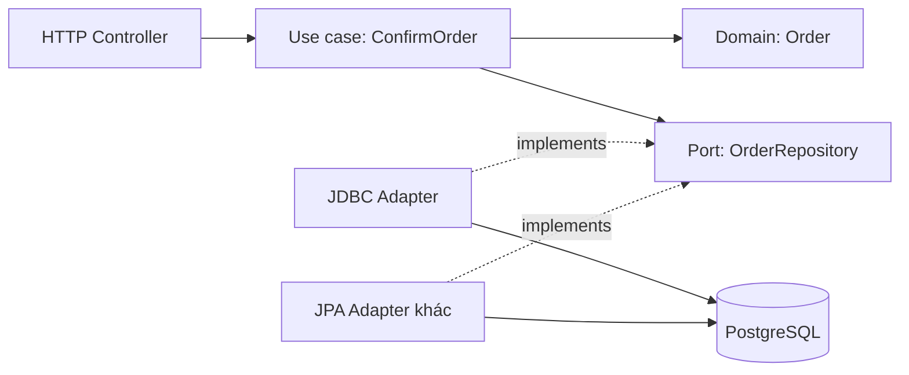
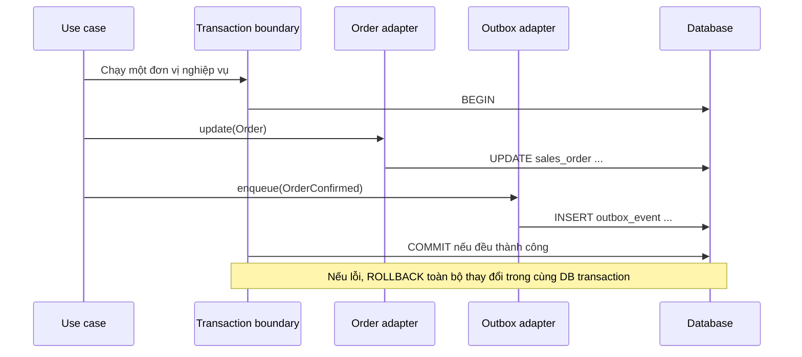

# Tách mô hình miền khỏi chi tiết công nghệ lưu trữ

## Mục tiêu học tập

Sau bài này, người học có thể:

- Phân biệt **mô hình miền (domain model)**, **mô hình lưu trữ (persistence model)**, **hợp đồng truy cập dữ liệu (port)** và **thành phần hiện thực công nghệ (adapter)**.
- Giải thích vì sao quy tắc nghiệp vụ cần tồn tại độc lập với JDBC, JPA, ORM, câu lệnh SQL và cấu trúc bảng.
- Thiết kế một đối tượng miền, một repository interface và một adapter JDBC cho quy trình xác nhận đơn hàng bằng Java.
- Nhận diện nơi đặt ranh giới giao dịch, kiểm soát đồng thời, ánh xạ lỗi và ràng buộc toàn vẹn dữ liệu mà không làm rò rỉ chi tiết persistence vào logic nghiệp vụ.
- Đánh giá đánh đổi giữa thiết kế tách biệt nghiêm ngặt và cách tổ chức đơn giản hơn, từ đó kiểm thử và tiến hóa lược đồ có kiểm soát.

## 1. Vì sao cần tách mô hình miền khỏi cách dữ liệu được lưu?

Một hệ thống đơn hàng có quy tắc: **chỉ đơn ở trạng thái `DRAFT` mới được xác nhận**. Quy tắc này thuộc nghiệp vụ; nó vẫn đúng dù dữ liệu đang nằm trong PostgreSQL, MySQL, một dịch vụ từ xa hay bộ nhớ của bài kiểm thử.

Nếu phương thức `confirm()` gọi thẳng `EntityManager.persist()` hoặc chứa `UPDATE sales_order ...`, quy tắc nghiệp vụ bị gắn vào một công nghệ và vòng đời kết nối cụ thể. Khi đổi ORM, điều chỉnh schema, bổ sung cache hay kiểm thử mà không mở database, lập trình viên phải đụng đến cả logic xác nhận đơn. Đây là **ghép chặt (coupling)** không cần thiết.

Trong module `DATA_PERSISTENCE_FUNDAMENTALS`, người học tìm hiểu từ mô hình dữ liệu, lược đồ, truy vấn, chỉ mục đến giao dịch, cô lập, kết nối, bảo mật và độ bền. **Ranh giới ứng dụng** nối các chủ đề đó với mã Java: nghiệp vụ nói *điều gì phải đúng*, còn tầng persistence quyết định *đọc, ghi và khôi phục dữ liệu bằng cơ chế nào*.

Ví dụ cách trộn trách nhiệm, chỉ nhằm chỉ ra vấn đề:

```java
// VÍ DỤ KHÔNG NÊN SAO CHÉP: một object làm cả nghiệp vụ và persistence.
public void confirm(EntityManager entityManager) {
    if (!"DRAFT".equals(status)) {
        throw new IllegalStateException("Order is not draft");
    }
    status = "CONFIRMED";
    entityManager.merge(this);
}
```

Phương thức này vừa ra quyết định nghiệp vụ, vừa cần một `EntityManager`, trạng thái entity và ngữ nghĩa lưu của JPA. Nếu phát sinh lỗi persistence, đối tượng miền còn phải biết cách xử lý một phần của hạ tầng. Thiết kế phù hợp hơn là giữ phép chuyển trạng thái trong domain, còn việc ghi dữ liệu ở một thành phần riêng.

**Tách biệt không có nghĩa bỏ database constraint.** Các ràng buộc `PRIMARY KEY`, `UNIQUE`, `FOREIGN KEY`, `CHECK` và cơ chế transaction vẫn cần tồn tại ở nơi dữ liệu được ghi. Domain giữ quy tắc nghiệp vụ dễ diễn đạt, còn database bảo vệ toàn vẹn trước các writer cạnh tranh, dữ liệu cũ hoặc đường ghi ngoài ứng dụng.

## 2. Bốn vai trò chính trong ranh giới ứng dụng

| Thành phần | Điều nó biết | Điều nó không nên phụ thuộc trực tiếp |
| --- | --- | --- |
| **Domain model** | Định danh, trạng thái, hành vi và bất biến nghiệp vụ | `Connection`, `ResultSet`, `@Entity`, tên bảng, HTTP request |
| **Application service / use case** | Trình tự công việc: tải aggregate, gọi hành vi miền, lưu, phát sự kiện sau commit | Cách thực thi SQL và các cột của bảng |
| **Repository port** | Khả năng cần từ nơi lưu trữ, ví dụ tìm hoặc cập nhật một đơn | `DataSource`, SQL cụ thể, tên schema |
| **Persistence adapter** | JDBC/JPA, mapping, query, transaction binding, lỗi và resource | Quyết định lại quy tắc nghiệp vụ mà domain đã sở hữu |

Một **port** là interface do phía nghiệp vụ/ứng dụng định nghĩa theo nhu cầu; **adapter** là thành phần hiện thực interface đó bằng công nghệ cụ thể. Mũi tên phụ thuộc ở cấp mã nguồn hướng từ adapter về interface:



Trong một ứng dụng, cấu hình dependency injection chọn đúng adapter ở lúc khởi động. Domain và application **không cần tạo** một `JdbcOrderRepository` hay tự đọc URL kết nối. Định nghĩa port có thể nằm trong package `application.port` hoặc `domain.repository` tùy kiến trúc; điều quan trọng là **hướng phụ thuộc**.

### Mô hình miền không phải mô hình trả về API

Một `Order` có thể chứa hành vi `confirm()` và bất biến tổng tiền; HTTP API lại cần JSON như `{"orderId":"...", "status":"CONFIRMED"}`. Đó là **response DTO**, không phải hợp đồng trực tiếp của database hay domain. Tương tự, entity JPA hoặc hàng từ `ResultSet` là biểu diễn phục vụ lưu trữ, không mặc nhiên là object nên gửi ra ngoài.

Đừng cố ép một class duy nhất làm đồng thời **domain entity, JPA entity, request DTO, response DTO và cache model**. Cách đó có thể nhanh lúc đầu nhưng dần tạo phụ thuộc ngược khó kiểm soát khi schema hoặc API thay đổi.

## 3. Ví dụ miền: đơn hàng có thể được xác nhận đúng một lần

Giả sử ứng dụng xử lý đơn hàng cho nhiều tenant, với yêu cầu:

1. Đơn có `id` và `tenantId`; truy cập phải được giới hạn theo tenant.
2. Tổng tiền của đơn phải lớn hơn 0.
3. Chỉ `DRAFT` được chuyển sang `CONFIRMED`; gọi xác nhận lần thứ hai phải báo lỗi nghiệp vụ.
4. Khi hai request sửa cùng một phiên bản, hệ thống không được **ghi đè âm thầm** quyết định đã commit trước đó.

Chọn một model thuần Java (ví dụ dùng Java 17+). Không có annotation ORM, connection hay lệnh SQL:

```java
import java.math.BigDecimal;
import java.util.Objects;
import java.util.UUID;

public record Order(
        UUID id,
        UUID tenantId,
        OrderStatus status,
        BigDecimal total,
        long version) {

    public Order {
        Objects.requireNonNull(id, "id");
        Objects.requireNonNull(tenantId, "tenantId");
        Objects.requireNonNull(status, "status");
        Objects.requireNonNull(total, "total");
        if (total.signum() <= 0) {
            throw new IllegalArgumentException("Order total must be positive");
        }
        if (version < 0) {
            throw new IllegalArgumentException("Version must not be negative");
        }
    }

    public Order confirm() {
        if (status != OrderStatus.DRAFT) {
            throw new IllegalStateException("Only a draft order can be confirmed");
        }
        // Trả object mới; version hiện tại dùng để phát hiện ghi cạnh tranh.
        return new Order(id, tenantId, OrderStatus.CONFIRMED, total, version);
    }

    public Order withVersion(long newVersion) {
        return new Order(id, tenantId, status, total, newVersion);
    }
}

enum OrderStatus {
    DRAFT, CONFIRMED
}
```

`Order.confirm()` chứa **quy tắc miền**. Nó không biết ai gọi, dữ liệu được lấy từ đâu hay được lưu bằng SQL nào. Có thể gọi trực tiếp phương thức này trong unit test mà không mở kết nối.

Ở đây `version` là một **token kiểm soát đồng thời**, không chứa API của công nghệ lưu trữ. Có thể giữ nó trong domain model để phục vụ optimistic concurrency. Nếu đội ngũ muốn domain hoàn toàn không biết về version lưu trữ, một phương án khác là để adapter hoặc application port mang `expectedVersion` riêng. Điều quan trọng là chọn hợp đồng nhất quán, không biến domain thành một bản sao schema vô thức.

### Bất biến của aggregate và bất biến của database

`Order.confirm()` bảo vệ chuyển trạng thái với một object đã được nạp. Nhưng hai request có thể cùng nạp bản nháp ở version 4, cùng gọi `confirm()` và cùng muốn ghi. Domain không thể tự khóa database chỉ bằng một lệnh `if`. Việc **điều phối ghi cạnh tranh** thuộc hợp đồng persistence và cơ chế transaction; ta sẽ xử lý bằng `WHERE version = ?` ở adapter.

Ngoài ra, nếu business rule liên quan **nhiều đơn hàng** (ví dụ tổng đơn đang mở không vượt hạn mức), chỉ một object `Order` không tự bảo vệ được bất biến toàn tập. Khi đó cần xác định aggregate boundary, constraint/cập nhật có điều kiện, locking hoặc isolation phù hợp với transaction.

## 4. Repository port: định nghĩa năng lực thay vì công nghệ

Ở phía application, tạo interface thể hiện đúng nhu cầu của use case:

```java
import java.util.Optional;
import java.util.UUID;

public interface OrderRepository {
    Optional<Order> findById(UUID tenantId, UUID orderId);

    // order.version() là version mong đợi hiện tại;
    // trả về object với version mới khi cập nhật thành công.
    Order update(Order order);
}
```

Interface không trả về `ResultSet`, `EntityManager` hoặc `JpaRepository`, không nhận SQL string và không yêu cầu người gọi quản lý `Connection`. Nó nói *đọc đơn theo tenant* và *cập nhật một đơn có kiểm soát version*.

Một application service có thể sử dụng repository qua constructor:

```java
import java.util.UUID;

public final class ConfirmOrderUseCase {
    private final OrderRepository orders;

    public ConfirmOrderUseCase(OrderRepository orders) {
        this.orders = orders;
    }

    public Order confirm(UUID tenantId, UUID orderId) {
        Order current = orders.findById(tenantId, orderId)
                .orElseThrow(() -> new IllegalArgumentException(
                        "Order not found for tenant"));

        Order confirmed = current.confirm();
        return orders.update(confirmed);
    }
}
```

Một adapter có thể lấy dữ liệu từ PostgreSQL, một adapter test có thể giữ dữ liệu trong `Map`, còn một adapter khác có thể dùng JPA. Use case không phải sửa khi đổi hiện thực, miễn là **ngữ nghĩa của port vẫn được giữ**.

**Điểm cần thận trọng:** dùng `Optional.empty()` cho bản ghi không tồn tại và bản ghi không thuộc tenant có thể là một quyết định bảo mật phù hợp để tránh lộ định danh cross-tenant. Lỗi ghi cạnh tranh, mất kết nối hoặc constraint violation **không nên bị nuốt thành `Optional.empty()`** vì chúng có cách xử lý khác.

## 5. Persistence model và lược đồ là chi tiết của adapter

Ví dụ schema PostgreSQL:

```sql
CREATE TABLE sales_order (
    id        UUID PRIMARY KEY,
    tenant_id UUID NOT NULL,
    status    VARCHAR(20) NOT NULL
              CHECK (status IN ('DRAFT', 'CONFIRMED')),
    total     NUMERIC(18, 2) NOT NULL
              CHECK (total > 0),
    version   BIGINT NOT NULL DEFAULT 0
              CHECK (version >= 0)
);

CREATE INDEX idx_sales_order_tenant_status
    ON sales_order (tenant_id, status);
```

Tên `sales_order`, kiểu `UUID`, cách biểu diễn status, precision của `NUMERIC`, chỉ mục và cách đánh số version là **lựa chọn persistence**. Domain quan tâm một đơn có định danh, tổng tiền dương và trạng thái hợp lệ; nó không cần biết câu `CREATE TABLE` nào được chạy.

| Domain | Persistence | Chính sách ánh xạ |
| --- | --- | --- |
| `Order.id` | `sales_order.id UUID` | Giữ định danh ổn định qua nhiều lần ghi |
| `Order.tenantId` | `tenant_id UUID` | Mọi truy vấn/ghi đều giới hạn tenant |
| `OrderStatus.CONFIRMED` | `status = 'CONFIRMED'` | Adapter chuyển enum ↔ mã lưu trữ |
| `Order.total` | `NUMERIC(18,2)` | Có quy tắc làm tròn, precision/scale rõ |
| `Order.version` | `version BIGINT` | Dùng compare-and-set, tăng version khi ghi |

Đây là ví dụ tối giản. Nếu tổng tiền có đơn vị tiền tệ, miền nên có `Money(amount, currency)` và các ràng buộc tiền tệ; adapter sẽ ánh xạ sang nhiều cột. Không được suy luận rằng `BigDecimal` và một cột `NUMERIC` đơn lẻ là đủ cho mọi quy tắc tài chính.

Trong hệ thống thật, schema có thể chứa thêm khóa ngoại, unique, audit timestamp hoặc cột phục vụ truy vấn. Không nên đưa từng cột audit, cột index và tên bảng vào domain chỉ vì chúng xuất hiện trong database.

## 6. JDBC adapter: map ở ranh giới, đóng tài nguyên tại nơi sở hữu

Một hiện thực có thể dùng `DataSource` và `PreparedStatement`. Các đoạn sau giả định `Order` và `OrderRepository` đã được định nghĩa như trên; tách class ra file Java tương ứng khi triển khai thật.

```java
import java.sql.Connection;
import java.sql.PreparedStatement;
import java.sql.ResultSet;
import java.sql.SQLException;
import java.util.Optional;
import java.util.UUID;
import javax.sql.DataSource;

public final class JdbcOrderRepository implements OrderRepository {
    private final DataSource dataSource;

    public JdbcOrderRepository(DataSource dataSource) {
        this.dataSource = dataSource;
    }

    @Override
    public Optional<Order> findById(UUID tenantId, UUID orderId) {
        String sql = """
            SELECT id, tenant_id, status, total, version
            FROM sales_order
            WHERE tenant_id = ? AND id = ?
            """;
        try (Connection connection = dataSource.getConnection();
             PreparedStatement statement = connection.prepareStatement(sql)) {
            statement.setObject(1, tenantId);
            statement.setObject(2, orderId);
            try (ResultSet rows = statement.executeQuery()) {
                if (!rows.next()) {
                    return Optional.empty();
                }
                return Optional.of(new Order(
                        rows.getObject("id", UUID.class),
                        rows.getObject("tenant_id", UUID.class),
                        OrderStatus.valueOf(rows.getString("status")),
                        rows.getBigDecimal("total"),
                        rows.getLong("version")));
            }
        } catch (SQLException error) {
            throw new PersistenceFailure("Cannot load order", error);
        }
    }

    @Override
    public Order update(Order order) {
        String sql = """
            UPDATE sales_order
               SET status = ?, total = ?, version = version + 1
             WHERE id = ? AND tenant_id = ? AND version = ?
            RETURNING version
            """;
        try (Connection connection = dataSource.getConnection();
             PreparedStatement statement = connection.prepareStatement(sql)) {
            statement.setString(1, order.status().name());
            statement.setBigDecimal(2, order.total());
            statement.setObject(3, order.id());
            statement.setObject(4, order.tenantId());
            statement.setLong(5, order.version());
            try (ResultSet rows = statement.executeQuery()) {
                if (!rows.next()) {
                    throw new ConcurrentOrderModification(
                            "Order changed, removed, or is not accessible");
                }
                return order.withVersion(rows.getLong(1));
            }
        } catch (SQLException error) {
            throw new PersistenceFailure("Cannot update order", error);
        }
    }
}

class PersistenceFailure extends RuntimeException {
    PersistenceFailure(String message, Throwable cause) {
        super(message, cause);
    }
}

class ConcurrentOrderModification extends RuntimeException {
    ConcurrentOrderModification(String message) {
        super(message);
    }
}
```

**Vì sao cách này có tác dụng?**

- Adapter đóng `ResultSet`, `PreparedStatement` và `Connection` qua `try-with-resources`, kể cả khi SQL lỗi hoặc mapper ném ngoại lệ. Đối với connection pool, `close()` thường trả connection logic về pool.
- `WHERE tenant_id = ? AND id = ?` bảo vệ phạm vi tenant ngay cả trên lệnh ghi. Không dựa duy nhất vào kiểm tra quyền ở controller.
- `WHERE version = ?` cộng với `version = version + 1` là một thao tác **optimistic concurrency** nguyên tử trên hàng. Nếu request khác đã ghi và tăng version, lần cập nhật stale sẽ không sửa hàng.
- Giá trị version mới được trả về qua cú pháp `RETURNING` của **PostgreSQL**; DBMS khác có thể cần API/SQL khác. Use case vẫn chỉ thấy một `Order` mới.
- Lỗi `SQLException` được bao trong lỗi tầng persistence; không bắt use case phải biết `SQLSTATE`, connection pool hay tên bảng.

**Giới hạn cần hiểu:** Hai phương thức trong adapter mẫu mỗi phương thức tự mượn connection, nên `findById` và `update` không tự nằm trong một transaction lớn. Với use case chỉ cập nhật một hàng có điều kiện version, câu `UPDATE` nguyên tử bảo vệ việc ghi đè cạnh tranh. Nếu nghiệp vụ cần nhiều bước **cùng commit hoặc cùng rollback**, phải thiết kế ranh giới transaction riêng ở application/infrastructure (mục 8). Trong Spring, muốn tham gia một transaction đã được `@Transactional` quản lý, dùng API JDBC tích hợp transaction như `JdbcTemplate` hoặc kết nối lấy qua `DataSourceUtils` đúng cấu hình; tự gọi `dataSource.getConnection()` như mẫu độc lập này **không mặc nhiên dùng cùng connection đang được Spring ràng buộc**.

Một adapter production còn cần cân nhắc lỗi null/enum không hợp lệ, rollback, retry, timeout, query plan, conversion precision, các ràng buộc unique và logging phù hợp. Đừng dịch **mọi** lỗi database thành một “không tìm thấy”: lỗi kết nối và ghi cạnh tranh cần chính sách phản hồi khác nhau.

## 7. Khi dùng JPA: có nên để domain đồng thời là entity?

JPA có mô hình đối tượng riêng: `@Entity`, `@Id`, `@Column`, `@OneToMany`, persistence context, lazy loading và dirty checking. Một lựa chọn là để domain entity cũng là JPA entity; lựa chọn khác là giữ **JPA entity riêng** rồi map sang domain.

### Hai cách tổ chức phổ biến

| Cách làm | Lợi ích | Giới hạn và đánh đổi |
| --- | --- | --- |
| **Chung một class domain/JPA** | Ít class, giảm code mapping, nhanh với CRUD đơn giản | Domain phụ thuộc annotation và yêu cầu vòng đời JPA; lazy proxies, constructor, quan hệ dữ liệu có thể chi phối mô hình |
| **Tách domain và JPA entity** | Domain thuần Java, quy tắc dễ kiểm thử; lược đồ có thể tiến hóa với adapter | Thêm mã mapping, cần quyết định xử lý identity, version và thay đổi collection |

Một JPA entity tách riêng có thể bắt đầu như sau (minh họa cấu trúc, chưa phải implementation đầy đủ):

```java
import jakarta.persistence.*;
import java.math.BigDecimal;
import java.util.UUID;

@Entity
@Table(name = "sales_order")
public class OrderJpaEntity {
    @Id
    UUID id;

    @Column(name = "tenant_id", nullable = false)
    UUID tenantId;

    @Enumerated(EnumType.STRING)
    @Column(nullable = false)
    OrderStatus status;

    @Column(nullable = false, precision = 18, scale = 2)
    BigDecimal total;

    @Version
    long version;

    protected OrderJpaEntity() { } // Yêu cầu của JPA.
}
```

Adapter có trách nhiệm **map** `OrderJpaEntity` ↔ `Order`. Không để domain gọi `EntityManager` hoặc `JpaRepository`. Với `@Version`, provider JPA có thể phát hiện ghi cạnh tranh bằng optimistic locking; adapter chuyển lỗi tương ứng thành một tín hiệu ổn định cho application thay vì đẩy `OptimisticLockException` ra mọi nơi.

**Cần thống nhất cơ chế version:** nếu adapter dùng `@Version` thì để JPA quản lý việc tăng version; nếu adapter JDBC dùng `version = version + 1` thì quy tắc tăng nằm trong SQL. Không vừa tự tăng version trong domain vừa cấu hình JPA tăng tự động rồi không đối chiếu kết quả.

Đừng hiểu tách class là một yêu cầu bắt buộc của mọi ứng dụng. Với CRUD nhỏ, một JPA entity có quy tắc nghiệp vụ đơn giản có thể là lựa chọn cân bằng. Khi quy tắc miền phức tạp, cần độc lập ORM hoặc có nhiều đường lưu trữ, mapping riêng thường tạo ranh giới rõ hơn.

### Tại sao không đưa trực tiếp entity JPA ra API?

Nếu controller serialize một entity JPA, nó có thể gặp **lazy loading ngoài transaction**, truy vấn N+1, vòng tham chiếu khi serialize, hoặc vô tình lộ cột nhạy cảm. API cũng bị buộc vào schema/entity lifecycle. Nên dùng DTO phù hợp với use case, và map ở ranh giới HTTP:

```java
public record ConfirmOrderResponse(String orderId, String status) {
    public static ConfirmOrderResponse from(Order order) {
        return new ConfirmOrderResponse(
                order.id().toString(), order.status().name());
    }
}
```

DTO ở đây chỉ chứa thông tin cần cho client; nó không bao gồm `DataSource`, entity JPA, tenant nội bộ hoặc toàn bộ bản ghi database.

## 8. Transaction là ranh giới của use case, không phải của từng hàm SQL

Một use case có thể phải **cập nhật đơn hàng, ghi một outbox event và trừ hạn mức** trong một giao dịch. Nếu mỗi repository method tự mở connection, chạy một câu SQL rồi auto-commit riêng, bước đầu có thể thành công trong khi bước sau thất bại, để lại trạng thái không nhất quán.

**Nguyên tắc:** application/use case quyết định *những thay đổi nào phải cùng thành công*. Infrastructure quyết định *làm sao tạo và kết thúc transaction trên hệ quản trị đang dùng*.



### Port điều phối transaction khi cần độc lập framework

Ứng dụng có thể khai báo một hợp đồng nhỏ:

```java
import java.util.function.Supplier;

public interface TransactionRunner {
    <T> T inTransaction(Supplier<T> work);
}
```

Application service gọi `transactionRunner.inTransaction(() -> { ... })` để bao nhiều thao tác của các port. Trong Spring, adapter có thể dùng `TransactionTemplate`:

```java
import java.util.function.Supplier;
import org.springframework.transaction.support.TransactionTemplate;

public final class SpringTransactionRunner implements TransactionRunner {
    private final TransactionTemplate template;

    public SpringTransactionRunner(TransactionTemplate template) {
        this.template = template;
    }

    @Override
    public <T> T inTransaction(Supplier<T> work) {
        return template.execute(status -> work.get());
    }
}
```

**Điều kiện bắt buộc:** các adapter JDBC/JPA tham gia transaction phải sử dụng cơ chế kết nối/context do cùng transaction manager điều phối. Với Spring JDBC, dùng `JdbcTemplate` hoặc `DataSourceUtils` theo cấu hình, thay vì mỗi adapter tự gọi `getConnection()` và commit độc lập như ví dụ JDBC tối giản ở mục 6. Chỉ có `TransactionRunner` trong interface **không tự tạo ra tính nguyên tử** nếu các adapter không chia sẻ cùng transaction thật.

Đối với ứng dụng đã phụ thuộc Spring, một phương thức service mỏng gắn `@Transactional` cũng có thể là lựa chọn thực tế. Khi ấy annotation nằm trong application adapter hoặc lớp service sát biên framework; đội ngũ cần chấp nhận và hiểu mức phụ thuộc đó. Với Spring AOP mặc định, lời gọi nội bộ qua `this.method()` có thể bỏ qua proxy nên không kích hoạt transaction như kỳ vọng.

### Giới hạn của transaction một database

Transaction của PostgreSQL không tự bao phủ email, HTTP API, Kafka hoặc file ghi ngoài database. Nếu use case cần thông báo sau khi xác nhận đơn, có thể ghi **outbox event trong cùng DB transaction**, rồi một worker gửi ra ngoài sau commit. Consumer vẫn cần idempotency vì retry có thể tạo thông báo trùng. Không gọi dịch vụ ngoài khi giữ lock/connection quá lâu nếu chưa có lý do nghiệp vụ rõ ràng.

## 9. Mapping không chỉ là đổi tên trường

Adapter là nơi xử lý chênh lệch giữa miền và mô hình lưu trữ:

| Vấn đề | Domain mong muốn | Việc adapter phải đảm nhận |
| --- | --- | --- |
| Mã trạng thái | `OrderStatus.CONFIRMED` | Chuyển mã cột, hỗ trợ dữ liệu lịch sử và thay đổi enum |
| Tiền tệ | Giá trị tiền hợp lệ, đúng đơn vị | Precision, scale, rounding và loại tiền lưu trong schema |
| Thiếu dữ liệu | Một kết quả `Optional.empty()` hoặc lỗi miền phù hợp | Phân biệt không tồn tại, không thuộc tenant và lỗi kết nối |
| Ghi đồng thời | Không ghi đè trạng thái mới bằng phiên bản cũ | `@Version` hoặc `WHERE version = ?`, diễn giải conflict |
| Đọc danh sách | Tập kết quả theo một tiêu chí nghiệp vụ | Paging, sort, index, query plan và giới hạn số hàng |
| Lỗi lưu trữ | Tín hiệu để ứng dụng quyết định retry/response | Ánh xạ SQLSTATE và exception của driver/ORM |
| Dữ liệu cũ | Domain luôn nhận giá trị hợp lệ | Validation và chính sách xử lý bản ghi không hợp lệ |

Không phải mọi chuyển đổi đều an toàn. Ví dụ chuyển `NUMERIC(18,2)` sang `double` có thể gây sai lệch số thập phân; chuyển enum bằng `valueOf()` có thể ném lỗi khi gặp mã cũ chưa được migration; lấy thời gian lưu ở DB mà không định rõ timezone dễ gây lỗi khi triển khai nhiều vùng.

Nên đặt mapping tại adapter, có một chính sách nhất quán và kiểm tra dữ liệu thực tế trước khi đổi schema. Đừng để converter riêng biệt tự sửa giá trị nghiệp vụ một cách âm thầm.

### Phân biệt ba nhóm mô hình để tránh rò rỉ phụ thuộc

```text
HTTP request DTO
    -> dữ liệu đầu vào và kiểm tra định dạng
Application command / use case
    -> điều phối nghiệp vụ, quyền truy cập và transaction
Domain Order
    -> hành vi confirm(), bất biến trạng thái/tổng tiền
Repository port
    -> yêu cầu đọc/ghi ở ngôn ngữ miền
JDBC/JPA persistence model
    -> bảng, cột, khóa, SQL, mapping và driver
Database
```

Một DTO sai định dạng có thể bị từ chối ở HTTP layer; một lệnh chuyển trạng thái bất hợp lệ bị từ chối ở domain; một cập nhật stale bị từ chối ở persistence; mất kết nối được xử lý theo chính sách infrastructure và application. Đặt đúng trách nhiệm giúp log và phản hồi lỗi rõ ràng hơn.

## 10. Bảo mật và đa tenant phải được giữ xuyên qua ranh giới

Domain thuần Java **không có nghĩa mọi kiểm tra bảo mật chỉ nằm ở controller**. Trong ví dụ, repository port yêu cầu `tenantId` và mọi truy vấn SQL lọc theo tenant. Nếu adapter quên điều kiện `tenant_id = ?` ở lệnh `UPDATE`, một ID bị đoán hoặc lộ có thể khiến thao tác chạm dữ liệu tenant khác.

Các nguyên tắc thực dụng:

- **Không tin dữ liệu tenant từ body tùy ý:** xác định tenant từ danh tính đã xác thực hoặc ngữ cảnh phân quyền, kiểm tra quyền của người gọi tại application boundary.
- **Giữ điều kiện tenant ở đọc và ghi:** dùng parameterized SQL, kiểm tra row count và cân nhắc Row Level Security nếu hệ thống đòi hỏi lớp bảo vệ tại DB.
- **Không ghép SQL trực tiếp từ đầu vào:** adapter sử dụng `PreparedStatement`/binding đúng kiểu; truy vấn có ORDER BY động cần allowlist tên cột thay vì nối chuỗi bất kỳ.
- **Ẩn thông tin nội bộ trong lỗi:** không trả nguyên `SQLException`, chuỗi kết nối, stack trace, SQL chứa PII hoặc tên bảng nhạy cảm cho client.
- **Giới hạn tài nguyên:** timeout, connection pool, page size và số hàng trả về là trách nhiệm của persistence/adapter và application, không phải domain entity.
- **Audit phù hợp:** ghi nhận ai xác nhận đơn và khi nào theo chính sách hệ thống; nếu audit phải commit cùng dữ liệu chính, đặt nó trong cùng transaction.

Adapter không tự quyết định người dùng có quyền xác nhận đơn nào; đó là trách nhiệm application/authorization. Nhưng adapter vẫn có thể và nên **thực thi rào chắn theo tenant** ở mọi truy cập để tránh phụ thuộc vào đúng một lớp bảo vệ.

## 11. Tiến hóa schema mà không kéo theo sửa quy tắc miền

Giả sử bảng `sales_order` cần đổi `status VARCHAR` thành mã trạng thái khác hoặc tách dữ liệu thanh toán sang bảng mới. Nếu domain đã dùng `OrderStatus` và repository port ổn định, ta có thể thay mapping/SQL của adapter trong khi hành vi `confirm()` vẫn như cũ.

Một migration an toàn trong hệ thống đang vận hành thường cần các bước:

1. **Xác định hợp đồng domain và ứng dụng còn phải hỗ trợ.** Ví dụ `DRAFT` → `CONFIRMED` vẫn là quy tắc bắt buộc.
2. **Thêm khả năng tương thích:** tạo cột/bảng mới hoặc mã trạng thái mới với default/ràng buộc phù hợp; tránh ngay lập tức xóa cột mà phiên bản ứng dụng cũ còn đọc.
3. **Triển khai adapter biết đọc/ghi định dạng mới:** có thể cần giai đoạn chuyển tiếp có kiểm soát, đảm bảo chỉ một nguồn sự thật cho mỗi thời điểm.
4. **Backfill và kiểm tra dữ liệu:** so row count, checksum/tập khóa, ràng buộc toàn vẹn, null/enum và giá trị không hợp lệ.
5. **Chuyển truy cập sang lược đồ mới:** giám sát latency, truy vấn, index, WAL, replication lag và lỗi mapping.
6. **Loại bỏ đường cũ sau khi tất cả phiên bản ứng dụng không còn phụ thuộc.** Dùng migration Flyway/Liquibase có kiểm soát và chuẩn bị rollback phù hợp.

Đó là mẫu **expand–migrate–contract**; chi tiết phụ thuộc DBMS và yêu cầu không gián đoạn. Thay đổi cột hoặc index có thể giữ khóa bảng, gây I/O, làm chậm transaction hoặc phát sinh lỗi ở replica. Tách domain không làm các chi phí vận hành biến mất, nhưng **giúp giới hạn vùng mã phải thay đổi**.

### Bảo trì performance vẫn thuộc adapter

Domain nên nói “lấy đơn nháp theo tenant”, không nói “dùng index `idx_sales_order_tenant_status`”. Khi workload thay đổi, adapter và migration có thể điều chỉnh SQL, index, phân trang, batching hoặc cơ chế cache. Tuy nhiên, lựa chọn kỹ thuật vẫn phải đáp ứng cùng ngữ nghĩa nghiệp vụ và thứ tự kết quả đã cam kết.

Nếu thay đổi đọc qua cache, phải định nghĩa staleness và invalidation; đừng âm thầm dùng cache cũ trong quyết định yêu cầu dữ liệu mới nhất. Một cache adapter không được phép làm yếu bất biến về trạng thái hoặc phiên bản mà port đã hứa.

## 12. Kiểm thử từng ranh giới bằng loại kiểm thử phù hợp

### 12.1. Kiểm thử domain không cần database

Một unit test có thể tạo `Order` và gọi hành vi trực tiếp:

```java
import static org.junit.jupiter.api.Assertions.*;
import org.junit.jupiter.api.Test;
import java.math.BigDecimal;
import java.util.UUID;

class OrderTest {
    @Test
    void confirmDraftPreservesIdentityAndChangesStatus() {
        Order draft = new Order(
                UUID.randomUUID(), UUID.randomUUID(),
                OrderStatus.DRAFT, new BigDecimal("120.00"), 3);

        Order confirmed = draft.confirm();

        assertEquals(OrderStatus.CONFIRMED, confirmed.status());
        assertEquals(draft.id(), confirmed.id());
        assertEquals(3, confirmed.version()); // DB chưa ghi nên chưa tăng.
        assertEquals(OrderStatus.DRAFT, draft.status()); // Bản gốc bất biến.
    }

    @Test
    void cannotConfirmAnAlreadyConfirmedOrder() {
        Order confirmed = new Order(
                UUID.randomUUID(), UUID.randomUUID(),
                OrderStatus.CONFIRMED, new BigDecimal("120.00"), 4);

        assertThrows(IllegalStateException.class, confirmed::confirm);
    }
}
```

Đây là ví dụ JUnit 5. Nó kiểm tra **bất biến nghiệp vụ**, không cần bật PostgreSQL, khởi tạo `EntityManager` hay mock `ResultSet`.

### 12.2. Kiểm thử application bằng một adapter giả

Port cho phép tạo một adapter in-memory trong phạm vi test:

```java
import java.util.HashMap;
import java.util.Map;
import java.util.Optional;
import java.util.UUID;

final class InMemoryOrderRepository implements OrderRepository {
    private final Map<UUID, Order> orders = new HashMap<>();

    void seed(Order order) {
        orders.put(order.id(), order);
    }

    @Override
    public Optional<Order> findById(UUID tenantId, UUID id) {
        Order order = orders.get(id);
        return Optional.ofNullable(order)
                .filter(item -> item.tenantId().equals(tenantId));
    }

    @Override
    public Order update(Order candidate) {
        Order current = orders.get(candidate.id());
        if (current == null
                || !current.tenantId().equals(candidate.tenantId())
                || current.version() != candidate.version()) {
            throw new ConcurrentOrderModification("Stale order");
        }
        Order saved = candidate.withVersion(candidate.version() + 1);
        orders.put(saved.id(), saved);
        return saved;
    }
}
```

Adapter này giúp kiểm tra luồng `ConfirmOrderUseCase` như “không tìm thấy”, “không thuộc tenant”, “xác nhận thành công” và “version không còn mới”. Nó chỉ phục vụ kiểm thử **application behavior** trên một thread; `HashMap` này không mô phỏng transaction, SQL isolation, connection hoặc tính cạnh tranh của database. Không dùng kết quả test in-memory để khẳng định adapter JDBC xử lý race condition đúng.

### 12.3. Kiểm thử adapter trên database thật

Một integration test với PostgreSQL phù hợp phải xác nhận:

- Mapping `NUMERIC` ↔ `BigDecimal` không sai precision/scale; enum/timestamp/null theo hợp đồng đã chọn.
- `findById` luôn ràng buộc tenant; ID của tenant A không truy cập được qua tenant B.
- Cập nhật version 4 một lần trả về version 5; lần thứ hai dùng version 4 bị từ chối.
- Khi `UPDATE` bị lỗi constraint hoặc database disconnect, adapter không báo thành “không tồn tại” hay che lỗi quan trọng.
- Resource JDBC được đóng/trả pool trên đường thành công, lỗi SQL và mapper lỗi.
- Migration schema, index và SQL thực tế tương thích với phiên bản PostgreSQL đang chạy.

Các kiểm thử cạnh tranh cần điều khiển **hai connection/transaction độc lập** và lịch thực thi, thay vì hy vọng hai thread tình cờ ghi cùng lúc. Nếu use case có nhiều repository call cần cùng commit, kiểm tra rằng lỗi ở bước cuối làm rollback **tất cả** thay đổi trước đó.

## 13. Những dấu hiệu ranh giới đang bị phá vỡ

| Dấu hiệu trong mã | Vấn đề có thể gây ra | Cách chỉnh |
| --- | --- | --- |
| Domain method nhận `Connection`/`EntityManager` | Domain biết công nghệ lưu trữ | Đưa đọc/ghi sang adapter qua port |
| Controller trả trực tiếp JPA entity | Lộ schema, quan hệ lazy và dữ liệu không cần thiết | Tạo response DTO theo yêu cầu API |
| Application service nối chuỗi SQL | Use case phụ thuộc schema và DBMS | Di chuyển câu SQL vào adapter |
| Repository interface có `ResultSet`/`Pageable` ở mọi method | Hợp đồng nghiệp vụ bị kéo theo công nghệ | Dùng đối tượng phân trang/tiêu chí thuộc application nếu cần; adapter chuyển đổi |
| Repository tự commit từng câu SQL trong use case nhiều bước | Không có ranh giới atomic cho toàn nghiệp vụ | Điều phối một transaction chung, cho các adapter cùng tham gia |
| Ngoại lệ SQL được bắt thành `Optional.empty()` | Lỗi hạ tầng biến thành “không có dữ liệu” | Phân loại not found, conflict, transient failure và permanent failure |
| Chỉ validate ở Java, bỏ constraint DB | Writer khác hoặc race có thể phá bất biến | Giữ constraint và kiểm soát đồng thời ở DB |
| Domain mirror mọi cột/index và bảng trung gian | Mô hình bị chi phối bởi schema vật lý | Chỉ đưa khái niệm có ý nghĩa nghiệp vụ vào domain |
| Đổi schema bắt sửa hàng loạt lớp nghiệp vụ | Phụ thuộc đang rò rỉ qua ranh giới | Đặt mapping và truy vấn sau port ổn định |

### Không biến mọi lớp thành abstraction chỉ vì kiến trúc

Tách biệt có chi phí thật: nhiều interface, mapper, DTO, lớp exception và công việc đồng bộ ngữ nghĩa. Nếu ứng dụng chỉ là CRUD đơn giản, ít quy tắc nghiệp vụ và không có nhu cầu độc lập khỏi ORM, dùng JPA entity trong service có thể là lựa chọn phù hợp. Khi dùng abstraction, hãy tạo nó theo **khả năng mà application thật sự cần**, không tạo interface một-một cho mọi bảng hay mọi method chỉ để đủ sơ đồ.

Tín hiệu nên đầu tư ranh giới rõ hơn là: quy tắc nghiệp vụ tăng, nhiều nguồn dữ liệu, cần kiểm thử nhanh không có DB, vòng đời giao dịch phức tạp, thay đổi schema liên tục, hoặc nhiều đội cùng phát triển domain và infrastructure.

## 14. Bài tập tình huống

**Tình huống A — Thay PostgreSQL bằng một dịch vụ lưu trữ khác.** `ConfirmOrderUseCase` đang gọi `OrderRepository.findById()` và `update()`. Hãy xác định lớp nào phải thay khi chuyển từ JDBC sang một adapter gọi API nội bộ, và hợp đồng nào phải giữ nguyên.

**Tình huống B — Hai request cùng xác nhận đơn.** Cả hai nạp đơn `DRAFT` ở version 7. T1 cập nhật thành `CONFIRMED` và tăng version lên 8. T2 cũng cập nhật bằng version 7. T2 cần nhận kết quả gì, và vì sao kiểm tra trong `Order.confirm()` không đủ để giải quyết cạnh tranh?

**Tình huống C — Nhiều thay đổi trong một use case.** Xác nhận đơn cần cập nhật `sales_order` và thêm `outbox_event`. Hai repository tự mở connection và commit riêng. Điều gì có thể sai khi bước thứ hai thất bại? Cần sửa ở ranh giới nào?

**Tình huống D — Lộ dữ liệu giữa tenant.** Adapter có câu `SELECT` lọc `tenant_id`, nhưng `UPDATE` chỉ có `WHERE id = ?`. Đây là lỗi thuộc trách nhiệm lớp nào và cần thêm rào chắn gì?

**Tình huống E — Cột trạng thái đổi tên.** Migration đổi `status` thành `order_state`. Domain đang dùng `OrderStatus`. Những lớp nào thường cần sửa và cần chiến lược triển khai nào để ứng dụng cũ/mới cùng tồn tại trong giai đoạn chuyển đổi?

**Tình huống F — Domain và ORM.** Một hệ thống CRUD nhỏ đang dùng JPA entity trực tiếp, logic nghiệp vụ rất ít. Có nhất thiết tạo một domain record riêng cho mọi bảng không? Khi nào việc tách thêm lớp đáng giá?

### Gợi ý đáp án

1. Tạo adapter mới hiện thực `OrderRepository`, cùng mapping và xử lý lỗi của công nghệ mới. Domain `Order`, quy tắc `confirm()` và use case không đổi **nếu** port còn giữ được hợp đồng về tenant, version, lỗi và độ nhất quán. Nếu lưu trữ mới không đáp ứng cùng ngữ nghĩa, phải đánh giá lại thiết kế thay vì giả vờ hoán đổi hoàn toàn.
2. T2 phải nhận **conflict/stale version**; câu `UPDATE ... WHERE version = 7` của T2 không sửa hàng sau khi T1 đã tăng lên 8. Phương thức `confirm()` chỉ kiểm tra snapshot object đã nạp, không điều phối giữa các transaction.
3. Đơn có thể đã `CONFIRMED` nhưng không có event tương ứng. Phải đặt hai thay đổi trong **một transaction DB**, bảo đảm các adapter thật sự tham gia cùng transaction manager. Worker gửi event ra ngoài sau commit, có xử lý retry và idempotency.
4. Adapter bỏ sót ranh giới tenant trong lệnh ghi. Giữ điều kiện tenant ở cả đọc/ghi, sử dụng parameter binding và xem xét Row Level Security nếu yêu cầu. Application vẫn cần kiểm tra quyền dựa trên danh tính đã xác thực.
5. Ưu tiên đổi migration/SQL/mapping trong adapter, giữ `OrderStatus` và use case. Dùng giai đoạn expand–migrate–contract, backfill, kiểm tra dữ liệu và rollout tương thích trước khi bỏ cột cũ.
6. **Không nhất thiết.** Với CRUD nhỏ, một JPA entity có thể là lựa chọn phù hợp. Tách khi domain có hành vi/bất biến phức tạp, cần độc lập ORM, có nhiều đường lưu trữ hoặc chi phí thay đổi schema đang lan vào nghiệp vụ.

## 15. Checklist thiết kế ranh giới persistence

- [ ] Quy tắc và trạng thái nghiệp vụ được biểu diễn bằng **ngôn ngữ miền**, không bằng tên bảng hay chi tiết JDBC/JPA.
- [ ] Application service điều phối use case qua interface có hợp đồng cụ thể; adapter hiện thực công nghệ.
- [ ] Không trả `ResultSet`, `EntityManager`, entity JPA hoặc exception driver ra domain/API khi không cần.
- [ ] Mapping giữa domain, persistence model và HTTP DTO được đặt ở biên thích hợp.
- [ ] Mọi đường đọc/ghi có kiểm tra tenant và quyền truy cập tương ứng.
- [ ] Các thao tác cạnh tranh có optimistic locking, row lock, cập nhật có điều kiện hoặc mức cô lập phù hợp.
- [ ] Các cập nhật phải cùng thành công nằm trong **cùng transaction thật**, dùng chung cơ chế quản lý connection.
- [ ] Ràng buộc toàn vẹn vẫn được thực thi tại database và lỗi được phân loại có ý nghĩa.
- [ ] Kế hoạch schema migration kiểm soát tương thích phiên bản, dữ liệu cũ, index, lock và rollback.
- [ ] Domain test chạy không cần DB; adapter được kiểm chứng bằng integration test trên hệ quản trị thật.
- [ ] Connection, transaction, thời gian truy vấn, retry và logging nhạy cảm được quản lý ở đúng ranh giới.
- [ ] Số lớp trừu tượng được lựa chọn theo độ phức tạp thực tế, tránh tạo mapping/interface chỉ để tăng hình thức kiến trúc.

**Ghi nhớ:** **Domain model** mô tả quy tắc kinh doanh; **application service** quyết định trình tự và ranh giới công việc; **repository port** nêu khả năng lưu trữ cần thiết; **persistence adapter** thực hiện JDBC/JPA, SQL, mapping và phối hợp transaction. Việc tách đúng giúp thay công nghệ và tiến hóa schema với tác động nhỏ hơn, đồng thời vẫn phải bảo vệ nhất quán, đồng thời, độ bền, tài nguyên và bảo mật ở nơi dữ liệu thực sự được lưu.
