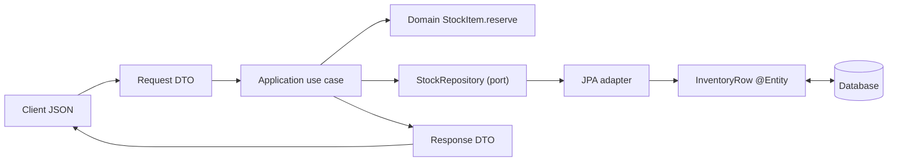

# Phân biệt đối tượng miền, entity lưu trữ và DTO

## 1. Vì sao cùng một “đơn hàng” lại có nhiều kiểu đối tượng?

Một API Java nhận yêu cầu đặt hàng, kiểm tra tồn kho, lưu dữ liệu và trả kết quả. Trên đường đi, cùng một khái niệm “đơn hàng” có thể xuất hiện dưới ba hình thức:

- **Đối tượng miền** (*domain object*) biểu diễn quy tắc và trạng thái có ý nghĩa nghiệp vụ: đơn nào được xác nhận, khi nào được hủy, hàng còn đủ để đặt hay không.
- **Entity lưu trữ** (*persistence entity*) biểu diễn dữ liệu theo cấu trúc và cơ chế của hệ lưu trữ: khóa chính, cột, quan hệ, phiên bản, quy tắc ánh xạ của JPA.
- **DTO** (*Data Transfer Object*) là hình dạng dữ liệu dùng để giao tiếp qua một ranh giới: JSON từ client, kết quả API, thông điệp hoặc yêu cầu gửi sang hệ thống khác.

Ba đối tượng có thể chứa những trường giống nhau, chẳng hạn `id` và `status`, nhưng **đóng vai trò khác nhau**. Dùng một lớp Java cho cả ba vai trò là lựa chọn có thể chấp nhận trong một ứng dụng CRUD đơn giản; với nghiệp vụ phức tạp, nó dễ khiến quy tắc nghiệp vụ, lược đồ cơ sở dữ liệu và hợp đồng API bị gắn chặt vào nhau.

Bài học thuộc chương **Ranh giới ứng dụng** của **DATA_PERSISTENCE_FUNDAMENTALS**. Mục tiêu là tổ chức persistence boundary trong Java sao cho dữ liệu được đọc, thay đổi và lưu bền vững đúng quy tắc, đồng thời hỗ trợ giao dịch, kiểm soát đồng thời, tiến hóa schema, bảo mật và tối ưu truy vấn.

## 2. So sánh ba vai trò theo trách nhiệm

| Tiêu chí | Đối tượng miền | Entity lưu trữ | DTO |
| --- | --- | --- | --- |
| Câu hỏi chính | “Nghiệp vụ cho phép điều gì?” | “Dữ liệu được lưu và cập nhật thế nào?” | “Bên kia ranh giới cần nhận/gửi trường nào?” |
| Nội dung | Bất biến, hành vi, trạng thái miền, value object | Cột, khóa, quan hệ, ánh xạ ORM, phiên bản ghi | Trường đầu vào/đầu ra theo hợp đồng |
| Phụ thuộc mong muốn | Java và khái niệm nghiệp vụ | JPA/JDBC, schema, ORM hoặc storage SDK | Hợp đồng API, serialization, validation giao tiếp |
| Vòng đời | Theo use case hoặc aggregate | Theo persistence context/transaction hoặc thao tác lưu trữ | Theo request, response, message |
| Thay đổi khi nào? | Khi quy tắc nghiệp vụ đổi | Khi mô hình lưu trữ hoặc cách truy vấn đổi | Khi API, sự kiện hoặc nhu cầu bên nhận đổi |
| Ví dụ | `StockItem.reserve(2)` | `InventoryRow` có `@Entity`, `@Version` | `ReserveStockRequest`, `StockResponse` |

**Đối tượng miền** không nhất thiết phải là một *entity* theo nghĩa Domain-Driven Design (DDD). Trong miền có thể có:

- **Domain entity:** có danh tính ổn định xuyên thời gian, ví dụ `Order` với `orderId`.
- **Value object:** được nhận diện bằng giá trị, ví dụ `Money(currency, amount)` hoặc `Address`; thường thích hợp với tính bất biến (*immutability*).
- **Aggregate:** nhóm đối tượng được thay đổi qua một ranh giới giữ bất biến chung, ví dụ `Order` cùng các dòng hàng của nó.
- **Domain service:** quy tắc không thuộc tự nhiên vào một đối tượng đơn lẻ.

Từ **entity** trong `@Entity` của JPA chỉ nói rằng lớp được ORM quản lý như một đối tượng lưu trữ. Không phải mọi JPA entity đều là domain entity, và cũng không phải mọi domain entity phải có annotation JPA.

## 3. Nhìn toàn bộ đường đi của một request

Giả sử API đặt giữ sản phẩm có đường dẫn `POST /stock/{sku}/reserve`, nhận `quantity` và trả số lượng tồn kho còn lại. Một thiết kế có ranh giới rõ ràng:



Các trách nhiệm quan trọng:

1. **API boundary** giải mã JSON, xác thực người dùng, nhận dạng tenant, kiểm tra hình dạng dữ liệu và ánh xạ lỗi sang phản hồi.
2. **Application use case** quyết định thứ tự các bước và ranh giới transaction: đọc tồn kho, yêu cầu domain kiểm tra, ghi kết quả, tạo response.
3. **Domain** quyết định có được đặt giữ số lượng đã yêu cầu không; không cần biết SQL hay HTTP.
4. **Repository interface** diễn đạt yêu cầu lưu/đọc theo ngôn ngữ mà use case cần.
5. **Persistence adapter** chuyển dữ liệu giữa domain và hệ lưu trữ, thực hiện truy vấn và phối hợp với JPA.

Sơ đồ là một cách tổ chức thường dùng, **không phải quy tắc bắt buộc cho mọi ứng dụng**. Với hệ thống nhỏ, một mô hình dữ liệu dùng chung có thể giảm mã ánh xạ. Điều quan trọng là biết mình đang đánh đổi mức gắn kết nào và liệu bất biến, bảo mật, schema, API có thể tiến hóa an toàn hay không.

## 4. Đối tượng miền: mô tả hành vi và bảo vệ bất biến

Trong ví dụ tồn kho, đối tượng miền cần giữ bất biến **`available >= 0`** và không cho đặt giữ số lượng không hợp lệ. Nó không cần mang `@Table`, `@Column` hay `@JsonProperty`.

```java
import java.util.Objects;
import java.util.UUID;

public record StockItem(UUID id, UUID tenantId, String sku, int available) {
    public StockItem {
        Objects.requireNonNull(id, "id");
        Objects.requireNonNull(tenantId, "tenantId");
        Objects.requireNonNull(sku, "sku");
        if (sku.isBlank()) {
            throw new IllegalArgumentException("sku is blank");
        }
        if (available < 0) {
            throw new IllegalArgumentException("available must be >= 0");
        }
    }

    public StockItem reserve(int quantity) {
        if (quantity <= 0) {
            throw new IllegalArgumentException("quantity must be positive");
        }
        if (quantity > available) {
            throw new InsufficientStock(sku);
        }
        return new StockItem(id, tenantId, sku, available - quantity);
    }

    public static final class InsufficientStock extends RuntimeException {
        public InsufficientStock(String sku) {
            super("Not enough stock for " + sku);
        }
    }
}
```

Đặc điểm của mô hình:

- `reserve` là **hành vi nghiệp vụ**: các nơi gọi không cần tự lặp lại điều kiện kiểm tra tồn kho.
- Bản ghi `record` là bất biến ở mức đối tượng Java; phương thức trả **một trạng thái mới**, không thay đổi trạng thái của bản ghi cũ.
- `id` là danh tính ổn định của mặt hàng trong ứng dụng; `tenantId` và `sku` giúp đặt điều kiện truy cập. Việc sử dụng UUID làm ID là lựa chọn thiết kế, không phải yêu cầu của JPA hay DDD.
- Exception miền `InsufficientStock` nói về **kết quả nghiệp vụ**, không nói về `SQLException` hay mã HTTP.

### Điều domain object chưa tự bảo đảm

Nếu hai transaction cùng đọc `available = 1`, cả hai đều có thể gọi `reserve(1)` và tạo hai đối tượng mới có `available = 0`. Bất biến cục bộ của từng đối tượng vẫn đúng, nhưng **hai lần đặt giữ có thể bị ghi nhận cùng lúc** nếu tầng lưu trữ không kiểm soát cạnh tranh.

Domain bảo vệ quy tắc **trên trạng thái mà nó đã nhận**. Transaction, constraint và cơ chế đồng thời phải bảo vệ việc chuyển **từ trạng thái được đọc sang trạng thái được commit**.

Với giá trị tiền, thời gian hoặc tỷ lệ, hãy dùng kiểu phù hợp cho miền (ví dụ `BigDecimal` kết hợp mã tiền tệ và quy tắc làm tròn), thay vì để dữ liệu nội bộ bị chi phối bởi biểu diễn JSON hoặc kiểu cột một cách ngẫu nhiên.

## 5. Entity lưu trữ: phục vụ cơ chế persistence

Cùng dữ liệu tồn kho có thể được lưu trong bảng PostgreSQL:

```sql
CREATE TABLE inventory (
    id UUID PRIMARY KEY,
    tenant_id UUID NOT NULL,
    sku VARCHAR(64) NOT NULL,
    available INTEGER NOT NULL CHECK (available >= 0),
    version BIGINT NOT NULL DEFAULT 0,
    CONSTRAINT uq_inventory_tenant_sku UNIQUE (tenant_id, sku)
);
```

Các trường `id`, `tenant_id` và `sku` mô tả danh tính và phạm vi dữ liệu; `CHECK` là lớp bảo vệ tại database. Cột `version` phục vụ **optimistic locking**, giúp phát hiện hai transaction cùng sửa một phiên bản cũ.

Ví dụ entity JPA cho bảng đó:

```java
import jakarta.persistence.Column;
import jakarta.persistence.Entity;
import jakarta.persistence.Id;
import jakarta.persistence.Table;
import jakarta.persistence.UniqueConstraint;
import jakarta.persistence.Version;
import java.util.UUID;

@Entity
@Table(
    name = "inventory",
    uniqueConstraints = @UniqueConstraint(
        name = "uq_inventory_tenant_sku",
        columnNames = {"tenant_id", "sku"}
    )
)
public class InventoryRow {
    @Id
    @Column(name = "id", nullable = false)
    private UUID id;

    @Column(name = "tenant_id", nullable = false, updatable = false)
    private UUID tenantId;

    @Column(name = "sku", length = 64, nullable = false, updatable = false)
    private String sku;

    @Column(name = "available", nullable = false)
    private int available;

    @Version
    @Column(name = "version", nullable = false)
    private long version;

    protected InventoryRow() {
        // Constructor dùng cho JPA.
    }

    public UUID id() { return id; }
    public UUID tenantId() { return tenantId; }
    public String sku() { return sku; }
    public int available() { return available; }
    public long version() { return version; }

    public void setAvailable(int nextAvailable) {
        this.available = nextAvailable;
    }
}
```

Entity lưu trữ chứa những chi tiết riêng của tầng persistence:

- `@Entity`, `@Id`, `@Column`, `@Version` là hợp đồng với JPA provider.
- `version` là metadata quản lý xung đột của một hàng; không nhất thiết là khái niệm nghiệp vụ cần công bố cho người dùng.
- `InventoryRow` có constructor được JPA truy cập và các trường để provider theo dõi thay đổi (*dirty checking*).
- Bảng có constraint `CHECK` và `UNIQUE` để bảo vệ dữ liệu ngay cả khi một đường ghi khác không đi qua domain method.

Đoạn mã minh họa **đọc và cập nhật một bản ghi đã tồn tại**. Nó chưa có constructor hoặc factory phục vụ insert bản ghi mới; đường tạo mới cần quyết định ai cấp ID, thời điểm khởi tạo `version` và cách gán các trường bắt buộc.

### Vòng đời entity của JPA khác vòng đời domain object

Một entity JPA có thể ở trạng thái *new/transient*, *managed*, *detached* hoặc *removed*. Khi `InventoryRow` đang được quản lý trong một persistence context, JPA có thể phát SQL `UPDATE` ở lúc flush/commit dù ứng dụng chỉ thay một thuộc tính Java. Đọc lại từ một context khác có thể tạo object Java khác nhưng cùng hàng database.

Một domain `StockItem` không tự có khái niệm “đang managed bởi EntityManager”, “lazy proxy” hay “flush”. Nó được tạo từ dữ liệu đọc ở thời điểm nào thì mang trạng thái nghiệp vụ của thời điểm đó.

## 6. DTO: mô tả dữ liệu đi qua biên API

Giả sử client chỉ được yêu cầu số lượng muốn đặt giữ. Request DTO không nên nhận các trường nội bộ như `available`, `version`, `tenantId`, `isAdmin` hay khóa định danh do server kiểm soát.

```java
public record ReserveStockRequest(int quantity) {}

public record StockResponse(
        String sku,
        int availableAfterReservation) {}
```

API có thể nhận:

```json
{
  "quantity": 2
}
```

và trả:

```json
{
  "sku": "LAPTOP-1",
  "availableAfterReservation": 6
}
```

Các DTO trên là **hợp đồng giao tiếp**, không phải nguồn xác thực bất biến cuối cùng:

- Tầng API có thể kiểm tra `quantity > 0` sớm để trả lỗi đầu vào rõ ràng; domain vẫn phải kiểm tra khi thực thi nghiệp vụ.
- `tenantId` phải đến từ **ngữ cảnh xác thực đáng tin cậy**; không lấy tenant tùy ý từ JSON rồi coi đó là quyền truy cập.
- Không trả một JPA entity trực tiếp chỉ vì nó “đã có đủ các trường”: điều đó có thể lộ thông tin nội bộ hoặc làm thay đổi API ngoài ý muốn khi bảng thêm cột.
- DTO được version hoặc tiến hóa theo hợp đồng API độc lập với tiến hóa schema.

**Request DTO và Response DTO nên tách nhau khi quyền ghi/đọc khác nhau.** Chẳng hạn client được gửi `quantity` nhưng không được gửi `availableAfterReservation`; một DTO dùng chung có thể dẫn tới lỗi mass assignment khi framework tự bind mọi trường.

### Validation ở ba vị trí

| Vị trí | Ví dụ cần kiểm tra | Vì sao |
| --- | --- | --- |
| DTO/API | `quantity` là số nguyên dương, JSON có định dạng hợp lệ | Phản hồi nhanh và thân thiện cho request sai |
| Domain | `quantity <= available`, trạng thái sản phẩm cho phép đặt | Bảo vệ quy tắc nghiệp vụ ở mọi đường gọi |
| Database | `CHECK (available >= 0)`, khóa duy nhất, optimistic locking | Ngăn dữ liệu sai khi có ghi cạnh tranh hoặc đường ghi khác |

Không nên vì đã có validation trong DTO mà bỏ kiểm tra domain; cũng không nên vì có constraint DB mà bỏ giải thích lỗi hợp lý ở API.

## 7. Mapper: chuyển dữ liệu tại điểm gặp nhau của các ranh giới

Một mapper cho phép persistence entity cung cấp dữ liệu cho domain mà không kéo annotation JPA vào domain:

```java
public final class StockMapper {
    private StockMapper() {}

    public static StockItem toDomain(InventoryRow row) {
        return new StockItem(
                row.id(), row.tenantId(), row.sku(), row.available());
    }

    public static void copyChanges(StockItem item, InventoryRow row) {
        if (!row.id().equals(item.id())
                || !row.tenantId().equals(item.tenantId())
                || !row.sku().equals(item.sku())) {
            throw new IllegalArgumentException("Stock identity mismatch");
        }
        row.setAvailable(item.available());
    }
}
```

Trong ví dụ, mapper chỉ chép **thuộc tính nghiệp vụ được phép thay đổi**: số lượng còn. Nó không đụng tới `version` để JPA quản lý optimistic locking, không ghi lại `tenantId` hay `sku` và không nhận giá trị ghi trực tiếp từ request DTO.

Ánh xạ không phải lúc nào cũng là chép từng trường một:

- Một domain value object như `Money` có thể được lưu thành hai cột `amount` và `currency`.
- Một domain aggregate có thể được lưu ở nhiều bảng, với thứ tự đọc/ghi phải giữ bất biến và khóa ngoại.
- Response DTO có thể gộp dữ liệu hoặc chỉ chọn một phần; không cần phản ánh đúng cấu trúc bảng.
- Có thể dùng MapStruct hoặc mapper thủ công. Với quy tắc ánh xạ quan trọng, mã tường minh dễ kiểm soát hơn ánh xạ tự động theo tên trường một cách không chọn lọc.

**Mapper không nên âm thầm thực hiện I/O hoặc commit transaction.** Nếu một phép map kích hoạt lazy-loading và truy vấn DB, chi phí sẽ khó đoán. Hãy thiết kế repository trả đủ dữ liệu cần cho use case và kiểm soát việc fetch.

## 8. Repository port và persistence adapter

Tầng ứng dụng có thể làm việc qua một interface nhỏ, dùng ngôn ngữ miền:

```java
import java.util.Optional;
import java.util.UUID;

public interface StockRepository {
    Optional<StockItem> find(UUID tenantId, String sku);
    void save(StockItem stock);
}
```

Adapter JPA triển khai interface, còn domain object không phải biết JPQL hay `EntityManager`:

```java
import jakarta.persistence.EntityManager;
import java.util.Optional;
import java.util.UUID;
import org.springframework.stereotype.Repository;

@Repository
public final class JpaStockRepository implements StockRepository {
    private final EntityManager entityManager;

    public JpaStockRepository(EntityManager entityManager) {
        this.entityManager = entityManager;
    }

    @Override
    public Optional<StockItem> find(UUID tenantId, String sku) {
        return entityManager.createQuery(
                    "SELECT r FROM InventoryRow r " +
                    "WHERE r.tenantId = :tenantId AND r.sku = :sku",
                    InventoryRow.class)
                .setParameter("tenantId", tenantId)
                .setParameter("sku", sku)
                .getResultStream()
                .findFirst()
                .map(StockMapper::toDomain);
    }

    @Override
    public void save(StockItem item) {
        InventoryRow row = entityManager.find(InventoryRow.class, item.id());
        if (row == null) {
            throw new IllegalStateException("Stock was removed");
        }
        StockMapper.copyChanges(item, row);
        // Managed row sẽ được flush trong transaction do tầng ứng dụng quản lý.
    }
}
```

Ví dụ có hai giả định:

1. `find` và `save` được gọi trong **cùng một transaction/persistence context**. Nếu sử dụng đối tượng domain được giữ lại qua nhiều transaction, phải bổ sung kiểm tra phiên bản và điều kiện cập nhật phù hợp; không thể dựa vào `EntityManager.find(...)` lúc save để chứng minh trạng thái domain cũ chưa bị thay đổi.
2. Domain object `StockItem` chỉ có ID do repository cung cấp. Adapter kiểm tra `tenantId` và `sku` khi ghi; API vẫn phải xác thực tenant từ ngữ cảnh bảo mật. Với hệ thống đa tenant nghiêm ngặt có thể cần chính sách truy cập ở database, filter hoặc tách schema.

Trong một ứng dụng dùng JDBC trực tiếp, adapter có thể thay `EntityManager` bằng `PreparedStatement` và các câu SQL, trong khi `StockItem`, DTO và hợp đồng use case vẫn được giữ. Đó là một lợi ích của ranh giới được thiết kế rõ.

## 9. Application use case: tổ chức transaction và trả DTO

Use case định nghĩa **thứ tự thực thi**, không chuyển quy tắc tồn kho thành các biểu thức SQL rải rác trong controller:

```java
import java.util.UUID;
import org.springframework.stereotype.Service;
import org.springframework.transaction.annotation.Transactional;

@Service
public final class ReserveStockUseCase {
    private final StockRepository repository;

    public ReserveStockUseCase(StockRepository repository) {
        this.repository = repository;
    }

    @Transactional
    public StockResponse reserve(
            UUID authenticatedTenantId, String sku, ReserveStockRequest request) {
        if (request == null) {
            throw new IllegalArgumentException("Missing request");
        }
        StockItem stock = repository.find(authenticatedTenantId, sku)
                .orElseThrow(() -> new IllegalArgumentException("Stock not found"));

        StockItem reserved = stock.reserve(request.quantity());
        repository.save(reserved);
        return new StockResponse(reserved.sku(), reserved.available());
    }
}
```

Khi Spring quản lý transaction thực sự cho lời gọi này, chuỗi xử lý là:

```text
HTTP request
  -> giải mã và kiểm tra Request DTO
  -> lấy tenant ID từ security context
  -> gọi ReserveStockUseCase (transaction bắt đầu)
     -> repository đọc hàng inventory
     -> mapper tạo StockItem
     -> StockItem.reserve(quantity) bảo vệ quy tắc nghiệp vụ
     -> repository nạp managed InventoryRow và cập nhật available
     -> transaction flush + COMMIT
  -> trả StockResponse
```

Phương thức Java tạo `StockResponse` trước khi Spring thực hiện commit ở ranh giới interceptor; **caller thông thường chỉ nhận kết quả sau khi transaction interceptor kết thúc thành công**. Nếu flush/commit thất bại, framework có thể ném exception thay vì trả response thành công. Cần kiểm tra đúng transaction manager, đường gọi qua proxy/interceptor và cấu hình rollback. Một lời gọi nội bộ không đi qua proxy trong một số cấu hình Spring có thể bỏ qua annotation `@Transactional`.

### Khi hai request cùng đặt giữ một sản phẩm

Giả sử tồn kho ban đầu là 1, hai transaction T1 và T2 cùng đọc 1, đều tạo domain `StockItem(available=0)`:

| Bước | T1 | T2 |
| --- | --- | --- |
| 1 | Đọc `available=1, version=4` qua JPA | — |
| 2 | — | Đọc `available=1, version=4` qua JPA |
| 3 | Domain trả tồn kho mới bằng 0 | Domain trả tồn kho mới bằng 0 |
| 4 | Flush cập nhật hàng, tăng `version` → 5; commit | — |
| 5 | — | Thử flush dựa trên version 4 → xung đột optimistic locking |

Với `@Version` và provider hỗ trợ đúng, T2 không thể âm thầm ghi đè cập nhật của T1 như thể không có cạnh tranh. Nó có thể nhận `OptimisticLockException` hoặc exception được framework chuyển đổi; transaction phải rollback. Một lần thử lại **toàn bộ use case** sẽ đọc tồn kho 0 và từ chối đặt giữ.

Trong thực tế, thứ tự T1/T2 có thể đảo ngược. Một trong hai có thể phải chờ khóa rồi thất bại khi kiểm tra phiên bản; điều cần kiểm tra là **kết quả được commit**, không phải một thứ tự thread được giả định.

**Lưu ý:** `@Version` bảo vệ xung đột trên hàng entity; nó không tự khử trùng lặp các yêu cầu nghiệp vụ. Nếu cùng request đến hai lần khi tồn kho còn nhiều, cả hai lần có thể thành công nếu không có cơ chế **idempotency key** hoặc business constraint. Với nghiệp vụ đặt giữ cần lưu phiếu đặt chỗ, hãy ghi phiếu đó và trừ kho trong cùng transaction, bảo vệ bằng định danh thao tác thích hợp.

### Phương án SQL cập nhật có điều kiện

Với trường hợp chỉ cần giảm một số lượng trên một hàng, persistence adapter còn có thể thực hiện một câu SQL nguyên tử:

```sql
UPDATE inventory
SET available = available - :quantity,
    version = version + 1
WHERE tenant_id = :tenant_id
  AND sku = :sku
  AND available >= :quantity;
```

Nếu số hàng bị cập nhật là 0, repository cần phân biệt “không tồn tại” với “không đủ” theo hợp đồng. Đây là lựa chọn thích hợp khi ưu tiên cập nhật nguyên tử tại database, nhưng **logic nghiệp vụ và contract của repository** phải nói rõ hành vi để các luồng khác không tự trừ kho theo cách không nhất quán. Nếu dùng bulk update cùng JPA, chú ý nó có thể bỏ qua trạng thái managed entity và cơ chế optimistic locking tự động; cần quản lý version, flush/clear và persistence context cho đúng.

## 10. ID, equality và version không phải lúc nào cũng thuộc cùng một mô hình

Ba lớp có thể dùng định danh khác nhau vì phục vụ ranh giới khác nhau:

| Dữ liệu | Domain | Persistence | DTO |
| --- | --- | --- | --- |
| Danh tính | `StockItem.id` hoặc khóa miền (`tenantId`, `sku`) | Khóa chính `id`, unique (`tenant_id`, `sku`) | Chỉ đưa ID ra khi hợp đồng API cần |
| Phiên bản | Có thể ẩn khỏi domain, hoặc là concurrency token có chủ đích | `version`, `@Version`, điều kiện `WHERE version = ?` | Có thể lộ dạng ETag/If-Match cho cập nhật có điều kiện |
| Thời gian | Thời điểm nghiệp vụ như “đã xác nhận lúc nào” | `created_at`, `updated_at`, audit columns | ISO-8601 hoặc định dạng theo API |
| Quan hệ | Domain reference/aggregate member | Khóa ngoại, join table, lazy association | ID hoặc cấu trúc lồng theo nhu cầu client |

### Cẩn trọng với equality

- Với **value object**, so sánh theo giá trị thường phù hợp.
- Với **domain entity**, danh tính ổn định thường quan trọng hơn toàn bộ thuộc tính có thể thay đổi; hai trạng thái khác nhau của cùng đơn hàng vẫn thuộc cùng một entity miền.
- Với **JPA entity**, cách viết `equals`/`hashCode` cần cân nhắc vòng đời entity, khóa được sinh sau persist, proxy và collection. Không mặc định dùng tất cả trường hoặc annotation tạo `equals` tự động cho entity có quan hệ lồng nhau.
- Với **DTO**, equality nếu có thường theo các trường được truyền, nhưng DTO không phải nguồn quyết định identity nghiệp vụ.

Nếu domain chọn `record StockItem`, record mặc định so sánh tất cả trường, bao gồm `available`. Điều đó phù hợp nếu coi record là **snapshot trạng thái**; nếu cần mô hình entity mutable với equality theo ID, hãy thiết kế lớp domain khác. Không suy từ tên “entity” rằng mọi object đều phải có cùng quy tắc equality.

## 11. Những ranh giới dễ bị phá vỡ

### 11.1. Trả trực tiếp JPA entity ra JSON

```java
// Ví dụ cần cân nhắc kỹ:
public InventoryRow getStock(UUID id) {
    return entityManager.find(InventoryRow.class, id);
}
```

Khi controller serialize trực tiếp entity:

- Thêm cột nội bộ vào entity có thể bất ngờ làm API thay đổi.
- Quan hệ lazy có thể sinh thêm truy vấn, lỗi `LazyInitializationException` hoặc vòng tham chiếu khi serialize.
- Những trường như thông tin nội bộ, version, audit hoặc dữ liệu nhạy cảm có thể bị công bố ngoài ý muốn.
- Client có thể bị gắn chặt với chi tiết schema/ORM, khiến migration khó triển khai.

Không phải lúc nào việc trả entity cũng tạo lỗi ngay lập tức; vấn đề là **hợp đồng API không được quyết định chủ yếu bởi mapping lưu trữ**.

### 11.2. Bind request DTO thẳng vào entity lưu trữ

```java
// Không cho framework nhận toàn bộ InventoryRow trực tiếp từ JSON
// rồi gọi entityManager.merge(row) khi client chỉ được đổi quantity.
```

Nếu client gửi thêm `tenantId`, `available`, `version`, `role` hoặc `isApproved` và framework tự gán, ứng dụng có thể gặp **mass assignment** hoặc cập nhật trường không được phép. Hãy dùng request DTO có những trường đúng quyền ghi, kiểm tra thông tin xác thực và gọi hành vi miền được kiểm soát.

### 11.3. Đặt mọi rule vào controller hoặc SQL

Khi controller tự kiểm tra `available`, tự tính giá và tự thay đổi trạng thái bằng những đoạn SQL độc lập, các luồng API, batch và consumer dễ áp dụng quy tắc khác nhau. Một ranh giới miền giúp tập trung hành vi; đồng thời vẫn cần **constraint DB** bảo vệ ở nơi ghi.

### 11.4. Ép mọi báo cáo phải đi qua aggregate đầy đủ

Không phải query đọc nào cũng cần khôi phục một aggregate miền. Một danh sách 10.000 đơn hàng để hiển thị mã, tổng tiền và trạng thái có thể được lấy bằng **DTO projection** trực tiếp từ query có chọn cột phù hợp. Điều đó giảm tải mapping, bộ nhớ và truy vấn không cần thiết.

Mô hình miền đặc biệt hữu ích khi có **quyết định nghiệp vụ và thay đổi trạng thái**; DTO projection thường phù hợp cho luồng đọc có hình dạng kết quả rõ và không có hành vi miền.

## 12. Khi một aggregate liên quan nhiều bảng

Trong ví dụ thật, đơn hàng gồm `orders`, `order_lines`, địa chỉ giao hàng và trạng thái thanh toán. Đối tượng miền `Order` có thể giữ quy tắc “đơn đã hủy không được xác nhận lại”, “tổng tiền bằng tổng dòng hàng sau các quy tắc giảm giá” và “không tạo dòng hàng có số lượng âm”.

Phần lưu trữ có thể dùng:

```text
Domain aggregate:
Order
  - orderId
  - customerId
  - status
  - lines: List<OrderLine>
  - confirm(), cancel(), total()

Persistence:
orders(id, customer_id, status, version, ...)
order_lines(id, order_id, sku, quantity, unit_price, ...)

API:
CreateOrderRequest(customer-facing fields)
OrderDetailResponse(id, status, lines, total)
OrderListItemResponse(id, status, total)
```

Mapper phải xác định quan hệ nào được nạp, đối tượng nào được phép thay đổi và thứ tự persist phù hợp với khóa ngoại. Không nên bật cascade cho mọi quan hệ chỉ để “đỡ viết repository”: thao tác xóa/cập nhật xuyên aggregate có thể gây ảnh hưởng lớn nếu không hiểu ownership.

Với các hành vi cần thay đổi nhiều bảng trong cùng một ranh giới nhất quán, transaction nên bao trùm các ghi liên quan. Một aggregate **không đồng nghĩa** mọi dữ liệu liên quan phải nằm chung một transaction hoặc chung một process; quy tắc nghiệp vụ phải quyết định giới hạn thay đổi nguyên tử.

Nếu một use case cần cập nhật hai hệ lưu trữ độc lập, chỉ dùng `@Transactional` trên một JPA datasource không biến chúng thành một transaction phân tán. Có thể cần outbox, idempotency, reconciliation hoặc một giao thức phối hợp khác.

## 13. Mapping và query có tác động trực tiếp tới hiệu năng

Ranh giới sạch không có nghĩa mọi lần đọc/ghi đều phải tạo nhiều đối tượng và nhiều truy vấn. Những vấn đề cần đo:

| Vấn đề | Biểu hiện | Lựa chọn cải thiện |
| --- | --- | --- |
| **N+1 queries** | Lấy N đơn rồi lazy-load từng tập dòng hàng | Fetch join, entity graph, batch fetching hoặc query projection tùy trường hợp |
| **Over-fetching** | Chỉ cần tổng tiền nhưng tải mọi dòng hàng và quan hệ | Chọn cột cần thiết vào DTO read model |
| **Lazy loading ngoài transaction** | Exception hoặc mở thêm truy vấn khi serialize response | Hoàn thành query/mapping trong boundary được kiểm soát |
| **Chuyển đổi lặp** | Map qua nhiều object trung gian không cần thiết | Đơn giản hóa đường đọc nhưng giữ hợp đồng API rõ |
| **Cập nhật mất dữ liệu** | Detached entity merge ghi đè trạng thái mới | @Version, update có điều kiện, transaction rõ |
| **Batch lớn** | Persistence context giữ quá nhiều managed entity | Phân trang, batch flush/clear theo quy tắc, chọn đường ghi phù hợp |

Một query projection như:

```sql
SELECT sku, available
FROM inventory
WHERE tenant_id = :tenant_id
ORDER BY sku
LIMIT :limit OFFSET :offset;
```

có thể trả trực tiếp dữ liệu cho danh sách tồn kho nếu ứng dụng chỉ cần hiển thị. Tuy nhiên, phân trang theo `OFFSET` có thể tốn kém ở vị trí sâu và kết quả có thể dịch chuyển khi dữ liệu thay đổi; cân nhắc keyset pagination và yêu cầu nhất quán đọc của sản phẩm.

**Đừng tối ưu chỉ bằng số lượng class.** Hãy đo query count, thời gian transaction, memory allocation, latency và độ dễ tiến hóa trước khi quyết định có nên gộp hoặc tách mô hình.

## 14. Tiến hóa schema và API mà không phá quy tắc miền

Giả sử nhóm vận hành muốn bổ sung `reserved` và `damaged` vào mô hình lưu trữ để phân biệt số sản phẩm có thể bán:

```text
Trước:
inventory.available

Sau:
inventory.on_hand
inventory.reserved
inventory.damaged
available_to_sell = on_hand - reserved - damaged
```

Nếu cả API, domain và ORM đều trực tiếp coi `available` là một cột, thay đổi này có thể lan qua nhiều lớp cùng lúc. Với các ranh giới được thiết kế, adapter có thể chuyển từ dữ liệu lưu trữ mới sang thông tin miền `availableToSell` theo hợp đồng đã định, còn API có thể tiếp tục cung cấp trường ổn định cho client trong một thời gian.

Điều đó **không có nghĩa domain không cần thay đổi**. Khi nghiệp vụ định nghĩa lại thế nào là “có thể bán”, quy tắc miền cũng phải được xem xét. Mục tiêu của việc tách lớp là **đổi đúng nơi có trách nhiệm**, không che giấu thay đổi nghiệp vụ thật.

Quy trình triển khai thường cần:

1. **Expand:** thêm cột/bảng và cho phép phiên bản ứng dụng cũ, mới cùng hoạt động nếu có giai đoạn triển khai chồng lấp.
2. **Migrate/backfill:** chuyển dữ liệu theo quy tắc xác định, kiểm tra sai lệch.
3. **Switch:** ứng dụng mới sử dụng lược đồ mới; giữ API contract hoặc phát hành phiên bản API có chủ đích.
4. **Contract:** xóa cột/đường đọc cũ sau khi chắc chắn không còn phụ thuộc.

Trong lúc migration, cần xem xét ràng buộc dữ liệu, dữ liệu cũ, rollback của bản triển khai, index và query plan. Mapper là một điểm tập trung giúp quản lý chuyển đổi, nhưng migration vẫn phải bảo vệ dữ liệu dưới tải thực.

## 15. Kiểm thử từng lớp theo trách nhiệm

**Domain tests:** có thể chạy không cần database. Ví dụ `reserve(3)` từ tồn kho 8 trả 5; `reserve(0)` và `reserve(9)` bị từ chối; đối tượng cũ không bị sửa. Kiểm tra quy tắc mà mọi đường gọi phải tuân thủ.

**Mapper tests:** kiểm tra ánh xạ đúng trường, null, enum, thời gian, money và danh tính; không vô tình chép các trường nhạy cảm từ request vào entity. Nếu mapping tự động, cần phát hiện khi thêm trường không được phép.

**Persistence integration tests:** dùng DBMS thực tế hoặc môi trường tương thích về constraint/locking. Kiểm tra `UNIQUE`, `CHECK`, `@Version`, flush/commit, tenant scope, trạng thái transaction sau lỗi và khả năng rollback.

**API contract tests:** request không được gửi các trường nội bộ; response chỉ có các trường công bố; kiểm tra validation và ánh xạ lỗi nghiệp vụ.

**Concurrency tests:** dùng hai transaction trên hai connection cùng đọc và cố cập nhật một hàng; xác minh chỉ một cập nhật hợp lệ khi điều kiện xung đột, transaction thua không để lại thay đổi dở dang. Với retry của cùng một yêu cầu, cần thêm idempotency key và constraint nghiệp vụ, vì optimistic locking **không** tự phát hiện hai lần thực hiện cùng ý định.

### Những câu hỏi để đánh giá ranh giới

- Nếu đổi tên cột, cần sửa domain rule hay chỉ sửa adapter/mapper?
- Nếu đổi response JSON, vì sao phải thay entity lưu trữ?
- Nếu API mới chỉ đọc tổng hợp, có cần nạp toàn bộ aggregate không?
- Ai đảm bảo `tenantId` đến từ ngữ cảnh xác thực và mọi truy vấn được giới hạn đúng tenant?
- Nếu hai request cùng ghi, thành phần nào phát hiện version conflict và xử lý transaction?
- Nếu thêm một kênh gọi mới như job hoặc consumer, nó có thể tái sử dụng use case và quy tắc miền không?

## 16. Bài tập tự kiểm tra

**Tình huống 1.** Lớp `OrderEntity` có `@Entity`, `@OneToMany` và được controller trả nguyên vẹn dưới dạng JSON. Sau khi thêm cột `internalNote`, API bắt đầu trả trường đó. Ranh giới nào đang bị gắn chặt và sửa như thế nào?

**Tình huống 2.** Client gửi JSON gồm `quantity` và `tenantId`, rồi controller ánh xạ cả hai thẳng vào entity. Vì sao đây là rủi ro bảo mật? Tenant ID nên lấy từ đâu?

**Tình huống 3.** Hai transaction cùng gọi `StockItem.reserve(1)` với trạng thái ban đầu 1 và cùng thu được đối tượng mới có tồn kho 0. Đối tượng miền có sai không? Cơ chế nào phải phân xử khi lưu?

**Tình huống 4.** Một màn hình danh sách 5.000 đơn hàng chỉ cần ID, trạng thái và tổng tiền. Có bắt buộc phải tải toàn bộ aggregate `Order` và quan hệ dòng hàng không?

**Tình huống 5.** Nhóm dùng `@Version` và cho rằng client gửi lại cùng request hai lần sẽ chắc chắn chỉ tạo một phiếu đặt hàng. Nhận định này đúng không?

**Tình huống 6.** Schema thay đổi từ một cột `available` sang ba cột `on_hand`, `reserved` và `damaged`. Những lớp nào cần xem xét và làm sao triển khai mà không phá khách hàng dùng API cũ?

**Tình huống 7.** Một phương thức repository trả entity đang `managed`, nhưng sau khi ra khỏi transaction, controller mới truy cập collection `orderLines` được đánh dấu lazy. Có thể xảy ra điều gì?

**Gợi ý trả lời:**

1. API đang lộ trực tiếp persistence entity. Dùng response DTO quy định rõ trường được công bố, mapping trong boundary có kiểm soát.
2. Client có thể tự chọn tenant và thay đổi dữ liệu không thuộc quyền. Tenant lấy từ ngữ cảnh xác thực đã được kiểm chứng; request DTO chỉ chứa trường được phép gửi.
3. Domain bảo vệ quy tắc trên mỗi snapshot, còn transaction và database phải xử lý cạnh tranh bằng version check, khóa hoặc cập nhật có điều kiện.
4. Không. DTO projection hoặc query read model có thể tiết kiệm query, dữ liệu tải và bộ nhớ.
5. Sai. `@Version` phát hiện xung đột ghi đồng thời trên một entity; retry cùng ý định cần định danh thao tác và ràng buộc dữ liệu phù hợp.
6. Adapter và mapper chắc chắn cần xem xét; domain có thể cần đổi nếu ngữ nghĩa nghiệp vụ đổi. Dùng migration nhiều bước và API contract có chủ đích.
7. Có thể phát sinh truy vấn ngoài ranh giới hoặc lỗi lazy initialization; cần fetch/mapping dữ liệu cần dùng trong transaction phù hợp hoặc dùng projection.

## Kết luận

**Đối tượng miền** giữ quy tắc và bất biến nghiệp vụ; **entity lưu trữ** phục vụ mapping, identity và kiểm soát thay đổi ở database; **DTO** định nghĩa dữ liệu được nhận hoặc công bố qua ranh giới giao tiếp. Mapper và repository adapter kết nối các vai trò ấy, còn application use case điều phối transaction và chuyển trạng thái nghiệp vụ.

Khi thiết kế persistence trong Java, hãy xác định **ai được phép thay đổi dữ liệu nào**, **bất biến được kiểm tra ở đâu**, **xung đột được phát hiện khi nào** và **hợp đồng API có cần biết cấu trúc bảng không**. Tách mô hình là công cụ giúp trả lời những câu hỏi đó rõ ràng; mức độ tách nên phù hợp với độ phức tạp nghiệp vụ, yêu cầu bảo mật, khả năng tiến hóa schema và chi phí hiệu năng thực tế.
