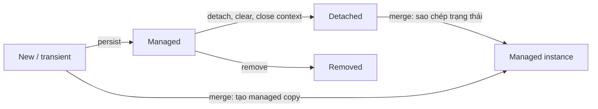

# Đối tượng được quản lý và đối tượng đã tách khỏi ngữ cảnh lưu trữ

> **Chương:** Ranh giới ứng dụng  
> **Phạm vi:** `DATA_PERSISTENCE_FUNDAMENTALS` — từ mô hình dữ liệu, lược đồ, chỉ mục và giao dịch đến thiết kế ranh giới persistence cho Java, kiểm soát đồng thời, xử lý lỗi kết nối, tiến hóa schema, bảo mật và hiệu năng.

## Mục tiêu học tập

Sau bài này, người học có thể:

1. Giải thích **persistence context**, vòng đời entity JPA và sự khác nhau giữa **managed** và **detached**.
2. Dự đoán khi nào thay đổi trên object Java được theo dõi và đồng bộ xuống cơ sở dữ liệu thông qua **dirty checking**, `flush` và `commit`.
3. Sử dụng `EntityManager.find`, `persist`, `detach`, `clear` và `merge` đúng ngữ nghĩa; hiểu tại sao `merge` trả về object managed khác với đối tượng truyền vào.
4. Thiết kế ranh giới transaction và DTO cho service/API, xử lý **lazy loading**, các truy vấn N+1 và dữ liệu không còn được quản lý.
5. Bảo vệ cập nhật đồng thời bằng `@Version`, tránh ghi đè dữ liệu cũ, mass assignment và các tác dụng phụ khi nhận entity từ phía client.

## 1. Một object Java chưa chắc đang được cơ sở dữ liệu theo dõi

Trong ứng dụng Java, cùng một lớp `CustomerAccount` có thể biểu diễn một hàng của bảng `customer_account`. Nhưng có sự khác nhau quan trọng giữa:

- **Đối tượng Java thông thường:** chỉ tồn tại trong bộ nhớ của tiến trình. Gọi setter không tự tạo SQL.
- **Entity được quản lý (*managed entity*):** object đang liên kết với một **persistence context** của JPA; provider theo dõi trạng thái để có thể đồng bộ các thay đổi khi flush.
- **Entity đã tách (*detached entity*):** entity từng được quản lý nhưng không còn thuộc persistence context đó; thay đổi sau khi tách không tự động được đồng bộ xuống DB.

Ví dụ:

```java
// Bên trong transaction có EntityManager đang hoạt động:
CustomerAccount managed =
        entityManager.find(CustomerAccount.class, 101L);

managed.rename("Tên mới"); // JPA có thể phát hiện thay đổi khi flush.

entityManager.detach(managed);
managed.rename("Tên sau khi tách");
// Thay đổi sau detach không còn được context này theo dõi.
```

Điều đó có ý nghĩa lớn với ranh giới ứng dụng. Nếu trả entity từ service ra controller, đưa entity vào cache, gửi nó sang worker khác hoặc giữ lại qua nhiều request, object có thể đã **detached**. Phương thức `setName` vẫn chạy như Java thông thường, nhưng không còn bảo đảm thay đổi được ghi tự động.

Ngược lại, khi entity **đang managed**, một thay đổi ngoài ý muốn trên field có thể bị flush thành SQL ngay cả khi code không gọi `repository.save(...)`. Vì thế hiểu đúng trạng thái entity còn giúp tránh cập nhật ngoài ý định.

## 2. Persistence context là gì?

**Persistence context** là ngữ cảnh JPA dùng để quản lý tập entity và danh tính của chúng trong một phạm vi tồn tại nhất định. Có thể hình dung nó như một **identity map** (với một khóa định danh DB của một entity type, context thường quản lý một instance tương ứng) cùng cơ chế theo dõi trạng thái.

Ví dụ trong một persistence context:

```java
CustomerAccount a =
        entityManager.find(CustomerAccount.class, 101L);
CustomerAccount b =
        entityManager.find(CustomerAccount.class, 101L);

System.out.println(a == b); // Thường là true trong cùng context.
```

Lần `find` thứ hai không nhất thiết chạy lại SQL nếu entity đã có trong persistence context. Đây là **bộ nhớ đệm cấp một (first-level cache)**, không đồng nghĩa với cache dùng chung giữa các request/instance.

**Cần phân biệt ba khái niệm:**

| Khái niệm | Trách nhiệm | Không nên nhầm với |
| --- | --- | --- |
| Object/entity Java | Giữ trạng thái và hành vi domain được mô hình hóa | Một bản ghi tự đồng bộ ở mọi nơi trong ứng dụng. |
| Persistence context | Quản lý danh tính và trạng thái entity; lên lịch đồng bộ thay đổi | Transaction hay kết nối DB được giữ vĩnh viễn. |
| Database transaction | Xác định đơn vị commit/rollback và mức cô lập cho các thao tác DB | Vòng đời bộ nhớ của mọi object Java. |

Trong trường hợp **transaction-scoped persistence context** thông dụng với Spring/JPA, context thường gắn với transaction đang chạy. Sau khi transaction kết thúc, các entity được trả ra ngoài thường không còn managed bởi context đó. Tuy nhiên, JPA còn hỗ trợ **extended persistence context**; Spring có thể bật **Open EntityManager in View (OSIV)** để kéo dài context qua xử lý web. Vì vậy không nên tuyên bố rằng “cứ hết phương thức `@Transactional` thì mọi entity chắc chắn detached” nếu chưa biết cấu hình thực tế.

OSIV có thể làm một quan hệ lazy còn tải được khi render HTTP response, nhưng cũng dễ che giấu truy vấn DB ngoài service, N+1 và ranh giới dữ liệu không rõ. Thiết kế nên xây dựng dữ liệu trả về **bên trong service transaction**, rồi trả DTO thay vì dựa vào OSIV.

## 3. Các trạng thái entity trong JPA

Một entity JPA đi qua các trạng thái chính sau:

| Trạng thái | Có persistence context theo dõi? | Đặc điểm | Cách thường gặp |
| --- | --- | --- | --- |
| **New / transient** | Không | Object mới, chưa được persistence context quản lý. | `new CustomerAccount(...)` |
| **Managed / persistent** | Có | JPA có thể phát hiện sửa đổi và đồng bộ dữ liệu. | `find`, `persist`, kết quả `merge` |
| **Detached** | Không | Có danh tính entity từ lúc còn managed nhưng không được context hiện tại theo dõi. | `detach`, `clear`, đóng context |
| **Removed** | Có trong context cho đến khi xử lý xóa theo quy tắc lifecycle | Được đánh dấu xóa; SQL `DELETE` thường thực hiện khi flush. | `remove` trên entity managed |

Sơ đồ đơn giản:



Hai điểm cần nhớ:

1. `merge(detached)` **không gắn lại chính object detached**; nó trả về một object managed và sao chép trạng thái phù hợp vào đó. Object đối số thường vẫn detached.
2. Object vừa được deserialize từ JSON với trường `id = 101` **chưa chắc là detached entity** theo nghĩa vòng đời JPA. Nó có thể chỉ là một object mới do mapper tạo. Chỉ có `id` không làm object trở thành managed.

Trạng thái lifecycle JPA cũng không đồng nghĩa với trạng thái SQL của transaction. Ví dụ entity đã managed và setter đã chạy, nhưng trước khi flush hoặc commit, DB có thể chưa thấy SQL `UPDATE`.

## 4. Managed entity và cơ chế dirty checking

Trong một transaction, JPA provider theo dõi thay đổi của các entity đang managed. Khi **flush**, provider xác định những thao tác ghi cần đồng bộ với DB: `INSERT` cho entity mới được persist, `UPDATE` cho entity thay đổi, `DELETE` cho entity removed. Cơ chế phát hiện thay đổi thường gọi là **dirty checking**.

```java
@Transactional
public void renameCustomer(long customerId, String newName) {
    CustomerAccount account =
            entityManager.find(CustomerAccount.class, customerId);
    if (account == null) {
        throw new IllegalArgumentException("Customer not found");
    }

    account.rename(newName);
    // Không bắt buộc gọi repository.save(account) ở đây.
    // Trước/đến commit, JPA flush những thay đổi cần thiết.
}
```

Đoạn minh họa giả định `entityManager` được quản lý trong cùng transaction, `rename` thật sự làm entity thay đổi và không có cấu hình chặn ghi. Có thay đổi object **không có nghĩa SQL được gửi ngay tại setter**. Thời điểm phát SQL và chi tiết các cột trong `UPDATE` phụ thuộc JPA provider, flush mode và cấu hình.

### 4.1. `flush` khác `commit`

| Hành động | Điều được thực hiện | Điều không được bảo đảm |
| --- | --- | --- |
| Đổi thuộc tính trên managed entity | Thay đổi object đang được theo dõi. | Chưa chắc SQL đã được phát. |
| `entityManager.flush()` | Yêu cầu đồng bộ các thay đổi đang chờ với database trong transaction. | **Chưa commit**; transaction sau đó vẫn có thể rollback. |
| `COMMIT` | Kết thúc transaction thành công theo cơ chế DB; thường có flush cần thiết trước đó. | Không tự xác nhận tác động ở hệ thống ngoài DB như email/HTTP. |
| `ROLLBACK` | Hoàn tác các thay đổi DB chưa commit thuộc transaction. | Không tự khôi phục giá trị field trên object Java về trạng thái trước đó. |

Khi `flush` báo vi phạm unique/FK hoặc optimistic lock, transaction có thể cần rollback; đừng bắt exception rồi tiếp tục sử dụng context như không có gì xảy ra. Trong Spring, lỗi flush có thể phát sinh **khi phương thức kết thúc và transaction manager commit**, ngoài vùng `try/catch` trong thân phương thức.

### 4.2. Khi nào thay đổi không được lưu?

```java
CustomerAccount account = entityManager.find(CustomerAccount.class, 101L);
entityManager.detach(account);

account.rename("Tên không được quản lý");

// Không có SQL UPDATE tự động từ context này chỉ vì account đổi tên.
```

Sau `detach`, provider không theo dõi các thay đổi tiếp theo của object đó. Tương tự, khi một transaction-scoped persistence context kết thúc và object trở thành detached, thay đổi từ controller ở ngoài context thường không ghi xuống DB.

**Lưu ý an toàn:** nếu một entity đã bị sửa khi còn managed nhưng chưa flush, sau đó `detach`/`clear`, các thay đổi chưa đồng bộ có thể bị bỏ khỏi context. Nếu cần lưu trước khi tách, dùng `flush` trong transaction phù hợp; nếu cần bỏ sửa đổi, rollback hoặc dùng workflow hủy thay đổi rõ ràng.

## 5. Cách entity chuyển thành detached

Các tình huống thường gặp:

| Tình huống | Hệ quả |
| --- | --- |
| `entityManager.detach(entity)` | Entity đó không còn managed bởi context, theo quy tắc cascade detach nếu có cấu hình. |
| `entityManager.clear()` | Tất cả entity managed trong context bị detach; các thay đổi chưa flush có thể không được đồng bộ. |
| Đóng `EntityManager`/context | Entity do context đó quản lý trở thành detached. |
| Trả entity qua service rồi context transaction-scoped kết thúc | Entity trả về thường detached; phụ thuộc cách tổ chức context/OSIV. |
| Serialize entity ra JSON, chuyển qua queue, lưu session | Object nhận lại không giữ liên kết với context ban đầu; không được xem là managed. |
| Chuyển object sang thread khác | Không được mang `EntityManager` hoặc managed entity qua thread rồi giả định thread khác dùng cùng context an toàn. |

Không nên đồng nhất `detach` với `remove`: **detach ngừng quản lý object**, còn **remove là thao tác yêu cầu xóa hàng DB**. Tương tự, `clear` không tương đương `rollback`: nó thay đổi trạng thái context nhưng không thay thế việc kết thúc transaction hợp lệ.

Một entity detached vẫn có thể chứa các trường đã được tải, dùng để hiển thị hoặc thực hiện tính toán thuần Java. Tuy nhiên dữ liệu có thể **đã cũ** so với DB, nhất là khi một request khác vừa cập nhật hàng tương ứng.

## 6. Thiết kế một ranh giới service rõ ràng với Spring JPA

Ví dụ ứng dụng có bảng:

```sql
CREATE TABLE customer_account (
    id BIGINT PRIMARY KEY,
    display_name VARCHAR(200) NOT NULL,
    active BOOLEAN NOT NULL,
    version BIGINT NOT NULL DEFAULT 0
);
```

`version` sẽ dùng cho optimistic locking; tên cột và DDL chỉ để minh họa, cần khớp với migration và provider thực tế.

### 6.1. Entity có hành vi nghiệp vụ

Trong file `CustomerAccount.java`:

```java
import jakarta.persistence.Column;
import jakarta.persistence.Entity;
import jakarta.persistence.Id;
import jakarta.persistence.Table;
import jakarta.persistence.Version;

@Entity
@Table(name = "customer_account")
public class CustomerAccount {
    @Id
    private Long id;

    @Version
    private Long version;

    @Column(name = "display_name", nullable = false, length = 200)
    private String displayName;

    @Column(name = "active", nullable = false)
    private boolean active;

    protected CustomerAccount() {
        // JPA cần constructor không tham số, ít nhất protected.
    }

    public Long getId() {
        return id;
    }

    public Long getVersion() {
        return version;
    }

    public String getDisplayName() {
        return displayName;
    }

    public boolean isActive() {
        return active;
    }

    public void rename(String candidate) {
        if (!active) {
            throw new IllegalStateException("Inactive account");
        }
        if (candidate == null || candidate.isBlank()
                || candidate.length() > 200) {
            throw new IllegalArgumentException("Invalid display name");
        }
        this.displayName = candidate.strip();
    }
}
```

Entity có hành vi `rename` để giữ quy tắc tối thiểu thay vì mở setter cho mọi cột. JPA vẫn cần cấu hình field access/phương thức getter phù hợp, còn **kiểm tra quyền** phải nằm ở service/use case. Không coi việc giấu setter là cơ chế bảo mật đầy đủ.

### 6.2. Service quản lý transaction và trả DTO

Trong file `CustomerService.java`:

```java
import jakarta.persistence.EntityManager;
import jakarta.persistence.PersistenceContext;
import org.springframework.stereotype.Service;
import org.springframework.transaction.annotation.Transactional;

public record CustomerView(
        long id, String displayName, boolean active) {}

@Service
public class CustomerService {
    @PersistenceContext
    private EntityManager em;

    @Transactional(readOnly = true)
    public CustomerView getCustomer(long id) {
        CustomerAccount account =
                em.find(CustomerAccount.class, id);
        if (account == null) {
            throw new IllegalArgumentException("Customer not found");
        }
        return toView(account);
    }

    @Transactional
    public CustomerView rename(long id, String newName) {
        CustomerAccount account =
                em.find(CustomerAccount.class, id);
        if (account == null) {
            throw new IllegalArgumentException("Customer not found");
        }

        // Kiểm tra authorization theo principal / tenant trước khi đổi.
        account.rename(newName);

        // Entity đang managed: JPA đồng bộ sửa đổi khi flush/commit.
        return toView(account);
    }

    private CustomerView toView(CustomerAccount account) {
        return new CustomerView(
            account.getId(),
            account.getDisplayName(),
            account.isActive()
        );
    }
}
```

Trong Java thực tế, record `CustomerView` thường nằm ở file riêng. Hai ví dụ giả định Spring quản lý `EntityManager`/transaction manager và gọi `CustomerService` qua bean proxy. `@Transactional` ở chế độ proxy thường không được áp dụng khi một phương thức trong cùng class gọi `this.rename(...)`.

**Lợi ích của DTO:** controller chỉ nhận dữ liệu đã chọn, không phải entity đang có quan hệ lazy hoặc field nhạy cảm. Khi transaction kết thúc, `CustomerView` không cần persistence context để được serialize, và serializer không thể tự ý kích hoạt truy vấn DB.

`@Transactional(readOnly = true)` giúp diễn đạt ý định và có thể kích hoạt tối ưu ở một số stack; **không phải biện pháp phân quyền hoặc ràng buộc DB không thể ghi**. Với nghiệp vụ bắt buộc chỉ đọc, kiểm tra cả quyền DB và cấu hình transaction thực tế.

## 7. `merge`: sao chép trạng thái, không hồi sinh object gốc

Một sai lầm phổ biến là cho rằng:

```java
entityManager.merge(detached);
detached.rename("Tên mới"); // Tưởng rằng detached nay đã managed.
```

Thực tế, `EntityManager.merge` **trả về một managed instance**, có thể là một instance đã có trong context hoặc một instance được tạo/tải để nhận trạng thái. Đối tượng `detached` được truyền vào **không trở thành managed** chỉ nhờ lệnh `merge`.

```java
CustomerAccount detached = /* object đã detach trước đó */;
CustomerAccount managedCopy = entityManager.merge(detached);

System.out.println(entityManager.contains(detached));    // false
System.out.println(entityManager.contains(managedCopy)); // true

managedCopy.rename("Tên được quản lý");
// Tác động vào managedCopy, không trông đợi detached được theo dõi.
```

Điều này giả định lệnh được gọi trong context hợp lệ và `merge` thành công. `contains(...)` chỉ cho biết object có thuộc **context đang xét** hay không; một object có thể managed ở context khác nhưng không managed trong context hiện tại.

### 7.1. Vì sao không nên `merge` toàn bộ entity nhận từ API?

Giả sử client tải hồ sơ ở thời điểm T1 với `displayName = "An"` và `active = true`, sau đó nhân viên quản trị khóa tài khoản (`active = false`) ở T2. Client cũ gửi lại JSON có `active = true` cùng tên mới.

Nếu server deserialize JSON thành entity rồi `merge` toàn bộ các field, dữ liệu cũ của client có thể ghi đè trạng thái khóa hoặc làm mất cập nhật từ transaction khác, tùy việc kiểm tra phiên bản và quy tắc merge.

Rủi ro tương tự xảy ra khi client chỉ gửi một phần field: `null`/giá trị mặc định trong entity deserialize có thể được sao chép như một thay đổi thật. Cascade `MERGE` trên graph quan hệ còn mở rộng phạm vi thay đổi ra nhiều object.

**Cách phù hợp cho API cập nhật từng phần:**

1. Nhận một DTO/command chỉ chứa những trường client được phép sửa.
2. Kiểm tra xác thực, quyền sở hữu/tenant và điều kiện nghiệp vụ.
3. Trong transaction mới, `find` entity **managed hiện tại** bằng ID.
4. Gọi phương thức thay đổi cụ thể (ví dụ `rename`), không copy tất cả thuộc tính từ request.
5. Dùng `@Version` hoặc cơ chế kiểm soát đồng thời khi cần phát hiện cập nhật dựa trên dữ liệu cũ.

`merge` vẫn hữu ích khi **thực sự có một detached entity hợp lệ**, biết rõ phạm vi trạng thái cần sao chép, quản lý cascade và xung đột phiên bản. Không nên coi nó là cách mặc định xử lý mọi yêu cầu REST.

### 7.2. Phân biệt `persist`, `merge`, `remove`

| API | Mục đích | Lưu ý |
| --- | --- | --- |
| `persist(newEntity)` | Đưa entity mới vào trạng thái managed để lưu khi flush. | Đưa một detached entity vào `persist` có thể gây lỗi; không dùng như upsert. |
| `merge(detachedOrNew)` | Sao chép trạng thái vào instance managed được trả về. | Object đối số không tự trở thành managed; kiểm tra quyền, version, cascade. |
| `remove(managedEntity)` | Đánh dấu entity managed để xóa. | Thường cần `find`/`getReference` hoặc `merge` phù hợp trước; không xóa tùy tiện entity detached. |
| `refresh(managedEntity)` | Nạp lại trạng thái từ database theo quy tắc của provider. | Có thể bỏ các sửa đổi chưa flush của object; entity phải managed. |

Thao tác trên một entity đã bị xóa ở DB bởi transaction khác cần xử lý riêng: `find` có thể trả `null`, `merge` có thể thất bại hoặc dẫn đến hành vi phụ thuộc trạng thái/phiên bản, và không được suy ra `merge` luôn là “UPDATE existing row”.

## 8. Detached entity và lazy loading

Một entity JPA có thể chứa quan hệ `@ManyToOne`/`@OneToMany` được cấu hình `LAZY`. Provider thường tải quan hệ khi ứng dụng truy cập, nếu context còn khả dụng.

Ví dụ mô hình đơn hàng:

```java
@Entity
public class PurchaseOrder {
    @Id
    private Long id;

    @ManyToOne(fetch = FetchType.LAZY)
    private CustomerAccount customer;

    // ...
}
```

Nếu controller nhận `PurchaseOrder` khi transaction-scoped context đã đóng và quan hệ `customer` **chưa được tải**, truy cập thuộc tính cần truy vấn có thể ném `LazyInitializationException` trong Hibernate. Đây là lỗi phổ biến khi serialize entity trực tiếp ra JSON:

```java
// Ví dụ có thể gây lỗi nếu order.customer chưa được initialize
// và persistence context của Hibernate đã đóng.
return order.getCustomer().getDisplayName();
```

**Không phải mọi truy cập vào detached entity đều lỗi:** các trường đã được tải vẫn là dữ liệu Java bình thường; quan hệ đã initialize có thể đọc được. Vấn đề phát sinh khi provider cần truy vấn DB để tải dữ liệu còn lazy nhưng không còn context thích hợp.

Các giải pháp ưu tiên:

- **Dựng DTO trong service transaction**: lấy đúng dữ liệu cần trả khi context còn hiệu lực.
- **Truy vấn projection/DTO trực tiếp** khi endpoint chỉ cần vài cột, tránh tải toàn bộ entity graph.
- **Sử dụng `JOIN FETCH` hoặc `EntityGraph` có chủ đích** cho các quan hệ cần dùng. Chỉ fetch những quan hệ được yêu cầu, kiểm tra ảnh hưởng phân trang và dữ liệu lặp.
- **Giới hạn khối lượng và số câu SQL**: tránh N+1 khi lặp danh sách đơn hàng rồi tải khách hàng từng dòng.

Ví dụ truy vấn DTO trực tiếp bằng JPQL:

```java
List<OrderSummary> rows = em.createQuery("""
    SELECT new com.example.api.OrderSummary(
        o.id, c.id, c.displayName
    )
    FROM PurchaseOrder o
    JOIN o.customer c
    WHERE o.status = :status
    ORDER BY o.id
    """, OrderSummary.class)
    .setParameter("status", OrderStatus.PAID)
    .setMaxResults(50)
    .getResultList();
```

Đoạn ví dụ giả định entity `PurchaseOrder` có `status` kiểu `OrderStatus` và tồn tại constructor phù hợp của `com.example.api.OrderSummary`. Đây là minh họa cách chọn cột; cần điều chỉnh theo mapping thực tế và truy vấn phân trang ổn định nếu dữ liệu lớn.

Không dùng “chuyển mọi association sang `EAGER`” để chữa lỗi lazy: cách đó có thể tạo graph rất lớn, N+1 hoặc truy vấn khó kiểm soát.

## 9. Cập nhật đồng thời và entity đã cũ

Entity detached thường phản ánh **ảnh chụp trạng thái cũ**. Khi user mở một form sửa hồ sơ, để lâu rồi bấm lưu, transaction khác có thể đã cập nhật cùng hàng. Nếu server blindly merge, thay đổi mới hơn có nguy cơ bị ghi đè.

JPA hỗ trợ **optimistic locking** bằng `@Version`. Giả sử hàng `customer_account` đang có `version = 7`:

| Thời điểm | Transaction A | Transaction B |
| --- | --- | --- |
| T1 | Đọc account version 7 | |
| T2 | | Đọc account version 7 |
| T3 | | Sửa tên và commit; version thành 8 |
| T4 | Sửa dựa trên version 7, cố flush/commit | |
| T5 | Nhận lỗi optimistic locking, không được âm thầm overwrite | |

Về ý tưởng, một câu cập nhật có kiểm tra phiên bản có thể trông như:

```sql
-- Minh họa ý tưởng kiểm soát version; JPA provider tự sinh SQL.
UPDATE customer_account
SET display_name = 'Tên từ A',
    version = 8
WHERE id = 101 AND version = 7;

-- Nếu số hàng UPDATE = 0: dữ liệu đã thay đổi hoặc không còn tồn tại.
```

SQL cụ thể do provider tạo có thể khác. `@Version` giúp phát hiện xung đột khi provider quản lý cập nhật entity, nhưng **không tự bảo vệ những đường ghi SQL/JDBC trực tiếp** nếu chúng bỏ qua quy tắc version. Mọi nơi sửa dữ liệu phải tham gia cơ chế thích hợp.

Trong Spring, xung đột có thể xuất hiện khi `flush` hoặc `commit` dưới dạng `OptimisticLockException` hay exception tương ứng đã được framework dịch. Không nên bắt lỗi rồi tiếp tục dùng persistence context đang ở trạng thái lỗi; rollback, thông báo client hoặc mở transaction mới với trạng thái vừa đọc lại.

Với cập nhật từ form, có thể dùng field `version`/ETag trong request và kiểm tra kỳ vọng của client trước khi sửa. Nếu transaction mới `find` phiên bản 8 rồi áp request cũ mà **không so sánh phiên bản mong đợi**, `@Version` chỉ kiểm tra cuộc đua xảy ra *sau khi transaction mới đọc*, chứ chưa phát hiện việc client đã sửa trên bản form version 7. Đây là lý do cần giữ thông tin phiên bản của dữ liệu đã trình bày cho người dùng.

### 9.1. Khi nào cần retry?

Không retry vô điều kiện xung đột optimistic lock bằng cách lấy entity mới rồi ghi đè lại toàn bộ state cũ. Retry an toàn thường yêu cầu:

1. Mở transaction mới, đọc trạng thái DB hiện tại.
2. Xác định xung đột có thể tự động áp lại ý định nghiệp vụ hay phải yêu cầu người dùng giải quyết.
3. Chỉ cập nhật các trường cho phép và kiểm tra lại bất biến.
4. Giới hạn số lần thử; phân loại lỗi kết nối/commit unknown riêng với optimistic conflict.

Trong các thao tác có tác động quan trọng, nếu mất kết nối ở `COMMIT` và không biết DB đã commit hay chưa, optimistic version **không thay thế idempotency key**. Cần tra cứu kết quả bền vững bằng khóa yêu cầu trước khi thử lại tác động.

## 10. `flush`, `clear` và batch: quản lý bộ nhớ đúng cách

Khi nhập hàng nghìn bản ghi, persistence context giữ tham chiếu tới nhiều managed entity và thông tin trạng thái. Dung lượng có thể tăng, dirty checking chậm hơn và transaction giữ khóa lâu.

Mô hình batch thường dùng:

```java
@Transactional
public void importChunk(List<CustomerInput> inputs) {
    for (int i = 0; i < inputs.size(); i++) {
        CustomerAccount entity = toNewEntity(inputs.get(i));
        entityManager.persist(entity);

        if ((i + 1) % 100 == 0) {
            entityManager.flush();
            entityManager.clear();
        }
    }

    entityManager.flush();
    entityManager.clear();
}
```

Ví dụ giả định `toNewEntity` tạo entity hợp lệ, có chiến lược tạo ID phù hợp, và mọi thao tác được thực hiện trong transaction thực. `flush` đồng bộ các lệnh đang chờ trước khi `clear`; `clear` tách các entity managed để tránh giữ chúng quá lâu.

**Cảnh báo về ngữ nghĩa:**

- `flush` **không commit** từng 100 hàng. Với một transaction bao toàn batch, lỗi ở cuối vẫn có thể rollback tất cả các câu SQL đã flush.
- Sau `clear`, các entity trước đó trở thành detached; không dùng chúng để sửa tiếp với kỳ vọng dirty checking tự ghi.
- Nếu cần commit theo từng chunk để giới hạn transaction, hãy đặt ranh giới transaction riêng cho từng chunk và thiết kế idempotency, tính nhất quán giữa chunk, khả năng tiếp tục sau lỗi.
- Đừng giữ tham chiếu tới hàng nghìn entity và quan hệ lazy nếu chỉ cần ID/DTO cho bước tiếp theo.

Một trường hợp khác là `UPDATE`/`DELETE` hàng loạt bằng JPQL:

```java
int affected = entityManager.createQuery("""
    UPDATE CustomerAccount a
    SET a.active = false
    WHERE a.id IN :ids
    """)
    .setParameter("ids", ids)
    .executeUpdate();
```

**Bulk JPQL update** đi trực tiếp qua database và có thể bỏ qua trạng thái các managed entity đã nằm trong context; sau đó object trong context có thể chứa dữ liệu cũ. Cần đồng bộ/clear/refresh theo chiến lược phù hợp trước khi tin trạng thái tiếp theo. Bulk update cũng không nhất thiết kích hoạt lifecycle callbacks hoặc tự xử lý `@Version` như thay đổi entity từng hàng. Nếu cần version và bất biến phức tạp, cân nhắc cập nhật entity quản lý hoặc SQL kiểm tra điều kiện rõ ràng.

## 11. Những lỗi thiết kế hay gặp ở ranh giới ứng dụng

| Tình huống | Hệ quả | Cách thiết kế |
| --- | --- | --- |
| Trả trực tiếp entity JPA từ controller | Lộ field không cần thiết, lazy loading ngoài transaction, vòng lặp serialize quan hệ. | DTO/projection có hợp đồng rõ ràng. |
| Gọi setter trên detached entity rồi chờ DB cập nhật | Không còn dirty checking từ context đã kết thúc. | Mở transaction, tải managed entity và áp ý định hợp lệ. |
| Gọi `merge(x)` rồi tiếp tục sửa `x` | `x` vẫn detached; thay đổi tiếp theo không được theo dõi. | Dùng object managed do `merge` trả về khi thật sự cần merge. |
| Deserialize JSON thành entity và `merge` toàn bộ | Ghi đè dữ liệu cũ, mass assignment hoặc cascade ngoài ý muốn. | Request DTO, kiểm tra quyền/field, cập nhật entity hiện tại. |
| Dựa vào OSIV để trả entity lazy | Truy vấn DB rơi vào tầng trình bày, khó đo và gây N+1. | Fetch/map DTO trong service transaction. |
| Dùng `clear` trước `flush` | Các thay đổi chưa đồng bộ có thể bị bỏ. | Flush phù hợp rồi clear; rollback đúng cách nếu lỗi. |
| Gọi repository trong `@Transactional` nhưng tự gọi qua `this` | Proxy transaction có thể không áp dụng. | Gọi qua Spring bean/thiết kế service boundary phù hợp. |
| Dùng entity managed như dữ liệu cache chia sẻ giữa request/thread | Context không thread-safe; dữ liệu có thể cũ và quan hệ lazy hỏng. | Cache DTO/immutable snapshot, nạp lại trong transaction. |
| Chỉ có `@Version` nhưng không gửi version của form cũ | Không phát hiện được mọi stale edit từ client trước khi transaction mới bắt đầu. | Version/ETag kỳ vọng và kiểm tra khi cập nhật. |
| Bulk update rồi đọc entity managed cũ | Context chưa đồng bộ với thay đổi từ bulk SQL. | Flush/clear/refresh có chủ đích. |

Đừng dùng `EntityManager` như một repository toàn cục được chia sẻ qua thread. `EntityManager` thực (và persistence context của nó) không an toàn cho truy cập đồng thời; Spring cung cấp proxy đến instance phù hợp với phạm vi thực thi và transaction. Cần phân biệt proxy được inject vào singleton service với việc tự tạo rồi giữ `EntityManager` thật trong singleton.

## 12. Thực hành: sửa hồ sơ qua API mà không làm mất cập nhật

**Bối cảnh:** ứng dụng quản lý tài khoản khách hàng. Màn hình sửa hồ sơ hiển thị `id`, `displayName`, `active` và `version`. Quy tắc: người dùng được đổi tên hiển thị của tài khoản thuộc tenant mình, không được tự mở lại tài khoản đã bị vô hiệu hóa.

**Nhiệm vụ:**

1. Tạo bảng `customer_account` có `version` và entity `CustomerAccount` với `@Version`, phương thức `rename`, constructor JPA phù hợp.
2. Tạo endpoint `GET /accounts/{id}` trả DTO gồm ID, tên, trạng thái và version; không trả entity trực tiếp.
3. Tạo request DTO `RenameAccountRequest(String displayName, Long expectedVersion)`. Trong service transaction, kiểm tra quyền/tenant, `find` entity hiện tại và so sánh `expectedVersion` với version của managed entity trước khi đổi tên.
4. Khi version không khớp, trả xung đột (ví dụ HTTP `409`/`412` theo hợp đồng API), cung cấp hướng xử lý cho form cũ; không tự merge mọi field.
5. Tạo bài thử hai client cùng đọc version 3, client A lưu trước thành version 4, client B dùng version 3 phải bị từ chối; xác nhận trạng thái của A không bị mất.
6. Cố tình gọi `entityManager.detach(account)` trước khi `rename`; quan sát thay đổi không được tự đồng bộ, sau đó viết lại đúng bằng thao tác trên managed entity.
7. Thử truy vấn đơn hàng với quan hệ lazy sau khi transaction kết thúc; thay việc trả entity bằng projection/DTO và đo số câu SQL để tránh N+1.
8. Thử batch import có `flush` và `clear`, rồi xác nhận từng chunk có transaction/lỗi theo yêu cầu, không lầm flush với commit.

**Bảng kiểm chứng**

| Kịch bản | Kết quả mong đợi |
| --- | --- |
| Sửa tên trên managed entity trong transaction hợp lệ | Thay đổi được flush/commit đúng quy tắc. |
| Sửa tên trên detached entity mà không merge/tải lại | DB không tự thay đổi vì setter trên detached. |
| `merge` detached và sửa instance được trả về | Instance trả về managed và có thể được theo dõi. |
| Hai client ghi dựa trên version cũ | Có xung đột được nhận diện; không ghi đè im lặng. |
| API chỉ nhận `displayName` | Không thể sửa `active`/`tenantId` qua mass assignment. |
| Serialize DTO sau khi transaction đóng | Không phát sinh lazy-loading query từ entity. |
| `clear` sau khi `flush` một batch | Các entity cũ không còn trong context; dữ liệu đã flush vẫn phải chờ commit. |

**Câu hỏi tự đánh giá**

1. Vì sao hai lần `find` cùng ID trong một persistence context thường trả về cùng instance?
2. `flush` đã phát SQL `UPDATE` nhưng transaction rollback: dữ liệu sau đó thế nào?
3. Vì sao entity đã detached vẫn gọi setter/getter được nhưng không tự cập nhật database?
4. Điểm khác nhau quan trọng nhất giữa `merge(detached)` và việc “attach lại chính object detached” là gì?
5. Một object JSON có `id` bằng ID đang tồn tại trong DB có chắc là detached JPA entity không?
6. Tại sao trả một entity có quan hệ lazy trực tiếp từ controller dễ gây lỗi hoặc N+1?
7. Khi nào `@Version` có thể phát hiện lost update và tại sao form API còn cần phiên bản kỳ vọng?
8. Sau bulk JPQL update, vì sao phải xét lại trạng thái các entity đang managed?
9. Khi nào `entityManager.clear()` có thể làm mất thay đổi chưa flush?
10. Nếu một request mất kết nối đúng lúc `COMMIT`, tại sao việc có managed entity trong bộ nhớ không chứng minh transaction đã commit?

## Ghi nhớ

**Managed entity** thuộc một persistence context đang quản lý, nên JPA có thể nhận biết thay đổi và đồng bộ chúng lúc flush/commit. **Detached entity** vẫn là object Java có dữ liệu và danh tính, nhưng không còn được context đó theo dõi; gọi setter trên nó không tự cập nhật database. `merge` sao chép trạng thái sang một object managed được trả về, không biến đối số thành managed.

Khi thiết kế ranh giới persistence cho Java, hãy đặt thay đổi nghiệp vụ trong transaction rõ ràng, tải entity managed hiện tại, chỉ áp những trường được phép và dùng version/ETag khi cần phát hiện cập nhật từ dữ liệu cũ. Trả DTO ra khỏi service, kiểm soát lazy loading, tránh giữ entity xuyên request/thread và phân biệt flush với commit để hạn chế lỗi nhất quán, bảo mật và hiệu năng.
