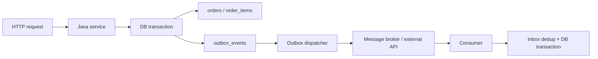
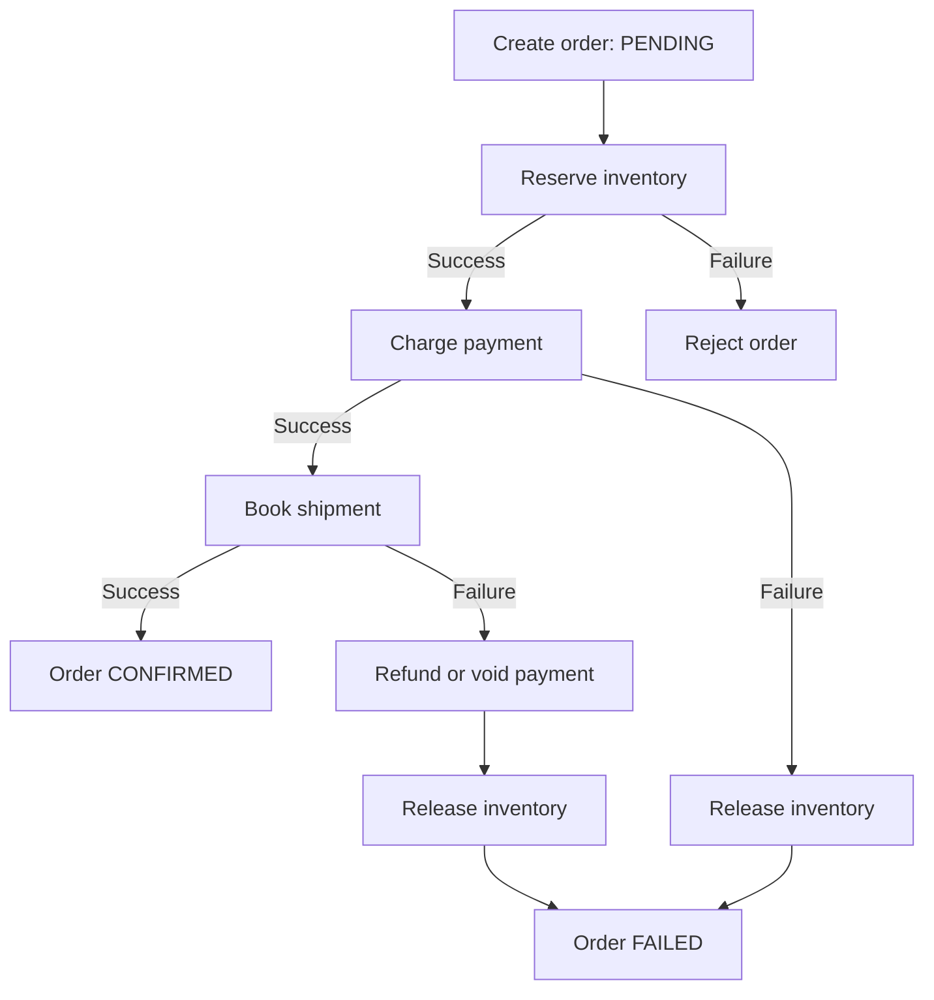

# Xử lý phụ thuộc giữa truy cập dữ liệu và dịch vụ bên ngoài

Trong ứng dụng Java, một nghiệp vụ thường không dừng ở việc `INSERT` hoặc `UPDATE` dữ liệu. Sau khi lưu đơn hàng, hệ thống có thể phải gọi cổng thanh toán, gửi email, phát sự kiện qua message broker hoặc cập nhật công cụ tìm kiếm. Các bước này **phụ thuộc nhau về mặt nghiệp vụ**, nhưng không nhất thiết nằm trong cùng một giao dịch kỹ thuật. Nếu database commit thành công mà lời gọi ngoài thất bại, hoặc dịch vụ ngoài đã xử lý nhưng ứng dụng mất kết nối trước khi nhận phản hồi, hệ thống rất dễ rơi vào trạng thái không nhất quán.

Bài học thuộc chương **Ranh giới ứng dụng** của mô-đun **DATA_PERSISTENCE_FUNDAMENTALS**. Mô-đun hướng tới hiểu nguyên lý lưu trữ bền vững, mô hình dữ liệu, schema, truy vấn, chỉ mục, giao dịch, cô lập, kiểm soát đồng thời; đồng thời thiết kế ranh giới persistence cho Java, xử lý lỗi kết nối, tiến hóa schema, bảo mật, sao lưu và hiệu năng. Trong phạm vi bài này, mục tiêu là **thiết kế cách phối hợp thao tác dữ liệu với dịch vụ bên ngoài** sao cho có quy tắc nhất quán, phục hồi được khi lỗi và không giả định rằng một transaction SQL có thể bao trùm mọi hệ thống.

Các ví dụ sử dụng PostgreSQL, JDBC và Spring theo cách thực hành thông dụng. Hợp đồng về idempotency, callback, tính thứ tự và khả năng xác nhận kết quả của **từng dịch vụ ngoài** phải được kiểm tra riêng; không thể suy ra chỉ từ cú pháp Java hoặc SQL.

## 1. Một nghiệp vụ có nhiều ranh giới kỹ thuật

Xét yêu cầu tạo đơn hàng và thu tiền:

```text
Client
  |
  v
Order service (Java)
  |-- [A] INSERT orders + order_items tại PostgreSQL
  |-- [B] POST /payments tới payment provider
  |-- [C] publish OrderPaid tới message broker
  `-- [D] gửi email cho khách hàng
```

Về nghiệp vụ, người dùng nghĩ đây là **một lần đặt hàng**. Về kỹ thuật, ít nhất bốn hệ thống có thể có chính sách lưu trữ, thời điểm commit, giao thức mạng và sự cố riêng. Một transaction JDBC chỉ kiểm soát các câu lệnh trên **cùng transaction database**; nó không tự rollback được khoản tiền đã thu hoặc email đã gửi.

| Ranh giới | Tài nguyên và cam kết | Điều không tự được bảo đảm |
|---|---|---|
| **Database transaction** | Tính nguyên tử của các thay đổi tham gia cùng giao dịch DB, theo mức cô lập và cấu hình độ bền | Lời gọi HTTP, email, broker hoặc dịch vụ khác đã thành công |
| **HTTP/API bên ngoài** | Kết quả theo hợp đồng API và provider | Một timeout có nghĩa phía provider chưa làm gì |
| **Message broker** | Nhận/lưu/phát sự kiện theo cấu hình và xác nhận của broker | Consumer đã xử lý thành công hay chỉ nhận thông điệp |
| **Consumer riêng** | Thay đổi dữ liệu của consumer trong transaction của chính nó | Toàn chuỗi producer → broker → consumer là một transaction ACID |

**Nguyên tắc nền tảng:** ranh giới kỹ thuật không được che giấu trong abstraction. `@Transactional` của Spring có thể quản lý DB transaction của service, nhưng **không biến HTTP request và message publish thông thường thành thành viên của transaction đó**.

## 2. Dual write: vấn đề khi phải ghi vào hai hệ thống

**Dual write** là tình huống ứng dụng phải cập nhật hai nơi độc lập, chẳng hạn database và broker. Thứ tự nào cũng có khoảng lỗi:

```text
Phương án 1: commit database -> publish event
  DB commit thành công
  Process crash trước publish
  => DB có đơn hàng, broker không có OrderCreated

Phương án 2: publish event -> commit database
  Broker đã nhận OrderCreated
  DB commit thất bại
  => Consumer nhận sự kiện về đơn hàng không tồn tại
```

Không có thứ tự tuyến tính đơn giản nào tự loại bỏ cả hai khoảng lỗi. Kể cả có `try/catch`, process vẫn có thể chết ngay sau bước đầu tiên; `catch` cũng không thể thu hồi tác dụng mà hệ thống ngoài đã xác nhận.

### 2.1. Gọi dịch vụ ngoài trong transaction DB có an toàn hơn không?

```java
@Transactional
public void placeOrder(CreateOrderCommand command) {
    Order order = orderRepository.save(newOrder(command));
    paymentClient.charge(order.getId(), command.paymentToken());
    order.markPaid();
}
```

Mã trên có các rủi ro:

- Provider thu tiền **thành công** nhưng DB transaction rollback vì lỗi SQL/serialization ngay sau đó → tiền đã thu, đơn hàng không được commit.
- Provider phản hồi **timeout** dù đã thu tiền → ứng dụng ném exception rồi caller retry, có nguy cơ thu lần hai.
- HTTP call chậm làm transaction giữ **connection, khóa hàng và snapshot** lâu hơn cần thiết, tăng lock wait, deadlock và nguy cơ cạn pool.
- Nếu lời gọi provider thành công nhưng callback/notification tiếp theo lỗi, `ROLLBACK` database không thể "unsend" thông báo.

Đặt lời gọi HTTP **trước** khi mở transaction hoặc **sau** khi commit có thể giảm thời gian giữ khóa, nhưng **chưa giải quyết** tính nguyên tử xuyên hai hệ thống. Cần thiết kế trạng thái trung gian, idempotency và khôi phục dựa trên hợp đồng nghiệp vụ.

### 2.2. Bảng sự cố theo từng điểm cắt

| Điểm lỗi | Database | Dịch vụ bên ngoài | Kết luận an toàn |
|---|---|---|---|
| Trước khi gửi HTTP | Có thể chưa commit | Chưa gửi | Có thể retry transaction đã được xác nhận hủy |
| Sau khi DB commit, trước HTTP | Đã commit | Chưa có yêu cầu | Cần công việc bền vững để gửi tiếp khi tiến trình khởi động lại |
| Đang chờ HTTP response | Theo từng luồng nghiệp vụ | **Có thể đã xử lý** | Không suy ra "chưa làm" từ timeout; đối soát với provider |
| HTTP thành công, DB ghi kết quả lỗi | Chưa phản ánh kết quả ngoài | Có thể đã tạo tác dụng | Cần ghi nhận/đối soát và thực hiện giao dịch bù trừ khi phù hợp |
| DB `COMMIT` timeout/mất xác nhận | **UNKNOWN đối với caller** | Có thể đã có tác dụng ngoài | Dùng operation ID, tra cứu authoritative; không phát lại mù quáng |

`UNKNOWN` là **độ chắc chắn của ứng dụng**, không phải một trạng thái ACID thứ ba mà database buộc phải lưu. Điều quan trọng là mã ứng dụng không giả định một exception luôn đồng nghĩa với giao dịch hoặc thao tác ngoài đã thất bại.

## 3. Xác định hợp đồng nhất quán trước khi chọn công cụ

Trước khi viết code, cần trả lời: **điều gì phải đúng ngay lập tức, điều gì được phép hoàn tất sau, và trong bao lâu?**

| Yêu cầu nghiệp vụ | Bảo đảm cần thiết | Hướng tiếp cận thường phù hợp |
|---|---|---|
| Tạo đơn và ghi dòng hàng phải cùng thành công/thất bại | Atomicity trong **một DB** | Một transaction với constraint/lock phù hợp |
| Đơn đã lưu thì phải có ý định phát `OrderCreated` | Không mất **ý định phát sự kiện** khi commit DB | Transactional outbox |
| Cổng thanh toán không được thu tiền hai lần cho cùng yêu cầu | Idempotency xuyên request/API | Operation ID ổn định, khóa provider và đối soát |
| Email có thể được gửi sau, nhưng không được mất vĩnh viễn | Giao hàng lại có kiểm soát, quan sát được backlog | Queue/outbox, retry, trạng thái xử lý, dedup nếu cần |
| Một nghiệp vụ qua nhiều dịch vụ phải có cách phục hồi | Trạng thái trung gian và hành động bù trừ | Saga/orchestration, state machine, reconciliation |
| Báo cáo/search index có thể cập nhật trễ | Eventual consistency trong giới hạn rõ | Event/CDC, idempotent consumer, rebuild và đo lag |

**Không phải mọi thứ đều cần đồng bộ ngay.** Ví dụ có thể trả `201 Created` khi đơn đã được lưu với trạng thái `PENDING_PAYMENT`, còn việc thanh toán tiến hành sau. Nhưng nếu hợp đồng API hứa rằng trả `201` nghĩa là **đã thu tiền**, hệ thống phải có bằng chứng xác nhận thanh toán trước khi báo như vậy. Tên endpoint, HTTP status và trạng thái nghiệp vụ cần phản ánh đúng thực tế.

## 4. Transactional outbox: ràng buộc dữ liệu và ý định phát sự kiện

**Transactional outbox** ghi **business data** và **bản ghi sự kiện cần phát** vào **cùng một transaction database**. Khi transaction commit, cả hai cùng tồn tại; khi rollback, cả hai cùng bị hủy. Sau đó một worker đọc bảng outbox và giao sự kiện ra hệ thống ngoài.



### 4.1. Schema minh họa

```sql
CREATE TABLE orders (
    id BIGINT GENERATED ALWAYS AS IDENTITY PRIMARY KEY,
    operation_id UUID NOT NULL UNIQUE,
    request_hash TEXT NOT NULL,
    customer_id BIGINT NOT NULL,
    status TEXT NOT NULL CHECK (
        status IN (
            'PENDING_PAYMENT', 'PAID', 'PAYMENT_FAILED', 'CANCELLED',
            'PENDING_RECONCILIATION', 'REFUND_PENDING'
        )
    ),
    created_at TIMESTAMPTZ NOT NULL DEFAULT now()
);

CREATE TABLE outbox_events (
    id BIGINT GENERATED ALWAYS AS IDENTITY PRIMARY KEY,
    event_id UUID NOT NULL UNIQUE,
    operation_id UUID NOT NULL,
    aggregate_id BIGINT NOT NULL REFERENCES orders(id),
    event_type TEXT NOT NULL,
    payload JSONB NOT NULL,
    delivery_status TEXT NOT NULL DEFAULT 'PENDING',
    next_attempt_at TIMESTAMPTZ NOT NULL DEFAULT now(),
    leased_until TIMESTAMPTZ,
    attempts INTEGER NOT NULL DEFAULT 0,
    created_at TIMESTAMPTZ NOT NULL DEFAULT now(),
    delivered_at TIMESTAMPTZ,
    CHECK (delivery_status IN ('PENDING', 'IN_FLIGHT', 'DELIVERED'))
);

CREATE INDEX idx_outbox_claim
    ON outbox_events (delivery_status, next_attempt_at, id);
```

Một `operation_id` định danh **yêu cầu nghiệp vụ** xuyên lần retry; `event_id` định danh **sự kiện** để consumer khử trùng lặp. Hai ID có quan hệ nhưng không nhất thiết giống nhau: một nghiệp vụ có thể phát nhiều loại sự kiện với ID riêng. `request_hash` giúp phát hiện client tái sử dụng operation ID nhưng thay đổi nội dung.

Schema minh họa giả định ứng dụng kiểm soát cập nhật trạng thái; production cần kiểm tra constraint liên quan đến trạng thái, retention, lease và payload. Không để dữ liệu thanh toán nhạy cảm như số thẻ hoặc token bí mật đi vào payload/log nếu không có lý do và cơ chế bảo vệ được phê duyệt.

### 4.2. Ghi dữ liệu và outbox trong cùng transaction

```sql
BEGIN;

INSERT INTO orders (operation_id, request_hash, customer_id, status)
VALUES (:operation_id, :request_hash, :customer_id, 'PENDING_PAYMENT')
RETURNING id;

-- Giả sử ứng dụng bind :new_order_id bằng id vừa nhận ở trên.
INSERT INTO outbox_events (
    event_id, operation_id, aggregate_id, event_type, payload
)
VALUES (
    :event_id,
    :operation_id,
    :new_order_id,
    'PaymentRequested',
    jsonb_build_object(
        'orderId', :new_order_id,
        'operationId', :operation_id
    )
);

COMMIT;
```

Các tham số `:name` là ký hiệu minh họa cho thư viện hỗ trợ named parameters; JDBC thuần dùng `?` và bind đúng kiểu. `RETURNING id` tạo một result để ứng dụng lấy ID trước khi chạy câu tiếp theo. Trong production, bản ghi `order_items`, kiểm tra tồn kho và những bất biến khác cũng phải tham gia transaction thích hợp.

**Bất biến cốt lõi:** không có đơn `PENDING_PAYMENT` mới mà lại **thiếu ý định yêu cầu thanh toán** nếu transaction này đã commit. Tuy nhiên outbox mới cam kết ý định được lưu bền vững theo cấu hình DB, **không cam kết message đã được giao cho broker hoặc provider đã xử lý**.

## 5. Dispatcher: claim ngắn, gọi dịch vụ ngoài transaction DB

Một sai lầm phổ biến là lấy khóa `FOR UPDATE` trên hàng outbox rồi **giữ transaction đang mở trong suốt HTTP call**. Khi provider chậm, worker giữ connection và khóa quá lâu. Cách phù hợp hơn là **claim một số công việc trong transaction ngắn**, commit để nhả khóa, sau đó gọi hệ thống ngoài và ghi kết quả bằng transaction khác.

Ví dụ PostgreSQL cho nhiều worker cùng claim theo lease:

```sql
BEGIN;

WITH selected AS (
    SELECT id
    FROM outbox_events
    WHERE (
        delivery_status = 'PENDING'
        AND next_attempt_at <= now()
    ) OR (
        delivery_status = 'IN_FLIGHT'
        AND leased_until < now()
    )
    ORDER BY id
    LIMIT 20
    FOR UPDATE SKIP LOCKED
)
UPDATE outbox_events AS e
SET delivery_status = 'IN_FLIGHT',
    leased_until = now() + interval '60 seconds',
    attempts = e.attempts + 1
FROM selected AS s
WHERE e.id = s.id
RETURNING e.id, e.event_id, e.operation_id,
          e.event_type, e.payload, e.attempts;

COMMIT;
```

Sau khi commit, dispatcher dùng danh sách đã claim để gọi broker/API, **không giữ khóa DB** trong lúc gửi mạng. Nếu nhận được xác nhận phù hợp với hợp đồng provider, worker cập nhật `DELIVERED`, `delivered_at` và xóa `leased_until`; nếu biết chắc gửi chưa thành công thì đặt lại `PENDING` với `next_attempt_at` và backoff có jitter. Với kết quả bên ngoài **không xác định**, trước khi gửi lại phải dựa vào **idempotency key hoặc API đối soát**.

Ở môi trường nhiều worker, một claim đã hết lease có thể được worker mới nhận trong lúc worker cũ vẫn còn chạy. Vì vậy production nên dùng **claim token/lease generation**: mỗi lần claim ghi một token duy nhất, và khi cập nhật trạng thái kết quả phải `WHERE id = ? AND claim_token = ?` để ngăn worker cũ ghi đè trạng thái của lease mới. Với tác động ngoài DB, token chỉ bảo vệ metadata trong DB; **provider idempotency** vẫn cần thiết để chống lặp khi hai worker gửi cùng yêu cầu.

`SKIP LOCKED` phù hợp để phân phối việc từ hàng đợi, vì nó chủ động bỏ qua hàng đang bị khóa và không cho góc nhìn nhất quán phục vụ báo cáo tổng hợp. Lease cần thời hạn phù hợp, khả năng gia hạn khi tác vụ dài, giới hạn số attempt, cơ chế dead-letter/manual review và dọn bản ghi đã xử lý theo retention policy.

### 5.1. Vì sao vẫn có thể phát trùng sự kiện?

```text
Worker gửi PaymentRequested hoặc OrderCreated
Broker/provider xác nhận đã nhận
Worker crash trước khi cập nhật outbox = DELIVERED
Lease hết hạn
Worker khác gửi lại cùng event_id / operation_id
```

Outbox thường đem lại **at-least-once delivery**, tức có thể gửi lặp. Do đó consumer hoặc provider phải xử lý idempotent. Không tuyên bố *exactly once end-to-end* chỉ vì việc ghi business rows và outbox rows cùng transaction.

## 6. Bảo vệ consumer bằng inbox và idempotency

Consumer cũng có cửa sổ lỗi: nó đã cập nhật database của mình nhưng chết trước khi xác nhận message với broker. Broker có thể phát lại message. Nếu mỗi lần nhận đều thực hiện cùng tác dụng mà không kiểm tra, dữ liệu bị nhân đôi.

Một mẫu đơn giản là **inbox dedup** trong cùng transaction với tác dụng local:

```sql
CREATE TABLE processed_events (
    consumer_name TEXT NOT NULL,
    event_id UUID NOT NULL,
    processed_at TIMESTAMPTZ NOT NULL DEFAULT now(),
    PRIMARY KEY (consumer_name, event_id)
);

BEGIN;

INSERT INTO processed_events (consumer_name, event_id)
VALUES (:consumer_name, :event_id)
ON CONFLICT DO NOTHING
RETURNING event_id;

-- Nếu INSERT trả đúng 1 hàng: xử lý side effect TRONG CÙNG DB
-- transaction; nếu trả 0 hàng: đã xử lý trước đó, không ghi lần nữa.
-- Ví dụ cập nhật projection hoặc ghi một ledger local.

COMMIT;
-- Chỉ ACK broker sau khi DB transaction commit thành công.
```

Nếu transaction của consumer rollback, bản ghi `processed_events` cũng rollback, nên lần giao tiếp theo có thể thử xử lý lại. Nếu consumer ghi nhiều bảng DB, chúng cần ở cùng transaction với bản ghi inbox. Nếu nghiệp vụ không chỉ ghi DB mà còn gọi API ngoài, inbox tại DB **không bảo vệ tác dụng bên ngoài** trừ khi tiếp tục dùng một bước idempotent/outbox riêng.

Một message có thể đến **không đúng thứ tự** hoặc bị trễ. Ngoài dedup theo event ID, các projection theo aggregate nên có version/sequence do producer phát hành và chính sách xử lý thứ tự rõ ràng; đừng để sự kiện `OrderPending` đến muộn ghi đè `OrderPaid` đã được áp dụng.

## 7. Java và Spring: ranh giới transaction cần hiện rõ trong code

### 7.1. Mô hình service ghi outbox

```java
@Service
public class OrderApplicationService {
    private final OrderRepository orders;
    private final OutboxRepository outbox;

    public OrderApplicationService(
            OrderRepository orders,
            OutboxRepository outbox) {
        this.orders = orders;
        this.outbox = outbox;
    }

    @Transactional
    public OrderReceipt submit(CreateOrderCommand command) {
        // operationId được cấp một lần bởi caller và giữ qua các retry.
        // Trước khi tạo mới, service phải xử lý yêu cầu trùng ID
        // và xác minh payload/requestHash theo hợp đồng idempotency.
        Order order = orders.createPendingPayment(command);

        outbox.append(new OutboxEvent(
                UUID.randomUUID(),
                command.operationId(),
                order.getId(),
                "PaymentRequested",
                paymentRequestPayload(order)));

        return new OrderReceipt(order.getId(), "PENDING_PAYMENT");
    }
}
```

Các kiểu `OrderRepository`, `OutboxRepository`, `Order`, `OrderReceipt`, `OutboxEvent`, `CreateOrderCommand` và phương thức tạo payload là **mã miền minh họa**, cần được định nghĩa trong dự án. `UUID.randomUUID()` tạo `event_id` cho một bản ghi outbox mới; nếu một attempt ghi bị rollback rồi retry thì bản ghi cũ cũng bị rollback. Nhưng để bảo đảm idempotency của **cùng yêu cầu sau commit không xác định**, logic service phải tra cứu `operationId`, kiểm tra request hash và tránh tạo thêm một bản ghi nghiệp vụ mới khi yêu cầu gốc đã commit.

Điểm quan trọng là cả `orders.createPendingPayment` và `outbox.append` phải dùng **cùng transaction vật lý**. Nếu outbox vô tình ghi sang một datasource khác không tham gia transaction, mẫu không còn bảo đảm atomicity giữa hai bản ghi. Spring `@Transactional` thông thường có hiệu lực qua transaction interceptor/proxy; self-invocation hoặc propagation khác có thể khiến ranh giới thực tế không như dự kiến.

Không gọi `paymentClient.charge(...)` bên trong `submit`. Việc tạo payment có thể được dispatcher hoặc một bước orchestration riêng thực hiện **sau khi order và outbox đã được commit**.

### 7.2. Hook `afterCommit` dùng được ở đâu?

Spring có thể chạy callback sau commit để **đánh thức dispatcher** hoặc giảm độ trễ xuất bản, nhưng một callback thuần in-memory không phải công việc bền vững:

```text
DB commit thành công
Process crash trước callback afterCommit
=> Callback không chạy dù DB đã commit
```

Vì vậy, `afterCommit` có thể là **tối ưu thông báo**, còn bảng outbox (hoặc một cơ chế bền vững tương đương) mới là nguồn phục hồi. Một callback `afterCommit` cũng không thể rollback DB transaction đã commit nếu publish thất bại. Nếu callback mở transaction DB mới để ghi trạng thái, cần cấu hình ranh giới transaction rõ ràng; đừng mặc định nó thuộc giao dịch đã hoàn tất.

### 7.3. JDBC trực tiếp cũng theo cùng nguyên tắc

Với JDBC, đặt `connection.setAutoCommit(false)`, ghi business data và outbox bằng **cùng `Connection`**, rồi `commit()` sau khi cả hai thành công. Khi có lỗi trước commit, rollback và trả connection về pool. Khi `commit()` mất xác nhận, không coi `SQLException` là bằng chứng rollback; đối soát theo operation ID trước khi quyết định retry. Đảm bảo `PreparedStatement`, `ResultSet` và connection được đóng bằng `try-with-resources` hoặc cơ chế quản lý tương đương.

## 8. Phụ thuộc đồng bộ: đọc dữ liệu ngoài trước hay sau DB transaction?

Không phải mọi dependency đều cần outbox. Một số là **tra cứu thông tin**, ví dụ kiểm tra tỷ giá, chính sách vận chuyển hoặc trạng thái gian lận trước khi tạo đơn. Cách thiết kế phụ thuộc vào việc dữ liệu ngoài có cần đồng thời nhất quán với transaction DB hay không.

| Cách thực hiện | Ưu điểm | Rủi ro và giới hạn |
|---|---|---|
| Gọi API ngoài **trước** transaction DB | Không giữ khóa DB khi chờ HTTP | Dữ liệu bên ngoài có thể thay đổi giữa lúc tra cứu và commit; phải ghi lại version/timestamp nếu cần audit |
| Gọi API ngoài **trong** transaction DB | Code tuyến tính, có đủ kết quả để quyết định ghi | Giữ connection/khóa lâu; HTTP không được rollback theo DB; timeout không xác định |
| Gọi API ngoài **sau** commit DB | DB transaction ngắn; thuận cho xử lý bất đồng bộ | Cần cơ chế bền vững để tiếp tục khi process crash |
| Ghi **ý định** trong DB, xử lý ngoài qua outbox | Phục hồi được tác vụ chưa hoàn tất, dễ retry và quan sát | Eventual consistency, delivery có thể lặp, cần idempotency và vận hành worker |

Ví dụ tỷ giá được lấy trước khi tạo đơn: nếu giá phải cố định theo lần báo giá, service nên lưu `quote_id`, tỷ giá, version và thời hạn hiệu lực, kiểm tra quy tắc hết hạn trước khi chốt. Nếu giá có thể thay đổi ngay sau tra cứu, không thể đảm bảo tính nhất quán xuyên hai hệ thống chỉ bằng isolation level của PostgreSQL; cần **hợp đồng giữ giá/reservation** do provider hỗ trợ hoặc xác nhận lại theo quy trình nghiệp vụ.

Đặt timeout rõ ràng cho dependency đồng bộ, giới hạn số connection và request đồng thời, và quyết định *fail-open* hay *fail-closed* theo mức rủi ro. Ví dụ dữ liệu gợi ý có thể cho phép fallback từ cache, nhưng kiểm tra chống gian lận hoặc giới hạn chi trả có thể bắt buộc fail-closed. Không dùng fallback chung cho mọi dependency.

## 9. Saga và giao dịch bù trừ khi nghiệp vụ trải nhiều dịch vụ

Khi một quy trình có nhiều thao tác không thể gói trong một DB transaction, có thể mô hình hóa nó thành **saga**: chuỗi bước có trạng thái và các **hành động bù trừ** khi một phần thất bại.

Ví dụ đơn hàng cần giữ tồn kho, thu tiền và đặt vận chuyển:



Các bước bù trừ **không phải rollback nguyên tử**. Hoàn tiền có thể mất thời gian, tốn phí, bị provider từ chối hoặc yêu cầu đối soát; email đã gửi không thể "thu hồi" như SQL rollback. Vì vậy saga cần trạng thái trung gian chính xác (`REFUND_PENDING`, `COMPENSATION_FAILED`...), retry an toàn, công cụ vận hành và khả năng can thiệp thủ công khi lỗi kéo dài.

**Orchestration** dùng một coordinator theo dõi trạng thái và điều khiển bước kế tiếp; **choreography** để các service phản ứng với event của nhau. Chọn phương án dựa trên độ phức tạp, số bước và nhu cầu audit, không dựa vào việc một kiểu luôn tốt hơn. Với nghiệp vụ tiền, lưu **lệnh tài chính bất biến và bằng chứng provider**; tránh cập nhật thẳng cột `PAID` chỉ vì một callback chưa được xác thực.

### 9.1. State machine ngăn chuyển trạng thái sai

Giả sử order có trạng thái `PENDING_PAYMENT`, `PAID`, `PAYMENT_FAILED`, `CANCELLED`. Callback `PaymentSucceeded` đến **sau** khi order bị hủy thì không thể đơn giản ghi `status='PAID'` mà không kiểm tra nghiệp vụ. Cần có bảng chuyển trạng thái hợp lệ và thực thi bằng lệnh ghi có điều kiện:

```sql
UPDATE orders
SET status = 'PAID'
WHERE id = :order_id
  AND status = 'PENDING_PAYMENT';
```

Nếu `UPDATE` trả 0 dòng, phải xác định đây là callback trùng, đã xử lý trước, hoặc trạng thái cạnh tranh cần bù trừ. Kết hợp với event ID/inbox trong cùng transaction và khóa/constraint phù hợp để tránh race condition. Tương tự, một callback `PaymentFailed` đến muộn không nên ghi đè order đã `PAID` nếu không có quy trình điều chỉnh hợp lệ.

## 10. Khi nào thực sự cần transaction phân tán?

Một số hệ thống hỗ trợ **distributed transaction / two-phase commit (2PC)** nếu tất cả resource manager tham gia protocol tương ứng. Nó có thể phối hợp commit của nhiều hệ hỗ trợ XA hoặc cơ chế tương đương, nhưng có chi phí vận hành, tình huống *in-doubt*, phụ thuộc coordinator và giới hạn hỗ trợ từ các dịch vụ.

**Một HTTP API thanh toán thông thường, email service hoặc broker không tự trở thành XA participant.** Không dùng `@Transactional` hoặc JTA annotation rồi mặc định nhiều hệ ngoài DB có atomicity toàn cục. Khi cần tính nhất quán rất cao, hãy đánh giá rõ khả năng hỗ trợ 2PC, availability, phục hồi coordinator, timeout và chi phí so với các lựa chọn outbox/saga/constraint. Trong nhiều kiến trúc ứng dụng, **local transaction + outbox + idempotency + reconciliation** là lựa chọn thực dụng hơn.

## 11. Retry, timeout và kết quả chưa xác định

Sự cố mạng tạo ra một vấn đề sâu hơn lỗi trả về rõ ràng: **caller có thể không phân biệt được bên ngoài đã xử lý hay chưa**.

```text
Order service                          Payment provider
    |  POST /payments --------------------> |
    |                                      | Đã thu tiền và ghi transaction
    |     X <---- phản hồi bị mất --------- |
    |  timeout                              |
```

Sau timeout, gọi lại với **một ID thanh toán mới** có thể thu tiền lần hai. Cách thiết kế cần:

1. Gán **provider idempotency key** ổn định cho mỗi yêu cầu thu tiền logic, lưu key trong DB theo operation ID.
2. Kiểm tra **phạm vi và thời gian hiệu lực** của idempotency trên provider; không giả định mọi API giữ key vĩnh viễn hoặc chấp nhận mọi request cùng key.
3. Nếu response không rõ, hỏi provider qua **API truy vấn giao dịch hoặc reconciliation** trước khi quyết định phát lệnh mới. Khi retry, giữ cùng idempotency key và cùng payload nếu hợp đồng cho phép.
4. Lưu trạng thái `UNKNOWN`/`PENDING_RECONCILIATION` ở tầng nghiệp vụ khi chưa đủ bằng chứng, không gắn `FAILED` hay `PAID` theo suy đoán.
5. Áp dụng **exponential backoff có jitter**, số attempt tối đa, deadline và retry budget để không tạo retry storm khi provider hoặc DB quá tải.

Kết quả `COMMIT` database cũng có thể không xác định nếu mất kết nối lúc chờ xác nhận. Phải phân biệt **đã biết transaction bị DB hủy** (chẳng hạn PostgreSQL `40001`/`40P01`) với **mất bằng chứng commit**. Với trạng thái sau, không tự chạy lại nghiệp vụ gây tác dụng ngoài DB; tra cứu theo operation ID tại nguồn có thẩm quyền, lưu ý replica có thể bị trễ.

## 12. Nhất quán đọc: người dùng sẽ thấy gì khi công việc chưa hoàn tất?

Sau khi đã dùng outbox/saga, nhiều bước hoàn tất **bất đồng bộ**. Giao diện và API phải thể hiện trạng thái trung gian một cách có chủ đích:

- `PENDING_PAYMENT`: order và ý định thanh toán đã ghi; **chưa có bằng chứng thanh toán hoàn tất**.
- `PAID`: đã có kết quả thanh toán thành công được kiểm chứng theo hợp đồng provider và đã áp dụng tại DB local.
- `PAYMENT_FAILED`: provider xác nhận từ chối hoặc workflow xác định thất bại hợp lệ; không dùng nhãn này cho mọi timeout.
- `PENDING_RECONCILIATION`: cần tra cứu lại kết quả ngoài, chưa thể kết luận thành công hay thất bại.
- `REFUND_PENDING`: đã quyết định bù trừ, nhưng **chưa có bằng chứng hoàn tiền hoàn tất**.

Nếu API trả kết quả sớm, có thể trả mã phù hợp như `202 Accepted` kèm `operation_id` và endpoint tra cứu trạng thái; đừng trả về `PAID` chỉ vì đã enqueue `PaymentRequested`. Đặt timeout và **SLO cho độ trễ hội tụ**, ví dụ phần trăm thao tác được xử lý trong khoảng thời gian mục tiêu, chứ không chỉ đo latency của lần ghi DB.

Eventual consistency không có nghĩa "sau cùng chắc chắn đúng" nếu không có worker, retry, dedup, dead-letter và cơ chế theo dõi backlog. Cần vận hành quy trình đưa dữ liệu từ trạng thái trung gian đến kết quả được xác nhận hoặc xử lý thủ công.

## 13. Bảo mật và ranh giới tin cậy

Các dịch vụ ngoài database có thể được vận hành bởi bên thứ ba, có credential riêng và dữ liệu ít đáng tin cậy hơn DB nội bộ. Ranh giới ứng dụng nên áp dụng:

- **Xác thực callback/webhook** bằng chữ ký, timestamp, chống replay và quy tắc provider; không cập nhật order chỉ dựa trên JSON callback tự khai báo `status=SUCCESS`.
- **Không đưa secret vào outbox payload hoặc log**. Chỉ lưu các trường cần cho consumer, áp dụng mã hóa/retention và quyền truy cập phù hợp; token thanh toán nên được quản lý theo hợp đồng bảo mật của provider.
- **Chỉ cho phép endpoint được cấu hình** khi service gọi mạng, để tránh SSRF từ URL lấy trực tiếp từ dữ liệu do người dùng gửi.
- **Phân quyền theo thao tác** và hạn chế quyền DB của worker/consumer; không để dispatcher có quyền thay mọi dữ liệu không liên quan.
- **Xử lý dữ liệu không tin cậy từ message/webhook** bằng validation và chống duplicate; payload có schema/version để tiến hóa an toàn.
- **Không gửi PII tràn lan** khi phát event; dùng ID tham chiếu hoặc redaction ở những hệ không cần dữ liệu nhạy cảm.

Bảo mật cũng liên quan đến **sự thật nghiệp vụ**: callback không được xác thực có thể khiến hệ thống đánh dấu đã thanh toán sai, bất kể kiến trúc outbox hoạt động tốt đến đâu.

## 14. Quan sát, đối soát và phục hồi vận hành

Khả năng phục hồi phụ thuộc việc phát hiện và giải quyết **công việc đang mắc kẹt**, không chỉ catch exception trong method Java.

| Tín hiệu | Tại sao cần |
|---|---|
| Số bản ghi outbox `PENDING`/`IN_FLIGHT` và tuổi bản ghi lớn nhất | Phát hiện worker dừng hoặc backlog ngày càng lớn |
| Độ trễ từ DB commit đến broker/provider ACK | Đo eventual-consistency lag |
| Tỷ lệ publish lỗi và phân bố số attempt | Phân biệt lỗi thoáng qua với dependency không khỏe |
| Số lease hết hạn và job được reclaim | Phát hiện crash, worker quá chậm hoặc lease quá ngắn |
| Số sự kiện trùng bị inbox loại bỏ | Kiểm chứng dedup, phát hiện retry bất thường |
| Số thanh toán `PENDING_RECONCILIATION` | Phát hiện commit/API outcome không rõ |
| Số bước bù trừ đang chờ hoặc thất bại | Không để saga mắc kẹt mà không ai xử lý |
| Connection pool usage, transaction duration, lock wait | Phát hiện lời gọi ngoài đang kéo dài transaction DB |

Trace nên gắn `operation_id`, `event_id`, `aggregate_id`, `provider_request_id` và trạng thái được xác nhận. Log phải loại bỏ token, thông tin thẻ, secret và dữ liệu cá nhân không cần thiết. Không dùng các ID riêng từng request làm **nhãn metric high-cardinality**.

Quy trình đối soát định kỳ nên lấy **nguồn authoritative** của từng hệ (ví dụ provider payment ledger), đối chiếu operation ID, trạng thái đơn hàng, outbox và bằng chứng ACK. Khi hai nguồn khác nhau, cần state machine xử lý sự kiện muộn, lặp hoặc thiếu thay vì cập nhật thủ công thiếu audit. Có thể xây dựng tác vụ sửa sai có idempotency, báo cáo ngoại lệ và hướng dẫn can thiệp thủ công cho các trường hợp không thể tự quyết định.

## 15. Kiểm thử các khoảng lỗi quan trọng

Một unit test chứng minh `orders.save()` và `outbox.save()` đều được gọi chưa chứng minh workflow chịu được crash. Cần thử các **cửa sổ lỗi** sau:

| Thử nghiệm | Cách giả lập | Kết quả cần kiểm chứng |
|---|---|---|
| Lỗi sau INSERT order nhưng trước INSERT outbox | Ném exception trước lệnh thứ hai | Cả order và outbox rollback; không còn trạng thái nửa vời |
| Crash sau DB commit, trước publish | Dừng process ngay sau commit | Có outbox `PENDING`, dispatcher tiếp tục xử lý sau restart |
| Provider xử lý xong nhưng response bị mất | Drop response/fault injection | Retry với **cùng idempotency key** hoặc đối soát, không thu tiền hai lần |
| Broker ACK trước khi worker cập nhật outbox | Dừng dispatcher tại điểm cắt | Sự kiện có thể được phát lại; consumer dedup đúng |
| Consumer commit DB nhưng chưa ACK broker | Gây lỗi trước ACK | Broker redeliver; inbox tránh áp dụng tác dụng local hai lần |
| Nhiều worker claim cùng lúc | Chạy song song với lease và `SKIP LOCKED` | Không claim trùng khi lease còn hiệu lực; stale worker không ghi đè claim mới |
| Callback đến trễ hoặc đảo thứ tự | Phát `PaymentFailed`/`PaymentSucceeded` theo nhiều thứ tự | State machine từ chối chuyển trạng thái không hợp lệ |
| DB commit không rõ kết quả | Gián đoạn kết nối lúc chờ commit | Hệ thống tra cứu theo operation ID; không phát lệnh ghi mới mù quáng |
| Saga bù trừ thất bại | Giả lập refund API lỗi nhiều lần | Trạng thái `REFUND_PENDING` có thể retry và được cảnh báo |

Trong integration test, xác minh **transaction boundaries thực sự** (datasource, transaction manager, propagation), ràng buộc unique, isolation và hành vi repository. Không tạo sự cố mạng trên hệ production để chứng minh tính đúng đắn. Với kiểm thử đồng thời, dùng barrier/latch để điều khiển lịch thực thi thay vì `sleep` rồi hy vọng xảy ra race.

## 16. Checklist thiết kế ranh giới dữ liệu – dịch vụ ngoài

Trước khi triển khai một workflow gọi database và dependency ngoài, hãy trả lời:

1. **Bất biến nào bắt buộc atomic ở DB?** Đặt các ghi liên quan vào cùng transaction và thêm constraint phù hợp.
2. **Lời gọi nào ra ngoài DB?** Ghi rõ hệ thống, hợp đồng timeout, idempotency, khả năng tra cứu và chính sách lỗi của từng lời gọi.
3. **Nếu crash giữa hai thao tác thì sao?** Dùng outbox hoặc cơ chế công việc bền vững khi phải bảo đảm bước sau sẽ được thực hiện.
4. **Nếu response bị mất nhưng tác dụng đã xảy ra?** Đối soát bằng operation ID ổn định, không phát lại bằng ID mới.
5. **Nếu event được giao nhiều lần hoặc sai thứ tự?** Có inbox dedup, sequence/version và state machine kiểm soát transition.
6. **Nếu bước tiếp theo thất bại lâu dài?** Có retry budget/backoff, deadline, dead-letter, bù trừ và xử lý thủ công.
7. **Transaction có giữ khóa trong lúc chờ HTTP không?** Rút ngắn transaction, claim job rồi gọi ngoài, không giữ connection vô ích.
8. **API báo kết quả dựa trên bằng chứng nào?** Phân biệt `PENDING`, `CONFIRMED`, `FAILED` và `UNKNOWN` rõ ràng.
9. **Dữ liệu và quyền truy cập có an toàn?** Xác thực webhook, bảo vệ credential, tối thiểu hóa payload nhạy cảm và giới hạn quyền worker.
10. **Quan sát và kiểm thử được khoảng lỗi nào?** Có metric backlog/lag, trace bằng operation/event ID và integration test cho crash, duplicate, timeout.

**Kết luận:** Truy cập dữ liệu và gọi dịch vụ bên ngoài là một nghiệp vụ chung nhưng thường thuộc **những transaction độc lập**. Hệ thống đáng tin cậy không cố che giấu ranh giới này: nó ghi ý định bền vững, đặt trạng thái trung gian rõ ràng, cho phép retry có kiểm soát, khử trùng lặp, đối soát kết quả không xác định và bù trừ khi cần. Với Java, thiết kế persistence đúng không chỉ bảo đảm SQL commit, mà còn bảo đảm workflow có thể **tiếp tục an toàn sau crash, timeout hoặc phản hồi đến trễ**.
