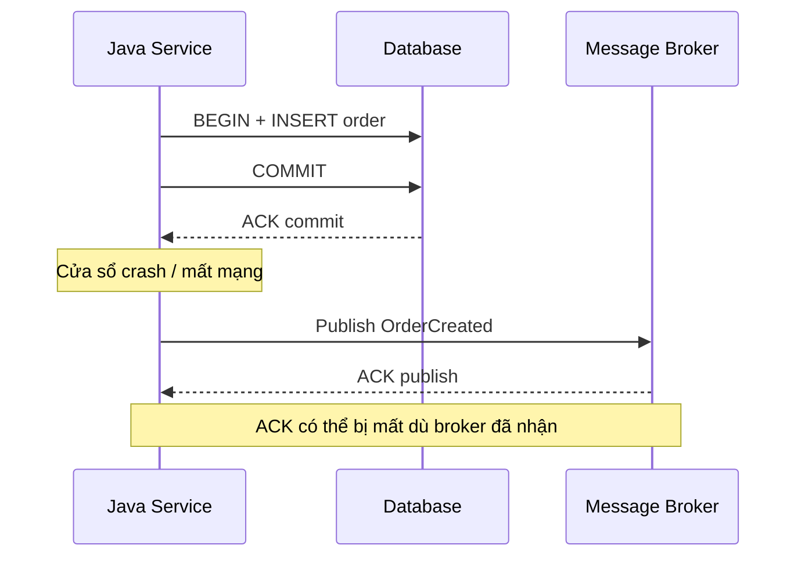
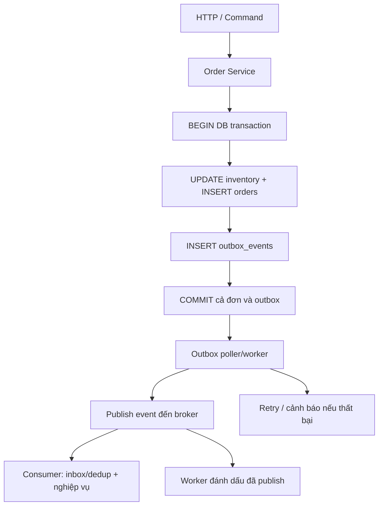
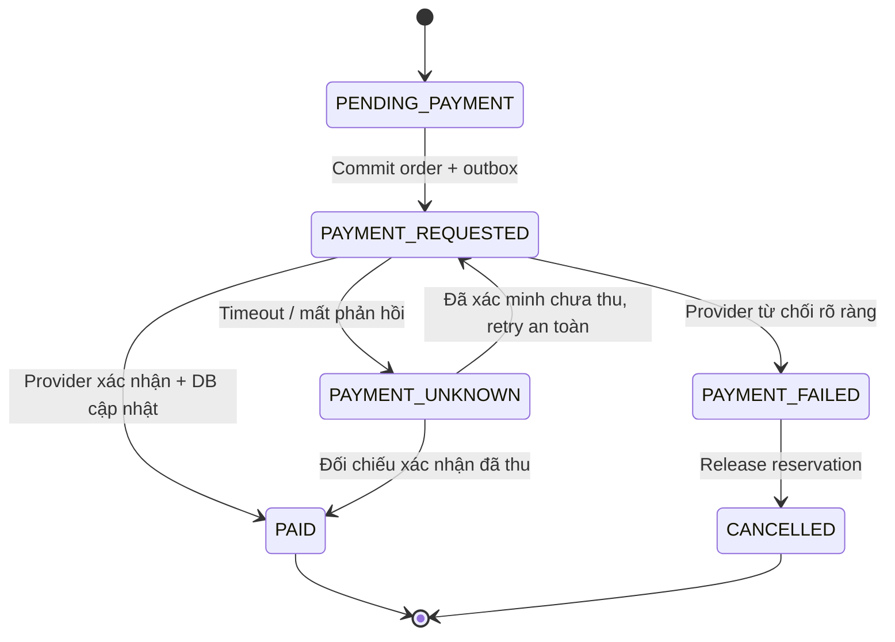

# Kiểm soát tác dụng phụ trước và sau commit

Trong chương **Ranh giới ứng dụng** của **DATA_PERSISTENCE_FUNDAMENTALS**, một câu hỏi quan trọng khi thiết kế persistence cho Java là: **nếu một nghiệp vụ vừa ghi cơ sở dữ liệu vừa gửi email, gọi API thanh toán hoặc phát message, ta phải thực hiện những tác dụng phụ ấy trước hay sau `COMMIT`?**

Câu trả lời không đơn giản là “cứ đưa vào transaction” hoặc “cứ chạy sau commit”. Giao dịch database có thể bảo đảm tính nguyên tử giữa các thay đổi **cùng thuộc tài nguyên được quản lý**, nhưng không mặc nhiên rollback được email đã gửi, lệnh HTTP đã tới bên thứ ba, file đã ghi, cache đã thay đổi hoặc message đã được broker nhận. Ngay cả hành động thực hiện **sau khi DB commit** cũng có thể bị mất nếu tiến trình dừng ở khoảng thời gian giữa commit và phát sự kiện.

Bài này giúp người học đặt **ranh giới giao dịch**, phân biệt tác dụng phụ có thể đảo ngược và không thể đảo ngược, chọn cơ chế `afterCommit`, **transactional outbox**, idempotency hoặc saga đúng bối cảnh, đồng thời thiết kế retry, kiểm thử và quan sát để ứng dụng Java duy trì hành vi có thể giải thích được khi gặp lỗi.

## 1. Nhận diện tác dụng phụ và phạm vi ACID

Một **tác dụng phụ** (*side effect*) là thay đổi trạng thái bên ngoài giá trị trả về của một hàm. Trong nghiệp vụ đặt hàng, có thể có những thao tác sau:

| Thao tác | Hệ thống chịu tác động | Có được rollback cùng transaction DB? |
| --- | --- | --- |
| `INSERT orders`, `UPDATE inventory` trên cùng database/transaction | Database | **Có**, nếu được thực hiện trong cùng transaction đúng cách |
| Ghi một hàng `outbox_events` trên cùng database/transaction | Database | **Có**, cùng transaction với thay đổi nghiệp vụ |
| Gửi email/SMS | Mail/SMS provider | **Không**, transaction DB không thể thu hồi email đã gửi |
| Gọi API tính phí thẻ | Payment provider | **Không**, cần hợp đồng idempotency và phương án bù trừ/hoàn tiền |
| Publish message trực tiếp tới broker | Message broker | **Không mặc nhiên**, ngay cả khi broker có transaction riêng |
| Ghi file lên object storage | Storage service | **Không**, cần thiết kế cleanup/khôi phục riêng |
| Xóa/ghi cache phân tán | Cache service | **Không**, cần invalidation, TTL, version hoặc cơ chế đồng bộ |
| Gửi metric/log | Observability backend | Thường **không cần** rollback, nhưng phải không làm thay đổi quyết định nghiệp vụ |

> **Phạm vi nguyên tử cần được định nghĩa rõ:** transaction cục bộ trên một database **không** tự bao gồm tài nguyên bên ngoài. Cũng không nên đồng nhất “gọi hai phương thức Java trong một `@Transactional`” với “hai hệ thống bên ngoài commit nguyên tử”.

Khi thiết kế use case, hãy viết ra **bất biến dữ liệu** và **lời hứa với người dùng**. Ví dụ:

- Không tạo đơn hàng `CONFIRMED` nếu chưa có quyền giữ hàng.
- Với một `order_id`, không thu tiền hai lần cho cùng một ý định thanh toán.
- Khi đơn đã được commit, sự kiện `OrderCreated` phải **cuối cùng được đưa tới kênh xử lý**, kể cả ứng dụng khởi động lại.
- Không gửi email “Đặt hàng thành công” cho đơn đã rollback.

Những lời hứa trên liên quan tới **nhiều hệ thống**; cần phân biệt phần DB giải quyết được và phần phải dùng cơ chế ứng dụng.

## 2. Hai cách gọi tác dụng phụ trực tiếp đều có lỗ hổng

Giả sử service thực hiện ba bước: lưu đơn, phát `OrderCreated` lên broker, xác nhận giao dịch.

### 2.1. Phát thông báo **trước commit**

```text
BEGIN
  INSERT orders ...
  PUBLISH OrderCreated đến broker → thành công
  INSERT order_items ... → lỗi
ROLLBACK
```

Broker đã nhận message, consumer có thể gửi email hoặc giao hàng, nhưng **đơn hàng chưa từng commit**. Nếu consumer đọc DB, nó có thể không thấy đơn do transaction đang mở hoặc đã rollback. Nếu message chứa dữ liệu đơn, consumer còn có thể dùng nội dung của một đơn không tồn tại.

Việc dùng `flush()` của JPA trước publish không giải quyết vấn đề. **Flush không phải commit**: SQL có thể đã gửi tới DB, nhưng transaction vẫn có thể rollback.

### 2.2. Phát thông báo **sau commit** theo thứ tự thông thường

```text
BEGIN
  INSERT orders ...
COMMIT → thành công

--- Tiến trình Java crash tại đây ---

PUBLISH OrderCreated → chưa từng xảy ra
```

Đơn đã có trong DB, nhưng hệ thống downstream không nhận sự kiện. Nếu ứng dụng chỉ gọi `eventPublisher.publish(...)` trong câu lệnh tiếp theo của service, nó **không có bản ghi bền vững** chứng minh còn một thông báo phải gửi sau khi tiến trình khởi động lại.

### 2.3. Nhìn theo cửa sổ lỗi

| Thời điểm sự cố | DB | Hệ thống ngoài | Nguy cơ |
| --- | --- | --- | --- |
| External call thành công, sau đó DB rollback | Chưa xác nhận | Đã có tác dụng phụ | **Ghost side effect**: email/charge cho dữ liệu không commit |
| DB commit xong, trước external call | Đã xác nhận | Chưa có tác dụng phụ | **Missing side effect**: mất sự kiện |
| External call thành công, phản hồi bị mất | Đã/đang xử lý | Có thể đã thực hiện | **Unknown outcome**: retry có thể gây trùng |
| External call thất bại tạm thời sau commit | Đã xác nhận | Chưa thành công | Không thể rollback DB đã commit chỉ vì lỗi bên ngoài |
| Consumer xử lý message rồi crash trước khi ACK | Đã xác nhận | Có thể đã thực hiện | Broker có thể gửi lại, gây duplicate |



**Kết luận:** Việc sắp thứ tự câu lệnh là cần thiết, nhưng **chỉ đổi thứ tự không thể loại bỏ mọi cửa sổ lỗi** khi hai hệ thống có commit độc lập.

## 3. Trước commit nên thực hiện những gì?

Trước khi commit, ưu tiên các thao tác giúp **quyết định tính hợp lệ và ghi trạng thái nghiệp vụ trong cùng transaction**:

1. Validate input thuần túy không cần I/O, chẳng hạn `quantity > 0`; có thể làm trước khi mở transaction để giữ transaction ngắn.
2. Đọc và kiểm tra dữ liệu cần thiết với isolation/locking thích hợp.
3. Ghi các thay đổi phải thành công hoặc thất bại **cùng nhau** trong một DB transaction.
4. Ghi **ý định phát sự kiện** vào bảng outbox nếu thông báo phải bền vững sau commit.
5. Hoàn tất constraint, kiểm tra affected rows/optimistic version và xử lý lỗi trước khi trả kết quả.

Ví dụ giữ hàng có điều kiện:

```sql
BEGIN;

UPDATE inventory
   SET available = available - :quantity
 WHERE product_id = :product_id
   AND available >= :quantity;
-- Yêu cầu đúng 1 hàng được cập nhật.

INSERT INTO orders(id, status, quantity)
VALUES (:order_id, 'CONFIRMED', :quantity);

-- Ghi ý định phát OrderCreated cùng transaction nếu dùng outbox.
COMMIT;
```

Nếu `UPDATE` không cập nhật hàng nào, **không** được tiếp tục tạo đơn rồi coi nghiệp vụ thành công. Nếu bất kỳ câu ghi nào thất bại, transaction phải rollback; không được để một repository tự commit trước khi toàn bộ quy trình hoàn tất.

### 3.1. Không nhầm kiểm tra với tác dụng phụ không đảo ngược

Gọi một API bên ngoài để **lấy báo giá** có thể là thao tác chỉ đọc theo hợp đồng provider; gọi API để **giữ tiền hoặc gửi email** là thay đổi bên ngoài. Nhưng ngay cả HTTP GET cũng có thể ghi log, đếm quota hoặc bị provider triển khai side effect; cần xác định hợp đồng thực tế.

Nếu dữ liệu từ dịch vụ ngoài cần được dùng để ra quyết định, hãy cân nhắc:

- Gọi lấy thông tin **trước khi mở transaction DB** nếu chấp nhận dữ liệu có thể thay đổi theo thời gian và có chính sách kiểm tra lại.
- Áp dụng timeout, xác thực, version/expiry cho dữ liệu nhận được.
- Không giữ khóa DB trong lúc đợi lời gọi mạng dài nếu không có lý do và giới hạn chặt.
- Nếu hệ thống bên ngoài cần thay đổi trạng thái, thiết kế **quy trình nhiều bước** thay vì kỳ vọng rollback DB sẽ đảo ngược nó.

### 3.2. `beforeCommit` không phải nơi gửi tác dụng phụ đáng tin cậy

Một số framework có callback trước commit. Đây có thể là nơi kiểm tra trạng thái hoặc hoàn thiện công việc **thuộc cùng transaction** theo hợp đồng framework, nhưng **không phải thời điểm an toàn để gửi email/charge**: callback thành công rồi commit vẫn có thể thất bại. Ngoài ra, callback trước commit không thay thế constraint database hoặc `flush` đúng cách.

Nguyên tắc đơn giản: tác dụng phụ **không thể rollback** không được phát trước khi có quyết định commit cuối cùng mà không có **cơ chế bù trừ/idempotency** được thiết kế có chủ đích.

## 4. Ranh giới transaction tại service, không phải tại mỗi repository

Trong ứng dụng Java, transaction thường bao quanh **một use case có ý nghĩa nghiệp vụ**. Repository xử lý thao tác lưu trữ, còn service điều phối các bước cần chung quyết định commit:

```java
@Service
public final class OrderService {
    private final InventoryRepository inventory;
    private final OrderRepository orders;
    private final OutboxRepository outbox;

    public OrderService(InventoryRepository inventory,
                        OrderRepository orders,
                        OutboxRepository outbox) {
        this.inventory = inventory;
        this.orders = orders;
        this.outbox = outbox;
    }

    @Transactional
    public UUID placeOrder(UUID orderId, long productId, int quantity) {
        if (quantity <= 0) {
            throw new IllegalArgumentException("quantity must be positive");
        }

        int updated = inventory.decreaseIfAvailable(productId, quantity);
        if (updated != 1) {
            throw new InsufficientStockException();
        }

        orders.insert(orderId, productId, quantity, "CONFIRMED");
        outbox.insertOrderCreated(
            orderId,
            productId,
            quantity
        );
        return orderId;
    }
}
```

Các repository và `InsufficientStockException` là API/lớp giả định của ứng dụng. Ví dụ dựa trên Spring imperative transaction management cấu hình đúng: cả ba repository phải tham gia **cùng một transaction manager và cùng cơ sở dữ liệu**. Mẫu này **không** gọi broker hay mail provider trong transaction. Khi commit thành công, thông tin đơn và **bản ghi yêu cầu phát event** cùng được lưu bền vững; khi rollback, cả hai cùng bị hủy.

Nếu service dùng JDBC thuần, nguyên tắc tương tự: service sở hữu một `Connection`, đặt `autoCommit(false)`, truyền cùng connection cho repository, rồi `commit`/`rollback` một lần. Không để mỗi repository tự mượn connection và tự commit nếu các bước phải nguyên tử.

### 4.1. Tránh transaction mở quá lâu

Không giữ DB transaction trong thời gian:

- Đợi người dùng xác nhận một màn hình.
- Đợi một HTTP API thanh toán xử lý hàng chục giây.
- Upload video lớn hoặc xử lý file lâu.
- Gửi email hàng loạt hay đợi broker hồi phục.
- Chờ worker/`CompletableFuture` ở luồng khác mà không có ranh giới rõ ràng.

Làm vậy giữ connection, khóa và snapshot lâu hơn cần thiết, tăng nguy cơ deadlock và timeout, **nhưng vẫn không tạo tính nguyên tử với hệ thống ngoài**. Hãy tách thành nhiều bước có trạng thái nghiệp vụ bền vững và xử lý bất đồng bộ khi phù hợp.

## 5. Chạy tác vụ sau commit: hữu ích, nhưng không bền vững

Các framework cung cấp **transaction callbacks** để chạy logic ở những pha nhất định. Trong Spring, `TransactionSynchronization` có những callback như `beforeCommit`, `afterCommit` và `afterCompletion`. Dùng chúng cần hiểu chính xác **bảo đảm** của từng pha.

```java
import org.springframework.transaction.support.TransactionSynchronization;
import org.springframework.transaction.support.TransactionSynchronizationManager;

public void scheduleBestEffortNotification(UUID orderId) {
    if (!TransactionSynchronizationManager.isSynchronizationActive()
            || !TransactionSynchronizationManager.isActualTransactionActive()) {
        throw new IllegalStateException("An active transaction is required");
    }

    TransactionSynchronizationManager.registerSynchronization(
        new TransactionSynchronization() {
            @Override
            public void afterCommit() {
                // Chỉ nên dùng cho hoạt động best-effort không cần
                // bảo đảm giao thông báo khi tiến trình crash.
                notificationDispatcher.trySignal(orderId);
            }
        }
    );
}
```

Đây là ví dụ **best-effort**, không phải phương án bảo đảm gửi sự kiện. `notificationDispatcher` là abstraction giả định và phải có cách xử lý lỗi/timeout rõ ràng. Nếu callback là bắt buộc để hoàn tất nghiệp vụ mà không có bản ghi bền vững, **không thể tránh mất việc** khi tiến trình dừng sau commit trước callback.

### 5.1. `afterCommit` đã ngoài transaction commit, nhưng tài nguyên có thể chưa dọn

Trong Spring, `afterCommit()` chạy sau khi giao dịch chính đã commit; tại thời điểm callback, một số tài nguyên transaction có thể **vẫn còn được liên kết với luồng** trước khi cleanup. Vì vậy, nếu callback tiếp tục gọi repository ghi dữ liệu, thao tác đó có thể tham gia vào ngữ cảnh tài nguyên còn tồn tại nhưng **không có lần commit tiếp theo** cho transaction chính.

Nếu thật sự cần **ghi DB trong bước sau commit** qua framework, phải mở một **transaction mới** được điều phối rõ ràng, chẳng hạn một phương thức public được gọi qua Spring proxy với propagation `REQUIRES_NEW` hoặc `TransactionTemplate` được cấu hình phù hợp. Tuy nhiên, transaction mới vẫn **không sửa được cửa sổ crash** giữa commit chính và bước này; với yêu cầu bền vững, nên ghi outbox cùng transaction chính.

### 5.2. Cần xử lý lỗi callback ra sao?

- Nếu logic after-commit gửi email rồi lỗi, transaction DB đã commit **không thể rollback lại** chỉ bằng cách ném ngoại lệ từ callback.
- Có thể framework lan lỗi callback về luồng gọi; caller nhìn thấy exception không có nghĩa đơn hàng chưa được lưu.
- Nếu callback chậm, thời gian trả kết quả API có thể chậm, gây timeout phía client dù transaction đã commit.
- `afterCompletion` nhận trạng thái kết thúc; không nên suy từ nó rằng tác dụng phụ bên ngoài đã đạt được “exactly once”.

Chỉ dùng callback cho tác vụ **có thể mất mà không phá hợp đồng nghiệp vụ** hoặc để **đánh thức nhẹ** một worker có cơ chế quét bền vững. Chẳng hạn, sau khi commit outbox, callback có thể gửi tín hiệu “có việc mới” để giảm độ trễ; nếu tín hiệu mất, poller vẫn quét bảng outbox.

## 6. Spring `@TransactionalEventListener` và giới hạn của event nội bộ

Spring cung cấp `@TransactionalEventListener` để nhận sự kiện ứng dụng ở một pha transaction:

```java
public record OrderCreatedInApp(UUID orderId) {}

@Service
public class OrderApplicationService {
    private final ApplicationEventPublisher events;

    @Transactional
    public void createOrder(UUID orderId) {
        // Ghi đơn hàng bằng repository.
        events.publishEvent(new OrderCreatedInApp(orderId));
    }
}

@Component
public class AuditListener {
    @TransactionalEventListener(
        phase = TransactionPhase.AFTER_COMMIT
    )
    public void onOrderCreated(OrderCreatedInApp event) {
        // Việc best-effort sau khi transaction commit thành công.
    }
}
```

`publishEvent(...)` ở đây **không có nghĩa là gửi một message bền vững đến broker**. Nó phát một sự kiện nội bộ đến cơ chế listener của application context. Listener được gắn với giao dịch và chỉ kích hoạt theo pha đã cấu hình. Với `AFTER_COMMIT` là mặc định, nó không được gọi cho một giao dịch rollback; khi không có transaction, listener dạng này thông thường **không chạy** trừ khi bật `fallbackExecution=true`.

| Phase | Khi nào được gọi? | Có thể dùng để làm gì? |
| --- | --- | --- |
| `BEFORE_COMMIT` | Trước khi transaction chính commit | Kiểm tra hoặc chuẩn bị công việc hợp lệ trong transaction; không gửi side effect không rollback được |
| `AFTER_COMMIT` | Sau commit thành công | Best-effort notification, tín hiệu kích hoạt poller |
| `AFTER_ROLLBACK` | Khi transaction rollback | Cleanup/báo cáo thất bại không đòi hỏi tính bền vững liên hệ giao dịch khác |
| `AFTER_COMPLETION` | Khi transaction kết thúc | Cleanup/telemetry cần biết transaction đã kết thúc |

Không nên mặc định rằng mọi loại transaction manager hay reactive pipeline đều dùng cùng ranh giới luồng. Với Spring imperative transactions, ngữ cảnh thường gắn với luồng thực thi; chuyển qua `@Async` hoặc `CompletableFuture` không tự chuyển đầy đủ context. Với reactive transactions, context có cơ chế lan truyền khác. Cần thử nghiệm đúng cấu hình/framework đang dùng.

### 6.1. `@Async` không biến event thành hàng đợi bền vững

Nếu đặt `@Async` lên listener, callback có thể chạy ở executor khác; nó vẫn có thể **mất khi tiến trình dừng**, bị từ chối do executor đầy hoặc bị chạy sau khi API đã trả thành công. Cách tổ chức asynchronous chỉ thay đổi **lịch thực thi**, không tạo tính bền vững của intent.

**Lựa chọn theo yêu cầu:** nếu gửi thất bại chỉ ảnh hưởng một thông báo không quan trọng và có thể mất, listener sau commit có thể đủ. Nếu nghiệp vụ yêu cầu **eventual delivery**, ví dụ trừ tiền rồi bắt buộc cập nhật ledger hoặc gửi tới đối tác, cần cơ chế ghi nhận và retry bền vững như outbox.

## 7. Transactional outbox: lưu ý định phát sự kiện trong cùng commit

**Transactional outbox** tách việc “quyết định một sự kiện phải được phát” khỏi việc “thực sự gửi nó qua mạng”. Ý định được **ghi bền vững trong cùng DB transaction với dữ liệu nghiệp vụ**. Một worker/poller sau đó đọc outbox và gửi message ra broker hoặc dịch vụ khác.



Điểm bảo đảm quan trọng:

1. Nếu transaction rollback, **không có đơn đã commit** và **không có bản ghi outbox đã commit**.
2. Nếu transaction commit, bản ghi outbox vẫn ở đó dù ứng dụng crash ngay sau commit.
3. Worker có thể tiếp tục đọc outbox khi hệ thống khởi động lại và retry khi broker tạm mất khả dụng.
4. Vì publish và đánh dấu đã gửi là **hai hành động ở hai hệ thống**, có thể có **message trùng**. Outbox thông thường hỗ trợ delivery kiểu *at-least-once*, không tự tạo *exactly-once end-to-end*.

### 7.1. Một lược đồ tối thiểu cho PostgreSQL

Ví dụ dưới đây là lược đồ minh họa, cần điều chỉnh theo yêu cầu thứ tự, throughput, bảo mật payload và retention:

```sql
CREATE TABLE outbox_events (
    id            UUID PRIMARY KEY,
    aggregate_type TEXT NOT NULL,
    aggregate_id   UUID NOT NULL,
    event_type     TEXT NOT NULL,
    payload        JSONB NOT NULL,
    status         TEXT NOT NULL DEFAULT 'PENDING'
                    CHECK (status IN ('PENDING', 'PROCESSING', 'SENT')),
    available_at   TIMESTAMPTZ NOT NULL DEFAULT now(),
    created_at     TIMESTAMPTZ NOT NULL DEFAULT now(),
    attempt_count  INTEGER NOT NULL DEFAULT 0,
    locked_until   TIMESTAMPTZ,
    claim_token    UUID,
    published_at   TIMESTAMPTZ
);

CREATE INDEX outbox_pending_idx
    ON outbox_events (available_at, created_at, id)
    WHERE status = 'PENDING';
```

`id` là **event ID ổn định** dùng để deduplicate; `aggregate_id` xác định đối tượng nghiệp vụ (ví dụ đơn hàng). Payload nên chứa **thông tin tối thiểu cần cho consumer** hoặc tham chiếu tới dữ liệu được phép đọc, không mặc định chứa thông tin cá nhân/bí mật. Nếu cần schema evolution, cân nhắc `event_version` và quy tắc tương thích giữa publisher/consumer.

Một giao dịch nghiệp vụ điển hình:

```sql
BEGIN;

UPDATE inventory
   SET available = available - 1
 WHERE product_id = 101
   AND available >= 1;
-- Nếu affected rows khác 1: ROLLBACK; không INSERT đơn.

INSERT INTO orders (id, status)
VALUES ('11111111-1111-1111-1111-111111111111', 'CONFIRMED');

INSERT INTO outbox_events (
    id, aggregate_type, aggregate_id, event_type, payload
)
VALUES (
    '22222222-2222-2222-2222-222222222222',
    'Order',
    '11111111-1111-1111-1111-111111111111',
    'OrderCreated',
    '{"orderId":"11111111-1111-1111-1111-111111111111"}'::jsonb
);

COMMIT;
```

Các bảng `orders`/`inventory` trong ví dụ là tối giản và giả định đã tồn tại với schema tương ứng; đoạn kiểm tra affected rows phải được **code điều phối transaction thực hiện**, không phải comment SQL tự khiến DB rollback. `aggregate_type`, `event_type` và payload cần một hợp đồng versioned rõ ràng.

### 7.2. Tại sao không chỉ ghi event vào một transaction khác?

Nếu service `COMMIT` đơn trước rồi mới `INSERT outbox_events` bằng transaction mới, ứng dụng vẫn có thể crash giữa hai commit: outbox sẽ thiếu event. Nếu ghi outbox trước rồi transaction đơn rollback, outbox sẽ chứa event cho đơn không tồn tại. **Cùng một transaction local** là đặc điểm giải quyết atomicity giữa nghiệp vụ và **ý định phát sự kiện**.

Điều này đòi hỏi hai bảng có thể cùng tham gia một DB transaction. Nếu đơn nằm ở database A còn outbox nằm ở database B không cùng một transaction coordinator, giả định tính nguyên tử này **không còn đúng**. Cần thiết kế khác như CDC từ log, quy trình điều phối hoặc công cụ transaction phân tán có đánh đổi rõ ràng.

## 8. Outbox publisher: claim, publish, ACK và retry

Một poller thực tế cần giải quyết nhiều worker chạy đồng thời, worker chết khi đang xử lý, broker timeout và việc trả lại message đã gửi. Không nên chỉ dùng “SELECT event, send, DELETE” mà không hiểu các cửa sổ lỗi.

### 8.1. Claim batch bằng một giao dịch ngắn

Với PostgreSQL, có thể dùng `FOR UPDATE SKIP LOCKED` để **nhiều worker cùng lấy việc mà giảm tranh chấp**. Một ý tưởng minh họa cho một batch:

```sql
BEGIN;

WITH picked AS (
    SELECT id
    FROM outbox_events
    WHERE status = 'PENDING'
      AND available_at <= now()
    ORDER BY created_at, id
    FOR UPDATE SKIP LOCKED
    LIMIT 50
)
UPDATE outbox_events AS e
   SET status = 'PROCESSING',
       attempt_count = attempt_count + 1,
       locked_until = now() + interval '30 seconds',
       claim_token = :worker_claim_token
FROM picked
WHERE e.id = picked.id
RETURNING e.id, e.event_type, e.payload, e.claim_token;

COMMIT;
```

Sau khi claim được commit, worker gửi event **ngoài transaction DB**, rồi mở một transaction mới để đánh dấu thành công nếu **vẫn sở hữu claim**:

```sql
UPDATE outbox_events
   SET status = 'SENT',
       published_at = now(),
       locked_until = NULL,
       claim_token = NULL
 WHERE id = :event_id
   AND status = 'PROCESSING'
   AND claim_token = :worker_claim_token;
```

Khi lỗi publish, worker có thể đặt lại `status='PENDING'` và `available_at` theo backoff, nhưng phải dùng điều kiện `claim_token` tương tự để tránh một worker cũ ghi đè trạng thái của worker đã claim lại.

Đây **chưa phải toàn bộ thuật toán production**. Cần xử lý các bản ghi `PROCESSING` có `locked_until` quá hạn để retry sau crash, có worker ownership/token đủ duy nhất cho từng lần claim, tránh xung đột race lúc lease hết hạn và có chính sách với event lỗi vĩnh viễn. Nếu publish kéo dài hơn lease, cần gia hạn lease hoặc chấp nhận worker khác có thể publish cùng event; consumer phải idempotent.

### 8.2. Vì sao broker ACK vẫn có thể tạo duplicate?

```text
1. Worker publish event E.
2. Broker đã lưu và trả ACK.
3. Worker crash trước khi UPDATE outbox_events SET status='SENT'.
4. Worker khác thấy lease hết hạn, publish lại E.
```

Consumer có thể nhận **hai message mang cùng event ID**. Không có cách tự động suy ra từ status `PROCESSING` rằng broker đã nhận hay chưa. Ngược lại, nếu đánh dấu `SENT` **trước** khi broker xác nhận, có thể mất event khi publish thất bại.

Vì thế lựa chọn thường là **ưu tiên không mất event** bằng việc chấp nhận duplicate, rồi dùng cơ chế idempotency/dedup ở nơi nhận. Khẳng định “outbox bảo đảm exactly-once delivery” mà không giải thích phạm vi là sai.

### 8.3. Thứ tự message không tự được bảo đảm

`ORDER BY created_at` trong lúc claim không đủ bảo đảm consumer quan sát đúng thứ tự giữa các event của cùng đơn khi:

- Nhiều worker publish song song.
- Một event cũ bị retry trong lúc event mới đã gửi thành công.
- Broker có nhiều partition.
- `created_at` không phản ánh thứ tự commit hoặc nhiều event cùng timestamp.

Nếu nghiệp vụ cần thứ tự cho từng aggregate, dùng **aggregate sequence/version**, thiết kế phân vùng theo aggregate key, quy tắc consumer xử lý phiên bản và giới hạn đồng thời publish tương ứng. Một số hệ thống có thể chấp nhận out-of-order events và tự hòa giải theo version; **không cần ép thứ tự toàn cục** nếu mục tiêu chỉ là thứ tự trên một đối tượng.

## 9. Inbox và idempotency ở consumer

Giải pháp outbox giải quyết việc **không mất ý định phát message sau DB commit**, nhưng **không ngăn consumer chạy hai lần**. Hãy giả định rằng broker có thể giao lại message khi ACK từ consumer bị mất, consumer crash hoặc worker publisher gửi lại.

Đối với consumer cũng dùng một database, mẫu **inbox/dedup** có thể ghi event ID đã xử lý trong **cùng transaction với thay đổi nghiệp vụ**:

```sql
CREATE TABLE processed_messages (
    consumer_name TEXT NOT NULL,
    event_id UUID NOT NULL,
    processed_at TIMESTAMPTZ NOT NULL DEFAULT now(),
    PRIMARY KEY (consumer_name, event_id)
);
```

Một consumer cập nhật read model:

```text
Nhận event E có id ổn định
BEGIN
  INSERT processed_messages (consumer_name, event_id)
  VALUES ('order_projection', E.id)
  ON CONFLICT DO NOTHING
  → nếu 0 hàng: đã xử lý trước đó; COMMIT/ACK theo hợp đồng

  UPDATE/INSERT bảng projection theo E
COMMIT
ACK message sau khi DB commit thành công
```

Nếu transaction consumer rollback, cả marker và thay đổi projection được rollback; lần giao lại có thể thử xử lý. Nếu transaction commit nhưng consumer crash trước ACK, broker giao lại E; marker tồn tại nên consumer **không làm lại thay đổi DB**.

Để an toàn, logic **phải phân biệt chính xác** kết quả `INSERT ... ON CONFLICT DO NOTHING` có tác động một hàng hay không. Nếu marker insert thất bại do lỗi DB khác, không được coi là duplicate và ACK message. Marker cũng cần phạm vi phù hợp: nếu một event phục vụ nhiều handler, key nên phân biệt `consumer_name`/handler thay vì chỉ mỗi event ID.

### 9.1. Inbox không bao trùm side effect ngoài DB

Nếu consumer ghi marker rồi **gửi email** ngay trong DB transaction, email có thể đã gửi nhưng DB rollback marker; message được giao lại có thể gửi email lần nữa. Nếu ghi marker trước và commit rồi mới gửi, consumer có thể crash trước email, gây **mất** tác dụng phụ. Vấn đề hai hệ thống vẫn tồn tại ở phía consumer.

Các phương án phải tùy loại tác dụng phụ:

- Nhà cung cấp hỗ trợ **idempotency key**: dùng event ID hoặc business operation ID làm khóa; bảo đảm khóa giữ ổn định qua mọi lần retry.
- Email/SMS không có bảo đảm dedup đầy đủ: lưu trạng thái gửi riêng, chấp nhận và công khai giới hạn trùng/lỡ thông báo hoặc dùng provider có API idempotent.
- Cập nhật read model DB: có thể thực hiện nguyên tử với inbox trong một transaction.
- Gọi hệ thống ngoài cần bảo đảm lâu dài: consumer có thể tự ghi một **outbox kế tiếp** hoặc vận hành như một workflow có trạng thái.

**Idempotent consumer** không đồng nghĩa “message chỉ được giao đúng một lần”; nó có nghĩa **cùng một message lặp lại không làm thay đổi kết quả nghiệp vụ ngoài dự kiến** trong phạm vi được thiết kế.

### 9.2. Dedup còn cần kiểm tra nội dung yêu cầu

Nếu một client gửi cùng idempotency key nhưng **nội dung khác**, hệ thống không nên trả kết quả cũ mà không kiểm tra. Ví dụ `payment_request_id = P` lần đầu có amount 100; lần sau dùng lại P với amount 500 phải được phát hiện là xung đột sử dụng khóa, không tự động coi là “đã thanh toán 500”.

Trong database, lưu thông tin định danh business operation và fingerprint/các trường được phép đối chiếu trong cùng transaction. Cần tránh lưu hoặc log raw payload chứa dữ liệu nhạy cảm chỉ để tính idempotency.

## 10. Thanh toán và những tác dụng phụ không thể rollback

Giả sử đặt hàng cần **thu tiền ở provider bên ngoài**. Transaction DB không thể tự động rollback một charge đã được provider ghi nhận.

### 10.1. Vì sao gọi payment provider trong `@Transactional` là nguy hiểm?

```java
@Transactional
public void chargeAndConfirm(UUID orderId) {
    Order order = orders.requirePending(orderId);
    paymentGateway.charge(order.paymentRequestId(), order.total());
    orders.markPaid(orderId);
}
```

Đây là mã minh họa **có rủi ro**:

- Provider thu tiền thành công, nhưng `orders.markPaid(...)` hoặc DB commit thất bại: DB vẫn thấy chưa thanh toán.
- API provider timeout nhưng thực tế charge đã thành công: retry không dùng cùng idempotency key có thể thu hai lần.
- Kết nối payment chậm khiến transaction DB giữ connection/khóa quá lâu.
- App crash sau khi charge xong trước khi ghi trạng thái mới: dữ liệu nội bộ và provider bị lệch.

Di chuyển `paymentGateway.charge(...)` xuống dưới `COMMIT` chỉ chuyển loại cửa sổ lỗi: nếu crash sau commit trước charge, đơn có thể ở trạng thái “đang chờ thanh toán” mãi nếu không có worker khôi phục.

### 10.2. Thiết kế theo workflow có trạng thái

Một quy trình thường phù hợp hơn:



Một thiết kế điển hình:

1. Trong transaction DB đầu tiên, tạo `PENDING_PAYMENT`, giữ hàng theo chính sách và ghi outbox `PaymentRequested`.
2. Worker tiêu thụ event, gọi provider bằng **idempotency key ổn định** gắn với payment intent, không tạo key mới sau mỗi retry.
3. Nếu provider trả kết quả thành công chắc chắn, worker ghi `PAID` cùng event tiếp theo trong DB transaction khác.
4. Nếu provider trả từ chối chắc chắn, ghi `PAYMENT_FAILED`; việc nhả hàng hoặc thông báo khách phải có trạng thái và retry riêng.
5. Nếu timeout/đứt mạng không rõ kết quả, ghi hoặc giữ `PAYMENT_UNKNOWN`, **tra cứu trạng thái qua API provider** hoặc webhook đã xác minh, không tự coi là thất bại.
6. Một tiến trình reconciliation định kỳ phát hiện các payment intent nằm lâu trong trạng thái trung gian.

Đây là một dạng **saga/workflow nhiều transaction**. Mỗi bước có cam kết cục bộ; toàn bộ quy trình đạt **tính nhất quán cuối cùng theo mô hình trạng thái**, không có một transaction duy nhất bao trùm DB và provider.

### 10.3. Compensation không phải là rollback vật lý

Nếu charge đã thành công nhưng đơn không thể hoàn tất, một hành động bù trừ có thể là **refund**. Refund là **tác dụng phụ mới** chứ không phải đảo ngược thời gian:

- Khách có thể đã nhận thông báo charge.
- Phí giao dịch hoặc thời gian hoàn tiền có thể tồn tại.
- Refund có thể timeout/thất bại và cần retry/idempotency riêng.
- Quy tắc nghiệp vụ có thể yêu cầu đối soát thủ công với các trường hợp không chắc chắn.

Vì vậy không viết “nếu DB commit lỗi thì tự động gọi refund và coi như rollback thành công” mà không có trạng thái bền vững, idempotency và xử lý kết quả refund chưa rõ.

## 11. Khi `COMMIT` không trả kết quả chắc chắn

Tình huống cần đặc biệt cẩn trọng:

```text
Service gửi COMMIT
Database commit và lưu bền vững
Kết nối đứt trước khi Service nhận ACK
Service nhận SQLException / timeout
```

Phía Java **không thể khẳng định giao dịch chưa commit** chỉ vì `Connection.commit()` ném lỗi. Cũng không thể khẳng định đã commit. Kết quả được gọi là **ambiguous/unknown commit outcome**.

Nếu service tạo order và outbox trong cùng transaction, hai hàng vẫn có thể đã tồn tại dù client nhận lỗi. Gọi lại nghiệp vụ với **order ID mới** có thể tạo hai đơn và hai event. Hãy thiết kế **business request ID** duy nhất:

```sql
CREATE TABLE order_requests (
    request_id UUID PRIMARY KEY,
    order_id UUID NOT NULL UNIQUE,
    request_fingerprint TEXT NOT NULL,
    status TEXT NOT NULL,
    created_at TIMESTAMPTZ NOT NULL DEFAULT now()
);
```

Khi client retry:

1. Giữ nguyên `request_id` và thông tin nghiệp vụ của lần đầu.
2. Tra cứu bản ghi theo ID trên nguồn dữ liệu đủ mới; khi cần kết quả ngay sau lỗi commit, không mặc định một read replica có độ trễ là nguồn chính xác.
3. Nếu đã xử lý và fingerprint phù hợp, trả **kết quả đã lưu**, không thực hiện lại side effect.
4. Nếu cùng ID nhưng dữ liệu khác, báo xung đột sử dụng idempotency key.
5. Nếu chưa thấy bản ghi, **chưa chắc** transaction trước không còn đang hoàn tất hoặc hệ thống đọc đủ mới. Cần quy trình retry có ràng buộc duy nhất, trạng thái nhận yêu cầu và giới hạn thời gian/đối soát.

`UNIQUE(request_id)` là tuyến bảo vệ quan trọng nhưng **không tự giải quyết toàn bộ chính sách phản hồi**: ứng dụng phải xử lý trùng khóa, trạng thái đang xử lý và các tình huống transaction chưa rõ.

### 11.1. Retry phải lặp lại đơn vị nghiệp vụ phù hợp

Với lỗi deadlock/serialization failure, database có thể đã hủy transaction; muốn retry thường phải **tạo transaction mới và chạy lại toàn bộ các bước đọc–kiểm tra–ghi**. Chỉ retry SQL cuối cùng trên transaction đã lỗi hoặc trên entity đang giữ trạng thái cũ có thể không đúng.

Với timeout mạng lúc commit hoặc publish, retry nguyên luồng “tạo đơn rồi gửi charge mới” là nguy hiểm. Retry cần dựa trên **mã yêu cầu ổn định**, có thể khôi phục trạng thái trước, và có giới hạn/backoff/jitter.

| Loại sự cố | Xử lý ưu tiên |
| --- | --- |
| DB rollback vì deadlock hoặc serialization | Retry toàn transaction sau backoff nếu nghiệp vụ cho phép |
| Broker tạm mất khả dụng | Giữ outbox, retry publish có backoff |
| Worker crash sau publish trước đánh dấu `SENT` | Cho phép publish lại với cùng event ID; consumer dedup |
| Client mất ACK của DB commit | Truy vấn trạng thái theo business request ID trước khi làm lại |
| Provider payment không trả ACK | Đối chiếu payment intent theo idempotency key |
| Lỗi dữ liệu không thể tự hồi phục | Ghi nhận failed/dead-letter/quarantine và cảnh báo; không retry vô hạn |

## 12. Chọn cơ chế phù hợp với mức bảo đảm cần thiết

| Tình huống | Cơ chế thường thích hợp | Bảo đảm/giới hạn |
| --- | --- | --- |
| Cập nhật nhiều bảng cùng một database | Một transaction do service sở hữu | Nguyên tử giữa các thay đổi cùng transaction |
| Xóa một cache entry có thể được xây lại | Sau commit best-effort, kết hợp TTL/version hoặc cơ chế repair | Có thể mất tín hiệu invalidation; cần kiểm soát stale data |
| Phát `OrderCreated` không được thất lạc sau DB commit | Transactional outbox + worker + retry | Ý định phát được commit nguyên tử, thường có duplicate |
| Consumer cập nhật bảng projection | Inbox/dedup marker trong cùng transaction với projection | At-least-once delivery có thể tạo hiệu ứng DB idempotent |
| Gửi email thông báo không quá quan trọng | Listener `AFTER_COMMIT` best-effort hoặc queue bền vững tùy SLA | Listener đơn thuần không bảo đảm gửi sau crash |
| Gọi payment/refund bên ngoài | Workflow bền vững + provider idempotency + reconciliation | Không có rollback vật lý giữa DB và provider |
| Tạo file trên object storage rồi ghi metadata DB | Thiết kế staging/commit marker/cleanup hoặc workflow | Tránh để file “mồ côi”; DB transaction không rollback object storage |
| Đồng bộ search index | Outbox/CDC + consumer có version + rebuild định kỳ | Index có thể nhất quán cuối cùng, cần repair |
| Chỉ cần metric hoặc log | Ghi best-effort ngoài đường quyết định nghiệp vụ | Mất metric không nên làm transaction nghiệp vụ rollback |

### 12.1. CDC thay thế hoặc bổ sung outbox publisher

Một số hệ thống dùng **Change Data Capture (CDC)** đọc các thay đổi đã commit từ nhật ký database để chuyển các bản ghi outbox thành sự kiện. Đây là lựa chọn khác với poller thường xuyên truy vấn bảng. Tuy nhiên:

- CDC cũng cần cấu hình retention, snapshot, connector, offset và giám sát lag.
- Event có thể được gửi lại sau connector restart hoặc khi checkpoint offset chưa bền vững.
- Schema evolution, thứ tự event và backlog vẫn phải được quản lý.
- Không nên phát trực tiếp mọi thay đổi bảng nghiệp vụ thành sự kiện công khai nếu chưa có hợp đồng domain event/version rõ ràng.

Kết hợp **outbox + CDC** giúp giữ phần ra quyết định nghiệp vụ trong DB transaction và tách phần vận chuyển sang hạ tầng CDC; nó không làm biến mất yêu cầu consumer idempotent.

### 12.2. Có nên dùng distributed transaction / two-phase commit?

Nếu cả hai tài nguyên đều hỗ trợ đúng giao thức giao dịch phân tán và có transaction coordinator, **two-phase commit (2PC)** có thể tạo một số bảo đảm nguyên tử qua nhiều tài nguyên. Nhưng cần cân nhắc chi phí phối hợp, trạng thái prepared bị giữ khi coordinator gặp sự cố, vận hành phức tạp và **không phải HTTP/SMS/payment provider nào cũng tham gia 2PC**.

Không nên áp dụng 2PC như phương án mặc định cho mọi giao tiếp giữa microservices. Với nhiều dịch vụ HTTP hoặc broker thông dụng, **outbox, idempotency, workflow trạng thái và bù trừ** thường dễ kiểm soát hơn khi các bước không cần đồng thời commit nguyên tử. Nếu chọn 2PC, cần chứng minh cả tài nguyên và hạ tầng thực sự hỗ trợ, đồng thời diễn giải chi phí khi partial failure.

## 13. Thực hành kiểm thử các cửa sổ lỗi

Happy-path test chỉ kiểm tra “đặt hàng → có message” **không đủ**. Cần kiểm tra cả những thời điểm tiến trình có thể chết hoặc mạng có thể ngắt.

### 13.1. Ma trận kiểm thử transaction và outbox

| Điểm gây lỗi | Điều cần xác nhận trong database | Điều cần xác nhận bên ngoài |
| --- | --- | --- |
| Sau `UPDATE inventory`, trước `INSERT orders` | Rollback tồn kho nếu nghiệp vụ thất bại | Không gửi `OrderCreated` |
| Sau `INSERT orders`, trước `INSERT outbox` | Nếu rollback, không có đơn đã commit | Không có event “mồ côi” |
| Sau `INSERT outbox`, trước DB commit | Nếu rollback, không có đơn lẫn outbox | Worker không phát event từ dữ liệu chưa commit |
| Ngay sau commit, trước khi worker được đánh thức | Cả order và outbox tồn tại | Poller khởi động lại vẫn tìm được event |
| Worker claim xong rồi crash | Outbox còn event và lease hữu hạn | Worker khác có thể claim/retry sau lease timeout |
| Broker nhận event, worker crash trước đánh dấu `SENT` | Outbox có thể còn `PROCESSING` | Consumer chịu được event được gửi lại |
| Consumer ghi projection rồi crash trước ACK | Marker inbox/projection đã commit | Broker giao lại không làm tăng đếm hai lần |
| Payment provider xử lý charge, mất ACK | Trạng thái nội bộ có thể là `UNKNOWN` | Reconciliation theo idempotency key xác định kết quả |
| DB commit trả lỗi mạng sau khi đã commit | Order/request ID tồn tại hoặc phải được xác minh | Client retry cùng ID không tạo thêm order |

Với Java integration test, dùng database và broker hoặc test double có **kiểm soát điểm lỗi**. Không cần dùng dữ liệu production để thử crash. Các bài test có thể dùng latch, fault-injection hook, proxy chặn mạng hoặc môi trường container để tạo lỗi đúng thời điểm; cần có timeout và cleanup để test không treo vô hạn.

### 13.2. Những bất biến nên kiểm tra bằng assertion

1. **Atomicity:** nếu transaction đặt hàng rollback thì `orders` và `outbox_events` không có hàng mới, tồn kho được hoàn tác.
2. **Durability of intent:** nếu DB commit xong thì outbox event vẫn tồn tại cho tới khi worker xử lý theo chính sách retention.
3. **No lost publish:** giả lập crash ở từng bước worker; cuối cùng event hợp lệ có thể được gửi khi hệ thống phục hồi.
4. **Duplicate tolerance:** gửi cùng event ID hai hoặc nhiều lần, consumer không cộng dồn side effect DB vượt mức cho phép.
5. **Correct retry key:** cùng request ID và cùng payload không tạo thêm charge/order; cùng ID nhưng payload khác được từ chối an toàn.
6. **Isolation/ordering:** xử lý event `OrderUpdated(v2)` đến trước `OrderUpdated(v1)` không ghi đè dữ liệu mới bằng dữ liệu cũ nếu nghiệp vụ đòi hỏi version monotonic.
7. **Failure isolation:** message độc hại hoặc hỏng schema không giữ nghẽn mãi toàn bộ backlog; có retry limit, cảnh báo và quy trình xử lý.

### 13.3. Kiểm thử Spring transaction events

Với `@TransactionalEventListener`, kiểm tra ít nhất:

- `AFTER_COMMIT` chạy khi transaction **thực sự commit**.
- Transaction rollback thì listener `AFTER_COMMIT` không chạy.
- Không có transaction thì listener mặc định không chạy, trừ khi cấu hình fallback được cho phép.
- Exception trong listener sau commit **không bị hiểu nhầm là DB đã rollback**.
- Nếu listener cần ghi DB, giao dịch mới thực sự được tạo và commit, không dựa vào connection còn bound từ transaction vừa kết thúc.

Một test dùng `@Transactional` trên chính phương thức test cần chú ý giao dịch của test có thể **rollback tự động**, khiến `AFTER_COMMIT` không chạy nếu không chủ động kết thúc/commit test transaction. Tránh kết luận listener lỗi chỉ vì cơ chế rollback của test framework.

## 14. Quan sát và vận hành pipeline sau commit

Outbox và workflow trạng thái **không tự vận hành được** nếu không theo dõi backlog, lỗi retry và các bản ghi bị mắc kẹt.

| Chỉ số | Điều muốn phát hiện | Phản ứng vận hành |
| --- | --- | --- |
| Số event `PENDING` theo thời gian | Worker không theo kịp tốc độ ghi | Kiểm tra broker, worker throughput, DB load |
| Tuổi của event lâu nhất chưa `SENT` | Độ trễ eventual delivery đang vượt SLA | Ưu tiên xử lý backlog, điều tra head-of-line blocking |
| Số `PROCESSING` quá `locked_until` | Worker crash hoặc lease quá ngắn | Reclaim có kiểm soát, kiểm tra thời gian publish |
| Tỷ lệ retry / attempt_count | Mạng không ổn định, broker throttle, schema lỗi | Exponential backoff, cảnh báo, quarantine/dead-letter |
| Tỷ lệ consumer duplicate | Worker crash/ACK lost/lease expiry | Xác minh dedup hoạt động, tìm nguyên nhân lặp bất thường |
| Số payment `UNKNOWN` quá ngưỡng | Không xác minh được kết quả provider | Reconciliation, đối soát, can thiệp thủ công khi cần |
| Độ trễ từ DB commit tới event processed | Thời gian nhất quán cuối cùng | Theo dõi p95/p99 và tác động lên trải nghiệm |
| Dung lượng bảng outbox và tốc độ tăng | Chính sách dọn `SENT`/retention không phù hợp | Archive/partition/delete theo lô khi đủ điều kiện |

**Không xóa outbox `PENDING` chỉ vì đã quá cũ** nếu đó là thông báo còn phải gửi. Cần phân biệt event lỗi vĩnh viễn (cần quarantine và quyết định nghiệp vụ), event hết hạn theo hợp đồng và event đã xử lý xong đủ thời gian retention. Việc dọn dữ liệu phải tuân theo yêu cầu audit và khả năng replay.

### 14.1. Bảo mật payload và dữ liệu vận hành

Outbox và inbox là **dữ liệu bền vững**, có thể chứa thông tin nhạy cảm lâu hơn dự kiến. Thiết kế nên:

- Giữ payload tối thiểu; ưu tiên ID/reference không chứa dữ liệu cá nhân khi consumer có quyền tra cứu.
- Xác định quyền truy cập của worker và consumer theo nguyên tắc tối thiểu.
- Áp dụng encryption/retention/redaction phù hợp với loại dữ liệu và quy định.
- Không ghi nguyên payload lên log mỗi lần retry; dùng event ID, event type, aggregate ID đã được phép và correlation ID.
- Kiểm tra thông điệp từ broker ở ranh giới trust, không coi event nội bộ mặc nhiên hợp lệ khi nhiều service có quyền publish.
- Tránh payload hoặc header làm lộ secret thanh toán, token xác thực hoặc dữ liệu khách hàng không cần thiết.

### 14.2. Về khả năng “exactly once”

Nhiều công cụ broker/streaming có các tính năng transaction hoặc exactly-once trong một **phạm vi nhất định** như xử lý giữa các topic của cùng hệ sinh thái. Phạm vi đó **không tự mở rộng** tới database, email provider hoặc payment API. Khi nói “exactly once”, phải chỉ rõ **đối với thao tác gì, trên tài nguyên nào, và sau kiểu sự cố nào**.

Trong thực tế, một thiết kế thường chọn: **at-least-once delivery + idempotent business effects + reconciliation**. Điều này có thể đạt đúng hành vi nghiệp vụ mong muốn dù một message vật lý được giao nhiều lần.

## 15. Checklist thiết kế trước và sau commit

Khi review một use case Java, hãy đặt các câu hỏi theo thứ tự:

1. **Mỗi side effect thuộc hệ thống nào?** Database, cache, broker, email, payment, object storage hay API ngoài?
2. **Bất biến nào cần commit nguyên tử?** Những thay đổi DB nào phải cùng transaction?
3. **Ai sở hữu transaction?** Service/application use case, repository hay transaction manager? Có repository nào tự commit/close connection không?
4. **Tác dụng phụ nào không thể rollback?** Nếu nó xảy ra trước DB commit, hậu quả sẽ ra sao?
5. **Tác dụng phụ nào bắt buộc cuối cùng phải xảy ra sau commit?** Đã lưu ý định bền vững trong outbox hoặc workflow chưa?
6. **Nếu crash ở từng điểm giữa commit–publish–ACK–mark sent thì sao?** Có mất event hoặc tạo duplicate không?
7. **Consumer có idempotent không?** Có event ID ổn định, inbox hoặc cơ chế dedup thuộc cùng transaction với thay đổi không?
8. **Kết quả từ nhà cung cấp ngoài có thể không rõ không?** Đã có provider idempotency key và reconciliation chưa?
9. **Retry có giới hạn không?** Có phân biệt rollback chắc chắn và unknown outcome, có backoff/jitter/deadline không?
10. **Thứ tự event có quan trọng không?** Có aggregate version/sequence và cách xử lý out-of-order chưa?
11. **Có thể giám sát và repair không?** Backlog, event age, failed messages, payment unknown, timeout và retention đã có metric/chính sách chưa?
12. **Đã thử các cửa sổ lỗi chưa?** Test crash sau DB commit và sau broker ACK thường quan trọng hơn chỉ happy path.

## 16. Câu hỏi tự kiểm tra

**Câu 1.** Service gửi email “Đặt hàng thành công” sau khi INSERT đơn nhưng trước `COMMIT`. Nếu transaction rollback thì có vấn đề gì?

**Gợi ý:** Email đã được gửi và không thể rollback bằng transaction DB; người nhận có thể tin một đơn không tồn tại. Tránh tác dụng phụ không đảo ngược trước commit, hoặc thiết kế workflow/bù trừ khi thật sự cần.

**Câu 2.** Dùng `@TransactionalEventListener(AFTER_COMMIT)` có bảo đảm event được gửi khi ứng dụng crash ngay sau DB commit không?

**Gợi ý:** Không. Listener phụ thuộc vào tiến trình còn chạy; nếu cần eventual delivery, ghi outbox trong cùng transaction với đơn hàng.

**Câu 3.** Vì sao outbox vẫn có thể phát cùng event hai lần?

**Gợi ý:** Broker có thể nhận event nhưng worker crash trước khi ghi trạng thái `SENT`. Khi retry, cùng event ID có thể được publish lại. Consumer cần dedup/idempotency.

**Câu 4.** Tại sao đánh dấu outbox `SENT` trước khi broker trả ACK không phải là giải pháp tránh duplicate an toàn?

**Gợi ý:** Nếu publish thất bại sau khi đã đánh dấu, worker không gửi lại và event có thể bị mất. Thông thường nên chấp nhận khả năng duplicate và bảo vệ hiệu ứng ở consumer.

**Câu 5.** Consumer ghi marker inbox trước, commit, rồi mới cập nhật projection. Nếu crash giữa hai bước thì sao?

**Gợi ý:** Marker nói đã xử lý dù projection chưa cập nhật; lần giao lại có thể bị bỏ qua. Marker inbox và thay đổi projection cần thuộc **cùng transaction**.

**Câu 6.** Provider thanh toán trả timeout. Có thể gọi charge lần thứ hai với request ID mới không?

**Gợi ý:** Không nên. Provider có thể đã thu tiền. Dùng idempotency key ổn định, tra cứu trạng thái payment intent và có reconciliation.

**Câu 7.** Sau `Connection.commit()` phát sinh lỗi mạng, service có thể coi DB chắc chắn rollback rồi tạo đơn mới không?

**Gợi ý:** Không. Kết quả commit có thể chưa rõ. Cần `request_id` ổn định, tra cứu trạng thái bền vững và chính sách idempotent retry.

**Câu 8.** Hệ thống dùng Kafka có tính năng exactly-once. Có thể kết luận email và database update cũng exactly-once không?

**Gợi ý:** Không. Bảo đảm của broker/streaming có phạm vi cụ thể, không tự bao trùm DB, email hoặc HTTP provider. Cần định nghĩa bất biến và idempotency cho từng side effect.

**Điểm cần ghi nhớ:** **Transaction DB xác nhận dữ liệu và ý định nghiệp vụ có thể ghi nguyên tử; các tác dụng phụ ngoài DB phải được điều phối theo hợp đồng riêng.** Trước commit, ưu tiên kiểm tra và ghi những dữ liệu cần cùng rollback; sau commit, dùng callback chỉ cho việc best-effort, dùng **transactional outbox + retry + idempotent consumer** khi không được mất thông báo, và dùng **workflow/saga + reconciliation** cho tác dụng phụ như thanh toán không thể rollback bằng transaction cục bộ.


