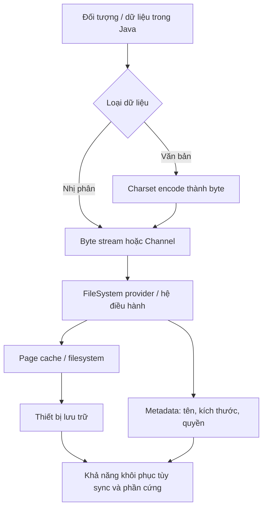
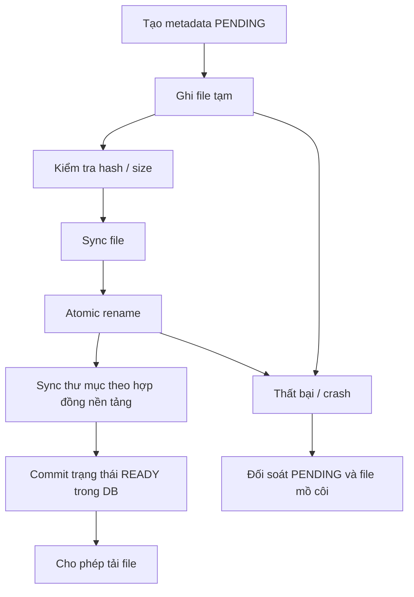

# Vai trò của Java I/O và NIO trong lưu trữ qua tệp

## Mục tiêu học tập

Sau bài học, người học có thể:

- Mô tả vai trò của **Java I/O** (`java.io`) và **NIO/NIO.2** (`java.nio`, `java.nio.file`) trong đọc, ghi, quản lý và truy cập dữ liệu lưu trên hệ thống tệp.
- Phân biệt **byte stream** với **character stream**, chọn charset khi chuyển byte ↔ văn bản và tránh làm hỏng dữ liệu nhị phân.
- Chọn `Path`, `Files`, `InputStream`, `OutputStream`, `FileChannel` và `ByteBuffer` phù hợp với khối lượng dữ liệu, kiểu truy cập và yêu cầu hiệu năng.
- Sử dụng `try-with-resources`, xử lý đọc/ghi chưa hoàn tất, giới hạn kích thước, ngoại lệ và lỗi tài nguyên an toàn.
- Giải thích sự khác nhau giữa **ghi thành công**, **flush buffer**, **đổi tên nguyên tử** và **lưu bền vững sau sự cố**.
- Thiết kế quy trình lưu tệp trong ứng dụng Java có kiểm soát đường dẫn, tên tệp, tính nhất quán với metadata trong cơ sở dữ liệu và khả năng phục hồi.

## 1. Hệ thống tệp là một lựa chọn persistence trong Java

Giả sử một dịch vụ Java cần lưu ảnh sản phẩm, hóa đơn PDF và tệp kết quả xuất báo cáo. Với dữ liệu có cấu trúc như đơn hàng, số dư hoặc quan hệ khách hàng, ứng dụng thường dùng database. Nhưng với dữ liệu nhị phân lớn hoặc nội dung có thể đọc bằng phần mềm bên ngoài, **hệ thống tệp (filesystem)** vẫn là một lựa chọn lưu trữ quan trọng.

Một thao tác lưu tệp bao gồm nhiều việc hơn gọi `Files.write(...)`:

1. Xác định **đường dẫn** và quyền được phép thao tác.
2. Mở tài nguyên đọc/ghi, chọn cách làm việc theo luồng hoặc truy cập ngẫu nhiên.
3. Chuyển đổi dữ liệu nếu là văn bản, hoặc giữ nguyên byte nếu là dữ liệu nhị phân.
4. Đảm bảo đã đọc/ghi đủ dữ liệu, đóng tài nguyên khi hoàn tất hay thất bại.
5. Quyết định khi nào tên tệp được công bố cho người đọc khác và mức **durability** cần cam kết.
6. Đồng bộ trạng thái với database nếu metadata của tệp nằm trong một transaction khác.

Trong module `DATA_PERSISTENCE_FUNDAMENTALS`, chủ đề **Hệ sinh thái Java** nối kiến thức về lưu trữ bền vững, truy vấn, giao dịch, kết nối, bảo mật và hiệu năng với các API Java cụ thể. Java I/O và NIO không thay thế hệ quản trị cơ sở dữ liệu: chúng cung cấp cách làm việc với **byte, tệp và tài nguyên lưu trữ**, còn ứng dụng phải tự thiết kế ràng buộc và quy trình nhất quán ở tầng nghiệp vụ.

### Từ đối tượng Java đến byte trên thiết bị



**Điểm phân biệt:** `write()` trả về thành công nghĩa là thao tác đã được tầng bên dưới chấp nhận theo hợp đồng API, **không mặc nhiên** nghĩa là mọi byte đã nằm trên bộ nhớ bền vững sau mất điện.

## 2. Java I/O, NIO và NIO.2 khác nhau ở đâu?

### 2.1. `java.io`: dòng byte hoặc ký tự

Các API `InputStream`, `OutputStream`, `Reader` và `Writer` mô tả dữ liệu như dòng phần tử được tiêu thụ hoặc tạo ra theo thứ tự. Chúng rất phù hợp với thao tác đọc/ghi tuần tự, tải lên, tải xuống, nén dữ liệu, giải mã và xử lý tệp có kích thước lớn không thể đưa toàn bộ vào RAM.

Nhiều stream truyền thống là **blocking I/O**: lời gọi có thể chờ dữ liệu hoặc thiết bị. Điều này không có nghĩa API `java.io` lỗi thời; nó vẫn là lớp trừu tượng thực dụng cho phần lớn pipeline xử lý byte.

### 2.2. `java.nio`: buffer, channel và truy cập theo vị trí

NIO giới thiệu `Buffer`/`ByteBuffer`, `Channel` và các API có khả năng làm việc với **vùng nhớ đệm** hoặc **vị trí trong tệp**. `FileChannel` hỗ trợ đọc/ghi tại vị trí, lấy kích thước, di chuyển vị trí con trỏ, ép đồng bộ dữ liệu, map file và một số hình thức truyền giữa channel.

Chữ “NIO” không đồng nghĩa **mọi I/O đều non-blocking**. `FileChannel.read/write` thông thường có thể chặn; `Selector` và non-blocking socket channels phục vụ I/O mạng, không phải lời hứa rằng mọi thao tác hệ thống tệp trở thành bất đồng bộ. `AsynchronousFileChannel` cung cấp API bất đồng bộ nhưng hành vi thực thi phụ thuộc provider.

### 2.3. NIO.2: `Path`, `Files`, `FileSystem`

Từ Java 7, `java.nio.file` cung cấp API giàu tính năng cho hệ thống tệp: `Path` biểu diễn đường dẫn; `Files` cung cấp thao tác tạo, sao chép, di chuyển, đọc/ghi, kiểm tra thuộc tính, duyệt thư mục và mở stream/channel. Các **file system provider** có thể có hành vi, thuộc tính và giới hạn khác nhau.

| Nhu cầu | API thường dùng | Điều cần lưu ý |
| --- | --- | --- |
| Đọc file nhị phân theo luồng | `Files.newInputStream(path)` | Đóng stream và kiểm soát số byte đọc |
| Ghi file nhị phân theo luồng | `Files.newOutputStream(path, ...)` | Chọn options tạo, ghi đè, append và đường lỗi |
| Đọc/ghi văn bản nhỏ | `Files.readString`, `Files.writeString` | Chỉ phù hợp khi kích thước có thể đưa vào bộ nhớ; chọn charset |
| Duyệt đường dẫn, copy/move/delete | `Path`, `Files` | Xử lý symbolic link, metadata, quyền và tính nguyên tử |
| Đọc/ghi theo offset | `FileChannel` + `ByteBuffer` | Cần quản lý buffer, offset và vòng lặp đọc/ghi |
| Đọc file theo luồng ký tự | `BufferedReader`/`BufferedWriter` | Đọc từng dòng, charset và line ending |
| Map vùng file vào bộ nhớ | `FileChannel.map` | Quản lý vòng đời mapping, giới hạn address space và consistency |

**Nguyên tắc chọn API:** ưu tiên API đơn giản nhất đáp ứng yêu cầu. Không thay `Files.newInputStream` bằng direct buffer hoặc memory-mapped file chỉ vì nghe có vẻ “nhanh hơn”; phải có số đo và hiểu mô hình lỗi của workload.

## 3. Byte stream và character stream: tránh nhầm nội dung với cách mã hóa

### 3.1. Byte stream không diễn giải dữ liệu

`InputStream` và `OutputStream` xử lý byte. Dùng chúng cho PDF, ảnh, ZIP, dữ liệu nén, file mã hóa hoặc một giao thức nhị phân. Không biến một ảnh JPEG thành `String` rồi ghi lại với UTF-8; thao tác đó có thể thay đổi byte và làm hỏng ảnh.

Ví dụ sao chép tệp nhị phân theo luồng:

```java
import java.io.IOException;
import java.io.InputStream;
import java.io.OutputStream;
import java.nio.file.Files;
import java.nio.file.Path;
import java.nio.file.StandardOpenOption;

public final class BinaryCopy {
    public static long copy(Path source, Path target) throws IOException {
        try (InputStream in = Files.newInputStream(source);
             OutputStream out = Files.newOutputStream(
                     target,
                     StandardOpenOption.CREATE_NEW,
                     StandardOpenOption.WRITE)) {
            byte[] buffer = new byte[64 * 1024];
            long total = 0;
            int count;
            while ((count = in.read(buffer)) != -1) {
                if (count == 0) {
                    continue; // Một số implementation có thể không tiến ngay.
                }
                out.write(buffer, 0, count);
                total += count;
            }
            out.flush();
            return total;
        }
    }
}
```

`CREATE_NEW` giúp không ghi đè tên đích đã tồn tại trong thao tác tạo tệp. Tuy nhiên, nếu xảy ra exception sau khi file đã được tạo, **tệp đích có thể là bản sao dở dang**. Đừng công bố nó cho người dùng chỉ vì nó đã tồn tại; phần sau sẽ dùng **file tạm và atomic move** để tránh tên chính thức trỏ tới dữ liệu chưa hoàn chỉnh.

Với nguồn/đích trên filesystem, `Files.copy(source, target)` cũng là lựa chọn thích hợp khi không cần logic xử lý từng chunk. Việc tự cài buffer chỉ có ích khi phải đếm byte, áp giới hạn, tính checksum hoặc biến đổi luồng.

### 3.2. Character stream chuyển đổi byte bằng charset

`Reader` và `Writer` làm việc với **ký tự** chứ không phải byte thô. Ví dụ một chữ tiếng Việt có thể cần nhiều byte UTF-8; mỗi lần đọc số ký tự không tương ứng với cùng số byte trên thiết bị.

```java
import java.io.BufferedReader;
import java.io.BufferedWriter;
import java.io.IOException;
import java.nio.charset.StandardCharsets;
import java.nio.file.Files;
import java.nio.file.Path;

public final class TextStore {
    public static void writeTitle(Path path, String title)
            throws IOException {
        try (BufferedWriter writer = Files.newBufferedWriter(
                path, StandardCharsets.UTF_8)) {
            writer.write(title);
            writer.newLine();
        }
    }

    public static String readFirstLine(Path path)
            throws IOException {
        try (BufferedReader reader = Files.newBufferedReader(
                path, StandardCharsets.UTF_8)) {
            return reader.readLine();
        }
    }
}
```

Chọn `StandardCharsets.UTF_8` tường minh để hợp đồng đọc/ghi rõ ràng và nhất quán giữa máy phát triển và production. `readLine()` trả dòng không bao gồm ký tự kết thúc dòng; nếu cần bảo toàn **chính xác từng byte**, phải dùng byte stream thay vì đọc rồi ghi lại từng dòng.

Một số đặc điểm cần ghi nhớ:

- `InputStreamReader` và `OutputStreamWriter` là cầu nối giữa byte stream và character stream; charset quyết định encode/decode.
- `BufferedReader`/`BufferedWriter` giảm số thao tác nhỏ khi đọc/ghi văn bản; `flush()` chỉ đẩy dữ liệu từ **buffer tầng Java** tới tầng dưới, không bảo đảm lưu bền vững trên thiết bị.
- `Files.readAllBytes` hoặc `Files.readString` tiện cho dữ liệu nhỏ, nhưng đưa toàn bộ nội dung vào bộ nhớ; không dùng mặc định cho upload hàng GB.
- Dữ liệu text không hợp lệ với charset có thể bị thay thế hoặc báo lỗi tùy decoder và cấu hình; khi nhận nguồn bên ngoài cần quy tắc validate/giới hạn kích thước.
- JSON và CSV đều là văn bản nhưng còn có **format** riêng: phải dùng parser/serializer phù hợp, không tự ghép delimiter hoặc tin rằng một dòng luôn là một bản ghi CSV.

### 3.3. `Files.lines()` trả một stream cần đóng

`Files.lines(path, UTF_8)` hỗ trợ xử lý nội dung theo dòng mà không tải cả file, nhưng stream giữ một tài nguyên đọc tệp. Ví dụ:

```java
import java.io.IOException;
import java.nio.charset.StandardCharsets;
import java.nio.file.Files;
import java.nio.file.Path;
import java.util.stream.Stream;

public long countNonBlankLines(Path path) throws IOException {
    try (Stream<String> lines = Files.lines(path, StandardCharsets.UTF_8)) {
        return lines.filter(s -> !s.isBlank()).count();
    }
}
```

Nếu trả `Stream<String>` ra khỏi phương thức, người gọi phải được chuyển giao trách nhiệm đóng một cách rõ ràng. Một số lỗi I/O khi stream đang được tiêu thụ có thể được bọc trong exception runtime thay vì xuất hiện ngay lúc mở file.

## 4. `Path` và `Files`: quản lý tệp bằng mô hình đường dẫn

`Path` là đối tượng đại diện đường dẫn theo provider, **không phải bản thân tệp đang mở**. Các thao tác như `resolve`, `normalize`, `getFileName` xử lý cấu trúc đường dẫn; các thao tác `Files` mới thực sự truy cập hệ thống tệp.

```java
import java.io.IOException;
import java.nio.file.Files;
import java.nio.file.Path;
import java.nio.file.Paths;

public final class DirectoryExample {
    public static Path ensureReportDirectory(Path storageRoot)
            throws IOException {
        Path reports = storageRoot.resolve("reports").normalize();
        Files.createDirectories(reports);
        return reports;
    }

    public static Path resolveReport(Path storageRoot, String fileId) {
        // fileId phải do ứng dụng sinh hoặc validate bằng allowlist.
        Path reports = storageRoot.resolve("reports");
        return reports.resolve(fileId + ".pdf").normalize();
    }
}
```

`resolve` ghép một đường dẫn con với đường dẫn cha; `normalize` loại một số thành phần cú pháp như `.` và `..`. **Nhưng `normalize()` không kiểm tra symbolic link và không tự xác thực đường dẫn có thật nằm trong storage root.** Vì vậy, đoạn `resolveReport` chỉ được dùng khi `fileId` đã được kiểm tra là tên file đơn giản do hệ thống sinh, không nhận trực tiếp đường dẫn tùy ý từ client.

Các phương thức `Files` thường gặp:

| Phương thức | Mục đích | Bẫy thường gặp |
| --- | --- | --- |
| `createDirectories` | Tạo đường dẫn thư mục còn thiếu | Cần kiểm soát quyền, symlink và môi trường nơi tạo |
| `newInputStream` / `newOutputStream` | Mở file dạng luồng byte | Phải đóng bằng `try-with-resources` |
| `readAllBytes` / `readString` | Đọc trọn nội dung | Không phù hợp nếu file lớn, không tin kích thước |
| `write` / `writeString` | Ghi byte/văn bản tiện lợi | Mặc định không cung cấp durable publish sau crash |
| `copy` | Sao chép file | Không mặc nhiên atomic; thuộc tính có thể không được giữ giống nhau trên mọi provider |
| `move` | Di chuyển/đổi tên | `ATOMIC_MOVE` chỉ có khi provider/filesystem hỗ trợ |
| `delete` / `deleteIfExists` | Xóa file hoặc entry | Thất bại nếu quyền không đủ hoặc không trống; ảnh hưởng dữ liệu thật |
| `readAttributes` | Đọc size, thời điểm và loại file | Thông tin có thể thay đổi ngay sau khi đọc, tránh kiểm tra-để-rồi-hành-động thiếu đồng bộ |

`Files.exists(path)` không phải bằng chứng tệp chắc chắn còn tồn tại ở thao tác kế tiếp: một process khác có thể đổi tên hoặc xóa giữa **check** và **use**. Tương tự, `Files.size(path)` hữu ích để quan sát, nhưng không nên là biện pháp duy nhất chống đọc quá lớn nếu dữ liệu có thể thay đổi trong lúc đọc.

## 5. `FileChannel` và `ByteBuffer`: đọc/ghi theo vị trí

### 5.1. Vòng đời của một `ByteBuffer`

`ByteBuffer` có ba giá trị quan trọng:

- **capacity:** số byte tối đa vùng buffer chứa.
- **position:** vị trí byte tiếp theo sẽ đọc hoặc ghi trong buffer.
- **limit:** ranh giới mà thao tác không được vượt qua.

Khi chuyển dữ liệu từ channel vào buffer, buffer ở chế độ **ghi**; sau đó gọi `flip()` để chuyển sang **đọc** dữ liệu vừa nhận. Sau khi tiêu thụ, dùng `clear()` để chuẩn bị ghi lại từ đầu, hoặc `compact()` để giữ phần chưa xử lý.

```text
ByteBuffer.allocate(8)
capacity = 8, position = 0, limit = 8

channel.read(buffer)     // Ví dụ nhận 5 byte: position = 5
buffer.flip()            // position = 0, limit = 5
process(buffer)          // Tiêu thụ 5 byte: position = 5
buffer.clear()           // position = 0, limit = 8
```

Quên `flip()` thường khiến mã cố đọc phần chưa ghi; quên `clear()/compact()` khiến vòng lặp tiếp theo không còn chỗ để nhận byte.

### 5.2. Đọc theo offset: không phải tải toàn file

`FileChannel` cho phép đọc một vùng byte tại offset cụ thể. Ví dụ đọc tối đa 16 byte bắt đầu ở vị trí 128:

```java
import java.io.IOException;
import java.nio.ByteBuffer;
import java.nio.channels.FileChannel;
import java.nio.file.Path;
import java.nio.file.StandardOpenOption;

public final class RandomRead {
    public static byte[] readWindow(Path path, long offset)
            throws IOException {
        if (offset < 0) {
            throw new IllegalArgumentException("offset must be >= 0");
        }
        try (FileChannel channel = FileChannel.open(
                path, StandardOpenOption.READ)) {
            ByteBuffer buffer = ByteBuffer.allocate(16);
            long filePosition = offset;
            while (buffer.hasRemaining()) {
                int n = channel.read(buffer, filePosition);
                if (n == -1) break;       // Đến EOF.
                if (n == 0) break;        // Không tiến được trong lần thử.
                filePosition += n;
            }
            buffer.flip();
            byte[] result = new byte[buffer.remaining()];
            buffer.get(result);
            return result;
        }
    }
}
```

Đây là trường hợp đọc theo **vị trí của file** bằng `read(buffer, position)`, không làm thay đổi vị trí đọc toàn cục của channel. API phù hợp với tệp có header cố định, index riêng hoặc cấu trúc nhị phân cần đọc một phần. Với file có thể bị thay đổi đồng thời, phải xác định cơ chế đồng bộ/phiên bản; đọc từng vùng khác thời điểm không tự đảm bảo một snapshot nhất quán.

**Không dùng `read()` một lần rồi giả định buffer đã đầy.** Giá trị trả về có thể ít hơn số byte còn trống; `-1` báo EOF. Khi đọc một record có kích thước bắt buộc, nếu EOF đến sớm thì phải báo tệp bị thiếu/truncated, không âm thầm chấp nhận.

### 5.3. Ghi buffer có thể cần nhiều lần gọi

`FileChannel.write(buffer)` có thể tiêu thụ ít hơn số byte còn lại; mã phải lặp cho tới khi `!buffer.hasRemaining()`. Nếu một channel liên tục trả `0`, phải có chính sách xử lý thay vì vòng lặp quay CPU mãi mãi.

```java
public static void writeFully(FileChannel channel, ByteBuffer payload)
        throws IOException {
    int stalls = 0;
    while (payload.hasRemaining()) {
        int n = channel.write(payload);
        if (n == 0) {
            if (++stalls > 100) {
                throw new IOException("File channel made no progress");
            }
        } else {
            stalls = 0;
        }
    }
}
```

Đây là mẫu nhỏ minh họa tính đầy đủ của thao tác ghi. Với mạng hoặc channel non-blocking, thiết kế chờ tiến triển sẽ khác (selector/backpressure); không áp dụng vòng lặp busy-spin như một giải pháp tổng quát.

## 6. Buffering, file transfer, memory mapping và asynchronous I/O

### 6.1. Buffer tăng hiệu quả, không tạo transaction

Đọc/ghi từng byte qua nhiều lần gọi hệ điều hành thường tốn chi phí hơn xử lý theo chunk. `BufferedInputStream`, `BufferedOutputStream`, `BufferedReader` và `ByteBuffer` cho phép gom thao tác. Nhưng:

- Buffering chủ yếu giúp giảm số lần chuyển dữ liệu qua các tầng; **không bảo đảm ghi nguyên tử hoặc tồn tại sau crash**.
- Kích thước buffer tối ưu phụ thuộc workload và hệ thống; không có con số 4 KiB, 64 KiB hay 1 MiB luôn tốt nhất.
- Tránh cấp phát buffer lớn cho hàng nghìn request đồng thời. Một tệp 1 GiB không cần trở thành `byte[]` 1 GiB.
- `ByteBuffer.allocateDirect()` có thể hữu ích khi tương tác native I/O, nhưng cấp phát/thu hồi direct memory cũng có chi phí. Cần đo trước khi lựa chọn.

### 6.2. `transferTo` và `transferFrom`

`FileChannel.transferTo`/`transferFrom` có thể tận dụng cơ chế chuyển dữ liệu hiệu quả của hệ điều hành, tránh sao chép không cần thiết qua user space. Tuy nhiên **một lần gọi không được đảm bảo chuyển đủ số byte yêu cầu**; phải kiểm tra giá trị trả về.

```java
import java.io.IOException;
import java.nio.channels.FileChannel;
import java.nio.file.Path;
import java.nio.file.StandardOpenOption;

public final class ChannelCopy {
    public static long copy(Path source, Path target) throws IOException {
        try (FileChannel in = FileChannel.open(
                    source, StandardOpenOption.READ);
             FileChannel out = FileChannel.open(
                    target,
                    StandardOpenOption.CREATE_NEW,
                    StandardOpenOption.WRITE)) {
            long size = in.size();
            long transferred = 0;
            while (transferred < size) {
                long n = in.transferTo(transferred, size - transferred, out);
                if (n <= 0) {
                    throw new IOException("Transfer stopped before copy finished");
                }
                transferred += n;
            }
            return transferred;
        }
    }
}
```

Ví dụ giả định source **không thay đổi trong lúc sao chép**. Nếu file được sửa đồng thời, kích thước chụp ban đầu không tương đương một snapshot nhất quán. Đích có thể còn bản sao thiếu khi exception; muốn công bố hoàn chỉnh cần ghi file tạm rồi đổi tên.

### 6.3. Memory-mapped file

`FileChannel.map(...)` tạo `MappedByteBuffer` cho phép truy cập vùng nội dung file qua bộ nhớ ánh xạ. Nó có thể phù hợp với dữ liệu có cấu trúc cần truy cập ngẫu nhiên nhiều lần, nhưng đòi hỏi hiểu giới hạn address space, vòng đời mapping và khả năng tương thích hệ điều hành.

- Không mặc định map file sẽ nhanh hơn streaming.
- Việc sửa/xóa file đang được map có hành vi phụ thuộc hệ điều hành.
- Mapping không tự cung cấp snapshot khi file bị writer khác sửa, và lỗi truncation có thể phức tạp.
- `MappedByteBuffer.force()` đồng bộ các thay đổi trong vùng map theo hợp đồng API; không tự làm directory entry bền vững sau rename.

### 6.4. `AsynchronousFileChannel`

API `AsynchronousFileChannel` cho phép gửi yêu cầu đọc/ghi theo vị trí và nhận kết quả qua `Future` hay `CompletionHandler`. Provider có thể dùng thread pool hoặc cơ chế của hệ điều hành; không được mặc định mọi thao tác đều là kernel non-blocking I/O hay nhanh hơn `FileChannel`.

Khi sử dụng asynchronous I/O, phải quản lý buffer còn được tác vụ sử dụng, đóng channel, xử lý cancellation, exception, progress và backpressure. Bắt đầu bằng API đồng bộ nếu workload chưa chứng minh lợi ích của bất đồng bộ.

## 7. Công bố file mới: nguyên tử khác bền vững

### 7.1. Vì sao không ghi trực tiếp vào tên chính thức?

Nếu dịch vụ ghi `daily-report.csv` trực tiếp, reader khác có thể thấy nội dung mới đang ghi dở. Khi tiến trình thất bại, tên file có thể tồn tại với một nửa dữ liệu. Quy trình thường dùng:

1. Tạo file tạm **trong cùng thư mục/filesystem** với đích.
2. Ghi đủ nội dung, kiểm tra số byte hoặc checksum.
3. Đồng bộ nội dung và metadata cần thiết của file tạm.
4. Di chuyển/đổi tên nguyên tử sang tên chính thức.
5. Khi cần chịu được OS crash hoặc power loss, đồng bộ **directory entry** theo hợp đồng của hệ điều hành/filesystem.
6. Chỉ công bố trạng thái hoàn chỉnh cho client sau khi đạt điều kiện độ bền đã cam kết.

`Files.move(temp, target, StandardCopyOption.ATOMIC_MOVE)` yêu cầu đổi tên **nguyên tử**, nhưng provider có thể ném `AtomicMoveNotSupportedException`. Atomic move không tự đồng nghĩa **durable rename** sau mất điện. Nếu đích đã tồn tại, ngữ nghĩa kết hợp `ATOMIC_MOVE` và thay thế đích phụ thuộc provider; nên ưu tiên tên đích riêng, bất biến.

### 7.2. Ví dụ ghi temp, sync file, rồi atomic move

```java
import java.io.IOException;
import java.nio.ByteBuffer;
import java.nio.channels.FileChannel;
import java.nio.file.AtomicMoveNotSupportedException;
import java.nio.file.Files;
import java.nio.file.Path;
import java.nio.file.StandardCopyOption;
import java.nio.file.StandardOpenOption;
import java.util.UUID;

public final class AtomicFilePublisher {
    private AtomicFilePublisher() {}

    public static Path publish(Path directory, byte[] data)
            throws IOException {
        // directory phải là thư mục được ứng dụng tin cậy và kiểm soát.
        Path target = directory.resolve(UUID.randomUUID() + ".bin");
        Path temp = Files.createTempFile(directory, ".upload-", ".tmp");
        try {
            try (FileChannel channel = FileChannel.open(
                    temp, StandardOpenOption.WRITE,
                    StandardOpenOption.TRUNCATE_EXISTING)) {
                ByteBuffer buffer = ByteBuffer.wrap(data);
                while (buffer.hasRemaining()) {
                    if (channel.write(buffer) == 0) {
                        throw new IOException("Cannot make progress writing file");
                    }
                }
                channel.force(true); // Sync data + metadata của chính file.
            }
            Files.move(temp, target, StandardCopyOption.ATOMIC_MOVE);
            // CÒN THIẾU BƯỚC PHỤ THUỘC HỆ ĐIỀU HÀNH:
            // đồng bộ thư mục cha để làm bền vững entry tên file mới.
            // Không tuyên bố bền vững sau power loss khi chưa có bước đó.
            return target;
        } catch (AtomicMoveNotSupportedException error) {
            throw new IOException("Atomic rename unsupported", error);
        } finally {
            Files.deleteIfExists(temp);
        }
    }
}
```

Đây là **khung minh họa**, chưa phải triển khai đảm bảo chống mất điện trên mọi nền tảng. `FileChannel.force(true)` đồng bộ file theo hợp đồng API, nhưng **không phải API portable để fsync thư mục**. Trên nhiều hệ POSIX, công bố bền vững dùng `fsync(file)` và `fsync(parent directory)`. Java không cung cấp cơ chế đồng bộ thư mục với cùng cam kết đa nền tảng; yêu cầu nghiêm ngặt cần triển khai theo hợp đồng OS/filesystem đã được kiểm chứng.

Với code production, lỗi cleanup trong `finally` có thể che lỗi gốc; cần giữ thông tin lỗi và thu gom file tạm còn sót. Atomic move qua hai filesystem có thể không được hỗ trợ. Nếu request mất phản hồi sau khi move thành công, retry cần ID/idempotency để tránh tạo nhiều file mồ côi.

### 7.3. Các điểm crash đáng kiểm tra

| Thời điểm | Trạng thái tên chính thức | Xử lý phục hồi |
| --- | --- | --- |
| Đang ghi temp | Chưa công bố | Dọn file tạm thiếu |
| Ghi xong nhưng chưa `force` | Chưa công bố | Không giả định data đã bền vững |
| `force` xong, trước move | Chưa công bố | Đối soát temp theo ID/checksum |
| Move xong, trước sync thư mục | Có thể đã nhìn thấy trước crash | Chưa xác nhận tên mới bền vững |
| Sau cả sync file và thư mục | Công bố bền vững theo hợp đồng nền tảng | Vẫn cần backup/replica cho hỏng thiết bị hoặc mất vùng lưu trữ |

**Ghi thành công**, **atomicity** và **durability** là ba cam kết khác nhau. Java I/O không tự biến nhiều lần ghi nhiều file thành một transaction ACID.

## 8. Nhiều reader/writer, khóa file và sự kiện thư mục

### 8.1. Reader có thể nhìn thấy dữ liệu không nhất quán

Khi writer chỉnh sửa tệp ngay trong lúc reader đọc, không có bảo đảm chung rằng reader nhìn thấy một snapshot đồng nhất. Reader có thể đọc header cũ và phần thân mới, gặp EOF sớm hoặc chứng kiến kích thước file đổi giữa các lần gọi.

Những chiến lược cần cân nhắc:

- **Phiên bản bất biến:** writer tạo file mới hoàn chỉnh, sau đó thay pointer/metadata; reader dùng một ID phiên bản không đổi.
- **Một writer cho một tài nguyên:** điều phối lệnh ghi qua queue hoặc khóa theo file ID.
- **File lock:** phối hợp các bên tham gia cùng giao thức trên nền tảng hỗ trợ.
- **Checksum và version:** phát hiện nội dung lệch hoặc thay đổi; checksum không tự ngăn writer sửa dữ liệu.

### 8.2. `FileLock` không tương đương transaction

`FileChannel.lock()` và `tryLock()` cho phép yêu cầu khóa trên toàn bộ hoặc một vùng file. Hành vi khóa phụ thuộc OS, filesystem, driver; trên nhiều hệ thống, khóa là **advisory**, nghĩa là tác nhân khác phải tự tuân theo cùng quy ước. Trên một số nền tảng, cách xử lý cùng tệp trong cùng JVM cũng có ràng buộc riêng.

```java
import java.io.IOException;
import java.nio.channels.FileChannel;
import java.nio.channels.FileLock;
import java.nio.file.Path;
import java.nio.file.StandardOpenOption;

public static void runUnderLock(Path path) throws IOException {
    try (FileChannel channel = FileChannel.open(
                path, StandardOpenOption.CREATE, StandardOpenOption.WRITE);
         FileLock lock = channel.lock()) {
        // Thao tác ngắn trên file; lock được giải phóng khi thoát try.
        // Những writer khác phải tuân thủ cùng quy ước.
    }
}
```

Lock có thể được nhả khi process chết, nhưng byte trước đó chưa chắc đã được flush bền vững. Nó cũng không khóa transaction PostgreSQL hay biến nhiều file thành một commit nguyên tử. Nếu cần đồng bộ dữ liệu qua nhiều hệ thống, phải thiết kế giao thức phục hồi hoặc dùng cơ chế giao dịch hỗ trợ trực tiếp.

### 8.3. `WatchService` là thông báo thay đổi, không phải xác nhận hoàn tất

NIO.2 có `WatchService` theo dõi sự kiện tạo, sửa, xóa entry thư mục. Sự kiện có thể đến muộn, gộp hoặc mất chi tiết khi xảy ra `OVERFLOW`. Không dùng tín hiệu “file created” để kết luận nội dung đã ghi xong hoặc đã bền vững trên ổ đĩa. Consumer cần đọc trạng thái công bố, ID/version và đối soát định kỳ khi yêu cầu nghiệp vụ quan trọng.

## 9. Bảo mật đường dẫn và quản lý tài nguyên

### 9.1. Tránh path traversal và truy cập ngoài vùng cho phép

Ứng dụng không nên ghép trực tiếp tên client cung cấp vào đường dẫn:

```java
// KHÔNG AN TOÀN nếu rawName đến trực tiếp từ request.
Path target = storageRoot.resolve(rawName);
```

Tên `../../config/secrets.yml` có thể trỏ ra ngoài thư mục upload; symbolic link cũng có thể làm đường đi thực khác đường đi trong chuỗi. Chỉ gọi `normalize()` hoặc kiểm tra `startsWith(root)` không tự chống mọi dạng **symbolic-link race / time-of-check-to-time-of-use (TOCTOU)**.

Một lựa chọn đơn giản và an toàn hơn là **server sinh tên file** rồi chỉ lưu ID cho client:

```java
import java.nio.file.Path;
import java.util.UUID;

public static Path newUploadPath(Path trustedRoot) {
    String name = UUID.randomUUID() + ".dat";
    return trustedRoot.resolve("uploads").resolve(name);
}
```

`trustedRoot` phải là thư mục cấu hình được kiểm soát quyền, không phải đầu vào tùy ý. Nếu hệ thống cho phép người dùng chọn đường dẫn, cần chính sách allowlist, kiểm soát quyền hệ điều hành và giải pháp thao tác dựa trên directory handle/provider phù hợp; `SecureDirectoryStream` hỗ trợ một số thao tác chống race khi provider cho phép. Không giả định `Files.isRegularFile()` rồi sau đó mở file đảm bảo không có ai thay symlink ở giữa.

### 9.2. Kiểm soát số byte và tính toàn vẹn

- **Giới hạn kích thước upload:** đếm byte **thực tế** khi streaming, không chỉ tin `Content-Length` hoặc độ dài tệp do client công bố.
- **Định dạng:** kiểm tra signature/content khi cần, không tin duy nhất đuôi `.pdf` hay MIME type do client gửi.
- **Quyền:** file upload nên có permission/ACL tối thiểu; API và provider xử lý khác nhau theo OS.
- **Hash:** SHA-256 giúp đối chiếu dữ liệu với metadata, nhưng không xác thực nguồn gốc nếu attacker có thể sửa cả file và hash.
- **Dung lượng:** theo dõi quota, disk-full, file tạm và số file descriptor đang mở; `IOException` khi thiếu dung lượng không được biến thành trạng thái thành công.
- **Không công bố trực tiếp:** với file nhạy cảm, không đặt nội dung vào thư mục public mà web server phục vụ không qua xác thực hoặc phân quyền.

Ví dụ đọc upload có giới hạn để tránh một request tiêu thụ vô hạn tài nguyên:

```java
import java.io.IOException;
import java.io.InputStream;
import java.io.OutputStream;

public static long copyWithLimit(
        InputStream in, OutputStream out, long maxBytes) throws IOException {
    if (maxBytes < 0) {
        throw new IllegalArgumentException("maxBytes must be >= 0");
    }
    byte[] buffer = new byte[64 * 1024];
    long total = 0;
    int n;
    while ((n = in.read(buffer)) != -1) {
        if (n == 0) continue;
        if (n > maxBytes - total) {
            throw new IOException("Upload exceeds allowed size");
        }
        out.write(buffer, 0, n);
        total += n;
    }
    return total;
}
```

Phương thức này **không tự đóng** `in` hoặc `out` vì caller sở hữu chúng; contract phải ghi rõ. Trong một pipeline upload, caller nên dùng `try-with-resources` để đóng cả hai resource ngay cả khi vượt giới hạn. Nếu đã ghi một phần vào tệp tạm, phải có cơ chế dọn dẹp, không công bố file thiếu.

### 9.3. Duyệt thư mục: stream cũng giữ tài nguyên

`Files.list`, `Files.walk` và `Files.find` trả `Stream<Path>` có thể giữ directory handle. Cần đóng:

```java
import java.io.IOException;
import java.nio.file.Files;
import java.nio.file.Path;
import java.util.stream.Stream;

public static long countRegularFiles(Path directory) throws IOException {
    try (Stream<Path> entries = Files.list(directory)) {
        return entries.filter(Files::isRegularFile).count();
    }
}
```

`Files.list` chỉ liệt kê một cấp; `Files.walk` có thể đi qua cây thư mục lớn, gặp quyền hạn, symlink hoặc lỗi giữa chừng. Với thao tác xóa, cần bảo vệ chặt thư mục đích và không dùng một đường dẫn được tính từ đầu vào không tin cậy để thực hiện xóa đệ quy. Đừng coi kết quả liệt kê là một snapshot ổn định nếu có process khác liên tục tạo/xóa file.

## 10. Khi ứng dụng lưu file nhưng metadata ở database

Một dịch vụ quản lý hồ sơ có thể lưu file PDF trên disk và record PostgreSQL:

```sql
CREATE TABLE stored_file (
    id UUID PRIMARY KEY,
    relative_path TEXT NOT NULL UNIQUE,
    size_bytes BIGINT CHECK (size_bytes >= 0),
    sha256_hex CHAR(64),
    status VARCHAR(16) NOT NULL
           CHECK (status IN ('PENDING', 'READY', 'FAILED'))
);
```

**JDBC transaction chỉ bao phủ dữ liệu do database quản lý.** Ghi file bằng `Files.newOutputStream` hoặc `FileChannel` nằm ngoài transaction PostgreSQL; nếu database rollback, file đã ghi không tự biến mất. Nếu file ghi thất bại, transaction DB đã commit cũng không tự rollback chỉ vì Java bắt được `IOException` sau commit.

### Giao thức công bố theo trạng thái

1. Tạo ID ổn định và record `PENDING` trong database; API tải file **không** phục vụ record này.
2. Tạo tên file tạm tương ứng với ID; ghi nội dung theo stream, kiểm tra kích thước và checksum.
3. Yêu cầu đồng bộ file, atomic rename và đồng bộ thư mục nếu cần độ bền sau crash theo nền tảng.
4. Trong transaction DB, cập nhật `status = 'READY'` cùng size/hash đã kiểm tra.
5. Nếu xảy ra lỗi giữa hai nơi lưu trữ, một **reconciliation job** tìm `PENDING` quá hạn và file mồ côi để hoàn tất hoặc dọn dẹp có kiểm soát.



Nếu crash **sau khi file hoàn chỉnh nhưng trước khi DB cập nhật READY**, file có thể còn nhưng chưa được tham chiếu: reconciler kiểm tra ID, kích thước, hash và trạng thái để xử lý idempotent. Nếu cập nhật READY trước khi file thực sự hoàn chỉnh, hệ thống có nguy cơ công bố đường dẫn thiếu/hỏng.

Phương án khác là lưu nội dung nhỏ vừa phải trực tiếp trong database, để metadata và byte có thể được quản lý bởi **cùng transaction**. Đổi lại, dung lượng DB, WAL, replication và backup tăng. Với object storage, dùng hợp đồng API/versioning của dịch vụ; không áp dụng quy tắc `fsync(parent directory)` của POSIX cho một dịch vụ object từ xa.

## 11. Hiệu năng và lựa chọn API theo workload

| Trường hợp sử dụng | Lựa chọn hợp lý để bắt đầu | Khi cần xem xét giải pháp khác |
| --- | --- | --- |
| Đọc file cấu hình UTF-8 nhỏ, đáng tin | `Files.readString(path, UTF_8)` | Khi file có thể lớn, đổi sang `BufferedReader`/`Files.lines` |
| Đọc hoặc ghi PDF/ảnh hàng trăm MB | `InputStream`/`OutputStream` với buffer và giới hạn | `FileChannel`/`transferTo` khi cần hiệu năng cao và đo được lợi ích |
| Đọc các record tại offset xác định | `FileChannel.read(buffer, offset)` | `MappedByteBuffer` nếu truy cập lặp lớn và đã đánh giá vòng đời mapping |
| Xuất báo cáo CSV | `BufferedWriter` + UTF-8 | Ghi temp và atomic publish nếu reader khác có thể tải đồng thời |
| Upload của người dùng | Stream vào file tạm + giới hạn byte + hash | Object storage hoặc streaming service khi cần scale/khả năng phục hồi |
| Nhiều tác vụ đọc/ghi file đồng thời | Thread pool giới hạn và backpressure | `AsynchronousFileChannel` nếu lợi ích được xác nhận bằng benchmark |
| Metadata cần query/transaction phức tạp | Database + file content riêng có trạng thái | Lưu BLOB trong DB khi cần atomicity và workload phù hợp |
| Thao tác cần tồn tại sau crash | Sync file + công bố + sync directory theo nền tảng | Storage service có durability contract rõ và cơ chế backup |

Khi tối ưu, đo **throughput**, p50/p95/p99 latency, số byte cấp phát, heap/direct memory, file descriptor, system call, disk IOPS, băng thông, page cache pressure và số tác vụ I/O đồng thời. Không tối ưu bằng cách tăng vô hạn thread hay kích thước buffer; cả hai có thể khiến hệ thống dùng thêm RAM, tăng queue và giảm thông lượng.

### Ba tầng cache và một hiểu nhầm phổ biến

Một writer có thể đẩy dữ liệu từ buffer Java xuống kernel nhưng vẫn còn **page cache** của OS và cache thiết bị. Vì thế:

- `OutputStream.flush()` giải quyết buffer ứng dụng (nếu có), không phải lệnh durable write.
- `FileChannel.force(true)` yêu cầu đồng bộ nội dung và metadata file theo hợp đồng API, nhưng không khẳng định mọi storage/thiết bị ngoài hợp đồng đều an toàn.
- `Files.move(..., ATOMIC_MOVE)` quản lý việc công bố tên nguyên tử, không tự đảm bảo metadata thư mục đã survive power loss.
- Backup và replica là bài toán khác, cần thiết cho lỗi thiết bị, mất vùng lưu trữ, xóa nhầm hoặc dữ liệu hỏng logic.

## 12. Kiểm thử tài nguyên, crash và tính đúng đắn

### 12.1. Những đường lỗi cần có trong bài kiểm thử

| Tình huống | Cần xác minh |
| --- | --- |
| File không tồn tại | `NoSuchFileException` được xử lý theo chính sách, không trả dữ liệu giả |
| Không có quyền đọc/ghi | `AccessDeniedException`/`IOException` được ghi nhận; không công bố thành công |
| Đĩa hết dung lượng giữa lúc ghi | File tạm không bị biến thành file chính thức; có cleanup/đối soát |
| Đọc đến EOF sớm | Không giả định đã nhận đủ record nhị phân |
| `FileChannel.write` ghi được ít hơn số byte yêu cầu | Vòng lặp tiếp tục, tránh mất phần còn lại |
| File vượt quota | Từ chối sau khi đếm byte thực, dọn temp và đóng nguồn |
| Parser text gặp mã byte không hợp lệ | Chính sách charset/validation được áp dụng nhất quán |
| `ATOMIC_MOVE` không được hỗ trợ | Báo lỗi hoặc chọn quy trình được thiết kế riêng, không hạ cấp âm thầm |
| Reader mở file khi writer đang ghi | Không thấy dữ liệu dở dang dưới tên chính thức theo giao thức công bố |
| Crash giữa file và metadata DB | Reconciler có thể tìm và giải quyết `PENDING`/file mồ côi |

Unit test có thể dùng tệp tạm trong thư mục dành riêng cho test, kiểm tra byte/hash thực tế và đóng resource bằng `try-with-resources`. Với bài kiểm thử tranh chấp, dùng hai luồng/tiến trình với latch hoặc đồng bộ có kiểm soát, tránh dựa vào thời gian ngủ ngẫu nhiên.

**Cần phân biệt mô hình lỗi:** giết tiến trình Java không tương đương **mất điện máy**; page cache của OS có thể tiếp tục flush. Kiểm thử logic crash bằng fault injection giữa các bước chỉ chứng minh luồng **phục hồi của ứng dụng**, không chứng minh durability phần cứng. Muốn xác nhận hợp đồng power-loss, cần môi trường thử nghiệm chuyên biệt hoặc khả năng fault injection lưu trữ thích hợp; không làm thử nghiệm phá hủy trên production.

### 12.2. Kiểm tra tài nguyên còn mở

Một hệ thống có thể cạn **file descriptor** hoặc directory handle nếu quên đóng `InputStream`, `FileChannel` hay stream trả về từ `Files.walk`. Theo dõi số file descriptor/process handle và số request đang streaming; dùng profiler/monitoring của JVM/OS trong môi trường phù hợp. Garbage collector không thay thế việc đóng tài nguyên đúng lúc.

Nếu một phương thức tạo và trả `InputStream` cho caller, hợp đồng phải nói **caller chịu trách nhiệm đóng**. Nếu phương thức tự đọc và trả DTO/byte đã hoàn chỉnh, nên đóng stream bên trong. Một API không rõ quyền sở hữu thường làm phát sinh leak khó điều tra.

## 13. Câu hỏi và bài tập tình huống

**Câu 1 — Nhị phân hay văn bản?** Một API nhận file PDF và muốn lưu nguyên byte. Nên dùng `Reader/Writer` hay `InputStream/OutputStream`? Vì sao?

**Câu 2 — Không đọc đủ:** `FileChannel.read(buffer)` trả về 128 trong khi buffer còn chỗ cho 4096 byte. Có thể kết luận file bị lỗi không? Mã cần làm gì nếu record phải đủ 4096 byte?

**Câu 3 — ByteBuffer:** Sau khi channel đọc được 200 byte vào buffer ở chế độ ghi, lập trình viên gọi `get()` ngay mà không `flip()`. Điều gì có thể xảy ra?

**Câu 4 — Ghi đè file:** Một job mới ghi trực tiếp vào `monthly.csv` đang được tải bởi người dùng. Khi job lỗi ở giữa, người dùng tải được file thiếu. Hãy đề xuất quy trình công bố khác.

**Câu 5 — Độ bền:** Tệp đã `FileChannel.force(true)`, sau đó `ATOMIC_MOVE` thành tên chính thức. Có thể khẳng định tên đích luôn tồn tại sau mất điện trên mọi filesystem không? Còn thiếu bước nào?

**Câu 6 — Đường dẫn:** Ứng dụng gọi `root.resolve(userProvidedName).normalize()` rồi lưu file. Vì sao cách này chưa đủ chống path traversal hoặc symlink race?

**Câu 7 — Hai nơi lưu trữ:** Java ghi file và DB record `READY`. Khi DB commit trước, quá trình ghi file thất bại. Hệ thống đang ở trạng thái gì? Nêu cách dùng `PENDING` và đối soát.

**Câu 8 — Dung lượng file lớn:** Dịch vụ tải file 2 GiB để gửi HTTP response bằng `Files.readAllBytes()`. Rủi ro là gì và nên đổi sang API nào?

**Câu 9 — Streaming resource:** Một repository trả `Stream<String>` từ `Files.lines` cho tầng khác, nhưng không nói ai đóng stream. Lỗi vận hành nào có thể phát sinh?

**Câu 10 — Khóa file:** Một process có `FileLock` độc quyền. Process khác không tuân thủ khóa vẫn sửa được nội dung ở một số nền tảng. Đây có phải bug logic Java không? Nên chọn giao thức phối hợp nào?

### Gợi ý đáp án

1. **Byte stream** để giữ nguyên byte PDF; `Reader/Writer` diễn giải bằng charset và có thể thay đổi dữ liệu nhị phân.
2. **Không.** Read có thể trả ít byte hơn yêu cầu. Phải lặp và kiểm tra tiến triển/EOF; nếu record cố định chưa đủ mà gặp EOF, báo dữ liệu thiếu.
3. Position/limit vẫn ở trạng thái ghi; `get()` có thể đọc vùng không phải phần mới nhận hoặc gây lỗi khi buffer không còn byte có thể đọc. Cần `flip()` trước khi tiêu thụ.
4. Ghi file tạm cùng filesystem, đóng/sync file, atomic rename vào tên công bố và xử lý durability của directory entry theo yêu cầu. Có thể ưu tiên tên phiên bản bất biến.
5. **Không.** Atomic rename khác durable rename. Cần đồng bộ directory entry theo hợp đồng nền tảng; cũng không được hứa chống mọi lỗi phần cứng ngoài mô hình lưu trữ.
6. `normalize()` chỉ xử lý cú pháp đường dẫn, không chống mọi symlink hoặc TOCTOU. Ưu tiên tên/ID do server sinh, thư mục tin cậy, quyền tối thiểu và cơ chế mở an toàn theo provider khi có attacker cùng sửa cây thư mục.
7. DB `READY` trỏ tới file thiếu/hỏng. Dùng `PENDING`, chỉ đổi `READY` sau khi file đã công bố hoàn chỉnh; có job đối soát và retry idempotent.
8. `readAllBytes()` cần cấp phát lượng RAM lớn, dễ gây out-of-memory/GC pressure. Dùng `InputStream`/`FileChannel` theo chunk và giới hạn concurrent streaming.
9. Directory/file descriptor có thể bị giữ lâu dẫn tới resource leak. Đặt trách nhiệm đóng rõ ràng và dùng `try-with-resources` trong phạm vi tiêu thụ stream.
10. Không nhất thiết. `FileLock` phụ thuộc nền tảng và nhiều nơi có semantics advisory. Các writer phải tuân theo cùng quy ước; có thể dùng version file, một writer hoặc giao thức khóa logic theo yêu cầu.

## 14. Checklist thiết kế lưu trữ qua tệp trong Java

- [ ] Biết rõ dữ liệu là **byte nhị phân** hay **text cần charset**; dùng UTF-8 tường minh khi hợp đồng là văn bản UTF-8.
- [ ] Không đọc toàn bộ file lớn vào RAM khi có thể xử lý theo stream/chunk.
- [ ] Kiểm tra số byte thực sự đọc/ghi; xử lý partial read/write, EOF và exception.
- [ ] Đóng `InputStream`, `OutputStream`, `Reader`, `Writer`, `FileChannel` và stream liệt kê thư mục đúng quyền sở hữu.
- [ ] Chọn `Path`/`Files` cho thao tác file thông thường; chỉ dùng memory mapping/async khi có nhu cầu rõ và đo được lợi ích.
- [ ] Tách tên file do client gửi khỏi đường dẫn thật; ưu tiên ID server sinh, kiểm soát quyền và symbolic link.
- [ ] Đặt giới hạn upload, quota, checksum, validation định dạng và bảo vệ nội dung nhạy cảm.
- [ ] Nếu cần reader chỉ thấy file hoàn chỉnh, ghi temp rồi atomic move; không ghi trực tiếp đè lên file đang dùng.
- [ ] Nếu cần độ bền sau power loss, hiểu `force/fsync` file và độ bền **directory entry** theo OS/filesystem.
- [ ] Không nhầm `FileLock` hoặc `WatchService` với transaction/đảm bảo durability.
- [ ] Khi file nằm ngoài DB, dùng trạng thái `PENDING/READY`, retry idempotent và reconciliation sau lỗi.
- [ ] Theo dõi latency, throughput, disk space, file descriptor, kích thước file tạm và lỗi I/O.
- [ ] Kiểm thử các đường lỗi, process crash và power-loss theo đúng mô hình lỗi được đặt ra; có backup/restore khi cần phục hồi dữ liệu.

**Ghi nhớ:** Java I/O cho ta các abstraction thuận tiện để đọc/ghi **dòng byte và ký tự**; NIO/NIO.2 bổ sung `Path`/`Files`, `Channel`/`Buffer`, truy cập theo vị trí và cơ chế quản lý filesystem phong phú hơn. Chọn API dựa trên **kích thước, kiểu dữ liệu, quyền sở hữu tài nguyên, tính đồng thời và cam kết độ bền**. Khi nội dung file tham gia một ứng dụng có database, correctness không kết thúc ở `write()`: phải thiết kế rõ ranh giới công bố, metadata, giao dịch và phục hồi sau sự cố.
