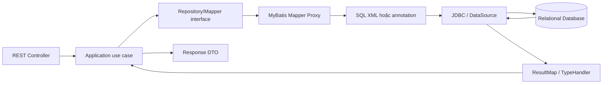

# Vai trò MyBatis khi ứng dụng chủ động quản lý SQL

## 1. Khi nào Java cần một công cụ ánh xạ SQL thay vì ORM đầy đủ?

Một ứng dụng Java có thể cần truy vấn PostgreSQL để hiển thị danh sách đơn hàng, giảm tồn kho hoặc tạo báo cáo. Lập trình viên có thể dùng JDBC trực tiếp, sử dụng ORM như JPA/Hibernate, hoặc chọn **MyBatis** để giữ quyền thiết kế câu SQL nhưng giảm công việc chuyển đổi giữa kết quả truy vấn và đối tượng Java.

Với MyBatis, ứng dụng chủ động định nghĩa **câu SQL nào được chạy**, **tham số nào được truyền** và **kết quả được ánh xạ vào kiểu Java nào**. Framework giúp quản lý mapper, gắn tham số, chuyển đổi kết quả và tích hợp với giao dịch; nó không cố che giấu SQL đằng sau mô hình entity được tự động theo dõi trạng thái.

Bài học thuộc chương **Hệ sinh thái Java** của module **DATA_PERSISTENCE_FUNDAMENTALS**. Khi thiết kế persistence boundary, người học cần hiểu cách MyBatis liên kết mã Java với lược đồ dữ liệu, truy vấn/chỉ mục, transaction, bảo mật, tài nguyên kết nối, kiểm soát đồng thời, schema migration và hiệu năng.

> **Ý chính:** MyBatis là một **SQL mapper**. SQL vẫn do lập trình viên thiết kế và chịu trách nhiệm; MyBatis cung cấp hạ tầng ánh xạ và thực thi thuận tiện hơn so với việc tự viết toàn bộ JDBC boilerplate.

## 2. MyBatis nằm ở đâu trong luồng xử lý?

Trong một hệ thống phân lớp, use case điều phối nghiệp vụ và transaction; mapper thực hiện SQL đã được khai báo; database bảo vệ tính toàn vẹn cuối cùng.



Một ví dụ thực tế là endpoint đặt giữ 2 sản phẩm:

1. Controller nhận request DTO `{quantity: 2}`, lấy `tenantId` từ ngữ cảnh xác thực.
2. Use case bắt đầu transaction, kiểm tra yêu cầu và gọi mapper.
3. Mapper chạy `UPDATE inventory SET available = available - ? WHERE ... AND available >= ?`.
4. Database khóa/điều phối việc cập nhật hàng theo engine, thực thi constraint và trả về số dòng đã cập nhật.
5. Use case ghi thêm phiếu đặt giữ rồi commit **cùng transaction**, hoặc rollback nếu có lỗi.
6. Mapper có thể đọc lại hàng tồn kho và ánh xạ thành một Java object cho response.

Không nên gọi MyBatis là công cụ “tự bảo đảm tính đúng đắn nghiệp vụ”. Nó thực thi các câu SQL được cung cấp; việc đặt constraint, dùng transaction, chọn mức cô lập và xử lý retry đúng vẫn là trách nhiệm thiết kế ứng dụng và hệ lưu trữ.

## 3. So sánh JDBC thuần, MyBatis và JPA/Hibernate

| Tiêu chí | JDBC trực tiếp | MyBatis | JPA/Hibernate |
| --- | --- | --- | --- |
| Ai chủ động viết SQL? | Lập trình viên | **Lập trình viên**; XML, annotation hoặc SQL builder | ORM có thể tự sinh SQL; vẫn hỗ trợ native SQL và JPQL |
| Binding tham số | `PreparedStatement` thủ công | `#{...}` được chuyển thành tham số của prepared statement | Query parameters hoặc các thao tác entity |
| Mapping kết quả | Tự lấy `ResultSet` và xây object | `resultType`, `resultMap`, `TypeHandler` | Entity mapping và persistence context |
| Theo dõi entity thay đổi | Không | **Không có dirty checking tự động kiểu JPA** | Có dirty checking đối với managed entity |
| Quan hệ và lazy loading | Thủ công | Có cơ chế nested mapping/select, lazy loading tùy cấu hình; cần kiểm soát truy vấn | Mapping quan hệ, fetch và cascade phong phú |
| Tối ưu câu SQL cụ thể | Trực tiếp | **Trực tiếp**, thuận tiện với SQL phức tạp | Tùy query ORM/native SQL và cách fetch |
| Chi phí bảo trì | Nhiều mã JDBC lặp | Cần bảo trì SQL và mapping | Cần hiểu mô hình ORM, SQL sinh ra và vòng đời entity |
| Schema migration | Công cụ riêng | **Công cụ riêng**, MyBatis không phải migration tool | Cũng nên quản lý schema production bằng migration rõ ràng |

Lựa chọn không chỉ là “framework nào nhanh hơn”. Với báo cáo phức tạp, truy vấn theo SQL đặc thù, truy vấn nhiều bảng hoặc database đã có schema rõ ràng, MyBatis giúp giữ truy vấn dễ thấy và đo được. Với mô hình aggregate giàu quan hệ và nhu cầu quản lý vòng đời entity, JPA có thể giúp giảm một số thao tác SQL thủ công. JDBC thuần vẫn hợp lý cho adapter nhỏ, rất ít câu truy vấn hoặc khi cần quyền kiểm soát ở mức thấp.

Đôi khi một ứng dụng dùng MyBatis cho read model phức tạp và một công cụ khác cho các luồng ghi. Khi đó phải **thiết kế nhất quán về datasource, giao dịch và ownership dữ liệu**, tránh giả định hai công nghệ tự tham gia cùng một transaction chỉ vì chúng chạy trong cùng process.

## 4. Những thành phần cốt lõi của MyBatis

| Thành phần | Vai trò | Lưu ý thiết kế |
| --- | --- | --- |
| `SqlSessionFactory` | Tạo `SqlSession`, chứa cấu hình đã dựng | Thường khởi tạo dùng chung cho một cấu hình dữ liệu |
| `SqlSession` | Ranh giới thực thi các statement và tương tác transaction ở MyBatis core | Không chia sẻ một session giữa các thread; phải đóng sau sử dụng |
| Mapper interface | Khai báo phương thức Java cho từng truy vấn/thao tác | Tên phương thức khớp statement ID, namespace phải đúng |
| Mapper XML / annotations | Định nghĩa `SELECT`, `INSERT`, `UPDATE`, `DELETE` và SQL động | SQL do đội phát triển chịu trách nhiệm |
| `#{parameter}` | Gắn **giá trị** làm tham số JDBC | Mặc định an toàn hơn ghép chuỗi trực tiếp cho dữ liệu không tin cậy |
| `resultMap` / `resultType` | Ánh xạ kết quả sang Java object | Với tên cột lệch tên trường, ưu tiên mapping tường minh |
| `TypeHandler` | Chuyển đổi giữa giá trị JDBC và kiểu Java | Cần thiết với kiểu đặc thù như enum, JSON, UUID tùy driver |
| Executor, cache, interceptors | Cơ chế thực thi, tối ưu hoặc mở rộng | Phải hiểu phạm vi cache và ảnh hưởng tới transaction |

Khi dùng **MyBatis-Spring**, Mapper bean thường được cung cấp thông qua `SqlSessionTemplate` và được đồng bộ với transaction của Spring. Ứng dụng không cần tự mở/đóng `SqlSession` mỗi lần gọi mapper; đó là một khác biệt quan trọng so với MyBatis core.

## 5. Bài toán xuyên suốt: giữ tồn kho không âm

Ta cần một thao tác tạo phiếu đặt giữ hàng. Ràng buộc nghiệp vụ:

- `quantity` phải dương.
- Một mặt hàng được nhận diện theo cặp `tenant_id` và `sku`.
- Số lượng khả dụng `available` không được âm, kể cả khi nhiều request đến đồng thời.
- Việc giảm tồn kho và lưu phiếu đặt giữ phải **cùng commit hoặc cùng rollback**.

Ví dụ schema **PostgreSQL** dùng trong các đoạn mã sau:

```sql
CREATE TABLE inventory (
    id UUID PRIMARY KEY,
    tenant_id UUID NOT NULL,
    sku TEXT NOT NULL,
    available INTEGER NOT NULL CHECK (available >= 0),
    version BIGINT NOT NULL DEFAULT 0,
    CONSTRAINT uq_inventory_tenant_sku UNIQUE (tenant_id, sku)
);

CREATE TABLE stock_reservations (
    reservation_id UUID PRIMARY KEY,
    tenant_id UUID NOT NULL,
    sku TEXT NOT NULL,
    quantity INTEGER NOT NULL CHECK (quantity > 0),
    created_at TIMESTAMPTZ NOT NULL DEFAULT CURRENT_TIMESTAMP,
    FOREIGN KEY (tenant_id, sku)
        REFERENCES inventory(tenant_id, sku)
);
```

`UNIQUE (tenant_id, sku)` giúp định danh đúng mặt hàng và làm khóa được tham chiếu bởi phiếu đặt giữ. `CHECK (available >= 0)` bảo vệ dữ liệu nếu một đường ghi khác bỏ qua kiểm tra ở Java. Cột `version` là **một khả năng** cho optimistic locking; MyBatis không tự động áp dụng `@Version` kiểu JPA — SQL cập nhật phải tự xét phiên bản nếu muốn dùng cơ chế này.

Hai thao tác ghi cùng một transaction sẽ được thực hiện theo thứ tự: **cập nhật tồn kho có điều kiện**, sau đó **chèn phiếu đặt giữ**. Nếu bước chèn thất bại vì trùng `reservation_id` hoặc lỗi constraint, transaction phải rollback cả việc giảm tồn kho.

## 6. Lớp Java để nhận kết quả từ MyBatis

Trong ví dụ này, một **POJO ánh xạ lưu trữ** và một **DTO kết quả** giữ vai trò tách biệt. POJO phục vụ dữ liệu đọc từ bảng; DTO là hình dạng kết quả use case công bố ra ngoài.

```java
package com.example.persistence;

import java.util.UUID;

public class InventoryRow {
    private UUID id;
    private UUID tenantId;
    private String sku;
    private int available;
    private long version;

    public InventoryRow() {}

    public UUID getId() { return id; }
    public void setId(UUID id) { this.id = id; }

    public UUID getTenantId() { return tenantId; }
    public void setTenantId(UUID tenantId) { this.tenantId = tenantId; }

    public String getSku() { return sku; }
    public void setSku(String sku) { this.sku = sku; }

    public int getAvailable() { return available; }
    public void setAvailable(int available) { this.available = available; }

    public long getVersion() { return version; }
    public void setVersion(long version) { this.version = version; }
}
```

Một dữ liệu miền như `StockItem` có thể có phương thức `reserve(quantity)` và kiểm tra bất biến. Với trường hợp giảm một bộ đếm tồn kho, việc **đặt điều kiện trực tiếp trong câu UPDATE** thường là điểm ghi nguyên tử tốt hơn việc đọc trạng thái rồi tự ghi một giá trị tuyệt đối. Sự lựa chọn đó không làm biến mất trách nhiệm của tầng miền/use case: nó vẫn phải quyết định ý nghĩa của số lượng, lý do từ chối và kết quả trả về.

DTO của use case:

```java
package com.example.application;

import java.util.UUID;

public record ReserveReceipt(
        UUID reservationId,
        String sku,
        int remainingAvailable) {}
```

Không nên để client tự truyền `tenantId` rồi tin tưởng giá trị đó. Trong ví dụ, `tenantId` được cung cấp từ ngữ cảnh xác thực đáng tin cậy ở tầng ứng dụng.

## 7. Mapper interface: API Java cho các câu SQL

Một mapper interface khai báo các thao tác ứng dụng cần:

```java
package com.example.persistence;

import java.util.List;
import java.util.UUID;
import org.apache.ibatis.annotations.Mapper;
import org.apache.ibatis.annotations.Param;

@Mapper
public interface InventoryMapper {
    InventoryRow findBySku(
            @Param("tenantId") UUID tenantId,
            @Param("sku") String sku);

    int decreaseAvailable(
            @Param("tenantId") UUID tenantId,
            @Param("sku") String sku,
            @Param("quantity") int quantity);

    int insertReservation(
            @Param("reservationId") UUID reservationId,
            @Param("tenantId") UUID tenantId,
            @Param("sku") String sku,
            @Param("quantity") int quantity);

    List<InventoryRow> findPage(
            @Param("tenantId") UUID tenantId,
            @Param("skuPrefix") String skuPrefix,
            @Param("limit") int limit);
}
```

`@Mapper` dùng khi mapper được quét/đăng ký bằng cơ chế tương thích của MyBatis-Spring. `@Param` đặt tên tường minh cho các tham số để XML tham chiếu qua `#{tenantId}`, `#{sku}` và `#{quantity}`; tránh phụ thuộc vào việc compiler có giữ tên tham số hay không.

Mapper **không phải** một JPA repository tự suy ra SQL từ tên phương thức: mỗi phương thức được nối với statement ID tương ứng trong XML (hoặc một annotation truy vấn). Ví dụ `decreaseAvailable` sẽ chạy chính câu `UPDATE` do ta viết, không được MyBatis tự sinh từ tên hàm.

## 8. Mapper XML: nơi ứng dụng chủ động quản lý SQL

Tạo tài nguyên XML và cấu hình để MyBatis nạp mapper; `namespace` phải trùng **tên đầy đủ của interface Java**. Trong ứng dụng Spring, vị trí XML thường được cấu hình bằng `mapper-locations` hoặc cơ chế tương đương của starter.

```xml
<?xml version="1.0" encoding="UTF-8"?>
<!DOCTYPE mapper
  PUBLIC "-//mybatis.org//DTD Mapper 3.0//EN"
  "https://mybatis.org/dtd/mybatis-3-mapper.dtd">
<mapper namespace="com.example.persistence.InventoryMapper">

  <resultMap id="inventoryMap"
             type="com.example.persistence.InventoryRow">
    <id property="id" column="id"/>
    <result property="tenantId" column="tenant_id"/>
    <result property="sku" column="sku"/>
    <result property="available" column="available"/>
    <result property="version" column="version"/>
  </resultMap>

  <select id="findBySku" resultMap="inventoryMap">
    SELECT id, tenant_id, sku, available, version
    FROM inventory
    WHERE tenant_id = #{tenantId}
      AND sku = #{sku}
  </select>

  <update id="decreaseAvailable">
    UPDATE inventory
    SET available = available - #{quantity},
        version = version + 1
    WHERE tenant_id = #{tenantId}
      AND sku = #{sku}
      AND available >= #{quantity}
  </update>

  <insert id="insertReservation">
    INSERT INTO stock_reservations
        (reservation_id, tenant_id, sku, quantity)
    VALUES (#{reservationId}, #{tenantId}, #{sku}, #{quantity})
  </insert>

  <select id="findPage" resultMap="inventoryMap">
    SELECT id, tenant_id, sku, available, version
    FROM inventory
    <where>
      tenant_id = #{tenantId}
      <if test="skuPrefix != null and skuPrefix != ''">
        AND sku LIKE CONCAT(#{skuPrefix}, '%')
      </if>
    </where>
    ORDER BY sku
    LIMIT #{limit}
  </select>

</mapper>
```

Mỗi `id` phải khớp tên phương thức interface. `resultMap` chỉ rõ cột `tenant_id` đi vào thuộc tính `tenantId`; điều này giúp tránh phụ thuộc vào quy tắc tự động chuyển underscore/camelCase. Khi driver hoặc kiểu dữ liệu yêu cầu, cấu hình thêm `jdbcType`/`javaType` hoặc `TypeHandler` thay vì ép kiểu tùy tiện trong code nghiệp vụ.

### Vì sao UPDATE có điều kiện quan trọng?

Giả sử hai request cùng đặt 1 sản phẩm khi `available = 1`. Nếu ứng dụng chỉ đọc 1 rồi cả hai ghi `available = 0`, nó có thể ghi nhận hai phiếu đặt giữ trong khi chỉ trừ tồn kho một lần về mặt dữ liệu.

Ở đây, lệnh:

```sql
UPDATE inventory
SET available = available - :quantity,
    version = version + 1
WHERE tenant_id = :tenant_id
  AND sku = :sku
  AND available >= :quantity;
```

để database quyết định tại **điểm cập nhật** xem còn đủ hàng không. Khi câu SQL được thực thi trong một transaction thích hợp, chỉ những lần cập nhật thỏa điều kiện mới đổi được số lượng. Phương thức mapper trả về **số hàng được cập nhật**:

- `1`: hàng tồn kho tương ứng đã được giảm trong transaction hiện tại.
- `0`: không có hàng phù hợp hoặc điều kiện đủ số lượng không còn thỏa.
- Khác kỳ vọng: cần xem lại lược đồ, điều kiện truy vấn hoặc lỗi hệ thống.

Một số dòng được cập nhật là **kết quả của statement**, chưa có nghĩa transaction cuối cùng chắc chắn commit. Nếu bước sau lỗi và transaction rollback, thay đổi tồn kho cũng được hoàn tác.

## 9. Dynamic SQL: linh hoạt nhưng phải giữ kiểm soát

MyBatis hỗ trợ các thẻ như `<if>`, `<choose>`, `<where>`, `<set>` và `<foreach>` để dựng SQL từ điều kiện. Đây là **khả năng tạo cấu trúc truy vấn**, không phải lý do chuyển mọi đầu vào của client thành chuỗi SQL.

Trong `findPage`, `skuPrefix` có thể rỗng; khi có giá trị, MyBatis thêm điều kiện `LIKE CONCAT(#{skuPrefix}, '%')`. Phần `#{skuPrefix}` là giá trị gắn bằng prepared statement. Tuy nhiên nếu muốn tìm **tiền tố theo nghĩa ký tự**, dấu `%` hoặc `_` do người dùng nhập cần được escape theo quy tắc `LIKE`; parameter binding ngăn ghép SQL tùy tiện nhưng không tự thay đổi ý nghĩa wildcard.

Ví dụ truy vấn nhiều ID bằng `<foreach>`:

```xml
<select id="findByIds" resultMap="inventoryMap">
  SELECT id, tenant_id, sku, available, version
  FROM inventory
  WHERE tenant_id = #{tenantId}
    AND id IN
    <foreach collection="ids"
             item="id"
             open="(" separator="," close=")">
      #{id}
    </foreach>
</select>
```

Đoạn XML này là **một phần bổ sung**, không phải statement trong mapper hoàn chỉnh ở trên. Khi dùng thật, phải khai báo thêm phương thức `findByIds` trong interface, và **kiểm tra danh sách `ids` không rỗng** trước khi dựng `IN (...)` vì truy vấn `IN` với danh sách rỗng có thể không hợp lệ hoặc mang hành vi khác theo phiên bản/cấu hình.

Với danh sách rất dài, không nên luôn tạo `IN` hàng chục nghìn tham số; cân nhắc chia batch, temporary table, table-valued parameter hoặc phương thức theo DBMS. Tối ưu phụ thuộc execution plan và giới hạn driver/database.

### `#{...}` và `${...}` khác nhau như thế nào?

| Cú pháp | Ý nghĩa | An toàn khi nhận input người dùng? |
| --- | --- | --- |
| `#{value}` | Đặt dấu `?` JDBC và bind một **giá trị** | Dùng cho các giá trị như ID, số lượng, chuỗi |
| `${expression}` | Thay trực tiếp một **đoạn text SQL** vào câu lệnh | **Không** với input không tin cậy; có nguy cơ SQL injection |

Ví dụ không an toàn:

```xml
<!-- KHÔNG làm: sortColumn nhận trực tiếp từ request -->
<select id="findAllUnsafe" resultMap="inventoryMap">
  SELECT id, tenant_id, sku, available, version
  FROM inventory
  ORDER BY ${sortColumn}
</select>
```

Giá trị cột, bảng và hướng `ORDER BY` không thể bind như dữ liệu bình thường bằng `#{...}`. Để chọn cột sắp xếp, dùng **allowlist cố định**, chẳng hạn một enum trong Java, hoặc MyBatis `<choose>` với những nhánh SQL cố định:

```xml
<choose>
  <when test="sortBy == 'AVAILABLE'">
    ORDER BY available
  </when>
  <otherwise>
    ORDER BY sku
  </otherwise>
</choose>
```

Các thẻ trên là đoạn minh họa để chèn vào statement thực tế. Client có thể đề nghị một giá trị logic như `AVAILABLE`, nhưng server quyết định cú pháp SQL được phép. Không đưa tên bảng hoặc cột được client cung cấp trực tiếp vào `${...}` rồi dựa vào MyBatis để “tự bảo vệ”.

## 10. Transaction với MyBatis-Spring: ranh giới nằm ở use case

Với Spring, mapper thường được inject như bean, còn transaction manager chịu trách nhiệm commit và rollback. Ví dụ use case:

```java
package com.example.application;

import com.example.persistence.InventoryMapper;
import com.example.persistence.InventoryRow;
import java.util.UUID;
import org.springframework.stereotype.Service;
import org.springframework.transaction.annotation.Transactional;

@Service
public final class ReserveStockService {
    private final InventoryMapper mapper;

    public ReserveStockService(InventoryMapper mapper) {
        this.mapper = mapper;
    }

    @Transactional
    public ReserveReceipt reserve(
            UUID authenticatedTenantId,
            String sku,
            int quantity,
            UUID reservationId) {
        if (authenticatedTenantId == null || reservationId == null
                || sku == null || sku.isBlank() || quantity <= 0) {
            throw new IllegalArgumentException("Invalid reservation");
        }

        int updated = mapper.decreaseAvailable(
                authenticatedTenantId, sku, quantity);
        if (updated != 1) {
            throw new ReservationRejected("Unknown SKU or insufficient stock");
        }

        int inserted = mapper.insertReservation(
                reservationId, authenticatedTenantId, sku, quantity);
        if (inserted != 1) {
            throw new IllegalStateException("Reservation insert did not succeed");
        }

        InventoryRow row = mapper.findBySku(authenticatedTenantId, sku);
        return new ReserveReceipt(
                reservationId, row.getSku(), row.getAvailable());
    }

    public static final class ReservationRejected extends RuntimeException {
        public ReservationRejected(String message) {
            super(message);
        }
    }
}
```

Với **một DataSource và transaction manager được cấu hình đúng**, các lệnh `decreaseAvailable`, `insertReservation` và `findBySku` do các mapper tham gia vào cùng transaction. Nếu `insertReservation` vi phạm khóa duy nhất hoặc một lỗi runtime khác xảy ra, Spring mặc định rollback transaction đối với unchecked exception.

Điều kiện để kết luận đó là một transaction duy nhất:

1. MyBatis-Spring dùng `SqlSessionFactory` và mapper bean liên kết với **cùng datasource** mà transaction manager quản lý.
2. Lời gọi service thực sự đi qua cơ chế transaction interception của Spring. Trong cấu hình proxy thông thường, **self-invocation** không kích hoạt annotation `@Transactional` theo cách mong đợi.
3. Không tự mở một `SqlSession` ngoài luồng bằng `openSession()` rồi nghĩ nó tự tham gia transaction đang được Spring quản lý.
4. Toàn bộ lệnh ghi nằm trong **cùng database** hoặc trong một giao thức transaction được thiết kế riêng. Một annotation không biến việc ghi vào hai datasource độc lập thành một distributed transaction.

**Lưu ý về thời điểm commit:** bên trong `reserve(...)`, mã Java tạo ra `ReserveReceipt` trước khi Spring transaction interceptor commit. Caller thông thường chỉ nhận kết quả sau khi interceptor hoàn tất; nếu DB từ chối ở commit, lời gọi có thể ném exception thay vì trả response thành công.

### Khi dùng MyBatis core mà không có Spring

Với MyBatis core, code tự quản lý `SqlSession` và boundary transaction:

```java
import org.apache.ibatis.session.SqlSession;
import org.apache.ibatis.session.SqlSessionFactory;

public void reserveWithCoreMyBatis(
        SqlSessionFactory factory, java.util.UUID tenantId,
        String sku, int quantity, java.util.UUID reservationId) {
    try (SqlSession session = factory.openSession()) {
        try {
            InventoryMapper mapper = session.getMapper(InventoryMapper.class);
            if (mapper.decreaseAvailable(tenantId, sku, quantity) != 1) {
                throw new IllegalStateException("Not enough stock");
            }
            mapper.insertReservation(reservationId, tenantId, sku, quantity);
            session.commit();
        } catch (RuntimeException failure) {
            session.rollback();
            throw failure;
        }
    }
}
```

Đây là ví dụ về `openSession()` mặc định (không bật auto-commit). `SqlSession` **không thread-safe** và phải đóng; không lưu nó thành singleton hay chia sẻ giữa request. Trong ứng dụng đã dùng MyBatis-Spring, nên chọn cách quản lý qua transaction manager và mapper bean, **không trộn tùy tiện hai kiểu quản lý transaction**.

## 11. Độ cô lập và kiểm soát đồng thời không do MyBatis tự tạo

MyBatis có thể thực thi SQL ở nhiều isolation level; mức cô lập thực tế đến từ driver, datasource/transaction manager và DBMS. Các vấn đề cần chủ động thiết kế:

**Lost update:** hai request đọc một giá trị rồi ghi một giá trị tuyệt đối tính từ snapshot cũ. MyBatis không tự phát hiện xung đột đó nếu SQL không có điều kiện.

**Optimistic locking:** nếu cần, thêm điều kiện phiên bản:

```sql
UPDATE inventory
SET available = :new_available,
    version = version + 1
WHERE tenant_id = :tenant_id
  AND sku = :sku
  AND version = :version_read;
```

Mapper trả 0 nếu hàng không còn ở phiên bản đã đọc. Use case phải tải lại trạng thái và quyết định lại; không nên cứ lặp `UPDATE` với giá trị cũ. Cột `version` không phát huy tác dụng chỉ nhờ tồn tại trong bảng.

**Write skew:** hai transaction sửa những hàng khác nhau dựa trên một điều kiện tổng hợp có thể vẫn gây sai bất biến ở một số isolation level. Khi bất biến thuộc nhiều dòng, phải cân nhắc constraint, khóa, cập nhật có điều kiện hoặc `SERIALIZABLE` với retry toàn transaction.

**Idempotency:** hai lần gọi với cùng ý định có thể làm hai phiếu đặt giữ nếu dùng hai `reservationId` khác nhau, dù mỗi transaction cập nhật tồn kho đúng. Muốn chống retry tạo tác động lặp, cần định danh thao tác ổn định, business key/unique constraint và lưu kết quả giao dịch. Trùng `reservationId` trong ví dụ sẽ làm transaction sau rollback, **chưa** tự tạo cơ chế trả lại response cũ.

**Commit chưa rõ:** nếu kết nối đứt sau khi gửi `COMMIT`, caller không luôn biết transaction đã commit chưa. Thử lại bằng một định danh nghiệp vụ mới có thể tạo dữ liệu trùng. MyBatis không tự giải quyết bài toán distributed retry; ứng dụng phải thiết kế operation ID và cơ chế tra cứu/đối soát.

## 12. Mapping kết quả, quan hệ và TypeHandler

### `resultType` hay `resultMap`?

Khi tên cột trùng tên property và mapping đơn giản, `resultType` có thể đủ. Với tên `tenant_id`/`tenantId`, quan hệ phức tạp, nhiều nguồn dữ liệu hoặc cần kiểm soát chính xác, `resultMap` tường minh giúp kết quả ổn định khi schema phát triển.

MyBatis có thể ánh xạ kết quả join qua `<association>` và `<collection>`. Tuy nhiên việc ghép đối tượng từ nhiều dòng SQL cần định danh từng object bằng `<id>` thích hợp; nếu mapping không đúng có thể tạo object lặp, thiếu hoặc tăng chi phí bộ nhớ.

Nếu dùng nested `select` cho mỗi quan hệ, rất dễ gặp **N+1 queries**:

```text
SELECT * FROM orders WHERE tenant_id = ?;      -- 1 query
SELECT * FROM order_lines WHERE order_id = ?;   -- N queries
...                                            -- tổng 1 + N
```

MyBatis không tự suy ra cách fetch tối ưu cho mọi use case. Nên cân nhắc một câu join với resultMap phù hợp, query projection, batch fetch hoặc nhiều truy vấn gom dữ liệu theo ID. Đo số câu SQL thực tế trước khi lựa chọn.

### Khi nào cần TypeHandler?

JDBC driver không nhất thiết biểu diễn mọi kiểu DB theo đúng kiểu domain mong muốn. Có thể cần `TypeHandler` để chuyển đổi:

- Enum Java ↔ mã chuỗi/cột số, với chính sách rõ khi gặp giá trị mới.
- `UUID` ↔ kiểu UUID DBMS hoặc chuỗi, tùy driver.
- JSON/JSONB ↔ kiểu Java thích hợp, với cách serialize/deserialize được kiểm soát.
- Các kiểu thời gian và múi giờ, tránh ngầm đổi giữa `Instant`, `LocalDateTime` và kiểu SQL khác ý nghĩa.

Không nên lạm dụng TypeHandler để giấu quy tắc nghiệp vụ phức tạp. Handler phù hợp cho **chuyển đổi dữ liệu** ở boundary; validation và quyết định nghiệp vụ nên ở miền/use case.

## 13. Cache, session và tài nguyên kết nối

MyBatis có cơ chế cache, nhưng cần biết rõ phạm vi và tương tác với dữ liệu vừa ghi:

| Cơ chế | Đặc điểm | Cảnh báo |
| --- | --- | --- |
| Local cache cấp `SqlSession` | MyBatis có cache cục bộ cho kết quả một số truy vấn trong session | Không xem đó là cache toàn ứng dụng; đọc lại trong cùng session có thể dùng dữ liệu cached theo cấu hình |
| Cache cấp namespace/mapper | Có thể cấu hình bật cache cấp hai, ví dụ `<cache/>` | Cache cần chính sách invalidation, dữ liệu có thể stale so với ghi từ ứng dụng khác |
| Cache ngoài như Redis | Tách khỏi MyBatis hoặc tích hợp theo thiết kế riêng | Phải định nghĩa TTL/invalidation và tình huống commit/rollback |

Một query report có thể được hưởng lợi từ cache, nhưng dữ liệu số dư hoặc quyền truy cập vừa thay đổi có thể **không chịu được độ trễ cập nhật**. Khi dùng nhiều instance, cache trong process không tự đồng bộ với các instance khác. Nên kiểm tra hiệu lực cache đối với transaction và các đường ghi ngoài MyBatis.

Để vận hành an toàn:

- `SqlSessionFactory` có thể dùng chung; một `SqlSession` không nên chia sẻ đồng thời giữa thread.
- Dùng pool DataSource phù hợp, đo active/idle/pending connections, timeout lấy connection, thời gian giữ connection và khả năng leak.
- Không trả streaming `Cursor` hoặc kết quả lazy ra khỏi ranh giới đã đóng `SqlSession`/transaction; tài nguyên JDBC có thể đã bị giải phóng.
- Cân nhắc `fetchSize`, phân trang, batch và giới hạn timeout tùy driver/DBMS, tránh kéo hàng triệu dòng vào memory.
- Không giữ transaction mở trong khi chờ HTTP call hoặc tác vụ lâu; điều đó kéo dài thời gian giữ connection/lock và tăng rủi ro nghẽn.

## 14. Bảo mật: nhìn thấy SQL không đồng nghĩa SQL an toàn

MyBatis cho phép xem SQL rõ hơn ORM, nhưng cũng trao trách nhiệm bảo mật cho đội phát triển.

**Parameter binding:** sử dụng `#{...}` cho giá trị từ người dùng. Không ghép trực tiếp input thành cú pháp SQL, nhất là tên bảng, cột, `ORDER BY` và biểu thức điều kiện.

**Phạm vi tenant:** mọi câu SQL đọc/ghi theo tenant phải có điều kiện scope đúng. Lọc tenant chỉ ở API mà bỏ quên điều kiện trong một mapper khác có thể gây lộ dữ liệu chéo tenant. Tenant phải đến từ định danh đã xác thực; có thể bổ sung RLS hoặc cơ chế phân quyền ở DB nếu phù hợp.

**Quyền DB:** tài khoản ứng dụng chỉ có các quyền cần thiết; không cho service thông thường dùng role có quyền sửa cấu trúc schema. MyBatis không tự thực thi authorization của người dùng cuối.

**Logging:** SQL và tham số có thể chứa PII, token hoặc bí mật. Cần định nghĩa mức log, redaction, retention và kiểm soát quyền truy cập; không bật log toàn bộ tham số trong production mà không đánh giá.

**Validation:** giới hạn độ dài `skuPrefix`, `limit`, ID list, độ lớn payload và giá trị `quantity`; SQL injection không phải rủi ro duy nhất của các truy vấn nhận dữ liệu từ client.

## 15. Schema migration và kiểm thử tính tương thích

Vì mapper gắn khá trực tiếp với SQL và tên cột, một thay đổi schema có thể khiến truy vấn thất bại ngay khi chạy:

- Đổi tên cột `available` thành `available_to_sell` mà chưa sửa XML có thể làm DB trả lỗi “undefined column”.
- Đổi kiểu `tenant_id` hoặc `sku` có thể ảnh hưởng binding, TypeHandler hoặc chỉ mục.
- Thêm cột `NOT NULL` mới không có default có thể làm `INSERT` hiện tại thất bại.
- Thay đổi chỉ mục hoặc phân hoạch có thể làm execution plan và latency biến động dù SQL vẫn chạy đúng.

MyBatis **không phải công cụ migration schema**. Dùng migration theo phiên bản (ví dụ Flyway hoặc Liquibase) và quy trình triển khai tương thích:

1. **Expand:** thêm cột/bảng/chỉ mục mới mà chưa xóa cấu trúc cũ.
2. **Backfill:** chuyển và kiểm tra dữ liệu cũ.
3. **Switch:** triển khai SQL mapper mới tương thích, quan sát query và lỗi.
4. **Contract:** chỉ xóa cấu trúc cũ sau khi chắc chắn không còn phiên bản ứng dụng phụ thuộc.

Thử nghiệm không nên chỉ dùng database giả lập có cú pháp “gần giống”. Với cú pháp riêng như `RETURNING`, JSONB, locking, `ON CONFLICT` hoặc quy tắc transaction, nên kiểm tra integration với **DBMS mục tiêu**. Có thể dùng database thử nghiệm cô lập hoặc Testcontainers trong CI, nhưng phải quản lý lifecycle và dữ liệu seed rõ ràng.

## 16. Hiệu năng: SQL chủ động, trách nhiệm đo cũng chủ động

MyBatis giảm boilerplate JDBC, nhưng hiệu năng chủ yếu đến từ **câu truy vấn và cách truy cập dữ liệu**, không tự động tốt chỉ vì chọn framework:

| Triệu chứng | Khả năng nguyên nhân | Hướng kiểm tra |
| --- | --- | --- |
| Query lọc theo `tenant_id`/`sku` chậm | Thiếu hoặc dùng sai index | `EXPLAIN (ANALYZE, BUFFERS)` trên PostgreSQL với dữ liệu thử phù hợp |
| Danh sách đơn có nhiều SQL nhỏ | N+1 từ nested select | Log query count, cân nhắc batch hoặc projection |
| Trả hàng trăm nghìn dòng làm tăng memory | Truy xuất quá nhiều, mapping tất cả kết quả vào List | Phân trang, streaming với session lifecycle rõ |
| Transaction giữ connection lâu | Lệnh khác trong use case quá chậm, khóa cạnh tranh | Đo transaction duration, lock wait, pool pending |
| Batch ghi chậm | Mỗi câu riêng lẻ qua mạng, flush quá thường xuyên | Batch executor hoặc multi-row insert theo quy tắc và DBMS |
| Sau deploy chỉ một truy vấn báo cáo chậm | SQL và execution plan đổi theo schema/index/stats | So query plan, số dòng ước lượng và thực tế |

### Index gắn với truy vấn như thế nào?

Trong schema mẫu, `UNIQUE(tenant_id, sku)` tạo một chỉ mục hỗ trợ phép tìm theo cặp. Câu `WHERE tenant_id = ? AND sku = ?` có điều kiện phù hợp với thứ tự khóa này. Khi bổ sung lọc theo trạng thái, thời gian hoặc sắp xếp, có thể cần chỉ mục khác tùy workload. **Không tạo index chỉ vì có một cột trong DTO**; cần dựa trên truy vấn thật và chi phí ghi/không gian lưu trữ.

### Batch không phải chỉ bật một cờ

MyBatis hỗ trợ executor theo kiểu batch trong cấu hình phù hợp. Tuy nhiên kết quả batch có thể chỉ được gửi hoặc hoàn tất ở lúc flush; lỗi constraint cũng có thể xuất hiện muộn. Cần quản lý ranh giới transaction, số lượng statement mỗi batch, bộ nhớ giữ tham số và cách ánh xạ kết quả lỗi. Không suy ra “batch thành công” chỉ vì từng lời gọi mapper chưa ném lỗi.

## 17. Một chiến lược kiểm thử có ý nghĩa

**Mapper integration test:** chạy `findBySku` trên dữ liệu đã seed, assert `tenant_id` → `tenantId`, `UUID` và kiểu số được ánh xạ đúng; thử không tìm thấy, nhiều tenant cùng một SKU và giới hạn kết quả `findPage`.

**SQL update test:** bắt đầu với `available = 1`, gọi `decreaseAvailable(..., quantity=2)` → 0 dòng; dữ liệu không đổi. Gọi với `quantity=1` → 1 dòng; dữ liệu giảm đúng một đơn vị.

**Transaction rollback test:** cố insert một `reservation_id` trùng sau khi `decreaseAvailable` đã tác động, xác nhận transaction rollback **cả hai bước** và tồn kho trở về trạng thái trước request.

**Concurrency test:** dùng hai transaction trên hai connection cùng đặt giữ món hàng còn 1; kết quả cuối phải có **tối đa một phiếu mới được commit**, tồn kho không âm. Chạy trên DBMS thật vì khóa và isolation khác nhau giữa các engine.

**Dynamic SQL/security test:** truyền `skuPrefix` có ký tự nhạy cảm/đặc biệt, kiểm tra không thể biến thành cấu trúc SQL mới; kiểm tra wildcard theo hợp đồng, sort allowlist, tenant scoping và phân trang.

**Schema compatibility test:** chạy migration và mapper phiên bản mới trong một môi trường gần production; kiểm tra cột, type handler, constraint và execution plan. Với triển khai rolling, kiểm tra cả phiên bản ứng dụng cũ và mới trên schema trung gian.

**Timeout/commit test:** giả lập lỗi lấy connection, deadlock/serialization failure và lỗi trong lúc commit; phân biệt khi nào toàn transaction có thể retry với **operation ID ổn định** và khi nào cần xác minh kết quả đã commit trước.

### Checklist review một mapper

- Có truy vấn nào bỏ `tenant_id` hoặc scope truy cập không?
- Có sử dụng `${...}` với dữ liệu không tin cậy không?
- Tên cột và tên property Java đã được ánh xạ chính xác chưa?
- Có xử lý `UPDATE` trả 0 dòng và lỗi unique/foreign key không?
- Các lệnh ghi liên quan có chung transaction thực tế không?
- Query có phù hợp index, phân trang và giới hạn memory không?
- Có thể thay schema mà không làm hỏng phiên bản cũ đang chạy không?
- Có integration test dùng DBMS thật, nhất là với câu SQL đặc thù không?

## 18. Những nhầm lẫn thường gặp

1. **“MyBatis là JPA với cú pháp khác.”** Không. MyBatis thiên về SQL mapper, không tự tạo persistence context và dirty checking kiểu JPA.
2. **“Mapper interface tự viết SQL.”** Không. SQL phải được định nghĩa rõ qua XML/annotation/provider/builder.
3. **“Dùng `${...}` giống `#{...}`.”** Không. `${...}` là thay text trực tiếp; nếu lấy từ input không tin cậy có thể SQL injection.
4. **“Một câu `SELECT` kiểm tra tồn kho trước là đủ.”** Không. Hai transaction có thể đều thấy còn hàng rồi ghi cạnh tranh; cần điều kiện tại điểm UPDATE hoặc cơ chế tương đương.
5. **“Cột `version` tự chống lost update.”** Không. MyBatis phải có điều kiện version trong SQL hoặc chiến lược khóa thích hợp.
6. **“Đặt `@Transactional` ở đâu cũng bao hết các connection.”** Không. Hiệu lực phụ thuộc transaction manager, datasource và đường gọi.
7. **“Mapper chạy thành công nghĩa là commit đã xong.”** Không. Statement thành công nhưng transaction có thể rollback hoặc commit chưa được xác nhận.
8. **“MyBatis tối ưu SQL thay lập trình viên.”** Không. Query plan, index, N+1 và batch vẫn cần đo và thiết kế.
9. **“Bật cache luôn làm kết quả nhanh và đúng hơn.”** Không. Cache có thể stale, nhất là khi có nhiều nơi ghi dữ liệu.
10. **“Không cần migration vì có mapper XML.”** Không. SQL mapper không tự tiến hóa schema.

## 19. Bài tập tự kiểm tra

**Tình huống 1.** Một nhóm chọn MyBatis vì muốn tối ưu câu SQL báo cáo có nhiều join, CTE và điều kiện động. Nhóm có phải từ bỏ repository interface và domain model không?

**Tình huống 2.** Endpoint nhận tên cột sắp xếp từ client. Developer dùng `ORDER BY ${sortColumn}`. Rủi ro gì xuất hiện và nên sửa ra sao?

**Tình huống 3.** Hai request cùng đọc tồn kho = 1 rồi mỗi request ghi `available = 0` và tạo phiếu đặt giữ. Chuyển sang MyBatis có tự giải quyết không? Câu SQL nào phù hợp hơn?

**Tình huống 4.** Một use case gọi hai mapper ghi hai bảng. Mapper thứ hai lỗi, nhưng thay đổi của mapper đầu vẫn tồn tại. Cần kiểm tra cấu hình nào?

**Tình huống 5.** Bảng có cột `version`, mapper đọc ra rồi gọi `UPDATE inventory SET available = ? WHERE id = ?`. Điều đó đã bảo vệ optimistic locking chưa?

**Tình huống 6.** Một mapper dùng nested select để tải 500 đơn và các dòng hàng, tạo hơn 500 câu SQL. Vấn đề gì xảy ra và các hướng tối ưu là gì?

**Tình huống 7.** Sau migration đổi tên cột, một mapper báo lỗi “column does not exist”, còn service Java vẫn build thành công. Vì sao compile không phát hiện và nên bổ sung loại test nào?

**Tình huống 8.** JDBC/MyBatis ném lỗi kết nối ngay sau khi gửi `COMMIT`. Có thể tạo `reservationId` mới và retry ngay không?

**Gợi ý trả lời:**

1. Không. MyBatis là một adapter SQL; application use case, domain model và repository port vẫn có thể tách biệt rõ ràng.
2. `${...}` đưa text trực tiếp vào SQL, có rủi ro injection. Dùng allowlist cột/hướng sắp xếp hoặc `<choose>` với nhánh cố định.
3. Không. Dùng `UPDATE ... SET available = available - ? WHERE ... AND available >= ?` trong transaction cùng phiếu đặt giữ, kết hợp constraint.
4. Kiểm tra `@Transactional` có hiệu lực thực không, mapper cùng `SqlSessionFactory`/DataSource/transaction manager hay không, và có code tự mở/commit session ngoài transaction không.
5. Chưa. Phải có `WHERE version = :expectedVersion` và cập nhật version, xử lý số dòng cập nhật = 0.
6. N+1 queries. Cân nhắc join với resultMap phù hợp, batch fetch, projection hoặc truy vấn gom dòng hàng theo danh sách ID.
7. SQL trong XML thường được database kiểm tra khi statement chạy, không phải compiler Java. Cần integration/contract test trên schema sau migration, bao gồm rolling upgrade.
8. Không retry mù vì commit có thể đã thành công. Dùng operation ID ổn định, tra cứu trạng thái trên nguồn có thẩm quyền và retry idempotent sau khi xác định hợp đồng lỗi.

## Kết luận

**MyBatis phù hợp khi ứng dụng muốn chủ động sở hữu SQL** nhưng không muốn viết lại mọi công việc binding tham số và mapping kết quả bằng JDBC thủ công. Mapper interface/XML, `resultMap`, `TypeHandler`, SQL động và tích hợp MyBatis-Spring giúp xây dựng một persistence adapter rõ ràng, dễ kiểm soát những truy vấn và cập nhật quan trọng.

Đổi lại, nhóm phát triển phải chủ động chịu trách nhiệm cho **bảo mật SQL, khóa và constraint, transaction, kiểm soát đồng thời, schema migration, cache, tài nguyên kết nối và hiệu năng truy vấn**. Khi kết hợp SQL có điều kiện, transaction đúng boundary và kiểm thử trên DBMS thật, MyBatis trở thành một lựa chọn thực dụng cho Java persistence mà không cần đánh đổi tính đúng đắn dữ liệu lấy sự thuận tiện của framework.
