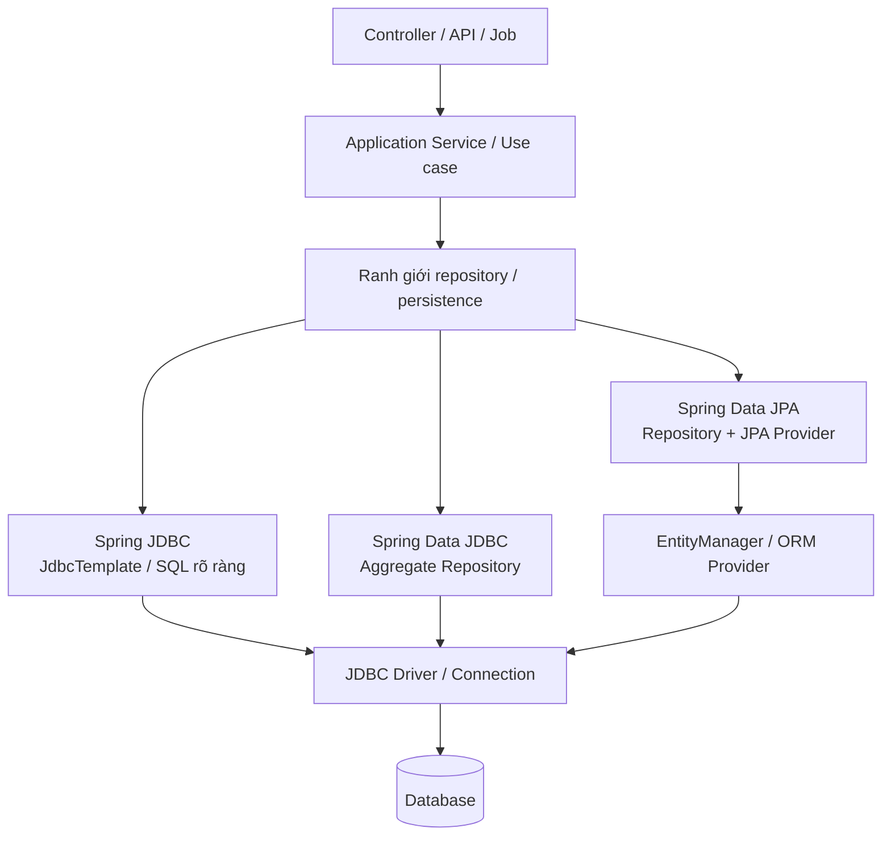

# Vai trò Spring JDBC và Spring Data trong truy cập dữ liệu

> **Chương:** Hệ sinh thái Java  
> **Phạm vi:** `DATA_PERSISTENCE_FUNDAMENTALS` — hiểu mô hình dữ liệu, lược đồ, truy vấn, chỉ mục, giao dịch và kiểm soát đồng thời; thiết kế ranh giới persistence cho Java, xử lý lỗi kết nối, thay đổi schema, bảo mật, sao lưu và hiệu năng.

## Mục tiêu học tập

Sau bài học, người học có thể:

1. Phân biệt **JDBC chuẩn của Java**, **Spring JDBC**, **Spring Data JDBC** và **Spring Data JPA** theo nhiệm vụ, mức trừu tượng và cách thực thi SQL.
2. Sử dụng `JdbcTemplate` hoặc `NamedParameterJdbcTemplate` để viết truy vấn tham số hóa, đọc `ResultSet`, kiểm tra số hàng cập nhật và xử lý exception.
3. Hiểu vai trò của `Repository` trong Spring Data, cơ chế JPA persistence context/dirty checking và cách Spring Data JDBC lưu aggregate mà không dùng JPA.
4. Đặt ranh giới transaction ở tầng nghiệp vụ bằng `@Transactional`, bảo vệ dữ liệu khi có nhiều yêu cầu đồng thời và phân loại lỗi để retry an toàn.
5. Chọn công cụ truy cập dữ liệu phù hợp với truy vấn, mô hình miền, ràng buộc schema, yêu cầu hiệu năng và khả năng bảo trì.

## 1. Spring JDBC và Spring Data giải quyết vấn đề gì?

Ứng dụng Java thường cần thực hiện một chuỗi công việc: lấy kết nối, chuẩn bị SQL, truyền tham số, thực thi, chuyển kết quả thành object, quản lý transaction, đóng tài nguyên và xử lý lỗi. Làm toàn bộ bằng JDBC thuần mang lại quyền kiểm soát nhưng tạo mã lặp; dùng một tầng trừu tượng có thể giảm mã lặp và giúp thống nhất ranh giới persistence.

**Spring JDBC** tập trung vào **thực thi SQL do lập trình viên chỉ định**: Spring quản lý phần lớn thao tác JDBC cơ bản, còn ứng dụng vẫn sở hữu câu SQL và ánh xạ dữ liệu. **Spring Data** là một **họ dự án** cung cấp mô hình repository và các thành phần truy cập dữ liệu cho nhiều công nghệ. Với cơ sở dữ liệu quan hệ, hai lựa chọn quan trọng là **Spring Data JDBC** và **Spring Data JPA**; chúng có cách quản lý object rất khác nhau.



Sơ đồ minh họa các **lựa chọn đường truy cập**, không nói rằng một ứng dụng bắt buộc phải sử dụng cả ba cùng lúc. Một hệ thống có thể dùng JPA cho luồng cập nhật domain và Spring JDBC cho báo cáo SQL phức tạp, miễn là ranh giới giao dịch và quản lý kết nối được thiết kế đúng.

| Công nghệ | Đơn vị trừu tượng chính | Ai viết SQL? | Trạng thái object sau khi đọc |
| --- | --- | --- | --- |
| **JDBC chuẩn** | `Connection`, `PreparedStatement`, `ResultSet` | Ứng dụng | Object tự ánh xạ, không được theo dõi tự động. |
| **Spring JDBC** | `JdbcTemplate`, `NamedParameterJdbcTemplate`, mapper | Ứng dụng | Object Java thông thường; không có JPA persistence context. |
| **Spring Data JDBC** | Aggregate root, `CrudRepository`, relational mapping | Framework sinh SQL CRUD theo mapping; ứng dụng có thể viết truy vấn tùy chỉnh | Aggregate được tải/lưu như trạng thái dữ liệu; **không có JPA dirty checking**. |
| **Spring Data JPA** | Entity, `JpaRepository`, `EntityManager`, JPA provider | Provider sinh nhiều SQL; ứng dụng viết JPQL/native SQL khi cần | Entity có thể **managed** trong persistence context; dirty checking khi flush. |

Không nên dùng câu “Spring Data chính là Hibernate”. Hibernate là một **JPA provider/ORM** phổ biến, trong khi Spring Data JPA xây tầng repository trên JPA; Spring Data JDBC là một nhánh khác và không cần JPA/Hibernate để ánh xạ aggregate.

## 2. Ba tầng khái niệm: JDBC, Spring JDBC và Spring Data

### 2.1. JDBC thuần

JDBC là API tiêu chuẩn trong Java để giao tiếp với hệ quản trị dữ liệu thông qua driver. Một đoạn đọc thông thường:

```java
String sql = "SELECT product_id, available FROM stock_item WHERE product_id = ?";

try (Connection connection = dataSource.getConnection();
     PreparedStatement statement = connection.prepareStatement(sql)) {
    statement.setLong(1, productId);
    try (ResultSet rs = statement.executeQuery()) {
        if (rs.next()) {
            long id = rs.getLong("product_id");
            int available = rs.getInt("available");
            // Tạo và trả đối tượng của ứng dụng từ dữ liệu đã đọc.
        }
    }
}
```

JDBC cho phép kiểm soát SQL, transaction, cursor và batch rất rõ. Nhưng nếu mỗi repository đều tự lặp việc mở/đóng statement, ánh xạ kết quả và dịch `SQLException`, khả năng bảo trì giảm. Ngoài ra, mở `Connection` tùy ý trong từng repository có thể khiến nhiều thao tác tưởng cùng một nghiệp vụ lại chạy trên các transaction khác nhau.

### 2.2. Spring JDBC

`JdbcTemplate` thực thi SQL, thiết lập tham số, giải phóng JDBC resource và dịch nhiều `SQLException` sang hệ ngoại lệ truy cập dữ liệu của Spring. `NamedParameterJdbcTemplate` dùng tham số có tên, thuận tiện cho câu SQL có nhiều điều kiện.

Các thành phần hay dùng:

| Thành phần | Chức năng |
| --- | --- |
| `JdbcTemplate` | `query`, `queryForObject`, `update`, `batchUpdate` và các phép thực thi JDBC phổ biến. |
| `NamedParameterJdbcTemplate` | Truyền tham số như `:productId`, giúp SQL dài dễ đọc hơn. |
| `RowMapper<T>` | Ánh xạ **một hàng** của `ResultSet` thành một object. |
| `ResultSetExtractor<T>` | Xử lý **toàn bộ ResultSet**, hữu ích khi tổng hợp nhiều hàng thành cấu trúc phức tạp. |
| `DataSource` | Cung cấp kết nối, thường nằm sau một connection pool. |
| `DataAccessException` | Hệ exception của Spring cho lỗi truy cập dữ liệu; các subtype phản ánh nhóm lỗi khác nhau. |

Spring JDBC **không** tự cung cấp entity manager, cascade mapping kiểu JPA hoặc dirty checking. Khi sửa một Java record/POJO đã đọc bằng `JdbcTemplate`, ứng dụng phải gọi `UPDATE` rõ ràng.

### 2.3. Spring Data

Spring Data cung cấp các khái niệm chung như repository, truy vấn theo tên phương thức (trong những module hỗ trợ), phân trang và phân loại kết quả. Nhưng **mỗi module được điều chỉnh theo công nghệ lưu trữ**:

- **Spring Data JPA**: xây repository trên JPA/`EntityManager`, thường kết hợp Hibernate; thích hợp khi muốn sử dụng mapping quan hệ, association, persistence context và optimistic locking của JPA.
- **Spring Data JDBC**: mô hình hóa aggregate cho dữ liệu quan hệ theo hướng đơn giản hơn; thường lưu cả aggregate theo quy tắc mapping, không có lazy loading và dirty checking kiểu JPA.
- Các module Spring Data khác có thể dành cho MongoDB, Redis, Cassandra...; không nên suy ra cơ chế transaction hay query của chúng giống JPA.

Vì vậy, khi nói “dùng Spring Data”, phải nêu **đúng module** và quy tắc mapping/transaction của module đó.

## 3. Ví dụ xuyên suốt: giữ hàng tồn kho khi tạo một đặt chỗ

Giả sử một cửa hàng có sản phẩm `product_id = 88`, tồn kho còn `available = 5`. Người dùng muốn giữ `3` sản phẩm trong một lệnh tạo reservation. Hai yêu cầu chạy đồng thời không được làm `available` âm.

Lược đồ PostgreSQL minh họa:

```sql
CREATE TABLE stock_item (
    product_id BIGINT PRIMARY KEY,
    available INTEGER NOT NULL CHECK (available >= 0),
    version BIGINT NOT NULL DEFAULT 0
);

CREATE TABLE stock_reservation (
    request_id UUID PRIMARY KEY,
    product_id BIGINT NOT NULL REFERENCES stock_item(product_id),
    quantity INTEGER NOT NULL CHECK (quantity > 0),
    created_at TIMESTAMPTZ NOT NULL DEFAULT now()
);

INSERT INTO stock_item(product_id, available, version)
VALUES (88, 5, 0);
```

**Bất biến dữ liệu:** số lượng hàng tồn không âm; một mã yêu cầu không được tạo hai reservation khác nhau. Bất biến số lượng có thể bảo vệ bằng một `UPDATE` có điều kiện, hoặc kiểm tra phiên bản khi sử dụng JPA. Toàn bộ lần trừ kho và lần ghi reservation phải thuộc **một transaction**.

Khóa `request_id` là điều kiện cần cho idempotency nhưng **chưa đủ để API tự động trả lại kết quả lần gọi trước**: đường xử lý retry phải tra cứu khóa đã có, so sánh payload và trả kết quả đã lưu thay vì tạo tác động lần nữa.

## 4. Spring JDBC: SQL rõ ràng và cập nhật có điều kiện

### 4.1. Đọc và ánh xạ một hàng

Ví dụ repository Spring JDBC sử dụng `NamedParameterJdbcTemplate`:

```java
import java.util.List;
import java.util.Map;
import java.util.Optional;
import org.springframework.jdbc.core.namedparam.NamedParameterJdbcTemplate;
import org.springframework.stereotype.Repository;

record StockView(long productId, int available) {}

@Repository
public class StockJdbcRepository {
    private final NamedParameterJdbcTemplate sql;

    public StockJdbcRepository(NamedParameterJdbcTemplate sql) {
        this.sql = sql;
    }

    public Optional<StockView> find(long productId) {
        List<StockView> rows = sql.query(
            """
            SELECT product_id, available
            FROM stock_item
            WHERE product_id = :productId
            """,
            Map.of("productId", productId),
            (rs, rowNum) -> new StockView(
                rs.getLong("product_id"),
                rs.getInt("available")
            )
        );
        return rows.stream().findFirst();
    }

    public boolean reserve(long productId, int quantity) {
        if (quantity <= 0) {
            throw new IllegalArgumentException("Quantity must be positive");
        }
        int updated = sql.update(
            """
            UPDATE stock_item
            SET available = available - :quantity
            WHERE product_id = :productId
              AND available >= :quantity
            """,
            Map.of("productId", productId, "quantity", quantity)
        );
        return updated == 1;
    }
}
```

Lệnh `UPDATE` có điều kiện trực tiếp trên một hàng giúp tránh lỗi kiểu “đọc 5, hai request đều tính 5 - 3 rồi ghi 2”. Trong PostgreSQL `READ COMMITTED`, hai `UPDATE` cùng đụng một hàng sẽ được phối hợp bằng khóa hàng; điều kiện `available >= :quantity` được kiểm tra trên phiên bản phù hợp sau khi chờ xung đột. Chỉ một yêu cầu có thể giữ được 3 trên tồn kho ban đầu 5.

Trong ví dụ, `find` trả `Optional` thay vì dùng `queryForObject` vì không có hàng là trường hợp hợp lệ. `queryForObject` thường ném `EmptyResultDataAccessException` khi kết quả không có hàng, và có thể báo lỗi số hàng không kỳ vọng. Nên chọn API theo ngữ nghĩa mong muốn.

### 4.2. Đặt transaction ở tầng nghiệp vụ

Ví dụ tiếp tục với một lớp service dùng `JdbcTemplate`:

```java
import java.util.UUID;
import org.springframework.jdbc.core.JdbcTemplate;
import org.springframework.stereotype.Service;
import org.springframework.transaction.annotation.Transactional;

@Service
public class ReservationJdbcService {
    private final StockJdbcRepository stock;
    private final JdbcTemplate jdbc;

    public ReservationJdbcService(
            StockJdbcRepository stock, JdbcTemplate jdbc) {
        this.stock = stock;
        this.jdbc = jdbc;
    }

    @Transactional
    public void reserve(UUID requestId, long productId, int quantity) {
        if (requestId == null || quantity <= 0) {
            throw new IllegalArgumentException("Invalid reservation");
        }

        if (!stock.reserve(productId, quantity)) {
            throw new IllegalStateException("Insufficient stock");
        }

        jdbc.update(
            """
            INSERT INTO stock_reservation (request_id, product_id, quantity)
            VALUES (?, ?, ?)
            """,
            requestId, productId, quantity
        );
    }
}
```

**Cần có Spring transaction manager tương ứng với `DataSource`** và hai repository phải dùng cùng tài nguyên được quản lý. Nếu `INSERT` bị lỗi (chẳng hạn `request_id` trùng), exception runtime được Spring đẩy ra sẽ khiến cả lượt trừ kho trước đó rollback theo cấu hình thông thường.

Đoạn service này cố tình tập trung vào **atomicity và conditional update**, chưa triển khai phản hồi idempotent cho yêu cầu trùng. Trong API thực, khi request cũ có thể đã commit nhưng client mất phản hồi, phải tra cứu `request_id` trên kết nối/transaction mới hoặc xử lý **retry cùng khóa** theo giao thức có đối chiếu payload. Không tự tạo `UUID` mới rồi chạy lại thao tác.

### 4.3. Khi nào Spring JDBC đặc biệt phù hợp?

Spring JDBC thuận tiện khi:

- Câu SQL đã được thiết kế và tối ưu rõ ràng, có CTE, window function, `RETURNING`, bulk operation hoặc cấu trúc đặc thù PostgreSQL.
- Cần chính xác **bao nhiêu hàng bị cập nhật** và dùng kết quả đó để quyết định nghiệp vụ.
- Chức năng chủ yếu đọc ra DTO, báo cáo, tổng hợp hoặc chạy truy vấn chuyên biệt.
- Muốn chủ động kiểm soát việc đọc, khóa, batch và các điều kiện cập nhật; số lượng object domain/association không quá khó quản lý bằng mapper.

Đánh đổi là ứng dụng tự duy trì SQL, mapping, thay đổi column/schema và các truy vấn tùy chỉnh. Spring JDBC không “tự sinh repository” từ domain model và không thay thế migration hoặc thiết kế chỉ mục.

## 5. Spring Data JPA: repository kết hợp EntityManager

Với Spring Data JPA, repository như `JpaRepository<StockItem, Long>` cung cấp các thao tác truy cập entity; JPA provider tạo SQL tương ứng. Entity được đọc trong một persistence context có thể là **managed**, nên khi thay đổi state, JPA đồng bộ chúng lúc `flush`/`commit`.

### 5.1. Entity và optimistic locking

Mô hình entity ánh xạ vào bảng `stock_item` ở phần 3:

```java
import jakarta.persistence.Column;
import jakarta.persistence.Entity;
import jakarta.persistence.Id;
import jakarta.persistence.Table;
import jakarta.persistence.Version;

@Entity
@Table(name = "stock_item")
public class StockItem {
    @Id
    @Column(name = "product_id")
    private Long productId;

    @Column(name = "available", nullable = false)
    private int available;

    @Version
    @Column(name = "version", nullable = false)
    private long version;

    protected StockItem() {
        // Constructor cho JPA.
    }

    public void reserve(int quantity) {
        if (quantity <= 0) {
            throw new IllegalArgumentException("Quantity must be positive");
        }
        if (available < quantity) {
            throw new IllegalStateException("Insufficient stock");
        }
        available -= quantity;
    }
}
```

`@Version` hỗ trợ **optimistic locking**. Khi hai transaction cùng đọc `stock_item.version = 0` rồi cùng sửa, JPA provider có thể tạo câu cập nhật với điều kiện version cũ, ví dụ:

```sql
-- SQL minh họa cơ chế; provider thực tế quyết định câu lệnh cuối.
UPDATE stock_item
SET available = 2, version = 1
WHERE product_id = 88 AND version = 0;
```

Nếu một giao dịch đã commit và tăng version, giao dịch còn lại cố cập nhật trên version cũ có thể nhận lỗi optimistic locking khi flush/commit; nó phải rollback và cân nhắc retry từ transaction mới. Đây là cách khác với `UPDATE ... WHERE available >= ?` của Spring JDBC. Cả hai đều cần kiểm tra bất biến nghiệp vụ và xử lý lỗi cạnh tranh.

### 5.2. Repository và service

```java
import java.util.UUID;
import org.springframework.data.jpa.repository.JpaRepository;
import org.springframework.stereotype.Service;
import org.springframework.transaction.annotation.Transactional;

public interface StockItemRepository
        extends JpaRepository<StockItem, Long> {}

@Service
public class JpaStockService {
    private final StockItemRepository stockItems;
    private final ReservationJpaRepository reservations;

    public JpaStockService(
            StockItemRepository stockItems,
            ReservationJpaRepository reservations) {
        this.stockItems = stockItems;
        this.reservations = reservations;
    }

    @Transactional
    public void reserve(UUID requestId, long productId, int quantity) {
        StockItem stock = stockItems.findById(productId)
            .orElseThrow(() -> new IllegalArgumentException("Unknown product"));

        stock.reserve(quantity); // Entity managed trong transaction.
        reservations.save(new Reservation(requestId, productId, quantity));
        // Dirty checking và flush ở ranh giới transaction.
    }
}
```

`ReservationJpaRepository` và entity `Reservation` ở đoạn trên là các thành phần JPA ánh xạ vào bảng `stock_reservation`, có `request_id` làm khóa chính; cần khai báo trong dự án thực tế. Ý chính: **service điều phối một thao tác nghiệp vụ**, repository quản lý việc nạp/lưu entity và `@Transactional` gom cả việc giảm kho và ghi reservation.

Không suy ra rằng `save()` luôn lập tức tạo SQL hay commit: SQL có thể được trì hoãn đến flush và transaction manager mới quyết định commit. Ngoài ra, một entity managed đã đổi thuộc tính thường **không cần gọi `save()` chỉ để JPA nhận biết thay đổi**.

### 5.3. Giá trị và chi phí của JPA

Spring Data JPA phù hợp khi domain có nhiều aggregate/entity với quan hệ, cần điều hướng association, entity lifecycle, dirty checking và optimistic locking. Repository giúp giảm mã CRUD lặp, có thể hỗ trợ query method theo tên và `@Query` dùng JPQL hoặc SQL native.

Tuy nhiên, JPA không loại bỏ nhu cầu hiểu SQL:

- **N+1 query** có thể xảy ra khi nạp danh sách entity rồi truy cập association lazy từng hàng.
- `JOIN FETCH` hoặc `EntityGraph` cần được chọn có chủ đích; fetch quá nhiều làm tăng dữ liệu đọc và có thể ảnh hưởng phân trang.
- Bulk JPQL `UPDATE`/`DELETE` đi thẳng tới database, có thể khiến entity đang managed trong context **bị cũ**; không kỳ vọng các thao tác đó đi qua dirty checking như cập nhật entity thông thường.
- Truy vấn sinh tự động có thể chưa tối ưu với index hay điều kiện cụ thể; phải đo SQL thực tế, số round-trip và execution plan.
- `@Version` không tự bảo vệ các đường ghi JDBC/native SQL bỏ qua điều kiện version.

Nếu API chỉ cần ba cột cho một bảng kết quả lớn, dùng projection/DTO hoặc Spring JDBC có thể đơn giản và tiết kiệm hơn việc tạo toàn bộ entity graph.

## 6. Spring Data JDBC: repository cho aggregate quan hệ

**Spring Data JDBC khác Spring Data JPA.** Nó ánh xạ object với bảng quan hệ theo mô hình aggregate, có repository tương tự về hình thức nhưng **không có JPA persistence context, dirty checking, lazy loading hoặc `EntityManager`**.

Ví dụ aggregate chỉ có một hàng `stock_item`:

```java
import org.springframework.data.annotation.Id;
import org.springframework.data.annotation.Version;
import org.springframework.data.relational.core.mapping.Column;
import org.springframework.data.relational.core.mapping.Table;
import org.springframework.data.repository.CrudRepository;

@Table("stock_item")
public class StockAggregate {
    @Id
    @Column("product_id")
    private Long productId;

    @Version
    private Long version;

    private int available;

    public void reserve(int quantity) {
        if (quantity <= 0 || quantity > available) {
            throw new IllegalStateException("Cannot reserve stock");
        }
        available -= quantity;
    }
}

interface StockAggregateRepository
        extends CrudRepository<StockAggregate, Long> {}
```

Khi tải aggregate bằng `findById`, ứng dụng thay đổi object rồi phải gọi `save` để lưu; sửa object mà **không gọi save** không tự phát sinh `UPDATE` do dirty checking. `@Version` của Spring Data JDBC có thể giúp phát hiện xung đột optimistic locking cho aggregate được lưu theo mapping.

Với aggregate có collection con, Spring Data JDBC có những quy tắc lưu **toàn bộ aggregate**, có thể xóa và tạo lại các hàng phụ thuộc khi save tùy mapping và trạng thái. Cần hiểu rõ ownership, vòng đời child, khóa ngoại, triggers và chi phí SQL của cách lưu này trước khi dùng cho một graph lớn. Không nên xem Spring Data JDBC như “JPA nhưng bỏ Hibernate”.

Ví dụ một service:

```java
@Transactional
public void reserveUsingSpringDataJdbc(long productId, int quantity) {
    StockAggregate stock = repository.findById(productId)
        .orElseThrow(() -> new IllegalArgumentException("Unknown product"));

    stock.reserve(quantity);
    repository.save(stock); // Lưu aggregate rõ ràng.
}
```

Ở đây `repository` là `StockAggregateRepository` đã được inject trong một service Spring. Đây là ví dụ lưu **một aggregate tồn kho**, chưa tạo hàng reservation; nếu nghiệp vụ cần cả hai, phải ghi trong cùng transaction và giữ cơ chế idempotency/khóa yêu cầu phù hợp.

Spring Data JDBC thường phù hợp khi muốn mapping quan hệ và repository nhưng mô hình aggregate rõ, quan hệ không cần lazy-loading phức tạp và muốn tránh các hiệu ứng của persistence context. Đánh đổi là phải thiết kế aggregate boundary kỹ: tham chiếu giữa aggregate thường nên là ID hoặc mô hình riêng, thay vì cố mô phỏng entity graph JPA ở mọi quan hệ.

## 7. Tầng Repository có nhiệm vụ gì?

Repository là **cửa truy cập dữ liệu theo nhu cầu của domain/use case**, nhưng không phải nơi điều phối mọi giao dịch nghiệp vụ.

Một cách chia trách nhiệm:

| Tầng | Trách nhiệm chính | Ví dụ |
| --- | --- | --- |
| Controller / API | Nhận request, kiểm tra định dạng cơ bản, xác thực, ánh xạ HTTP | `POST /reservations` và `request_id` |
| Application service | Kiểm tra quyền, điều phối bất biến, đặt transaction, xử lý trường hợp nghiệp vụ | Giữ hàng và tạo reservation nguyên tử |
| Repository / adapter | Thực thi truy vấn, ánh xạ dữ liệu, khóa/cập nhật, báo kết quả truy cập | `reserveIfAvailable`, `findById` |
| Database | Lưu dữ liệu bền vững, thực thi khóa, ràng buộc và transaction | `CHECK`, `UNIQUE`, `FK`, WAL |

**Spring Data repository** có thể là interface được framework cung cấp implementation; **Spring JDBC repository** thường là class ứng dụng tự viết. Cả hai đều có thể thỏa một interface domain nếu ứng dụng cần tách logic nghiệp vụ khỏi lựa chọn thư viện.

Ví dụ hợp đồng phía application:

```java
public interface StockPort {
    boolean reserveIfAvailable(long productId, int quantity);
}
```

Một adapter dùng Spring JDBC có thể hiện thực hợp đồng trên bằng `UPDATE ... WHERE available >= ?`. Adapter khác có thể dùng JPA/optimistic locking, nhưng phải giữ cùng ý nghĩa về thành công/thất bại và không che giấu lỗi transaction. Không tạo abstraction phức tạp chỉ để giấu một câu SQL; interface có giá trị khi giúp kiểm thử nghiệp vụ hoặc thay đổi lựa chọn persistence mà không làm đổi quy tắc.

## 8. Ranh giới transaction là trách nhiệm chung

**`@Transactional` không thuộc riêng JPA.** Spring có thể quản lý transaction cho nhiều lựa chọn truy cập dữ liệu thông qua transaction manager phù hợp:

- Với Spring JDBC thuần thường dùng `JdbcTransactionManager`/`DataSourceTransactionManager` cho `DataSource`.
- Với JPA thường dùng `JpaTransactionManager` để điều phối JPA `EntityManager`; khi phối hợp JDBC trên cùng nguồn dữ liệu cần cấu hình tương thích, không mặc định mọi JDBC connection ngoài pool đều tham gia.
- Spring Data JDBC dựa trên cơ chế transaction của Spring và tài nguyên JDBC tương ứng; các repository có transaction semantics cụ thể tùy cấu hình/module.

Ranh giới thường nên ở **application service/use case**: một transaction xử lý trừ kho + ghi reservation, không tách thành hai transaction được commit độc lập.

### 8.1. Những điểm dễ sai

1. Trong chế độ Spring proxy phổ biến, gọi `this.reserve()` từ chính class có thể **không đi qua interceptor `@Transactional`**. Cần thiết kế lời gọi qua bean và kiểm tra cấu hình AOP.
2. Nếu một thao tác sử dụng hai `DataSource`/hai database độc lập, một `@Transactional` đơn giản **không tự tạo transaction phân tán** cho cả hai. Cần giải pháp phối hợp/outbox hoặc workflow bù trừ.
3. `readOnly = true` là khai báo ý định và có thể hỗ trợ tối ưu, nhưng không thay thế phân quyền database hoặc bảo đảm tuyệt đối mọi câu SQL đều bị cấm ghi trong mọi cấu hình.
4. Spring mặc định rollback khi ném `RuntimeException`/`Error`; checked exception có thể cần `rollbackFor` hoặc cấu hình tương đương. Bắt lỗi rồi trả kết quả bình thường có thể khiến transaction commit.
5. Trong JPA, `flush` có thể gửi SQL nhưng **chưa commit**; một rollback sau flush vẫn hoàn tác thay đổi thuộc transaction.
6. Không giữ transaction mở khi gọi HTTP, gửi email hoặc chờ người dùng. Giao dịch DB không tự rollback được tác động đã hoàn thành ở dịch vụ bên ngoài.

### 8.2. Đọc rồi ghi trong tranh chấp đồng thời

Đọc `available = 5` rồi trong Java tính `5 - 3` và chạy một `UPDATE stock_item SET available = 2` có thể gây mất cập nhật khi hai transaction cùng đọc. Với một hàng tồn kho, có thể dùng:

```sql
UPDATE stock_item
SET available = available - :quantity
WHERE product_id = :productId
  AND available >= :quantity;
```

Hoặc dùng JPA `@Version` để phát hiện transaction khác đã sửa và rollback/retry có điều kiện. Nếu bất biến liên quan **nhiều hàng**, cả hai phương pháp trên cần được mở rộng bằng khóa guard row, ràng buộc thích hợp hoặc `SERIALIZABLE` và retry theo thiết kế. Lựa chọn thư viện truy cập dữ liệu **không tự thay thế kiểm soát đồng thời**.

## 9. Truy vấn, phân trang và hiệu năng

### 9.1. Quyết định đo bằng SQL thực tế

Để tối ưu truy cập dữ liệu, cần xem:

- **Số round-trip** từ Java đến DB, kích thước dữ liệu và số hàng nạp.
- **Truy vấn và execution plan**: chỉ mục phù hợp điều kiện `WHERE`, `JOIN`, `ORDER BY`, selectivity và kích thước bảng.
- **Chi phí ghi**: số index cần cập nhật, row locks, thời gian transaction, contention và retry.
- **Chi phí mapping/ORM**: entity graph và dirty checking, số collection liên quan, batch size.

Với PostgreSQL, có thể phân tích trên môi trường thích hợp:

```sql
EXPLAIN (ANALYZE, BUFFERS)
SELECT product_id, available
FROM stock_item
WHERE product_id = 88;
```

`ANALYZE` trong `EXPLAIN` **thực thi truy vấn**, nên cần thận trọng với câu lệnh làm thay đổi dữ liệu. Một benchmark nhỏ không chứng minh lựa chọn nào luôn nhanh hơn: Spring JDBC có thể ít overhead mapping hơn cho truy vấn DTO đơn giản, nhưng JPA với batch/fetch đúng có thể phù hợp với domain phức tạp và giảm mã trùng lặp. Phải đo trên workload dự kiến.

### 9.2. Phân trang và N+1

Spring Data JPA hỗ trợ `Pageable`, `Page<T>` hoặc `Slice<T>` (tùy API), nhưng `Page` thường cần truy vấn đếm tổng; với tập rất lớn, việc đếm và dùng offset cao có thể tốn chi phí. Các endpoint “xem tiếp” có thể cân nhắc keyset/seek pagination với khóa sắp xếp ổn định nếu yêu cầu phù hợp.

Khi JPA nạp 100 đơn hàng và vòng lặp truy cập `order.getCustomer()`, provider có thể phát thêm nhiều câu `SELECT` nếu association được tải lazy và chưa được fetch phù hợp. Có thể tránh bằng DTO projection, fetch join/`EntityGraph` có chọn lọc hoặc query gom dữ liệu. Spring JDBC cũng có thể tạo N+1 nếu repository tự chạy một query trong vòng lặp; vấn đề này thuộc **cách tổ chức truy vấn**, không phải chỉ riêng JPA.

### 9.3. Batch và tài nguyên

`JdbcTemplate.batchUpdate` giúp gom nhiều parameter set theo giao thức JDBC. Batching có ích khi cần thêm/cập nhật nhiều hàng, nhưng phải đo với driver, DB, kích thước batch và transaction thực tế.

JPA có thể hỗ trợ JDBC batching qua cấu hình provider; cần hiểu lúc nào `flush` xảy ra và việc dùng identity generator có thể ảnh hưởng khả năng batch. Spring Data JDBC lưu aggregate có collection lớn cũng cần đo số SQL sinh ra.

Đối với query trả dữ liệu lớn, không giữ `ResultSet`/stream hoặc persistence context lâu hơn cần thiết; dùng phân lô, fetch size/cursor và transaction phù hợp với driver/DB, bảo đảm tài nguyên được đóng. Connection pool giúp tái sử dụng kết nối, nhưng **pool không làm biến mất giới hạn connection của DB**. Transaction dài có thể chiếm connection và khóa, làm nghẽn mọi cách truy cập.

## 10. Xử lý lỗi, retry và khả năng khôi phục

Spring JDBC và Spring Data thường biểu diễn lỗi truy cập dữ liệu bằng các `DataAccessException` hoặc exception tương thích. Tuy nhiên, ứng dụng vẫn cần phân loại theo **ngữ nghĩa lỗi**, không chỉ theo tên class:

| Nhóm lỗi | Ví dụ | Chiến lược |
| --- | --- | --- |
| Vi phạm toàn vẹn dữ liệu | Unique key, FK, `CHECK` | Rollback; ánh xạ đúng bất biến, thường trả lỗi nghiệp vụ; không retry mù quáng. |
| Không tìm thấy dữ liệu | `findById` rỗng, query không có hàng | Trả kết quả not found hoặc nhánh nghiệp vụ phù hợp; không biến thành lỗi hạ tầng. |
| Optimistic locking | `@Version`/version check thất bại | Transaction phải rollback; đọc lại và quyết định retry hay báo xung đột. |
| Deadlock / serialization failure | PostgreSQL SQLSTATE `40P01`, `40001` | Có thể retry **toàn bộ transaction** trên transaction mới, với giới hạn và backoff. |
| Timeout hoặc mất kết nối trước khi biết kết quả commit | JDBC/driver báo mất kết nối quanh `COMMIT` | **Kết quả có thể chưa xác định**; đối soát theo khóa bền vững, không sinh yêu cầu mới. |
| Không sẵn sàng kết nối | DB/pool cạn, mạng lỗi | Ghi nhận sự cố; retry giới hạn nếu phù hợp và không lặp tác động chưa rõ. |

Đối với **mất kết nối đúng lúc commit**, Java có thể nhận exception dù DB đã commit thành công. Không được mặc định mọi `SQLException` hoặc `DataAccessException` đồng nghĩa transaction rollback. Một API tạo reservation hoặc thanh toán cần `request_id` duy nhất, kết quả bền vững và giao thức retry với cùng khóa.

**Spring Data JPA `save` và Spring JDBC `update` đều không giải quyết giúp bài toán idempotency ở mức nghiệp vụ**. Đó là trách nhiệm thiết kế schema và use case.

Khi triển khai thực tế, log mã lỗi, SQLSTATE, tên constraint hoặc operation ID để hỗ trợ điều tra, nhưng không ghi mật khẩu DB, token, số tài khoản hay dữ liệu cá nhân không cần thiết. Việc dịch exception của Spring không nên trở thành lý do bỏ qua chẩn đoán DBMS.

## 11. Bảo mật, tiến hóa schema và vận hành

### 11.1. Truy vấn tham số hóa

`JdbcTemplate`, `NamedParameterJdbcTemplate` và `@Query` với tham số giúp phân biệt dữ liệu đầu vào với câu SQL. **Không nối chuỗi** để nhét input vào câu truy vấn:

```java
// Sai: dữ liệu từ client được ghép thẳng vào SQL.
String unsafeSql =
    "SELECT * FROM stock_item WHERE product_id = " + userInput;

// Đúng: tham số JDBC cho giá trị.
jdbc.query(
    "SELECT product_id, available FROM stock_item WHERE product_id = ?",
    (rs, n) -> new StockView(
        rs.getLong("product_id"), rs.getInt("available")
    ),
    productId
);
```

Các phần **định danh SQL** như tên bảng/cột hoặc hướng `ORDER BY` thường không thể bind như giá trị bằng `?`. Khi phải hỗ trợ sort động, sử dụng **danh sách cho phép (allowlist)** và ánh xạ các lựa chọn hợp lệ sang biểu thức SQL cố định, không ghép trực tiếp tham số client.

### 11.2. Tenant và phân quyền

Repository có thể truy vấn đúng SQL nhưng vẫn làm lộ dữ liệu nếu quên `tenant_id` hoặc điều kiện chủ sở hữu. Cần xác minh quyền và tenant ở application service, đưa phạm vi dữ liệu vào query/constraint và cân nhắc cơ chế Row-Level Security của database khi phù hợp. Không dùng ID do client gửi để mặc nhiên đọc được mọi hàng.

### 11.3. Thay đổi schema

Các công cụ như Flyway/Liquibase thường được dùng quản lý migration schema, nhưng không có framework truy cập dữ liệu nào làm cho migration tự động an toàn. Khi thêm cột, đổi kiểu, tạo unique index hoặc tách bảng, phải phối hợp:

1. Phiên bản Java đang chạy và mapping/SQL của từng repository.
2. Các bước bổ sung cột/tables tương thích trước, backfill dữ liệu và áp constraint khi dữ liệu đã hợp lệ.
3. Thời gian có nhiều phiên bản ứng dụng cùng chạy trong rollout.
4. Thời điểm tạo chỉ mục, khóa DDL, tác động lên ghi/đọc, phương án rollback.

Đối với JPA, không nên xem tính năng tự động tạo schema khi khởi động là chiến lược thay thế migration có kiểm soát trên production. Đối với Spring JDBC, SQL viết tay phải thay đổi đồng bộ với lược đồ; đối với Spring Data JDBC/JPA, annotation mapping cũng phải nhất quán với DDL.

### 11.4. Độ bền và backup

Spring JDBC hay Spring Data không tự thay thế WAL, backup/restore, quyền database hoặc kiểm tra toàn vẹn sau khôi phục. Giao dịch đã commit cần được bảo vệ bởi cơ chế độ bền của DB theo cấu hình vận hành; ứng dụng vẫn phải chuẩn bị cho mất kết nối, failover, replay và **mốc dữ liệu thực tế** khi restore. Bản ghi idempotency, outbox và lịch sử nghiệp vụ cần nằm trong chính sách backup/retention để lần retry sau sự cố có thể đối soát.

## 12. Chọn công nghệ cho từng loại công việc

| Tình huống | Lựa chọn khởi đầu | Lý do |
| --- | --- | --- |
| Báo cáo SQL nhiều join/CTE/window function, trả DTO | **Spring JDBC** | SQL và mapping kết quả rõ ràng, dễ đo execution plan. |
| Cập nhật tồn kho bằng `UPDATE ... WHERE available >= ?` | **Spring JDBC** hoặc truy vấn update tùy chỉnh | Dễ kiểm tra số hàng ảnh hưởng và thực thi điều kiện nguyên tử. |
| CRUD và điều hướng quan hệ domain phong phú, lifecycle/dirty checking | **Spring Data JPA** | Repository + JPA entity mapping, persistence context và optimistic locking. |
| Aggregate quan hệ tương đối đơn giản, muốn repository và mapping minh bạch | **Spring Data JDBC** | Trạng thái aggregate được lưu rõ, không cần JPA context. |
| Đọc danh sách lớn, ít cột | **JDBC/DTO projection** hoặc query projection của JPA | Tránh tải object graph không cần thiết. |
| Hệ thống hiện dùng JPA, một truy vấn đặc thù cần tối ưu | **Giữ JPA cho luồng domain, thêm JDBC có kiểm soát** | Không phải thay toàn bộ tầng persistence vì một câu SQL. |

Đây là **gợi ý thiết kế**, không phải bảng xếp hạng tốc độ. Tiêu chí cuối cùng là bất biến nghiệp vụ, khả năng quan sát SQL, tải thật, độ phức tạp domain, kỹ năng nhóm và chi phí duy trì. Cần giải thích lựa chọn ở mức use case thay vì mặc định “ít code hơn là tốt hơn”.

## 13. Bài thực hành: so sánh ba cách giữ tồn kho

**Bài toán:** cơ sở dữ liệu có `stock_item(product_id=88, available=5)`. Hai request muốn giữ mỗi request `3` sản phẩm. Mỗi request có `request_id` ổn định; sau hai request đồng thời, chỉ được có tối đa một reservation thành công, và số hàng còn lại không âm.

**Yêu cầu thực hiện:**

1. Tạo lược đồ `stock_item` và `stock_reservation` như phần 3, thêm các constraint đã nêu.
2. **Với Spring JDBC:** dùng `UPDATE ... WHERE available >= ?`, kiểm tra số hàng cập nhật, ghi reservation trong cùng `@Transactional`.
3. **Với Spring Data JPA:** ánh xạ entity có `@Version`; hai transaction đọc cùng version, thử giữ hàng, quan sát optimistic locking và rollback của request thua.
4. **Với Spring Data JDBC:** tạo aggregate có `@Version`; gọi `save` sau khi sửa và kiểm tra ứng dụng không dựa vào dirty checking.
5. Tạo lỗi khi ghi `stock_reservation` sau khi trừ kho; xác minh rollback hoàn tác thay đổi tồn kho.
6. Gửi lại cùng `request_id` sau khi request đầu thành công; bổ sung bước đối chiếu payload/kết quả để không trừ kho lần hai.
7. So sánh SQL thực tế, số truy vấn, số connection/transaction, lock wait và kết quả khi hai request chạy đồng thời.
8. Thử timeout khi chờ commit; không tự động coi lỗi kết nối là rollback mà đối soát bằng `request_id`.

**Kết quả cần xác minh**

| Phép thử | Kết quả mong đợi |
| --- | --- |
| Hai request khác khóa cùng giữ 3 trên tồn kho 5 | Chỉ một request thành công; `available = 2`. |
| SQL chèn reservation bị từ chối | Lượt trừ kho trong cùng transaction rollback. |
| JPA hai transaction sửa cùng version | Có kiểm tra version; không cho cả hai commit trên trạng thái cũ. |
| Spring Data JDBC sửa object nhưng không `save` | Không tự ghi thay đổi chỉ nhờ setter. |
| Retry cùng `request_id` với payload khớp | Nhận đúng kết quả đã lưu, không giảm tồn kho thêm. |
| Retry cùng khóa với payload khác | Trả lỗi xung đột, không áp dụng thao tác mới. |
| Mất kết nối khi commit | Trạng thái có thể chưa xác định; tiếp tục đối soát bằng khóa yêu cầu. |

**Câu hỏi tự kiểm tra**

1. Spring JDBC giúp giảm những đoạn mã lặp nào của JDBC thuần, và phần việc nào vẫn phải do ứng dụng tự thiết kế?
2. Vì sao `JdbcTemplate` không tự ghi thay đổi khi ta sửa một Java object vừa đọc?
3. Spring Data JPA và Spring Data JDBC khác nhau như thế nào về persistence context, dirty checking và việc `save` một aggregate?
4. Khi `@Transactional` được đặt trên một method nhưng gọi qua `this.method()`, điều gì có thể xảy ra trong chế độ proxy?
5. Vì sao một câu `UPDATE ... WHERE available >= ?` có thể ngăn hai request cùng trừ quá số hàng còn lại?
6. `@Version` có tự bảo vệ một cập nhật bằng JDBC trực tiếp không? Cần thêm điều kiện nào?
7. Trong Spring Data JPA, N+1 hình thành ra sao và những lựa chọn nào có thể giảm nó?
8. Vì sao `DataAccessException` khi chờ commit không đủ để kết luận giao dịch đã rollback?
9. Đối với một báo cáo 500.000 hàng chỉ cần ba cột, nên xem xét yếu tố nào trước khi chọn entity JPA hay DTO query?
10. Nếu thay đổi schema trên production, các repository JDBC và mapping JPA/Data JDBC cần được phối hợp theo những bước nào?

## Ghi nhớ

**Spring JDBC** giúp viết và chạy SQL rõ ràng với ít mã JDBC lặp, phù hợp truy vấn chuyên biệt và cập nhật điều kiện. **Spring Data** cung cấp mô hình repository; **Spring Data JPA** dùng JPA provider và persistence context để quản lý entity, còn **Spring Data JDBC** lưu aggregate quan hệ theo cơ chế đơn giản hơn, không có dirty checking kiểu JPA.

Việc chọn công cụ không thay thế thiết kế persistence: transaction phải bao trùm đúng thao tác nghiệp vụ, constraint và chỉ mục phải phản ánh bất biến, lỗi đồng thời phải được phân loại, SQL phải được đo trên dữ liệu thực, và retry sau mất kết nối cần có khóa yêu cầu bền vững. Một ranh giới service/repository rõ ràng giúp Java giữ được tính đúng đắn khi mô hình dữ liệu và hệ thống phát triển.
