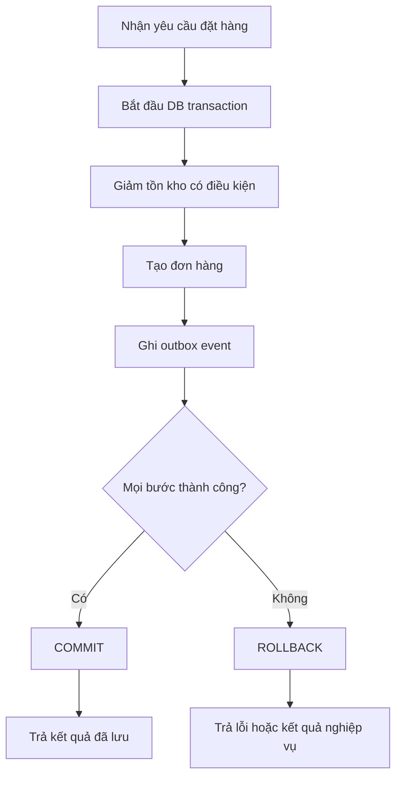
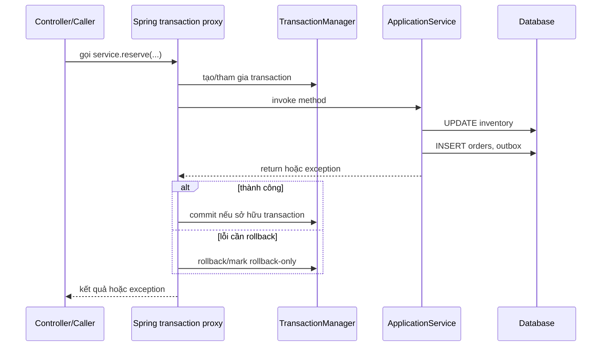

# Quản lý giao dịch trong ứng dụng Spring ở mức nền tảng

Một thao tác persistence trong Java thường không chỉ là một câu SQL. Ví dụ tạo đơn hàng cần **kiểm tra và giảm tồn kho**, lưu thông tin đơn, rồi ghi một sự kiện sẽ được phát sau. Nếu bước cuối thất bại mà hai bước trước vẫn được commit, dữ liệu có thể ở trạng thái không nhất quán. **Transaction** giúp gom các thay đổi trong cùng một cơ sở dữ liệu thành một đơn vị: hoặc các thay đổi hợp lệ cùng được commit, hoặc chúng được rollback khi có lỗi cần hủy giao dịch.

Spring giúp quản lý transaction bằng các abstraction như `@Transactional`, `PlatformTransactionManager` và `TransactionTemplate`. Tuy nhiên, **annotation không thay thế việc hiểu ranh giới giao dịch**: phải biết transaction bắt đầu ở đâu, các câu lệnh nào tham gia, exception nào khiến rollback, lời gọi có thực sự đi qua Spring proxy không và tài nguyên được giải phóng lúc nào.

Bài học thuộc chương **Hệ sinh thái Java** trong mô-đun **DATA_PERSISTENCE_FUNDAMENTALS**. Mục tiêu của mô-đun là hiểu nguyên lý lưu trữ bền vững từ mô hình dữ liệu, schema, truy vấn, chỉ mục đến giao dịch, cô lập và kiểm soát đồng thời; người học thiết kế ranh giới persistence cho Java, xử lý lỗi kết nối, tiến hóa schema, bảo mật, sao lưu và tối ưu hiệu năng. Ở đây, trọng tâm là **quản lý transaction căn bản trong ứng dụng Spring sử dụng JDBC hoặc JPA**, xác định tính nhất quán và cách khôi phục khi lỗi. Ví dụ dựa trên Spring transaction thông dụng và PostgreSQL; chi tiết hành vi có thể phụ thuộc phiên bản Spring, transaction manager, JDBC driver và DBMS.

## 1. Vì sao một method nghiệp vụ cần transaction?

Giả sử kho có 5 sản phẩm. Yêu cầu đặt mua 4 sản phẩm gồm ba bước:

```text
1. UPDATE inventory: giảm available từ 5 xuống 1
2. INSERT orders: tạo bản ghi đơn hàng
3. INSERT outbox_events: ghi ý định phát OrderCreated
```

Nếu mỗi câu lệnh chạy trong autocommit riêng và bước 3 thất bại, bước 1 và 2 đã lưu nhưng không có sự kiện để hệ thống bên ngoài tiếp tục xử lý. Nếu bước 2 thất bại, số lượng tồn đã giảm mà không có đơn. **Ranh giới transaction nên bao trùm những thay đổi dữ liệu phải cùng thành công hoặc cùng thất bại.**



Với một DB transaction thực sự, các thay đổi thuộc giao dịch được xử lý như một đơn vị theo hợp đồng ACID của DB. **Atomicity** không đồng nghĩa mọi nghiệp vụ ngoài DB được rollback; **Isolation** không tự động ngăn mọi race condition nếu mức cô lập hoặc câu SQL chưa bảo vệ đúng bất biến; **Durability** còn phụ thuộc cấu hình ghi bền vững của DB.

Trong Spring, nơi thích hợp để xác định đơn vị công việc thường là **application service/use-case**, không phải từng phương thức repository riêng lẻ. Một service có thể gọi nhiều repository trong một transaction; một repository không nên tự quyết định commit giữa chừng nếu các bước phải thuộc cùng nghiệp vụ.

## 2. `@Transactional` hoạt động như thế nào?

`@Transactional` là cách **khai báo metadata về transaction**, không phải một câu lệnh Java trực tiếp gọi `BEGIN` tại vị trí annotation. Trong cơ chế proxy thông dụng của Spring, một lời gọi đi qua Spring-managed proxy được transaction interceptor xử lý:

1. Xác định phương thức và các thuộc tính transaction (`propagation`, `isolation`, `readOnly`, `timeout`, quy tắc rollback).
2. Thông qua transaction manager phù hợp, **tạo transaction mới** hoặc **tham gia transaction đang tồn tại**.
3. Gọi method nghiệp vụ; các thao tác dữ liệu sử dụng tài nguyên được transaction manager quản lý có thể tham gia cùng transaction.
4. Khi method kết thúc, transaction interceptor **commit hoặc rollback theo kết quả và chính sách** nếu nó sở hữu ranh giới transaction; nếu chỉ tham gia transaction khác, nó có thể đánh dấu rollback-only cho transaction đang dùng.
5. Dọn transaction context và hoàn trả connection theo quy tắc quản lý tài nguyên.



Khi proxy **tạo transaction mới**, commit thực tế diễn ra sau khi method target trả về nhưng **trước khi lời gọi qua proxy hoàn thành**. Vì vậy một lỗi ràng buộc phát hiện lúc `flush`/`commit` vẫn có thể ném ra cho caller, dù thân method đã chạy hết. Nếu proxy chỉ tham gia transaction ngoài, commit thật diễn ra ở ranh giới ngoài.

Trong ứng dụng Spring Boot thường có transaction management tự cấu hình khi các dependency và bean phù hợp hiện diện, nhưng không nên suy ra mọi method có annotation đều được quản lý đúng. Cần xác minh **bean do Spring tạo, proxy/interceptor được kích hoạt và transaction manager thực tế được chọn**.

## 3. Ví dụ Spring JDBC: một transaction cho cập nhật và outbox

Xét schema PostgreSQL tối giản:

```sql
CREATE TABLE inventory (
    product_id BIGINT PRIMARY KEY,
    available INTEGER NOT NULL CHECK (available >= 0)
);

CREATE TABLE orders (
    operation_id UUID PRIMARY KEY,
    product_id BIGINT NOT NULL REFERENCES inventory(product_id),
    quantity INTEGER NOT NULL CHECK (quantity > 0),
    status TEXT NOT NULL
);

CREATE TABLE outbox_events (
    event_id UUID PRIMARY KEY,
    operation_id UUID NOT NULL REFERENCES orders(operation_id),
    event_type TEXT NOT NULL
);

INSERT INTO inventory (product_id, available) VALUES (10, 5);
```

Service dùng `JdbcTemplate` để thực hiện cả ba bước trong cùng Spring-managed transaction:

```java
import java.util.UUID;
import org.springframework.jdbc.core.JdbcTemplate;
import org.springframework.stereotype.Service;
import org.springframework.transaction.annotation.Transactional;

@Service
public class CheckoutService {
    private final JdbcTemplate jdbc;

    public CheckoutService(JdbcTemplate jdbc) {
        this.jdbc = jdbc;
    }

    @Transactional
    public UUID reserve(UUID operationId, long productId, int quantity) {
        if (quantity <= 0) {
            throw new IllegalArgumentException("quantity must be positive");
        }

        int changed = jdbc.update("""
                UPDATE inventory
                SET available = available - ?
                WHERE product_id = ? AND available >= ?
                """, quantity, productId, quantity);

        if (changed != 1) {
            throw new IllegalStateException("product missing or insufficient stock");
        }

        jdbc.update("""
                INSERT INTO orders(operation_id, product_id, quantity, status)
                VALUES (?, ?, ?, 'PENDING')
                """, operationId, productId, quantity);

        jdbc.update("""
                INSERT INTO outbox_events(event_id, operation_id, event_type)
                VALUES (?, ?, 'OrderCreated')
                """, UUID.randomUUID(), operationId);

        return operationId;
    }
}
```

Trong mẫu này, `JdbcTemplate` phải dùng **cùng `DataSource` được transaction manager quản lý**; ví dụ `JdbcTransactionManager`/`DataSourceTransactionManager` được cấu hình tương ứng. Spring JDBC sử dụng connection gắn với transaction hiện hành thông qua cơ chế quản lý tài nguyên của Spring. Nếu một repository khác tự mở kết nối bằng `DriverManager.getConnection()` không tham gia transaction đó, **nó không tự có cùng commit/rollback**.

`JdbcTemplate.update` trả số hàng chịu tác động. Với PostgreSQL `READ COMMITTED`, điều kiện `available >= quantity` giúp kiểm soát trường hợp hai yêu cầu trừ tồn kho đồng thời trên cùng hàng, vì thao tác cập nhật được DB phối hợp theo khóa và đánh giá điều kiện phù hợp. Ràng buộc `CHECK (available >= 0)` bảo vệ thêm bất biến. Thao tác kiểm tra–ghi phức tạp trên nhiều hàng vẫn cần đánh giá isolation và locking riêng.

**Điều xảy ra khi lỗi:** nếu `INSERT orders` hoặc `INSERT outbox_events` gây exception unchecked và exception thoát khỏi method, Spring mặc định rollback transaction mới do proxy tạo. Lượng tồn không bị trừ vĩnh viễn dù `UPDATE inventory` đã chạy trước đó. Ngược lại, nếu service bắt exception rồi **trả thành công** mà không đánh dấu rollback-only, interceptor có thể commit phần thay đổi đã thực hiện.

**Lưu ý về idempotency:** `operation_id` là khóa unique nên một yêu cầu đã commit không thể âm thầm tạo thêm đơn với cùng ID. Nhưng nếu caller gửi lại cùng ID, code minh họa sẽ gặp lỗi unique, không tự trả kết quả cũ. Production cần **tra cứu kết quả theo `operation_id` và xác minh payload/request hash** ở ranh giới nghiệp vụ, đặc biệt khi lần trước mất xác nhận commit; không chỉ retry bằng operation ID mới.

## 4. Transaction rollback khi exception nào xảy ra?

Mặc định thường dùng của Spring `@Transactional` là rollback với **`RuntimeException` và `Error`**, còn checked exception (subclass `Exception` nhưng không phải `RuntimeException`) không tự gây rollback theo quy tắc mặc định. Chính sách có thể được cấu hình bằng các thuộc tính của annotation hoặc cấu hình transaction management; phải xác nhận cấu hình thực tế của dự án.

| Kết quả của method được intercept | Kỳ vọng mặc định thường gặp | Lưu ý |
|---|---|---|
| Kết thúc bình thường | Commit nếu proxy sở hữu transaction và không bị đánh dấu rollback-only | Commit vẫn có thể thất bại vì constraint/deadlock/lỗi I/O |
| Ném `RuntimeException` | Rollback | Ví dụ `IllegalStateException`, Spring `DataAccessException` |
| Ném `Error` | Rollback | Không nên dùng `Error` làm cơ chế điều khiển nghiệp vụ |
| Ném checked `Exception` | Thường **không tự rollback** | Định nghĩa `rollbackFor` nếu nghiệp vụ yêu cầu |
| Bắt exception trong method rồi trả về | Interceptor thường coi là kết thúc bình thường | Có thể commit trừ khi transaction đã bị rollback-only hoặc lỗi DB khiến commit thất bại |

Ví dụ muốn rollback khi một checked exception nghiệp vụ xảy ra:

```java
public class FulfillmentException extends Exception {
    public FulfillmentException(String message) {
        super(message);
    }
}

@Transactional(rollbackFor = FulfillmentException.class)
public void allocateForShipment(long orderId) throws FulfillmentException {
    // Ghi các bảng phải cùng commit hoặc rollback.
    // Nếu phát hiện lỗi cần hủy, throw new FulfillmentException(...).
}
```

Đây là mẫu **minh họa chính sách**, phần thân method chưa có nghiệp vụ cụ thể. Thuộc tính `noRollbackFor` cũng tồn tại, nhưng phải cân nhắc kỹ vì cho phép commit mặc dù method ném exception; dùng sai có thể giữ trạng thái nửa vời.

### 4.1. Vì sao nuốt exception dễ khiến transaction commit?

```java
@Transactional
public void unsafe() {
    jdbc.update("UPDATE inventory SET available = available - 1 WHERE product_id = 10");
    try {
        sendOrPersistMoreData();
    } catch (RuntimeException failure) {
        log.warn("failed", failure); // Nếu chỉ log rồi return, transaction có thể commit.
    }
}
```

Nếu lỗi bị bắt và method không ném lại, Spring không thể biết ứng dụng muốn rollback **chỉ từ việc exception đã từng xảy ra ở bên trong method**. Ngoài ra, một số lỗi DB có thể đánh dấu transaction là aborted; khi ấy các câu sau hoặc commit có thể thất bại bất kể đã catch. Nếu muốn hủy toàn bộ đơn vị công việc, nên **ném lại exception phù hợp** hoặc đánh dấu rollback-only thông qua transaction context khi có lý do rõ ràng.

```java
TransactionAspectSupport.currentTransactionStatus().setRollbackOnly();
```

Lệnh này cần transaction do Spring đang quản lý trong đúng ngữ cảnh, và dùng trong method đã bắt lỗi. Đánh dấu rollback-only là công cụ đặc biệt, không thay thế thiết kế exception/contract rõ ràng; caller phải biết thao tác đã không được commit. Đối với transaction ngoài còn bao nhiều lời gọi, việc một phần bên trong đánh dấu rollback-only có thể khiến **toàn bộ transaction ngoài** không thể commit.

### 4.2. `UnexpectedRollbackException` là tín hiệu gì?

Một method `REQUIRED` bên trong tham gia transaction ngoài, gặp `RuntimeException` và interceptor đánh dấu transaction chung là rollback-only. Caller bên ngoài có thể catch lỗi và tiếp tục chạy, rồi kết thúc bình thường; nhưng khi commit ở ranh giới ngoài, Spring có thể ném **`UnexpectedRollbackException`**, vì không thể báo rằng commit thành công khi transaction thực tế đã bị hủy.

```text
Outer @Transactional REQUIRED: bắt đầu transaction
    |
    +--> Inner @Transactional REQUIRED: cùng transaction
            -> exception -> đánh dấu rollback-only
    |
    +--> Outer catch exception rồi return bình thường
    |
Outer cố COMMIT -> rollback / UnexpectedRollbackException
```

Đừng sửa bằng cách bỏ qua exception hoặc đổi `noRollbackFor` bừa bãi. Phải xem nghiệp vụ có thật sự cần hai đơn vị commit độc lập không, hay cần để lỗi làm hủy toàn bộ transaction.

## 5. `propagation`: gọi method con sẽ tham gia transaction nào?

**Propagation** quy định hành vi khi một method transactional được gọi trong lúc **đã có hoặc chưa có** transaction hiện hành. Nó không quyết định isolation thực tế cho mọi lệnh SQL và không biến nhiều datasource thành một transaction.

| Propagation | Đã có transaction | Chưa có transaction | Khi thường dùng |
|---|---|---|---|
| `REQUIRED` (mặc định) | Tham gia transaction hiện có | Tạo transaction mới | Hầu hết application service |
| `REQUIRES_NEW` | Tạm treo transaction ngoài; tạo transaction mới độc lập | Tạo transaction mới | Một đơn vị commit thực sự độc lập, có ràng buộc tài nguyên rõ |
| `NESTED` | Tạo savepoint trong transaction hiện có **nếu transaction manager hỗ trợ** | Thường hoạt động như `REQUIRED`, tạo transaction mới | Rollback một phần bằng savepoint |
| `SUPPORTS` | Tham gia nếu có | Chạy không có transaction mới do annotation tạo | Đọc không bắt buộc có transaction |
| `MANDATORY` | Tham gia | Báo lỗi | Method chỉ hợp lệ khi caller đã mở transaction |
| `NOT_SUPPORTED` | Tạm treo transaction ngoài | Chạy không có transaction do annotation tạo | Công việc không nên chạy trong transaction hiện tại |
| `NEVER` | Báo lỗi | Chạy không có transaction | Cấm gọi trong ngữ cảnh transaction |

### 5.1. `REQUIRED`: một đơn vị commit chung

```java
@Service
class CheckoutFacade {
    private final OrderWriter orderWriter;

    CheckoutFacade(OrderWriter orderWriter) {
        this.orderWriter = orderWriter;
    }

    @Transactional
    public void checkout(CheckoutCommand command) {
        // Do work participating in the same transaction.
        orderWriter.writeOrder(command);
    }
}

@Service
class OrderWriter {
    @Transactional(propagation = Propagation.REQUIRED)
    public void writeOrder(CheckoutCommand command) {
        // Persist order and related rows.
    }
}
```

Các kiểu `CheckoutCommand`, repository và các import từ Spring là placeholder minh họa. Do gọi qua bean khác do Spring quản lý, `OrderWriter.writeOrder` có thể được interceptor xử lý. Nếu đã có transaction ở `CheckoutFacade`, hai method thường tham gia **cùng một physical transaction**. `OrderWriter` không tự commit ở cuối method con; commit thuộc ranh giới outer.

### 5.2. `REQUIRES_NEW`: transaction độc lập, không miễn phí

`REQUIRES_NEW` **tạo physical transaction mới**, độc lập với transaction bên ngoài. Transaction ngoài bị treo trong lúc inner chạy; khi inner commit, rollback của outer về sau **không hoàn tác được inner commit**.

Điều này có thể hữu ích cho một số bản ghi audit cần lưu riêng, nhưng nguy hiểm khi audit hoặc một cập nhật nghiệp vụ **phải atomic với transaction ngoài**. Nếu `order` rollback mà event/audit đã commit, dữ liệu có thể mô tả một hành động chưa thực sự xảy ra. Với sự kiện bắt buộc đi cùng business data, dùng **cùng transaction và outbox**, không tự động `REQUIRES_NEW`.

Ngoài ra, transaction ngoài có thể **giữ connection/khóa** trong lúc bị treo, còn transaction trong cần connection khác. Nhiều request đồng thời dùng `REQUIRES_NEW` có thể khiến pool cạn và tăng khả năng chờ/deadlock. Không dùng mode này chỉ để tránh `UnexpectedRollbackException` mà không đánh giá tính đúng đắn nghiệp vụ.

### 5.3. `NESTED` và savepoint không phải transaction thứ hai

Nếu manager hỗ trợ JDBC savepoint, một method `NESTED` có thể rollback phần thay đổi từ savepoint mà vẫn giữ transaction ngoài hoạt động. Nhưng **commit của nested scope không phải commit độc lập**: nếu outer rollback, mọi thay đổi nested cũng bị hủy.

`NESTED` không được hỗ trợ giống nhau giữa `DataSourceTransactionManager`, `JpaTransactionManager` và các provider. Với JPA, savepoint của JDBC không bảo đảm persistence context được hoàn tác nhất quán, nên không giả định `NESTED` hoạt động như transaction con với mọi entity. Luôn kiểm tra transaction manager và test trên DB thật.

## 6. Isolation level, `readOnly`, timeout và các thuộc tính khác

Ví dụ khai báo transaction đọc báo cáo:

```java
@Transactional(
    propagation = Propagation.REQUIRED,
    isolation = Isolation.REPEATABLE_READ,
    readOnly = true,
    timeout = 30
)
public ReportSnapshot loadReport(long reportId) {
    // Chạy các truy vấn thuộc cùng report snapshot.
    // Trả về DTO đã materialize trước khi kết thúc transaction.
}
```

Đây là ví dụ chữ ký minh họa; `ReportSnapshot` và thân method cần được hiện thực trong dự án. Những thuộc tính có ý nghĩa khác nhau:

| Thuộc tính | Tác động mong muốn | Giới hạn cần nhớ |
|---|---|---|
| `isolation = DEFAULT` | Theo mặc định transaction của datasource/DB | Mặc định khác nhau theo DBMS |
| `READ_COMMITTED` | Ngăn dirty read theo bảo đảm của DB | Hai lần `SELECT` có thể cho giá trị khác nhau |
| `REPEATABLE_READ` | Hỗ trợ đọc một trạng thái ổn định hơn trong transaction | Chi tiết MVCC/locking khác giữa DBMS; chưa thay `SERIALIZABLE` |
| `SERIALIZABLE` | Yêu cầu lịch transaction có tác dụng như tuần tự | Có thể phát sinh lỗi serialization cần retry toàn transaction |
| `readOnly = true` | Gợi ý cho transaction manager/driver/ORM tối ưu đọc | Không phải **hợp đồng bảo mật** cấm mọi ghi ở mọi DB/provider |
| `timeout = N` | Yêu cầu giới hạn thời gian transaction khi manager hỗ trợ | Không mặc nhiên ngắt mọi HTTP call hoặc một thread bị kẹt |
| `rollbackFor` | Thêm loại exception khiến rollback | Không thay được việc xác định trạng thái commit khi mất kết nối |

Mức cô lập và một số thuộc tính thường chỉ có hiệu lực khi **transaction mới được tạo**. Nếu method `REQUIRED` tham gia transaction ngoài, nó có thể dùng isolation/readOnly/timeout của transaction ngoài thay vì cấu hình mong muốn của method trong. Spring có cơ chế kiểm tra sự không tương thích của transaction hiện hữu tùy transaction manager/cấu hình, nhưng không nên dựa vào việc annotation inner tự nâng isolation.

Trong PostgreSQL, `READ COMMITTED` cho phép non-repeatable read giữa hai câu đọc; `REPEATABLE READ` cho snapshot ổn định của transaction cho các câu đọc thông thường; `SERIALIZABLE` có thể từ chối một lịch thực thi với SQLSTATE `40001`. Mức cô lập cao hơn **không tự xác nhận** nghiệp vụ chống trùng thanh toán, tồn kho âm hay uniqueness khi câu SQL/constraint chưa thiết kế đúng.

`@Transactional(readOnly = true)` có thể dẫn đến gợi ý đọc cho JDBC hoặc điều chỉnh flush mode của ORM, tùy framework. Không dùng nó như công cụ phân quyền; DB user và các ràng buộc truy cập mới quyết định một tác nhân được phép viết gì. `timeout` thường tương tác với query timeout/transaction manager; để có deadline end-to-end cần thêm timeouts cho JDBC, pool và các dịch vụ ngoài.

## 7. `PlatformTransactionManager`, JDBC và JPA khác nhau ở đâu?

Spring sử dụng abstraction quản lý transaction để phối hợp tài nguyên persistence. Trong luồng **blocking** thông thường, `PlatformTransactionManager` cung cấp cơ chế `getTransaction`, `commit`, `rollback` cho transaction interceptor hoặc `TransactionTemplate`.

| Thành phần | Vai trò | Điều phải xác minh |
|---|---|---|
| `DataSourceTransactionManager` / `JdbcTransactionManager` | Quản lý local transaction trên JDBC `DataSource` | `JdbcTemplate` và manager dùng cùng datasource; driver hỗ trợ isolation/savepoint phù hợp |
| `JpaTransactionManager` | Quản lý JPA `EntityManager`/transaction trong môi trường Spring | EntityManager được gắn đúng transaction; tích hợp JDBC nếu dùng chung datasource được cấu hình đúng |
| JTA transaction manager | Phối hợp resource theo giao thức hỗ trợ distributed transaction | Các resource manager thực sự hỗ trợ enlistment/2PC; không tự áp dụng cho HTTP thường |
| `TransactionTemplate` | API lập trình cho transaction blocking | Được cấp đúng `PlatformTransactionManager` |
| `ReactiveTransactionManager` | Quản lý transaction trong luồng reactive thích hợp | Không trộn semantics của transaction context reactive với ThreadLocal JDBC |

**Chọn transaction manager là một quyết định thực tế**, không phải chi tiết ẩn có thể bỏ qua. Nếu dự án có nhiều datasource hoặc nhiều bean transaction manager, phải xác định method dùng manager nào (`transactionManager`/qualifier khi cần), và liệu tất cả thao tác được kỳ vọng atomic có thuộc **cùng một physical transaction** hay không. Hai repository sử dụng hai datasource khác nhau không tự thành một transaction chỉ vì method cha có `@Transactional`.

Với JDBC thuần không qua Spring, `Connection.setAutoCommit(false)`, `commit()` và `rollback()` là cách quản lý transaction trực tiếp. Nhưng trong Spring-managed transaction, **không tự gọi `commit()` hoặc `setAutoCommit` trên connection do Spring đang quản lý**: việc đó có thể phá ranh giới do interceptor và pool quản lý. Dùng `JdbcTemplate`, `DataSourceUtils`/API phù hợp để truy cập connection tham gia transaction.

## 8. Khi dùng JPA/Hibernate: `save`, `flush`, `commit` không đồng nghĩa

Trong JPA, khi method repository gọi `save(entity)` hoặc EntityManager `persist`, entity có thể được quản lý trong persistence context. SQL thực tế có thể được gửi lúc `flush` hoặc sớm hơn tùy chiến lược sinh ID/truy vấn/provider. **`flush()` đồng bộ các thay đổi đang chờ từ persistence context xuống DB trong transaction; nó không phải `COMMIT`.**

```java
@Transactional
public void updateCustomer(Long customerId, String newName) {
    Customer customer = entityManager.find(Customer.class, customerId);
    if (customer == null) {
        throw new IllegalArgumentException("Customer not found");
    }
    customer.setDisplayName(newName); // Dirty checking trong transaction.
    entityManager.flush();             // Phát SQL cần thiết, chưa commit.
    // Nếu sau đó transaction rollback, thay đổi vẫn bị hủy.
}
```

Một lỗi unique/foreign-key có thể phát sinh ở `flush`, hoặc nếu ràng buộc bị deferred thì ở `COMMIT`. Không coi việc `repository.save()` trả về ID là bằng chứng transaction đã commit thành công. Hãy để lỗi transaction đến đúng ranh giới caller và có hợp đồng xử lý.

### 8.1. Persistence context và lazy loading

Entity quản lý có thể chứa quan hệ lazy chưa được tải. Nếu service trả entity ra controller rồi transaction/EntityManager đã đóng, việc truy cập quan hệ lazy có thể gây `LazyInitializationException` (tùy provider và cấu hình). **Đừng kéo transaction qua việc render HTTP response chỉ để tránh lỗi đó.** Nên query/projection đúng nhu cầu và ánh xạ thành DTO hoàn chỉnh trong transaction, hoặc thiết kế riêng API đọc theo luồng có ranh giới tài nguyên minh bạch.

Persistence context cũng giữ identity map/cache cấp phiên. Khi duyệt hàng trăm nghìn entity, bộ nhớ có thể tăng dù JDBC fetch theo nhóm. Cân nhắc projection/DTO, pagination theo khóa, clear/detach khi hiểu rõ lifecycle, hoặc JDBC trực tiếp cho export; transaction quá dài còn có thể giữ snapshot/khóa gây ảnh hưởng DB.

### 8.2. `@Transactional` trên repository và service

Một số phương thức repository của Spring Data JPA có transaction metadata được cấu hình sẵn, nhưng **không vì vậy mà chuỗi nhiều lời gọi repository tự động atomic**. Nếu service gọi `save` trên hai repository ngoài transaction service, từng lời gọi có thể tạo/kết thúc transaction riêng. Đặt transaction ở **use-case service** nếu các bước phải cùng commit. Không giả định mọi repository method tự sinh đều read-only hoặc transaction như nhau; kiểm tra contract và cấu hình framework.

## 9. Programmatic transaction bằng `TransactionTemplate`

`@Transactional` phù hợp khi một method rõ ràng là đơn vị công việc. Khi cần một **khối transaction nhỏ, có thể đặt ở đúng vị trí** và tránh phụ thuộc vào self-invocation/proxy, dùng `TransactionTemplate`. Template phải được khởi tạo từ **đúng `PlatformTransactionManager`**; ứng dụng có thể sử dụng bean do cấu hình Spring Boot cung cấp khi phù hợp, hoặc đăng ký bean `new TransactionTemplate(transactionManager)` riêng. Đặc biệt khi có nhiều transaction manager, không mặc định Spring biết phải chọn manager nào.

```java
import java.util.UUID;
import org.springframework.jdbc.core.JdbcTemplate;
import org.springframework.stereotype.Service;
import org.springframework.transaction.support.TransactionTemplate;

@Service
public class PaymentResultService {
    private final JdbcTemplate jdbc;
    private final TransactionTemplate transactions;

    public PaymentResultService(
            JdbcTemplate jdbc,
            TransactionTemplate transactions) {
        this.jdbc = jdbc;
        this.transactions = transactions;
    }

    // Chỉ gọi sau khi đã kiểm chứng kết quả thanh toán từ provider.
    public UUID recordConfirmedPayment(UUID operationId) {
        return transactions.execute(status -> {
            int updated = jdbc.update("""
                    UPDATE orders
                    SET status = 'PAID'
                    WHERE operation_id = ? AND status = 'PENDING'
                    """, operationId);
            if (updated != 1) {
                throw new IllegalStateException("order not pending or not found");
            }
            UUID eventId = UUID.randomUUID();
            // Ghi outbox trong cùng transaction với thay đổi trạng thái order.
            jdbc.update("""
                    INSERT INTO outbox_events(event_id, operation_id, event_type)
                    VALUES (?, ?, 'OrderPaid')
                    """, eventId, operationId);
            return eventId;
        });
    }
}
```

Ví dụ sử dụng lại bảng `orders` và `outbox_events` của phần 3 nên `operation_id` ở outbox tham chiếu tới một đơn đã tồn tại. Callback `recordConfirmedPayment` được gọi **sau khi xác minh thanh toán**, không phải gọi payment provider trong transaction. Đoạn code minh họa một lần chuyển trạng thái từ `PENDING` sang `PAID`. Khi provider gửi callback lặp, cập nhật có thể tác động `0` hàng; production phải phân biệt **đã xử lý trước đó** với **trạng thái không hợp lệ**, dùng event/payment ID và ràng buộc khử trùng lặp thích hợp để không phát thêm một sự kiện `OrderPaid` cho cùng kết quả. Logic idempotency và đối soát phải được thiết kế theo hợp đồng provider thực tế.

`TransactionTemplate` dùng transaction manager được cấu hình; khi callback ném runtime exception, template rollback transaction nó quản lý theo hợp đồng. Với xử lý một lỗi có thể phục hồi và cần rollback chủ động, `status.setRollbackOnly()` đánh dấu hủy transaction. Không gửi HTTP hoặc thao tác chậm qua callback nếu cần giữ connection/khóa DB trong suốt thời gian đó.

## 10. Những bẫy phổ biến với Spring transaction

### 10.1. Self-invocation: gọi qua `this` có thể bỏ qua proxy

```java
@Service
public class OrderService {
    public void placeOrder() {
        this.writeOrder(); // Lời gọi nội bộ: có thể bỏ qua transaction proxy.
    }

    @Transactional
    public void writeOrder() {
        // Không mặc định có transaction nếu được gọi qua this.writeOrder().
    }
}
```

Trong cơ chế **Spring proxy mặc định**, lời gọi nội bộ cùng object không đi qua proxy, nên annotation trên `writeOrder` không được intercept bởi lời gọi đó. Cách rõ ràng là đặt transaction ở method **được gọi từ bean khác qua proxy**, tách bean hoặc dùng `TransactionTemplate`. Đối với AspectJ weaving, hành vi có thể khác; không suy rộng cho mọi kiểu cấu hình. Tương tự, method `private`, không thể intercept bằng proxy phù hợp, hoặc object tạo bằng `new` ngoài Spring container có thể không được áp dụng transaction như mong đợi. Với proxy dựa trên subclass còn có giới hạn liên quan `final` method/class; cần kiểm tra cơ chế proxy và khả năng intercept thật sự.

### 10.2. Gọi `@Async`, chạy thread mới hoặc trả luồng reactive

Trong mô hình transaction imperative thông thường, Spring thường quản lý transaction context gắn với **thread hiện hành**. Tạo thread mới, gọi `@Async` hoặc gửi việc sang executor không tự mang theo cùng JDBC transaction/connection. Một method trả về `CompletableFuture` hay `Flux` cũng không có nghĩa toàn bộ công việc bất đồng bộ về sau sẽ nằm trong transaction của lời gọi blocking đã kết thúc.

Spring có transaction management riêng cho reactive pipeline với `ReactiveTransactionManager` và Reactor context. Nếu dùng R2DBC/reactive, phải thiết kế theo semantics đó; **không lấy giả định ThreadLocal JDBC áp vào publisher bất đồng bộ**. Khi code blocking và reactive dùng chung use-case, xác định rõ ranh giới commit và nơi xử lý lỗi/cancellation.

### 10.3. Dịch vụ ngoài database không tham gia local transaction

```java
@Transactional
public void checkout() {
    saveOrder();
    paymentGateway.charge(); // Không được local DB rollback nếu đã thu tiền.
}
```

Nếu `charge()` thành công rồi `saveOrder()` hoặc commit DB thất bại, phía thanh toán vẫn có thể đã tạo khoản thu. Nếu HTTP timeout, provider cũng có thể đã xử lý dù caller không nhận response. Không giữ transaction mở trong lúc chờ mạng chỉ vì code dễ viết. Thiết kế **outbox + idempotency + đối soát**, trạng thái `PENDING` và saga/bù trừ nếu nghiệp vụ cần nhiều bước độc lập. `@TransactionalEventListener(phase = AFTER_COMMIT)` có thể giúp kích hoạt công việc sau commit nhưng một callback thuần in-memory **không thay thế outbox bền vững** khi process có thể crash.

### 10.4. Rollback không bảo đảm kết quả của `COMMIT` luôn biết rõ

Nếu JDBC connection bị ngắt **trong lúc `COMMIT`**, caller có thể không biết DB đã commit hay chưa. Một exception từ commit không cho phép khẳng định transaction chắc chắn đã rollback. Vì vậy những nghiệp vụ ghi không thể lặp mù quáng cần có **operation ID ổn định, ràng buộc unique, tra cứu/đối soát nguồn authoritative và retry cùng ID khi được phép**. Không cố gắng sửa bằng cách gọi `rollback()` trên connection đã mất rồi mặc định kết quả chưa được lưu.

## 11. Retry transaction bị hủy phải ở bên ngoài transaction lỗi

PostgreSQL có thể báo `40001` khi serialization failure hoặc `40P01` khi deadlock; đây là những trường hợp transaction bị DB hủy và thường có thể retry **toàn bộ nghiệp vụ** trong transaction mới, với exponential backoff có jitter, max attempts và deadline. Cần đọc lại dữ liệu, tính lại quyết định và không dùng lại transaction đã lỗi.

Một cấu trúc hợp lý trong Spring là **retry orchestration ở ngoài** và **mỗi attempt ở trong** method transactional được gọi qua bean khác:

```text
RetryCoordinator (không có transaction đang mở)
  |
  +-- Attempt 1 -> Spring proxy -> BEGIN -> business SQL -> ROLLBACK
  |                              SQLSTATE 40001
  +-- chờ backoff + jitter
  +-- Attempt 2 -> Spring proxy -> BEGIN -> business SQL -> COMMIT
  `-- trả kết quả
```

Nếu đặt toàn bộ retry loop bên trong một `@Transactional` duy nhất, attempt thứ hai có thể tiếp tục trên transaction đã bị abort/rollback-only và không đạt mục tiêu. Với `@Retryable` hoặc decorator framework, **thứ tự interceptors** retry/transaction quyết định có transaction mới cho mỗi attempt hay không; cần kiểm tra bằng integration test. Đối với `REQUIRES_NEW`, cũng phải đánh giá pool usage và tính đúng đắn khi transaction ngoài còn mở.

**Không tự retry mọi `SQLException` hoặc `DataAccessException`.** Phân biệt constraint violation, lỗi dữ liệu, kết nối gián đoạn và commit outcome chưa xác định. Retry không phải công cụ sửa lỗi sai cấu hình, SQL syntax hay dữ liệu đầu vào không hợp lệ.

## 12. Kiểm thử transaction: chứng minh rollback và commit thực sự

Kiểm thử một method `@Transactional` chỉ bằng mock repository không chứng minh transaction đã rollback dữ liệu. Cần **integration test với DB thật hoặc môi trường tương đương**, dùng transaction manager thực sự.

| Kịch bản | Hành động trong test | Kỳ vọng cần xác minh |
|---|---|---|
| Toàn bộ nghiệp vụ thành công | Gọi service qua Spring bean | `inventory`, `orders`, `outbox_events` đều phản ánh commit |
| `INSERT outbox` thất bại | Gây lỗi sau khi cập nhật tồn và tạo order | Cả ba bước rollback, số tồn quay về trước transaction |
| Checked exception | Method ném checked exception có/không `rollbackFor` | Trạng thái DB phù hợp với chính sách thực tế |
| Method nội bộ dùng `this` | Gọi method qua self-invocation | Xác định có hay không có transaction, không chỉ dựa vào annotation |
| Inner `REQUIRED` đánh dấu rollback-only | Outer catch lỗi rồi cố hoàn tất | Transaction không được commit; có thể nhận `UnexpectedRollbackException` |
| `REQUIRES_NEW` độc lập | Inner commit, outer rollback | Inner có thể tồn tại, outer bị hủy; kiểm tra pool và logic nghiệp vụ |
| Transaction vs HTTP | Mock provider trả success/timeout sau ghi DB | DB rollback không tự bù trừ provider; logic idempotency/outbox hoạt động |
| Hai request cùng trừ tồn | Chạy hai transaction tranh chấp cùng product | Bất biến số lượng không âm, một request thiếu hàng được xử lý đúng |

### 12.1. Test method `@Transactional` có thể che mất commit thật

Spring Test có thể **mở transaction cho chính test và rollback sau test** khi test gắn `@Transactional`. Điều này hữu ích để giữ fixture sạch nhưng có thể che khuất lỗi chỉ xuất hiện ở commit hoặc làm các method `REQUIRED` tham gia transaction của test thay vì tạo transaction như production.

Muốn kiểm chứng commit/rollback thật, cấu hình test không bao ngoài bằng test-managed transaction, hoặc chủ động điều khiển ranh giới bằng `TestTransaction` khi phù hợp. Dùng một transaction/kết nối độc lập đọc trạng thái sau khi nghiệp vụ kết thúc. Với constraint deferred, cần thực sự đến điểm commit để nhìn thấy lỗi.

### 12.2. Đảm bảo không nhầm ngữ cảnh transaction

Trong test, xác nhận lời gọi đi qua Spring proxy và `@Transactional` thực sự được áp dụng. Quan sát log transaction manager ở mức phù hợp, trạng thái connection/autocommit khi cần, và SQLSTATE khi test deadlock/serialization. Kiểm tra việc giải phóng connection khi method trả về hoặc ném lỗi; không giữ stream/ResultSet mở sau khi transaction đóng.

## 13. Vận hành: transaction ngắn, đủ mạnh và dễ quan sát

Transaction càng dài, ứng dụng càng có nguy cơ giữ **connection trong pool**, khóa trên hàng, snapshot hoặc tài nguyên database lâu. Với PostgreSQL, snapshot cũ được giữ dài có thể ảnh hưởng dọn các phiên bản dữ liệu và làm tăng bloat. Không bọc cả quá trình đọc file lớn, gọi nhiều HTTP API hoặc xử lý report vài phút trong một transaction nếu không thực sự cần một snapshot/đơn vị commit như vậy.

Theo dõi tối thiểu: thời gian lấy connection từ pool, thời gian transaction, lock wait, deadlock, số transaction rollback, số lần retry, SQLSTATE, thời gian commit và số phiên `idle in transaction`. `pg_stat_activity` và các công cụ quan sát của pool như HikariCP có thể giúp nhận diện transaction dài. Log/trace nên có operation ID an toàn, không đưa password hoặc dữ liệu nhạy cảm vào SQL log.

**Độ bền sau commit** còn phụ thuộc cấu hình DB và hạ tầng; `@Transactional` không thay thế backup, migration, giám sát kết nối, xử lý lỗi chưa xác định hoặc kiểm soát quyền DB. Transaction giúp thực thi một ranh giới nhất quán, không phải bảo đảm tuyệt đối trước mọi lỗi hệ thống.

## 14. Bảng quyết định khi chọn ranh giới Spring transaction

| Bài toán | Cách tiếp cận đề xuất | Điều cần kiểm tra |
|---|---|---|
| Hai hoặc nhiều cập nhật phải cùng commit | `@Transactional` ở application service | Cùng datasource/transaction manager, rollback rules |
| Cần một khối transaction ngắn giữa method | `TransactionTemplate` | Scope thực sự và propagation phù hợp |
| Chỉ đọc một báo cáo cần snapshot nhất quán | Transaction read-only với isolation thích hợp | DBMS, query duration, lazy resources |
| Nhiều request tranh tồn kho | Atomic conditional `UPDATE` hoặc khóa/optimistic locking | Affected rows, constraint, isolation |
| Bắt checked exception phải rollback | `rollbackFor` phù hợp | Có thực sự ném lỗi qua interceptor? |
| Một bước cần commit riêng | Cân nhắc `REQUIRES_NEW` | Tính đúng đắn nghiệp vụ và connection pool |
| Lỗi `40001`/deadlock cần retry | Retry **bên ngoài** mỗi transaction mới | Max attempts, deadline, idempotency |
| DB commit rồi gửi message | Transactional outbox | Delivery at-least-once, consumer dedup |
| Gọi payment API, kết quả timeout | Operation ID, idempotency, reconciliation | Không suy ra API chưa xử lý khi mất response |

## 15. Checklist kiểm tra trước khi đưa vào production

1. **Transaction bao trùm đúng đơn vị công việc nào?** Những bảng và bất biến nào phải commit/rollback cùng nhau?
2. **Method thực sự được Spring intercept không?** Có self-invocation, đối tượng tạo bằng `new`, `private/final` hoặc lời gọi qua thread khác không?
3. **Transaction manager và datasource có đúng không?** JDBC, JPA và các repository dùng chung physical transaction nếu cần atomicity chưa?
4. **Rollback rules khớp exception nghiệp vụ không?** Checked exception, catch nuốt lỗi và rollback-only được xử lý rõ chưa?
5. **Propagation có vô tình làm commit độc lập không?** `REQUIRES_NEW`, `NESTED` và transaction ngoài có tác động gì đến bất biến?
6. **Isolation và timeout có đúng yêu cầu?** Không dựa vào giá trị mặc định khi concurrency ảnh hưởng kết quả nghiệp vụ.
7. **Transaction có giữ connection trong lúc chờ mạng hoặc làm việc lâu không?** Có thể tách tác vụ ngoài DB và giữ giao dịch ngắn hơn không?
8. **Nếu commit lỗi hoặc mất xác nhận thì sao?** Có operation ID, idempotency và đối soát authoritative trước retry chưa?
9. **Nếu dùng JPA, flush và lazy loading được hiểu đúng chưa?** Không coi `save` là commit hoặc trả lazy entity ngoài ranh giới.
10. **Đã integration test rollback và commit thực sự chưa?** Có kiểm tra concurrency, lỗi cuối transaction và trạng thái trên kết nối độc lập không?

**Kết luận:** Spring cung cấp API thuận tiện để quản lý transaction, nhưng tính đúng đắn phụ thuộc **ranh giới nghiệp vụ và cách cấu hình tài nguyên thực sự**. Dùng `@Transactional` hoặc `TransactionTemplate` để gom những thay đổi DB phải cùng commit, hiểu rollback/propagation/isolation, giữ transaction đủ ngắn, kiểm soát cạnh tranh và không giả định thao tác ngoài DB được rollback theo. Khi exception hoặc timeout làm kết quả commit chưa rõ, hãy đối soát trước khi retry. Đó là nền tảng để ứng dụng Java xây dựng lớp persistence bền vững, an toàn và có thể vận hành.
