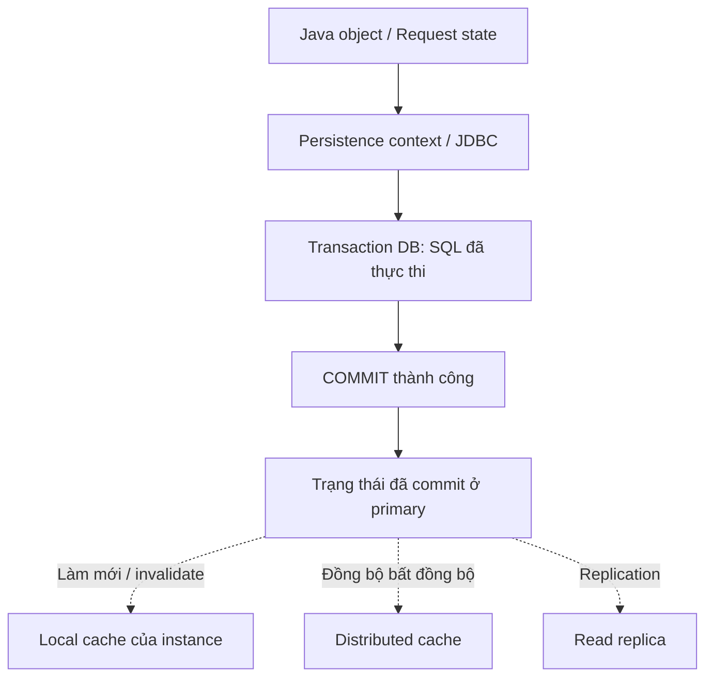
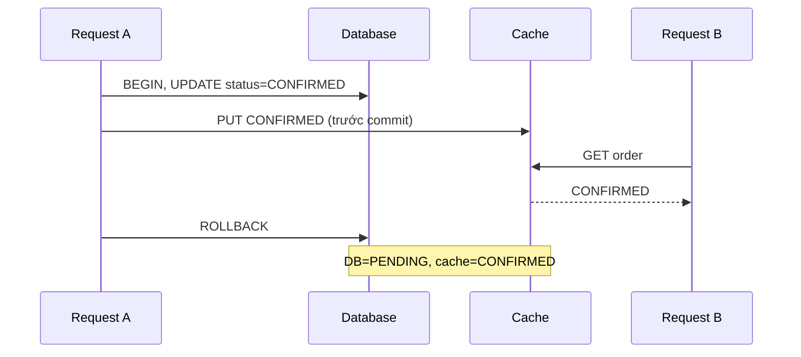
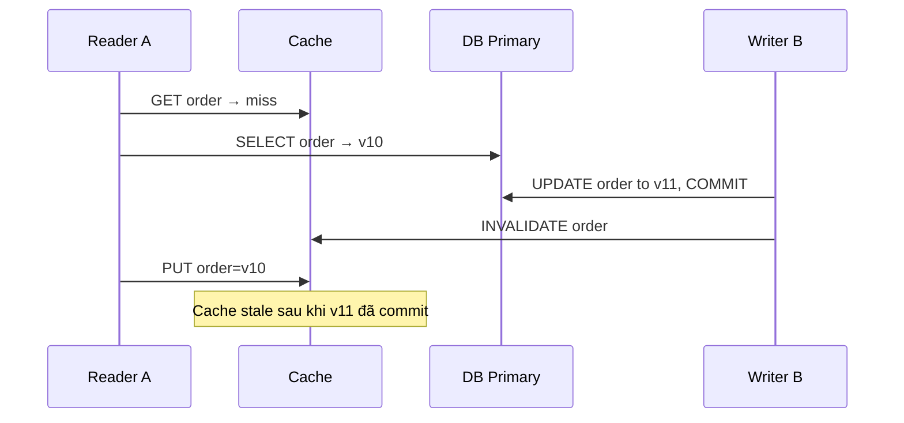

# Lưu trạng thái trong bộ nhớ và nguy cơ khác trạng thái đã commit

Trong chương **Nhất quán và cache** của **DATA_PERSISTENCE_FUNDAMENTALS**, một câu hỏi rất thực tế khi thiết kế persistence cho Java là: **giá trị ứng dụng đang giữ trong RAM có thực sự phản ánh kết quả giao dịch đã `COMMIT` ở database không?** Câu trả lời thường là **chưa chắc**.

Ứng dụng có thể sửa một đối tượng Java nhưng chưa gửi SQL; đã gửi SQL nhưng transaction vẫn có thể rollback; database đã commit nhưng cache chưa được làm mới; hoặc cache chứa dữ liệu được nạp từ một bản sao đọc (read replica) đang trễ. Nếu lấy trạng thái bộ nhớ làm chân lý mà không hiểu các ranh giới này, hệ thống có thể báo “thanh toán thành công” cho giao dịch đã rollback, hiển thị tồn kho cũ, hoặc ra quyết định nghiệp vụ bằng một phiên bản dữ liệu không còn hợp lệ.

Bài này tập trung vào sự khác nhau giữa **trạng thái trong bộ nhớ** và **trạng thái đã commit**, cách quản lý cache trong ứng dụng Java, sự tương tác với JDBC/JPA/Spring, cùng chiến lược vô hiệu hóa, phiên bản hóa, xử lý race condition và kiểm thử tính nhất quán. Nguyên tắc áp dụng rộng cho các hệ quản trị dữ liệu giao dịch; ví dụ cụ thể về Spring, Hibernate hoặc PostgreSQL sẽ được nêu rõ khi cần.

## 1. Một đối tượng nghiệp vụ có thể tồn tại ở nhiều nơi

Giả sử dịch vụ đặt hàng có một đơn `O-101`, trạng thái trong database đã commit là `PENDING`. Trong một request, service muốn chuyển nó sang `CONFIRMED`. Cùng một “đơn hàng” có thể có nhiều bản thể hiện:

| Nơi lưu | Ví dụ trạng thái | Đặc điểm |
| --- | --- | --- |
| Biến/đối tượng Java trong một request | `order.status = CONFIRMED` | Có thể chỉ là thay đổi trong RAM, chưa có SQL nào chạy |
| JPA `EntityManager` / persistence context | Managed entity có `status=CONFIRMED` | Thay đổi có thể chờ dirty checking và `flush` |
| Trang dữ liệu/WAL của một DB transaction chưa commit | SQL đã `UPDATE status='CONFIRMED'` | Transaction khác có thể chưa nhìn thấy, và thay đổi vẫn có thể rollback |
| Bản dữ liệu **đã commit** ở database | `PENDING` hoặc `CONFIRMED` tùy transaction hoàn tất | Là trạng thái bền vững/được xác nhận theo cam kết của DB |
| Cache trong JVM (local cache) | `PENDING` trên instance A, `CONFIRMED` trên instance B | Mỗi instance có đời sống và thời điểm cập nhật riêng |
| Cache phân tán như Redis | Có thể giữ `PENDING` cho tới khi hết hạn hoặc bị invalidate | Không tham gia nguyên tử vào transaction DB thông thường |
| Read replica | Có thể vẫn trả `PENDING` sau khi primary đã commit `CONFIRMED` | Có thể trễ do replication và cơ chế read consistency |

Sự tồn tại của nhiều bản sao không tự động sai. Vấn đề là **ứng dụng dựa vào bản nào để ra quyết định**, và có cơ chế nào xác định độ mới hợp lệ cho yêu cầu đó.



Các đường nét đứt biểu diễn **quá trình đồng bộ riêng**, không hàm ý mỗi lần commit tự động cập nhật mọi cache hoặc replica ngay lập tức.

### 1.1. Điều gì là source of truth?

Trong ví dụ này, **database ghi giao dịch chính** là nguồn dữ liệu có thẩm quyền (*source of truth*) cho trạng thái đơn hàng. Cache chỉ là bản sao phục vụ đọc nhanh. Tuy vậy, không nên tuyên bố “mọi dữ liệu trong hệ thống đều có một nguồn chân lý”: một nhà cung cấp thanh toán có thể là nguồn có thẩm quyền cho trạng thái charge; inventory có thể được điều phối bởi dịch vụ kho; một search index chỉ là hình chiếu (projection).

Trước khi đưa dữ liệu vào bộ nhớ, cần định nghĩa rõ **trường dữ liệu nào do hệ thống nào sở hữu** và điều gì phải được đồng bộ sau khi nguồn đó thay đổi.

## 2. `flush`, `commit` và thay đổi của đối tượng Java là ba sự kiện khác nhau

Đặc biệt trong JPA/Hibernate, lập trình viên dễ nhầm việc sửa một entity được quản lý với việc database đã commit:

```java
@Transactional
public void confirmOrder(long orderId) {
    Order order = entityManager.find(Order.class, orderId);
    order.setStatus(OrderStatus.CONFIRMED); // Thay đổi trong persistence context.

    // Chưa có bằng chứng transaction đã commit.
    // Provider có thể flush khi cần hoặc trước commit.
}
```

Nếu phương thức hoàn tất bình thường và transaction được quản lý đúng, framework có thể flush và commit. Nhưng trong khoảng giữa lời gọi setter và commit, `order.getStatus()` trong cùng persistence context có thể đã là `CONFIRMED` **dù database chưa xác nhận kết quả đó**.

| Mốc | Đối tượng Java thấy gì? | Giao dịch khác có thể thấy gì? | Có thể rollback không? |
| --- | --- | --- | --- |
| Vừa gọi setter | Entity đã đổi trong RAM | Thường vẫn thấy trạng thái committed trước đó | Có |
| Sau khi JPA `flush()` | SQL có thể đã chạy trong transaction | Phụ thuộc isolation và quy tắc DB; thường chưa thấy uncommitted write | Có |
| Sau `commit()` thành công | Giao dịch được DB xác nhận theo cấu hình durability | Các transaction mới có thể đọc bản committed phù hợp với isolation | Không rollback transaction đã hoàn tất bằng rollback cũ |
| Transaction bị rollback | Đối tượng Java có thể vẫn giữ giá trị đã sửa | Database không giữ tác dụng ghi của transaction bị rollback | Đã rollback; object cần bỏ hoặc tái nạp |

**`flush()` không phải `commit()`.** Nó đồng bộ thay đổi từ persistence context tới database **trong transaction hiện tại**, thường để đáp ứng SQL, constraint hoặc chuẩn bị commit. Transaction vẫn có thể lỗi sau `flush`, bao gồm lỗi constraint, deadlock, serialization hoặc lỗi khi commit.

### 2.1. Rollback không tự tua ngược mọi object Java

Ví dụ:

```java
Order order = orderRepository.findById(id).orElseThrow();
order.setStatus(OrderStatus.CONFIRMED);
try {
    performDatabaseWorkAndCommit(order);
} catch (RuntimeException ex) {
    // Đừng giả định order.getStatus() đã tự quay về PENDING.
}
```

Nếu DB rollback, việc khôi phục trạng thái **trong RAM** phụ thuộc vào phạm vi persistence context và cách ứng dụng quản lý object. Biến Java vẫn có thể giữ `CONFIRMED`, thậm chí khi DB vẫn là `PENDING`. Trong Spring/JPA, sau lỗi khiến transaction rollback, không nên tái sử dụng `EntityManager`/managed entity đang ở trạng thái thất bại làm nguồn dữ liệu tin cậy cho transaction kế tiếp; hãy **mở đơn vị công việc mới và đọc lại** khi cần.

Điều này đặc biệt nguy hiểm nếu object đó được lưu vào **singleton field**, session HTTP, cache, hoặc trả cho các task bất đồng bộ trước khi biết commit thành công.

### 2.2. JDBC cũng có trạng thái bộ nhớ không gắn với rollback

```java
int newBalance = currentBalance - 100;
accountDto.setBalance(newBalance);        // Java object đã thay đổi.
// Sau đó UPDATE accounts ... nhưng transaction thất bại và rollback.
```

Rollback DB không gọi `accountDto.setBalance(currentBalance)` giúp bạn. Cần **không công bố object chưa commit** cho bên ngoài hoặc thiết kế lại quy trình: chỉ xây dựng kết quả thành công sau xác nhận commit; với trạng thái không chắc, trả mã yêu cầu để truy vấn lại.

## 3. Lỗi khi cập nhật cache trước commit

Một anti-pattern thường gặp là **đặt giá trị mới vào cache ngay sau khi sửa entity nhưng trước commit**:

```java
@Transactional
public void confirmOrder(long orderId) {
    Order order = orders.findById(orderId).orElseThrow();
    order.setStatus(OrderStatus.CONFIRMED);

    cache.put(orderId, "CONFIRMED"); // Nguy hiểm: DB chưa commit.
    // Việc ghi DB còn có thể rollback ở cuối transaction.
}
```

Nếu DB rollback, người đọc cache vẫn có thể thấy `CONFIRMED` trong khi dữ liệu đã commit là `PENDING`. Ngay cả khi commit cuối cùng thành công, một request khác có thể đọc `CONFIRMED` **trước khi DB transaction commit**, tức là cache làm lộ trạng thái chưa được xác nhận.



**Quy tắc mặc định:** khi cache chứa bản sao của dữ liệu đã commit, **không công bố thay đổi chưa commit cho những người đọc khác**. Đặc biệt, không để thao tác cache trong cùng hàm `@Transactional` khiến người đọc nhầm rằng Redis/Caffeine tự động tham gia transaction DB.

### 3.1. Cache nằm trong RAM của một JVM vẫn có thể sai

Một service singleton giữ `Map<Long, OrderDto>` có thể bị nhiều thread sử dụng và cập nhật trong khi DB transaction chưa hoàn tất. Dùng `ConcurrentHashMap` giúp map an toàn trước những thao tác concurrent cơ bản, **không làm trạng thái trong map trở nên nhất quán với DB**. Cấu trúc dữ liệu thread-safe là một yêu cầu khác với tính đúng đắn của cache ở ranh giới transaction.

Nếu cache giữ đối tượng mutable, một luồng có thể sửa chính object đã được cache **mà không gọi `put`**, làm giá trị “rò” sang người đọc khác. Có thể cân nhắc cache các DTO bất biến, defensive copy, hoặc những snapshot có version.

## 4. Chỉ cập nhật cache sau commit đã đủ chưa?

Đợi commit xong trước khi cập nhật/invalidate cache là **cải thiện quan trọng**, nhưng chưa giải quyết toàn bộ vấn đề:

```text
Transaction A: UPDATE orders; COMMIT thành công
--- Ứng dụng crash / mất mạng ở đây ---
Cache invalidate(orderId) chưa chạy
```

Lúc này database đã ở `CONFIRMED`, nhưng cache vẫn là `PENDING`. `afterCommit` callback của Spring có thể giảm nguy cơ công bố giá trị **trước** commit, song không bảo đảm callback sẽ chạy nếu tiến trình dừng đúng khoảng trống sau commit. Một cache entry có TTL còn có thể hết hạn sau đó, nhưng trong thời gian chờ nó vẫn stale.

Ngoài ra, một sự cố ngược cũng tồn tại: ứng dụng invalidates cache sau commit, nhưng một request đọc khác đang xử lý có thể **ghi lại giá trị cũ**. Mẫu này sẽ được phân tích ở phần cache-aside.

### 4.1. Ba yêu cầu cần tách biệt

| Câu hỏi | Bảo đảm cần có | Cơ chế có thể dùng |
| --- | --- | --- |
| Không cho người khác thấy giá trị chưa commit? | **Không công bố trước commit** | Đọc trực tiếp DB trong transaction; delay publication |
| Sau commit cache sẽ được sửa/xóa? | **Delivery của tín hiệu đồng bộ** | After-commit best-effort; outbox + consumer/repair khi phải bền vững |
| Cache không bị bản cũ ghi đè lên bản mới? | **Đúng thứ tự/phiên bản** | Version check, CAS, conditional update, monotonic sequence |

Ba câu hỏi liên quan nhưng **không tương đương nhau**. Chỉ gọi cache clear sau commit có thể vẫn không đủ trong hệ thống nhiều instance và có race giữa fill/invalidate.

## 5. Cache-aside: race condition giữa nạp cache và vô hiệu hóa

**Cache-aside** (còn gọi là lazy loading) là mẫu mà ứng dụng chủ động đọc cache trước, nếu miss thì đọc database và lưu kết quả vào cache:

```text
GET order:
  cache GET key
  nếu hit: trả giá trị
  nếu miss:
      SELECT order từ database
      cache PUT key, dữ liệu vừa đọc
      trả dữ liệu

UPDATE order:
  COMMIT cập nhật trong database
  cache INVALIDATE key
```

Với nhu cầu đọc nhiều và ghi ít, mẫu này đơn giản và thường đem lại hiệu quả tốt. Tuy nhiên nó có một cuộc đua tinh vi, **ngay cả khi thao tác invalidate chỉ chạy sau commit**.

### 5.1. Giá trị cũ được ghi lại sau lần invalidate

Giả sử DB đang là phiên bản `v10`, cache ban đầu trống:

| Thời điểm | Reader A | Writer B | Database | Cache |
| --- | --- | --- | --- | --- |
| T1 | Cache miss | — | `v10` | Trống |
| T2 | `SELECT` và nhận `v10` | — | `v10` | Trống |
| T3 | — | Cập nhật thành `v11`, `COMMIT` | `v11` | Trống |
| T4 | — | Invalidate key | `v11` | Trống |
| T5 | Reader A `PUT v10` từ dữ liệu đã đọc | — | `v11` | **`v10`** |
| T6 | Reader C cache hit | — | `v11` | **`v10`** |

Không ai “put vào cache trước commit” cả, nhưng bản cũ vẫn thắng vì request đọc trước **đặt dữ liệu vào cache muộn hơn** sự kiện invalidation.



Trong triển khai có nhiều process hoặc cache phân tán, khóa `synchronized` của một JVM **không bảo vệ được** lịch chạy giữa hai instance. Những phương án như khóa theo key, compare-and-set, generation/tombstone hoặc versioned cache phải được thiết kế theo phạm vi đồng thời thực tế.

### 5.2. Invalidate **trước** commit còn có một cuộc đua khác

```text
Writer A: DELETE cache key
Reader B: cache miss, SELECT DB → thấy v10 vì v11 chưa commit
Reader B: PUT v10 vào cache
Writer A: COMMIT v11
```

Cache có thể giữ `v10` lâu hơn vì Writer A **không còn invalidate lần nữa** sau commit. Đây là lý do invalidation trước commit thường không đủ để bảo đảm cache thể hiện trạng thái đã xác nhận; ngược lại, invalidation sau commit vẫn cần xét race nạp cache ở mục 5.1.

### 5.3. Chiến lược giảm rủi ro

Không có một thủ thuật áp dụng cho mọi hệ thống; các hướng sau phù hợp trong điều kiện khác nhau:

| Phương án | Ý tưởng | Đánh đổi / điều kiện |
| --- | --- | --- |
| **TTL ngắn + chấp nhận stale** | Dữ liệu cũ tự hết hạn trong khoảng giới hạn | Không bảo đảm đọc mới ngay sau commit; TTL có thể tính từ lần fill cũ |
| **Cache key có version** | `order:101:v11` khác `order:101:v10` | Người đọc phải lấy **version đáng tin**; cơ chế chỉ mục version cũng cần đồng bộ |
| **CAS theo version** | Chỉ cho phép ghi cache nếu phiên bản đến mới hơn phiên bản đang có | Không ngăn stale write khi key vừa bị xóa và không còn version; cần generation/tombstone phù hợp |
| **Barrier/tombstone khi invalidate** | Giữ “phiên bản tối thiểu” khiến lần fill cũ không được công bố | Cần thao tác so sánh nguyên tử trong cache và retention cho barrier |
| **Per-key coordination** | Nạp cache và invalidation được điều phối trong cùng miền khóa | Khó mở rộng giữa nhiều instance; timeout/failure của khóa phải an toàn |
| **Không cache quyết định ghi** | Kiểm tra và ghi điều kiện trực tiếp tại DB | Tăng truy cập DB nhưng giữ invariant nghiệp vụ đúng |

**Lưu ý quan trọng:** so sánh version chỉ an toàn nếu version có ý nghĩa **đơn điệu đối với cùng thực thể** và được thay đổi cùng transaction với dữ liệu. Dựa vào timestamp ở client để suy ra “bản nào mới hơn” có thể sai do lệch đồng hồ hoặc đồng thời.

## 6. Cách dùng cache đúng với nguồn dữ liệu đã commit

Các chiến lược phổ biến có mức bảo đảm khác nhau:

### 6.1. Cache-aside

Ứng dụng đọc cache, miss thì đọc DB rồi fill; khi ghi, commit DB xong mới invalidate. Đây là lựa chọn tốt khi chấp nhận tính nhất quán cuối cùng trong một khoảng thời gian và có giải pháp cho stale fill nếu cần.

Một mẫu đọc đơn giản, **chưa bảo vệ hết race ở mục 5**, là:

```java
public OrderView getOrder(long orderId) {
    String key = "order:" + orderId;
    OrderView cached = cache.getIfPresent(key);
    if (cached != null) {
        return cached;
    }

    OrderView fresh = orderReader.loadCommitted(orderId);
    cache.put(key, fresh);
    return fresh;
}
```

Mẫu trên chỉ là cơ sở để phân tích. `cache` và `orderReader` là abstraction giả định. `loadCommitted(...)` phải dùng một ngữ cảnh đọc database phù hợp, không vô tình sử dụng persistence context đang giữ dữ liệu cũ hoặc read replica trễ. Kể cả giá trị được đọc từ DB tại thời điểm T2, nó vẫn có thể bị ghi vào cache sau một commit mới ở T3.

### 6.2. Write-through

Mỗi lần ghi đi qua một lớp cache, lớp đó cập nhật DB và cache. Cách này có thể giữ hai nơi gần nhau hơn khi **mọi đường ghi** đều đi qua lớp đó, nhưng hai hệ thống vẫn có commit/ACK độc lập. Nếu DB commit xong mà cache update lỗi, trạng thái lệch; nếu cache được cập nhật trước DB commit, cũng có nguy cơ công bố giá trị chưa commit.

**Write-through không mặc nhiên là distributed transaction**. Muốn cam kết mạnh, phải xác định thứ tự thao tác, cách phát hiện lỗi, retry và phương pháp hòa giải trạng thái.

### 6.3. Write-behind / write-back

Ứng dụng cập nhật cache hoặc hàng đợi trước, rồi ghi DB **về sau**. Đây là thay đổi kiến trúc đáng kể: cache/hàng đợi trở thành nơi nắm **ý định ghi chưa được commit vào DB**.

```text
Client → WRITE cache/queue → trả thành công
                               |
                               v
                         Worker → WRITE DB
```

Nếu chỉ ghi vào **RAM** và trả thành công, tiến trình crash có thể làm mất dữ liệu trước khi lưu DB. Muốn có cam kết bền vững, cần **log/queue bền vững**, cơ chế replay, thứ tự, idempotency, backpressure và trạng thái lỗi; không được quảng bá “đã lưu DB thành công” khi mới đưa thay đổi vào một bộ đệm volatile.

### 6.4. Read-through

Cache hoặc thư viện cache tự gọi loader khi miss. Mẫu này giảm code ở caller nhưng **không loại bỏ race với cập nhật DB**. Cần biết loader truy cập primary/replica, có transaction nào đang mở, cách refresh bất đồng bộ hoạt động và liệu kết quả đọc có thể đến sau lần invalidate hay không.

### 6.5. Bảng lựa chọn sơ bộ

| Nhu cầu | Hướng ưu tiên | Điều cần chứng minh |
| --- | --- | --- |
| Danh mục công khai ít thay đổi | Cache-aside + TTL/invalidation | Chấp nhận stale trong thời gian bao lâu |
| Tồn kho/số dư trước thao tác ghi | Conditional SQL/transaction tại DB | Không ra quyết định chỉ từ số tồn hoặc số dư cache |
| Profile người dùng nhiều read | Cache-aside + version hoặc invalidation | PII/tenant separation và phản hồi khi dữ liệu đổi |
| Phiên bản trạng thái đơn cần mới ngay | Đọc primary hoặc cơ chế read consistency phù hợp | Read-your-writes và SLA |
| Hàng triệu thay đổi cần streaming | Outbox/CDC + projection/cache consumer | Lượng trễ, thứ tự, idempotency và repair |
| Hệ thống offline-first | Log sự kiện/đồng bộ hai chiều và conflict resolution | Chính sách xung đột và dữ liệu “chưa được server xác nhận” |

**Nguyên tắc:** chọn mô hình cache từ **yêu cầu nhất quán của nghiệp vụ**, không từ mong muốn giảm số query đơn thuần.

## 7. Tương tác với Spring `@Transactional` và Spring Cache

Trong ứng dụng Spring, `@Transactional` có nhiệm vụ điều phối transaction database theo transaction manager; các annotation như `@Cacheable`, `@CachePut` và `@CacheEvict` điều khiển một **abstraction khác**. Không nên suy ra rằng đặt hai annotation trên cùng một phương thức sẽ tự tạo **atomic commit giữa DB và cache**.

### 7.1. Vì sao `@CacheEvict` chưa chắc chạy sau DB commit?

```java
@Transactional
@CacheEvict(cacheNames = "orders", key = "#orderId")
public void confirmOrder(long orderId) {
    orderRepository.confirm(orderId);
}
```

Mặc định `@CacheEvict` thường thực hiện sau khi phương thức được gọi thành công (trừ khi cấu hình `beforeInvocation=true`), nhưng **“sau invocation” không nhất thiết là “sau database commit”**. Thời điểm phụ thuộc cách các interceptor transaction và cache được lồng ghép, thứ tự advice và loại `CacheManager` đang dùng.

Hệ quả có thể là cache key bị xóa **trong khi transaction chưa commit**. Một request khác thấy cache miss, đọc trạng thái cũ từ DB, rồi đưa bản cũ vào cache. Sau đó transaction commit và không có lần invalidate nào khác, tạo stale cache.

Spring có các thành phần hỗ trợ **transaction-aware cache operations**, có thể trì hoãn một số thao tác put/evict/clear tới pha transaction phù hợp; phải xác nhận cách cấu hình và hành vi cụ thể của cache implementation. Đừng xem tính năng này là distributed commit giữa DB và Redis, hoặc bảo đảm không có crash window và stale fill.

### 7.2. Listener sau commit cho invalidation best-effort

Một cách viết rõ ý định là đăng ký sự kiện nội bộ trong transaction, rồi xử lý invalidate khi commit thành công:

```java
public record OrderChanged(long orderId) {}

@Service
public class OrderService {
    private final OrderRepository orders;
    private final ApplicationEventPublisher events;

    public OrderService(OrderRepository orders,
                        ApplicationEventPublisher events) {
        this.orders = orders;
        this.events = events;
    }

    @Transactional
    public void confirmOrder(long orderId) {
        int changed = orders.confirmIfPending(orderId);
        if (changed != 1) {
            throw new IllegalStateException("Order is not pending");
        }
        events.publishEvent(new OrderChanged(orderId));
    }
}

@Component
public class OrderCacheInvalidator {
    private final Cache orderCache;

    public OrderCacheInvalidator(Cache orderCache) {
        this.orderCache = orderCache;
    }

    @TransactionalEventListener(phase = TransactionPhase.AFTER_COMMIT)
    public void afterOrderCommit(OrderChanged event) {
        orderCache.evict(event.orderId());
    }
}
```

Đây là **ví dụ minh họa về best-effort invalidation**. `confirmIfPending` là repository method do ứng dụng định nghĩa; `Cache` được cấu hình để chứa các entry với key tương ứng. Khi transaction rollback, listener `AFTER_COMMIT` không được kích hoạt theo hợp đồng phase. Nhưng nếu process crash sau DB commit, **event nội bộ và lời gọi invalidate có thể bị mất**.

Với Spring, event listener gắn transaction thường không được thực thi nếu không có transaction, trừ khi cho phép `fallbackExecution`; nếu chọn bật fallback, cần hiểu hành vi khi không tồn tại ranh giới commit để trì hoãn. Trong transaction reactive, cơ chế context không giống transaction imperative gắn với thread; phải dùng API/cấu hình tương thích.

### 7.3. Khi invalidation phải được giao chắc chắn

Nếu stale cache gây hại lớn hoặc nhiều instance cần nhận được thông báo ngay cả sau restart, có thể ghi **ý định invalidation** trong cùng DB transaction với cập nhật dữ liệu:

```text
BEGIN
    UPDATE orders SET status='CONFIRMED', version=version+1
    WHERE id=:order_id AND status='PENDING'
    → kiểm tra đúng 1 row

    INSERT INTO outbox_events(event_id, aggregate_id, event_type, version)
    VALUES (:event_id, :order_id, 'OrderChanged', :new_version)
COMMIT

Worker đọc outbox → phát event → cache consumer invalidates entry
```

Ở đây outbox và bảng `orders` **phải cùng được ghi trong một transaction**; SQL dùng placeholder dạng `:name` chỉ là ký hiệu để giải thích, không phải cú pháp SQL thuần được mọi driver hỗ trợ. Worker cần retry có giới hạn và consumer xử lý idempotent vì event có thể được giao **hơn một lần**.

Outbox cải thiện **độ bền của ý định đồng bộ**, nhưng không làm cache và DB cập nhật cùng một thời điểm. Khoảng thời gian giữa commit và consumer xử lý vẫn có thể có stale reads. Nếu yêu cầu đọc tức thời nhất quán thì chọn đọc primary/đường có bảo đảm mạnh hơn, không chỉ thêm outbox.

### 7.4. Không dùng `afterCommit` để tạo một transaction “vô hình”

Trong Spring imperative, callback sau commit có thể chạy khi một số tài nguyên transaction **vẫn còn được liên kết với luồng trước lúc cleanup**. Nếu callback gọi repository để **ghi database** và trông chờ có lần commit tiếp theo, kết quả có thể không như mong muốn. Khi cần ghi DB ở giai đoạn này, hãy chủ động tạo transaction mới được quản lý (chẳng hạn `REQUIRES_NEW` qua proxy hoặc `TransactionTemplate` phù hợp) và vẫn phải chấp nhận cửa sổ crash giữa hai transaction. Giải pháp bền vững cho một thay đổi bắt buộc cùng tồn tại với trạng thái nghiệp vụ thường là **ghi trong transaction chính**.

Ngoài ra, exception trong callback sau commit **không thể đảo ngược commit DB đã hoàn tất**. Nếu API nhận lỗi do invalidation thất bại sau commit, client có thể nghĩ yêu cầu thất bại dù DB đã ghi. Cần thiết kế phản hồi/idempotency theo **kết quả DB**, không dựa duy nhất vào thành công của thao tác cache.

## 8. JPA persistence context không phải cache dùng chung cho toàn ứng dụng

Hibernate/JPA có những tầng nhớ dữ liệu khác nhau, cần phân biệt chúng để tránh đọc nhầm trạng thái:

### 8.1. First-level cache / persistence context

Mỗi `EntityManager`/Hibernate `Session` có một **persistence context** quản lý các entity đã tải. Trong cùng context, `find(Order.class, id)` có thể trả lại **cùng object đã quản lý** thay vì truy vấn lại DB. Điều đó duy trì identity trong đơn vị công việc, nhưng không bảo đảm object luôn phản ánh **commit mới nhất của transaction khác**.

```java
@Transactional
public void example(long orderId) {
    Order first = entityManager.find(Order.class, orderId);

    // Transaction khác có thể commit trạng thái mới tại đây.
    Order second = entityManager.find(Order.class, orderId);

    // Trong cùng persistence context, first và second có thể là
    // cùng managed entity, chưa được refresh từ database.
}
```

Không có một thao tác “tự làm mới khi ai đó commit” áp dụng cho mọi JPA entity. `entityManager.refresh(entity)` có thể buộc provider đọc lại theo quy tắc hiện hành nhưng vẫn chịu mức cô lập của transaction; ở transaction với snapshot cố định, đọc lại chưa chắc thấy commit mới nhất. `clear()` tách các entity khỏi context; phải hiểu ảnh hưởng tới các thay đổi chưa flush và vòng đời entity. Không sử dụng refresh/clear bừa bãi như cách giải quyết mọi race condition.

### 8.2. Sau rollback, đừng tái sử dụng entity như một snapshot đã commit

JPA entity có thể đã được sửa trước khi transaction rollback. Sau rollback, trạng thái in-memory của entity có thể không phản ánh DB; persistence context còn có thể không phù hợp để sử dụng tiếp sau một số lỗi. Tạo transaction/context mới và tải lại dữ liệu là cách đơn giản để tránh lấy trạng thái chưa commit làm căn cứ cho thao tác tiếp theo.

### 8.3. Second-level cache / query cache

Tùy provider và cấu hình, ORM có thể dùng cache cấp hai cho dữ liệu entity/collection, và một cache khác cho kết quả query. Khác với first-level cache gắn một `EntityManager`, second-level cache có thể được chia sẻ trong một phạm vi lớn hơn.

Các lưu ý chính:

- Không suy từ “có JPA” rằng second-level cache đã được bật hoặc bảo đảm nhất quán mạnh.
- Cấu hình concurrency strategy (`READ_ONLY`, `READ_WRITE`, v.v. tùy provider) có yêu cầu và hành vi khác nhau.
- **Bulk update JPQL/SQL**, JDBC trực tiếp, migration script và hệ thống khác ghi cùng bảng có thể không tuân thủ cơ chế cache của ORM; cần xác định khả năng phát hiện/evict theo provider.
- Query cache có phụ thuộc vào tham số và bảng liên quan; tránh suy rằng một entity được sửa thì mọi kết quả truy vấn đã được cache tự động làm mới chính xác.
- Managed entity có thể giữ bản đã tải dù second-level cache vừa bị invalidate; hai tầng cache không phải một.

### 8.4. Version trong JPA bảo vệ write conflict, không tự bảo đảm fresh read

```java
@Entity
public class Order {
    @Id
    private Long id;

    @Version
    private Long version;

    @Enumerated(EnumType.STRING)
    private OrderStatus status;
}
```

`@Version` giúp phát hiện xung đột khi các giao dịch dùng version cũ để cập nhật **cùng entity**, miễn đường ghi tuân thủ cơ chế version. Nhưng người dùng vẫn có thể **đọc một bản cache cũ** mà không ghi gì; optimistic locking không làm mọi cache entry lập tức cập nhật khi DB commit. Nếu dùng version làm tín hiệu nhất quán cache, cần mang version qua read model, invalidation và quy tắc so sánh tương ứng.

## 9. Versioned cache và quy tắc “không đi lùi”

Một cách tăng tính đúng đắn là gắn mỗi phiên bản dữ liệu với **version được database cập nhật trong cùng transaction với bản ghi nghiệp vụ**:

```sql
-- PostgreSQL, minh họa trên một hàng đã tồn tại.
UPDATE orders
   SET status = 'CONFIRMED',
       version = version + 1
 WHERE id = :order_id
   AND status = 'PENDING'
RETURNING id, status, version;
```

Trong SQL thực tế qua JDBC, dùng tham số `?` hoặc công cụ hỗ trợ named parameter thay vì tự ghép chuỗi. Câu lệnh phải được thực hiện trong transaction bao trọn quy tắc nghiệp vụ; kết quả `RETURNING` **chỉ là phiên bản mới dự kiến**, chưa phải thay đổi đã commit khi transaction vẫn đang mở.

Sau khi commit, cache có thể lưu một envelope bất biến:

```java
public record OrderSnapshot(
    long id,
    String status,
    long version
) {}
```

Mục tiêu của quy tắc **monotonic version** là: với cùng một order, cache không được thay giá trị phiên bản `v11` đã chấp nhận bằng `v10` xuất hiện muộn do một truy vấn chậm, sự kiện cũ hoặc thứ tự mạng thay đổi.

### 9.1. Compare-and-set phải là nguyên tử tại nơi lưu cache

Pseudo-code:

```text
cachePutIfNewer(orderKey, incoming):
    atomic:
        current = GET orderKey
        if current == null or incoming.version >= current.version:
            SET orderKey incoming
            return true
        return false
```

Chữ **`atomic`** là một yêu cầu quan trọng; nếu thao tác GET rồi SET được thực hiện riêng biệt, hai luồng vẫn có thể đua nhau:

```text
Luồng A GET v9
Luồng B GET v9
Luồng B SET v11
Luồng A SET v10  → cache bị lùi phiên bản
```

Với cache phân tán như Redis, phải dùng một cơ chế so sánh và ghi nguyên tử phù hợp (ví dụ thao tác script/transaction có điều kiện được triển khai đúng), không giả định hai lệnh mạng liên tiếp là atomic. Với cache local, có thể dùng cơ chế update nguyên tử theo key của implementation tương ứng.

### 9.2. Vì sao CAS trên entry còn chưa đủ khi dùng invalidate?

Quay lại cuộc đua mục 5.1: writer đã **xóa** key sau commit `v11`, rồi reader cũ muốn nạp `v10`. Vì entry hiện tại không tồn tại, một `putIfNewer` chỉ so sánh với **giá trị đang có** vẫn cho phép `v10` trở lại.

Để bảo vệ tình huống này, có thể lưu **ngưỡng version tối thiểu** hoặc *tombstone*:

```text
Sau khi commit order v11:
  cache atomic setMinimumAcceptedVersion(orderKey, 11)
  cache không cho phép công bố snapshot version < 11

Reader A đang cầm v10:
  cachePutIfNewer(orderKey, v10) → bị từ chối

Reader khác nạp v11 từ primary:
  cachePutIfNewer(orderKey, v11) → được chấp nhận
```

Ngưỡng phiên bản phải được cập nhật theo một cơ chế đồng bộ đã định nghĩa; nếu **event nâng version bị mất**, cache vẫn có thể stale. Tombstone cũng phải tồn tại đủ lâu so với thời gian của những thao tác đọc cũ đang bay trên mạng; xóa tombstone quá sớm có thể mở lại cuộc đua. Đây là một thiết kế nâng cao, có chi phí bộ nhớ và vận hành.

### 9.3. Không dùng timestamp ngẫu nhiên làm version tuyệt đối

`updated_at` từ nhiều node có thể chịu lệch đồng hồ, độ chính xác giới hạn hoặc nhiều commit trùng timestamp. Nếu cần so sánh đáng tin cậy giữa các thay đổi của **cùng một aggregate**, dùng một version/sequence tăng trong transaction DB là phương án dễ lý luận hơn.

Ngay cả với version tăng, hãy xác định scope: `order.version=11` không thể đem so trực tiếp với `customer.version=8` để suy ra đối tượng nào “mới hơn”. Trong hệ thống event-driven, cần phân biệt **thứ tự theo aggregate** với **thứ tự toàn cục**, và consumer phải xử lý trường hợp event đến trễ hoặc lặp.

## 10. Đọc từ replica có thể khác database primary đã commit

Không phải mọi lượt đọc “từ database” đều đọc đúng nguồn authoritative mới nhất. Nhiều hệ thống ghi vào **primary** và phân tải đọc sang **read replica**. Replication có thể bất đồng bộ:

```text
T1: Client UPDATE order trên primary
T2: Primary COMMIT thành công, trả HTTP 200
T3: Client gửi GET order sang read replica
T4: Replica chưa replay tới thay đổi mới → trả PENDING
T5: Replica bắt kịp → trả CONFIRMED
```

Nếu GET tại T3 dùng replica đang chậm và sau đó fill cache, **bản cũ có thể được cache thêm một thời gian sau T5**. Như vậy cần kiểm soát cả **nguồn nạp cache**, không chỉ invalidation.

### 10.1. Read-your-writes

**Read-your-writes** là kỳ vọng rằng sau khi một client đã được xác nhận ghi thành công, các lần đọc sau của **chính client đó** không thấy bản cũ hơn thao tác vừa xác nhận trong phạm vi bảo đảm đã định nghĩa.

Các cách triển khai thường gặp:

- Định tuyến các lần đọc nhạy cảm ngay sau ghi tới **primary** trong một khoảng thời gian hoặc cho tới khi đảm bảo mức version.
- Trả **version/commit token** cho client; nếu đọc qua replica thì đợi/kiểm tra replica đã bắt kịp mốc đó theo khả năng của DB.
- Với dữ liệu dùng làm quyết định tiền/tồn kho, thực hiện **đọc và ghi trong transaction ở nguồn có thẩm quyền**, không quyết định từ cache/replica.
- Cho phép eventual consistency đối với màn hình báo cáo, danh mục hoặc dữ liệu không yêu cầu phản ánh cập nhật ngay; công bố giới hạn của trải nghiệm.

Không giả định “cùng HTTP session” tự tạo read-your-writes nếu load balancer đưa request tới instance khác hoặc service dùng replica. Những đảm bảo từ primary, synchronous replica và snapshot isolation cũng phải được diễn giải theo DB cụ thể.

### 10.2. Phân biệt stale read và lost update

**Stale read** là nhận dữ liệu cũ. **Lost update** xảy ra khi thao tác ghi dựa trên dữ liệu cũ làm mất ảnh hưởng của một lần ghi khác. Stale read không phải lúc nào cũng dẫn đến mất cập nhật, nhưng có thể gây ra nó nếu code tính giá trị mới từ số cũ:

```java
int cachedStock = stockCache.get(productId); // Có thể là 5, trong DB là 3.
stockRepository.writeAbsolute(productId, cachedStock - 2);
```

Việc ghi số tuyệt đối `3` từ cache `5` có thể vô tình xóa ảnh hưởng của các giao dịch khác. Để bảo vệ tồn kho:

```sql
UPDATE products
   SET available = available - :quantity
 WHERE id = :product_id
   AND available >= :quantity;
```

Kiểm tra affected rows và thực hiện trong transaction với các bước nghiệp vụ liên quan. **Cache có thể gợi ý UI “còn 5 sản phẩm”, nhưng database phải quyết định có chấp nhận đặt hàng hay không.**

### 10.3. Negative caching cũng có thể stale

Một cache giữ kết quả “không tìm thấy” (negative cache) có thể làm giảm truy vấn cho ID không tồn tại. Nhưng nếu service A cache “không có sản phẩm 101” rồi service B tạo sản phẩm 101 và commit, người đọc tiếp theo vẫn có thể thấy “không có” tới khi negative entry hết hạn hoặc bị vô hiệu hóa.

Điều này cần được xem xét khi đăng ký tài khoản, đăng nhập, phân quyền, tạo mã định danh và màn hình “vừa tạo xong nhưng chưa tìm thấy”. Nếu caching trạng thái không tồn tại có thể tiết lộ danh tính hoặc ảnh hưởng quyền truy cập, chính sách phải nghiêm ngặt hơn dữ liệu danh mục thông thường.

## 11. Không dùng cache làm nơi quyết định bất biến quan trọng

Những quyết định như “được trừ tiền hay không”, “có đủ hàng hay không” hoặc “một mã chỉ được tạo một lần” phải được kiểm soát tại **nguồn có thẩm quyền** bằng constraint, conditional update, locking hoặc giao dịch phù hợp.

| Tình huống | Có thể dùng cache cho | Nên dựa vào đâu khi chấp nhận thay đổi |
| --- | --- | --- |
| Hiển thị số sản phẩm còn hàng | Chỉ báo có thể trễ theo SLA | DB `UPDATE ... WHERE available >= quantity` + kiểm tra số hàng |
| Hiển thị số dư trong dashboard | Số liệu đọc nhanh đã công bố mức trễ | Transaction DB và quy tắc số dư/ledger |
| Quyết định có tạo username không | Gợi ý sớm “có vẻ đã tồn tại” | `UNIQUE` constraint tại DB |
| Phân quyền đọc hồ sơ nhạy cảm | Tối ưu read theo version/TTL được kiểm soát chặt | Nguồn quyền có thẩm quyền, cơ chế fail-closed khi không chắc |
| Chuyển trạng thái đơn `PENDING → PAID` | Trạng thái hiển thị | Conditional UPDATE / version và kết quả ghi đã commit |
| Thanh toán qua provider ngoài | Hiển thị trạng thái đã đồng bộ | Trạng thái payment intent đã xác minh với provider và nghiệp vụ idempotent |

Ví dụ, dùng cache để kiểm tra đủ hàng rồi thực thi một `UPDATE` không điều kiện có thể bán vượt tồn. Dù cache luôn phản ánh DB ở một thời điểm, dữ liệu vẫn có thể thay đổi **giữa lúc đọc và lúc ghi**. Đây là lỗi *check-then-act*; **không có mức TTL ngắn nào tự biến hai bước ấy thành nguyên tử**.

Đối với phân quyền và thu hồi quyền, chấp nhận stale trong 30 giây có thể là một quyết định bảo mật nghiêm trọng. Nếu bắt buộc thu hồi có hiệu lực ngay, không chỉ dựa vào TTL; cần đường kiểm tra đáng tin, phiên bản chính sách hoặc invalidation có bảo đảm và xử lý fail-closed khi trạng thái không rõ.

## 12. Sự cố và trạng thái cache: đừng suy luận từ một phản hồi lỗi

Cache là tài nguyên ngoài database transaction trong phần lớn kiến trúc. Vì thế **thành công/thất bại của thao tác cache** không tự định nghĩa kết quả DB và ngược lại:

| Điểm xảy ra sự cố | DB sau sự cố | Cache có thể thế nào? | Phản ứng phù hợp |
| --- | --- | --- | --- |
| Ghi cache giá trị mới trước DB commit, rồi DB rollback | Vẫn là dữ liệu cũ | Đã là dữ liệu mới **không hợp lệ** | Không công bố uncommitted value; rollback không tự khôi phục cache |
| DB commit xong, tiến trình chết trước invalidate | Dữ liệu mới đã commit | Vẫn có bản cũ | TTL/repair; outbox nếu không được mất invalidation |
| Invalidate xong, reader cũ mới put lại | DB là bản mới | Bản cũ bị phục hồi | Version barrier/CAS hoặc chấp nhận stale theo SLA |
| Cache server timeout khi `PUT` | DB có thể đã commit | Cache có thể cập nhật hoặc chưa; ACK chưa rõ | Không kết luận DB rollback; thao tác cache phải idempotent |
| Invalidation được gửi qua broker nhưng ACK bị mất | DB đã commit | Consumer có thể đã xử lý hoặc chưa | Retry cùng event ID, handler idempotent và version-aware |
| DB `commit()` bị lỗi mạng | **Chưa biết** đã commit chưa | Cache có thể đang giữ bản cũ | Tra cứu bằng request ID bền vững trước khi suy kết quả và invalidation |
| Read replica đang trễ | Primary có bản mới | Có thể cache bản cũ từ replica | Kiểm tra source/version; đọc primary khi đòi hỏi read-your-writes |
| Cache mất hoàn toàn | DB không đổi | Miss nhiều, cold cache | Fallback có giới hạn và chống stampede; kiểm soát tải DB |

Nếu `cache.evict()` ném exception **sau DB commit**, ứng dụng không được đơn giản trả `"DB update failed"` như thể transaction vừa rollback. Client có thể retry thao tác ghi, gây thay đổi lần nữa. API cần phân biệt kết quả đã commit, trạng thái commit chưa rõ và sự cố của **lớp tối ưu đọc**.

### 12.1. Trạng thái commit chưa rõ

```text
Service gửi COMMIT tới DB
DB commit thành công rồi gửi ACK
Mạng đứt trước khi service nhận ACK
Service nhận SQLException / timeout
```

Service không thể kết luận database **chưa** lưu thay đổi. Việc cập nhật cache dựa trên giả định thất bại cũng có thể sai. Đối với lệnh thay đổi có tác dụng nghiệp vụ quan trọng, cần một **business request ID** ổn định và bản ghi trạng thái trong transaction, để truy vấn lại kết quả ở nguồn phù hợp trước khi retry. Redis/cache không phải là bằng chứng authoritative rằng một payment hoặc order đã commit.

Nếu đang xử lý transaction retry do deadlock/serialization failure, lần thử mới phải **đọc lại trạng thái**; không tái sử dụng đối tượng trong bộ nhớ được tính toán từ transaction đã hủy. Ngoài ra, các side effect bên ngoài xảy ra trước commit (gửi email, phát sự kiện) cần cơ chế riêng như transactional outbox, không được coi là có thể rollback cùng DB.

## 13. Nhiều lớp cache và nhiều instance làm vấn đề rõ hơn

Một hệ thống có thể có:

```text
HTTP Client
    |
Service instance A / B / C
    |  mỗi instance có local cache (L1)
    v
Redis / Memcached (L2)
    |
Database primary và read replicas
```

Khi A cập nhật đơn, việc xóa entry ở Redis không tự xóa bản sao local của B, C. Nếu có broadcast invalidation, một instance đang mất kết nối hoặc restart giữa chừng có thể bỏ lỡ message. Nếu B vẫn giữ entry trong L1 có TTL rất dài, mọi đảm bảo invalidation ở L2 sẽ không mang lại độ mới mà user kỳ vọng.

### 13.1. Các cách kiểm soát L1/L2

- Giới hạn TTL ở từng lớp và xác định **ngân sách stale** khi một thông báo invalidation bị mất.
- Kết hợp event mang version; mọi instance xử lý idempotent và không cho bản cũ ghi đè bản mới.
- Khi instance khởi động/reconnect, có cách **làm mới snapshot hoặc bỏ cache local** nếu không thể chắc đã nhận đủ các event.
- Đối với dữ liệu nhạy cảm cần tức thời, cân nhắc **không dùng L1**, hoặc yêu cầu xác minh version/permission ở nguồn có thẩm quyền.
- Giám sát lag của consumer, độ tuổi cache entry, lỗi invalidation và số lần đối chiếu khác biệt.

TTL ở một tầng không tự bảo đảm end-to-end stale bound nếu tầng khác vẫn phục vụ bản cũ, hoặc nếu loader luôn tái nạp dữ liệu từ replica chậm. Chính sách stale cần tính theo **đường đi thực tế của một request**.

### 13.2. Cache stampede và single-flight

Khi một key “nóng” hết hạn, hàng trăm request có thể đồng thời cache miss và cùng truy vấn DB. Đây là hiện tượng *cache stampede*. Một số cách giảm:

1. **Single-flight / per-key load coordination** trong một instance để chỉ một tác vụ nạp, những request khác cùng chờ kết quả.
2. Thêm jitter hợp lý vào TTL để giảm việc nhiều key hết hạn cùng lúc.
3. Giới hạn số truy vấn đồng thời đến DB bằng pool, bulkhead và deadline.
4. Nếu nghiệp vụ cho phép, dùng stale-while-revalidate với giới hạn độ trễ rõ ràng.
5. Với cache phân tán, dùng coordination phù hợp để tránh nhiều instance tải cùng key, nhưng không tạo khóa toàn hệ thống có rủi ro deadlock.

**Single-flight chủ yếu giải quyết tải**, không tự bảo đảm snapshot mới hơn lần ghi đã commit. Một loader có thể chỉ chạy một lần nhưng vẫn đọc dữ liệu cũ rồi đưa vào cache. Cần kết hợp version/đường đọc đúng nguồn nếu yêu cầu tính nhất quán mạnh hơn.

### 13.3. Key cache cần mang đủ ngữ cảnh

Không nên chỉ dùng `customer:42` nếu cùng ID có thể xuất hiện giữa nhiều tenant, environment hoặc phiên bản dữ liệu khác nhau. Cache key có thể cần thành phần `tenantId`, loại đối tượng, schema/format version, quyền hiển thị hoặc locale, tùy dữ liệu và chính sách sản phẩm.

Không nhúng token, mật khẩu hoặc dữ liệu cá nhân nhạy cảm trực tiếp vào tên key nếu key được log/quan sát. Cần định nghĩa cơ chế xóa dữ liệu theo retention và khả năng thu hồi quyền. **Tính nhất quán và bảo mật liên quan trực tiếp**: cache chậm cập nhật quyền có thể dẫn tới rò rỉ thông tin giữa người dùng hoặc tenant, không đơn giản là UI hiển thị cũ.

## 14. Đo lường tính nhất quán, không chỉ cache hit rate

Một cache có **hit rate 99%** nhưng 1% dữ liệu quan trọng bị sai có thể gây hại hơn một cache chỉ đạt 80% hit nhưng có SLA nhất quán đúng với nghiệp vụ.

| Nhóm chỉ số | Cần quan sát | Ý nghĩa |
| --- | --- | --- |
| Hiệu năng đọc | Hit/miss, cache latency p95/p99, load time | Cache có giảm chi phí truy vấn không? |
| Chậm đồng bộ | Thời gian từ DB commit tới khi cache được sửa/invalidate | Người dùng có thể thấy dữ liệu cũ trong bao lâu? |
| Độ mới | Tuổi snapshot, version trong cache so với DB khi lấy mẫu | Cache có bị lùi phiên bản hoặc giữ bản cũ quá lâu? |
| Lỗi đường đồng bộ | Invalidation failure/retry, consumer lag, outbox pending age | Có sự kiện đồng bộ bị kẹt sau commit không? |
| Cạnh tranh | Stale fill rejected, CAS conflict, duplicate event | Cơ chế chống race có đang hoạt động và tốn bao nhiêu chi phí? |
| Khả dụng | Cache outage, fallback-to-DB rate, pool wait | Khi cache lỗi, hệ thống có làm DB quá tải không? |
| An toàn nghiệp vụ | Trường hợp stale gây conflict, tỷ lệ validate lại DB | Quyết định ghi có còn dựa vào nguồn đúng không? |

### 14.1. Kiểm chứng độ mới bằng lấy mẫu

Có thể lấy mẫu một tỷ lệ nhỏ các lượt cache hit, đọc version từ nguồn authoritative bằng đường kiểm soát được, rồi so sánh:

```text
cache version = 38
primary DB version = 40
→ phát hiện stale by 2 versions
```

Không nên kiểm chứng từng request bằng truy vấn primary nếu như vậy làm mất lợi ích caching hoặc tạo tải ngoài mong muốn. Kết quả lấy mẫu cần phân biệt một **stale read được SLA cho phép** với một **vi phạm tính nhất quán**. Dữ liệu dùng cho telemetry nên tối thiểu hóa PII; dùng tên operation/loại dữ liệu thay vì đặt user ID vào label metric có cardinality lớn.

### 14.2. Cần kế hoạch repair

Với event-driven invalidation, hệ thống nên có cơ chế đối chiếu định kỳ hoặc rebuild khi phát hiện sai lệch, ví dụ:

- Quét các outbox event chưa xử lý quá thời hạn và retry có backoff.
- Kiểm tra projection/cache phiên bản cũ hơn database khi lấy mẫu.
- Khi đổi định dạng dữ liệu, dùng schema version trong key hoặc xóa cache tương ứng.
- Cung cấp thao tác vận hành có kiểm soát để invalidate theo phạm vi (tenant/aggregate), không xóa toàn hệ thống không cần thiết.
- Sau cache outage lớn, làm ấm lại theo tốc độ giới hạn để tránh dồn tải DB.

Nếu bất biến nghiệp vụ đòi hỏi luôn đúng, **repair sau sự cố không thay thế việc kiểm tra tại nguồn lúc ghi**. Repair giúp phục hồi lớp đọc/phụ trợ, không thể chấp nhận bán quá tồn rồi hy vọng cache sẽ được sửa sau.

## 15. Kiểm thử đồng thời và lỗi ở ranh giới commit

Một unit test chỉ gọi `cache.put`, `cache.get` và `database.update` theo thứ tự tuần tự thường **không tái hiện** được lỗi đã phân tích. Cần những bài test điều khiển lịch chạy, transaction thật, nhiều instance hoặc mô phỏng cache network và sự cố khởi động lại.

### 15.1. Ma trận kịch bản

| Ca kiểm thử | Cách gây lỗi có chủ đích | Bất biến cần kiểm tra |
| --- | --- | --- |
| **Rollback sau sửa entity** | Đổi managed entity và bắt transaction rollback sau `flush` | DB vẫn là giá trị cũ; không cache/return như thể đã commit |
| **Cache put trước commit** | Cho Reader đọc cache ngay sau khi Writer put nhưng trước commit; sau đó rollback | Reader không được thấy giá trị chưa commit nếu hợp đồng yêu cầu committed data |
| **Invalidate trước commit** | Writer xóa key, Reader cache miss đọc bản cũ, sau đó Writer commit | Không tuyên bố cache đã nhất quán chỉ nhờ invalidate sớm |
| **Stale fill sau invalidate** | Reader đọc DB v10 rồi dừng trước `PUT`; Writer commit v11 và invalidate; Reader mới `PUT` v10 | Thiết kế version/barrier phải từ chối bản cũ hoặc chấp nhận stale theo SLA |
| **App crash sau commit** | Dừng tiến trình sau DB commit trước callback invalidate | Nếu cần durability, outbox còn event để xử lý lại |
| **Message giao lại/out-of-order** | Gửi event v12 trước v11, gửi lại v11 thêm lần nữa | Cache không bị hạ từ v12 về v11 |
| **Read replica lag** | Primary commit v5 nhưng replica vẫn v4; loader đọc từ replica | Đường read-your-writes không fill v4 khi cần tối thiểu v5 |
| **JPA first-level cache** | `find` entity, một transaction khác commit, `find` lần nữa trong cùng context | Test xác nhận hành vi identity map; không giả định đã tự refresh |
| **Hai instance local cache** | Instance A commit và invalidate Redis, B giữ local L1 | Có TTL/event/version/repair theo hợp đồng nhất quán |
| **Cache outage / timeout** | Redis không khả dụng ngay sau DB commit | Không coi DB rollback; xử lý fallback và tải DB có giới hạn |
| **Unknown commit** | Ngắt kết nối khi client đang nhận kết quả `COMMIT` | Không thực hiện lại nghiệp vụ có side effect mà không kiểm tra request ID |

### 15.2. Tái hiện cuộc đua cache-aside một cách có kiểm soát

Một test dễ hiểu có thể dùng hai `CountDownLatch` hoặc một *fault-injection hook*. Pseudo-code:

```text
Khởi tạo primary DB order v10 và cache trống.

Reader A:
    cache miss
    snapshot = SELECT từ primary  → v10
    signal(readerHasLoaded)
    wait(allowReaderToFill)
    cache put(snapshot)

Writer B:
    wait(readerHasLoaded)
    BEGIN; UPDATE order thành v11; COMMIT
    invalidate(orderKey)
    signal(allowReaderToFill)

ASSERT:
    Với cache-aside đơn giản, cache có thể là v10.
    Với thiết kế version barrier, put(v10) phải bị từ chối.
```

Điểm cốt lõi của bài test là **dừng Reader sau lúc đọc nhưng trước lúc ghi cache**. Chỉ khởi động hai thread “cùng lúc” không bảo đảm hệ điều hành sẽ xếp lịch đủ đúng để tái hiện race.

Nếu thử Spring/JPA, cần hiểu `@Transactional` trên phương thức test có thể tạo một transaction ngoài và **tự rollback** cuối test. Muốn kiểm tra listener `AFTER_COMMIT`, phải có giao dịch **thực sự commit**, không chỉ gọi `flush`.

### 15.3. Kiểm thử trên database/driver phù hợp

H2 hoặc mock repository có thể không tái hiện cùng isolation, lock, SQLSTATE và read replica lag như PostgreSQL/MySQL đang triển khai. Các test cần bảo đảm tính đúng đắn của transaction nên sử dụng môi trường integration gần production, có timeout cho latch và connection, đồng thời dọn tài nguyên trong `finally`.

Không cố tình crash một database đang phục vụ người dùng. Kiểm thử recovery/invalidation cần môi trường cô lập với dữ liệu giả và cơ chế khôi phục đã chuẩn bị.

### 15.4. Phản ứng an toàn khi cache hỏng

Một chiến lược fallback cần xác định:

- Nếu cache đọc lỗi, service **có thể đọc primary** không? Pool DB có đủ dư địa để chịu lượng truy vấn tăng đột biến?
- Nếu DB cũng lỗi, có chấp nhận trả bản stale trong giới hạn hay phải **fail closed**?
- Nếu cache ghi lỗi sau DB commit, service có idempotency key và cách **phân biệt lỗi cache với lỗi DB** khi trả response không?
- Nếu invalidation backlog kéo dài, có chuyển một số endpoint quan trọng sang đường đọc authoritative không?
- Nếu cache vừa phục hồi, có làm ấm từng phần theo tốc độ phù hợp thay vì gây cache stampede không?

**Không chọn stale fallback chỉ vì nhanh.** Với màn hình catalog, một bản stale ngắn có thể chấp nhận; với quyết định quyền truy cập hoặc chấp thuận giao dịch tiền, stale fallback có thể vi phạm yêu cầu nghiệp vụ/bảo mật.

## 16. Quy trình review một thay đổi có cache

Trước khi thêm annotation cache hoặc một dòng `redis.set(...)`, nên đặt các câu hỏi sau:

1. **Nguồn sự thật là gì?** Database primary, payment provider hay hệ thống khác? Cache là snapshot hay nơi nhận write intent?
2. **Dữ liệu được đọc ở pha nào?** Java object mới thay đổi, JPA chưa flush, SQL chưa commit, primary đã commit hay replica đang trễ?
3. **Ai có quyền công bố dữ liệu mới?** Có thể một request khác thấy cache put trước commit/rollback không?
4. **Khi commit thành công thì cache được thay đổi bằng cách nào?** Best-effort `AFTER_COMMIT`, outbox, CDC hay TTL?
5. **Nếu process crash sau commit thì sao?** Event/invalidation có bản ghi bền vững để retry không, hay chấp nhận stale tới khi TTL hết?
6. **Nếu một reader đọc trước và put sau invalidate thì sao?** Có version/CAS/tombstone hay giới hạn stale được xác nhận?
7. **Nếu nhiều instance và nhiều tầng cache thì sao?** Một invalidation có tới mọi L1/L2 đang dùng không? Khi bỏ lỡ event, instance tự phục hồi thế nào?
8. **Nếu read replica chưa bắt kịp thì sao?** Những luồng cần read-your-writes có chuyển sang nguồn phù hợp không?
9. **Nếu phải ra quyết định ghi quan trọng?** Có constraint, conditional SQL, transaction hoặc locking tại nguồn có thẩm quyền không?
10. **Nếu kết quả commit không rõ?** Có request ID và cách đối chiếu trạng thái trước retry không?
11. **TTL và version có ý nghĩa rõ chưa?** Có timestamp lệch, negative caching, schema evolution, key tenant và cleanup không?
12. **Có thể quan sát và repair không?** Đã có lag/age metric, kiểm tra stale mẫu, retry, cảnh báo và test các cửa sổ lỗi chưa?

### 16.1. Một ví dụ end-to-end

Xét endpoint `POST /orders/{id}/confirm` và endpoint `GET /orders/{id}`:

```text
POST confirm:
    validate request
    BEGIN DB transaction
        conditional UPDATE order PENDING → CONFIRMED; version v10 → v11
        INSERT outbox OrderChanged(orderId, version=v11)
    COMMIT
    trả kết quả từ transaction đã được xác nhận
    (nếu commit chưa rõ: xác minh theo business request ID)

Outbox consumer:
    đọc event đã commit
    invalidate/advance minimum accepted cache version cho orderId
    retry an toàn khi cache không khả dụng

GET order:
    nếu yêu cầu tối thiểu version v11:
        không trả entry v10
        đọc primary hoặc chờ nguồn đọc đạt v11 theo cơ chế DB
    nếu chỉ cần eventual consistency:
        dùng cache-aside với TTL/version và chính sách stale đã công bố
```

Đây là một **thiết kế tham khảo**, không phải một thuật toán atomic cache-DB dùng được cho mọi sản phẩm. `GET` cần biết tiêu chí tối thiểu version và cơ chế làm mới phù hợp; outbox vẫn có độ trễ; version barrier cần thao tác nguyên tử và cơ chế phục hồi. Điểm quan trọng là **từng ranh giới được mô tả thành hợp đồng rõ ràng**, không dựa vào giả định “cache sẽ tự đồng bộ”.

## 17. Câu hỏi tự kiểm tra

**Câu 1.** Service đã gọi `entity.setStatus(CONFIRMED)`, và `entity.getStatus()` trả `CONFIRMED`. Có thể kết luận database đã commit không?

**Gợi ý:** Không. Đây có thể chỉ là trạng thái của entity trong RAM/persistence context; ngay cả `flush()` cũng chưa phải commit.

**Câu 2.** Khi transaction rollback, object Java đã sửa và cache đã `PUT` có tự quay về giá trị cũ không?

**Gợi ý:** Không được giả định như vậy. Rollback DB không tự thay đổi object Java hoặc hoàn tác Redis/local cache. Không công bố giá trị chưa commit; tải lại khi cần.

**Câu 3.** Vì sao xóa cache sau commit vẫn có thể cho ra giá trị stale?

**Gợi ý:** Reader A có thể lấy bản DB cũ trước khi Writer commit, rồi sau khi Writer invalidate mới put bản cũ vào cache. Cần version/coordination hoặc chấp nhận stale theo SLA.

**Câu 4.** Đặt TTL bằng 10 giây có bảo đảm dữ liệu luôn mới trong 10 giây sau một commit không?

**Gợi ý:** Không. Cache có thể bị fill từ dữ liệu cũ sau commit, TTL có thể được làm mới, và có thể tồn tại nhiều tầng cache/replica trễ. TTL chỉ là một phần của chính sách staleness.

**Câu 5.** `@Transactional` và `@CacheEvict` cùng trên một phương thức có tạo atomic commit cho DB và Redis không?

**Gợi ý:** Không. Thời điểm cache advice còn phụ thuộc interceptor/cache manager; kể cả evict sau commit vẫn có crash window và stale fill.

**Câu 6.** `@Version` trong JPA có bảo đảm mọi lượt đọc entity luôn lấy dữ liệu mới nhất không?

**Gợi ý:** Không. Nó chủ yếu hỗ trợ phát hiện xung đột khi ghi; first-level/second-level cache và read replica vẫn có thể giữ snapshot cũ.

**Câu 7.** Client vừa được xác nhận ghi `CONFIRMED`, nhưng GET từ replica trả `PENDING`. Database có nhất thiết commit lỗi không?

**Gợi ý:** Không. Replica có thể chưa bắt kịp; cần đọc từ primary hoặc dùng cơ chế version/read-your-writes.

**Câu 8.** Có nên dùng giá trị tồn kho trong Redis để cho phép đặt hàng mà không kiểm tra DB?

**Gợi ý:** Không, trừ khi Redis được thiết kế là chính nguồn có thẩm quyền với mô hình nhất quán được chứng minh. Trong mẫu DB là source of truth, dùng conditional SQL và kiểm tra affected rows để giữ bất biến.

**Câu 9.** Vì sao `ConcurrentHashMap` không tự giải quyết tính nhất quán giữa cache và database?

**Gợi ý:** Nó bảo vệ thao tác concurrent trên cấu trúc map trong JVM, không liên kết thay đổi map với commit/rollback DB hoặc cache của các instance khác.

**Câu 10.** Nếu `COMMIT` ném lỗi mạng, có thể xóa cache và chạy lại toàn bộ đơn hàng với ID mới vì “DB chưa thành công” không?

**Gợi ý:** Không. Kết quả commit có thể chưa xác định. Cần đối chiếu trạng thái bền vững bằng request ID ổn định trước khi retry.

**Điểm cần ghi nhớ:** **Trạng thái trong RAM, entity JPA, cache và read replica không mặc nhiên bằng dữ liệu đã `COMMIT` tại nguồn có thẩm quyền.** Muốn hệ thống nhất quán, hãy xác định pha giao dịch của từng dữ liệu, không công bố uncommitted state, xử lý invalidation và stale fill có chủ đích, dùng version/repair khi cần, và luôn thực thi bất biến ghi quan trọng tại nguồn dữ liệu đáng tin cậy.


