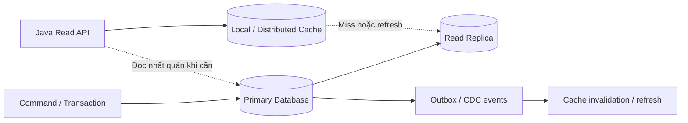
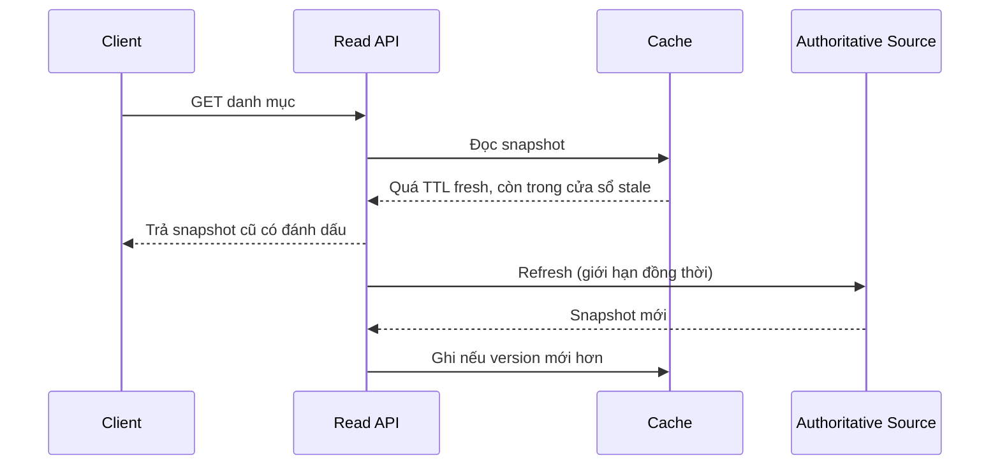

# Dữ liệu cũ được phép phục vụ trong giới hạn nghiệp vụ

## Mục tiêu học tập

Sau bài này, người học có thể:

- Giải thích **stale data** (dữ liệu cũ) trong cache, replica và các bản sao đọc; phân biệt dữ liệu đã commit với dữ liệu cập nhật gần nhất.
- Chuyển yêu cầu nghiệp vụ thành **ngân sách độ mới** (freshness budget), điều kiện dùng dữ liệu cũ và các hành động phải **fail closed** khi không kiểm chứng được dữ liệu.
- Phân biệt `TTL`, tuổi bản ghi trong cache, độ trễ replica, độ trễ invalidation và độ cũ thực tế so với nguồn dữ liệu có thẩm quyền.
- Lựa chọn cache-aside, refresh, stale-while-revalidate, stale-if-error, invalidation và versioning theo tình huống cụ thể.
- Viết một ví dụ Java phục vụ dữ liệu danh mục có giới hạn tuổi cache và xử lý lỗi nguồn, nhưng không đưa dữ liệu cũ vào quyết định giao dịch quan trọng.
- Kiểm thử race condition, mất sự kiện, lỗi kết nối, độ trễ replica và quan sát tỷ lệ dữ liệu cũ được phục vụ.

## 1. Vì sao đôi khi dữ liệu cũ lại là lựa chọn đúng?

Một website thương mại điện tử có hai hành động rất khác nhau:

1. **Hiển thị danh mục:** người dùng xem tên và giá tham khảo của sản phẩm. Nếu database danh mục tạm lỗi, hiển thị giá vừa tải vài giây trước kèm thông báo “giá có thể đã thay đổi” có thể tốt hơn một trang trống.
2. **Xác nhận thanh toán:** hệ thống quyết định số tiền sẽ thu và lượng hàng sẽ giữ. Dùng giá hoặc tồn kho từ cache cũ để chốt đơn có thể gây thu sai tiền hoặc bán vượt số lượng.

Cùng một trường `price` nhưng **mức chấp nhận dữ liệu cũ phụ thuộc hành động nghiệp vụ**. Chấp nhận stale cho màn hình chỉ đọc không đồng nghĩa cho phép dùng stale để ghi hoặc ra quyết định có hệ quả.

Trong module `DATA_PERSISTENCE_FUNDAMENTALS`, người học đã cần hiểu mô hình dữ liệu, giao dịch, cô lập, kết nối, chỉ mục, độ bền và kiểm soát đồng thời. Chủ đề **Nhất quán và cache** nối các cơ chế đó với cam kết phục vụ dữ liệu trong ứng dụng Java: khi nào được dùng bản sao nhanh, khi nào phải đến nguồn đáng tin cậy, và điều gì xảy ra lúc nguồn không sẵn sàng.

**Dữ liệu cũ (stale data)** là dữ liệu không còn phản ánh phiên bản mới nhất của một nguồn dữ liệu được xem là có thẩm quyền. Bản sao cũ có thể vẫn hoàn toàn hợp lệ về cấu trúc và đã từng được commit, nhưng **không còn là trạng thái mới nhất**.

### Hai trục độc lập: có sẵn và đúng thời điểm

| Tình huống | Khả dụng | Độ mới | Ứng dụng nên làm gì? |
| --- | --- | --- | --- |
| Cache vừa tải từ nguồn đáng tin, vẫn trong ngân sách | Cao | Phù hợp hợp đồng | Phục vụ trực tiếp |
| Cache hơi cũ, nguồn đang chậm | Cao nếu cho dùng stale | Không phải mới nhất | Chỉ phục vụ cho use case được phép và thể hiện giới hạn |
| Cache cũ, người dùng muốn chuyển tiền | Cache có thể sẵn | Không đủ để quyết định | Bắt buộc kiểm tra trên nguồn/transaction có thẩm quyền |
| Không còn nguồn lẫn bản sao hợp lệ | Thấp | Không thể chứng minh | Trả trạng thái tạm thời không khả dụng; không bịa dữ liệu |

Không có một ngưỡng “dữ liệu dưới 5 phút luôn an toàn” cho mọi ứng dụng. Với một báo cáo xu hướng ngày, dữ liệu hôm qua có thể vẫn hữu ích; với hạn mức tín dụng, quyền truy cập vừa bị thu hồi hoặc tồn kho cuối cùng, chỉ vài giây cũng có thể quá lâu.

## 2. Phân biệt nguồn sự thật, bản sao và nhiều loại độ trễ

Một kiến trúc thường có nhiều điểm đọc:



Sơ đồ chỉ là mô hình chung: hệ thống cụ thể có thể không dùng replica hoặc CDC. **Primary** thường là nguồn có thẩm quyền cho các quyết định ghi trong kiến trúc này; nếu hệ thống dùng cơ chế quorum, leaderless hoặc nhiều primary, phải định nghĩa lại hợp đồng đọc/ghi theo công nghệ thực tế.

### Những mốc thời gian khác nhau

Gọi:

- `t_commit`: lúc thay đổi phiên bản mới được commit tại nguồn có thẩm quyền.
- `t_replica`: lúc replica đã áp dụng thay đổi đó.
- `t_refresh`: lúc cache đọc và lưu một bản sao.
- `t_serve`: lúc API trả dữ liệu cho client.

Một bản ghi trong cache có thể được tải **vừa xong** từ một read replica đang chậm 30 giây. Vì vậy `t_serve - t_refresh` chỉ khoảng vài mili giây, nhưng dữ liệu **vẫn thiếu thay đổi đã commit 30 giây trước**.

| Thuật ngữ | Đo điều gì? | Giới hạn |
| --- | --- | --- |
| **Cache residence age** | Thời gian từ lần cache tải/refresh thành công đến lúc đọc | Không gồm thời gian nguồn/replica đã chậm trước lần tải |
| **TTL** | Chính sách giữ một bản ghi cache trước khi coi hết hạn hoặc làm mới | Không đo độ trễ replica hay thời gian lan truyền sự kiện |
| **Replica lag** | Độ trễ áp dụng thay đổi từ primary tới replica | Chỉ là một phần đường truyền dữ liệu |
| **Invalidation delay** | Độ trễ từ commit tới khi các cache liên quan nhận và xử lý việc vô hiệu hóa | Có thể có event mất, xử lý lặp, xử lý sai thứ tự |
| **End-to-end staleness** | Bản sao chậm bao nhiêu so với trạng thái có thẩm quyền | Khó bảo đảm bằng TTL đơn thuần; cần version/offset hoặc hợp đồng hệ thống |

Một trường `updated_at` trong bản ghi hữu ích cho chẩn đoán, nhưng không phải lúc nào cũng là thời điểm commit và có thể chịu ảnh hưởng độ lệch đồng hồ hoặc cách ứng dụng cập nhật. Nếu yêu cầu **giới hạn độ cũ chính xác**, cần xác định cách chứng minh bản sao đã thấy tới commit/LSN/version nào của nguồn và clock/ordering đang dùng.

### “Đã commit” không có nghĩa “mới nhất”

Cache có thể giữ một phiên bản đã từng commit, không có dirty read, nhưng vẫn là stale. Ngược lại, transaction ở `REPEATABLE READ` trên PostgreSQL cố tình đọc snapshot ổn định trong transaction; đó là cơ chế nhất quán của một giao dịch, **không có nghĩa** mọi thông tin trong snapshot phải là mới nhất ở thời điểm người dùng nhìn màn hình.

Vì vậy phải tách câu hỏi **“dữ liệu có hợp lệ theo giao dịch không?”** và **“dữ liệu có đủ mới cho nghiệp vụ này không?”**.

## 3. Định nghĩa ngân sách độ mới theo quyết định nghiệp vụ

Một **freshness budget** là tập ràng buộc cho phép dùng bản sao chưa mới nhất. Tối thiểu nên trả lời:

1. **Dữ liệu gì?** Danh mục, ảnh, tồn kho, quyền truy cập, tỷ giá, số dư, cấu hình hệ thống?
2. **Hành động gì?** Hiển thị tham khảo, tìm kiếm, tính dự báo, phê duyệt, ghi tiền, cấp quyền?
3. **Được cũ bao lâu?** Khoảng thời gian tối đa, hoặc yêu cầu version/độ trễ đã xác nhận?
4. **Nguồn lỗi thì sao?** Hiển thị cũ có cảnh báo, chặn hành động, dùng bản sao dự phòng hay trả lỗi?
5. **Làm sao kiểm chứng?** Timestamp tải, version, watermark nguồn, metrics lag, audit, test?

### Ví dụ chính sách của một hệ thống giả định

Những con số dưới đây **chỉ để minh họa cách thiết kế hợp đồng**; không phải ngưỡng an toàn mặc định:

| Dữ liệu / hành động | Hợp đồng ví dụ | Khi nguồn không sẵn sàng |
| --- | --- | --- |
| Tên, mô tả sản phẩm trên trang danh mục | Được hiển thị bản cache đã tải trong 10 phút | Có thể hiển thị kèm mốc cập nhật, không khẳng định còn chính xác |
| Giá tham khảo trên trang tìm kiếm | Có thể dùng bản cache trong 30 giây | Có thể stale-if-error tối đa 2 phút, ghi “giá xác nhận ở checkout” |
| Giá **chốt** khi đặt đơn | Kiểm tra giá/điều khoản theo giao dịch hoặc quote còn hiệu lực | Không tự động chốt đơn bằng giá cache |
| Tồn kho dự kiến trên trang sản phẩm | Có thể dùng cache ngắn để gợi ý | Hiển thị “tình trạng đang được kiểm tra” |
| Giữ một đơn vị tồn kho | `UPDATE ... WHERE available >= quantity` nguyên tử trên nguồn ghi | Từ chối/tạm hoãn nếu không xác nhận được |
| Quyền truy cập vừa thu hồi | Yêu cầu policy và cơ chế kiểm tra không cho phép quyền cũ | **Fail closed** đối với hành động nhạy cảm |
| Dashboard tổng hợp ngày | Chấp nhận dữ liệu đến kỳ tổng hợp trước | Hiển thị rõ thời điểm dữ liệu và phạm vi thiếu |

Không chỉ khai báo TTL ở cache rồi coi như đã thỏa SLA. Phải xác định **độ mới thực tế được bảo đảm bởi từng lớp**. Nếu chính sách chỉ nói “không lấy cache đã ở trong bộ nhớ quá 2 phút”, hãy diễn đạt đúng là **giới hạn thời gian giữ bản sao tại cache**; không gọi đó là “dữ liệu luôn chậm tối đa 2 phút so với primary”.

### Read model khác command model

Một thiết kế có thể có hai đường:

- **Query/read model:** phục vụ giao diện qua cache hoặc replica, cho phép eventual consistency trong giới hạn được công bố.
- **Command model:** xử lý quyết định nghiệp vụ bằng constraint, transaction, version và nguồn ghi có thẩm quyền.

Phân biệt này thường hữu ích trong CQRS hoặc hệ thống nhiều dịch vụ, nhưng không bắt buộc mọi ứng dụng phải triển khai CQRS đầy đủ. Một service CRUD nhỏ vẫn có thể tách đường đọc danh mục từ cache và đường checkout đọc/ghi trong transaction.

## 4. Các chính sách phục vụ dữ liệu cũ

### 4.1. Cache-aside và TTL

**Cache-aside**: ứng dụng đọc cache trước; khi miss/hết hạn, tải từ nguồn và cập nhật cache. Ưu điểm là đơn giản và chỉ cache dữ liệu thật sự được đọc. Nhược điểm là lần đầu phải chờ nguồn và các writer cần cơ chế invalidation/refresh nếu muốn giảm stale.

```text
GET product:42
  -> cache hit còn fresh: trả ngay
  -> miss/expired: tải từ repository -> cache -> trả
  -> repository lỗi: tuân theo chính sách stale-if-error hoặc fail
```

TTL là **quy tắc hết hạn**, không phải transaction lock. Nếu sản phẩm đổi giá ngay sau một lần cache fill, bản cũ vẫn có thể được phục vụ cho đến khi refresh/invalidation. Nếu cache phía sau đọc từ replica chậm, cache hit “mới tạo” vẫn có thể chứa dữ liệu cũ.

### 4.2. Stale-while-revalidate (SWR)

Khi mục tiêu ưu tiên thời gian phản hồi cho màn hình chỉ đọc, **SWR** có thể:

1. Trả ngay một snapshot đã quá thời hạn fresh nhưng còn trong cửa sổ stale được phép.
2. Khởi động refresh ở background hoặc qua một worker có giới hạn.
3. Khi refresh thành công, dùng phiên bản mới cho request tiếp theo.
4. Nếu đã quá giới hạn stale, không trả bản cũ chỉ để giảm latency.



Trong ứng dụng thật, refresh cần single-flight/per-key lock, timeout và giới hạn hàng đợi để tránh **cache stampede**. Nếu mọi request cùng thấy stale rồi mở một truy vấn DB, cache có thể làm tải tăng đột biến đúng lúc nguồn đang yếu.

### 4.3. Stale-if-error

Khác SWR, **stale-if-error** chỉ dùng bản cũ khi lần tải mới thất bại trong những lỗi được phép, chẳng hạn mất kết nối tạm thời. Không áp dụng vô điều kiện cho:

- `404`/bản ghi thực sự đã bị xóa;
- Lỗi thiếu quyền hoặc thu hồi quyền;
- Dữ liệu bị xác định là không hợp lệ, vi phạm schema/validation;
- Các quyết định chốt tiền, giữ hàng, cấp quyền mà hợp đồng yêu cầu dữ liệu mới.

Một cache lưu bản giá tham khảo tối đa 2 phút sau lần tải thành công có thể tạm phục vụ khi catalog database lỗi; nhưng phiên xác nhận đơn phải đọc lại/đối chiếu theo một giao thức chốt giá rõ ràng. Cùng một endpoint nếu trộn hai hành động mà không tách policy thì rất dễ vô tình dùng stale ngoài phạm vi cho phép.

### 4.4. Hard expiration và fail closed

Đặt một **hard ceiling** cho chính sách phục vụ cache: qua ngưỡng, bản cũ không còn được trả dù DB lỗi. Đối với hành động nhạy cảm, giá trị ngưỡng có thể bằng 0 hoặc buộc tái xác nhận ngay tại điểm ghi.

HTTP có các chỉ thị như `Cache-Control: max-age=...`, `stale-while-revalidate=...` và `stale-if-error=...` trong những môi trường hỗ trợ. Hành vi thực tế còn phụ thuộc client/CDN/proxy, và không được dùng cache công khai cho phản hồi cá nhân hoặc tài nguyên yêu cầu phân quyền chỉ vì header có vẻ hợp lý. Với dữ liệu nhạy cảm, xem xét `private`, `no-store` hoặc thiết kế key theo đúng người dùng/tenant.

## 5. Invalidation, versioning và những cuộc đua dễ bỏ sót

TTL chỉ đảm bảo bản ghi sẽ được xem xét làm mới sau một khoảng thời gian. Khi nghiệp vụ cần thay đổi sớm được phản ánh, hệ thống thường có **invalidation** (đánh dấu bản cache không còn hợp lệ) hoặc cập nhật chủ động sau ghi.

### 5.1. Invalidate sau commit

Một cách phổ biến khi cập nhật sản phẩm:

```text
T1: BEGIN
T1: UPDATE product SET ... version = version + 1
T1: COMMIT
T1: Phát sự kiện ProductChanged
Worker: Xóa cache product:<id> hoặc cập nhật bản mới
Request kế: Cache miss -> tải phiên bản hiện hành
```

**Không nên phát tín hiệu công bố thay đổi trước khi transaction commit**: transaction có thể rollback, khiến cache chứa dữ liệu không tồn tại trong nguồn đã commit. Ngược lại, nếu cập nhật DB đã commit nhưng process chết trước khi gửi sự kiện, cache có thể còn bản cũ lâu hơn dự kiến. **Transactional outbox** hoặc CDC có thể nối sự kiện với commit DB đáng tin cậy hơn cách gọi API phát sự kiện sau commit mà không có cơ chế khôi phục.

Ngay cả khi sự kiện được phát đáng tin cậy, consumer vẫn cần xử lý **at-least-once**, trùng lặp, thất bại và khởi động lại. Có TTL/đối soát định kỳ như cơ chế dự phòng, nhưng không gọi chúng là bằng chứng mạnh về giới hạn độ mới nếu event có thể bị trì hoãn vô hạn.

### 5.2. Bản refresh cũ hoàn tất sau bản refresh mới

Ví dụ hai tác vụ cùng tải một sản phẩm:

| Thời điểm | Tác vụ A | Tác vụ B | Nguy cơ |
| --- | --- | --- | --- |
| 1 | Bắt đầu đọc phiên bản 7, mạng chậm | | |
| 2 | | Đọc phiên bản 8, hoàn thành | Cache nhận version 8 |
| 3 | Hoàn thành muộn với version 7, ghi cache | | Cache bị **lùi về version 7** |

Một policy **chỉ chấp nhận version lớn hơn hoặc bằng version hiện tại** khi cập nhật cache giúp giảm rủi ro bản cũ ghi đè bản mới. Nhưng để version có nghĩa, nó phải được **tăng đơn điệu cho đúng khóa dữ liệu** và không bị reset vô tình khi xóa/tạo lại. Chỉ so `updated_at` giữa các server khác đồng hồ cũng có thể cho kết quả sai.

Với bản ghi bị xóa, cần cân nhắc **tombstone** chứa version xóa, hoặc thế hệ khóa (generation/epoch), để một refresh đang bay từ trước không tái đưa bản ghi đã xóa vào cache. Chỉ `cache.remove(id)` không đủ nếu một tác vụ tải cũ sắp hoàn thành.

### 5.3. Version là thứ tự, không phải đồng hồ đo thời gian

`version = 42` cho biết một trạng thái mới hơn version 41 của cùng đối tượng, **không nói trạng thái 42 đã được commit cách đây bao lâu**. Version giúp bảo vệ tính đơn điệu khi cập nhật cache và hỗ trợ optimistic locking, nhưng không tự chứng minh rằng replica đã theo kịp primary.

Ngược lại, timestamp “đã tải lúc 10:00” cho biết thời điểm cache nhận bản sao, nhưng không đảm bảo đó là bản mới nhất nếu nguồn đã trễ trước lúc tải.

### 5.4. Cache key cũng là một phần của tính đúng đắn

Ví dụ giá sản phẩm phụ thuộc tenant, vùng, đơn vị tiền tệ và nhóm khách hàng. Key chỉ gồm `productId` có thể khiến khách ở vùng này thấy giá của vùng khác — đó không còn là stale đơn thuần, mà là **sai dữ liệu và có thể lộ thông tin**.

Key phải chứa mọi yếu tố làm thay đổi ngữ nghĩa kết quả: chẳng hạn `tenantId`, `locale`, `currency`, `priceListId`, `productId` và version cấu hình liên quan. Tránh cache một phản hồi có quyền truy cập cá nhân dưới key dùng chung. Khi quyền thay đổi, invalidation hoặc đường kiểm tra quyền trực tiếp phải được đặt sao cho không tiếp tục cấp quyền bằng bản cache cũ.

## 6. Khi người dùng yêu cầu “vừa ghi xong phải đọc thấy”

### 6.1. Read-your-writes

Người dùng vừa đổi địa chỉ giao hàng và nhận thông báo cập nhật thành công. Nếu lần `GET` kế tiếp đọc từ replica hoặc cache chưa cập nhật, địa chỉ cũ xuất hiện lại. Đây là vi phạm kỳ vọng **read-your-writes** của phiên người dùng.

Một số hướng xử lý:

- Sau một command đã commit, đọc lại từ nguồn ghi có thẩm quyền cho những truy vấn liên quan.
- Cập nhật hoặc vô hiệu hóa cache của chính đối tượng sau commit với cơ chế tránh race.
- Mang theo `version` hoặc commit position của lần ghi; chỉ chấp nhận bản đọc có version/position **không cũ hơn** mức người dùng đã thấy.
- Với replica, chỉ route đọc tới replica nếu đã xác nhận nó áp dụng ít nhất tới commit position cần thiết; nếu không thì route về primary hoặc chờ trong giới hạn thời gian.

Không dùng `Thread.sleep(1000)` để “đảm bảo replica đã kịp cập nhật”: độ trễ thay đổi theo tải, mạng và sự cố, nên chờ cố định không tạo bảo đảm.

### 6.2. Monotonic reads

Một người đang xem version 12, sau đó chuyển request sang node khác và nhận version 11. Dù cả hai phiên bản đã từng commit, đây là **đọc lùi thời gian** so với trải nghiệm phiên trước. Nếu ứng dụng cam kết monotonic reads, server/client cần giữ watermark phiên bản đã quan sát và không phục vụ bản nhỏ hơn.

Lưu ý: version phải thuộc cùng một chuỗi thứ tự có ý nghĩa. Không so version độc lập giữa hai aggregate khác nhau như thể đó là đồng hồ toàn cục.

### 6.3. Bounded staleness mạnh hơn một TTL

Nếu hợp đồng yêu cầu “không phục vụ phiên bản chậm hơn primary quá N giây”, hệ thống phải có cơ chế **xác nhận độ trễ end-to-end**, ví dụ mức tiến độ log/replication đã áp dụng hoặc metadata phiên bản có nguồn và cách đo thời gian đáng tin cậy. TTL trong một process Java chỉ đo tuổi bản sao **kể từ lần nó được nạp**, không ràng buộc được độ chậm của read replica ở phía sau.

Khi không chứng minh được ràng buộc, câu trả lời đúng là **không đáp ứng được hợp đồng độ mới**, chứ không phải âm thầm hiển thị dữ liệu với nhãn “fresh”.

## 7. Ví dụ Java: cache danh mục chỉ để hiển thị

Ví dụ sau có **hai ngưỡng**:

- `freshFor`: thời gian sau lần tải thành công mà cache được dùng không cần gọi lại repository.
- `maxSinceFetch`: giới hạn thời gian tối đa từ lần tải thành công để **dùng làm fallback khi nguồn gặp lỗi kỹ thuật**.

Giới hạn thứ hai là **tuổi kể từ lần nạp vào cache**, không phải chứng minh độ cũ tối đa so với trạng thái mới nhất của primary. Repository trong ví dụ được hiểu là nguồn đọc đáng tin để minh họa; nếu nó đọc replica trễ, cần cơ chế freshness khác như đã phân tích.

### 7.1. Model và repository interface

```java
import java.math.BigDecimal;
import java.time.Instant;
import java.util.Optional;

record ProductSnapshot(
        long id,
        String name,
        BigDecimal displayPrice,
        long version) {}

interface CatalogRepository {
    // Optional.empty(): sản phẩm thực sự không còn tồn tại hoặc không thể
    // được phục vụ. CatalogUnavailableException: lỗi hạ tầng tạm thời.
    Optional<ProductSnapshot> findForDisplay(long productId)
            throws CatalogUnavailableException;
}

final class CatalogUnavailableException extends RuntimeException {
    CatalogUnavailableException(String message, Throwable cause) {
        super(message, cause);
    }
}

record DisplayProduct(
        ProductSnapshot product,
        Instant loadedAt,
        boolean servedAsFallback) {}
```

**Quan trọng:** `servedAsFallback = false` chỉ cho biết không dùng đường stale-if-error của cache này. Nó **không** đồng nghĩa “giá này đang là giá mới nhất trên primary”. Một snapshot vừa được lấy từ replica cũ cũng có thể có `servedAsFallback = false`.

### 7.2. Cache và giới hạn fallback

```java
import java.time.Clock;
import java.time.Duration;
import java.time.Instant;
import java.util.NoSuchElementException;
import java.util.concurrent.ConcurrentHashMap;
import java.util.concurrent.ConcurrentMap;

public final class CatalogDisplayCache {
    private record Entry(ProductSnapshot value, Instant loadedAt) {}

    private final CatalogRepository repository;
    private final Clock clock;
    private final Duration freshFor;
    private final Duration maxSinceFetch;
    private final ConcurrentMap<Long, Entry> cache = new ConcurrentHashMap<>();

    public CatalogDisplayCache(
            CatalogRepository repository,
            Clock clock,
            Duration freshFor,
            Duration maxSinceFetch) {
        if (freshFor.isNegative() || maxSinceFetch.isNegative()
                || freshFor.compareTo(maxSinceFetch) > 0) {
            throw new IllegalArgumentException("Invalid freshness policy");
        }
        this.repository = repository;
        this.clock = clock;
        this.freshFor = freshFor;
        this.maxSinceFetch = maxSinceFetch;
    }

    public DisplayProduct findForDisplay(long productId) {
        Entry old = cache.get(productId);
        Instant now = clock.instant();
        if (old != null && ageSinceLoad(old, now).compareTo(freshFor) <= 0) {
            return new DisplayProduct(old.value(), old.loadedAt(), false);
        }

        try {
            ProductSnapshot reloaded = repository.findForDisplay(productId)
                    .orElseThrow(() -> {
                        // Không dùng dữ liệu cũ để che việc sản phẩm đã mất.
                        cache.remove(productId);
                        return new NoSuchElementException("Product not found");
                    });
            Entry next = new Entry(reloaded, clock.instant());

            // Ngăn tác vụ refresh hoàn thành muộn đưa version cũ
            // ghi đè version mới đang có trong cache.
            Entry chosen = cache.compute(productId, (id, existing) ->
                    existing != null
                    && existing.value().version() > next.value().version()
                    ? existing : next);

            // Nếu nguồn trả version thấp hơn, không làm mới timestamp
            // của bản cũ; vẫn áp dụng giới hạn cư trú tại cache.
            if (ageSinceLoad(chosen, clock.instant())
                    .compareTo(maxSinceFetch) > 0) {
                throw new IllegalStateException("Cached snapshot too old");
            }
            return new DisplayProduct(
                    chosen.value(), chosen.loadedAt(), chosen != next);

        } catch (CatalogUnavailableException unavailable) {
            // Chỉ lỗi hạ tầng đã phân loại mới được fallback.
            Entry fallback = cache.get(productId);
            if (fallback != null && ageSinceLoad(fallback, clock.instant())
                    .compareTo(maxSinceFetch) <= 0) {
                return new DisplayProduct(
                        fallback.value(), fallback.loadedAt(), true);
            }
            throw unavailable; // Fail nếu không có fallback hợp lệ.
        }
    }

    private static Duration ageSinceLoad(Entry entry, Instant now) {
        Duration elapsed = Duration.between(entry.loadedAt(), now);
        return elapsed.isNegative() ? Duration.ZERO : elapsed;
    }
}
```

Đây là ví dụ **chỉ cho trang danh mục**. Nó có các đặc tính chủ ý:

- Chỉ fallback cho `CatalogUnavailableException`; `Optional.empty()` từ repository không bị che thành dữ liệu cũ.
- Đọc quá `freshFor` sẽ thử nạp lại; khi nguồn lỗi, chỉ sử dụng bản cũ còn trong `maxSinceFetch`.
- Dùng `compute` để giảm nguy cơ một response version thấp ghi đè bản cache có version cao hơn.
- Kết quả có `loadedAt` và `servedAsFallback` cho API/UI hiển thị chính sách rõ ràng, không hứa quá phạm vi được chứng minh.

**Đây chưa phải cache production hoàn chỉnh.** Nhiều request có thể refresh cùng lúc, gây stampede; `Clock` có thể bị thay đổi bởi đồng bộ giờ hệ thống (để đo thời gian trôi qua thật trong cùng process, một monotonic ticker phù hợp hơn); và `cache.remove()` khi not-found không ngăn mọi cuộc đua với một refresh đã bắt đầu trước đó. Đặc biệt, muốn xử lý xóa/tạo lại hoặc event đến sai thứ tự, phải dùng tombstone/version/generation được định nghĩa rõ và phối hợp cập nhật nguyên tử. Cần thêm giới hạn kích thước, eviction, metrics và timeout trước khi triển khai chịu tải lớn.

**Không đưa `CatalogDisplayCache` vào phương thức thanh toán** chỉ vì nó có `maxSinceFetch`. Giao dịch thanh toán có hợp đồng khác, phải kiểm tra giá, tồn kho và điều kiện nghiệp vụ tại điểm quyết định bằng cơ chế có thẩm quyền.

## 8. Ví dụ checkout: hiển thị từ cache, xác nhận bằng transaction

Giả sử catalog cho phép một khách xem sản phẩm ở giá tham khảo 200.000 đồng. Trong lúc họ điền thông tin giao hàng, người quản trị đổi giá thành 220.000 đồng. Một cache chưa cập nhật vẫn hiển thị giá cũ. Có hai hợp đồng hợp lý nhưng khác nhau:

1. **Giá tham khảo:** chỉ là gợi ý, API checkout phải hiển thị lại giá mới để người mua xác nhận trước khi chốt.
2. **Quote giữ giá:** hệ thống cấp một báo giá có ID, số tiền, điều kiện và thời hạn hiệu lực; lúc xác nhận phải **kiểm tra quote hợp lệ** theo quy tắc nghiệp vụ, chứ không đọc lại giá cũ từ cache rồi coi đó là cam kết.

Không thể quyết định một trong hai bằng `TTL`. Đó là **quy tắc miền** phải được mô tả rõ trong use case và dữ liệu lưu trữ.

### 8.1. Chốt số lượng bằng cập nhật nguyên tử

Ví dụ PostgreSQL có bảng `inventory(product_id, available)` với một hàng đại diện tồn kho từng sản phẩm. Một lệnh ghi có điều kiện:

```sql
UPDATE inventory
SET available = available - 1
WHERE product_id = 42
  AND available >= 1
RETURNING available;
```

Nếu câu lệnh trả **không hàng nào**, không được tiếp tục xác nhận đơn như thể đã giữ hàng. Giao dịch cần rollback hoặc trả về trạng thái không đủ hàng. Hai request cùng giữ một hàng tồn kho được PostgreSQL điều phối theo quy tắc khóa hàng và mức cô lập; không dựa vào số lượng đã hiển thị trong cache.

Một luồng giao dịch **minh họa** cho quyết định chốt giá và tồn kho:

```sql
BEGIN;

-- Đọc giá hiện tại trên nguồn có thẩm quyền, trong cùng transaction.
-- FOR SHARE giúp ngăn cập nhật xung đột trên hàng product đã đọc
-- trong thời gian transaction còn mở ở PostgreSQL.
SELECT price, price_version
FROM product
WHERE id = 42 AND active = TRUE
FOR SHARE;
-- Ứng dụng kiểm tra điều kiện giá/quote và sự đồng ý của người mua.
-- Nếu không thỏa: ROLLBACK, không tạo đơn.

UPDATE inventory
SET available = available - 1
WHERE product_id = 42 AND available >= 1
RETURNING available;
-- Nếu không trả hàng: ROLLBACK.

-- Sau khi cả hai bước hợp lệ:
-- INSERT purchase_order(..., agreed_price, price_version, ...)
-- Sử dụng giá đã đọc/được xác nhận, không dùng giá tham khảo từ cache.

COMMIT;
```

Đây là **sơ đồ SQL cho một workflow**, không phải script hoàn chỉnh để chạy nguyên khối: các lệnh `SELECT`, `UPDATE` và `INSERT` phải được ứng dụng kiểm tra kết quả trên **cùng transaction**. Trong thực tế, hãy lấy **sự đồng ý của người dùng trước khi mở transaction**, hoặc dùng quote có hiệu lực rõ ràng; không giữ `FOR SHARE` và transaction mở trong lúc chờ người dùng nhấn nút hay gọi HTTP tới cổng thanh toán.

Truyền quote/giá đã chấp thuận cùng một version và kiểm tra trong transaction. Nếu không khớp, trả lại đề nghị xác nhận giá mới hoặc xử lý theo cam kết giữ giá đã thiết kế. Các tác dụng phụ ngoài DB như gửi email hoặc thu tiền không được giả định tự rollback theo PostgreSQL; cần idempotency, outbox/saga hoặc quy trình đối soát phù hợp.

### 8.2. Vì sao `READ COMMITTED` không tự biến cache thành nguồn đáng tin?

Ngay cả khi database dùng transaction `READ COMMITTED`, dữ liệu tham khảo lấy từ cache trước đó vẫn có thể đã cũ. Cần đưa **điều kiện ghi bảo vệ bất biến vào SQL/transaction**, hoặc kiểm tra version khi ghi. Mức cô lập không tự xác nhận nội dung một cache nằm bên ngoài database.

Tương tự, `REPEATABLE READ` đảm bảo snapshot ổn định trong giao dịch theo triển khai của PostgreSQL, nhưng snapshot ấy có thể không chứa commit mới sau lúc snapshot bắt đầu. Khi bất biến có nhiều writer và nhiều hàng liên quan, vẫn phải xem xét write skew, khóa, constraint hoặc `SERIALIZABLE` với retry toàn transaction.

## 9. Khi hệ thống lỗi: chọn giảm chất lượng hay dừng đúng chỗ

Một ứng dụng có thể **degrade gracefully**: khi catalog backend lỗi, vẫn hiển thị mô tả/ảnh đã cache trong cửa sổ stale, nhưng nút “Mua ngay” chuyển thành “Thử lại” nếu không thể xác minh giá/tồn kho. Đây là chủ đích giảm chất lượng **ở đường đọc** chứ không phải chấp nhận ghi không nhất quán.

### Phân loại fallback theo hậu quả

| Phạm vi | Có thể fallback bằng stale? | Điều kiện tối thiểu |
| --- | --- | --- |
| Nội dung công khai ít thay đổi | Thường có thể | Cửa sổ có giới hạn, không lộ dữ liệu cá nhân |
| Dự báo, thống kê tham khảo | Có thể | Hiển thị thời điểm chốt dữ liệu và những phần bị thiếu |
| Giá/ưu đãi ở màn hình xem trước | Có thể theo chính sách | Gắn nhãn tham khảo, xác nhận lại trước khi chốt |
| Quản lý đơn và trạng thái “vừa lưu” | Cần thận trọng | Read-your-writes hoặc thông báo đang đồng bộ |
| Thu hồi quyền, vai trò, danh sách cấm | Không dùng stale để **tiếp tục cấp quyền** khi hợp đồng yêu cầu thu hồi ngay | Kiểm tra quyền có thẩm quyền, fail closed |
| Chuyển tiền, số dư dùng để quyết định ghi | Không dùng cache cũ làm cơ sở duy nhất | Kiểm tra transaction và ràng buộc DB |
| Cấu hình khóa an toàn/kill switch khẩn cấp | Phụ thuộc yêu cầu an toàn, thường ưu tiên mặc định an toàn | Cơ chế lan truyền/kiểm tra đủ mạnh và chế độ thất bại rõ ràng |

Không dùng `catch (Exception e) { return cached; }` làm chiến lược chung. Câu lệnh ấy có thể che lỗi phân quyền, sai schema, lỗi logic, sản phẩm bị xóa, hoặc dữ liệu đã hết điều kiện hiệu lực. Đặc biệt, **lỗi 403 hoặc 404 khác lỗi 503**: fallback được phép cho một số loại không khả dụng, không phải cho mọi kết quả bất lợi.

### Cache stampede khi nguồn khôi phục

Khi nhiều khóa cache cùng hết TTL lúc nguồn đang yếu, hàng nghìn request có thể đổ về database. Những cơ chế thường dùng:

- **Single-flight refresh:** một thao tác nạp cho mỗi key, các request khác chờ hoặc dùng stale được phép.
- **TTL jitter:** phân tán thời điểm hết hạn để không refresh hàng loạt.
- **Backoff và circuit breaker:** không retry ồ ạt khi backend đang lỗi; giới hạn số tác vụ refresh.
- **Admission control và giới hạn concurrency:** ưu tiên traffic nghiệp vụ quan trọng và giữ hệ thống nguồn sống.
- **Warm-up có kiểm soát:** nạp trước những key nóng, không mở nhiều truy vấn cùng lúc khi khởi động.

Chính sách này giúp **khả dụng**, không thay thế kiểm tra freshness cho các hành động cần nhất quán mạnh.

## 10. Kiểm soát nhất quán qua nhiều tầng cache

Một request có thể đi qua **browser → CDN → API gateway → local cache trong JVM → Redis → replica → primary**. Mỗi tầng có thể có TTL và cơ chế invalidation riêng. Việc Redis đã xóa key không đồng nghĩa browser hoặc CDN đã bỏ bản cũ.

### 10.1. Phải định nghĩa hợp đồng end-to-end

Nếu tầng CDN cho stale 5 phút, local cache 1 phút và replica chậm 20 giây, không thể chỉ nhìn TTL của Redis rồi hứa toàn hệ thống chậm tối đa 1 phút. Thực tế còn phụ thuộc lần refresh của các tầng, thời điểm invalidation và chính sách lỗi. Nhiều TTL **không nhất thiết cộng đơn giản thành một số** trong mọi kiến trúc, nhưng mỗi tầng đều là một nơi cần đo và kiểm soát.

Một cách thực dụng là chọn **một nơi kiểm soát freshness theo nghiệp vụ** và cấu hình các tầng còn lại không được vượt quá hợp đồng đó; dùng version/commit position khi cần bằng chứng mạnh. API trả metadata phù hợp như `lastUpdated`, `sourceVersion` và trạng thái fallback nếu chính sách cho phép.

### 10.2. Multi-tenant, cá nhân hóa và phân quyền

Cache key không đầy đủ có thể nghiêm trọng hơn stale. Ví dụ dữ liệu giá hợp đồng khác nhau giữa tenant A và B nhưng key chỉ là `product:42`. Bản sao không chỉ cũ mà còn **sai người nhận**.

Đảm bảo cache key, ACL và scope có đủ thông tin phân biệt. Không cache response có bearer token, thông tin định danh hay nội dung nhạy cảm như một object công khai. Nếu nội dung vừa bị thu hồi quyền mà không có cơ chế invalidation/kiểm tra đủ mạnh, phải hạn chế hoặc tắt cache ở đường đó.

### 10.3. Không để bản cũ hồi sinh sau xóa

Trong hệ thống có tombstone và event, thứ tự có thể xảy ra:

```text
V7: Sản phẩm còn tồn tại; refresh A bắt đầu.
V8: Sản phẩm bị xóa; DB commit và event xóa phát ra.
Cache áp dụng tombstone V8.
Refresh A kết thúc muộn và cố ghi lại dữ liệu V7.
```

Nếu adapter cache không so version/generation hoặc xóa tombstone quá sớm, dữ liệu đã xóa **hồi sinh**. Giải pháp có thể là giữ dấu xóa với version đủ lâu, từ chối mọi update có version nhỏ hơn hoặc dùng key có generation để refresh cũ không còn ghi được vào namespace đang dùng.

Với eviction, eviction bản thân nó không đồng nghĩa event xóa nghiệp vụ. Sau eviction, lần tải từ một replica chưa bắt kịp deletion có thể tạo lại bản cũ; vì vậy cần kết hợp **nguồn đọc phù hợp, version và quy trình khôi phục**, không chỉ `cache.evict(id)`.

## 11. Quan sát hệ thống: đo đúng loại dữ liệu cũ

Tỷ lệ cache hit cao không tự chứng minh tính đúng đắn; một cache có thể “hit” 99,9% nhưng phần lớn dữ liệu đã cũ so với nghiệp vụ. Cần quan sát cả **khả dụng** lẫn **freshness**.

| Nhóm chỉ số | Ví dụ | Câu hỏi trả lời |
| --- | --- | --- |
| Hiệu năng cache | Hit/miss, p50/p95/p99 latency, eviction, memory | Cache có giảm tải và giảm độ trễ? |
| Cửa sổ stale | Số response fallback, tuổi `loadedAt` của bản được phục vụ, lần vượt hard limit | Bao nhiêu request đang dùng ngoại lệ stale? |
| Nguồn đọc | Load errors, timeout, query latency, retry, circuit breaker | Vì sao phải fallback hoặc không refresh được? |
| Độ trễ replication | Replay/apply lag, commit position, source watermark | Replica có theo kịp mức version cần thiết? |
| Invalidation | Event backlog, delivery delay, duplicate/reorder, failure/dead letter | Bản mới có lan đến cache theo cam kết? |
| Tính đơn điệu | Số lần đọc bị từ chối vì version thấp hơn watermark đã thấy | Có hiện tượng đọc lùi version? |
| Quyết định nghiệp vụ | Số lần checkout phải báo lại giá, conflict do version, số lần giữ hàng thất bại | Cache cũ ảnh hưởng trải nghiệm và quyết định thế nào? |

Đặt **SLO theo đường nghiệp vụ**, chẳng hạn “99% request catalog dùng bản cache không quá 30 giây kể từ lần nạp thành công” và “checkout không dựa vào giá cache để thu tiền”. Hai SLO này có ý nghĩa khác nhau. Nếu muốn SLO “không chậm quá N giây so với primary”, cần thêm tín hiệu có thể xác minh tiến độ của nguồn; metric thời gian nạp cache không đủ.

### Khi trả bản cũ, có nên thông báo cho client?

Với dữ liệu tham khảo, phản hồi có thể kèm `lastRefreshedAt` và trạng thái `FALLBACK`; UI hiển thị “Thông tin cập nhật lúc ...; giá được xác nhận khi đặt hàng”. Khi hiển thị mốc thời gian, cần ghi rõ đó là **lúc cache tải** hay **lúc nguồn cập nhật**, tránh dùng từ “lần cập nhật cuối” gây hiểu nhầm. Nếu truy cập nhạy cảm, log trạng thái và metrics phải bảo vệ thông tin cá nhân.

Đối với tác vụ tiền tệ, dùng bản cache cũ nhưng âm thầm ghi “thành công” là lỗi nghiêm trọng hơn một trang danh mục tạm không hiện được; không thể đánh đổi hai trường hợp chỉ bằng một tỉ lệ hit chung.

## 12. Kiểm thử freshness budget và các tình huống sự cố

### 12.1. Kiểm thử tại đúng ranh giới thời gian

Với ví dụ `CatalogDisplayCache`, giả sử `freshFor = 5s` và `maxSinceFetch = 20s`. Các kiểm thử nên dùng **clock điều khiển được** thay vì `Thread.sleep`:

| Thời điểm so với lần tải | Nguồn | Kết quả kỳ vọng |
| --- | --- | --- |
| 0 giây | Trả version 7 | Nạp và phục vụ version 7, `servedAsFallback=false` |
| 3 giây | Không được gọi lại | Phục vụ cache vì còn trong fresh window |
| 6 giây | Lỗi `CatalogUnavailableException` | Phục vụ version 7 với `servedAsFallback=true` |
| 20 giây | Lỗi nguồn | Có thể dùng fallback tại đúng giới hạn `<= 20s` theo chính sách minh họa |
| 21 giây | Lỗi nguồn | Không trả bản cũ; ném lỗi không khả dụng |
| 6 giây | Repository trả `Optional.empty()` | Không dùng stale để che dữ liệu không tồn tại |
| 6 giây | Repository trả version 8 | Cập nhật cache lên version 8 |
| Tác vụ A version 7 hoàn thành sau B version 8 | Cả hai thành công | Không ghi version 7 đè lên version 8 |

Đoạn code dùng `Clock` để test dễ tái hiện; một implementation thực có yêu cầu chặt về khoảng thời gian nên cân nhắc **monotonic clock** cho elapsed time trong process. Khi có replica, còn phải test rằng snapshot vừa nạp nhưng version cũ **không bị hiểu nhầm thành trạng thái mới nhất**.

### 12.2. Những lỗi không thể kiểm tra chỉ bằng unit test

- **Mất sự kiện invalidation:** sau DB commit, worker nhận event rất muộn hoặc không nhận; kiểm tra TTL/hard ceiling và cảnh báo backlog.
- **Event đảo thứ tự:** `ProductChanged(version=8)` đến trước `ProductChanged(version=7)`; cache không được lùi version.
- **Xóa và tạo lại:** tombstone version mới hơn phải chặn refresh cũ hồi sinh đối tượng.
- **Đổi tenant/phân quyền:** cache key không cho dữ liệu tenant A xuất hiện trong request tenant B.
- **Replica lag:** giả lập replica đang trễ nhưng API vừa nạp cache; không dùng timestamp nạp làm bằng chứng primary freshness.
- **Read-your-writes:** sau một lệnh cập nhật thành công, request tiếp theo trong phiên không đọc lùi về bản cũ nếu hợp đồng yêu cầu.
- **Cache stampede:** hàng trăm request cùng hết TTL không dẫn tới hàng trăm truy vấn refresh một key.
- **Nguồn lỗi kéo dài:** sau hard ceiling, service trả trạng thái không thể xác nhận thay vì phục vụ stale vô hạn.
- **Giao dịch checkout:** cache báo còn một sản phẩm nhưng inventory cập nhật có điều kiện trả 0 hàng; không tạo đơn đã giữ hàng.

Khi tích hợp PostgreSQL, dùng **hai transaction/kết nối độc lập** để tạo lịch ghi cạnh tranh. Đảm bảo status của đơn, số lượng và giá được lưu theo cùng hợp đồng; không lấy kết quả trả về từ cache làm bằng chứng đã có hàng hoặc quyền.

### 12.3. Fault injection có kiểm soát

Một bài thử có thể chủ động làm chậm repository, tắt đường đọc replica trong test, tạo hàng đợi CDC giả hoặc khiến cache refresh ném exception. Kiểm tra cả phản hồi người dùng và metrics. Đừng thử phá hỏng production để chứng minh fallback. Nếu dùng môi trường nhiều node, cần kiểm tra hành vi mỗi node có cache cục bộ và mỗi tầng có TTL riêng.

## 13. Bài tập tình huống

**Tình huống A — Cache vừa tải vẫn có dữ liệu cũ.** API lấy giá từ read replica cách đây 2 mili giây, sau đó lưu cache trong 30 giây. Replica đang chậm primary 40 giây. Có thể khẳng định bản giá mới tải “chậm tối đa 2 mili giây” không? Vì sao?

**Tình huống B — Dùng stale khi hết kết nối.** Danh mục có `freshFor=30s`, `maxSinceFetch=120s`. Sau 70 giây, backend trả timeout. Trang giới thiệu có thể làm gì? Trang checkout có thể lấy giá cache đó để chốt tiền không?

**Tình huống C — Vừa sửa hồ sơ rồi đọc lại.** Người dùng cập nhật địa chỉ giao hàng thành công, nhưng GET kế tiếp trả bản cũ từ cache. Đây là kỳ vọng nhất quán nào bị vi phạm và có hai giải pháp nào?

**Tình huống D — Xóa sản phẩm.** Event xóa version 20 đã được xử lý, nhưng một request nạp phiên bản 19 trước đó hoàn thành muộn và ghi lại cache. Vì sao `cache.remove()` đơn thuần chưa đủ? Nêu cách ngăn bản cũ hồi sinh.

**Tình huống E — Thu hồi quyền.** Cache còn quyền `ADMIN` của tài khoản vừa bị thu hồi. API duyệt chi tiền thất bại khi kiểm tra trung tâm. Có nên bỏ qua lỗi và dùng bản quyền cache để duyệt không?

**Tình huống F — TTL qua nhiều lớp.** CDN có `max-age=300`, Redis có TTL 60 giây, read replica chậm 15 giây. Có thể chỉ dựa vào Redis TTL để hứa toàn hệ thống chậm tối đa 60 giây không?

**Tình huống G — Cache hit 99,9%.** Dịch vụ khoe cache hit rất cao nhưng nhiều người dùng thấy hàng tồn kho cũ. Cần bổ sung metric và thay đổi quyết định nghiệp vụ nào?

**Tình huống H — Hai request cùng giữ món hàng cuối.** Cache hiển thị còn một sản phẩm và cả T1/T2 đọc thấy còn hàng. Làm thế nào ngăn cả hai cùng tạo đơn thành công?

### Gợi ý đáp án

1. **Không.** Thời gian từ lúc cache tải chỉ đo cache residence; nó không bao gồm độ trễ 40 giây đã tồn tại ở replica. Cần thông tin version/commit position và hợp đồng tiến độ nguồn để đánh giá thực tế.
2. Trang giới thiệu có thể phục vụ bản cache cũ kèm mốc thời gian/cảnh báo nếu chính sách cho phép. **Checkout không chốt giá từ cache đó**; phải kiểm tra điều khoản, giá hoặc quote có thẩm quyền.
3. Vi phạm **read-your-writes**. Có thể route lần đọc sau ghi về primary hoặc mang theo version/commit watermark để chỉ dùng replica/cache đã bắt kịp.
4. Refresh phiên bản 19 đang bay có thể ghi sau event xóa; dùng tombstone version 20 hoặc generation và chỉ chấp nhận update version mới hơn, kể cả sau eviction.
5. **Không.** Với hành động nhạy cảm, phải fail closed theo hợp đồng phân quyền. Cache có thể hữu ích ở những đường đọc ít nhạy cảm nhưng không được tự cấp quyền thay cơ chế có thẩm quyền.
6. **Không.** CDN và replica đều có thể làm dữ liệu chậm thêm; TTL Redis không ràng buộc end-to-end staleness. Cần đo/cấu hình mọi tầng và tiến độ nguồn.
7. Bổ sung stale fallback rate, độ tuổi cache, replica lag/invalidation delay, thời gian refresh, số lần từ chối do hard limit; trước khi giữ hàng, dùng cập nhật nguyên tử/transaction thay vì tin cache.
8. Trong một transaction, chạy `UPDATE inventory SET available = available - 1 WHERE product_id = ? AND available >= 1 RETURNING ...`; chỉ tạo đơn khi đã giữ được hàng, rollback nếu không. Cache chỉ dùng để hiển thị.

## 14. Checklist thiết kế và vận hành

- [ ] Phân loại **dữ liệu và hành động** trước khi quyết định có dùng stale; không áp một TTL cho mọi use case.
- [ ] Viết rõ `freshFor`, hard ceiling, điều kiện stale-if-error và hành vi khi không đáp ứng độ mới.
- [ ] Phân biệt **tuổi cache từ lần nạp** với **độ cũ so với nguồn có thẩm quyền**.
- [ ] Xác định nguồn đọc có thể chậm (replica, CDC, cache khác) và cách kiểm chứng tiến độ/version.
- [ ] Không dùng dữ liệu cũ để quyết định chốt giá, giữ hàng, chuyển tiền hoặc cấp quyền khi hợp đồng đòi hỏi kiểm tra mới.
- [ ] Dùng transaction, constraint, cập nhật có điều kiện hoặc version tại điểm ghi để bảo vệ bất biến.
- [ ] Invalidate sau commit bằng cơ chế đáng tin, theo dõi hàng đợi event và xử lý event trùng/đảo thứ tự.
- [ ] Ngăn refresh cũ ghi đè mới; với xóa cần tombstone/generation và chính sách hết hạn rõ ràng.
- [ ] Đảm bảo cache key đủ tenant/user/locale/currency và những tham số ảnh hưởng ngữ nghĩa.
- [ ] Nếu cần read-your-writes hoặc monotonic reads, mang theo version/commit watermark hoặc chọn nguồn đọc phù hợp.
- [ ] Ngăn stampede bằng single-flight, jitter, giới hạn refresh và timeout/backoff.
- [ ] Cung cấp mốc thời gian/trạng thái fallback có ý nghĩa, không dán nhãn “mới nhất” khi chỉ biết lần tải cache.
- [ ] Giám sát cache hit **cùng** stale rate, tuổi fallback, lỗi nguồn, replica lag và invalidation delay.
- [ ] Kiểm thử boundary TTL, mất sự kiện, out-of-order update, failover, thu hồi quyền và race khi checkout.

**Ghi nhớ:** Dữ liệu cũ không luôn là lỗi, nhưng **chỉ được phép phục vụ khi một hợp đồng nghiệp vụ cụ thể chấp nhận hậu quả của nó**. TTL cho biết cache đã giữ bản sao bao lâu; nó không tự chứng minh dữ liệu mới nhất của primary. Hãy dành stale cache cho những đường đọc đã được phân loại, công bố giới hạn của nó, và dùng nguồn có thẩm quyền cùng transaction/constraint tại điểm quyết định quan trọng. Khi không thể xác nhận độ mới cần thiết, phải dừng đúng hành động thay vì che lỗi bằng bản sao cũ.
