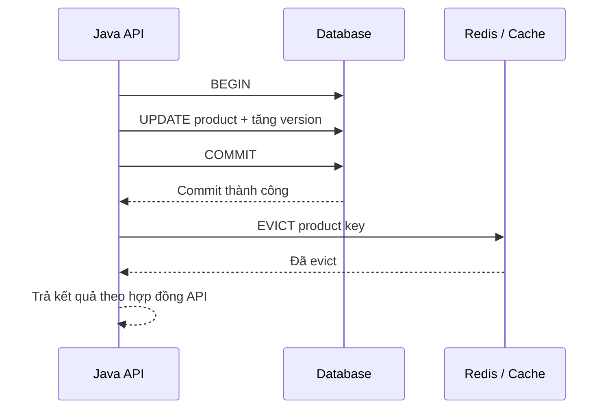
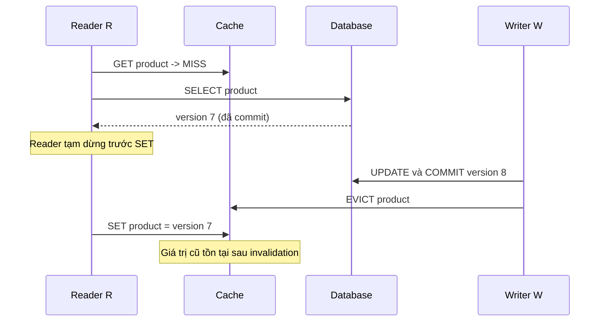
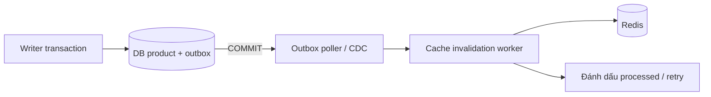

# Cập nhật hoặc vô hiệu hóa cache sau khi lưu thành công

## 1. Vì sao ghi database thành công vẫn có thể trả dữ liệu cũ?

Giả sử ứng dụng Java bán hàng có một bản ghi sản phẩm trong PostgreSQL:

```text
Database: product LAPTOP-01, price = 20.000.000, version = 7
Redis cache: product LAPTOP-01, price = 20.000.000, version = 7
```

Nhân viên quản trị đổi giá thành 19.000.000 đồng. Transaction ghi database đã `COMMIT`, nhưng API đọc tiếp theo vẫn lấy giá 20.000.000 từ cache. Người dùng thấy thông tin cũ mặc dù thao tác cập nhật thành công.

Nguyên nhân là **database và cache có vòng đời dữ liệu riêng**. Một lần `UPDATE` trên database không tự cập nhật bản sao nằm trong bộ nhớ ứng dụng, Redis, CDN hoặc các lớp cache khác. Để điều chỉnh độ mới, ứng dụng phải quy định rõ **khi nào** được cập nhật/vô hiệu hóa cache, **ai** thực hiện, **khi lỗi** thì phục hồi ra sao và **đọc đồng thời** có thể gây tranh chấp gì.

Bài học nằm trong chương **Nhất quán và cache** của **DATA_PERSISTENCE_FUNDAMENTALS**. Trong phạm vi persistence boundary cho Java, nội dung liên kết transaction, đọc/ghi dữ liệu bền vững, lỗi kết nối, đồng thời, bảo mật, hiệu năng và khả năng phục hồi.

> **Nguyên tắc mở đầu:** chỉ công bố kết quả cache mới dựa trên một thay đổi database đã commit thành công. Nhưng **làm việc sau commit chưa đủ để bảo đảm mọi lần đọc đều mới nhất**; còn phải xét độ trễ đồng bộ, lỗi invalidation và các lịch chạy đồng thời.

## 2. Xác định nguồn dữ liệu có thẩm quyền và hợp đồng độ mới

Trong mô hình thông thường, **database giao dịch là nguồn có thẩm quyền** (*source of truth*), còn cache là bản sao tối ưu tốc độ đọc. Cache có thể bị xóa và dựng lại mà không làm mất dữ liệu nghiệp vụ gốc. Nếu cache lại chứa dữ liệu chưa được lưu ở đâu khác, ví dụ một hàng đợi write-behind, nó không còn thuần túy là bản sao có thể bỏ đi; yêu cầu về độ bền và phục hồi phải được thiết kế riêng.

Trước khi triển khai, hãy trả lời:

1. **Đọc gì?** Một hàng theo ID, danh sách theo điều kiện, kết quả tổng hợp hay dữ liệu quyền truy cập?
2. **Ghi gì?** Giá trị một hàng, nhiều bảng trong một transaction hay cả một hệ thống ngoài database?
3. **Độ mới cần đến đâu?** Chấp nhận cũ vài giây, cần *read-your-writes* cho người vừa cập nhật, hay mọi lần đọc sau khi ghi hoàn tất phải thấy trạng thái mới?
4. **Tại thời điểm nào gọi là thành công?** Sau `UPDATE`, sau `COMMIT` DB, sau invalidation cache hay sau khi bản sao đọc được dữ liệu mới?
5. **Lỗi cache phải làm gì?** Vẫn trả kết quả ghi DB thành công, trả trạng thái đang đồng bộ, hay không thể chấp nhận đọc stale?

| Yêu cầu nghiệp vụ | Cách đọc thường phù hợp | Cạm bẫy |
| --- | --- | --- |
| Danh mục sản phẩm, chấp nhận chậm vài giây | Cache-aside, TTL và invalidation sau commit | Cần mô tả độ trễ chấp nhận được |
| Xem nội dung vừa tự chỉnh sửa | Đọc primary sau ghi hoặc bảo đảm read-your-writes | Chỉ xóa Redis key chưa chắc đủ nếu đọc lại từ replica chậm |
| Kiểm tra quyền vừa bị thu hồi | Nguồn đáng tin cậy hoặc cơ chế version/fence mạnh | Cache stale có thể trở thành lỗi bảo mật |
| Kiểm tra số dư để quyết định chuyển tiền | Transaction/constraint tại DB có thẩm quyền | Không lấy cache làm bằng chứng cuối cùng để cho phép ghi |
| Báo cáo tổng hợp không theo thời gian thực | Cache kết quả theo mốc dữ liệu, refresh bất đồng bộ | Cần công bố thời điểm snapshot |

**Nhất quán trong một transaction DB** khác với **nhất quán giữa DB và cache**. `SERIALIZABLE` có thể bảo vệ một quy tắc ghi trong database nhưng **không tự làm Redis cập nhật nguyên tử cùng commit DB**.

## 3. Ba chiến lược phổ biến: cache-aside, write-through, write-behind

### Cache-aside / lazy loading

Luồng đọc:

```text
GET /products/LAPTOP-01
  -> kiểm tra Redis
  -> nếu cache hit: trả dữ liệu
  -> nếu cache miss: SELECT từ DB
  -> đưa kết quả vào cache với TTL phù hợp
  -> trả kết quả
```

Luồng ghi thường là **cập nhật DB trong transaction, commit xong rồi vô hiệu hóa key**. Lần đọc tiếp theo khi cache miss sẽ nạp lại từ DB. Cách này phổ biến vì database là nguồn dữ liệu chính và không cần cập nhật mọi bản sao cache trong lúc ghi.

### Write-through

Một thành phần điều phối ghi DB và cập nhật cache theo một hợp đồng xác định. Nó có thể **trả kết quả sau khi cả hai bước hoàn tất**, nhưng nếu DB và cache là hai hệ độc lập, **không có nguyên tử xuyên hai hệ chỉ vì gọi chúng liên tiếp**. DB có thể commit xong rồi cập nhật Redis thất bại; hoặc Redis đã thay đổi nhưng DB rollback nếu thứ tự làm sai.

### Write-behind / write-back

Ứng dụng ghi trước vào cache/hàng đợi và flush sang database về sau. Cách này có thể giảm độ trễ nhưng thay đổi vai trò của cache: dữ liệu chỉ có trong cache/hàng đợi có thể bị mất nếu tầng đó không đủ bền vững. Cần hàng đợi đáng tin cậy, thứ tự thao tác, dedup, retry và recovery. Không dùng write-behind cho nghiệp vụ đòi DB đã commit trước khi API báo thành công nếu thiết kế chưa đáp ứng cam kết đó.

| Chiến lược | Điểm ghi chính | Ưu điểm | Giới hạn |
| --- | --- | --- | --- |
| Cache-aside + evict | Database rồi invalidate cache | Đơn giản, cache có thể tái dựng | Cửa sổ stale, race nạp lại, lỗi evict |
| Cache-aside + refresh | Database rồi tải và đưa giá trị mới vào cache | Có thể giảm cache miss sau ghi | Cập nhật chậm có thể ghi đè giá trị mới hơn |
| Write-through | Cơ chế điều phối DB + cache | Trải nghiệm đọc sau ghi có thể tốt hơn | Không tự có distributed transaction |
| Write-behind | Cache hoặc log trung gian trước | ACK nhanh, gom ghi | Độ bền, thứ tự và xử lý lỗi phức tạp |

**Cập nhật cache** và **vô hiệu hóa cache** là hai lựa chọn. Việc chọn cách nào phụ thuộc mức độ đơn giản của key, khả năng tính đầy đủ các view bị ảnh hưởng và cam kết độ mới.

## 4. Vì sao không nên evict hoặc put trước khi transaction commit?

Giả sử DB có giá trị `price=20`; transaction T1 đang thay `price=19` nhưng chưa commit.

### Lịch sai A: evict trước commit

```mermaid
sequenceDiagram
    participant W as T1 - Writer
    participant D as Database
    participant C as Cache
    participant R as T2 - Reader
    W->>D: BEGIN; UPDATE price=19 (chưa commit)
    W->>C: DELETE product key
    R->>C: GET key -> MISS
    R->>D: SELECT price (READ COMMITTED)
    D-->>R: 20 (giá trị đã commit cũ)
    R->>C: SET key = 20
    W->>D: COMMIT
    Note over C,D: DB=19 nhưng cache lại là 20
```

T1 đã xóa cache quá sớm. T2 gặp miss, đọc trạng thái cũ còn hợp lệ tại thời điểm đó, rồi nạp lại giá cũ **trước khi DB commit**. Nếu không có bước evict sau commit, cache có thể tiếp tục stale đến khi TTL hết hoặc có cập nhật khác.

### Lịch sai B: cập nhật cache trước commit rồi rollback

```text
T1: BEGIN; UPDATE products SET price=19  -- chưa commit
T1: SET Redis product=19
T2: GET Redis product -> 19
T1: ROLLBACK
Kết quả: database=20, Redis=19
```

Với cách này, cache chứa **một giá trị chưa từng được commit**. Giao dịch DB rollback không tự rollback lệnh Redis đã hoàn tất.

### Quy tắc thực hành

**Không đặt thay đổi cache dựa trên dữ liệu mới ở trước điểm DB commit thành công**, trừ khi đang dùng một cơ chế transaction phân tán được thiết kế và kiểm chứng riêng. Không nên dựa vào callback “sau khi gọi repository.save” vì một ORM có thể trì hoãn SQL tới flush/commit, và kể cả SQL đã chạy thì transaction vẫn có thể rollback.

## 5. Luồng cơ bản: commit DB trước, evict cache sau

Với cache-aside, trình tự đơn giản hơn là:



Tính chất của trình tự:

- Nếu DB rollback, cache **không bị cập nhật bằng trạng thái chưa commit**.
- Nếu DB commit, việc xóa cache cho phép lần đọc sau nạp giá trị mới **nếu nguồn đọc cũng đã bắt kịp**.
- Có **khoảng thời gian giữa DB commit và evict** khi cache vẫn chứa dữ liệu cũ.
- Nếu tiến trình chết ngay sau commit hoặc Redis gặp lỗi, sự kiện evict có thể **không bao giờ diễn ra** nếu chỉ lưu trong bộ nhớ ứng dụng.
- Ngay cả khi evict thành công, một reader đã đọc DB trước commit vẫn có thể đặt dữ liệu cũ vào cache **sau evict**; cần xử lý cuộc đua này khi yêu cầu độ mới cao.

Vì thế câu “evict sau commit thì dữ liệu chắc chắn mới” là **quá mạnh**. Đây là một quy tắc thứ tự quan trọng, nhưng không phải bảo đảm nhất quán mạnh giữa DB và cache.

## 6. Mô hình dữ liệu ví dụ: sản phẩm có version

Dùng PostgreSQL làm ví dụ cho một ứng dụng bán hàng đa tenant:

```sql
CREATE TABLE catalog_products (
    tenant_id UUID NOT NULL,
    sku TEXT NOT NULL,
    price NUMERIC(18, 2) NOT NULL CHECK (price >= 0),
    version BIGINT NOT NULL DEFAULT 1,
    updated_at TIMESTAMPTZ NOT NULL DEFAULT CURRENT_TIMESTAMP,
    PRIMARY KEY (tenant_id, sku)
);
```

Quy tắc:

- `tenant_id` đến từ ngữ cảnh xác thực đáng tin cậy, không tin bất kỳ tenant tùy ý nào do client gửi.
- `sku` định danh sản phẩm trong tenant.
- `price` dùng `NUMERIC`/Java `BigDecimal` để tránh sai số nhị phân khi biểu diễn tiền.
- `version` tăng đơn điệu theo các cập nhật đối với một hàng, phục vụ phát hiện thay đổi, optimistic locking và phân biệt giá trị cache mới/cũ.
- `updated_at` giúp hiển thị thời gian cập nhật, nhưng **không thay thế version** cho so sánh thứ tự: timestamp có độ phân giải và đồng hồ riêng, có thể trùng hoặc không phản ánh thứ tự commit khi có nhiều nguồn.

Ví dụ lệnh thay giá có kiểm tra phiên bản kỳ vọng:

```sql
UPDATE catalog_products
SET price = :new_price,
    version = version + 1,
    updated_at = CURRENT_TIMESTAMP
WHERE tenant_id = :tenant_id
  AND sku = :sku
  AND version = :expected_version
RETURNING version;
```

Nếu không trả dòng nào, có thể do sản phẩm không tồn tại hoặc version không còn đúng; use case cần phân biệt theo hợp đồng. Lệnh `UPDATE` thành công **chưa phải** commit: phải kết thúc transaction và ghi nhận outcome trước khi phát hành thay đổi cache.

Khóa cache nên tách tenant rõ ràng, ví dụ `catalog:{tenantId}:{sku}`. Khi dùng Redis Cluster và nhiều khóa cần thao tác nguyên tử trong một Lua script, phải bảo đảm các khóa đó nằm đúng phạm vi hash slot của script, không tự mặc định thao tác xuyên slot là nguyên tử.

## 7. Spring transaction: đăng ký invalidation sau commit

Trong Spring Framework, code chạy **bên trong** phương thức `@Transactional` thực hiện trước khi transaction interceptor hoàn tất commit. Vì vậy câu lệnh `cache.evict(...)` đặt ngay sau `repository.update(...)` trong phương thức ấy **có thể chạy trước commit**.

Một cách tường minh để hoãn evict là dùng `TransactionSynchronization.afterCommit()`.

```java
import java.math.BigDecimal;
import java.util.List;
import java.util.UUID;
import org.springframework.jdbc.core.JdbcTemplate;
import org.springframework.stereotype.Service;
import org.springframework.transaction.annotation.Transactional;
import org.springframework.transaction.support.TransactionSynchronization;
import org.springframework.transaction.support.TransactionSynchronizationManager;

interface ProductCache {
    void evict(UUID tenantId, String sku);
}

@Service
public class ChangePriceService {
    private final JdbcTemplate jdbc;
    private final ProductCache cache;

    public ChangePriceService(JdbcTemplate jdbc, ProductCache cache) {
        this.jdbc = jdbc;
        this.cache = cache;
    }

    @Transactional
    public long changePrice(
            UUID tenantId, String sku, BigDecimal newPrice,
            long expectedVersion) {
        if (tenantId == null || sku == null || sku.isBlank()
                || newPrice == null || newPrice.signum() < 0) {
            throw new IllegalArgumentException("Invalid product update");
        }
        List<Long> versions = jdbc.query(
                """
                UPDATE catalog_products
                SET price = ?, version = version + 1,
                    updated_at = CURRENT_TIMESTAMP
                WHERE tenant_id = ? AND sku = ? AND version = ?
                RETURNING version
                """,
                (rs, rowNum) -> rs.getLong("version"),
                newPrice, tenantId, sku, expectedVersion);

        if (versions.isEmpty()) {
            throw new IllegalStateException("Product missing or stale version");
        }
        long nextVersion = versions.get(0);

        // Đăng ký trong transaction đang chạy; không evict ngay tại đây.
        if (!TransactionSynchronizationManager.isSynchronizationActive()
                || !TransactionSynchronizationManager.isActualTransactionActive()) {
            throw new IllegalStateException("No active transaction");
        }

        TransactionSynchronizationManager.registerSynchronization(
                new TransactionSynchronization() {
                    @Override
                    public void afterCommit() {
                        try {
                            cache.evict(tenantId, sku);
                        } catch (RuntimeException cacheFailure) {
                            // Ghi log/metric/alert thực tế ở đây.
                            // Không làm giả rằng rollback DB sẽ diễn ra.
                            // TTL là fallback, không phải bảo đảm khắc phục tức thì.
                        }
                    }
                });
        return nextVersion;
    }
}
```

Các điều kiện để đoạn mã hoạt động đúng ý định:

1. Lời gọi phương thức phải **thực sự đi qua** transaction interceptor của Spring; self-invocation trong cấu hình proxy thông thường có thể không áp dụng `@Transactional`.
2. `JdbcTemplate` và transaction manager phải dùng **cùng DataSource** được quản lý.
3. Mapper/driver/PostgreSQL phải hỗ trợ `UPDATE ... RETURNING` như ví dụ. Đây là cú pháp PostgreSQL, không phải SQL di động cho mọi DBMS.
4. `afterCommit` chỉ chạy **sau khi** transaction manager đã nhận commit thành công. Không có callback afterCommit cho transaction rollback theo đường bình thường.
5. Nếu tiến trình chết giữa commit và callback, hoặc callback thất bại, **không có bản ghi công việc bền vững** để đảm bảo evict lại. Đây là thiết kế đơn giản phù hợp khi chấp nhận stale theo TTL, không đáp ứng mọi cam kết chặt.

Code minh họa cố tình bắt lỗi cache để không biến DB commit thành công thành một exception mơ hồ tại API. Trong sản phẩm thật phải phát metric/cảnh báo và có chiến lược sửa lỗi theo mức độ quan trọng; **không nên nuốt lỗi mà không có quan sát**. Nếu lựa chọn ném exception từ `afterCommit`, caller có thể thấy request thất bại **sau khi DB đã commit**, gây retry trùng nếu thiếu idempotency.

### `@TransactionalEventListener(phase = AFTER_COMMIT)`

Một cách tổ chức khác là phát sự kiện nội bộ trong transaction và xử lý sau commit:

```java
public record ProductPriceChanged(java.util.UUID tenantId, String sku) {}

// Trong service @Transactional, sau khi UPDATE hợp lệ:
publisher.publishEvent(new ProductPriceChanged(tenantId, sku));

@org.springframework.stereotype.Component
class ProductCacheListener {
    private final ProductCache cache;

    ProductCacheListener(ProductCache cache) {
        this.cache = cache;
    }

    @org.springframework.transaction.event.TransactionalEventListener(
        phase = org.springframework.transaction.event.TransactionPhase.AFTER_COMMIT)
    public void onPriceChanged(ProductPriceChanged event) {
        cache.evict(event.tenantId(), event.sku());
    }
}
```

Đoạn này minh họa các thành phần được đặt trong những lớp tương ứng; `publisher` là một `ApplicationEventPublisher` được inject vào service. Cách phát sự kiện chỉ có tác dụng theo transaction đang hoạt động và cấu hình listener; nó **không mặc nhiên tạo hàng đợi bền vững hoặc bảo đảm giao nhận qua crash**. Nếu handler dùng `@Async`, cần đánh giá thêm thứ tự, lỗi, executor và retry.

Không mặc định `@CacheEvict` gắn lên một phương thức `@Transactional` sẽ luôn chạy **sau commit**: thứ tự advice phụ thuộc cấu hình. `TransactionAwareCacheManagerProxy` có thể hoãn những thao tác cache tiêu chuẩn theo transaction, nhưng vẫn là cơ chế **trong tiến trình**, không phải outbox bền vững; hãy kiểm chứng phiên bản và hành vi thực tế trước khi dựa vào nó.

## 8. Cập nhật cache bằng giá trị mới: chú ý thứ tự giữa nhiều writer

Thay vì evict, service có thể cập nhật cache thành phiên bản vừa commit để lần đọc kế tiếp không bị cache miss. Nhưng khi có hai writer chạy gần nhau, **thứ tự callback sau commit có thể khác thứ tự phiên bản**.

```text
T1: DB commit version=8; chuẩn bị cache.put(v8) nhưng bị chậm
T2: DB commit version=9; cache.put(v9) thành công
T1: cache.put(v8) đến muộn
Kết quả nếu SET không điều kiện: cache tụt từ v9 về v8
```

Đây là rủi ro **stale overwrite**. Vô hiệu hóa key thay vì ghi cả giá trị mới có thể giảm nguy cơ này, vì hai lần `DELETE` cùng key không trực tiếp đưa giá trị cũ vào cache. Tuy nhiên **evict không loại bỏ mọi lịch race**: một reader có thể nạp lại v8 sau evict của T2.

Nếu chọn cache refresh, cần một quy tắc có thể kiểm chứng:

- Mỗi giá trị cache có một `version` thuộc hàng dữ liệu nguồn.
- Chỉ **put nếu version mới không nhỏ hơn version đang có**; thao tác compare-and-set phải nguyên tử ở backend cache.
- Nếu một sự kiện đến muộn, cache bỏ qua dữ liệu có version thấp.
- Không ghép các phiên bản khác nguồn không có quan hệ thứ tự vào cùng khóa; cần định nghĩa version theo aggregate hoặc mô hình cập nhật.

Một lần `GET` Redis rồi `SET` riêng rẽ **không phải** compare-and-set nguyên tử: writer khác có thể xen vào giữa. Có thể triển khai bằng Lua script, transaction/cache primitive có điều kiện hoặc hệ thống hỗ trợ version fencing tương đương.

## 9. Race khó hơn: evict sau commit nhưng reader nạp lại dữ liệu cũ

Ngay cả khi writer **đợi commit xong mới evict**, vẫn có lịch:



Không ai đọc dữ liệu chưa commit; mọi thao tác riêng lẻ đều hợp lệ. Vấn đề là **khoảng cách giữa đọc DB và ghi cache**. Một luồng đọc đã lấy snapshot cũ có thể hoàn tất sau luồng ghi mới.

Các phương án giảm hoặc loại bỏ tùy hợp đồng:

**1. TTL hữu hạn:** cache có thể tự hết hạn sau một khoảng thời gian. Đây là cơ chế giới hạn thời gian tồn tại của một entry cũ **nếu không có refresh liên tục làm kéo dài tuổi**; không bảo đảm read-your-writes ngay sau commit.

**2. Version fence:** sau khi writer commit v8, cache lưu một *minimum accepted version* bằng 8. Một reader cố ghi v7 phải bị từ chối, kể cả khi key giá trị đã bị xóa. Cập nhật fence và kiểm tra version khi put phải được thiết kế nguyên tử và có miền thứ tự nhất quán. Chỉ dùng “put-if-newer so với entry hiện tại” khi entry đã bị xóa là **chưa đủ**, vì cache trống không còn dấu vết v8 để so.

**3. Khóa cache có version:** ví dụ `product:{tenant}:{sku}:v8`. Nếu reader **xác định version hiện tại từ nguồn có thẩm quyền hoặc từ một con trỏ version được giữ đúng**, một giá trị v7 không thể bị nhầm là v8. Key cũ có thể dọn bằng TTL. Nếu con trỏ version cũng có thể stale, cách này **không tự** bảo đảm dữ liệu mới nhất.

**4. Đọc primary hoặc chờ watermark:** sau khi chính người dùng ghi, giữ commit/version token và chỉ phục vụ từ nguồn đã đạt token đó; tránh cho reader nạp lại từ một read replica còn ở v7.

**5. Phối hợp vùng đọc/ghi:** dùng khóa phân tán hoặc cơ chế epoch/version barrier khi yêu cầu mạnh. Phải tính đến lock timeout, crash, fencing và thứ tự commit; khóa đơn giản thiếu fencing có thể tạo lỗi khi lease hết hạn.

**Delayed double delete** (xóa trước/sau một khoảng chờ) đôi khi làm giảm xác suất stale repopulation, nhưng **không chứng minh được** mọi lịch đều an toàn: reader, GC pause, network và replica lag có thể dài hơn khoảng chờ. Không dùng nó làm bằng chứng nhất quán mạnh.

## 10. Transactional outbox: khi mất một lần invalidation là không chấp nhận được

Callback sau commit có một khoảng rủi ro: DB commit xong, JVM crash trước khi gửi sự kiện tới cache. Nếu cache stale gây ảnh hưởng quan trọng, cần một **tín hiệu bền vững** để phát lại công việc đồng bộ.

**Transactional outbox** ghi sự kiện thay đổi dữ liệu **trong cùng transaction với cập nhật nguồn**:

```sql
CREATE TABLE cache_invalidation_outbox (
    event_id UUID PRIMARY KEY,
    tenant_id UUID NOT NULL,
    sku TEXT NOT NULL,
    product_version BIGINT NOT NULL,
    event_type TEXT NOT NULL CHECK (event_type = 'PRODUCT_PRICE_CHANGED'),
    created_at TIMESTAMPTZ NOT NULL DEFAULT CURRENT_TIMESTAMP,
    processed_at TIMESTAMPTZ,
    UNIQUE (tenant_id, sku, product_version, event_type)
);

-- Trong CÙNG transaction với UPDATE catalog_products:
INSERT INTO cache_invalidation_outbox
    (event_id, tenant_id, sku, product_version, event_type)
VALUES
    (:event_id, :tenant_id, :sku, :new_version, 'PRODUCT_PRICE_CHANGED');

COMMIT;
```

Luồng tổng quát:



Vì product và event commit cùng nhau, hệ thống tránh trạng thái **“DB đã đổi nhưng chưa từng ghi nhận yêu cầu invalidation”** khi ứng dụng crash sau commit. Worker có thể đọc event chưa xử lý, thử invalidate và chỉ đánh dấu xử lý sau khi đã hoàn tất theo chính sách.

Nhưng outbox **không mang bảo đảm giao đúng một lần tuyệt đối**:

- Event có thể được giao lại khi worker đã invalidate nhưng crash trước khi đánh dấu processed.
- Evict theo key thường là thao tác idempotent và phù hợp với giao lại, nhưng **event cũ đến muộn** vẫn có thể xóa entry mới, làm tăng cache miss.
- Nếu dùng cập nhật cache theo giá trị, phải ngăn event v8 đến muộn ghi đè v9 bằng version fencing.
- Nếu worker đánh dấu processed **trước** khi thực hiện invalidation, crash có thể khiến sự kiện bị mất tác dụng.
- Worker polling nhiều instance cần cơ chế claim/lock hoặc xử lý đồng thời có kiểm soát, backoff, poison-event handling và telemetry.

### Vì sao outbox vẫn chưa đủ cho “đọc ngay mới nhất”?

Outbox biến invalidation thành **công việc phục hồi được**, nhưng thường thực hiện bất đồng bộ. Giữa commit và worker xử lý, cache có thể stale. Ngoài ra race reader repopulate đã mô tả vẫn có thể xảy ra. Nếu API cần cam kết đồng bộ mạnh, phải dùng thêm đường đọc có bảo đảm, version fence hoặc bỏ qua cache trên đường đó.

## 11. Redis: phiên bản, TTL và thao tác có điều kiện

Một entry cache nên mang ít nhất:

```json
{
  "tenantId": "11111111-1111-1111-1111-111111111111",
  "sku": "LAPTOP-01",
  "price": "19000000.00",
  "version": 8
}
```

Lưu `version` trong payload giúp kiểm tra thứ tự, ghi log và phục vụ một số giao thức chống stale overwrite. Nhưng **có version trong JSON không tự ngăn request cũ ghi đè**.

### Pseudocode cho một version fence

```text
writer commit DB version 8
  -> publish/apply fence(cacheKey, minVersion=8)
  -> remove cached value có version < 8

reader đọc DB được product version 7
  -> cache.putIfAtLeastFence(product(v7))
  -> REJECT vì 7 < minVersion=8

reader đọc DB được product version 8
  -> cache.putIfAtLeastFence(product(v8))
  -> ACCEPT nếu không có phiên bản mới hơn
```

Hệ thống cần đảm bảo **cập nhật fence và kiểm tra put là thao tác nguyên tử** tại nơi lưu trạng thái version. Nếu cache backend phân vùng, các khóa liên quan phải được bố trí sao cho thao tác nguyên tử thực sự khả thi. Fence và quy tắc TTL cũng phải được thiết kế: nếu fence hết hạn trước khi mọi reader cũ kết thúc, một reader có thể đặt lại dữ liệu stale.

Version fence **ngăn ghi lại giá trị cũ vào cache**, nhưng không tự bảo đảm trong khoảng ngay sau DB commit và trước khi fence v8 được chuyển tới cache, không có ai đọc v7. Để cam kết “mọi read sau commit thấy v8”, phiên bản hiện hành phải được xác nhận trên đường đọc hoặc điều phối đồng bộ chặt với commit/ack.

### TTL và stale-while-revalidate

TTL là một **giới hạn quản trị vòng đời entry**, không phải điều kiện commit. Với stale-while-revalidate, hệ thống cố ý trả giá trị cũ trong lúc tải giá trị mới ở nền. Cách này hợp lý cho ảnh, danh mục hoặc thống kê có ngưỡng trễ được chấp nhận; không phù hợp mặc định cho quyền truy cập hoặc hạn mức ra quyết định.

Chọn TTL theo **ngân sách stale**, độ nóng của key, năng lực DB và khả năng cache stampede. Đừng làm tất cả key hết hạn đúng một thời điểm; có thể dùng jitter và single-flight cho quá trình tái nạp, nhưng các cơ chế ấy không thay thế kiểm tra phiên bản.

## 12. Cache key không chỉ có một hàng database

Khi một sản phẩm đổi giá, có thể có nhiều loại entry:

| Cache key / view | Phụ thuộc | Phản ứng khi sản phẩm thay giá |
| --- | --- | --- |
| `product:{tenant}:{sku}` | Một sản phẩm | Evict hoặc cập nhật đúng key |
| `category:{tenant}:{category}:page:1` | Danh sách sản phẩm có giá | Có thể cần evict danh sách hoặc dùng version của collection |
| `search:{tenant}:keyword:...` | Chỉ mục tìm kiếm/danh sách tổng hợp | Có thể cần refresh projection hoặc cơ chế index riêng |
| `promotion:{tenant}:eligible-products` | Điều kiện giá và khuyến mãi | Phải xem thay giá có đổi tập kết quả không |
| `product-not-found:{tenant}:{sku}` | Kết quả âm “không tìm thấy” | Evict khi tạo sản phẩm mới hoặc để TTL ngắn phù hợp |

Chỉ xóa cache chi tiết một sản phẩm **không** bảo đảm danh sách, tìm kiếm hoặc báo cáo đã cập nhật. Cần **bản đồ phụ thuộc** hoặc chiến lược version/refresh cho từng loại read model.

Một cách giảm chi phí invalidation phức tạp là cache theo **namespace generation**, ví dụ `category:{tenant}:g23:page:1`. Khi thuộc tính liên quan thay đổi, generation tăng; các key cũ tồn tại nhưng không còn được dùng nếu đường đọc lấy generation đúng. Cơ chế tăng generation và xác định giá trị hiện hành vẫn cần xử lý thứ tự, lỗi và TTL; không được suy ra một số nguyên version trong cache là bằng chứng đã commit.

Khi cached object chứa quyền, thông tin cá nhân hoặc dữ liệu đa tenant, ràng buộc **quyền truy cập** phải được áp dụng ở cả key và đường lấy dữ liệu. Không dùng key chỉ theo `sku` nếu các tenant có thể trùng mã sản phẩm.

## 13. Đọc từ replica sau khi evict: cache có thể được nạp bằng dữ liệu cũ

Giả sử primary đã commit v8 và Redis xóa key thành công. Reader gặp miss nhưng đường đọc được định tuyến sang read replica còn ở v7:

```text
Primary: product v8 (COMMITTED)
Replica: product v7 (chưa apply v8)
Cache: MISS sau khi evict
Reader: SELECT từ replica -> v7
Reader: SET cache = v7
```

Đây là vấn đề **replica lag** phối hợp với cache, khác với việc một transaction đọc dữ liệu chưa commit. Dù transaction đọc trên replica có snapshot ổn định, snapshot đó vẫn có thể **cũ hơn primary**.

Các phương án:

- Đối với đường đọc sau khi người dùng vừa ghi, **đọc primary** trong một khoảng hoặc tới khi replica đạt commit token/watermark.
- Nếu hệ thống hỗ trợ, dùng **session consistency** hoặc token version để không phục vụ dưới phiên bản người dùng đã xác nhận.
- Dùng **version fence** ở cache để chặn nạp lại v7, nhưng còn phải xử lý đường đọc khi kết quả v7 bị từ chối: tải lại từ primary, chờ replica hoặc trả trạng thái chưa sẵn sàng.
- Đối với màn hình chấp nhận eventual consistency, theo dõi replica lag và TTL; nêu rõ thời gian cập nhật cuối nếu hữu ích.

**Isolation level ở replica không thay thế cơ chế read-your-writes.** Tăng từ READ COMMITTED lên REPEATABLE READ có thể cố định một snapshot cũ lâu hơn, chứ không tự đồng bộ bản sao.

## 14. Khi Redis mất kết nối hoặc invalidation thất bại

Không thể biến DB và cache độc lập thành một transaction nguyên tử bằng cách chỉ đổi thứ tự lời gọi. Cần có chính sách cho từng trạng thái:

| Trường hợp | Dữ liệu ở DB | Cache | Ứng dụng nên làm gì? |
| --- | --- | --- | --- |
| DB rollback | Không thay đổi | Giữ giá trị trước đó | Không phát tín hiệu thay đổi đã commit |
| DB commit; evict thành công | Đã đổi | Entry bị xóa | Đọc lại từ nguồn đủ mới và nạp cache có kiểm soát |
| DB commit; evict thất bại | Đã đổi | Có thể stale | Ghi metric, retry qua outbox nếu cần; TTL hoặc bypass |
| DB commit; process crash trước callback | Đã đổi | Có thể stale | Outbox/CDC mới có thể bảo đảm ghi nhận công việc phục hồi |
| Cache down lúc đọc | DB còn | Không dùng được cache | Fallback DB có giới hạn tải, timeout/circuit breaker |
| Commit trả lỗi do mất phản hồi | **Chưa rõ từ phía caller** | Không rõ | Tra cứu/retry bằng operation ID ổn định, không ghi mới mù quáng |
| Event v8 đến sau event v9 | DB đang ở v9 | Dễ bị ghi đè nếu put thẳng | Version fencing/compare-and-set cho cập nhật |

Nếu API tuyên bố cập nhật giá **chỉ thành công khi cache đã cập nhật**, một lỗi cache sau commit DB tạo ra trạng thái “DB đã thay đổi nhưng API báo lỗi”. Client có thể retry và gây tác động lặp nếu không có idempotency. Vì vậy cần **định nghĩa rõ ý nghĩa của response**: “đã lưu nguồn”, “đã đồng bộ cache” hay “đã hoàn tất mọi projection”.

Không gửi một câu `UPDATE` lặp lại chỉ vì evict thất bại. Retry **công việc invalidation** theo key/version, tách khỏi retry thao tác nghiệp vụ đã commit.

## 15. Kiểm thử: xác minh thứ tự, lỗi và lịch cạnh tranh

### Kịch bản 1 — commit thành công

Cho cache ban đầu chứa sản phẩm v7. Gọi use case đổi giá thành v8. Ghi log mốc `UPDATE`, `COMMIT`, `EVICT` và assert **evict không chạy trước commit**; sau commit, việc đọc lại phải đạt hợp đồng độ mới đã chọn.

### Kịch bản 2 — transaction rollback

Cố tình gây `CHECK`, optimistic lock conflict hoặc lỗi sau cập nhật nhưng trước commit. Assert DB giữ v7 và callback sau commit không chạy. Kiểm thử cả lỗi xảy ra tại **flush/commit** của ORM, không chỉ lỗi ném ngay lúc gọi repository.

### Kịch bản 3 — callback/outbox gặp lỗi

Cho DB commit v8 nhưng Redis không nhận lệnh evict. Assert bản ghi DB vẫn đã commit, telemetry ghi nhận lỗi và cơ chế retry/outbox nếu có thực thi lại công việc. Với cache-aside thuần TTL, đo thời gian stale thực tế và so với yêu cầu.

### Kịch bản 4 — reader nạp lại phiên bản cũ sau invalidation

Dùng hai connection và barrier:

```text
R: cache MISS, SELECT DB -> v7
R: tạm dừng trước cache.put
W: UPDATE DB -> v8, COMMIT
W: evict cache thành công
R: tiếp tục cache.put(v7)
Assert: cơ chế version fence chặn v7 hoặc ghi nhận rủi ro stale
```

Nếu thử nghiệm chỉ xác nhận “cache đã bị xóa” mà không thử lịch này, nó bỏ qua một trong những race quan trọng nhất của cache-aside.

### Kịch bản 5 — hai writer hoàn thành không theo thứ tự callback

Cho T1 commit v8 nhưng trì hoãn cache update; T2 commit v9 và cập nhật cache trước; sau đó phát update v8. Assert cache không tụt phiên bản. Nếu dùng evict, kiểm tra tác động của event cũ lên cache miss và tải DB.

### Kịch bản 6 — replica lag

Sau khi primary commit v8 và evict, cho reader đọc một replica mới ở v7. Kiểm tra đường đọc có chờ watermark, chuyển primary hoặc chấp nhận stale đúng hợp đồng. Đừng dùng cùng DB node cho test rồi kết luận mọi môi trường sao chép đều nhất quán.

### Kịch bản 7 — crash sau commit

Mô phỏng worker chết sau commit nhưng trước evict. Với outbox, khởi động worker mới và khẳng định event chưa xử lý được giao lại; khi consumer có thể xử lý lặp, evict vẫn an toàn. Với callback thuần, phải ghi nhận giới hạn khôi phục.

### Kịch bản 8 — negative cache, tenant và projection

Tạo sản phẩm mới sau khi cache trước đó lưu “không tìm thấy”; kiểm tra entry âm được vô hiệu hóa. Thử hai tenant cùng một SKU, không để dữ liệu bị lẫn. Đổi giá rồi kiểm tra danh sách sản phẩm và read model tổng hợp tương ứng, không chỉ cache chi tiết.

**Các chỉ số nên theo dõi:** cache hit rate, miss latency, TTL, evict/put error rate, thời gian từ DB commit đến cache phản ánh version mới, outbox backlog/oldest event age, số lần rejected stale put, replica lag, database fallback QPS và số lần người dùng đọc thấy version cũ hơn token đã nhận.

## 16. Chọn chiến lược theo mức độ nhất quán cần đạt

| Mục tiêu | Giải pháp gợi ý | Cam kết còn cần kiểm chứng |
| --- | --- | --- |
| Đọc nhanh, cho phép stale ngắn | Cache-aside, evict after commit, TTL | Race và lỗi evict có nằm trong ngân sách stale không |
| Giảm cache miss ngay sau ghi | Refresh cache từ dữ liệu đã commit | Event/put cũ không được ghi đè version mới |
| Không mất tín hiệu invalidation khi JVM crash | Transactional outbox hoặc CDC | Worker retry, thứ tự, idempotency, backlog |
| Không cho reader cũ nạp lại giá trị stale | Version fence nguyên tử hoặc version-keyed cache với con trỏ đúng | Thứ tự phiên bản, TTL fence và quyền ghi cache |
| Người dùng đọc thấy ghi của chính mình | Đọc primary, dùng commit token hoặc chờ replica | Mức độ mới của nguồn đọc và đường đi thực tế |
| Quyết định tài chính/bảo mật không chấp nhận stale | Đọc từ nguồn có thẩm quyền, kiểm tra trong transaction ghi | Isolation, constraint, failover và phiên bản dữ liệu |

**Không có một annotation cache hoặc một thao tác Redis nào thay thế được việc định nghĩa hợp đồng nhất quán.** Trong cùng hệ thống, catalog có thể dùng eventual consistency; xác nhận đơn hàng cần read-your-writes; thao tác trừ tiền phải dựa trên bất biến được bảo vệ ở database.

## 17. Các sai lầm thường gặp

1. **Evict trước `COMMIT`:** reader có thể nạp lại dữ liệu cũ trước khi writer commit.
2. **`cache.put` trạng thái chưa commit:** transaction rollback làm cache chứa dữ liệu chưa từng được xác nhận.
3. **Tin rằng `repository.save()` luôn đã ghi và commit:** với ORM, SQL có thể chỉ flush muộn.
4. **Tin rằng `@CacheEvict` luôn chạy sau commit:** thứ tự advice và transaction integration phải được kiểm chứng.
5. **Tin rằng evict sau commit loại bỏ mọi race:** reader đã đọc v7 có thể put v7 sau khi v8 đã evict.
6. **Chỉ dựa vào TTL để bảo đảm mạnh:** TTL là giới hạn vòng đời bản sao, không phải giao thức đồng bộ với commit.
7. **Cho sự kiện v8 ghi đè cache v9:** thiếu compare-and-set/version fencing.
8. **Dùng version nhưng không giữ fence sau khi xóa key:** cache trống không có thông tin để từ chối v7 đến muộn.
9. **Bỏ qua read replica lag:** evict đúng nhưng cache miss lại nạp từ replica chưa bắt kịp.
10. **Chỉ xóa cache chi tiết:** bỏ sót danh sách, tìm kiếm và kết quả tổng hợp phụ thuộc sản phẩm.
11. **Xử lý ngoại lệ cache bằng rollback tưởng tượng:** DB đã commit không bị hoàn tác bởi lỗi Redis sau đó.
12. **Dùng event trong bộ nhớ thay outbox bền vững:** crash có thể làm mất tín hiệu invalidation.
13. **Không scope cache theo tenant và quyền:** cache hit có thể trả dữ liệu thuộc người dùng khác.
14. **Cho tất cả key hết hạn đồng thời:** cache stampede có thể đẩy tải DB lên cao.

## 18. Tình huống luyện tập

**Câu 1.** T1 gọi `UPDATE price=19` rồi `cache.evict` trước `COMMIT`. T2 gặp cache miss, đọc DB thấy 20 và nạp lại. T1 commit. Vì sao cache có thể stale và cần đổi thứ tự nào?

**Câu 2.** Một service cập nhật Redis lên price=19, sau đó PostgreSQL rollback. Redis đã làm gì sai so với vai trò bản sao?

**Câu 3.** Spring service dùng `@Transactional` và gọi `cache.evict(...)` ngay sau `repository.save(...)`. Có đủ bằng chứng evict chạy sau commit không? Có những cơ chế nào biểu đạt rõ thời điểm?

**Câu 4.** DB commit v8, cache evict thành công, nhưng một reader đã lấy v7 trước commit lại put v7 vào Redis sau đó. TTL có ngăn ngay sự kiện này không? Nếu yêu cầu mạnh hơn thì cần gì?

**Câu 5.** T1 commit v8 và callback chậm; T2 commit v9 và `cache.put(v9)` trước; cuối cùng T1 put v8. Cần kiểm tra điều kiện nào tại điểm ghi cache?

**Câu 6.** API vừa tạo sản phẩm mới, nhưng cache lưu “không tồn tại” từ lần truy vấn trước. Xóa cache chi tiết `product:{id}` có luôn đủ không?

**Câu 7.** API commit DB xong rồi JVM crash trước khi gọi Redis. Cơ chế afterCommit trong bộ nhớ có thể tự phục hồi không? Thiết kế nào lưu bền vững công việc invalidation?

**Câu 8.** Sau commit trên primary và evict Redis, một reader đọc từ replica chưa bắt kịp rồi nạp dữ liệu cũ. Đổi transaction đọc từ READ COMMITTED sang REPEATABLE READ có tự sửa vấn đề không?

**Câu 9.** Một sự kiện invalidation trong outbox bị giao hai lần. Có nhất thiết phải coi việc giao lại là lỗi nghiệp vụ không? Khi nào replay sự kiện cũ vẫn gây rắc rối?

**Câu 10.** Hệ thống kiểm tra quyền truy cập bằng một entry Redis có TTL 5 phút. Quản trị viên vừa thu hồi quyền và DB commit. Có thể mặc định chấp nhận stale trong 5 phút không?

**Đáp án gợi ý:**

1. Evict quá sớm cho phép đọc lại trạng thái đã commit cũ. Ít nhất phải evict **sau DB commit**, đồng thời xử lý race reader repopulate nếu yêu cầu mạnh.
2. Cache chứa trạng thái chưa commit; rollback DB không rollback Redis. Chỉ cập nhật cache dựa trên trạng thái đã commit.
3. Chưa đủ. Dùng `TransactionSynchronization.afterCommit()` hoặc `@TransactionalEventListener(AFTER_COMMIT)` và xác minh transaction manager/advice.
4. TTL chỉ làm entry cũ hết hạn sau một khoảng, không chặn put v7 ngay. Dùng version fence/đường đọc có kiểm chứng version hoặc bỏ qua cache cho luồng cần mạnh.
5. Chỉ chấp nhận ghi nếu phiên bản không nhỏ hơn phiên bản/fence hiện hành, với so sánh và ghi **nguyên tử**.
6. Không. Cần xem cả negative cache, danh sách, kết quả tìm kiếm và các view khác phụ thuộc bản ghi vừa tạo.
7. Không. Dùng transactional outbox hoặc CDC bền vững, worker retry/idempotent và telemetry.
8. Không. Snapshot trên replica có thể vẫn cũ. Cần read-your-writes bằng primary, token/watermark hoặc cơ chế đồng bộ tương ứng.
9. Evict theo key thường idempotent, giao lại có thể chấp nhận. Nhưng sự kiện cũ đến muộn có thể làm tăng miss hoặc ghi đè dữ liệu mới nếu dùng refresh không kiểm soát phiên bản.
10. Không nên suy diễn như vậy. Độ mới của quyết định phân quyền là cam kết bảo mật; có thể cần đường đọc có thẩm quyền hoặc invalidation/version fence mạnh hơn TTL.

## Kết luận

Cập nhật hoặc vô hiệu hóa cache **sau khi database commit thành công** là quy tắc nền tảng để tránh công bố dữ liệu chưa được xác nhận. Với Java và Spring, có thể dùng callback `afterCommit` hoặc listener `AFTER_COMMIT` để giữ đúng thứ tự; khi không được phép mất tín hiệu đồng bộ do crash, cần transactional outbox hoặc cơ chế thay đổi bền vững tương đương.

Tuy nhiên, **thứ tự commit rồi evict không tự bảo đảm mọi lần đọc đều mới nhất**. Reader có thể nạp lại bản cũ, callback có thể mất, event có thể đến sai thứ tự và read replica có thể chậm. Hợp đồng nhất quán phải quyết định khi nào dùng TTL, version fencing, nguồn đọc có thẩm quyền hoặc bỏ qua cache. Chỉ khi kết hợp transaction, xử lý lỗi, kiểm soát đồng thời và kiểm thử các lịch race, cache mới cải thiện hiệu năng mà không làm mất tính đúng đắn của dữ liệu nghiệp vụ.
