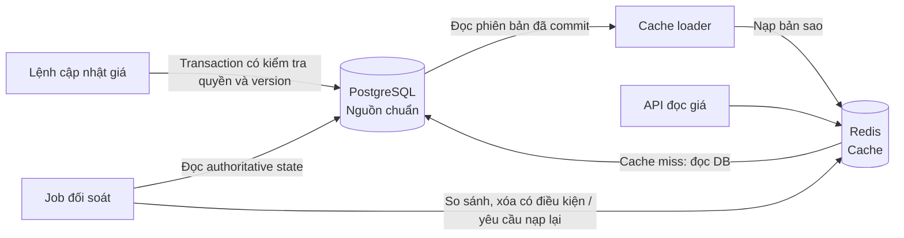
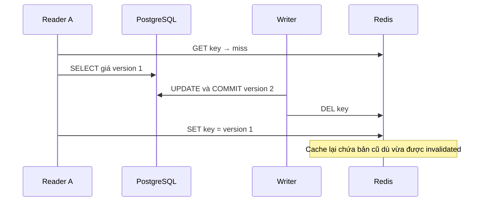
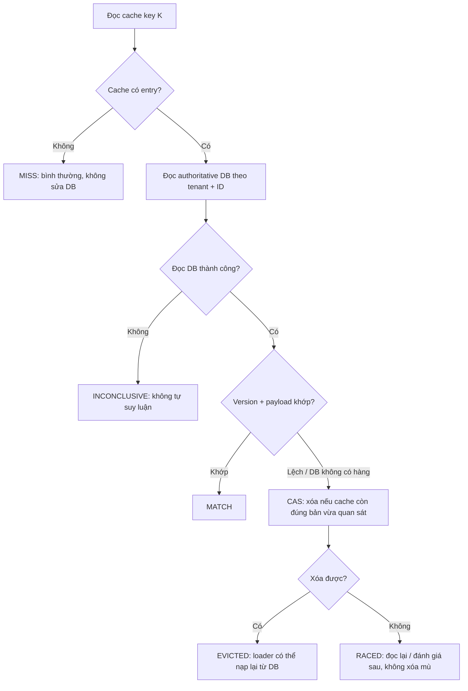

# Đối soát và sửa sai lệch mà không biến cache thành nguồn chuẩn

> **Chương:** Nhất quán và cache  
> **Phạm vi:** `DATA_PERSISTENCE_FUNDAMENTALS` — hiểu mô hình dữ liệu, lược đồ, truy vấn, chỉ mục, giao dịch, tính cô lập và kiểm soát đồng thời; thiết kế ranh giới persistence Java, xử lý lỗi kết nối, tiến hóa schema, bảo mật, sao lưu và hiệu năng.

## Mục tiêu học tập

Sau bài này, người học có thể:

1. Phân biệt **nguồn dữ liệu chuẩn** (*system of record / source of truth*) với **cache**, bản sao đọc và dữ liệu suy ra, từ đó xác định chiều đối soát đúng.
2. Nhận diện các nguyên nhân cache lệch dữ liệu: bỏ sót invalidation, cập nhật trễ, event đến sai thứ tự, đọc replica chậm, xóa/khôi phục dữ liệu và các race condition.
3. Thiết kế quy trình đối soát theo khóa, phiên bản và giá trị nghiệp vụ; phân biệt sai lệch thật với cache miss, snapshot khác thời điểm và kết quả chưa thể kết luận.
4. Sửa sai lệch bằng **invalidation có điều kiện** hoặc nạp lại từ database, không lấy nội dung cache cũ để ghi đè nguồn chuẩn.
5. Dùng giao dịch, transactional outbox, TTL, version/fencing và cơ chế kiểm thử cạnh tranh để giảm thời gian dữ liệu sai lệch trong ứng dụng Java.

## 1. Nguyên tắc đầu tiên: cache là bản sao, không phải trọng tài

Giả sử một dịch vụ Java quản lý giá bán của sản phẩm. PostgreSQL lưu giá đã được phê duyệt và phiên bản của từng sản phẩm; Redis giữ bản sao giá để trả lời nhanh các request đọc.

- **PostgreSQL** là nguồn chuẩn cho **giá đang có hiệu lực** trong hệ thống này.
- **Redis** là dữ liệu dẫn xuất, có thể thiếu, hết hạn, bị xóa, bị cập nhật chậm hoặc gặp lỗi kết nối.
- **Dịch vụ nghiệp vụ** phải áp dụng quy tắc ghi, phân quyền và transaction lên database; Redis không được tự quyết định một giá mới hợp lệ hay không.

Nếu DB ghi `price = 120000` nhưng cache còn `price = 100000`, cách sửa đúng là **lấy giá từ DB để vô hiệu hóa hoặc xây dựng lại cache**. Không lấy `100000` từ cache để “khôi phục” DB về giá cũ vì thấy hai nơi không khớp.



**Ngoại lệ cần nói rõ:** không phải mọi dữ liệu trong mọi hệ thống đều có PostgreSQL làm nguồn chuẩn. Trạng thái thu tiền thật có thể thuộc hệ thống thanh toán bên ngoài; danh tính có thể thuộc hệ thống IAM. Khi đối soát những lĩnh vực đó, phải xác định **ai sở hữu sự thật nghiệp vụ**. Bài này chọn PostgreSQL làm nguồn chuẩn cho *giá sản phẩm*; cache không có quyền thay đổi thực tế ở DB.

### 1.1. Phân biệt những loại dữ liệu thường bị gọi chung là cache

| Thành phần | Bản chất | Cơ chế nhất quán đặc trưng |
| --- | --- | --- |
| Redis/Caffeine cache-aside | Bản sao có thể bỏ đi và nạp lại | TTL, invalidate, rehydrate, version, đối soát. |
| JPA first-level cache (persistence context) | Trạng thái entity đang được quản lý trong một context | Flush/clear/refresh, transaction và snapshot. |
| Read replica của PostgreSQL | Bản sao cơ sở dữ liệu được nhân bản | Replication lag, LSN/timeline và chính sách failover. |
| Search index hoặc read model | Dữ liệu dẫn xuất phục vụ truy vấn khác cách đọc từ nguồn chuẩn | Event/CDC replay, rebuild và watermark. |
| Browser/CDN cache | Bản sao ở phía người dùng hoặc lớp phân phối nội dung | Cache-Control, ETag, purge và độ trễ phân phối. |

Không mặc định các lớp này có cùng cơ chế invalidation. Một lệnh xóa khóa Redis không làm snapshot JPA trong một transaction khác tự đổi, và không bảo đảm CDN đã purge.

## 2. Định nghĩa “lệch” dựa trên hợp đồng dữ liệu

Trước khi so sánh, hãy đặc tả **cache key**, **schema payload**, **nguồn đọc** và **mức chấp nhận cũ**.

Ví dụ một cache entry:

```text
Key:   catalog:price:v1:tenant:7:product:88
Value: {"version":12,"price":120000.00,"status":"ACTIVE"}
TTL:   5 phút (ví dụ, không phải quy tắc bắt buộc)
```

Trong đó:

- `tenant_id` và `product_id` xác định đối tượng và ranh giới phân quyền; không được bỏ `tenant_id` khỏi key nếu ID chỉ duy nhất trong tenant.
- `v1` là phiên bản **định dạng cache**, không phải phiên bản hàng trong DB.
- `version = 12` là phiên bản dữ liệu tăng khi giá hoặc trạng thái sản phẩm thay đổi.
- `price` là giá decimal; không dùng `float`/`double` để đối chiếu số tiền.
- `status` cho biết sản phẩm còn bán hay đã vô hiệu hóa/xóa mềm.
- TTL giới hạn **thời gian sống tối đa của entry nếu có chính sách hết hạn**, nhưng không đồng nghĩa dữ liệu luôn đúng trong suốt TTL hoặc ngay sau khi TTL hết.

Quy tắc nhất quán cần nói rõ. Ví dụ: trang danh mục cho phép giá hiển thị cũ tối đa một khoảng ngắn, nhưng **giá dùng để chốt đơn hoặc kiểm tra hạn mức phải được xác nhận trong transaction ở DB**. Nếu một nghiệp vụ bắt buộc đọc-ngay-sau-ghi (*read-your-writes*), có thể đọc trực tiếp primary, trả giá từ kết quả ghi hoặc dùng token/version để chờ cache bắt kịp.

### 2.1. Không phải mọi cache miss đều là sai lệch

| Quan sát | Đánh giá ban đầu | Hành động phù hợp |
| --- | --- | --- |
| DB có hàng version 12, cache cũng version 12 và payload đúng | Khớp tại thời điểm kiểm tra | Không thay đổi. |
| DB có version 12, cache có version 10 | Cache cũ | Invalidate có điều kiện hoặc nạp lại từ DB. |
| DB có version 12, cache có version 12 nhưng giá khác | Sai payload/serialization hoặc dữ liệu bị ghi sai | Vô hiệu hóa bản đang quan sát; điều tra writer và bộ chuẩn hóa. |
| DB có hàng, cache không có entry | **Cache miss bình thường** | Chỉ nạp khi có nhu cầu hoặc warming phù hợp. |
| DB đã xóa hoặc đánh dấu xóa, cache vẫn trả bản đang bán | Bản sao lỗi thời | Invalidate theo giao thức xóa/tombstone; chặn tái sinh bản cũ. |
| Cache version 13, DB được đọc chỉ thấy version 12 | Chưa thể suy ra cache là nguồn đúng | Kiểm tra đang đọc primary hay replica cũ, phiên bản/tenant/key và thứ tự sự kiện. |
| Không đọc được DB hoặc Redis | **INCONCLUSIVE** | Không coi giá cache là bằng chứng DB sai; không tự sửa nguồn chuẩn. |

So sánh giá trị cần cùng đơn vị tiền, quy tắc làm tròn, chuẩn hóa và schema version. `120000.0` với `120000.00` có thể bằng nhau về số học dù chuỗi JSON khác. Nếu không thống nhất canonicalization, chương trình đối soát tạo cảnh báo giả.

## 3. Lược đồ mẫu: dữ liệu chuẩn và dấu vết thay đổi trong cùng transaction

Với PostgreSQL:

```sql
CREATE TABLE product_price (
    tenant_id BIGINT NOT NULL,
    product_id BIGINT NOT NULL,
    price NUMERIC(18, 2) NOT NULL CHECK (price >= 0),
    status TEXT NOT NULL CHECK (
        status IN ('ACTIVE', 'INACTIVE', 'DELETED')
    ),
    version BIGINT NOT NULL DEFAULT 1 CHECK (version > 0),
    updated_at TIMESTAMPTZ NOT NULL DEFAULT now(),
    PRIMARY KEY (tenant_id, product_id)
);

CREATE TABLE price_cache_outbox (
    event_id BIGINT GENERATED ALWAYS AS IDENTITY PRIMARY KEY,
    tenant_id BIGINT NOT NULL,
    product_id BIGINT NOT NULL,
    db_version BIGINT NOT NULL,
    event_type TEXT NOT NULL CHECK (
        event_type IN ('PRICE_CHANGED', 'PRICE_DELETED')
    ),
    created_at TIMESTAMPTZ NOT NULL DEFAULT now(),
    delivered_at TIMESTAMPTZ
);

CREATE INDEX ix_price_cache_outbox_pending
ON price_cache_outbox (event_id)
WHERE delivered_at IS NULL;

INSERT INTO product_price
    (tenant_id, product_id, price, status, version)
VALUES
    (7, 88, 100000.00, 'ACTIVE', 1);
```

`price_cache_outbox` được thiết kế để **đường ghi DB và ý định invalidation được commit nguyên tử**. Ở đây không đặt foreign key từ outbox sang `product_price` vì một sự kiện xóa vẫn phải tồn tại khi bản ghi gốc bị xóa vật lý. Có thể dùng soft delete để giữ lịch sử version, hoặc bảng tombstone/generation riêng nếu bắt buộc xóa hẳn.

### 3.1. Một thay đổi giá phải ghi cả version và outbox

Ví dụ yêu cầu đổi giá thành `120000.00` khi client đã đọc version 1:

```sql
BEGIN;

WITH changed AS (
    UPDATE product_price
    SET price = 120000.00,
        version = version + 1,
        updated_at = now()
    WHERE tenant_id = 7
      AND product_id = 88
      AND version = 1
    RETURNING tenant_id, product_id, version
)
INSERT INTO price_cache_outbox
    (tenant_id, product_id, db_version, event_type)
SELECT tenant_id, product_id, version, 'PRICE_CHANGED'
FROM changed
RETURNING event_id, db_version;

-- Ứng dụng phải xác nhận đúng một hàng được INSERT vào outbox.
-- Nếu không có hàng, UPDATE không khớp version/tên khóa: xử lý xung đột.

COMMIT;
```

CTE `changed` chỉ trả dữ liệu khi cập nhật DB thật sự thành công; `INSERT ... SELECT` vào outbox thuộc **cùng transaction**. Nếu ghi outbox lỗi, transaction phải rollback cả cập nhật giá. Nếu trả 0 hàng, ứng dụng không được báo thay đổi thành công; đây có thể là version cũ hoặc không tìm thấy sản phẩm.

Sau commit thành công, bản chuẩn có `version = 2`, `price = 120000.00` và một sự kiện chưa phân phối. Worker có thể xử lý sự kiện để vô hiệu hóa cache. Nếu Java mất kết nối lúc commit và không biết kết quả cuối, phải đọc lại dữ liệu/request theo khóa ổn định; không khẳng định cập nhật đã rollback chỉ từ lỗi mạng.

**Tại sao không chỉ gọi `redis.delete(key)` ngay sau `UPDATE`?** Nếu DB commit xong nhưng process chết trước lệnh xóa Redis, cache sẽ còn cũ. Nếu xóa trước commit nhưng DB rollback, cache mất không cần thiết; tệ hơn, một reader có thể nạp lại trạng thái cũ trước khi transaction ghi commit. Outbox giúp lưu ý định phát sự kiện bền vững cùng dữ liệu, nhưng consumer vẫn phải được thiết kế cho giao hàng **ít nhất một lần**, thứ tự đến không bảo đảm trong mọi kiến trúc.

## 4. Các đường gây sai lệch và race condition

### 4.1. Mất invalidation sau commit

1. Service commit giá version 2 vào PostgreSQL.
2. Service chuẩn bị xóa khóa Redis nhưng process chết.
3. Redis tiếp tục trả version 1 cho đến TTL hoặc lần sửa lại.

**Khắc phục:** outbox/CDC hoặc cơ chế phát sự kiện có lưu bền vững, retry delivery và job đối soát phát hiện entry tồn tại lâu hơn yêu cầu cho phép. Không cần viết lại DB từ Redis để “hai nơi giống nhau”.

### 4.2. Reader nạp dữ liệu cũ sau khi invalidation đã chạy

Đây là một race dễ bỏ sót:



Chỉ kết hợp **cache-aside + xóa sau commit** không bảo đảm tuyệt đối không có entry cũ trở lại. Có thể giảm rủi ro bằng TTL, outbox có retry và job đối soát; với yêu cầu mạnh hơn, thiết kế **fencing/version watermark** hoặc so sánh phiên bản nguyên tử trước khi cho một reader điền cache.

Một **version watermark** lưu riêng tại Redis có thể ngăn nạp `version < latestCommittedVersion`, nhưng chính watermark cũng phải cập nhật đáng tin và không được vô tình mất do TTL/eviction. Trong thời gian event từ DB chưa đến, cache vẫn có thể cũ; vì thế giải pháp này cần đánh giá độ trễ đồng bộ và không thay thế đọc primary cho thao tác phải nhất quán mạnh.

### 4.3. Sự kiện đến sai thứ tự

Giao dịch phát sự kiện cho version 4 và 5. Vì retry/parallel consumer, thông báo version 5 có thể được xử lý trước version 4. Nếu consumer “cập nhật cache bằng payload event” một cách mù quáng, version 4 có thể ghi đè version 5.

Hướng an toàn:

- Ưu tiên **event chỉ yêu cầu invalidate** khi có thể, sau đó cache loader đọc trạng thái hiện tại từ DB.
- Nếu cập nhật cache trực tiếp từ event, dùng so sánh **version tăng đơn điệu** dưới thao tác nguyên tử để chỉ chấp nhận version mới hơn; với xóa cần tombstone/generation.
- Event phải đủ định danh `tenant_id`, `product_id` và version. Không dùng chỉ timestamp ứng dụng làm thứ tự duy nhất nếu nhiều node có đồng hồ khác nhau.
- Một event có thể được gửi lặp; handler cần idempotent. Đánh dấu outbox đã phát chỉ sau khi đã có kết quả giao phù hợp với hợp đồng; phát thành công rồi chết trước khi đánh dấu vẫn có thể tạo lần phát lại.

### 4.4. Replica lag và mốc so sánh khác nhau

Job đọc giá trên read replica với version 10, trong khi cache đã nhận version 11 từ primary. Nếu đối soát coi replica là nguồn chuẩn tức thời rồi xóa hoặc ghi đè cache, nó có thể làm tình hình tệ hơn.

Đối với dữ liệu cần nhất quán cao, đọc **primary** hoặc dùng cơ chế bảo đảm replica đã bắt kịp watermark/LSN thích hợp trước khi kết luận. Cũng phải hiểu rằng hai `SELECT` tại `READ COMMITTED` có thể nhìn các thời điểm đã commit khác nhau; khi quét hàng triệu bản ghi, ghi rõ snapshot/độ trễ và phạm vi của báo cáo.

### 4.5. Xóa dữ liệu rồi tái sử dụng khóa

Nếu `product_id = 88` bị xóa và được tạo lại, phiên bản mới có thể bắt đầu lại từ 1, trong khi một cache/event cũ còn version 25. So sánh version đơn giản không đủ: **ID đã được tái sử dụng** có thể làm bản ghi cũ “mới hơn” giả tạo.

Cần dùng định danh không tái sử dụng, **record generation/incarnation**, hoặc tombstone bền vững ghi phiên bản cuối để ngăn đọc cũ tái xuất hiện. Soft delete với version tăng đơn điệu là một lựa chọn khi phù hợp chính sách dữ liệu. Khi xóa do yêu cầu bảo mật, TTL và backup/retention còn phải được xét theo nghĩa vụ lưu trữ và xóa dữ liệu.

## 5. Quy trình đối soát không đảo chiều nguồn sự thật

**Mục tiêu của đối soát:** tìm những cache entry đang tồn tại nhưng không còn phản ánh dữ liệu authoritative trong phạm vi chính sách; sau đó sửa cache an toàn, ghi nhận bằng chứng và báo hiệu những sai lệch không thể tự xử lý.

Một quy trình tuần tự:

1. **Chọn phạm vi:** tenant, loại đối tượng, tập khóa đang được cache, khoảng thời gian hoặc sample. Khóa cache thiếu là điều bình thường; không bắt buộc nạp toàn bộ DB vào cache.
2. **Chụp entry cache đang quan sát:** đọc key và **toàn bộ giá trị thô**/version tại thời điểm đối soát.
3. **Đọc DB authoritative:** truy vấn theo đúng tenant/id trên primary hoặc nguồn có cam kết freshness phù hợp. Nếu DB không sẵn sàng, phân loại `INCONCLUSIVE`.
4. **Chuẩn hóa và so sánh:** cùng schema cache, đơn vị tiền, trạng thái, ID thế hệ và version. Tách sai lệch phiên bản khỏi sai lệch payload.
5. **Chọn cách sửa:** với cache cũ/hỏng hoặc không còn hàng DB, thực hiện **xóa có điều kiện** để không xóa nhầm entry mới vừa được tiến trình khác viết. Không cập nhật DB bằng dữ liệu cache.
6. **Nạp lại có kiểm soát:** cho cache-aside loader nạp từ DB sau cache miss, hoặc warm từ nguồn chuẩn nếu cần, sử dụng version/fencing theo yêu cầu nhất quán.
7. **Ghi lại kết quả và xác minh:** ghi `MATCH`, `EVICTED`, `RACED`, `INCONCLUSIVE`, số entry đã kiểm tra, tỷ lệ lỗi, thời gian tồn tại sai lệch và phiên bản liên quan. Sau repair, có thể đọc lại để xác nhận trên cùng chính sách.



**Không dùng tổng số hàng hoặc checksum tổng hợp đơn lẻ để chứng minh mọi key đúng.** Hai tập dữ liệu khác nhau có thể có cùng số lượng, và hash chỉ có ý nghĩa nếu dữ liệu được chuẩn hóa, chọn phạm vi đúng và có nguồn hash độc lập. Đối soát cần đủ bằng chứng ở cấp khóa/phiên bản cho các bất biến quan trọng.

### 5.1. Khi quét nhiều khóa

Trên Redis, không dùng `KEYS *` trên một instance production lớn để lấy toàn bộ key; sử dụng `SCAN` với giới hạn tốc độ, cursor và bộ lọc prefix phù hợp, chấp nhận đặc tính quét trên tập đang biến đổi. `SCAN` **không tạo snapshot nhất quán tuyệt đối**; có thể gặp entry lặp, bỏ sót entry đang thay đổi hoặc khóa hết hạn giữa chừng. Đối soát phải chịu được các tình huống đó và chạy lặp theo lịch.

Nếu cần quét từ DB authoritative theo phạm vi ổn định, PostgreSQL có thể phân trang bằng khóa tăng dần:

```sql
-- Minh họa keyset pagination: thay các giá trị tham số phù hợp.
SELECT tenant_id, product_id, price, status, version
FROM product_price
WHERE (tenant_id, product_id) > (7, 0)
ORDER BY tenant_id, product_id
LIMIT 500;
```

Sử dụng khóa của hàng cuối batch làm cursor. Với bảng thay đổi liên tục, kết quả qua nhiều batch có thể không cùng một snapshot; nếu cần chứng nhận tại một điểm thời gian, phải thiết kế snapshot/watermark có chủ đích và cân đối chi phí transaction dài. Khi chạy ở `READ COMMITTED`, nên ghi rõ báo cáo là kiểm tra **best-effort theo batch**, không tuyên bố đã chứng minh ảnh chụp toàn database tại một thời điểm.

## 6. Sửa cache bằng compare-and-delete thay vì xóa mù

Giả sử job vừa đọc giá cache version 10 và DB version 12. Trong lúc job chuẩn bị xóa, một reader khác đã nạp cache version 12. Nếu job gửi `DEL key` không điều kiện, nó xóa luôn entry mới đã đúng. Điều này không làm hỏng DB nhưng tạo cache miss và tải DB không cần thiết.

Phương án đơn giản là **compare-and-delete nguyên tử**: chỉ xóa nếu giá trị hiện tại của khóa Redis **vẫn bằng đúng giá trị thô job vừa đọc**.

Redis hỗ trợ thực hiện kiểm tra và xóa trong cùng Lua script:

```lua
-- KEYS[1]: cache key
-- ARGV[1]: exact raw value đã quan sát trước đó
local current = redis.call('GET', KEYS[1])
if current == ARGV[1] then
    return redis.call('DEL', KEYS[1])
end
return 0
```

Kết quả `1`: đã xóa entry quan sát được; `0`: khóa đã mất hoặc giá trị đã đổi, không xóa nhầm dữ liệu mới.

**Giới hạn:** compare-and-delete chỉ bảo vệ cuộc đua giữa lúc **đọc cache** và lúc **xóa cache**. Nó không chứng minh DB không đổi ngay sau khi job đọc; cũng không ngăn reader cũ nạp lại giá trị lỗi sau khi job xóa. Để đạt mục tiêu freshness nghiêm ngặt hơn, vẫn cần chiến lược nạp version-aware, outbox/CDC và fallback về DB.

### 6.1. Ví dụ Java: chỉ sửa Redis, không ghi ngược vào PostgreSQL

Ví dụ Java 17+ với Spring JDBC, Spring Data Redis và Jackson. `CachePrice` biểu diễn payload JSON như phần 2. Code so sánh `BigDecimal` theo giá trị số học và chỉ xóa nếu khóa còn đúng raw value đã quan sát:

```java
import com.fasterxml.jackson.core.JsonProcessingException;
import com.fasterxml.jackson.databind.ObjectMapper;
import java.math.BigDecimal;
import java.util.List;
import java.util.Objects;
import org.springframework.data.redis.core.StringRedisTemplate;
import org.springframework.data.redis.core.script.RedisScript;
import org.springframework.jdbc.core.JdbcTemplate;
import org.springframework.stereotype.Service;

record DbPrice(BigDecimal price, String status, long version) {}
record CachePrice(BigDecimal price, String status, long version) {}

enum ReconcileOutcome {
    MISS, MATCH, EVICTED, RACED_OR_REMOVED, INCONCLUSIVE
}

@Service
public class PriceCacheReconciler {
    private static final RedisScript<Long> DELETE_IF_UNCHANGED =
        RedisScript.of("""
            local current = redis.call('GET', KEYS[1])
            if current == ARGV[1] then
                return redis.call('DEL', KEYS[1])
            end
            return 0
            """, Long.class);

    private final JdbcTemplate jdbc;
    private final StringRedisTemplate redis;
    private final ObjectMapper mapper;

    public PriceCacheReconciler(
            JdbcTemplate jdbc,
            StringRedisTemplate redis,
            ObjectMapper mapper) {
        this.jdbc = jdbc;
        this.redis = redis;
        this.mapper = mapper;
    }

    public ReconcileOutcome reconcile(long tenantId, long productId) {
        String key = "catalog:price:v1:tenant:" + tenantId
                   + ":product:" + productId;
        String observed = redis.opsForValue().get(key);
        if (observed == null) {
            return ReconcileOutcome.MISS;  // Cache không bắt buộc có entry.
        }

        // Datasource này phải đọc authoritative primary,
        // không đọc một replica đang trễ mà không có watermark.
        List<DbPrice> rows = jdbc.query("""
            SELECT price, status, version
            FROM product_price
            WHERE tenant_id = ? AND product_id = ?
            """,
            (rs, i) -> new DbPrice(
                rs.getBigDecimal("price"),
                rs.getString("status"),
                rs.getLong("version")),
            tenantId, productId);
        DbPrice db = rows.isEmpty() ? null : rows.get(0);

        if (db != null) {
            try {
                CachePrice cached =
                    mapper.readValue(observed, CachePrice.class);

                // Nếu cache có version lớn hơn DB đọc được,
                // cần điều tra nguồn/replica/generation, không ghi ngược DB.
                if (cached.version() > db.version()) {
                    return ReconcileOutcome.INCONCLUSIVE;
                }
                if (cached.version() == db.version()
                        && cached.price().compareTo(db.price()) == 0
                        && Objects.equals(cached.status(), db.status())) {
                    return ReconcileOutcome.MATCH;
                }
            } catch (JsonProcessingException | NullPointerException error) {
                // Payload sai định dạng được xem là entry cần vô hiệu hóa;
                // ghi metric lỗi serialization, không sửa dữ liệu DB.
            }
        }

        Long removed = redis.execute(
            DELETE_IF_UNCHANGED, List.of(key), observed);
        return Long.valueOf(1L).equals(removed)
                ? ReconcileOutcome.EVICTED
                : ReconcileOutcome.RACED_OR_REMOVED;
    }
}
```

**Các giả định và lưu ý:**

- Lược đồ có khóa chính `(tenant_id, product_id)` nên `rows` có tối đa một hàng. Nếu không có hàng DB, cache entry quan sát được sẽ bị đề nghị vô hiệu hóa; việc xóa vật lý/tombstone cần cơ chế chống tái sinh bản cũ như phần 4.5.
- `StringRedisTemplate` dùng Redis **string value** dạng JSON. Nếu dự án dùng Redis hash hoặc serializer nhị phân, script và codec phải được thay theo format thực tế.
- Script so sánh **byte/string raw** thay vì dựa vào version của cache nên không xóa entry khác vừa thay đổi. Nếu cùng payload bị ghi lại y hệt sau lúc quan sát, xóa entry đó vẫn không làm sửa sai DB; nhiều nhất là cache miss.
- Không giữ một database transaction dài trong lúc thực hiện network I/O Redis; code này dùng truy vấn đọc ngắn rồi CAS trên cache. Do đó kết quả là **best-effort tại thời điểm đọc**, chưa phải cam kết snapshot xuyên hai hệ thống.
- Nếu đọc DB hoặc Redis lỗi/timeout, caller phải phân loại `INCONCLUSIVE` và retry có giới hạn; không nuốt exception rồi xem là `MATCH`. Ví dụ không có vòng xử lý retry hoặc metrics đầy đủ để giữ phần thuật toán rõ ràng.
- `NullPointerException` trong nhánh parse chỉ minh họa payload thiếu field; trong production nên dùng schema validation rõ ràng và ghi lại mã lỗi, không dựa vào catch rộng làm cơ chế kiểm tra dữ liệu.
- Đường sửa cache **không có câu `UPDATE product_price`**. Nếu phát hiện dữ liệu nguồn không thỏa bất biến nội bộ DB, cần tạo một workflow sửa dữ liệu nguồn riêng, có quyền và bằng chứng nghiệp vụ, không lấy cache làm giá trị mặc định.

### 6.2. Khi nào nạp lại ngay?

Sau `EVICTED`, có hai lựa chọn:

1. **Lazy rehydrate:** để request đọc tiếp theo nhận cache miss rồi đọc từ DB, thích hợp dữ liệu ít truy cập.
2. **Controlled warm-up:** nạp lại từ DB cho những sản phẩm nóng, có giới hạn đồng thời và kiểm soát version để tránh ghi đè một entry mới.

Đừng nạp lại bằng chính payload cache vừa bị đánh dấu sai. Nếu cache loader có thể dùng read replica bị trễ, phải kiểm tra freshness theo yêu cầu hoặc đọc primary; nếu không, job vừa xóa version 10 có thể lại nạp version 10.

## 7. Transactional outbox và xử lý thông điệp bị lặp

Outbox giúp nối **thay đổi DB** với **ý định thông báo cache** mà không yêu cầu transaction phân tán giữa PostgreSQL và Redis.

Luồng:

1. Service ghi `product_price` và `price_cache_outbox` trong **cùng transaction**.
2. Worker tìm những outbox row chưa phân phối và phát sự kiện/invalidate cache.
3. Worker chỉ ghi nhận đã giao sau kết quả theo hợp đồng vận chuyển; nếu chết sau khi gửi nhưng trước khi ghi nhận, event có thể **được gửi lặp**.
4. Consumer/idempotent invalidation dùng `tenant_id`, `product_id`, `db_version`; out-of-order event không được chép payload version cũ đè lên version mới.
5. Job đối soát định kỳ vẫn kiểm tra lỗi ở các mắt xích hoặc race cache-aside mà thông điệp đơn lẻ không chữa hết.

Ví dụ truy vấn hàng đợi theo batch:

```sql
BEGIN;

SELECT event_id, tenant_id, product_id, db_version, event_type
FROM price_cache_outbox
WHERE delivered_at IS NULL
ORDER BY event_id
FOR UPDATE SKIP LOCKED
LIMIT 100;

-- Worker xử lý mỗi event theo giao thức phân phối được chọn.
-- Sau kết quả giao phù hợp, UPDATE delivered_at cho từng event.
-- Nếu xảy ra lỗi, ROLLBACK hoặc lưu trạng thái retry có kiểm soát.

COMMIT;
```

Đây là **khung thuật toán**, chưa phải worker chạy production. Không nên giữ transaction/row lock quá lâu trong lúc gọi Redis hoặc message broker có độ trễ không kiểm soát. Thiết kế production thường sử dụng **claim/lease và trạng thái xử lý**, thời hạn lease, retry/backoff và chuyển lỗi không thể xử lý sang hàng chờ điều tra. `SKIP LOCKED` giúp nhiều worker không tranh nhau cùng hàng đang bị khóa trong phạm vi transaction, nhưng tự nó không bảo đảm event được xử lý đúng một lần.

Một `event_id` tăng không nhất thiết bằng thứ tự commit quan sát được khi nhiều transaction chồng lấn; tránh dùng duy nhất ID của outbox làm version nghiệp vụ. `db_version` hoặc token thế hệ của từng sản phẩm mới là cơ sở phân xử sự kiện cũ/mới.

## 8. Bảo vệ bất biến nghiệp vụ: không quyết định giao dịch từ cache

Cache giá có thể giúp hiển thị nhanh, nhưng nếu đơn hàng cần áp **giá đang có hiệu lực** và tránh việc một giá đã hết hiệu lực bị chốt, service phải kiểm tra thông tin theo transaction/điều kiện nghiệp vụ phù hợp ở DB.

Ví dụ một thao tác chốt giá có optimistic version:

```sql
BEGIN;

SELECT price, status, version
FROM product_price
WHERE tenant_id = 7 AND product_id = 88
FOR UPDATE;

-- Kiểm tra sản phẩm ACTIVE, quyền truy cập tenant,
-- giá/phiên bản đã được khách chấp nhận theo chính sách.
-- Sau đó ghi order/order_line với giá được chốt
-- trong chính transaction.

COMMIT;
```

**Không chỉ** nhận giá từ Redis và ghi giá đó vào đơn hàng mà bỏ qua kiểm tra nguồn chuẩn. Nếu chính sách chấp nhận giá đã hiển thị trước đó cho khách (ví dụ báo giá có hiệu lực 15 phút), cần lưu **quote có điều kiện, version và thời hạn** ở nguồn bền vững, rồi xử lý nghiệp vụ dựa vào quote đó. Cache vẫn là phương tiện tăng tốc, không phải quyền quyết định giá.

Tương tự, tồn kho, số dư, hạn mức tín dụng, quyền truy cập và ràng buộc “một chỗ chỉ được đặt một lần” phải được bảo vệ bằng constraint/conditional update/locking thích hợp trong transaction. Cache có thể hiển thị thông tin gần đúng, nhưng không được dùng làm bộ kiểm tra duy nhất cho bất biến không được vi phạm.

## 9. Xử lý các tình huống khó khi sửa sai lệch

| Tình huống | Hành động an toàn | Hành động cần tránh |
| --- | --- | --- |
| Cache stale, DB đã có giá mới | Xóa entry quan sát được bằng CAS, nạp lại từ DB theo nhu cầu. | `UPDATE` DB trở về giá cache vì hai nơi không giống nhau. |
| Cache chứa dữ liệu hợp lệ nhưng TTL hết | Chấp nhận cache miss, rehydrate có giới hạn. | Coi miss là bằng chứng dữ liệu DB hỏng. |
| DB/primary không đọc được | Đánh dấu `INCONCLUSIVE`, retry giới hạn, kích hoạt chính sách fallback rõ ràng. | Dùng cache làm nguồn xác nhận một thao tác ghi quan trọng. |
| Replica DB sau cache một version | Chờ watermark/đọc primary, điều tra thứ tự event. | Ghi đè cache version mới bằng kết quả replica cũ. |
| Event từ outbox đến trễ hoặc lặp | Invalidate idempotent hoặc kiểm tra version trước khi apply. | Ghi payload sự kiện cũ không điều kiện. |
| Sản phẩm bị xóa | Dùng soft delete/tombstone/generation để chặn tái sinh cache cũ. | Chỉ xóa key một lần rồi tin rằng không có reader chậm. |
| Sản phẩm đổi tenant/đổi định danh cache | Invalidate cả khóa cũ và mới bằng sự kiện có đủ metadata, kiểm tra phân quyền. | Đọc nhầm cache xuyên tenant vì chỉ dùng `product_id`. |
| Lệch do serializer hoặc cache schema migration | Version hóa schema cache, có chiến lược đọc tương thích hoặc xóa & nạp lại. | Ép kiểu payload cũ rồi coi là dữ liệu authoritative. |

### 9.1. Cache stampede và giới hạn tải lúc sửa

Xóa nhiều key cùng lúc có thể khiến hàng nghìn request đi thẳng xuống DB (*cache stampede*). Cần áp giới hạn tốc độ, cache warming có chọn lọc, request coalescing/single-flight, jitter TTL, hoặc stale-while-revalidate **chỉ ở những API cho phép stale**.

Khi cần bảo đảm đọc mới nhất cho một quyết định nghiệp vụ, không dùng stale-while-revalidate như một ngoại lệ tùy tiện. Nên tách endpoint hiển thị gần đúng với endpoint xác nhận/ghi có transaction; đó là một phần thiết kế hợp đồng nhất quán cho ứng dụng.

### 9.2. Dữ liệu cá nhân và quyền truy cập

Key phải đủ tenant/user scope; dữ liệu nhạy cảm nên hạn chế lưu hoặc mã hóa theo chính sách, cấu hình TTL/retention phù hợp và kiểm tra quyền trước khi trả. Không dùng `KEYS *` hoặc ghi payload chứa PII ra log đối soát. Một cache chứa thông tin đã bị thu hồi quyền truy cập không được làm API vượt qua kiểm tra phân quyền chỉ vì entry vẫn tồn tại.

## 10. Đo lường và vận hành đối soát

Một hệ thống đối soát cần đo **thời gian và phạm vi sai lệch**, không chỉ đếm số lần xóa key:

| Chỉ số | Ý nghĩa và lưu ý |
| --- | --- |
| `cache_hit_ratio` / `cache_miss_ratio` | Hiệu quả cache; hit cao không có nghĩa dữ liệu đúng. |
| `reconcile_checked_total` | Số key đã thực sự kiểm tra; phân biệt quét toàn bộ, theo mẫu và theo sự kiện. |
| `reconcile_mismatch_total` | Số key có version/payload lệch theo tiêu chí đã định. |
| `reconcile_inconclusive_total` | Số trường hợp không đọc được DB/Redis hoặc nguồn không đủ freshness. |
| `reconcile_evicted_total` / `reconcile_raced_total` | Xóa được entry quan sát được hoặc entry đã đổi trong lúc sửa. |
| `outbox_oldest_pending_age` | Thời gian sự kiện chưa được phân phối lâu nhất; chỉ dấu nguy cơ cache stale. |
| `cache_staleness_seconds` | Ước lượng thời gian từ commit nguồn chuẩn đến lúc cache phản ánh bản mới, cần đo bằng dữ liệu nguồn đáng tin. |
| `db_load_during_repair` | CPU/IO, số connection, lock wait và truy vấn tại DB khi đối soát/warm. |

Đặt **SLO freshness** theo use case, ví dụ: giá hiển thị được phép trễ trong một cửa sổ đã định, trong khi chốt đơn luôn đối chiếu DB. Chỉ số phải đi kèm phân bố độ trễ (không chỉ trung bình), backlog outbox và số trường hợp không thể kết luận.

Đối soát không nên tự động “chữa cho hết màu đỏ” bằng cách xóa mọi key khi DB timeout: làm vậy vừa không chứng minh giá đúng vừa có thể gây quá tải DB sau khi phục hồi. Cần dừng/throttle khi phát hiện lỗi hàng loạt hoặc khả năng hệ thống nguồn chuẩn đang suy giảm.

## 11. Kiểm thử cạnh tranh và lỗi cần có

Một số kịch bản quan trọng:

| Kịch bản | Cách mô phỏng | Điều phải đúng |
| --- | --- | --- |
| Mất invalidation sau commit | Commit DB, dừng worker ngay trước Redis delete | Outbox còn sự kiện để retry; đối soát nhận diện cache cũ. |
| Reader nạp version cũ sau delete | Tạm dừng reader sau SELECT DB version 1; writer commit version 2 và invalidate; reader SET version 1 | Thử nghiệm phơi bày race; version/fencing hoặc job đối soát/TTL phải xử lý theo SLO. |
| Job xóa trong khi reader đã nạp bản mới | Đọc cache version 1; thay cache version 2; chạy compare-and-delete bằng raw value version 1 | Không được xóa version 2. |
| Event version 5 đến trước event version 4 | Đổi thứ tự phát event | Không được ghi đè version 5 bằng payload version 4. |
| Cache trả lỗi, DB vẫn tốt | Ngắt Redis trong lúc đọc | Chính sách fallback rõ; transaction nghiệp vụ vẫn xác nhận từ DB. |
| DB primary không đọc được | Cắt kết nối lúc đối soát | `INCONCLUSIVE`, không ghi lại DB từ cache, không báo PASS. |
| Soft delete sản phẩm | Đánh dấu `DELETED` và tăng version | Không tiếp tục trả ACTIVE từ cache cũ sau mốc freshness đã định. |
| Cùng product ID ở hai tenant | Ghi giá khác nhau cho hai tenant | Cache key và truy vấn không lẫn tenant, không lộ dữ liệu chéo. |
| Cache schema đổi v1 → v2 | Triển khai phiên bản cache mới cùng phiên bản cũ | Phân biệt namespace/codec; payload không đọc được phải được xử lý an toàn. |
| Job scan lặp hoặc key hết hạn | Quét Redis nhiều đợt, key biến mất giữa chừng | Không tạo báo cáo lỗi giả, không xóa/ghi đè giá trị mới. |

**Các bước kiểm thử cần đồng bộ được thời điểm thực thi** (barrier/hook/test proxy) nếu muốn tái hiện race. Chạy hai thread “gần như đồng thời” không đủ để chứng minh thuật toán CAS hoặc cache-aside an toàn.

## 12. Bài thực hành: giá sản phẩm đã đổi nhưng cache chưa đổi

**Bối cảnh:** PostgreSQL có giá sản phẩm 88 của tenant 7 là `120000.00`, version 12. Redis vẫn giữ `100000.00`, version 10. Có hai service Java đang đồng thời phục vụ đọc; một worker outbox có thể phát lại sự kiện.

**Yêu cầu triển khai:**

1. Tạo schema `product_price` và `price_cache_outbox`. Giữ khóa duy nhất `(tenant_id, product_id)` và version tăng khi giá hoặc trạng thái thay đổi.
2. Viết service đổi giá trong một transaction, đồng thời ghi một sự kiện outbox. Nếu ghi outbox thất bại, không được commit thay đổi giá.
3. Viết cache-aside read: thử Redis; khi cache miss, đọc DB authoritative và ghi cache với TTL. Ghi nhận giới hạn của cách làm này khi reader đã đọc phiên bản cũ trước writer commit.
4. Viết reconciliation job đọc payload cache, đối chiếu DB và dùng compare-and-delete bằng Lua; **không có lệnh UPDATE lên `product_price` trong job**.
5. Tạo lịch cạnh tranh: job đọc cache version 10, reader nạp version 12, job chạy CAS delete. Kiểm tra bản mới không bị xóa.
6. Mô phỏng event version 12 đến trước version 11; xác minh consumer không ghi payload version 11 đè lên version 12.
7. Thử DB không sẵn sàng và Redis có entry cũ; buộc reconciliation báo `INCONCLUSIVE` thay vì sửa DB theo cache.
8. Thử soft delete và cache schema mới, thêm các phép đo stale age, backlog outbox và số lần reconciliation failed.

**Bảng kết quả mong đợi**

| Tình huống | Kết quả |
| --- | --- |
| DB version 12, cache version 10 | Xóa bản cache đang quan sát hoặc nạp lại từ DB; giá DB giữ nguyên. |
| Cache miss | Không báo sai lệch mặc định; có thể lazy load từ DB. |
| Cache được nâng lên version 12 trước lúc job xóa version 10 | CAS không xóa giá trị mới. |
| DB đọc bị timeout | `INCONCLUSIVE`; không dùng cache làm nguồn sửa DB. |
| Outbox event bị gửi hai lần | Consumer idempotent, không ghi dữ liệu cũ đè bản mới. |
| Cùng `product_id` ở hai tenant | Key và dữ liệu không giao nhau. |
| Xóa mềm và nạp lại | Không phục hồi trạng thái ACTIVE lỗi thời từ reader chậm sau khi chính sách freshness đã được thực thi. |

**Câu hỏi tự kiểm tra**

1. Vì sao thấy Redis có giá 100.000 còn PostgreSQL có giá 120.000 thì không được mặc định dùng cache cập nhật DB?
2. Cache miss khác cache stale như thế nào? Vì sao không nên khởi tạo tất cả key khi đối soát?
3. Một reader đọc DB version 1 rồi bị tạm dừng, writer commit version 2 và xóa cache; điều gì xảy ra nếu reader sau đó `SET` version 1?
4. Lua compare-and-delete bảo vệ race nào? Nó **không** bảo vệ race nào?
5. Vì sao event có thể được gửi lặp dù worker đã thực hiện Redis delete thành công?
6. Khi cache có version 13 còn DB đọc được version 12, cần kiểm tra những yếu tố nào trước khi kết luận?
7. Tại sao việc xóa một sản phẩm rồi tái dùng cùng ID có thể khiến version check sai?
8. Một thao tác chốt đơn có nên hoàn toàn tin giá trong cache không? Nếu được phép chốt theo báo giá cũ, phải bảo vệ quy tắc ấy ở đâu?
9. Khi chạy `SCAN` trên Redis có nhiều thao tác ghi, vì sao không thể xem danh sách key trả về là một snapshot?
10. Đâu là những metric cần giám sát để phát hiện cache stale kéo dài hoặc job đối soát làm quá tải PostgreSQL?

## Ghi nhớ

**Cache là dữ liệu dẫn xuất, không phải nguồn chuẩn.** Đối soát bắt đầu từ việc xác định chủ sở hữu sự thật, chọn đúng phạm vi và mốc quan sát, so sánh version cùng payload, rồi **chỉ sửa cache** khi có bằng chứng cache cũ hoặc hỏng. Với dữ liệu DB làm nguồn chuẩn, không lấy cache để ghi ngược DB và không dùng cache làm cơ chế duy nhất bảo vệ bất biến nghiệp vụ.

Trong Java, kết hợp transaction cho thay đổi dữ liệu và outbox, cache-aside có giới hạn độ cũ rõ ràng, compare-and-delete nguyên tử để tránh xóa bản mới, cùng đối soát/giám sát định kỳ. Khi không đọc được nguồn chuẩn hoặc không xác định được thứ tự version, phải báo **chưa thể kết luận** thay vì giả định cache đúng. Thiết kế như vậy giúp cache tăng hiệu năng mà không nắm quyền quyết định tính đúng đắn của dữ liệu.
