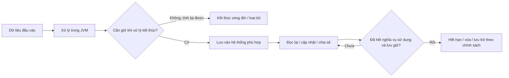
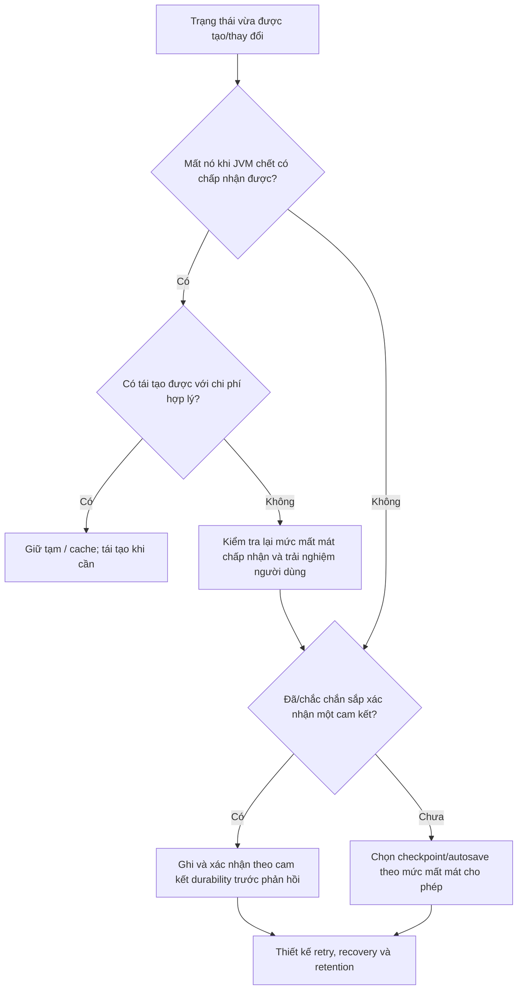
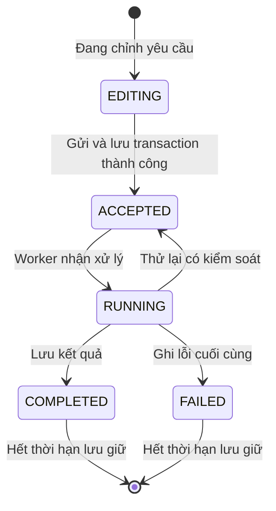

# Xác định thời điểm dữ liệu cần tồn tại ngoài tiến trình

> **Chương:** Vòng đời dữ liệu  
> **Học phần:** `DATA_PERSISTENCE_FUNDAMENTALS` — thiết kế lưu trữ dữ liệu bền vững cho ứng dụng Java, từ mô hình dữ liệu và lược đồ đến truy vấn, giao dịch, cô lập, kiểm soát đồng thời, tiến hóa schema, bảo mật, sao lưu và hiệu năng.

Không phải mọi giá trị được tạo ra trong một ứng dụng đều cần ghi vào cơ sở dữ liệu. Biến cục bộ của một phép tính có thể biến mất khi phương thức kết thúc; kết quả tìm kiếm có thể tính lại; giỏ hàng đang chỉnh sửa có thể cần được khôi phục sau khi người dùng đóng trình duyệt; còn đơn hàng đã được hệ thống xác nhận thì phải tồn tại sau khi JVM khởi động lại. Điểm quyết định là **khi nào việc mất trạng thái sẽ vi phạm một lời hứa của hệ thống hoặc làm gián đoạn một quy trình không thể phục hồi chính xác**.

Bài này tập trung vào quyết định *thời điểm lưu* trong vòng đời dữ liệu. Các lựa chọn công nghệ như bảng SQL, chỉ mục, object storage, hàng đợi và cache chỉ có ý nghĩa khi đã xác định dữ liệu nào có thể mất, dữ liệu nào phải còn và lỗi nào cần chịu được.

Sau bài này, người học có thể:

- Phân loại dữ liệu theo vòng đời và khả năng tái tạo, thay vì mặc định tất cả đều phải lưu.
- Phân biệt trạng thái trong bộ nhớ JVM, dữ liệu nằm ở một tiến trình khác, dữ liệu đã được commit và dữ liệu được bảo vệ bằng backup.
- Xác định điểm ghi bắt buộc trước khi trả phản hồi `accepted` hoặc `completed`.
- Thiết kế một luồng xử lý Java có transaction, khóa idempotency và outbox để tiếp tục sau lỗi.
- Tính đến restart, crash, hỏng máy, mất kết nối, đồng thời và thời hạn lưu dữ liệu khi quyết định dùng persistence.

## 1. Dữ liệu đi qua những vòng đời nào?

Một giá trị có thể trải qua các trạng thái sau:



Đây là mô hình khái niệm, không có nghĩa mọi dữ liệu đều đi qua một đường duy nhất. Một bản ghi nghiệp vụ có thể tồn tại nhiều năm; một lần nhập liệu đang dở có thể lưu vài giờ; còn dữ liệu cache có thể được tạo lại bất cứ lúc nào.

| Loại trạng thái | Ví dụ | Có thể mất sau restart JVM? | Quyết định ban đầu |
| --- | --- | --- | --- |
| Tạm trong một thao tác | Biến trung gian, danh sách đã sắp xếp trong một request | Thường có | Giữ trong bộ nhớ, tránh ghi vô ích |
| Có thể tái tạo | Kết quả tổng hợp từ các bản ghi nguồn đã lưu | Có, nếu chi phí tái tạo chấp nhận được | Tính lại hoặc cache với cơ chế hết hạn |
| Phiên làm việc | Bước đang điền của biểu mẫu, phiên giỏ hàng | Tùy trải nghiệm đã cam kết | Cân nhắc lưu ở client hoặc shared store, thêm TTL |
| Ý định đã được chấp nhận | Yêu cầu xử lý, đơn hàng đang chờ, tác vụ nền | Không, nếu API đã xác nhận tiếp nhận | Lưu yêu cầu trước khi gửi xác nhận |
| Trạng thái nghiệp vụ chính thức | Giao dịch đã hoàn tất, số dư, trạng thái thanh toán | Không | Lưu có giao dịch và bất biến dữ liệu |
| Dấu vết kiểm toán | Ai đổi quyền, kết quả phê duyệt, lịch sử xử lý bắt buộc | Không trong thời hạn quy định | Lưu kiểm soát quyền và chính sách retention |

Hai hệ thống có thể lựa chọn khác nhau cho cùng một dữ liệu. Ví dụ, bộ lọc tìm kiếm có thể là trạng thái tạm thời trong ứng dụng tin tức, nhưng trở thành cấu hình được lưu nếu người dùng đã nhấn “Lưu tìm kiếm”. **Yêu cầu nghiệp vụ xác định vòng đời, không phải kiểu dữ liệu Java.**

## 2. “Ngoài tiến trình” không đồng nghĩa với “bền vững”

Trong ứng dụng Java, biến `static`, trường của singleton, bản đồ `ConcurrentHashMap` và cache trong heap đều thuộc tiến trình JVM. Khi tiến trình bị kill, crash hoặc được triển khai lại, các giá trị này không tự tồn tại. Việc chuyển sang một tiến trình khác giúp chia sẻ trạng thái nhưng chưa bảo đảm độ bền.

Phân biệt bốn mức:

1. **Trong bộ nhớ tiến trình:** rất nhanh, thường mất khi JVM kết thúc. Dữ liệu dùng chung giữa nhiều instance cũng không tự đồng bộ.
2. **Ngoài tiến trình nhưng có thể mất:** dữ liệu nằm trong cache hoặc dịch vụ RAM riêng. JVM khởi động lại vẫn truy cập được *nếu dịch vụ đó còn*, nhưng restart hay sự cố của chính dịch vụ ấy có thể làm mất dữ liệu tùy cấu hình.
3. **Được hệ lưu trữ xác nhận:** database, object storage hoặc log/broker xác nhận ghi theo cơ chế durability cụ thể. Phải đọc cam kết của sản phẩm về log, flush, replication, quorum và loại sự cố chịu được.
4. **Có khả năng phục hồi sau sự cố lớn:** dữ liệu quan trọng còn cần bản sao, backup, phục hồi theo thời điểm và quy trình kiểm tra restore; một commit đơn lẻ không thay thế các bước này.

| Nơi đặt trạng thái | Sống qua restart JVM? | Sống qua hỏng máy/vùng? | Lưu ý |
| --- | --- | --- | --- |
| Heap JVM | Không | Không | Dùng cho tính toán, dữ liệu tạm |
| File trên đĩa cục bộ | Có thể | Thường không nếu mất đĩa/máy | Container và volume tạm có thể bị xóa khi triển khai |
| Redis hoặc shared cache | Thường có nếu cache còn chạy | Phụ thuộc persistence/replication và cấu hình | Đặt TTL; không mặc định là nguồn dữ liệu bền vững |
| Database quan hệ | Theo bảo đảm commit của DBMS/cấu hình | Phụ thuộc HA, replication và backup | Phù hợp bất biến, transaction, truy vấn |
| Object storage | Theo xác nhận và cam kết của dịch vụ | Theo lớp lưu trữ và phạm vi sao chép | Phù hợp tệp và đối tượng lớn; phối hợp metadata |
| Message broker | Theo cấu hình ghi nhận và lưu giữ message | Phụ thuộc replication, acknowledgment và retention | Thích hợp vận chuyển/replay thông điệp, không mặc nhiên thay thế database nghiệp vụ |

Ví dụ: đặt giỏ hàng trong Redis khiến giỏ hàng tồn tại dù một pod Java bị thay mới, nhưng chỉ đạt yêu cầu “khôi phục sau mất Redis” khi cấu hình Redis thực sự hỗ trợ và đã kiểm chứng. Ngược lại, ghi file trên hệ thống tệp tạm của container tuy “ra khỏi heap” vẫn có thể mất ngay trong một lần redeploy.

Đặt đúng câu hỏi: **cần sống sót qua sự cố nào?** Restart ứng dụng, restart dịch vụ cache, mất máy chủ lưu trữ, lỗi vùng hạ tầng và xóa nhầm dữ liệu là những tình huống khác nhau.

## 3. Quyết định thời điểm lưu bằng một hợp đồng về mất dữ liệu

Trước khi chọn công nghệ, trả lời năm câu hỏi cho mỗi loại trạng thái:

1. **Ai cần dùng giá trị sau khi thao tác hiện tại kết thúc?** Cùng request, request tiếp theo, một worker khác, hay người dùng quay lại ngày mai?
2. **Có tái tạo được chính xác không?** Có đủ đầu vào nguồn đã lưu và logic xác định hay cần giữ thông tin ban đầu không thể tính lại?
3. **Nếu tiến trình chết ngay lúc này, có thể mất tối đa bao nhiêu?** Mất một phép tính tạm thời khác với mất đơn hàng đã thông báo “tiếp nhận thành công”.
4. **Hệ thống đã hứa điều gì với bên ngoài?** “Đang chỉnh sửa”, “đã nhận yêu cầu”, “đang xử lý” và “đã hoàn tất” là các cam kết khác nhau.
5. **Phải giữ bao lâu, ai được đọc, và khi nào phải xóa?** Độ bền và thời hạn lưu là hai quyết định độc lập.

Một cây quyết định thực dụng:



**RPO (Recovery Point Objective)** là mức dữ liệu có thể mất theo thời gian khi gặp sự cố trong phạm vi đã chọn. Nếu “không được mất yêu cầu đã xác nhận”, thao tác tiếp nhận phải có bảo đảm tương ứng trước phản hồi; backup mỗi đêm là chưa đủ cho nhu cầu khôi phục gần thời điểm hiện tại. **RTO (Recovery Time Objective)** là thời gian tối đa chấp nhận được để dịch vụ hoặc dữ liệu hoạt động trở lại. RPO trả lời *mất bao nhiêu*, RTO trả lời *phục hồi mất bao lâu*. Cả hai cần dựa trên sự cố cụ thể, không nên đồng nhất “đã ghi DB” với RPO bằng không trong mọi thảm họa.

Một số quy tắc xác định mốc ghi:

- **Trước khi phản hồi “đã tiếp nhận”:** lưu tối thiểu yêu cầu và định danh ổn định để có thể xử lý tiếp sau restart.
- **Trước khi tạo tác dụng phụ khó đảo ngược:** lưu trạng thái hoặc ý định có thể đối chiếu và thử lại an toàn. Ví dụ, chuẩn bị thanh toán cần ID giao dịch nhất quán và cơ chế tra cứu kết quả của nhà cung cấp.
- **Trước khi bỏ dữ liệu nguồn không thể tái tạo:** hoàn thành lưu trữ/kiểm tra hoặc có bản sao độc lập, rồi mới xóa bản nguồn.
- **Theo checkpoint khi xử lý dài:** lưu tiến độ tại khoảng phù hợp với công sức tính lại chấp nhận được; checkpoint phải bao gồm đủ thông tin để bắt đầu lại.
- **Theo chính sách khi thông tin hết giá trị:** xóa, ẩn danh hoặc lưu trữ theo retention; tránh biến mọi dữ liệu tạm thành dữ liệu giữ vô hạn.

## 4. Tình huống: người dùng gửi yêu cầu xử lý

Giả sử người dùng nhập yêu cầu tạo báo cáo. Hệ thống có worker xử lý nền nên không thể tạo xong ngay trong một request HTTP. Ta có thể mô tả vòng đời:



Các trạng thái thể hiện hợp đồng khác nhau:

| Mốc | Hệ thống được phép nói gì? | Cần tồn tại ngoài tiến trình? |
| --- | --- | --- |
| Người dùng đang điền form | “Thay đổi chưa gửi” | Tùy tính năng lưu nháp/autosave |
| Server kiểm tra request | “Đang kiểm tra” | Chưa nhất thiết; có thể từ chối mà không lưu |
| Yêu cầu được commit | “Đã tiếp nhận; mã yêu cầu X” | Có: ID, chủ sở hữu, tham số cần thiết, trạng thái ban đầu |
| Worker bắt đầu | “Đang xử lý” | Nên có trạng thái hoặc cơ chế xác định tiến độ và lease |
| Worker hoàn tất | “Đã hoàn thành” | Có: kết quả hoặc vị trí truy xuất kết quả, trạng thái hoàn tất |
| Hết thời hạn giữ | “Không còn khả dụng” | Thực hiện retention/xóa có kiểm soát |

Một cách triển khai sai dễ gặp là đẩy request vào `BlockingQueue` trong JVM rồi trả HTTP `202 Accepted`. Nếu pod chết ngay sau khi trả phản hồi, request đã được **chấp nhận với client** nhưng không có bản ghi nào để worker hoặc hệ thống mới tiếp tục xử lý. `202` chỉ diễn tả trạng thái HTTP; nó không tự làm hàng đợi thành bền vững.

Luồng an toàn hơn cho yêu cầu nền:

```mermaid
sequenceDiagram
    autonumber
    actor Client
    participant API as Java API
    participant DB as Database
    participant Worker as Background worker
    Client->>API: POST /reports (requestId, tham số)
    API->>API: Xác thực, kiểm tra đầu vào/quyền
    API->>DB: BEGIN; INSERT request + outbox event
    API->>DB: COMMIT
    DB-->>API: Commit được xác nhận
    API-->>Client: 202 Accepted + requestId
    Worker->>DB: Đọc request/outbox chưa xử lý
    Worker->>DB: Cập nhật có điều kiện: ACCEPTED -> RUNNING
    Worker->>Worker: Tạo báo cáo, lưu kết quả
    Worker->>DB: Ghi COMPLETED + địa chỉ kết quả
    Client->>API: GET /reports/{requestId}
    API->>DB: Đọc trạng thái đã lưu
    DB-->>API: Trạng thái hiện tại
    API-->>Client: Trạng thái / đường dẫn kết quả
```

Trong sơ đồ, “ghi `COMPLETED`” là bước chốt kết quả. Kết quả có thể là blob trong object storage với metadata trong database; khi đó phải bảo đảm đối tượng đã ghi có thể truy cập trước khi trạng thái hoàn tất được công bố.

Điểm mấu chốt nằm **giữa commit và phản hồi 202**. Server chỉ xác nhận một yêu cầu bền vững khi đã nhận được cam kết tương ứng từ hệ lưu trữ. Nếu gửi phản hồi trước commit, cửa sổ mất yêu cầu vẫn tồn tại. Nếu commit thành công nhưng phản hồi bị mất, client cần gửi lại cùng mã yêu cầu để tra kết quả cũ.

### Lược đồ minh họa (PostgreSQL)

```sql
CREATE TABLE report_request (
    request_id UUID PRIMARY KEY,
    owner_id BIGINT NOT NULL,
    parameters_json JSONB NOT NULL,
    parameters_hash CHAR(64) NOT NULL,
    status VARCHAR(20) NOT NULL
        CHECK (status IN ('ACCEPTED', 'RUNNING', 'COMPLETED', 'FAILED')),
    result_uri TEXT,
    created_at TIMESTAMPTZ NOT NULL DEFAULT CURRENT_TIMESTAMP,
    updated_at TIMESTAMPTZ NOT NULL DEFAULT CURRENT_TIMESTAMP
);

CREATE TABLE outbox_event (
    event_id UUID PRIMARY KEY,
    request_id UUID NOT NULL REFERENCES report_request(request_id),
    event_type VARCHAR(80) NOT NULL,
    created_at TIMESTAMPTZ NOT NULL DEFAULT CURRENT_TIMESTAMP,
    delivered_at TIMESTAMPTZ
);
```

`report_request` giữ dữ liệu cần tiếp tục xử lý. `outbox_event` ghi ý định thông báo cho worker/broker **trong cùng transaction**, tránh tình huống lưu yêu cầu rồi ứng dụng chết trước khi gửi sự kiện. Một worker có thể đọc trực tiếp bảng hoặc một tiến trình phát outbox sang broker; khi phát lại, consumer phải chịu được thông điệp trùng. `request_id` là khóa idempotency: người gọi giữ nguyên ID trong mọi lần thử lại cùng thao tác.

`parameters_hash` có thể được tính theo cách chuẩn hóa payload đã định nghĩa, để khi một ID được dùng lại hệ thống kiểm tra nó đại diện cùng yêu cầu. Không chỉ dựa vào hash nếu các quy tắc nghiệp vụ còn cần so sánh nội dung và danh tính chủ sở hữu; giá trị hash phải được kiểm tra cùng dữ liệu gốc và bối cảnh truy cập.

### Java JDBC: chỉ xác nhận sau khi transaction commit

```java
import java.sql.Connection;
import java.sql.PreparedStatement;
import java.sql.SQLException;
import java.util.Objects;
import java.util.UUID;
import javax.sql.DataSource;

public final class ReportRequestService {
    private final DataSource dataSource;

    public ReportRequestService(DataSource dataSource) {
        this.dataSource = dataSource;
    }

    // Tham số và ownerId cần được validate/xác thực ở lớp gọi.
    public UUID accept(UUID requestId, long ownerId,
                       String canonicalParametersJson,
                       String parametersHash) throws SQLException {
        Objects.requireNonNull(requestId, "requestId");
        Objects.requireNonNull(canonicalParametersJson, "parameters");
        Objects.requireNonNull(parametersHash, "parametersHash");
        if (ownerId <= 0 || !parametersHash.matches("[0-9a-f]{64}")) {
            throw new IllegalArgumentException("Invalid request");
        }

        try (Connection conn = dataSource.getConnection()) {
            conn.setAutoCommit(false);
            try {
                String insertRequest =
                    "INSERT INTO report_request " +
                    "(request_id, owner_id, parameters_json, parameters_hash, status) " +
                    "VALUES (?, ?, CAST(? AS JSONB), ?, 'ACCEPTED')";
                try (PreparedStatement stmt =
                         conn.prepareStatement(insertRequest)) {
                    stmt.setObject(1, requestId);
                    stmt.setLong(2, ownerId);
                    stmt.setString(3, canonicalParametersJson);
                    stmt.setString(4, parametersHash);
                    stmt.executeUpdate();
                }

                String insertOutbox =
                    "INSERT INTO outbox_event " +
                    "(event_id, request_id, event_type) VALUES (?, ?, ?)";
                try (PreparedStatement stmt =
                         conn.prepareStatement(insertOutbox)) {
                    stmt.setObject(1, UUID.randomUUID());
                    stmt.setObject(2, requestId);
                    stmt.setString(3, "REPORT_REQUESTED");
                    stmt.executeUpdate();
                }

                conn.commit();
                return requestId; // Controller lúc này mới có thể trả 202.
            } catch (SQLException | RuntimeException failure) {
                try {
                    conn.rollback();
                } catch (SQLException rollbackFailure) {
                    failure.addSuppressed(rollbackFailure);
                }
                throw failure;
            }
        }
    }
}
```

Trong ví dụ, `DataSource` có thể kết nối tới một connection pool; `try-with-resources` trả kết nối khi phương thức kết thúc. Lệnh ghi yêu cầu và lệnh ghi outbox cùng chạy trên một kết nối với `autoCommit=false`. Nếu insert outbox thất bại, bản ghi yêu cầu cũng rollback. Nếu `commit()` trả thành công, controller có cơ sở xác nhận `202 Accepted` theo bảo đảm durability của database.

Ví dụ chỉ biểu diễn đường ghi lần đầu. **Ứng dụng thực tế phải bổ sung luồng trùng request:** khi `request_id` đã tồn tại, rollback transaction lỗi, tra bản ghi đã có, kiểm tra `owner_id` và payload có tương thích rồi trả trạng thái cũ; nếu không tương thích thì trả lỗi xung đột. Không sinh request ID mới khi retry. Nếu mất kết nối **ngay lúc commit**, không mặc nhiên kết luận rollback; kết quả commit có thể chưa biết và phải tra lại theo request ID sau khi có kết nối.

Worker cũng không được dựa vào hàng đợi RAM làm nguồn sự thật duy nhất. Nếu nhiều worker cùng nhận việc, nên claim tác vụ bằng cập nhật trạng thái có điều kiện, khóa/lease hoặc cơ chế phân phối công việc của broker. Worker có thể chết sau khi tạo kết quả nhưng trước khi đánh dấu `COMPLETED`, vì vậy việc tạo kết quả cần idempotent hoặc có cách nhận diện kết quả đã tạo. Với xử lý lâu, sử dụng checkpoint và timeout lease để tiếp tục khi worker chết.

## 5. Phân biệt bốn thời điểm thường bị gộp làm một

Một ứng dụng có thể trải qua các mốc:

```text
t0: Object Java đã thay đổi
t1: INSERT/UPDATE đã chạy, còn nằm trong transaction
t2: COMMIT được DB xác nhận
t3: HTTP response đã đến client
t4: Replica/cache/bản sao lưu đã cập nhật theo cơ chế riêng
```

- **t0 không phải t2:** sửa POJO hoặc JPA entity chỉ thay đổi trong bộ nhớ/persistence context; ORM có thể chưa `flush` SQL.
- **t1 không phải t2:** `flush` hoặc `executeUpdate()` hoàn tất không có nghĩa transaction đã commit. Nếu thao tác sau đó lỗi, rollback vẫn có thể hủy thay đổi.
- **t2 không phải t3:** DB có thể đã commit nhưng kết nối HTTP đứt, nên client không nhận được kết quả; idempotency giúp tránh thao tác hai lần.
- **t2 không phải t4:** replica bất đồng bộ, cache và backup có thể cập nhật trễ; đọc ở nơi khác có thể chưa thấy bản ghi ngay sau commit.

Mức độ bền vững của t2 phụ thuộc DBMS và cấu hình. Ví dụ, transaction log, chính sách đồng bộ xuống thiết bị lưu trữ và cơ chế xác nhận replica ảnh hưởng loại lỗi mà commit chịu được. Cần đọc tài liệu và thử nghiệm failover của dịch vụ thật; không giả định một ACK đồng nghĩa dữ liệu sống sót trước mọi sự cố hạ tầng.

**Hệ quả đối với API:** phân biệt các câu trả lời `202 Accepted` (đã ghi nhận để xử lý), `200/201` khi thao tác nghiệp vụ phù hợp thực sự hoàn tất, và lỗi/timeout khi kết quả chưa biết. Nếu triển khai trạng thái eventual consistency, endpoint đọc có thể cần đọc primary hoặc hỗ trợ người dùng tra tiến độ bằng ID thay vì hứa trạng thái mới nhất qua mọi cache.

## 6. Không phải lúc nào cũng lưu ngay: chi phí, mất mát và checkpoint

Ghi bền vững có chi phí: I/O, mạng, đồng bộ log, transaction, storage, giám sát và vận hành. Ghi mọi thao tác gõ phím có thể tăng độ trễ, số lần ghi và lượng dữ liệu cá nhân phải quản lý. Ngược lại, hoãn lưu quá lâu làm tăng rủi ro mất công sức của người dùng.

| Trường hợp | Cửa sổ mất dữ liệu có thể chấp nhận | Chiến lược phù hợp |
| --- | --- | --- |
| Thanh tiến độ animation, biến trung gian | Mất hoàn toàn | Chỉ giữ trong bộ nhớ |
| Kết quả truy vấn có thể tạo lại | Mất cache, đọc lại nguồn | Cache với TTL/invalidation; giữ nguồn dữ liệu bền vững |
| Bản nháp đang gõ | Có thể mất vài giây, theo cam kết UX | Debounce/autosave định kỳ và cảnh báo “chưa lưu” |
| Yêu cầu đã báo tiếp nhận | Không mất trong phạm vi lỗi đã cam kết | Ghi transaction trước response; có ID tra cứu |
| Tác vụ chạy hàng giờ | Có thể tính lại một đoạn ngắn | Checkpoint theo đơn vị công việc, đánh dấu từng phần hoàn tất |
| Nhật ký kiểm toán theo chính sách | Không được bỏ sót sự kiện đã cam kết | Lưu bền vững, hạn chế quyền chỉnh sửa và áp dụng retention |

Ví dụ với tác vụ xử lý 1 triệu dòng: nếu ghi checkpoint sau mỗi 10.000 dòng thì một lần restart có thể phải tính lại tối đa khoảng 10.000 dòng, **chỉ khi** xử lý có thể replay và checkpoint được ghi đúng thứ tự. Muốn resume an toàn, checkpoint cần chứa vị trí đọc, phiên bản dữ liệu nguồn, trạng thái kết quả và cách chống ghi trùng. Lưu mỗi số “đã xử lý 500.000” mà không biết những bản ghi nào đã commit vẫn có thể bỏ sót hoặc nhân đôi dữ liệu.

Khi dữ liệu không thể tái tạo (ví dụ ảnh do người dùng vừa tải lên), cần lưu đối tượng vào kho thích hợp và có cách xác minh/tra cứu trước khi báo nhận tệp thành công. Nếu metadata và tệp nằm trong hai hệ lưu trữ khác nhau, không thể mặc định một transaction SQL bao trùm cả hai. Một chiến lược là upload tệp trước, tạo metadata chính thức sau khi đã xác nhận object, và dọn object mồ côi định kỳ; hoặc quản lý trạng thái `UPLOADING` / `READY` có bước đối soát.

## 7. Ranh giới tiến trình, nhiều instance và kiểm soát đồng thời

Ứng dụng Java chạy nhiều bản sao trên Kubernetes hoặc máy chủ riêng không có một heap dùng chung. Nếu instance A giữ trạng thái nghiệp vụ trong `HashMap`, request tiếp theo được cân bằng tải tới instance B có thể không thấy nó. Sticky session có thể che hiện tượng trong một giai đoạn nhưng không làm trạng thái sống sót sau khi A chết.

Lựa chọn có thể là:

- **Stateless service:** gửi đủ thông tin trong request hoặc token đã ký, đọc nguồn sự thật chung khi cần. Chỉ đưa vào token những dữ liệu phù hợp với quyền riêng tư và khả năng thu hồi.
- **Shared session/cache:** giữ thông tin phiên ngắn hạn bên ngoài JVM, với TTL và chính sách mất dữ liệu rõ ràng.
- **Durable data store:** ghi trạng thái nghiệp vụ cần dùng lại và quản lý transaction/concurrency, không phụ thuộc pod xử lý request.

Khi nhiều tiến trình cập nhật cùng một trạng thái, chỉ lưu “ra ngoài JVM” chưa đủ. Cần kiểm soát đồng thời bằng ràng buộc `UNIQUE`, cập nhật có điều kiện, optimistic locking với cột `version`, khóa hàng hoặc isolation phù hợp. Ví dụ:

```sql
UPDATE report_request
SET status = 'RUNNING',
    updated_at = CURRENT_TIMESTAMP
WHERE request_id = ?
  AND status = 'ACCEPTED';
```

Worker chỉ được coi là đã claim tác vụ khi `executeUpdate()` trả **1 hàng**. Câu lệnh nguyên tử giúp tránh hai worker cùng chuyển một request từ `ACCEPTED` sang `RUNNING`. Tuy nhiên, nếu worker chết trong trạng thái `RUNNING`, cần thêm lease/timeout và recovery logic; riêng câu `UPDATE` này chưa hoàn thiện hệ thống worker chịu lỗi.

Đối với dữ liệu liên quan nhiều bản ghi, chọn ranh giới giao dịch đúng đơn vị nghiệp vụ. Không mở transaction database lâu trong khi gọi hệ thống ngoài hoặc chờ xử lý kéo dài; thay vào đó, lưu trạng thái trung gian rồi cho worker tiếp tục qua các transaction ngắn có thể thử lại an toàn.

## 8. Dữ liệu cần tồn tại bao lâu và có thể phục hồi ra sao?

Lưu bền vững không đồng nghĩa giữ vĩnh viễn. Một quyết định persistence đầy đủ cần xác định cả **thời điểm bắt đầu tồn tại**, **độ bền trong thời gian tồn tại** và **thời điểm kết thúc vòng đời**.

Ví dụ vòng đời một yêu cầu tạo báo cáo:

1. **ACCEPTED:** giữ tham số và định danh để có thể xử lý lại.
2. **RUNNING:** giữ trạng thái và checkpoint có ích cho recovery.
3. **COMPLETED:** giữ kết quả hoặc đường dẫn object theo thời hạn công bố cho người dùng.
4. **EXPIRED:** thu hồi đường dẫn, dọn object, xóa hoặc giảm chi tiết dữ liệu khi hết hạn lưu.

Khi thiết kế retention, cần tính cả bản sao lưu, log, file tạm, cache, dữ liệu đã xuất sang hệ phân tích và quyền truy cập của nhân sự vận hành. Thông tin cá nhân chỉ nên lưu ở mức cần thiết; việc xóa khỏi bảng chính chưa chắc đã xóa lập tức mọi bản sao lưu hoặc replica. Chính sách cần mô tả rõ thời hạn, cơ chế xóa và các ngoại lệ có căn cứ.

Với yêu cầu “phải khôi phục sau sự cố”, xác định:

- **Loại sự cố:** mất JVM, mất một node, hỏng ổ đĩa, lỗi toàn vùng, xóa nhầm, triển khai migration sai.
- **RPO/RTO:** lượng dữ liệu tối đa có thể mất và thời gian phục hồi tối đa cho từng loại sự cố.
- **Khả năng phục hồi thực:** replication, backup, point-in-time recovery, diễn tập restore và đối soát dữ liệu sau phục hồi.
- **Khả năng tái xử lý:** request ID, event log, checkpoint và các thao tác idempotent để làm lại mà không nhân đôi tác dụng phụ.

Replication phục vụ tính sẵn sàng và khả năng đọc mở rộng, nhưng không thay thế backup: một thao tác xóa nhầm có thể được replicate sang mọi bản sao. Backup cũng không làm một yêu cầu đã `202 Accepted` trở thành bền vững nếu mất dữ liệu gần nhất vẫn vượt quá hợp đồng của hệ thống.

## 9. Những lỗi thiết kế thường gặp

| Lựa chọn sai hoặc giả định sai | Vấn đề khi sự cố xảy ra | Hướng sửa |
| --- | --- | --- |
| Trả `202` ngay sau khi đưa vào queue của JVM | Pod chết làm mất tác vụ đã nhận | Commit yêu cầu vào nguồn bền vững hoặc dùng durable broker với acknowledgment phù hợp trước khi nhận |
| Giữ dữ liệu quan trọng trong `static Map` | Restart và nhiều instance không chia sẻ trạng thái | Chuyển nguồn sự thật sang storage có tính nhất quán và độ bền phù hợp |
| Coi Redis luôn là database bền vững | Mất dữ liệu khi Redis restart/failover tùy cấu hình | Định nghĩa chính xác mức mất cho phép, cấu hình persistence hoặc giữ source of truth khác |
| Coi `flush()` là commit | Có thể trả “thành công” rồi rollback | Chỉ phản hồi theo cam kết sau khi transaction hoàn thành |
| Retry request bằng ID mới sau timeout | Có thể tạo đơn hàng hoặc thanh toán hai lần | Idempotency key ổn định và tra cứu kết quả |
| Ghi DB rồi gửi broker như hai thao tác độc lập | Crash ở khoảng giữa làm thiếu sự kiện | Transactional outbox và consumer chịu trùng |
| Chỉ lưu số dòng đã chạy của job | Resume có thể bỏ sót hoặc ghi lặp | Checkpoint có nguồn, vị trí và trạng thái commit rõ ràng |
| Lưu mọi dữ liệu tạm vô thời hạn | Tốn chi phí, tăng rủi ro lộ dữ liệu | TTL, phân loại retention, xóa/ẩn danh |
| Coi replica và backup tương đương | Không thể hoàn tác thao tác xóa nhầm đã replicate | Backup độc lập, PITR và diễn tập phục hồi |

## 10. Bài tập thiết kế và cách tự kiểm tra

Với ứng dụng Java phục vụ người dùng, hãy phân tích từng tình huống:

**Tình huống A — tìm kiếm sản phẩm.** Người dùng nhập một bộ lọc, API trả 50 kết quả. Kết quả được tính từ bảng sản phẩm đã lưu. Hãy quyết định bộ lọc và danh sách kết quả có cần tồn tại sau restart không. Nếu người dùng nhấn “Lưu tìm kiếm”, câu trả lời thay đổi ra sao? Gợi ý: phân biệt kết quả tái tạo được và một cấu hình người dùng đã chủ động lưu.

**Tình huống B — gửi yêu cầu xuất dữ liệu.** API nhận tham số, trả `202` kèm ID; worker xử lý khoảng 20 phút. Vẽ lại thứ tự từ validate, ghi request, commit, trả `202`, chạy worker, lưu object kết quả và cập nhật trạng thái. Đánh dấu mốc nào bắt buộc được lưu trước khi phản hồi và mốc nào cần có cơ chế retry.

**Tình huống C — mất kết nối khi commit.** Java gửi `COMMIT` nhưng kết nối mạng bị đóng trước khi nhận kết quả. Có thể suy ra transaction đã rollback không? Nếu client retry, server phải dùng thông tin nào để xác định đây là yêu cầu cũ? Gợi ý: outcome có thể chưa biết, cần tra cứu theo ID ổn định và kiểm tra payload.

**Tình huống D — cập nhật đồng thời.** Hai worker đọc cùng một job `ACCEPTED`, đều muốn xử lý. Một thao tác `UPDATE ... WHERE status = 'ACCEPTED'` với kiểm tra affected rows giải quyết điều gì, và chưa giải quyết điều gì nếu worker đã claim rồi bị kill?

**Tình huống E — xóa dữ liệu.** Một báo cáo hết hạn sau 30 ngày, nhưng object storage, cache và backup vẫn có bản sao. Hãy xác định điểm kết thúc vòng đời thực tế và phương thức kiểm chứng xóa phù hợp với chính sách dữ liệu.

Một thiết kế tốt phải trả lời được bốn câu hỏi theo đúng thứ tự: **trạng thái này có thể mất không; sau sự cố nào; hệ thống đã hứa điều gì; và đã lưu/khôi phục đủ để giữ lời hứa đó chưa?**

## 11. Checklist trước khi đưa vào production

- [ ] Phân loại từng trạng thái thành tạm thời, tái tạo được, cần giữ theo phiên, hoặc dữ liệu nghiệp vụ phải bền vững.
- [ ] Nêu rõ các sự cố cần chịu được và RPO/RTO tương ứng, thay vì chỉ ghi “cần lưu DB”.
- [ ] Xác định mốc commit/ack trước khi gửi phản hồi `accepted` hay `completed`.
- [ ] Có định danh ổn định và cơ chế idempotency cho thao tác có thể được client/worker thử lại.
- [ ] Ghi những thay đổi cần nguyên tử trong cùng transaction; dùng outbox hoặc cơ chế tương đương khi phối hợp hệ khác.
- [ ] Thiết kế retry, checkpoint, lease và đối soát khi tiến trình chết giữa thao tác.
- [ ] Kiểm soát nhiều instance, transaction isolation, khóa, phiên bản và xung đột cập nhật.
- [ ] Định nghĩa thời hạn lưu, quyền truy cập, mã hóa, xóa dữ liệu và khả năng restore.
- [ ] Kiểm tra bằng cách chủ động làm chết tiến trình **trước commit, sau commit trước response, trong lúc worker chạy và sau khi ghi kết quả**.

Không có một “thời điểm lưu chuẩn” cho mọi dữ liệu. Mốc persistence đúng là thời điểm mà việc mất trạng thái bắt đầu gây ra tổn thất lớn hơn mức hệ thống cho phép hoặc làm sai một cam kết đã đưa ra. Nắm rõ mốc này giúp người phát triển Java chọn ranh giới transaction và công nghệ lưu trữ phù hợp, giảm ghi không cần thiết và làm cho ứng dụng có thể tiếp tục phục vụ sau sự cố.
