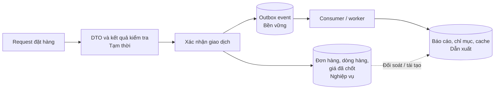

# Dữ liệu tạm thời, dữ liệu nghiệp vụ và dữ liệu dẫn xuất

Trong một ứng dụng Java, không phải mọi dữ liệu được tạo ra đều cần lưu lâu dài, và cũng không phải mọi dữ liệu nằm trong cơ sở dữ liệu đều là nguồn thông tin gốc. Phân biệt **dữ liệu tạm thời**, **dữ liệu nghiệp vụ** và **dữ liệu dẫn xuất** giúp lựa chọn nơi lưu trữ, thiết kế giao dịch, xử lý lỗi và kiểm soát chi phí vận hành đúng với vai trò của từng loại dữ liệu.

Bài học thuộc chương **Vòng đời dữ liệu**, trong phạm vi **DATA_PERSISTENCE_FUNDAMENTALS**: tìm hiểu cách dữ liệu đi từ lúc phát sinh đến khi được lưu bền vững, truy vấn, cập nhật, tái tạo, sao lưu và loại bỏ. Trọng tâm là xác định **thứ gì phải bảo toàn**, **thứ gì có thể tính lại** và **thứ gì chỉ phục vụ một bước xử lý**.

## 1. Ba vai trò dữ liệu

| Nhóm | Định nghĩa theo vai trò | Ví dụ trong hệ thống đặt hàng | Câu hỏi khi thiết kế |
| --- | --- | --- | --- |
| **Dữ liệu tạm thời** (*temporary / transient*) | Phục vụ một yêu cầu, phiên, tác vụ hoặc giai đoạn trung gian; có thể hết hiệu lực khi công việc kết thúc hoặc hết hạn. | Dữ liệu biểu mẫu đang xác thực, đối tượng DTO trong bộ nhớ, tệp tải lên chờ quét virus. | Cần giữ bao lâu, khi nào dọn và việc mất dữ liệu có cản trở một tác vụ chưa hoàn tất không? |
| **Dữ liệu nghiệp vụ** (*business / authoritative*) | Ghi nhận các sự kiện, trạng thái hoặc cam kết có ý nghĩa với nghiệp vụ; là căn cứ để khôi phục sự thật của hệ thống. | Đơn hàng đã xác nhận, các dòng hàng và giá chốt lúc mua, thanh toán, biến động kho. | Nếu mất hoặc sửa sai dữ liệu này, hệ thống có còn giải thích đúng điều đã xảy ra không? |
| **Dữ liệu dẫn xuất** (*derived / projection*) | Được tính, biến đổi hoặc lập chỉ mục từ dữ liệu nguồn theo một quy tắc xác định. | Tổng bán hàng theo ngày, chỉ mục tìm kiếm, trang tổng hợp đơn hàng, cache sản phẩm. | Nguồn và quy tắc tính có đủ để tái tạo nó không; chấp nhận trễ bao lâu? |

Ba khái niệm mô tả **vai trò**, không phải ba loại phương tiện lưu trữ. Một đối tượng Java nằm trong RAM có thể chứa dữ liệu nghiệp vụ chưa được commit; một bảng SQL có thể chỉ chứa cache; một tệp trong object storage có thể là dữ liệu tạm thời đang chờ xử lý.

### Vai trò khác với thời gian sống và độ bền

Cần xét ba trục riêng biệt:

1. **Ý nghĩa:** dữ liệu là nguồn ghi nhận sự thật, kết quả suy ra, hay trạng thái trung gian?
2. **Thời gian sống:** tồn tại trong một request, vài phút, qua nhiều phiên, hay nhiều năm?
3. **Độ bền cần thiết:** mất khi tiến trình khởi động lại có được không, hay phải phục hồi sau sự cố máy chủ?

Ví dụ, một bản nháp đơn hàng có thể được lưu trong cơ sở dữ liệu để người dùng quay lại ngày hôm sau. Nó vẫn là trạng thái **chưa chốt**, nhưng nếu sản phẩm cam kết lưu nháp thì bản nháp đã trở thành dữ liệu cần bảo toàn theo yêu cầu nghiệp vụ. Ngược lại, bảng báo cáo doanh thu có thể tồn tại nhiều năm và được sao lưu để giảm thời gian khôi phục, dù về logic nó vẫn là dữ liệu dẫn xuất.

> **Quy tắc cốt lõi:** Quyết định chính sách persistence theo hậu quả khi mất dữ liệu và khả năng tái tạo dữ liệu, không chỉ theo tên biến, tên bảng hay công nghệ đang sử dụng.

## 2. Theo dấu một đơn hàng từ lúc nhập đến lúc hiển thị

Giả sử khách hàng đặt hai sản phẩm qua ứng dụng thương mại điện tử.

1. Trình duyệt gửi mã sản phẩm và số lượng. DTO nhận request, kết quả kiểm tra cú pháp và dữ liệu trung gian là **tạm thời**.
2. Server kiểm tra quyền mua, giá, khuyến mãi và tồn kho. Các kết quả tính toán chưa chốt là trạng thái trung gian; giá do trình duyệt gửi không thể được xem là giá đáng tin cậy.
3. Khi giao dịch đặt hàng thành công, server lưu mã đơn, các dòng hàng, **đơn giá tại thời điểm mua**, thuế/chiết khấu được chốt, số tiền phải trả và trạng thái đơn. Đây là **dữ liệu nghiệp vụ**.
4. Hệ thống lập bản tổng hợp doanh thu theo ngày, cache trang lịch sử đơn và chỉ mục tìm kiếm từ nguồn đơn hàng. Chúng là **dữ liệu dẫn xuất**.
5. Khi đơn hàng được hoàn tiền hoặc hủy, sự kiện nghiệp vụ mới phải được ghi nhận; các bản tổng hợp liên quan cần cập nhật hoặc tái tạo.



**Điểm dễ nhầm:** `subtotal = số lượng × đơn giá` có vẻ là một giá trị dẫn xuất. Tuy nhiên, **số tiền thanh toán đã được hai bên chấp nhận tại thời điểm đặt hàng** có thể phải lưu như một bản ghi nghiệp vụ bất biến. Lý do là giá niêm yết, chính sách thuế, chiết khấu và quy tắc làm tròn có thể đổi theo thời gian. Không được tính lại nghĩa vụ thanh toán lịch sử chỉ từ bảng giá hiện tại.

Tương tự, thông tin giao hàng lấy từ hồ sơ người dùng là dữ liệu có thể sao chép, nhưng **địa chỉ giao hàng được chốt cho một đơn cụ thể** phải được giữ dưới dạng snapshot phù hợp. Khi người dùng đổi địa chỉ mặc định, lịch sử giao hàng của đơn cũ không được âm thầm đổi theo.

## 3. Cách quyết định dữ liệu thuộc nhóm nào

Trước khi thiết kế cột, bảng hay cache, hãy trả lời tuần tự:

1. **Nếu dữ liệu biến mất ngay bây giờ, điều gì xảy ra?** Nếu chỉ cần tính lại một gợi ý giao diện, nhiều khả năng đó là dữ liệu dẫn xuất. Nếu mất bằng chứng về thanh toán hay số lượng hàng đã xuất, đó là dữ liệu nghiệp vụ.
2. **Nguồn chân lý (*source of truth*) ở đâu?** Nêu rõ bảng, log sự kiện hoặc hệ thống bên ngoài giữ bản ghi có thẩm quyền. Không để hai nơi cùng tự nhận là nguồn gốc mà thiếu quy tắc đối soát.
3. **Có tái tạo được một cách đúng đắn không?** Phải có cả dữ liệu nguồn lẫn quy tắc, phiên bản thuật toán, dữ liệu tham chiếu lịch sử và quyền truy cập cần thiết. “Có thể chạy lại” chưa chắc đồng nghĩa “ra đúng kết quả cũ”.
4. **Khi nào dữ liệu hết hiệu lực?** Request kết thúc, job hoàn thành, token hết hạn, đơn đóng, hay thời hạn lưu giữ pháp lý kết thúc?
5. **Độ trễ và tính nhất quán nào được chấp nhận?** Số tiền phải trả cần nhất quán ở thời điểm chốt; biểu đồ thống kê có thể chậm một khoảng thời gian được công bố.
6. **Ai chịu trách nhiệm cập nhật và xóa?** Định nghĩa chủ sở hữu, ràng buộc giao dịch, sự kiện làm mới, TTL, lưu trữ và xóa dữ liệu cá nhân.

Bảng sau minh họa các trường hợp thực tế:

| Dữ liệu | Vai trò thường gặp | Cách lưu và xử lý hợp lý |
| --- | --- | --- |
| Tham số lọc trên trang tìm kiếm | Tạm thời | URL hoặc bộ nhớ của request; không cần ghi DB cho mỗi thao tác. |
| Tệp import đang được xác thực | Tạm thời, nhưng có thể cần lưu bền vững | Vùng staging riêng; gắn mã job, trạng thái và hạn xóa; chỉ công bố dữ liệu chính thức sau kiểm tra. |
| Giỏ hàng chưa thanh toán | Tùy cam kết sản phẩm | Có thể tạm thời theo phiên; nếu hứa lưu qua thiết bị/phiên thì phải có cơ chế lưu bền vững và xử lý xung đột. |
| Đơn hàng và các lần thay đổi trạng thái | Nghiệp vụ | Giao dịch, ràng buộc dữ liệu, phân quyền, audit và sao lưu. |
| Bản ghi bút toán hoặc hoàn tiền | Nghiệp vụ | Không thay thế bằng số dư cache; cần khả năng đối soát và ghi nhận điều chỉnh. |
| Số dư tồn kho hiển thị trên trang | Có thể dẫn xuất | Có thể tổng hợp từ biến động và giữ chỗ; thao tác trừ kho phải dựa vào dữ liệu có thẩm quyền với kiểm soát đồng thời. |
| Chỉ mục tìm kiếm sản phẩm | Dẫn xuất | Đồng bộ qua sự kiện hoặc job; có quy trình rebuild khi lệch. |
| Báo cáo doanh thu theo ngày | Dẫn xuất | Projection hoặc materialized view; công bố độ trễ, xử lý hủy/hoàn và tái lập theo kỳ. |
| Mã OTP còn hiệu lực | Tạm thời, nhạy cảm | Lưu tối thiểu, giới hạn thử, TTL ngắn, không ghi nội dung vào log; yêu cầu bảo mật vẫn áp dụng. |
| Khóa chống gửi trùng yêu cầu thanh toán | Trạng thái vận hành cần bền vững trong một khoảng thời gian | Ghi trạng thái xử lý/kết quả với khóa duy nhất và hạn giữ đủ dài để retry an toàn. |

**Lưu ý:** một dữ liệu có thể thay đổi vai trò trong vòng đời của nó. Giá dự kiến hiển thị trong giỏ là tạm thời; giá được chốt trong đơn là dữ liệu nghiệp vụ. Bản tổng hợp được tính từ dữ liệu nguồn là dẫn xuất, nhưng nếu chính bản tổng hợp đã được phê duyệt làm chứng từ hoặc căn cứ quyết toán thì phải quản lý nó như hồ sơ nghiệp vụ theo yêu cầu cụ thể.

## 4. Ranh giới persistence trong Java

### 4.1. Phân biệt đối tượng đang xử lý và trạng thái đã commit

Trong Java, đặt tên và thiết kế kiểu dữ liệu để phản ánh mục đích:

- `CheckoutCommand` / `ValidatedCheckout`: đầu vào và kết quả kiểm tra đang tồn tại trong request.
- `Order` / `OrderLine` / `PaymentRecord`: bản ghi nghiệp vụ cần lưu đúng và nhất quán.
- `DailySalesProjection` / `ProductSearchDocument`: hình chiếu có thể xây dựng từ dữ liệu nguồn.

Đoạn mã sau cho thấy một phép tính **dẫn xuất** từ các dòng hàng mang **giá lịch sử đã chốt**:

```java
import java.math.BigDecimal;
import java.util.List;
import java.util.Objects;

public final class OrderMath {
    private OrderMath() {}

    public record Line(String sku, int quantity, BigDecimal unitPriceAtPurchase) {
        public Line {
            Objects.requireNonNull(sku, "sku");
            Objects.requireNonNull(unitPriceAtPurchase, "unitPriceAtPurchase");
            if (sku.isBlank() || quantity <= 0 || unitPriceAtPurchase.signum() < 0) {
                throw new IllegalArgumentException("Invalid order line");
            }
        }

        public BigDecimal amount() {
            return unitPriceAtPurchase.multiply(BigDecimal.valueOf(quantity));
        }
    }

    public static BigDecimal subtotal(List<Line> lines) {
        Objects.requireNonNull(lines, "lines");
        return lines.stream()
                .map(Line::amount)
                .reduce(BigDecimal.ZERO, BigDecimal::add);
    }
}
```

`subtotal` có thể được tính lại **nếu** các dòng hàng và giá tại thời điểm mua vẫn còn nguyên. Nhưng đây chưa phải toàn bộ số tiền thanh toán: vận chuyển, thuế, giảm giá và quy tắc làm tròn có thể khiến `payableTotal` khác `subtotal`. Khi xác nhận đơn, ứng dụng cần chốt và lưu các thành phần giá quan trọng cùng tổng tiền cuối cùng, theo hợp đồng nghiệp vụ.

### 4.2. Lược đồ lưu nguồn và hình chiếu

Ví dụ dùng cú pháp PostgreSQL. Mục đích là chỉ ra sự khác nhau giữa bảng nguồn và bảng dẫn xuất; hệ thống thật cần thêm các ràng buộc phù hợp với yêu cầu cụ thể.

```sql
-- Nguồn nghiệp vụ: các giá trị đã chốt cho đơn hàng.
CREATE TABLE orders (
    order_id        UUID PRIMARY KEY,
    customer_id     UUID NOT NULL,
    created_at      TIMESTAMPTZ NOT NULL,
    currency        CHAR(3) NOT NULL,
    status          VARCHAR(32) NOT NULL,
    payable_total   NUMERIC(19, 2) NOT NULL CHECK (payable_total >= 0),
    version         BIGINT NOT NULL DEFAULT 0
);

CREATE TABLE order_lines (
    order_id              UUID NOT NULL REFERENCES orders(order_id),
    line_no               INTEGER NOT NULL,
    sku                   VARCHAR(64) NOT NULL,
    quantity              INTEGER NOT NULL CHECK (quantity > 0),
    unit_price_at_purchase NUMERIC(19, 2) NOT NULL
        CHECK (unit_price_at_purchase >= 0),
    PRIMARY KEY (order_id, line_no)
);

-- Hình chiếu: có quy trình xây lại từ dữ liệu nghiệp vụ.
CREATE TABLE daily_order_summary (
    report_date          DATE NOT NULL,
    currency             CHAR(3) NOT NULL,
    confirmed_orders     BIGINT NOT NULL,
    confirmed_amount     NUMERIC(19, 2) NOT NULL,
    refreshed_at         TIMESTAMPTZ NOT NULL,
    PRIMARY KEY (report_date, currency)
);
```

Bảng `daily_order_summary` **không được mặc định là nơi quyết định** một khách hàng đã trả bao nhiêu. Dữ liệu nguồn phải được đối soát theo trạng thái đơn, hoàn tiền, hủy và múi giờ báo cáo. Chọn chỉ mục cho truy vấn thực tế: ví dụ truy vấn báo cáo theo ngày có thể cần chỉ mục phù hợp trên trạng thái và thời điểm, nhưng không nên thêm chỉ mục chỉ vì bảng là “nghiệp vụ” hay “dẫn xuất”.

Với dữ liệu nghiệp vụ, dùng khóa chính/ngoại, `UNIQUE`, `CHECK` và giao dịch để ngăn các trạng thái không hợp lệ. Với projection, ưu tiên khóa định danh đúng đơn vị tổng hợp và cơ chế cập nhật có thể chạy lặp an toàn.

### 4.3. Giao dịch và outbox

Khi xác nhận đơn hàng, việc lưu đơn và thông điệp yêu cầu cập nhật hệ thống khác phải có quan hệ nhất quán. Nếu ghi DB thành công nhưng tiến trình chết trước khi gửi sự kiện, báo cáo hoặc hệ thống xử lý sau đó có thể bỏ sót đơn. Mô hình **transactional outbox** xử lý vấn đề bằng cách lưu sự kiện dự kiến phát đi trong **cùng giao dịch** với dữ liệu nghiệp vụ:

```text
BEGIN TRANSACTION
    Kiểm tra và khóa/đối chiếu điều kiện cần thiết
    Ghi orders và order_lines
    Ghi outbox_events với event_id duy nhất
COMMIT

Worker đọc outbox_events và gửi sự kiện
Consumer cập nhật projection theo cách idempotent
Đánh dấu sự kiện đã xử lý / lưu trạng thái gửi
```

Cần chấp nhận rằng worker có thể gửi cùng một sự kiện hơn một lần khi retry. Consumer nên nhận diện `event_id` đã xử lý, hoặc áp dụng thao tác cập nhật có khóa/phiên bản thích hợp. Chỉ gửi sự kiện sau khi dữ liệu nguồn đã commit; không coi cache hay projection cập nhật thành công là điều kiện để công nhận đơn đã tạo.

Ví dụ cấu trúc một service theo Spring (mã minh họa; các interface phụ thuộc ứng dụng):

```java
@Transactional
public CheckoutResult placeOrder(CheckoutCommand command) {
    ValidatedCheckout input = validator.validate(command); // Tạm thời

    Order order = checkoutPolicy.createConfirmedOrder(input);
    // Phải đối chiếu tồn kho/giá và kiểm soát tranh chấp trong giao dịch.
    orderRepository.save(order);                          // Nghiệp vụ

    outboxRepository.save(OrderConfirmed.from(order));    // Cùng transaction
    return new CheckoutResult(order.id(), order.payableTotal());
}
```

`@Transactional` giúp nhóm các thao tác database do transaction manager quản lý; nó **không tự động** biến API gọi hệ thống ngoài thành một phần của giao dịch. Đặt logic mạng ngoài giao dịch, phối hợp bằng outbox hoặc quy trình bù trừ. Với thao tác thanh toán hay đặt đơn có retry, dùng thêm **idempotency key** và ràng buộc duy nhất để tránh tạo hai đơn do request bị gửi lại.

## 5. Quản lý vòng đời cho từng nhóm

Một vòng đời thường có các giai đoạn: **tiếp nhận → xác thực → ghi nhận → sử dụng → cập nhật/tái tạo → lưu trữ → xóa**. Không phải dữ liệu nào cũng đi qua tất cả giai đoạn.

| Hoạt động | Dữ liệu tạm thời | Dữ liệu nghiệp vụ | Dữ liệu dẫn xuất |
| --- | --- | --- | --- |
| Tạo | Khi bắt đầu request/job/phiên. | Khi một hành động hoặc sự kiện có ý nghĩa nghiệp vụ được chấp nhận. | Khi nguồn được tổng hợp, lập chỉ mục hoặc cache. |
| Cập nhật | Theo tiến độ tác vụ; thường có hạn hiệu lực. | Theo quy tắc trạng thái, giao dịch và kiểm soát đồng thời. | Theo sự kiện, lịch chạy hoặc khi đọc. |
| Xử lý lỗi | Thử lại, tiếp tục job từ checkpoint hoặc xóa staging an toàn. | Rollback khi chưa commit; khi đã commit phải đối soát, bù trừ, phục hồi. | Xây lại từ nguồn, đồng bộ lại phần bị lệch. |
| Lưu giữ | TTL hoặc chính sách dọn theo trạng thái job. | Theo yêu cầu nghiệp vụ, kiểm toán, pháp lý và quyền riêng tư. | Theo giá trị sử dụng, chi phí tái tạo và độ mới cần thiết. |
| Khôi phục | Chỉ cần nếu quy trình đòi hỏi tiếp tục sau sự cố. | Bắt buộc có chiến lược backup/restore, RPO/RTO phù hợp. | Có thể rebuild, nhưng đôi khi vẫn sao lưu để giảm thời gian phục hồi. |

### Tạm thời không đồng nghĩa với không cần thiết

Một job xử lý tệp lớn có thể lưu **checkpoint** và tệp staging trong ổ đĩa hoặc object storage. Dữ liệu này vẫn mang tính tạm thời vì phục vụ một lần nhập liệu; tuy nhiên, nếu tác vụ cần tiếp tục sau mất điện thì nó phải đủ bền vững trong thời gian job chạy.

Hãy quy định rõ:

- Định danh tác vụ và chủ sở hữu của dữ liệu staging.
- Thời điểm hết hạn hoặc điều kiện dọn sau khi job thành công, thất bại hay bị hủy.
- Chính sách retry, checkpoint và xử lý tệp dở dang.
- Cách không để dữ liệu chưa được xác thực xuất hiện trong bảng nghiệp vụ chính thức.

TTL chỉ là cơ chế dọn dẹp; nếu dữ liệu quan trọng bị gắn TTL sai, nó vẫn có thể bị xóa khi còn cần thiết.

### Dữ liệu nghiệp vụ cần lịch sử và kiểm soát thay đổi

Đối với đơn hàng, chuyển trạng thái từ `CREATED` sang `PAID` có thể yêu cầu điều kiện tiên quyết, version hoặc khóa dòng. Hai tác vụ song song không được cùng xác nhận hết hàng cuối cùng nếu điều đó vi phạm quy tắc tồn kho.

Các kỹ thuật thường sử dụng:

- **Transaction** để commit nhiều thay đổi liên quan như một đơn vị.
- **Optimistic locking** với cột `version` hoặc khóa thích hợp để xử lý ghi đồng thời.
- **Ràng buộc DB** để không phụ thuộc hoàn toàn vào kiểm tra ở tầng Java.
- **Nhật ký sự kiện/audit** đối với thay đổi cần truy vết; một bản ghi audit có thể là dữ liệu nghiệp vụ quan trọng, không phải cache.
- **Sao lưu và thử khôi phục** theo mục tiêu RPO (mức mất dữ liệu chấp nhận được) và RTO (thời gian phục hồi).

Tránh sửa đè lịch sử nếu nghiệp vụ đòi hỏi dấu vết: hoàn tiền thường được ghi nhận bằng giao dịch hoàn hoặc bút toán điều chỉnh, không bằng việc xóa thanh toán ban đầu.

### Dữ liệu dẫn xuất cần hợp đồng đồng bộ

Ba chiến lược phổ biến:

| Cách tạo/làm mới | Phù hợp với | Đánh đổi |
| --- | --- | --- |
| **Tính khi đọc** | Tổng hợp nhỏ, ít request, cần rất mới. | Chi phí truy vấn lặp lại; dễ chậm khi dữ liệu tăng. |
| **Cập nhật khi nguồn thay đổi** (sự kiện/outbox) | Chỉ mục tìm kiếm, dashboard có yêu cầu cập nhật thường xuyên. | Có độ trễ và xử lý sự kiện trùng/lệch thứ tự. |
| **Tái tạo định kỳ hoặc theo yêu cầu** | Báo cáo theo kỳ, sửa dữ liệu lịch sử, phục hồi khi projection lệch. | Dùng tài nguyên nền; có khoảng trễ giữa các lần rebuild. |

Bất kỳ chiến lược nào cũng nên định nghĩa:

- **Độ mới:** hiển thị `refreshed_at` và mức trễ được chấp nhận; khi không đạt, giao diện có thể cảnh báo dữ liệu chưa cập nhật.
- **Tính idempotent:** chạy lại cùng sự kiện không được đếm doanh thu hai lần.
- **Thứ tự sự kiện:** thay đổi trạng thái cũ không được ghi đè phiên bản mới; lưu offset/sequence/version khi cần.
- **Đường tái tạo:** có thể xóa và xây lại projection từ nguồn hoặc từ log sự kiện đáng tin cậy.
- **Đối soát:** định kỳ so tổng hợp với nguồn nghiệp vụ, đặc biệt sau sự cố hoặc đổi quy tắc tính.

Không phải lúc nào projection cũng tái tạo được y hệt: nguồn đã bị xóa, sự kiện thiếu, dữ liệu tham chiếu đổi hoặc thuật toán lịch sử không còn có thể khiến kết quả khác. Vì thế phải kiểm tra **khả năng tái tạo thực tế**, thay vì chỉ gắn nhãn “dẫn xuất”.

## 6. Điều gì xảy ra khi có sự cố?

| Tình huống | Hành vi đúng cần thiết |
| --- | --- |
| Tiến trình Java chết trước khi commit đơn | Rollback giao dịch; dữ liệu request trong RAM có thể mất. Client có thể gửi lại bằng mã idempotency. |
| DB commit thành công nhưng response HTTP bị mất | Client retry không được tạo thêm đơn thứ hai; tra cứu theo idempotency key hoặc định danh yêu cầu. |
| Đơn đã lưu nhưng worker báo cáo tạm ngừng | Đơn vẫn là nguồn chân lý; outbox tồn đọng được xử lý sau, projection thể hiện độ trễ. |
| Cache hiển thị số lượng tồn kho cũ | Không dựa vào cache để chấp nhận một giao dịch có tranh chấp; xác thực tồn kho tại nguồn trước commit. |
| Bảng tổng hợp ngày bị sai do xử lý sự kiện trùng | Xây lại từ nguồn và sửa consumer để khử trùng/kiểm soát thứ tự; đối soát trước khi công bố. |
| Mất dữ liệu nghiệp vụ vì lỗi ổ đĩa hoặc thao tác sai | Phục hồi từ backup/WAL theo quy trình đã diễn tập; đánh giá mức mất dữ liệu và thời gian phục hồi. |
| Job import chết giữa chừng | Tiếp tục từ checkpoint hoặc rollback phần chưa công bố; dọn staging theo chính sách, không để dữ liệu nhập dở thành bản ghi chính thức. |

Một hệ thống chỉ backup cơ sở dữ liệu nhưng chưa từng **thử restore** chưa chứng minh được khả năng phục hồi. Tương tự, câu “có thể tính lại báo cáo” chỉ có giá trị khi đã kiểm tra nguồn, phiên bản quy tắc và thời gian rebuild đáp ứng yêu cầu.

## 7. Bảo mật, lưu giữ và xóa dữ liệu

Phân nhóm theo vai trò **không thay thế** phân loại bảo mật. Mật khẩu, token, địa chỉ giao hàng, thông tin cá nhân hoặc dữ liệu thanh toán vẫn phải được bảo vệ khi nằm trong request, log, cache, tệp staging hay bảng chính thức.

- **Dữ liệu tạm thời:** thu thập tối thiểu, giới hạn quyền đọc, xóa đúng hạn; tránh ghi request nhạy cảm ra log để một bản sao “tạm thời” trở thành dữ liệu lưu lâu không kiểm soát.
- **Dữ liệu nghiệp vụ:** phân quyền theo vai trò, mã hóa khi thích hợp, audit truy cập/chỉnh sửa, chính sách retention và archive; việc xóa phải phù hợp nghĩa vụ lưu hồ sơ và yêu cầu quyền riêng tư.
- **Dữ liệu dẫn xuất:** thực thi quyền truy cập tương đương dữ liệu nguồn; lan truyền cập nhật và xóa đến cache, index, bản xuất và báo cáo liên quan. Projection không được trở thành lối đi vòng qua chính sách bảo mật của nguồn.

Đặt chính sách xóa theo *vòng đời*, ví dụ: xóa tệp import sau khi hoàn tất và hết thời gian hỗ trợ; ẩn hoặc lưu trữ đơn đã đóng theo chính sách; làm mới chỉ mục khi thông tin khách hàng được chỉnh sửa. Đừng quên backup, bản xuất và hệ thống downstream: cần quy trình riêng để đáp ứng thời hạn lưu giữ và yêu cầu xóa phù hợp.

## 8. Những sai lầm thường gặp

**1. Đồng nhất “đang ở trong RAM” với “tạm thời”.** Một thay đổi tồn kho có ý nghĩa nghiệp vụ có thể đang ở trong RAM trước commit. Nếu yêu cầu đã được xác nhận thành công mà chưa lưu bền vững, đó là lỗi thiết kế giao dịch.

**2. Đồng nhất “có trong database” với “dữ liệu nghiệp vụ”.** Cache, bảng tổng hợp hay staging vẫn có thể nằm trong database, với retention và quy trình phục hồi khác nhau.

**3. Chỉ giữ dữ liệu đã tính tổng, bỏ mất thành phần lịch sử.** Số tiền cuối không đủ để giải thích chi tiết từng dòng, thuế và chiết khấu. Lưu đủ snapshot nghiệp vụ cần thiết để đối soát.

**4. Dùng dữ liệu hiện tại để viết lại quá khứ.** Cập nhật giá sản phẩm hôm nay không được làm hóa đơn cũ thay đổi. Bất cứ dữ liệu tham chiếu nào phải được chốt tại thời điểm cam kết đều cần snapshot hoặc phiên bản lịch sử.

**5. Coi dữ liệu dẫn xuất luôn mới và luôn đúng.** Eventual consistency, lỗi consumer và sự kiện gửi trùng có thể tạo sai lệch. Cần giới hạn độ trễ, đối soát và khả năng rebuild.

**6. Xem dữ liệu tạm thời là vô hại.** Tệp import, session và log có thể chứa thông tin nhạy cảm, hoặc gây quá tải lưu trữ nếu không có chính sách dọn.

**7. Để nhiều nơi cùng ghi nguồn nghiệp vụ.** Nếu bảng đơn hàng, cache và dịch vụ báo cáo đều có quyền tự quyết trạng thái thanh toán, xung đột rất khó xử lý. Phải xác định nơi được phép ghi, quy tắc lan truyền và cơ chế sửa sai.

## 9. Áp dụng vào thiết kế một tính năng

Với yêu cầu “khách có thể lưu giỏ hàng, đặt hàng, xem lịch sử và xem số liệu bán hàng”, có thể thiết kế như sau:

| Nhu cầu | Dữ liệu cần giữ | Quyết định persistence |
| --- | --- | --- |
| Lưu giỏ hàng giữa các phiên | Các dòng giỏ và phiên bản chỉnh sửa, đến khi hết hạn/được chuyển thành đơn. | Lưu bền vững theo tài khoản; xác thực lại giá và tồn kho lúc checkout. |
| Đặt hàng thành công | Order ID, snapshot dòng hàng, giá/tax/chiết khấu đã chốt, trạng thái và lịch sử thay đổi cần truy vết. | Transaction, constraints, concurrency control, backup và idempotency. |
| Hiển thị lịch sử đơn | Truy vấn từ nguồn nghiệp vụ hoặc read model. | Nếu dùng read model, có độ trễ/đường sửa sai; nguồn nghiệp vụ quyết định khi tranh chấp. |
| Thống kê theo ngày | Tổng hợp theo kỳ, đơn vị tiền và điều kiện trạng thái/hoàn tiền. | Projection có `refreshed_at`, đối soát và có thể rebuild. |
| Nhập sản phẩm hàng loạt | Tệp upload, kết quả kiểm tra, checkpoint. | Staging có kiểm soát quyền, trạng thái job và hạn xóa. |

Một thiết kế đủ rõ cần trả lời được các câu hỏi kiểm tra sau:

- Nếu xóa toàn bộ cache và bảng báo cáo, dữ liệu nào dùng để xây lại? Việc xây lại mất bao lâu?
- Nếu HTTP timeout ngay sau commit, lần retry có tạo đơn trùng không?
- Khi thay đổi giá hoặc địa chỉ mặc định, thông tin nào của đơn cũ phải giữ nguyên?
- Khi hai người cùng mua món hàng cuối, ràng buộc nào quyết định giao dịch hợp lệ?
- Khi khách yêu cầu xóa thông tin cá nhân theo chính sách áp dụng, những bản sao nào phải được xử lý?
- Sau mất máy chủ, mục tiêu mất dữ liệu tối đa và thời gian phục hồi được chứng minh bằng cách nào?

Phân biệt đúng ba vai trò dữ liệu giúp kiến trúc persistence của Java vừa **bảo toàn sự thật nghiệp vụ**, vừa **linh hoạt tái tạo kết quả tính toán**, đồng thời **dọn được trạng thái trung gian** khi không còn giá trị. Từ đó mới có cơ sở lựa chọn mô hình dữ liệu, giao dịch, cô lập, chỉ mục, cache, sao lưu và chiến lược phát triển schema phù hợp.
