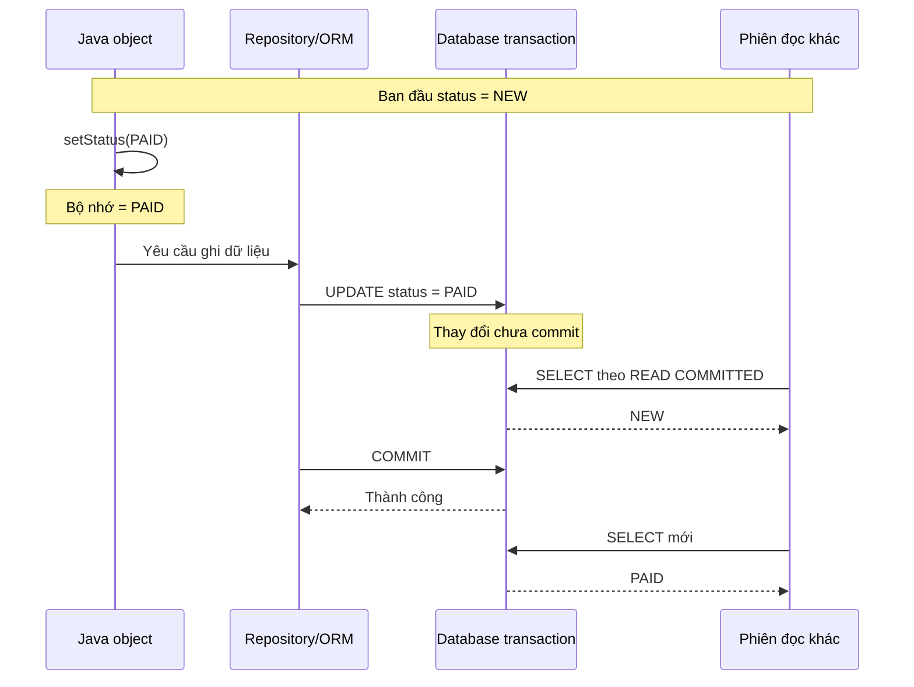
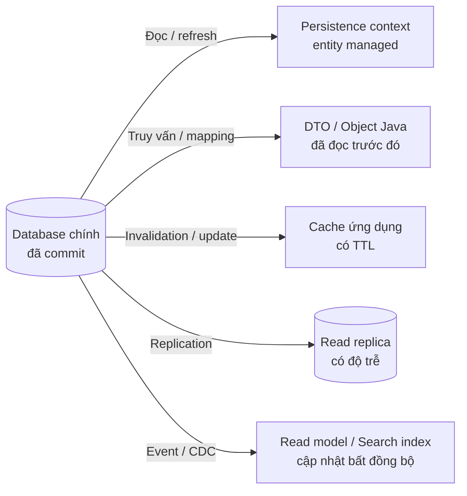
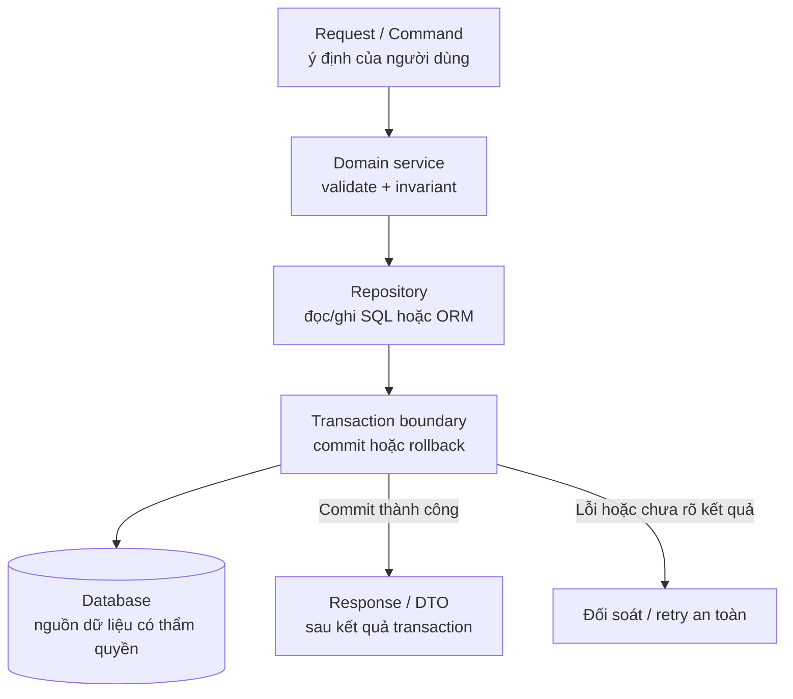

# Phân biệt trạng thái trong đối tượng với trạng thái đã lưu

## 1. Vấn đề trong vòng đời dữ liệu

Một đối tượng Java có thể thay đổi trong bộ nhớ ngay lập tức, nhưng thay đổi ấy chưa chắc đã được ghi xuống cơ sở dữ liệu; ngay cả khi câu lệnh SQL đã chạy, giao dịch vẫn có thể **chưa commit** hoặc bị rollback. Đây là khác biệt nền tảng khi thiết kế persistence.

Ví dụ, ứng dụng xử lý đơn hàng:

```java
Order order = repository.findById(orderId);
order.setStatus(OrderStatus.PAID);
```

Sau dòng `setStatus`, câu trả lời chắc chắn duy nhất là: **đối tượng `order` trong tiến trình Java hiện đang có `status = PAID`**. Để biết trạng thái đã được lưu hay chưa, phải xét cách repository hoạt động, đối tượng có được quản lý bởi ORM không, transaction đang ở giai đoạn nào và lệnh commit có thành công không.

Nếu bỏ qua các mốc này, ứng dụng rất dễ:

- Phản hồi “đã thanh toán” dù giao dịch bị rollback.
- Gửi email xác nhận khi bản ghi trong database vẫn là “chưa thanh toán”.
- Dùng lại đối tượng có dữ liệu cũ, ghi đè thay đổi của một yêu cầu khác.
- Nhầm việc có ID hoặc đã gọi `save()` với dữ liệu đã bền vững sau sự cố.
- Trả thông tin mới từ bộ nhớ trong khi client khác đọc database hoặc read replica vẫn thấy giá trị cũ.

Trong chủ đề **vòng đời dữ liệu**, ta cần theo dõi một thay đổi từ lúc phát sinh trong Java, đi qua ranh giới persistence, được giao dịch xác nhận và trở thành dữ liệu mà các lần đọc sau có thể quan sát.

## 2. Hai loại trạng thái cần gọi đúng tên

### 2.1. Trạng thái trong đối tượng (in-memory object state)

Đây là tập giá trị của các field đang có trong một đối tượng cụ thể ở một thời điểm:

```java
public final class Order {
    private final java.util.UUID id;
    private String status;
    private long version;

    public Order(java.util.UUID id, String status, long version) {
        this.id = id;
        this.status = status;
        this.version = version;
    }

    public void markPaid() {
        if (!"NEW".equals(status)) {
            throw new IllegalStateException("Chi don NEW moi duoc danh dau PAID");
        }
        this.status = "PAID";
    }

    public java.util.UUID getId() { return id; }
    public String getStatus() { return status; }
    public long getVersion() { return version; }
}
```

Một lệnh `markPaid()` chỉ sửa đối tượng `Order` đang được gọi. Nó không tự tạo SQL, không bảo đảm database được cập nhật và không làm các đối tượng `Order` khác cùng ID đổi giá trị.

Đối tượng nằm trong heap của JVM; khi process kết thúc, bộ nhớ đó mất đi. Đối tượng còn có thể là một bản sao đã đọc từ trước, không còn khớp với database do tiến trình khác vừa commit.

### 2.2. Trạng thái đã lưu (persisted state)

Đây là dữ liệu được hệ thống lưu trữ quản lý theo quy tắc transaction, schema và mô hình độ bền đã cấu hình. Với database quan hệ, trạng thái thường được biểu diễn bằng một hoặc nhiều hàng; với object storage, file hoặc kho key-value, có những cơ chế xác nhận ghi tương ứng.

“Đã lưu” phải đi kèm **mốc bảo đảm cụ thể**:

1. Đã tạo hoặc sửa giá trị trong đối tượng Java.
2. Đã đăng ký thay đổi với lớp persistence/ORM.
3. Đã gửi SQL đến database hoặc ghi thay đổi trong transaction.
4. Đã nhận xác nhận `COMMIT` theo cấu hình của database.
5. Đã được hệ thống nhân bản, sao lưu hoặc đồng bộ sang nơi khác theo những cam kết bổ sung.

Năm mốc trên **không tương đương nhau**. Trong phần lớn giao dịch JDBC/JPA thông thường, mốc `COMMIT` thành công là ranh giới ứng dụng dùng để xác nhận giao dịch đã hoàn tất; độ bền trong các sự cố khác nhau vẫn phụ thuộc cấu hình database, lưu trữ và replication.

### 2.3. Bảng so sánh

| Khía cạnh | Trạng thái trong đối tượng | Trạng thái đã lưu trong database |
|---|---|---|
| Nơi tồn tại | Heap của JVM, trong đối tượng cụ thể | Hệ lưu trữ quản lý bản ghi theo transaction |
| Thời điểm thay đổi | Khi code gán field hoặc thực thi phương thức | Khi lớp truy cập dữ liệu gửi thao tác ghi; chỉ thành kết quả đã commit khi giao dịch hoàn tất |
| Phạm vi quan sát | Các tham chiếu tới đúng đối tượng đó | Những phiên/giao dịch được phép đọc theo isolation và độ trễ đồng bộ |
| Vòng đời | Gắn với object, garbage collection và process | Gắn với quy tắc lưu trữ, commit, retention và khôi phục |
| Khả năng rollback | Java không tự đảo ngược field đã sửa | Transaction có thể rollback thay đổi chưa commit |
| Xung đột cập nhật | Không tự biết có writer khác đang thay đổi dữ liệu | Có thể kiểm soát bằng constraint, lock, version và isolation |
| Ví dụ | `order.getStatus()` trả `"PAID"` | `SELECT status FROM orders WHERE id = ?` trả trạng thái theo góc nhìn transaction đọc |

Không nên gọi mọi giá trị do Java đang giữ là “nguồn sự thật”. Với dữ liệu đơn hàng, database giao dịch thường là **nguồn dữ liệu có thẩm quyền**; object, cache và read model là những cách biểu diễn có thể chậm hoặc lệch so với nguồn đó.

## 3. Các mốc trong một giao dịch

Giả sử database đang có đơn hàng `O-1` với `status = NEW`.

| Mốc | Điều ứng dụng thực hiện | Object trong JVM | Database (phiên ghi) | Phiên đọc độc lập, ví dụ `READ COMMITTED` |
|---|---|---|---|---|
| T0 | Đọc đơn từ database | `NEW` | `NEW` | `NEW` |
| T1 | Gán `order.status = PAID` | `PAID` | Vẫn `NEW` nếu chưa phát SQL | `NEW` |
| T2 | Gửi lệnh `UPDATE` trong transaction | `PAID` | Có thay đổi **chưa commit** thành `PAID` | Thường vẫn thấy `NEW` |
| T3a | `ROLLBACK` | Vẫn `PAID` nếu không tự khôi phục object | Trở về `NEW` | `NEW` |
| T3b | `COMMIT` thành công, thay cho T3a | `PAID` | `PAID` đã commit | Lần đọc mới theo `READ COMMITTED` thường thấy `PAID` |
| T4 | Tiến trình khác sửa `PAID → REFUNDED` và commit | Object cũ vẫn `PAID` | `REFUNDED` | Đọc mới thấy `REFUNDED` |

Các nhánh T3a và T3b **loại trừ nhau** trong cùng giao dịch. Bảng nêu cách PostgreSQL với `READ COMMITTED` hoạt động trong trường hợp thông thường; cơ sở dữ liệu, isolation và cách đọc khác có thể cho kết quả quan sát khác.



Điểm cần ghi nhớ:

- **Field đã đổi ≠ SQL đã chạy.**
- **SQL đã chạy ≠ transaction đã commit.**
- **Transaction commit ≠ mọi cache/replica/người đọc lập tức quan sát cùng giá trị.**
- **Rollback ở database ≠ tự hoàn nguyên mọi đối tượng Java đã sửa.**

## 4. JDBC: ranh giới bộ nhớ và database hiện rõ

Trong JDBC thuần, sửa POJO không tự ghi database. Phải chủ động viết lệnh `INSERT`, `UPDATE` hoặc `DELETE`, quản lý transaction và kiểm tra kết quả.

### 4.1. Lược đồ mẫu cho đơn hàng

```sql
CREATE TABLE orders (
    id UUID PRIMARY KEY,
    status VARCHAR(20) NOT NULL
        CHECK (status IN ('NEW', 'PAID', 'CANCELLED', 'REFUNDED')),
    version BIGINT NOT NULL DEFAULT 0 CHECK (version >= 0),
    updated_at TIMESTAMPTZ NOT NULL DEFAULT now()
);
```

Cột `version` cho biết phiên bản dữ liệu đã commit mà chương trình đọc lần trước. Điều kiện cập nhật theo `version` giúp tránh **lost update** khi hai phiên cùng sửa một hàng dựa trên ảnh chụp dữ liệu cũ.

### 4.2. Cập nhật có kiểm soát và trả kết quả sau commit

Ví dụ dùng PostgreSQL, một bản chụp bất biến `OrderSnapshot` giúp tách rõ ý định thay đổi khỏi dữ liệu đã xác nhận:

```java
import javax.sql.DataSource;
import java.sql.*;
import java.util.UUID;

record OrderSnapshot(UUID id, String status, long version) {}

public final class OrderRepository {
    private final DataSource dataSource;

    public OrderRepository(DataSource dataSource) {
        this.dataSource = dataSource;
    }

    public OrderSnapshot markPaid(OrderSnapshot current) throws SQLException {
        if (!"NEW".equals(current.status())) {
            throw new IllegalStateException("Don hang khong o trang thai NEW");
        }

        try (Connection connection = dataSource.getConnection()) {
            connection.setAutoCommit(false);

            try {
                int affected;
                try (PreparedStatement statement = connection.prepareStatement("""
                    UPDATE orders
                    SET status = 'PAID',
                        version = version + 1,
                        updated_at = now()
                    WHERE id = ? AND status = 'NEW' AND version = ?
                    """)) {
                    statement.setObject(1, current.id());
                    statement.setLong(2, current.version());
                    affected = statement.executeUpdate();
                }

                if (affected != 1) {
                    throw new IllegalStateException(
                        "Don hang da bi thay doi hoac khong ton tai; can tai lai");
                }

                // Moi chi ghi trong transaction. Chua duoc xem la commit.
                connection.commit();

                // Chi tao ket qua PAID sau khi commit() tra ve thanh cong.
                return new OrderSnapshot(
                    current.id(), "PAID", current.version() + 1);
            } catch (SQLException | RuntimeException e) {
                try {
                    connection.rollback();
                } catch (SQLException rollbackError) {
                    e.addSuppressed(rollbackError);
                }
                throw e;
            }
        }
    }
}
```

Đây là ví dụ một lần cập nhật đơn giản, không phải quy trình thanh toán hoàn chỉnh. Trong thực tế cần đặt quy tắc trạng thái và transaction ở tầng service phù hợp; nếu nhiều bảng phải cùng thay đổi, phải dùng **chung transaction** để các thao tác thành một đơn vị nguyên tử.

Chú ý:

- `executeUpdate() == 1` cho thấy database nhận và áp dụng câu lệnh **trong transaction hiện tại**; nó chưa chứng minh transaction đã commit.
- `commit()` trả về thành công là điều kiện để phương thức trả một snapshot mới.
- Nếu `commit()` phát sinh lỗi mạng hoặc timeout, **kết quả có thể không xác định**: database có thể đã commit dù ứng dụng không nhận phản hồi. Không mặc định “rollback chắc chắn đã xóa giao dịch”; cần tra cứu trạng thái bằng khóa nghiệp vụ/idempotency và đối soát.
- Nếu hai caller cùng giữ `version = 3`, caller đầu cập nhật thành `4`; caller sau có `affected = 0`, buộc phải tải lại hoặc báo xung đột. Không tự động ghi đè bằng dữ liệu cũ.

### 4.3. Điều gì xảy ra nếu sửa object trước rồi rollback?

```java
Order order = loadOrder();                 // status = NEW
order.markPaid();                          // status = PAID trong JVM

try {
    repository.update(order);              // Có thể ném lỗi; transaction rollback
} catch (Exception error) {
    // order.getStatus() vẫn có thể là PAID!
    // Cần đánh dấu trạng thái không còn đáng tin cậy,
    // tải lại hoặc loại bỏ đối tượng và xử lý lỗi.
}
```

Cơ chế rollback của JDBC tác động đến **database transaction**, không có khả năng tự đảo ngược một lệnh gán field bất kỳ ở Java. Nếu code dùng object này để quyết định gửi hàng hoặc phản hồi thanh toán, nó có thể ra quyết định sai.

Thiết kế an toàn hơn là giữ đối tượng chứa **ý định thay đổi** hoặc snapshot bất biến, chỉ công bố kết quả mới sau khi ghi thành công; khi transaction lỗi, tải lại trạng thái từ nguồn dữ liệu có thẩm quyền trước khi tiếp tục.

### 4.4. Trường hợp auto-commit

JDBC connection thường khởi đầu với `autoCommit = true`: mỗi câu lệnh SQL được commit riêng nếu hoàn tất thành công theo quy tắc driver/database. Nhưng một nghiệp vụ gồm **nhiều** câu lệnh không vì thế mà trở thành một transaction nguyên tử.

Ví dụ:

```java
// Giả định connection đang autoCommit = true
decreaseStock(connection);   // Câu lệnh có thể đã commit
insertOrder(connection);     // Nếu lỗi, trừ tồn kho không tự rollback
```

Nếu hai thao tác phải thành công cùng nhau, dùng `setAutoCommit(false)`, bao trùm bằng một transaction và `commit()` sau khi cả hai thành công. Ở các framework, cần hiểu transaction được quản lý tại đâu để không vô tình commit trước khi nghiệp vụ hoàn tất.

## 5. ORM/JPA: object được quản lý vẫn chưa đồng nghĩa đã lưu bền vững

ORM ánh xạ object Java với dữ liệu quan hệ và có thể tự phát SQL ở những thời điểm nhất định. Sự tiện lợi này cũng khiến hai loại trạng thái dễ bị nhầm.

### 5.1. Các trạng thái vòng đời của entity trong JPA

| Trạng thái entity | Ý nghĩa | Điều cần nhớ về lưu dữ liệu |
|---|---|---|
| **New / transient** | Object vừa được tạo, chưa thuộc persistence context | Chỉnh field không phát SQL |
| **Managed / persistent** | Entity đang được một `EntityManager` quản lý | Dirty checking có thể đồng bộ thay đổi xuống DB khi flush; chưa chắc commit |
| **Detached** | Entity từng được quản lý nhưng không còn gắn với persistence context hiện tại | Chỉnh field không tự được theo dõi; có thể chứa dữ liệu cũ |
| **Removed** | Entity được đánh dấu để xóa trong context | Lệnh `DELETE` có thể chưa chạy hoặc chưa commit |

**Managed** trong thuật ngữ JPA nói về **mối liên hệ với persistence context**, không khẳng định object đã được ghi bền vững xuống đĩa. Đối tượng `new` được gọi `persist()` thường chuyển sang managed, nhưng thời điểm chạy `INSERT` tùy chiến lược sinh khóa, provider và flush.

### 5.2. Ví dụ `persist`, dirty checking, `flush` và `commit`

```java
EntityManager em = entityManagerFactory.createEntityManager();
EntityTransaction tx = em.getTransaction();

try {
    tx.begin();

    OrderEntity order = new OrderEntity();
    order.setId(java.util.UUID.randomUUID());
    order.setStatus("NEW");

    em.persist(order);              // Đăng ký entity với context
    order.setStatus("PAID");         // Thay đổi entity managed

    em.flush();                     // Đồng bộ thay đổi thành SQL
    // Database có thể thấy PAID trong transaction hiện tại.
    // Phiên khác thường chưa thấy; tx vẫn có thể rollback.

    tx.commit();                    // Ranh giới commit của transaction
} catch (RuntimeException error) {
    if (tx.isActive()) {
        tx.rollback();
    }
    throw error;
} finally {
    em.close();
}
```

Ví dụ giả định `OrderEntity` là entity JPA hợp lệ có mapping và constructor phù hợp. Trong ứng dụng Spring/Jakarta EE, framework có thể quản lý `EntityManager` và transaction thay cho code thủ công. Dù quản lý bằng cách nào, sự khác biệt giữa thay đổi object, flush và commit vẫn tồn tại.

Các khái niệm cần tách bạch:

- **`persist(entity)`:** Đưa entity mới vào phạm vi quản lý; không đồng nghĩa transaction đã commit.
- **Dirty checking:** Khi entity managed được sửa, ORM xác định những thay đổi cần ghi. Với entity detached, sửa field thường không được tự đồng bộ.
- **`flush()`:** Đồng bộ pending changes của context thành thao tác database; **không commit**. Lỗi constraint có thể xuất hiện khi flush hoặc muộn hơn ở commit, tùy cách kiểm tra ràng buộc.
- **`commit()`:** Đề nghị hoàn tất transaction; trước khi commit, provider có thể flush tự động theo flush mode.
- **`refresh(entity)`:** Nạp lại trạng thái entity managed theo database và ngữ nghĩa transaction hiện tại; có thể ghi đè thay đổi chưa lưu trên object.
- **`clear()` / `detach(entity)`:** Ngừng quản lý entity; object vẫn còn field trong Java nhưng không còn được dirty checking tự động.
- **`merge(detached)`:** Sao chép trạng thái từ entity detached vào entity managed và trả về **managed instance**; object detached ban đầu không tự biến thành instance managed. Merge không giải quyết mọi xung đột concurrent update.

Các hàm `save()` và `saveAndFlush()` của các thư viện repository không phải lệnh JPA chuẩn đồng nghĩa với `COMMIT`. Phải xem **transaction boundary** của framework/caller: một phương thức `save()` chạy trong transaction bên ngoài có thể trả về trước khi transaction đó commit.

### 5.3. Vì sao “entity có ID” vẫn chưa chứng minh đã commit?

ID có thể được:

- Tạo trong Java (`UUID.randomUUID()`) trước khi phát SQL.
- Cấp bởi sequence/database trước khi transaction commit.
- Cấp khi `INSERT` được thực thi trong một transaction vẫn có thể rollback.

Vì vậy kiểm tra `entity.getId() != null` không đủ để quyết định phát hành thông báo “đơn đã được lưu thành công”. Cần xác định kết quả transaction và điều kiện đảm bảo từ dữ liệu có thẩm quyền.

## 6. Cùng một ID, nhiều bản thể hiện của trạng thái

Ngay cả khi transaction commit thành công, nhiều nơi có thể giữ các trạng thái khác nhau cho cùng ID:



Ví dụ, phiên A commit đơn `PAID` vào primary. Phiên B có thể:

- Đọc trực tiếp primary bằng một transaction `READ COMMITTED` mới và thấy `PAID`.
- Vẫn giữ object `Order` đã tạo từ trước với `status = NEW`.
- Truy vấn trong persistence context đã cache entity và thấy giá trị cũ, tùy thao tác.
- Đọc read replica chưa nhận đủ thay đổi và nhận `NEW`.
- Đọc cache hoặc search index chưa cập nhật và nhận `NEW`.

**Đã commit** không đồng nghĩa mọi bản sao ứng dụng nhìn thấy cùng giá trị ngay lập tức. Khả năng nhìn thấy dữ liệu còn phụ thuộc isolation, snapshot của transaction, cache, replica và đồng bộ bất đồng bộ.

### 6.1. Các ngữ nghĩa đọc cần lựa chọn

| Mong muốn | Hướng triển khai | Đánh đổi |
|---|---|---|
| Đọc sau ghi thấy kết quả của chính mình (read-your-writes) | Đọc từ primary hoặc cơ chế định tuyến/phiên có bảo đảm tương đương | Có thể giảm lợi ích của read replica |
| Các bước trong một transaction có góc nhìn nhất quán | Chọn isolation phù hợp và nhất quán việc dùng connection/transaction | Isolation mạnh hơn có thể tăng xung đột hoặc chi phí |
| Danh sách tìm kiếm có thể chậm vài giây | Search index/read model cập nhật qua event | Cần hiển thị độ trễ và có cơ chế đồng bộ lại |
| Hiển thị thông tin đọc phổ biến thật nhanh | Cache với TTL, invalidation, version | Có thể nhận dữ liệu cũ trong khoảng thời gian xác định |
| Quyết định tiền/tồn kho/đặt hàng chính xác | Thực thi ràng buộc và cập nhật nguyên tử tại nguồn dữ liệu có thẩm quyền | Có thể cần khóa, xung đột hoặc chờ commit |

Đừng dùng giá trị cache hoặc DTO cũ làm căn cứ **duy nhất** để ghi một thay đổi cần bảo toàn invariant. Hãy bảo vệ invariant ở ranh giới ghi của database bằng constraint, transaction, kiểm tra version hoặc cơ chế phù hợp.

## 7. Đồng thời: object đúng lúc đọc nhưng sai lúc ghi

Hai tiến trình đọc cùng hàng có thể cùng nhận `status = NEW, version = 7`:

1. A đọc đơn hàng phiên bản 7, quyết định đổi sang `PAID`.
2. B cũng đọc phiên bản 7, quyết định đổi sang `CANCELLED`.
3. A ghi `PAID` và commit phiên bản 8.
4. B vẫn giữ object `NEW` trong Java. Nếu B cập nhật vô điều kiện, `CANCELLED` có thể ghi đè thay đổi của A.

Đây là một dạng **lost update**. Chỉ kiểm tra `status == NEW` trên object B **trước** khi ghi không đủ vì trạng thái trong object có thể đã cũ.

### Optimistic locking

```sql
UPDATE orders
SET status = 'CANCELLED',
    version = version + 1,
    updated_at = now()
WHERE id = :order_id
  AND status = 'NEW'
  AND version = :version_da_doc;
```

Nếu `row count = 0`, application phải xem đây là xung đột hoặc hàng không còn thỏa điều kiện. Cần đọc lại để đưa ra quyết định phù hợp, không “cố ghi cho xong” bằng cách bỏ điều kiện.

JPA hỗ trợ cơ chế optimistic locking thông qua `@Version`:

```java
@Entity
@Table(name = "orders")
public class OrderEntity {
    @Id
    private java.util.UUID id;

    @Version
    private long version;

    private String status;

    protected OrderEntity() {}

    // Các phương thức nghiệp vụ, getter và setter phù hợp.
}
```

Trong trường hợp hỗ trợ/version mapping đúng, provider sẽ phát hiện xung đột khi cập nhật và thường báo ngoại lệ optimistic locking. Cần có chiến lược xử lý xung đột rõ ràng: trả HTTP 409, yêu cầu người dùng tải lại, hoặc retry có giới hạn khi thao tác có thể thực hiện lại an toàn.

### Pessimistic locking và isolation

`SELECT ... FOR UPDATE` hoặc cơ chế khóa phù hợp có thể chặn writer khác trong thời gian transaction còn mở. Chi phí là chờ khóa, deadlock có thể xảy ra và giảm throughput nếu transaction kéo dài.

Mức isolation giải quyết những bất thường khác nhau. Không thể suy ra từ `READ COMMITTED` rằng mọi quy tắc nhiều hàng đều an toàn: với điều kiện tổng hoặc ràng buộc chéo nhiều hàng, cần phân tích **write skew**, phantom và phương án `SERIALIZABLE`, khóa hoặc thiết kế constraint tương ứng.

Điểm chung: **tính đúng đắn của lần ghi phải được kiểm tra trước hoặc trong thao tác ghi có phối hợp đồng thời**, không chỉ bằng trạng thái của object được đọc lúc trước.

## 8. Lỗi, rollback và kết quả commit không xác định

Một luồng ghi dữ liệu cần phân biệt ít nhất bốn trường hợp:

| Tình huống | Trạng thái trong Java | Trạng thái database | Ứng xử đúng |
|---|---|---|---|
| Validation thất bại trước SQL | Có thể đã sửa bản nháp | Không có thay đổi mới được ghi | Không công bố thành công; sửa input |
| SQL/flush lỗi, transaction rollback | Object managed/POJO có thể vẫn giữ field mới | Thay đổi chưa commit bị hủy | Không dùng object cũ như dữ liệu đã lưu; đóng/loại bỏ context lỗi, tải lại |
| Commit trả về thành công | Có thể đang giữ trạng thái mới | Giao dịch đã được database xác nhận theo bảo đảm cấu hình | Có thể công bố thành công; lưu ý replica/cache chậm |
| Commit timeout hoặc mất kết nối | Object có thể đã đổi | **Không biết chắc** commit thành công hay chưa | Tra cứu theo khóa ổn định; tránh tạo lại thao tác gây tác động kép |

Khi transaction ORM bị lỗi, một persistence context vẫn chứa entity đã sửa có thể không còn đáng tin. Với framework thực tế, cần tuân thủ quy tắc xử lý transaction thất bại và tạo context mới khi thích hợp; **không** cố tiếp tục dùng đối tượng cũ như thể nó đã đồng bộ với database.

### 8.1. Tại sao retry cần idempotency?

Giả sử client gửi yêu cầu tạo đơn `requestId = R100`. Server commit thành công nhưng mất mạng trước khi trả phản hồi. Client không thể tự biết có cần tạo đơn mới không. Nếu retry bằng `requestId` mới, có thể tạo hai đơn hoặc trừ tồn kho hai lần.

Đặt khóa duy nhất trong database:

```sql
CREATE TABLE order_requests (
    request_id UUID PRIMARY KEY,
    order_id UUID NOT NULL UNIQUE REFERENCES orders(id),
    request_hash TEXT NOT NULL
);
```

Một quy trình chặt chẽ dùng **cùng request ID** cho các lần thử lại, lưu khóa và kết quả trong **cùng transaction** với thao tác nghiệp vụ, kiểm tra payload của request ID trùng và trả về kết quả đã có. Cần thiết kế xử lý tình trạng request đang diễn ra, timeout và thời gian lưu khóa. Không được tự giả định một lần gặp lỗi đồng nghĩa chưa có commit.

### 8.2. Gửi sự kiện bên ngoài sau commit

Một sai lầm phổ biến:

```java
order.setStatus("PAID");
emailClient.sendPaidEmail(order); // Gửi email thành công
repository.save(order);           // Database có thể lỗi/rollback
```

Email không rollback theo database; hệ thống đã thông báo trạng thái mà chưa chắc có bản ghi tương ứng.

Mặt khác, gọi email **sau** commit cũng có khoảng trống: database commit thành công nhưng process chết trước khi gửi email. Cách phổ biến là **transactional outbox**:

1. Trong một transaction, cập nhật `orders` và thêm một hàng `outbox` biểu diễn sự kiện.
2. Commit transaction.
3. Worker đọc outbox và gửi sự kiện; khi cần thì thử lại.
4. Consumer xử lý sự kiện trùng bằng `event_id` hoặc khóa idempotency.

Outbox giúp thay đổi nghiệp vụ và **ý định phát sự kiện** được lưu nguyên tử trong cùng database. Nó **không tự bảo đảm exactly-once delivery**; cần chấp nhận at-least-once và xử lý lặp an toàn.

## 9. Thiết kế ranh giới persistence trong ứng dụng Java

Cần trả lời tường minh: **Khi nào dữ liệu là bản nháp trong Java? Khi nào đã được giao cho repository? Ai sở hữu transaction? Khi nào trả kết quả thành công?**

Một cách tổ chức dễ kiểm soát:



Vai trò thường gặp:

- **Domain model hoặc command:** Biểu diễn ý định và quy tắc nghiệp vụ; thay đổi field chưa có nghĩa database đã cập nhật.
- **Repository:** Đọc và ghi dữ liệu, ánh xạ giữa row và object, nhận biết row count, constraint violation và optimistic lock.
- **Service/transaction boundary:** Xác định những cập nhật phải cùng commit; kiểm soát kết quả trước khi công bố thành công.
- **Database:** Thực thi constraint, isolation, log và commit theo cấu hình.
- **DTO/response:** Trình bày kết quả cho client theo hợp đồng nhất quán đã chọn; không nên trả tùy tiện object cũ từ cache.
- **Outbox/integration:** Đồng bộ sang hệ thống khác có phương án retry và đối soát riêng.

### Snapshot bất biến và entity có thể sửa

Có hai hướng thiết kế phổ biến:

**Hướng snapshot/command:** Domain giữ dữ liệu đầu vào và snapshot đã đọc; repository nhận lệnh có điều kiện theo version, commit rồi trả snapshot mới. Ưu điểm là dễ thấy rõ mốc dữ liệu được coi là đã lưu. Phải chủ động viết mapping và SQL.

**Hướng entity managed:** Domain sửa entity JPA đang được quản lý; provider theo dõi dirty fields và flush. Ưu điểm là biểu diễn nhiều quan hệ thuận tiện. Cần kiểm soát rõ transaction, fetch, flush, phiên bản và những trường hợp detached entity.

Cả hai đều có thể đúng. Không chọn cách chỉ vì nó “tự lưu”; chọn theo độ phức tạp invariant, tần suất cập nhật, khả năng kiểm thử và cách nhóm bảo trì transaction.

### Phân biệt các lời hứa trong API

Một response có thể mang các trạng thái khác nhau:

- **`202 Accepted`:** Hệ thống đã chấp nhận yêu cầu để xử lý; chưa nên khẳng định nghiệp vụ đã commit nếu nó còn ở hàng đợi.
- **`200 OK` / `201 Created` sau commit:** Có thể xác nhận kết quả khi transaction tương ứng đã thành công.
- **`409 Conflict`:** Có thể dùng khi optimistic lock hoặc quy tắc trạng thái phát hiện xung đột.
- **Timeout/`5xx` khi mất phản hồi commit:** Client không nên suy ra chắc chắn nghiệp vụ đã rollback; phải retry với cùng khóa hoặc tra cứu trạng thái.

HTTP status chỉ có ý nghĩa khi gắn với **hợp đồng thực tế** của endpoint. Trả `200 OK` trước khi commit hoặc trước khi có bảo đảm nghiệp vụ tương ứng sẽ làm client hiểu sai.

## 10. Cơ sở dữ liệu không chỉ lưu giá trị field

Dữ liệu được lưu còn tuân theo schema, chỉ mục và chính sách vận hành. Object trong Java có thể chứa giá trị hợp lệ ở mức lớp nhưng **không hợp lệ** trong database:

- `NOT NULL`, `UNIQUE`, `CHECK` và khóa ngoại có thể từ chối câu lệnh/commit.
- Schema migration có thể thêm field, thay đổi default hoặc kiểu dữ liệu; object cũ và row mới không còn ánh xạ một-một.
- Trigger, generated column hoặc default của database có thể khiến dữ liệu sau commit khác với giá trị Java đã suy đoán; cần `RETURNING` hoặc reload khi cần giá trị chuẩn.
- Phân quyền database và phân quyền nghiệp vụ có thể cấm ghi dù object đã được sửa.
- Backup, transaction log và replication quyết định khả năng phục hồi sau crash hoặc lỗi hạ tầng; serializing một object vào file không tự cho các tính chất transaction như database.

### Đừng nhầm serialization với persistence nghiệp vụ

Java serialization, JSON serialization và chuyển entity sang DTO chỉ tạo biểu diễn của object tại một thời điểm. Chúng không tự cho phép:

- Ghi nguyên tử nhiều bản ghi.
- Ràng buộc duy nhất giữa các yêu cầu cạnh tranh.
- Transaction rollback.
- Phục hồi theo RPO/RTO đã đặt ra.
- Quản lý nâng cấp schema và phân quyền dữ liệu.

Nếu chọn file hoặc object storage thay cho database quan hệ, vẫn cần xác định mốc ghi bền, cơ chế thay thế nguyên tử, versioning và xử lý nhiều writer.

## 11. Kiểm thử ranh giới giữa object và dữ liệu đã lưu

Các kịch bản sau giúp kiểm tra hành vi thật, thay vì chỉ kiểm tra getter trên một object Java.

| Bài kiểm tra | Thiết lập | Kết quả cần chứng minh |
|---|---|---|
| **Thay đổi object chưa lưu** | Đọc `NEW`; sửa field thành `PAID` nhưng không gọi repository và không commit | Đọc từ database bằng phiên độc lập vẫn là `NEW` |
| **Flush rồi rollback** | Trong JPA transaction, `persist`/sửa entity, `flush()`, sau đó rollback | Database không có thay đổi đã commit; object Java có thể vẫn giữ giá trị đã sửa |
| **Read-your-writes** | Cập nhật trong transaction, đọc lại trên cùng connection; đọc riêng bằng `READ COMMITTED` | Phiên ghi có thể thấy giá trị mới, phiên độc lập chưa thấy đến sau commit |
| **Hai writer cạnh tranh** | Hai request cùng đọc `version = 7`, cùng yêu cầu cập nhật | Chỉ cập nhật phù hợp điều kiện version thành công; bên còn lại nhận xung đột |
| **Kết quả commit không rõ** | Ngắt kết nối tại ranh giới commit, retry cùng `requestId` | Không có hiệu ứng nghiệp vụ trùng; truy ra kết quả hoặc trạng thái cần đối soát |
| **Entity detached** | Đọc entity trong context đã đóng, sửa field ngoài transaction | Sửa field không tự được ghi; nếu merge, cần xử lý version và trả về managed instance |
| **Cache hoặc replica chậm** | Commit vào primary, đọc ngay từ cache/replica | Quan sát và mô tả được độ trễ; hành vi đáp ứng hợp đồng nhất quán |
| **Khôi phục sau sự cố** | Commit một bản ghi, crash process hoặc môi trường DB thử nghiệm rồi khôi phục | Bản ghi đúng theo bảo đảm độ bền đã cấu hình; số liệu RPO/RTO được đo |

Khi kiểm tra transaction, cần thực hiện phép đọc xác minh bằng một **connection/transaction khác** hoặc khởi tạo persistence context mới theo mục đích test. Nếu cùng `EntityManager` giữ entity trong first-level cache, phép `find()` có thể chỉ trả về chính object đã sửa, tạo cảm giác dữ liệu đã được lưu dù thực tế chưa commit.

Tránh test chỉ có dạng:

```java
order.markPaid();
assertEquals("PAID", order.getStatus());
```

Test này xác minh **logic trong bộ nhớ**, không xác minh persistence. Test ghi cần kiểm tra riêng SQL/constraint, hành vi transaction và trạng thái quan sát sau commit hoặc rollback.

## 12. Những ngộ nhận phổ biến

**“Đã gọi `save()` thì chắc đã lưu vĩnh viễn.”** Hàm repository có thể chỉ đăng ký thay đổi, hoặc ghi SQL trong transaction chưa kết thúc. Kiểm tra transaction boundary và cam kết độ bền.

**“Đối tượng Java bị đổi lại khi database rollback.”** JDBC không làm vậy; JPA cũng không bảo đảm khôi phục tất cả field của object theo trạng thái trước transaction. Tải lại/loại bỏ dữ liệu không còn tin cậy.

**“`flush()` tương đương `commit()`.”** Flush đồng bộ pending changes xuống database trong transaction; rollback vẫn có thể hủy chúng.

**“Có khóa chính là không gặp xung đột.”** Khóa chính xác định hàng; hai phiên vẫn có thể cùng đọc version cũ và tranh cập nhật một hàng. Dùng version, khóa hoặc điều kiện cập nhật phù hợp.

**“Một khi primary commit, mọi nơi phải đọc ra cùng giá trị.”** Cache, replica, read model và snapshot của transaction có thể chậm cập nhật.

**“Đối tượng detached sửa xong thì ORM tự lưu.”** Entity detached không được dirty checking tự động; `merge` hoặc một lệnh ghi rõ ràng cần được thực hiện trong transaction có kiểm soát xung đột.

**“Thấy dữ liệu trong một transaction nghĩa là giao dịch đã bền.”** Transaction thường đọc được thay đổi của chính nó, kể cả khi những thay đổi đó chưa commit.

## 13. Câu hỏi tự kiểm tra

**Câu 1.** Trong transaction JPA, gọi `order.setStatus("PAID")` rồi `em.flush()`. Ngay sau đó một constraint khác khiến transaction rollback. Trạng thái trong object và trong database có thể khác nhau thế nào?

**Câu 2.** Hai cửa sổ trình duyệt cùng tải một đơn hàng phiên bản 5. Một cửa sổ lưu thành công phiên bản 6; cửa sổ còn lại gửi thay đổi dựa trên phiên bản 5. Điều gì ngăn ghi đè dữ liệu mà không biết?

**Câu 3.** API tạo đơn đã gọi `commit()` nhưng connection đứt và client nhận timeout. Client có nên gửi lại với ID yêu cầu mới không? Tại sao?

**Câu 4.** Vì sao phép `entityManager.find()` trong cùng persistence context có thể không phải bằng chứng độc lập rằng giá trị vừa sửa đã được commit?

**Câu 5.** Một luồng đọc trực tiếp primary thấy đơn `PAID`, còn giao diện lấy dữ liệu từ read replica thấy `NEW` trong vài giây. Đây có nhất thiết là lỗi ghi dữ liệu không? Muốn luôn đọc thấy thay đổi của chính mình cần thiết kế gì?

### Gợi ý trả lời

1. Object có thể vẫn là `PAID`, nhưng rollback hủy cập nhật chưa commit nên database giữ trạng thái trước giao dịch.
2. Optimistic locking bằng `version` và điều kiện `WHERE version = 5` hoặc cơ chế đồng thời tương đương; phát hiện xung đột để tải lại và quyết định.
3. Không. Commit có thể đã thành công; dùng lại khóa idempotency, tra cứu kết quả và đối soát khi cần.
4. JPA có thể trả entity managed đang nằm trong first-level cache; cần phân biệt dữ liệu của context với trạng thái đã commit mà một phiên độc lập quan sát.
5. Không nhất thiết; replication bất đồng bộ có độ trễ. Có thể định tuyến lần đọc sau ghi về primary hoặc triển khai bảo đảm read-your-writes theo phiên.

## 14. Checklist áp dụng khi triển khai

Trước khi công bố “dữ liệu đã được lưu”, hãy kiểm tra:

1. Đối tượng đang là bản nháp, DTO, POJO, entity managed hay detached? Nó có thể đã cũ không?
2. Thao tác ghi đã được phát thành SQL chưa, và nếu có, đang ở transaction nào?
3. Ai sở hữu `commit()`/`rollback()`? Có một transaction bên ngoài còn chưa hoàn tất không?
4. Nếu ghi xung đột, có kiểm tra constraint/row count/version và đưa ra hành vi rõ ràng không?
5. Nếu timeout tại commit, hệ thống có khóa idempotency và cách đối soát kết quả không?
6. Response hoặc sự kiện phát ra lúc nào? Có phụ thuộc giá trị object chưa commit không?
7. Client đọc từ primary, replica, persistence context hay cache? Hợp đồng độ mới của dữ liệu là gì?
8. Schema, migration, quyền truy cập, backup và cấu hình độ bền có phù hợp với lời hứa của API không?

**Nguyên tắc cốt lõi:** Trạng thái trong đối tượng là điều tiến trình Java hiện đang *tin hoặc muốn thay đổi*; trạng thái đã lưu là điều nguồn dữ liệu có thẩm quyền đã *xác nhận theo ranh giới transaction và cam kết độ bền*. Khi phân biệt rõ hai mốc này, ta thiết kế được mã Java dễ kiểm chứng, tránh mất cập nhật, xử lý lỗi kết nối an toàn và công bố kết quả chính xác cho người dùng.
