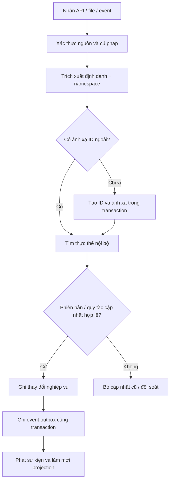
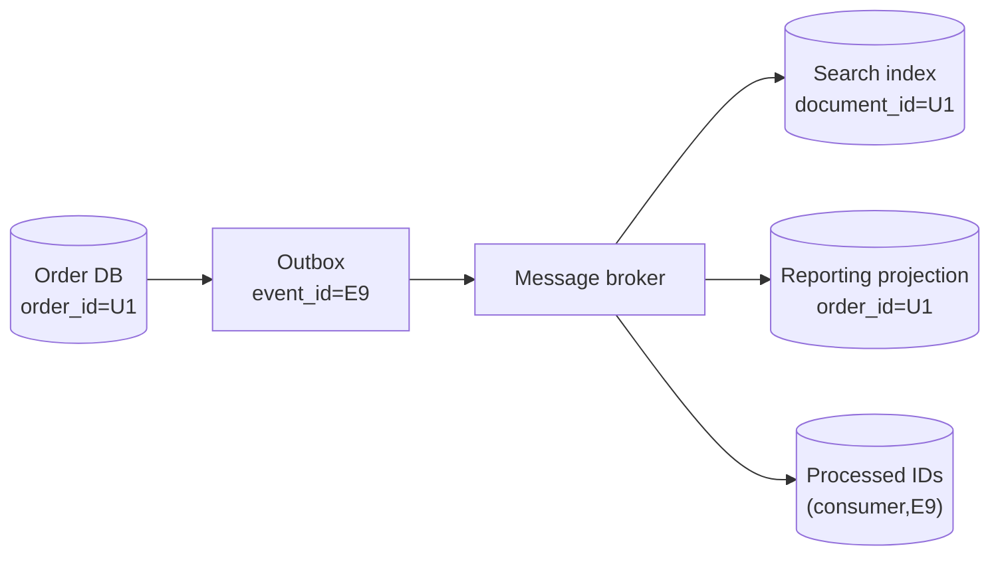

# Định danh và nhận diện một bản ghi qua nhiều lần xử lý

Một bản ghi có thể được đọc, ghi, nhập lại, truyền qua nhiều dịch vụ, gửi lại sau lỗi mạng và tái tạo trong các bảng phục vụ truy vấn. Mỗi lần xử lý có thể tạo đối tượng Java mới hoặc nhận một thông điệp mới, nhưng nghiệp vụ vẫn cần biết **đó có phải cùng một thực thể đã tồn tại hay không**. Nếu nhận diện sai, hệ thống dễ tạo khách hàng trùng, ghi thanh toán hai lần, cập nhật nhầm đơn hàng hoặc bỏ qua sự kiện hợp lệ.

Bài học thuộc chương **Vòng đời dữ liệu** của **DATA_PERSISTENCE_FUNDAMENTALS**. Trong phạm vi thiết kế persistence cho Java, mục tiêu là xây dựng định danh ổn định từ lúc tiếp nhận dữ liệu, ghi bền vững, truy vấn và đồng bộ, đến khi lưu trữ, xóa và tiến hóa schema. Việc nhận diện đúng gắn trực tiếp với khóa dữ liệu, ràng buộc duy nhất, giao dịch, kiểm soát đồng thời, xử lý kết nối lỗi, bảo mật và khả năng khôi phục.

## 1. Bài toán: cùng một đơn hàng xuất hiện nhiều lần

Giả sử ứng dụng bán hàng nhận dữ liệu đơn từ một hệ thống đối tác qua API và hàng đợi thông điệp:

- Lần đầu, đối tác gửi đơn `SO-2026-0831`. Ứng dụng tạo bản ghi nội bộ với `order_id` là một UUID.
- Mạng ngắt sau khi ứng dụng commit nhưng trước khi đối tác nhận được HTTP response. Đối tác gửi lại request.
- Queue giao lại cùng một thông điệp vì consumer đã xử lý xong nhưng chưa xác nhận (*ack*).
- Sau đó đối tác gửi **thông điệp khác** thông báo đơn này đã giao hàng.
- Hệ thống báo cáo dựng một dòng dữ liệu tổng hợp để hiển thị cho nhân viên.

Các lần trên có thể mang cùng mã đơn của đối tác nhưng không giống nhau về ý nghĩa. Hai request đầu có thể là **cùng một ý định tạo đơn**; hai lần queue giao có thể là **cùng một thông điệp**; sự kiện giao hàng là **thay đổi mới của cùng một đơn**; bản báo cáo là **hình chiếu của đơn**, không phải một đơn mới.

Nếu chỉ so sánh nội dung JSON hoặc chỉ đếm số lần xuất hiện của mã đơn, ta không thể phân biệt chính xác các trường hợp này.

> **Nguyên tắc:** Trước khi hỏi “hai bản ghi có giống nhau không?”, phải xác định **cùng cái gì**: cùng thực thể, cùng yêu cầu nghiệp vụ, cùng thông điệp, cùng phiên bản trạng thái hay cùng nội dung.

## 2. Các lớp định danh và ý nghĩa của từng lớp

| Loại | Trả lời câu hỏi | Ví dụ | Cách sử dụng |
| --- | --- | --- | --- |
| **Định danh thực thể nội bộ** (*entity ID*) | Đây có phải cùng một đơn hàng trong hệ thống của ta? | `order_id = 8a7e...` | Khóa chính và liên kết giữa các bảng nghiệp vụ. |
| **Khóa nghiệp vụ** (*business key*) | Nghiệp vụ nhận biết bản ghi bằng giá trị nào? | Mã đơn do hệ thống phát hành | Tra cứu/đối soát; có thể đồng thời là khóa tự nhiên nếu thật sự ổn định. |
| **Khóa hệ thống ngoài** (*external key*) | Bản ghi của đối tác nào tương ứng với thực thể nội bộ nào? | `(partner_A, SO-2026-0831)` | Ánh xạ qua ranh giới hệ thống. |
| **Khóa idempotency của yêu cầu** | Có phải client đang thử lại cùng một thao tác? | `(tenant, client, request-key)` | Ngăn lặp lại tác dụng của lệnh khi client retry. |
| **ID thông điệp/sự kiện** | Đây có phải cùng một đơn vị thông điệp được giao lại? | `event_id = evt-907` | Ngăn xử lý trùng một thông điệp trong phạm vi consumer. |
| **Correlation ID / trace ID** | Những bước kỹ thuật nào thuộc cùng luồng xử lý? | `trace_id = 39fe...` | Theo dõi log và truy vết; không quyết định có tạo bản ghi mới hay không. |
| **Phiên bản hoặc sequence** | Trạng thái này mới hơn trạng thái nào? | `source_version = 7` | Chống cập nhật ngược khi sự kiện đến sai thứ tự; hỗ trợ optimistic locking. |
| **Fingerprint / hash nội dung** | Hai payload có cùng nội dung theo quy tắc chuẩn hóa không? | SHA-256 của payload chuẩn hóa | Phát hiện nội dung trùng hoặc thay đổi; không chứng minh cùng thực thể. |

Các ID này có thể tồn tại đồng thời trên một luồng xử lý. **Không nên tái sử dụng một trường cho mọi nhiệm vụ.** Chẳng hạn `order_id` của thực thể không thể dùng để bỏ qua mọi sự kiện có cùng `order_id`: một đơn phải được phép nhận lần lượt sự kiện `CREATED`, `PAID`, `SHIPPED` và `DELIVERED`.

### Định danh khác với bằng nhau về giá trị

Hai bản ghi có cùng tên và địa chỉ có thể thuộc về hai khách hàng khác nhau. Một khách hàng đổi tên hay địa chỉ vẫn là cùng khách hàng. Tương tự, hai order line có cùng SKU và số lượng không nhất thiết là cùng dòng hàng.

Có ba quan hệ phải phân biệt:

1. **Cùng thực thể theo thời gian:** một ID ổn định nối các trạng thái của cùng đối tượng nghiệp vụ.
2. **Cùng trạng thái/giá trị:** các thuộc tính hiện giống nhau; điều này không khẳng định identity.
3. **Cùng sự kiện hoặc yêu cầu đã xử lý:** cùng đơn vị công việc kỹ thuật hay cùng ý định nghiệp vụ đã được xác nhận.

Đối với Java, `equals()` trên DTO hoặc `record` thường so sánh giá trị các thành phần. Điều đó hữu ích khi đối chiếu dữ liệu, nhưng không thể thay thế một quy tắc định danh nghiệp vụ đã thiết kế.

## 3. Thiết kế khóa ổn định cho dữ liệu nghiệp vụ

### 3.1. Khóa tự nhiên và khóa thay thế

**Khóa tự nhiên** (*natural key*) xuất phát từ thuộc tính có ý nghĩa trong miền nghiệp vụ, chẳng hạn một mã được cấp theo quy tắc chắc chắn không trùng. **Khóa thay thế** (*surrogate key*) là định danh kỹ thuật như UUID hoặc số nguyên sinh từ sequence.

| Tiêu chí | Khóa tự nhiên | Khóa thay thế |
| --- | --- | --- |
| Ý nghĩa | Có ý nghĩa đối với nghiệp vụ hoặc hệ thống ngoài. | Chủ yếu để nhận diện ổn định trong persistence. |
| Rủi ro thay đổi | Có thể đổi do quy tắc nghiệp vụ, đối tác hoặc nhập sai. | Nên bất biến trong vòng đời thực thể. |
| Tính duy nhất | Phải xác định chính xác phạm vi và cơ quan cấp khóa. | DB bảo đảm duy nhất bằng ràng buộc khóa chính. |
| Khả năng liên kết | Có thể hữu ích khi đối soát với hệ thống cấp mã. | Phù hợp làm khóa ngoại ổn định giữa các bảng. |
| Điểm cần chú ý | Không chọn email/số điện thoại làm khóa chính nếu được phép thay đổi hoặc tái sử dụng. | UUID không tự tạo ra chính sách bảo mật hay bảo đảm thao tác idempotent. |

Phương án phổ biến là sử dụng **khóa chính nội bộ bất biến** và ràng buộc `UNIQUE` riêng cho khóa nghiệp vụ hoặc khóa từ hệ thống ngoài. Nhờ vậy, đổi nhãn hiển thị hoặc điều chỉnh mã ngoài không buộc phải sửa hàng loạt khóa ngoại.

Không có loại khóa tối ưu cho mọi hệ thống. `BIGINT` dùng sequence thường gọn và có tính cục bộ chỉ mục thuận lợi trong một database; UUID phù hợp khi nhiều nút cần cấp ID độc lập. UUID ngẫu nhiên không có thứ tự thời gian và có chi phí lưu trữ/chỉ mục khác số nguyên; nếu cần ID có tính sắp xếp, hãy xét tính khả dụng, chuẩn phát sinh và hệ quả khi lộ thông tin thời gian. Dù chọn cách nào, **ràng buộc uniqueness ở database vẫn cần thiết**.

### 3.2. Phạm vi duy nhất là một phần của định danh

Cùng chuỗi `SO-2026-0831` có thể xuất hiện ở hai đối tác hoặc hai tenant khác nhau. Một external key hợp lệ phải bao gồm **namespace** của nơi cấp nó:

```text
Sai ngữ nghĩa:  "SO-2026-0831"

Đúng trong ví dụ:
  tenant_id       = Tenant-17
  source_system   = Partner-A
  external_order  = SO-2026-0831

Khóa ánh xạ = (tenant_id, source_system, external_order)
```

Nếu hệ thống ngoài chỉ bảo đảm duy nhất theo cửa hàng hoặc tài khoản, phải bổ sung cả phạm vi ấy. Không được tự mặc định mọi đối tác đều cấp mã duy nhất toàn cầu.

**Chuẩn hóa có chủ đích:** cắt khoảng trắng, viết hoa/thường, bỏ dấu phân cách hoặc bỏ số 0 đầu có thể khiến hai mã vốn khác nhau thành một. Chỉ áp dụng chuẩn hóa khi hợp đồng dữ liệu của nơi cấp mã nói các biến thể đó tương đương. Nên giữ giá trị thô để đối soát khi cần và lưu phiên bản quy tắc chuẩn hóa nếu quy tắc có thể thay đổi.

### 3.3. Schema ví dụ: khóa nội bộ và bảng ánh xạ

Ví dụ PostgreSQL dưới đây mô tả một đơn hàng có ID nội bộ và có thể được biết đến bởi nhiều mã từ hệ thống ngoài:

```sql
CREATE TABLE orders (
    tenant_id       UUID NOT NULL,
    order_id        UUID NOT NULL,
    created_at      TIMESTAMPTZ NOT NULL DEFAULT now(),
    status          VARCHAR(32) NOT NULL,
    row_version     BIGINT NOT NULL DEFAULT 0,
    PRIMARY KEY (tenant_id, order_id)
);

CREATE TABLE external_order_identity (
    tenant_id         UUID NOT NULL,
    source_system     VARCHAR(64) NOT NULL,
    external_order_id VARCHAR(160) NOT NULL,
    order_id          UUID NOT NULL,
    first_seen_at     TIMESTAMPTZ NOT NULL DEFAULT now(),
    PRIMARY KEY (tenant_id, source_system, external_order_id),
    FOREIGN KEY (tenant_id, order_id)
        REFERENCES orders (tenant_id, order_id)
);

CREATE INDEX ix_external_order_identity_target
    ON external_order_identity (tenant_id, order_id);
```

Các bất biến quan trọng:

- Một bộ `(tenant_id, source_system, external_order_id)` chỉ được ánh xạ tới **một** đơn nội bộ tại cùng thời điểm.
- Một đơn nội bộ có thể có nhiều mã ngoài khi có nhu cầu tích hợp nhiều nguồn. Nếu miền nghiệp vụ cấm điều này, bổ sung ràng buộc tương ứng.
- `tenant_id` có mặt trong khóa ngoại để tránh ánh xạ đơn hàng từ tenant này sang tenant khác.
- `row_version` là phiên bản khi **ứng dụng nội bộ** ghi thay đổi; không tự đồng nhất với phiên bản mà đối tác phát ra.
- Chỉ mục phụ phục vụ truy vấn ngược từ đơn nội bộ sang mã ngoài. Số lượng chỉ mục cần cân đối với tải ghi và mẫu truy vấn thực tế.

Nếu chỉ lưu `external_order_id` mà không lưu `source_system`, hệ thống sẽ phải sửa dữ liệu khi tích hợp thêm đối tác có cùng quy tắc mã. Nếu đặt mã ngoài làm khóa chính xuyên suốt, việc đối tác sửa mã sẽ khó quản lý hơn.

### 3.4. Xử lý thực thể chưa có ID và JPA

Trong Java có thể tạo một kiểu định danh rõ nghĩa:

```java
import java.util.Objects;
import java.util.UUID;

public record OrderId(UUID value) {
    public OrderId {
        Objects.requireNonNull(value, "value");
    }
}

public record ExternalOrderKey(
        UUID tenantId,
        String sourceSystem,
        String externalOrderId
) {
    public ExternalOrderKey {
        Objects.requireNonNull(tenantId);
        Objects.requireNonNull(sourceSystem);
        Objects.requireNonNull(externalOrderId);
        if (sourceSystem.isBlank() || externalOrderId.isBlank()) {
            throw new IllegalArgumentException("External key is required");
        }
    }
}
```

`record` tự cung cấp so sánh giá trị cho các thành phần, nên hai `OrderId` bọc cùng UUID là bằng nhau. Nhưng **thực thể JPA** có vòng đời riêng: đối tượng mới chưa có ID, đối tượng managed, detached và đối tượng nạp từ phiên khác. Nếu cài đặt `equals()/hashCode()` theo ID sinh sau khi persist, cần tránh thay đổi hash code khi đối tượng đang nằm trong `HashSet`. Không đưa các trường nghiệp vụ thường xuyên biến đổi vào equality của entity chỉ để “nhận diện bản ghi”.

Nguyên tắc triển khai là chọn chiến lược cấp ID ổn định, thống nhất cách định nghĩa equality của entity với cơ chế ORM, và tách việc **so sánh nội dung** khỏi việc **nhận diện cùng bản ghi**.

## 4. Nhận diện qua các lần nhập, đồng bộ và cập nhật

Một luồng xử lý có thể đi qua nhiều lớp:



**Bước một — xác thực nguồn:** trường `external_order_id` chỉ có ý nghĩa sau khi hệ thống đã xác định được đối tác/tài khoản gửi và đã kiểm tra quyền. Không tin `tenant_id` lấy trực tiếp từ payload nếu người gửi có thể giả mạo.

**Bước hai — phân giải identity:** tìm theo khóa ngoài có namespace; nếu chưa thấy, tạo ID nội bộ và ghi ánh xạ. Hai worker chạy cùng lúc có thể cùng thấy “chưa có”: kiểm tra bằng `SELECT` rồi `INSERT` **không đủ** ngăn trùng.

**Bước ba — ràng buộc tại database:** khóa chính/`UNIQUE` là trọng tài cuối. Khi gặp xung đột do hai giao dịch tạo cùng key, một giao dịch có thể phải rollback rồi đọc lại mapping đã commit. Không biến mọi lỗi constraint thành “đã xử lý thành công”: cần phân biệt lỗi trùng khóa kỳ vọng với vi phạm dữ liệu khác.

**Bước bốn — kiểm tra phiên bản:** nếu đối tác gửi trạng thái version 4 sau khi version 5 đã được áp dụng, không được cập nhật ngược. Nếu đối tác không cung cấp version đáng tin cậy, cần quy tắc chuyển trạng thái, thứ tự từ nguồn hoặc chủ động đối soát với hệ thống nguồn.

**Bước năm — cập nhật hình chiếu:** bảng đọc, cache và chỉ mục tìm kiếm có thể dùng lại `order_id` của nguồn như khóa định danh. Điều này giúp cập nhật một tài liệu đang tồn tại thay vì thêm bản ghi báo cáo mới cho mỗi lần phát sự kiện.

### Cùng một bản ghi qua nhiều batch

Với import hàng ngày, không nên dùng số dòng trong tệp, thứ tự bản ghi hoặc số thứ tự batch làm ID thực thể. Ngày hôm sau dữ liệu có thể được sắp xếp khác nhưng cùng khách hàng hoặc đơn hàng vẫn phải được cập nhật đúng.

Ví dụ:

| Batch | Dòng tệp | Mã đối tác | Trạng thái | Kết quả |
| --- | ---: | --- | --- | --- |
| Ngày 1 | 10 | `Partner-A / SO-0831` | CREATED | Tạo đơn `order_id = U1`. |
| Ngày 2 | 47 | `Partner-A / SO-0831` | PAID | Tìm U1 và cập nhật hợp lệ. |
| Ngày 3 | 4 | `Partner-A / SO-0831` | PAID | Nhận diện U1; bỏ cập nhật trùng hoặc không đổi. |
| Ngày 3 | 5 | `Partner-B / SO-0831` | CREATED | Tạo/nhận diện đơn khác theo namespace đối tác. |

Nếu dữ liệu nguồn **không có khóa đủ tin cậy**, bài toán trở thành *record linkage* hoặc đối soát xác suất: kết hợp thuộc tính, kiểm tra xung đột và có thể cần con người xác nhận. Không nên tự động gộp hai khách hàng chỉ vì cùng tên/số điện thoại; một quyết định gộp sai có thể làm lộ dữ liệu và phá hỏng lịch sử nghiệp vụ.

## 5. Phân biệt deduplication và idempotency

**Deduplication** là phát hiện hoặc loại bỏ các đầu vào/đơn vị xử lý trùng theo một tiêu chí. **Idempotency** là tính chất thao tác được gọi lặp lại mà không tạo thêm tác dụng nghiệp vụ ngoài ý định ban đầu. Có thể dùng dedup để triển khai idempotency, nhưng hai khái niệm không đồng nghĩa.

| Trường hợp | Dùng khóa nào? | Hành vi mong muốn |
| --- | --- | --- |
| HTTP client retry tạo đơn do timeout | `(tenant, actor, idempotency_key)` kết hợp fingerprint request | Trả lại kết quả thao tác đã ghi nhận, không tạo đơn thứ hai. |
| Broker giao lại đúng event | `(consumer, message_id)` | Không áp dụng lần thứ hai tác dụng của cùng event. |
| Đối tác gửi event `PAID` rồi `SHIPPED` cho cùng đơn | `event_id` khác nhau, `order_id` giống nhau | Phải xử lý **cả hai** event hợp lệ. |
| Nhập lại cùng entity với dữ liệu mới | Khóa thực thể bên ngoài và version | Cập nhật entity tương ứng, không tạo entity khác. |
| Người dùng bấm “mua lần nữa” một cách có chủ đích | Idempotency key **mới** | Được phép tạo giao dịch nghiệp vụ mới. |

### 5.1. Idempotency cho lệnh tạo đơn qua HTTP

Một API tạo đơn có thể yêu cầu client gửi `Idempotency-Key`. Server gắn khóa với tenant, danh tính client hoặc phạm vi yêu cầu đã quy định, lưu **fingerprint của nội dung lệnh** và trạng thái/kết quả xử lý. Khi cùng khóa được dùng lại:

- **Cùng fingerprint và hoàn tất:** trả lại kết quả đã ghi nhận theo hợp đồng API.
- **Cùng khóa nhưng nội dung khác:** trả lỗi xung đột, không lặng lẽ thực hiện yêu cầu khác.
- **Yêu cầu đầu vẫn đang xử lý:** đồng bộ chờ khóa hoặc trả trạng thái “đang xử lý” để client retry sau, theo giao thức API.
- **Khóa đã hết thời gian lưu:** hành vi phải được nêu rõ trong hợp đồng, vì sau khi xóa bản ghi chống trùng, cùng khóa có thể không còn được nhận diện.

Fingerprint nên tính trên **nội dung đã chuẩn hóa theo hợp đồng**, không tùy tiện lấy hash của JSON thô: thay đổi thứ tự trường, khoảng trắng hoặc biểu diễn số có thể làm khác hash dù ý định tương đương. Đồng thời, không được bỏ qua trường nghiệp vụ ảnh hưởng kết quả.

Ví dụ bảng PostgreSQL lưu định danh của yêu cầu:

```sql
CREATE TABLE order_requests (
    tenant_id         UUID NOT NULL,
    client_id         UUID NOT NULL,
    idempotency_key   VARCHAR(128) NOT NULL,
    request_hash      BYTEA NOT NULL,
    state             VARCHAR(20) NOT NULL
        CHECK (state IN ('PROCESSING', 'COMPLETED', 'FAILED')),
    order_id          UUID,
    response_code     INTEGER,
    created_at        TIMESTAMPTZ NOT NULL DEFAULT now(),
    expires_at        TIMESTAMPTZ NOT NULL,
    PRIMARY KEY (tenant_id, client_id, idempotency_key),
    FOREIGN KEY (tenant_id, order_id)
        REFERENCES orders (tenant_id, order_id)
);
```

Bảng này chỉ minh họa lược đồ; vận hành đúng cần một **giao thức giao dịch**. Ví dụ, server có thể giữ lock cho cùng key trong transaction rồi lưu đơn và kết quả đã hoàn tất cùng một lần commit. Nếu muốn lưu `PROCESSING` qua nhiều transaction hoặc khi có lời gọi thanh toán bên ngoài, cần cơ chế lease/timeout, recovery và chống hai worker đồng thời tiếp tục cùng công việc.

Không nên giữ transaction DB mở trong suốt lời gọi HTTP tới cổng thanh toán. Đối với hệ thống ngoài, dùng khóa idempotency mà nhà cung cấp hỗ trợ, ghi trạng thái bền vững, kết hợp outbox/saga và đối soát khi kết quả mạng không rõ. Idempotency key cũng cần retention phù hợp với khoảng retry thực tế.

### 5.2. Xử lý một event giao lại trong consumer

Thông điệp có ít nhất hai thông tin khác nhau: `message_id` nhận diện **lần phát sự kiện logic** và `entity_id` nhận diện thực thể bị thay đổi.

Với consumer xử lý cùng một database, có thể dùng bảng sau:

```sql
CREATE TABLE processed_messages (
    consumer_name VARCHAR(100) NOT NULL,
    message_id    VARCHAR(160) NOT NULL,
    processed_at  TIMESTAMPTZ NOT NULL DEFAULT now(),
    PRIMARY KEY (consumer_name, message_id)
);
```

Sau đó, trong **cùng một transaction** với thay đổi nghiệp vụ:

```sql
-- PostgreSQL: kết quả RETURNING có một dòng nếu claim thành công.
INSERT INTO processed_messages (consumer_name, message_id)
VALUES ('order-projection-v1', :message_id)
ON CONFLICT DO NOTHING
RETURNING message_id;

-- Nếu không nhận dòng nào: message này đã được claim/commit ở lần trước.
-- Nếu nhận một dòng: thực hiện thay đổi DB và commit CÙNG transaction.
-- Nếu bất kỳ bước nào lỗi: rollback cả claim và thay đổi.
```

Ở tình huống hai worker xử lý đồng thời, ràng buộc khóa chính buộc chúng cạnh tranh trên một `(consumer_name, message_id)`; transaction thua không được nhân đôi tác dụng sau khi transaction thắng commit. Khi consumer xử lý nhiều database hoặc gọi hệ thống bên ngoài, một bảng `processed_messages` riêng lẻ không bảo đảm atomicity trên tất cả tài nguyên. Khi đó phải phối hợp idempotency ở đích, outbox hoặc giao thức bù trừ.

**Cảnh báo:** không được đánh dấu event là đã xử lý rồi commit, sau đó mới thực hiện thay đổi cần thiết trong transaction khác mà không có cơ chế khôi phục. Nếu tiến trình chết giữa hai bước, sự kiện sẽ bị bỏ qua mãi mãi dù tác dụng nghiệp vụ chưa xảy ra.

### 5.3. Chính sách chống trùng theo nguồn

Trước khi chọn khóa dedup, làm rõ broker hoặc nhà cung cấp bảo đảm điều gì:

- Một lần giao lại có giữ nguyên `message_id` không?
- Cùng một sự kiện nghiệp vụ khi phát lại thủ công có dùng ID mới không?
- Có sequence ổn định cho mỗi aggregate hay chỉ có timestamp?
- Có trường ID nào do người gửi kiểm soát tùy ý và có thể bị giả mạo không?
- ID có duy nhất toàn cục hay chỉ duy nhất theo topic, partition, tenant hoặc producer?

Khi chỉ có `event_id` duy nhất trong một topic, khóa xử lý có thể cần `(consumer, topic, event_id)`. Khi nơi phát có thể tạo ID mới cho cùng một ý định nghiệp vụ, cần thêm ràng buộc nghiệp vụ hoặc phiên bản nguồn để đạt hiệu quả idempotent thực sự.

## 6. Phiên bản, đồng thời và thứ tự cập nhật

**Biết “cùng bản ghi” chưa đủ để biết “có nên ghi đè hay không”.** Hai luồng có thể cùng cập nhật một đơn. Một thông điệp cũ có thể đến muộn hơn thông điệp mới. Cần kiểm soát cả identity lẫn ordering.

### 6.1. Optimistic locking cho cập nhật nội bộ

Giả sử đơn có `row_version = 7`. Hai request cùng đọc version 7, sau đó đều muốn sửa. Để tránh request thứ hai âm thầm ghi đè, dùng cập nhật có điều kiện:

```sql
UPDATE orders
SET status = :new_status,
    row_version = row_version + 1
WHERE tenant_id = :tenant_id
  AND order_id = :order_id
  AND row_version = :expected_version;
```

Nếu số dòng cập nhật bằng 0, đó có thể là xung đột phiên bản, bản ghi đã bị xóa hoặc không thuộc tenant. Ứng dụng phải phân biệt các trường hợp và quyết định reload/retry/báo xung đột theo nghiệp vụ, thay vì luôn retry vô hạn.

Với JPA, `@Version` hỗ trợ optimistic locking khi entity được quản lý qua ORM. Việc dùng native SQL hoặc bulk update có thể bỏ qua cơ chế cập nhật version mặc định; cần quy định rõ cách mọi đường ghi tuân thủ cùng bất biến.

### 6.2. Phiên bản nguồn khác phiên bản DB

Ví dụ đối tác gửi:

```text
order SO-0831, source_version=5, status=SHIPPED
order SO-0831, source_version=4, status=PAID    <- đến muộn
```

Nếu đã áp dụng version 5, không nên để version 4 đưa trạng thái quay lại `PAID`. Lưu `last_applied_source_version` **theo đúng namespace và thực thể nguồn**, rồi chỉ áp dụng sự kiện mới hơn theo hợp đồng của nguồn.

Timestamp không luôn đủ để xác định thứ tự. Đồng hồ ở các máy có thể lệch, cùng thời điểm có nhiều thao tác, và thời gian gửi khác thời gian thực sự phát sinh sự kiện. Nếu không có version tăng đơn điệu đáng tin, hãy dùng state machine với điều kiện hợp lệ, thứ tự do nguồn xác nhận hoặc cơ chế fetch lại trạng thái hiện tại.

### 6.3. Khóa đối với cập nhật có ảnh hưởng tiền và kho

Định danh chính xác chỉ giúp chọn đúng hàng cần sửa. Nó **không tự bảo đảm tính đúng đắn của giao dịch**:

- Trừ kho cần điều kiện đủ tồn và kiểm soát cạnh tranh giữa các đơn.
- Một lần thanh toán cần ràng buộc nghiệp vụ, ID giao dịch của provider, và cơ chế đối soát.
- Hai event khác nhau cho cùng đơn không mặc nhiên nên cùng được chấp nhận: quy tắc chuyển trạng thái phải quyết định.

Áp dụng mức cô lập, row lock, optimistic locking hoặc ràng buộc uniqueness/conditional update theo bất biến cần bảo vệ. Không tăng isolation một cách máy móc; hãy kiểm chứng bằng trường hợp cạnh tranh thực tế.

## 7. Định danh qua nhiều dịch vụ và dữ liệu dẫn xuất

Trong kiến trúc nhiều dịch vụ, mỗi bounded context có thể có ID nội bộ riêng, ví dụ khách hàng trong CRM và tài khoản trong billing. Không bắt buộc mọi hệ thống dùng chung một khóa chính. Nhưng mỗi ánh xạ giữa hai identity phải có **chủ sở hữu, nguồn cấp và quy tắc nhất quán**.



Đối với projection một dòng cho mỗi đơn, dùng `order_id` làm `document_id` hoặc khóa upsert giúp nhận event nhiều lần mà không nhân bản tài liệu. Tuy nhiên, một báo cáo **nhiều dòng cho mỗi đơn** cần khóa cấp dòng đúng, ví dụ `(order_id, line_no)`, và bảng tổng hợp theo ngày có thể cần `(report_date, currency, dimension)`. Khóa projection phải phản ánh **đơn vị dữ liệu mà projection biểu diễn**, không nhất thiết luôn bằng khóa của aggregate nguồn.

Nếu bảng báo cáo dùng tên khách hàng hoặc email làm key, việc đổi tên/email có thể vô tình tạo dòng mới và để lại dòng cũ. Tốt hơn là dùng ID ổn định của nguồn, hoặc bảng mapping có quản lý lịch sử khi phải kết hợp nhiều nguồn.

### Truy vết không thay thế nhận diện nghiệp vụ

Một `trace_id` nối các span khi request đi qua gateway, service và database. Nó có thể thay đổi khi consumer retry hoặc tác vụ chạy nền; cũng có thể có nhiều order trong cùng một trace. Vì thế hãy log cả `trace_id` lẫn `entity_id`, `message_id`, `idempotency_key` (nếu được phép), với mức độ nhạy cảm và chính sách lưu log phù hợp.

Không đưa raw token, bí mật hoặc toàn bộ thông tin cá nhân vào log chỉ để thuận tiện tra cứu. Khi cần log định danh nhạy cảm, áp dụng che/mã hóa hoặc mã hóa băm có khóa tùy mô hình đe dọa.

## 8. Vòng đời của một định danh

Định danh thường phải sống lâu hơn một request và đôi khi lâu hơn cả bản ghi đang hoạt động:

| Giai đoạn | Vấn đề cần giải quyết |
| --- | --- |
| **Tạo mới** | Ai được cấp ID? ID phải duy nhất trong phạm vi nào? Có cần ID trước khi persist không? |
| **Ghi và liên kết** | Khóa chính, khóa ngoại, ánh xạ hệ thống ngoài, transaction và constraint. |
| **Đọc/nhập lại** | Phân giải về cùng thực thể; không lấy vị trí dòng, bộ nhớ hoặc hash toàn bộ nội dung làm identity. |
| **Cập nhật** | Bảo toàn ID; kiểm soát version, trạng thái và concurrent writes. |
| **Đổi mã ngoài** | Duy trì lịch sử mapping hoặc alias có hiệu lực theo thời gian; không đánh mất tham chiếu cũ nếu còn dữ liệu gửi trễ. |
| **Gộp/tách thực thể** | Có quyết định nghiệp vụ được audit; chuyển tham chiếu đúng và xác định ID nào tiếp tục còn hiệu lực. |
| **Xóa, archive, phục hồi** | Quy định có được tái sử dụng ID không; xử lý sự kiện đến trễ và tham chiếu tới bản ghi đã xóa. |

### 8.1. Khi hai bản ghi cần gộp

Giả sử hệ thống có `customer_id=A` và `customer_id=B` nhưng sau đối soát xác nhận chúng thuộc cùng khách hàng. Gộp không đơn thuần là xóa một hàng:

1. Quyết định ID chính sau gộp và lưu biên bản đối soát.
2. Kiểm tra các khóa ngoại, đơn hàng, giao dịch, audit, quyền truy cập và hệ thống downstream.
3. Chuyển liên kết khi hợp lệ, hoặc giữ các ID lịch sử với mapping alias.
4. Phát sự kiện thay đổi mapping và cập nhật projection/index.
5. Ngăn dữ liệu import cũ vô tình tạo lại hai thực thể như trước.

Một số miền dữ liệu không cho phép gộp lịch sử vì ràng buộc pháp lý hoặc kế toán; khi ấy cần quan hệ “có liên quan” hoặc hồ sơ đối chiếu thay cho cập nhật ID trực tiếp.

### 8.2. Xóa mềm, tombstone và chống tái tạo nhầm

Khi xóa bản ghi, thông điệp cũ có thể tiếp tục đến từ queue hoặc hệ thống ngoài. Nếu ứng dụng đơn giản “không thấy record thì INSERT”, dữ liệu vừa xóa có thể được tạo lại.

Có thể cần **tombstone** lưu định danh và trạng thái đã xóa, hoặc danh sách sự kiện/phiên bản nguồn đã xử lý trong thời hạn phù hợp. Thiết kế chính sách này phải cân bằng tính nhất quán với quyền riêng tư: tombstone có thể chỉ giữ hash/khóa kỹ thuật tối thiểu và thời hạn xóa theo quy định. Không mặc định giữ mọi định danh cá nhân vô hạn.

Cũng phải xem xét ID có được tái sử dụng bởi hệ thống nguồn không. Một mã đơn cũ nếu đối tác được phép cấp lại sau nhiều năm có thể không còn xác định duy nhất lịch sử. Khi ấy cần thêm phạm vi, ngày phát hành, phiên bản hoặc cơ chế nhận diện khác đã được thống nhất.

### 8.3. Di chuyển schema và thay đổi định danh

Khi chuyển từ khóa tự nhiên sang khóa thay thế, cần thiết kế lộ trình để không làm gãy liên kết:

1. Thêm khóa nội bộ mới, cấp ID ổn định cho bản ghi hiện có và tạo ràng buộc uniqueness.
2. Tạo ánh xạ từ khóa cũ sang ID mới, kiểm tra các trường hợp trùng/mâu thuẫn.
3. Bổ sung tham chiếu mới tại nơi đọc/ghi và chuyển dần dữ liệu liên quan.
4. Duy trì hai đường tra cứu trong giai đoạn tương thích, sau đó ngắt đường cũ có kiểm soát.
5. Kiểm tra backup/restore, foreign key, consumer và dữ liệu đến trễ trước khi bỏ ánh xạ cũ.

Đây là một phần của **tiến hóa schema**: thay đổi khóa tác động đến dữ liệu lịch sử, dịch vụ tích hợp, index, cache và audit, không chỉ đến cột trong một bảng.

## 9. Hiệu năng, bảo mật và khả năng khôi phục

### Chỉ mục phải đi theo truy vấn nhận diện

Các truy vấn quan trọng thường là:

- `SELECT ... WHERE tenant_id = ? AND order_id = ?` để lấy một thực thể.
- `SELECT ... WHERE tenant_id = ? AND source_system = ? AND external_order_id = ?` để giải mã từ nguồn ngoài.
- `SELECT ... WHERE consumer_name = ? AND message_id = ?` để kiểm tra xử lý trùng.
- Truy vấn lịch sử mapping theo ID nội bộ hoặc thời điểm hiệu lực.

Khóa chính/unique constraint thường tạo chỉ mục tương ứng ở PostgreSQL; tránh tạo lại chỉ mục giống hệt. Kiểm tra kế hoạch thực thi trên khối lượng dữ liệu và mẫu truy vấn thực tế. Một khóa composite quá rộng làm tăng chi phí ghi/chỉ mục nhưng có thể cần thiết để thể hiện phạm vi duy nhất chính xác.

### Định danh không phải là quyền truy cập

UUID khó đoán hơn ID tuần tự không có nghĩa là ai có UUID đều được xem bản ghi. Mọi truy vấn vẫn phải xác thực actor, tenant và quyền trên tài nguyên. Truy vấn bằng `order_id` mà bỏ điều kiện tenant có thể dẫn đến rò rỉ dữ liệu giữa khách hàng tổ chức.

Các ID được đưa vào URL, log và event có thể bị lộ hoặc chứa thông tin nhạy cảm; tránh nhúng dữ liệu cá nhân trực tiếp vào ID nếu không cần thiết.

### Khôi phục phải khôi phục được quan hệ identity

Một hệ thống backup bảng `orders` nhưng mất bảng ánh xạ `external_order_identity` có thể nhận diện nhầm các bản tin từ đối tác khi khởi động lại. Tương tự, mất trạng thái idempotency trong thời gian retry có thể làm phát sinh thao tác trùng. Vì thế phải phân loại các bảng mapping, processed IDs và idempotency store theo **yêu cầu phục hồi thực tế**, không chỉ theo tên bảng “hỗ trợ”.

Kiểm tra RPO/RTO bao gồm cả khóa ánh xạ, trạng thái xử lý, outbox và các bảng cần thiết để replay an toàn. Khi phục hồi từ snapshot cũ, có thể cần reconcile với hệ thống ngoài để xử lý khoảng thời gian chưa được backup.

## 10. Những lỗi thiết kế thường gặp

**Dùng email hoặc số điện thoại làm ID khách hàng.** Hai giá trị này có thể đổi, được tái sử dụng hoặc thiếu/không xác thực. Nếu chỉ có chúng, cần quy trình đối soát và xác nhận identity; không tự coi là định danh bất biến.

**Dùng hash của cả bản ghi để nhận diện thực thể.** Khi địa chỉ hoặc trạng thái thay đổi, hash thay đổi dù thực thể vẫn như cũ. Hash thích hợp để phát hiện nội dung biến đổi, không mặc nhiên là khóa entity.

**Kiểm tra “không tồn tại” rồi insert mà không có UNIQUE.** Hai request đồng thời đều vượt qua bước kiểm tra và tạo hai hàng. Database constraint cùng retry có kiểm soát mới bảo vệ tính duy nhất.

**Dùng một `order_id` để bỏ qua tất cả event về đơn đó.** Event `PAID` và `SHIPPED` khác nhau; bỏ event thứ hai làm dữ liệu mất tiến triển.

**Đánh dấu thông điệp hoàn tất trước tác dụng nghiệp vụ.** Crash giữa hai bước tạo thất thoát xử lý. Claim ID và thao tác DB cần cùng transaction hoặc giao thức recovery phù hợp.

**Chỉ dựa vào timestamp để quyết định sự kiện mới nhất.** Thứ tự sự kiện không được bảo đảm chỉ bằng thời gian hệ thống. Cần version từ nguồn hoặc quy tắc trạng thái.

**Coi tất cả ID ngoài là duy nhất toàn cục.** Hai đối tác có thể cấp cùng mã; phải kèm namespace và tenant phù hợp.

**Thay đổi primary key khi tên hoặc mã ngoài thay đổi.** Điều này làm đứt liên kết và khiến consumer gặp khó khăn. Duy trì ID nội bộ ổn định và cập nhật mapping có kiểm soát.

**Tưởng UUID bảo đảm an toàn và chống trùng thao tác.** UUID chỉ giải quyết cách gán định danh với xác suất va chạm rất thấp; nó không thay thế authorization, transaction, UNIQUE hay idempotency.

## 11. Tình huống vận dụng: thiết kế luồng nhận đơn từ đối tác

Yêu cầu: hệ thống Java nhận đơn từ ba đối tác, mỗi đối tác có mã đơn riêng; API có thể retry, queue có thể giao lại event và sự kiện cập nhật có thể đến sai thứ tự.

Một thiết kế cần có các thành phần:

| Thành phần | Trách nhiệm |
| --- | --- |
| `orders` | Lưu thực thể nghiệp vụ và trạng thái nội bộ với `order_id` bất biến. |
| `external_order_identity` | Ánh xạ `(tenant, partner, external_order_id)` đến `order_id`. |
| `order_requests` | Ghi nhận ý định gọi API theo idempotency key và kết quả trong thời hạn retry. |
| `processed_messages` | Ngăn cùng consumer áp dụng lại một event đã commit. |
| `source_version` hoặc state machine | Chống event cũ ghi đè trạng thái mới. |
| `outbox_events` | Ghi yêu cầu phát sự kiện trong cùng transaction với thay đổi nguồn. |
| Projection/cache | Tạo dữ liệu phục vụ đọc, có thể cập nhật bằng key ổn định và rebuild. |

**Các bước xử lý lần đầu:** xác thực đối tác; lấy external key và idempotency key; kiểm tra lệnh đã xử lý; tìm hoặc tạo ánh xạ trong transaction có ràng buộc duy nhất; ghi đơn và outbox; commit; trả kết quả có `order_id`.

**Khi retry:** cùng idempotency key và nội dung sẽ nhận lại kết quả tương ứng. Nếu client tạo key mới nhưng external key vẫn là cùng đơn nguồn, ràng buộc mapping chặn tạo hai entity cho một mã nguồn; ứng dụng phải quyết định đây là cập nhật hợp lệ hay xung đột nghiệp vụ.

**Khi nhận event:** dedup theo `(consumer, message_id)`; xác định `order_id`; đối chiếu version/trạng thái; cập nhật một lần trong transaction; làm mới các projection qua outbox. Nếu gặp lỗi tạm thời, retry an toàn thay vì tạo bản ghi mới.

### Câu hỏi tự kiểm tra

1. Vì sao hai JSON khác nhau vẫn có thể mô tả cùng một bản ghi nghiệp vụ?
2. Khi nào nên dùng khóa composite `(tenant, source, external_id)`, và khi nào cần thêm phạm vi khác?
3. Vì sao `message_id` không thể thay thế `order_id` trong hệ thống?
4. Nếu client retry sau timeout nhưng dùng khóa idempotency khác, cơ chế nào vẫn có thể chống tạo trùng một đơn nhập từ đối tác?
5. Tại sao claim thông điệp và thay đổi cơ sở dữ liệu nên nằm trong cùng transaction?
6. Khi sự kiện version 9 đến trước version 8, làm sao bảo vệ trạng thái mới?
7. Khi đổi mã ngoài hoặc gộp hai khách hàng, những bảng, dịch vụ và projection nào cần điều chỉnh?
8. Sau phục hồi database từ backup cũ, làm sao tránh phát sinh đơn trùng từ các bản tin được phát lại?

Để một hệ thống persistence đáng tin cậy, định danh phải thể hiện **bản ghi nào là cùng một thực thể**, còn khóa idempotency, ID thông điệp và phiên bản phải làm rõ **thao tác nào đã xảy ra và thay đổi nào được phép áp dụng**. Khi các lớp này được tách bạch, ràng buộc trong schema và bảo vệ bằng transaction, ứng dụng Java có thể xử lý retry, import lại, đồng bộ nhiều dịch vụ, phục hồi sự cố và tiến hóa dữ liệu mà vẫn giữ được lịch sử nghiệp vụ nhất quán.
