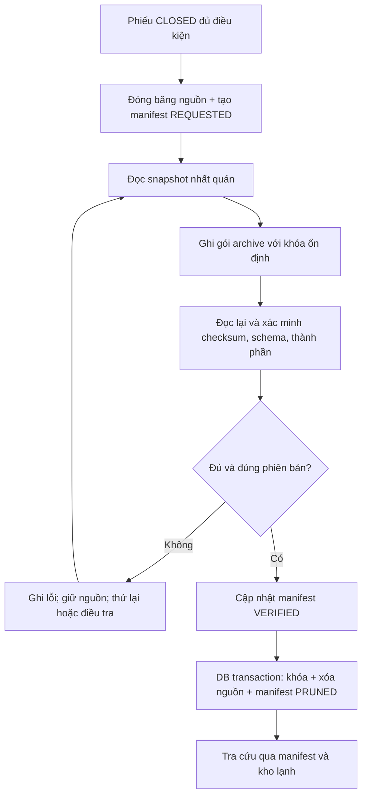

# Xóa vật lý, xóa logic và dữ liệu đã được lưu trữ lạnh

## 1. Ba khái niệm khác nhau trong vòng đời dữ liệu

Khi một bản ghi không còn cần thiết cho công việc hằng ngày, hệ thống phải quyết định **còn giữ bản ghi ở đâu**, **ai còn được nhìn thấy** và **khi nào được loại bỏ hoàn toàn**. Ba thao tác thường được đặt cạnh nhau là xóa vật lý (*hard delete*), xóa logic (*soft delete*) và lưu trữ lạnh (*cold archive*). Chúng giải quyết các nhu cầu khác nhau.

- **Xóa vật lý:** loại hàng hoặc tài nguyên khỏi kho dữ liệu nguồn bằng thao tác xóa thực sự, chẳng hạn `DELETE FROM ...`. Sau đó truy vấn thông thường không còn thấy bản ghi ở bảng đó. Việc xóa hàng không mặc nhiên xóa ngay mọi bản sao trong cache, log, bản sao lưu hoặc hệ thống khác.
- **Xóa logic:** giữ bản ghi trong kho dữ liệu nhưng đánh dấu rằng nó đã bị xóa khỏi góc nhìn nghiệp vụ, thường bằng `deleted_at` hoặc một trạng thái. Các truy vấn hoạt động phải loại bản ghi này ra; việc khôi phục có thể khả thi.
- **Lưu trữ lạnh:** chuyển dữ liệu ít được truy cập sang tầng lưu trữ được tối ưu cho lưu giữ lâu dài và chi phí, chấp nhận việc truy xuất có thể chậm hoặc tốn phí hơn. Dữ liệu vẫn tồn tại và phải có cách tìm lại, xác minh và khôi phục khi cần.

Bài này thuộc chương **Vòng đời dữ liệu** của module `DATA_PERSISTENCE_FUNDAMENTALS`. Mục tiêu là biết chọn mô hình dữ liệu, lược đồ, truy vấn, chỉ mục và ranh giới persistence trong Java phù hợp với từng chính sách; đồng thời bảo vệ tính nhất quán khi giao dịch, lỗi kết nối hoặc nhiều yêu cầu đồng thời xảy ra. Vấn đề bảo mật, tiến hóa schema, sao lưu và hiệu năng cũng thay đổi theo cách ta xóa hay lưu trữ dữ liệu.

### Bảng đối chiếu nhanh

| Tiêu chí | Xóa vật lý | Xóa logic | Lưu trữ lạnh |
| --- | --- | --- | --- |
| Dữ liệu còn trong bảng nóng? | Không, sau khi xóa thành công | Có, nhưng bị đánh dấu/ẩn | Có thể còn tạm trong lúc chuyển; thường được dọn sau khi xác minh bản lưu |
| Mục đích chính | Loại bỏ dữ liệu không còn được giữ | Ẩn khỏi nghiệp vụ và có thể hoàn tác | Giữ dữ liệu ít dùng, giảm gánh nặng tầng nóng |
| Truy vấn hoạt động | Không thấy hàng đã xóa | Phải lọc hàng bị xóa | Thường không tra trực tiếp trong bảng hoạt động |
| Khôi phục | Cần bản sao hoặc cơ chế phục hồi | Có thể bỏ dấu xóa nếu chính sách cho phép | Đọc/tải từ kho lạnh và tái dựng dữ liệu |
| Thời gian truy cập | Không áp dụng với hàng đã xóa | Tương tự dữ liệu nóng nếu vẫn cùng DB | Có thể chậm hơn từ giây đến nhiều giờ, tùy tầng |
| Chi phí lưu giữ | Giảm dữ liệu logic trong nguồn; dung lượng vật lý thu hồi tùy DB | Vẫn trả chi phí lưu trữ và chỉ mục | Thường giảm chi phí lưu giữ, có thể có phí truy xuất/chuyển đổi |
| Rủi ro nổi bật | Mất dữ liệu cần thiết, lỗi quan hệ và sao lưu không đồng bộ | Truy vấn quên bộ lọc, dữ liệu nhạy cảm tồn tại lâu | Bản lưu thiếu/hỏng, truy xuất không được, xóa bản gốc quá sớm |
| Có đồng nghĩa xóa khỏi mọi nơi? | Không | Không | Không |

**Hai trục cần phân biệt:** bản ghi **có được coi là đang hoạt động hay không** là một quyết định nghiệp vụ; bản ghi **nằm ở tầng lưu trữ nào** là một quyết định lưu trữ. Một bản ghi đã xóa logic vẫn có thể được đưa vào kho lạnh nếu chính sách yêu cầu giữ lịch sử. Một bản ghi đã lưu trữ lạnh vẫn có thể phải xóa vĩnh viễn khi hết thời hạn lưu.

## 2. Tình huống xuyên suốt: phiếu hỗ trợ khách hàng

Xét hệ thống Java quản lý phiếu hỗ trợ (*support ticket*). Phiếu được tạo, nhân viên xử lý, đóng lại và có thể bị người dùng xóa khỏi danh sách cá nhân. Một số phiếu đóng lâu ngày được giữ để tra cứu, nhưng hiếm khi mở lại.

Quy tắc ví dụ:

1. Phiếu đang `OPEN` hoặc `IN_PROGRESS` xuất hiện ở danh sách làm việc.
2. Người dùng có thể **xóa logic** phiếu theo quyền hạn; phiếu không còn xuất hiện ở danh sách hoạt động.
3. Phiếu đã `CLOSED` và đủ điều kiện lưu giữ có thể được **chuyển sang kho lạnh** cùng nội dung, tệp đính kèm và thông tin kiểm chứng.
4. Chỉ khi bản lưu lạnh được xác minh đọc lại được, hệ thống mới **xóa vật lý dữ liệu nguồn** theo chính sách.
5. Khi hết thời hạn giữ, quy trình có quyền mới thực hiện việc **xóa ở các kho còn lưu**, bao gồm các bản lạnh tương ứng theo quy định.

Những điều kiện như “đóng bao nhiêu ngày thì chuyển” hoặc “giữ bao nhiêu năm” là tham số của chính sách sản phẩm, bảo mật và quy định áp dụng. Không tự chọn một mốc chung cho mọi tổ chức.

Trạng thái nghiệp vụ `CLOSED`, dấu xóa `deleted_at` và trạng thái chuyển tầng phải độc lập về ý nghĩa:

```text
Trạng thái xử lý:  OPEN ──> IN_PROGRESS ──> CLOSED

Hiển thị nghiệp vụ: ACTIVE ──xóa logic──> HIDDEN
                             <──khôi phục──

Vị trí lưu trữ:    HOT ──đóng băng──> ARCHIVING
                                   │
                          ghi + kiểm tra bản lưu
                                   ▼
                        COLD_VERIFIED ──dọn nguồn──> COLD_ONLY
                                                            │
                                              hết hạn / duyệt xóa
                                                            ▼
                                                         PURGED
```

Không phải sản phẩm nào cũng cần đủ các trạng thái trên. Sơ đồ giúp phân biệt hành động và không buộc mọi bản ghi phải đi qua tất cả các bước.

## 3. Thiết kế lược đồ cho dữ liệu nóng

Ví dụ PostgreSQL sau thể hiện thông tin nghiệp vụ và dấu xóa. `storage_state` phục vụ quá trình chuyển tầng; bản ghi được dọn khỏi bảng khi đã xác minh bản lưu lạnh.

```sql
CREATE TABLE tickets (
    id            BIGINT GENERATED ALWAYS AS IDENTITY PRIMARY KEY,
    owner_id      BIGINT NOT NULL,
    subject       VARCHAR(240) NOT NULL,
    body          TEXT NOT NULL,
    status        VARCHAR(20) NOT NULL DEFAULT 'OPEN',
    version       BIGINT NOT NULL DEFAULT 0,
    storage_state VARCHAR(16) NOT NULL DEFAULT 'HOT',
    created_at    TIMESTAMPTZ NOT NULL DEFAULT CURRENT_TIMESTAMP,
    updated_at    TIMESTAMPTZ NOT NULL DEFAULT CURRENT_TIMESTAMP,
    closed_at     TIMESTAMPTZ,
    deleted_at    TIMESTAMPTZ,

    CONSTRAINT ck_ticket_status
        CHECK (status IN ('OPEN', 'IN_PROGRESS', 'CLOSED')),
    CONSTRAINT ck_ticket_storage
        CHECK (storage_state IN ('HOT', 'ARCHIVING')),
    CONSTRAINT ck_ticket_version CHECK (version >= 0)
);

CREATE INDEX idx_tickets_owner_active
    ON tickets (owner_id, updated_at DESC, id DESC)
    WHERE deleted_at IS NULL AND storage_state = 'HOT';
```

Trong ví dụ này, chỉ có hai trạng thái ở bảng nóng: `HOT` và `ARCHIVING`. Một khi bản gốc được dọn, hàng không còn trong `tickets`; trạng thái `COLD_ONLY` được đại diện bằng danh mục lưu trữ (*archive manifest*), không phải một hàng trống giả trong bảng nguồn.

Chỉ mục có điều kiện trên phù hợp với truy vấn danh sách phiếu hoạt động của từng người. Nó là lựa chọn cho PostgreSQL; các DB khác có cú pháp hoặc cách tối ưu khác. Chỉ tạo chỉ mục khi đo truy vấn thực tế cho thấy lợi ích vượt chi phí ghi và duy trì chỉ mục.

**Bất biến quan trọng:** việc xóa logic không làm thay đổi `status`. Một phiếu `CLOSED` có thể chưa bị xóa logic; một phiếu `OPEN` bị xóa logic vẫn có trạng thái nghiệp vụ `OPEN` ở dữ liệu lưu trữ. Nếu muốn cấm trường hợp nào đó, service phải thực thi luật chuyển trạng thái tương ứng.

## 4. Xóa logic: ẩn, khôi phục và giới hạn truy cập

### 4.1. Đánh dấu xóa có điều kiện

Thay vì xóa hàng, ứng dụng ghi thời điểm xóa và tăng phiên bản:

```sql
UPDATE tickets
SET deleted_at = CURRENT_TIMESTAMP,
    version = version + 1,
    updated_at = CURRENT_TIMESTAMP
WHERE id = :id
  AND owner_id = :owner_id
  AND version = :expected_version
  AND deleted_at IS NULL
  AND storage_state = 'HOT'
RETURNING id, version, deleted_at;
```

Các tên `:id` và `:expected_version` ở trên là ký hiệu tham số minh họa; với JDBC thuần hãy dùng dấu `?` trong `PreparedStatement` hoặc dùng thư viện hỗ trợ tham số đặt tên.

Điều kiện `owner_id` bảo vệ phạm vi truy cập ngay tại lệnh ghi trong ví dụ đơn giản. Hệ thống thật còn cần kiểm tra quyền và phạm vi tenant/đối tượng thích hợp. `version` tránh một yêu cầu dùng trạng thái cũ xóa nhầm bản ghi vừa được sửa. `storage_state = 'HOT'` tránh xóa khi hàng đang đóng băng để lưu trữ.

### 4.2. Mọi đường đọc phải thống nhất

```sql
SELECT id, owner_id, subject, status, version, updated_at
FROM tickets
WHERE owner_id = :owner_id
  AND deleted_at IS NULL
  AND storage_state = 'HOT'
ORDER BY updated_at DESC, id DESC
LIMIT 25;
```

Những nơi dễ bỏ sót bộ lọc xóa logic:

- Chi tiết bản ghi theo ID, danh sách, tìm kiếm và API autocomplete.
- Báo cáo thống kê: số phiếu “còn hoạt động” và “đã từng được tạo” là hai định nghĩa khác nhau.
- Truy vấn `JOIN`: hàng con vẫn tồn tại và có thể làm lộ thông tin của phiếu đã ẩn nếu join hoặc phân quyền không đúng.
- Export, cache, chỉ mục tìm kiếm và sự kiện truyền sang dịch vụ khác.
- Lệnh `UPDATE` nghiệp vụ: cần chặn sửa hàng đã xóa logic nếu không có quyền khôi phục/chỉnh sửa chuyên biệt.

Lớp repository nên cung cấp các phương thức rõ nghĩa như `findVisibleById`, `findDeletedByIdForAdmin` thay vì một hàm chung tùy ý bỏ qua điều kiện. Với cơ chế mặc định của ORM, phải xem kỹ các truy vấn native, report, batch và các đường truy cập bypass bộ lọc.

### 4.3. Khôi phục xóa logic

```sql
UPDATE tickets
SET deleted_at = NULL,
    version = version + 1,
    updated_at = CURRENT_TIMESTAMP
WHERE id = :id
  AND owner_id = :owner_id
  AND version = :expected_version
  AND deleted_at IS NOT NULL
  AND storage_state = 'HOT';
```

Cần xác định ai có quyền khôi phục và thời hạn cho phép khôi phục. Nếu trong thời gian bị xóa logic đã có bản ghi khác dùng cùng khóa nghiệp vụ, việc khôi phục có thể vi phạm ràng buộc duy nhất. Không được coi khôi phục là thao tác luôn thành công.

### 4.4. Khi nào nên dùng xóa logic?

Xóa logic phù hợp với “thùng rác”, khả năng hoàn tác trong một khoảng thời gian, nhật ký nghiệp vụ hoặc quy trình duyệt trước khi xóa thật. Nhược điểm là dung lượng không giảm, nhiều truy vấn phải kiểm tra dấu xóa, dữ liệu cá nhân vẫn hiện diện và việc đảm bảo ẩn trong mọi dịch vụ tốn công.

**Xóa logic không thỏa một yêu cầu xóa dữ liệu vĩnh viễn** nếu yêu cầu đó buộc hệ thống ngừng lưu dữ liệu sau một thời điểm. Cần kết hợp quy trình giữ/xóa theo chính sách, kể cả ở các bản sao liên quan.

## 5. Xóa vật lý: xóa khỏi bảng nguồn và điều gì còn lại

SQL đơn giản nhất:

```sql
DELETE FROM tickets WHERE id = :id;
```

Nhưng lệnh này thường quá rộng trong hệ thống thật: nó có thể xóa phiếu đang xử lý, bỏ qua quyền và xung đột phiên bản. Đối với chính sách chỉ cho xóa sau khi đã được đánh dấu, nên làm rõ điều kiện:

```sql
DELETE FROM tickets
WHERE id = :id
  AND deleted_at IS NOT NULL
  AND version = :expected_version
RETURNING id;
```

Kết quả `0 hàng` có thể nghĩa là không tồn tại, chưa đủ điều kiện hoặc bị thay đổi đồng thời; service phải phân loại theo hợp đồng API và quyền truy cập. Với quy trình dọn bản gốc sau archive, điều kiện lại khác: chỉ dọn khi bản lưu đã **được xác minh**, và việc đổi trạng thái manifest với việc xóa hàng phải cùng một giao dịch DB.

### 5.1. Khóa ngoại, dữ liệu con và tác động dây chuyền

Ví dụ một phiếu có nhiều bình luận hoặc tham chiếu tệp:

```sql
CREATE TABLE ticket_comments (
    id BIGINT GENERATED ALWAYS AS IDENTITY PRIMARY KEY,
    ticket_id BIGINT NOT NULL REFERENCES tickets(id),
    content TEXT NOT NULL,
    created_at TIMESTAMPTZ NOT NULL DEFAULT CURRENT_TIMESTAMP
);
```

Với khóa ngoại mặc định ở ví dụ, DB sẽ ngăn xóa một phiếu vẫn được tham chiếu. Các lựa chọn:

- Xóa có kiểm soát các bản ghi con trước rồi mới xóa cha, trong cùng giao dịch DB.
- Chọn `ON DELETE CASCADE` khi quan hệ sở hữu thực sự đòi hỏi dữ liệu con biến mất cùng cha.
- Ngăn xóa nếu còn dữ liệu liên quan cần giữ.
- Lưu trữ cả phiếu và dữ liệu con trước khi dọn các hàng nguồn; manifest phải xác nhận gói lưu có đủ các thành phần.

`ON DELETE CASCADE` không tự bảo đảm xóa mọi đối tượng nằm ngoài DB như tệp trên object storage hay dữ liệu trong hệ thống tìm kiếm. Nó cũng có thể xóa nhiều hàng hơn dự kiến, vì vậy cần đánh giá đường quan hệ và số lượng hàng bị ảnh hưởng.

### 5.2. Xóa hàng chưa chắc thu hồi ngay byte trên ổ đĩa

Với PostgreSQL, cập nhật/xóa hàng hoạt động theo MVCC. Hàng đã xóa có thể còn dưới dạng tuple cũ cho đến khi quá trình dọn dẹp như `VACUUM` có thể tái sử dụng dung lượng; phần lớn trường hợp dung lượng được tái sử dụng trong bảng trước khi hệ điều hành thấy file nhỏ đi. `VACUUM FULL` có đặc điểm khóa/chi phí khác và không nên chạy tùy tiện trên hệ thống đang phục vụ. Các hệ quản trị khác có cơ chế thu hồi dung lượng riêng.

Hơn nữa, WAL/redo log, replication, snapshot, backup, log ứng dụng, cache và hệ thống downstream có thể lưu dấu vết dữ liệu theo thời hạn độc lập. **Xóa bản ghi gốc khác với xóa dữ liệu trên toàn hệ sinh thái**. Nếu mục tiêu là xóa dữ liệu theo yêu cầu bảo mật hoặc quyền riêng tư, phải có danh mục nơi dữ liệu tồn tại và quy trình xử lý ở từng nơi.

### 5.3. Khi nào nên xóa vật lý?

- Khi hết hạn lưu giữ và không có lý do hợp lệ để tiếp tục lưu.
- Khi dữ liệu được tạo nhầm hoặc trùng, với điều kiện hậu quả ở các bảng liên quan đã được xử lý.
- Khi đã chuyển thành công sang kho lạnh và chính sách cho phép dọn bản nóng.
- Khi thực hiện quy trình loại bỏ dữ liệu, bao gồm các hệ thống bản sao theo chính sách.

Xóa vật lý là thao tác khó hoàn tác; cần quyền riêng, giới hạn lô, kiểm tra số hàng tác động và cơ chế phục hồi khi áp dụng diện rộng.

## 6. Lưu trữ lạnh: chuyển vị trí, không đổi ý nghĩa của dữ liệu

**Dữ liệu lạnh** là dữ liệu cần giữ nhưng truy cập hiếm, ví dụ phiếu đã đóng nhiều tháng, chứng từ lịch sử hoặc sự kiện phục vụ đối soát. Kho lạnh có thể là:

- Một cơ sở dữ liệu hoặc cụm riêng dành cho dữ liệu lịch sử.
- Bảng hoặc phân vùng lịch sử tách khỏi tải giao dịch hằng ngày.
- Object storage chứa gói dữ liệu nén, JSON, Parquet hay định dạng có quy ước; tùy dịch vụ, phải chờ quá trình phục hồi đối tượng trước khi tải được.
- Kho lưu trữ đặc biệt có chính sách bất biến, giữ dữ liệu theo thời hạn hoặc quy trình kiểm toán.

“Lạnh” mô tả đặc tính truy cập và kinh tế lưu trữ, **không bắt buộc là một công nghệ hoặc định dạng tệp**. Một bảng lịch sử vẫn ở cùng DB có thể chưa đạt mục tiêu giảm tải hệ thống nguồn. Ngược lại, tệp JSON trên object storage có thể rẻ nhưng khó tìm hoặc khôi phục nếu thiếu metadata và công cụ đọc.

### 6.1. Bản lưu lạnh đủ dùng cần những gì?

Một gói archive nên chứa hoặc tham chiếu rõ:

1. **Định danh ổn định:** `ticket_id`, hệ nguồn, tenant/owner, phiên bản tại thời điểm chụp.
2. **Nội dung hoàn chỉnh:** trường nghiệp vụ cần giữ, quan hệ/bình luận/tệp đính kèm theo phạm vi đã định.
3. **Schema/format version:** phiên bản cấu trúc, charset, thời gian/múi giờ và cách giải mã.
4. **Integrity:** checksum của đúng byte được lưu, kích thước, số lượng bản ghi và bằng chứng đọc lại.
5. **Metadata truy xuất:** archive key/URI có quản lý, thời gian lưu, thời hạn giữ, trạng thái, chỉ mục tra cứu.
6. **Bảo mật:** mã hóa, quản lý khóa, quyền đọc hạn chế, nhật ký truy cập, tách quyền khôi phục và xóa.
7. **Quy trình phục hồi:** cách tải gói, xác thực checksum, giải mã, chuyển schema và quyết định khôi phục vào DB hoặc chỉ xuất cho người xem.

Không chỉ lưu đường dẫn tệp trong cơ sở dữ liệu rồi xem là đã archive thành công. Đường dẫn có thể sai, tệp thiếu một phần hoặc không có khóa giải mã. Trạng thái hoàn tất nên yêu cầu **đọc lại và kiểm tra**.

### 6.2. Danh mục lưu trữ (*manifest*)

Danh mục phải tiếp tục tồn tại sau khi hàng nguồn đã xóa, nên ví dụ không dùng khóa ngoại từ `ticket_archive_manifest.ticket_id` đến `tickets.id`.

```sql
CREATE TABLE ticket_archive_manifest (
    ticket_id       BIGINT PRIMARY KEY,
    archive_key     TEXT NOT NULL UNIQUE,
    source_version  BIGINT NOT NULL,
    state           VARCHAR(16) NOT NULL DEFAULT 'REQUESTED',
    checksum_sha256 CHAR(64),
    object_bytes    BIGINT,
    requested_at    TIMESTAMPTZ NOT NULL DEFAULT CURRENT_TIMESTAMP,
    verified_at     TIMESTAMPTZ,
    retention_until TIMESTAMPTZ NOT NULL,

    CONSTRAINT ck_archive_state
        CHECK (state IN ('REQUESTED', 'VERIFIED', 'PRUNED')),
    CONSTRAINT ck_archive_source_version
        CHECK (source_version >= 0),
    CONSTRAINT ck_archive_object_bytes
        CHECK (object_bytes IS NULL OR object_bytes > 0)
);
```

Các trạng thái của manifest có nghĩa:

- `REQUESTED`: công việc archive đã được ghi nhận; bản nguồn phải được đóng băng trước khi tạo snapshot nhất quán.
- `VERIFIED`: đối tượng ở kho lạnh đã được ghi và đọc kiểm tra; manifest lưu checksum/định dạng/bằng chứng cần thiết. Bản nguồn vẫn có thể còn để bảo vệ bước dọn.
- `PRUNED`: bản nguồn đã được xóa trong giao dịch DB phù hợp; manifest tiếp tục dẫn đến bản lưu lạnh còn hiệu lực.

Bản ghi `PRUNED` **không có nghĩa đã xóa vĩnh viễn**; nó chỉ có nghĩa dữ liệu nóng đã được dọn. Khi hết hạn archive và được phép xóa, nên có quy trình riêng theo dõi việc xóa đối tượng lạnh, metadata, cache và các bản sao liên quan.

## 7. Luồng chuyển từ nóng sang lạnh an toàn

Một hệ quản trị cơ sở dữ liệu không thể tự tạo một giao dịch ACID bao trùm việc ghi vào object storage bên ngoài. Vì vậy, thiết kế **workflow nhiều bước có thể thử lại và đối chiếu**, với các bước xóa được chặn cho đến khi đủ bằng chứng.



### Bước 1 — Chọn dữ liệu và đóng băng

Chỉ chọn phiếu đáp ứng chính sách đã phê duyệt (ví dụ đã đóng, không có yêu cầu xử lý dở, không bị giữ vì điều tra). Để tránh snapshot bị thay đổi trong lúc xuất, chuyển `storage_state` sang `ARCHIVING` bằng cập nhật có điều kiện phiên bản. Mọi đường cập nhật nghiệp vụ phải từ chối sửa phiếu đang `ARCHIVING`, hoặc dùng một cơ chế snapshot nhất quán tương đương.

```sql
BEGIN;

UPDATE tickets
SET storage_state = 'ARCHIVING',
    version = version + 1,
    updated_at = CURRENT_TIMESTAMP
WHERE id = :ticket_id
  AND status = 'CLOSED'
  AND storage_state = 'HOT'
  AND deleted_at IS NULL
  AND version = :expected_version
RETURNING id, version;

-- Nếu không cập nhật được đúng một hàng: ROLLBACK và phân loại lý do.
-- Dùng version mới từ RETURNING làm source_version trong manifest.

INSERT INTO ticket_archive_manifest (
    ticket_id, archive_key, source_version, retention_until
) VALUES (
    :ticket_id, :deterministic_archive_key,
    :new_source_version, :retention_until
);

COMMIT;
```

Ở đây hai thao tác DB phải là **một giao dịch trên cùng kết nối**. Lựa chọn `archive_key` ổn định theo ticket và lần archive giúp worker có thể kiểm tra kết quả sau timeout. Nếu công việc chạy lại, đừng mù quáng chèn manifest mới; hãy đọc manifest hiện có, kiểm tra nguồn và tiếp tục từ trạng thái hợp lệ.

**Điều kiện triển khai:** tất cả đường ghi vào phiếu và dữ liệu con trong gói archive phải tuân theo quy tắc đóng băng hoặc được chụp bằng snapshot nhất quán. Chỉ đóng băng hàng `tickets` mà vẫn cho thêm bình luận ở bảng con sẽ tạo gói archive thiếu nhất quán. Với nghiệp vụ yêu cầu tiếp tục ghi, cần thiết kế cơ chế snapshot và đồng bộ phần thay đổi phát sinh.

### Bước 2 — Xuất bản đầy đủ và xác minh

Sau khi có snapshot nhất quán, worker:

1. Đọc dữ liệu và các bản ghi con trong phạm vi lưu giữ.
2. Tuần tự hóa theo một định dạng có phiên bản; lưu thông tin trường, thời gian, quan hệ và tệp đính kèm cần thiết.
3. Ghi vào kho lạnh bằng khóa ổn định; đảm bảo ghi trùng không làm tạo các bản khác nhau mà không thể kiểm soát.
4. Đọc lại gói đã lưu, tính lại checksum SHA-256, kiểm tra số lượng, định dạng và khả năng mở/giải mã.
5. Ghi checksum, kích thước và `state = 'VERIFIED'` vào manifest sau khi xác minh thành công.

Nếu bước xuất thất bại, **giữ dữ liệu nguồn**. Nếu kho lạnh đã ghi thành công nhưng phản hồi bị mất, worker kiểm tra đối tượng theo khóa ổn định và checksum trước khi ghi lại. Không suy đoán “đã lưu” chỉ vì lời gọi upload không ném lỗi.

### Bước 3 — Dọn bản nguồn trong giao dịch DB

Bước dọn phải kiểm tra manifest đã `VERIFIED`, nguồn vẫn ở trạng thái đóng băng và phiên bản vẫn khớp. Ví dụ minh họa logic trong một transaction:

```sql
BEGIN;

-- Khóa manifest để các worker không cùng chuyển trạng thái.
SELECT state, source_version
FROM ticket_archive_manifest
WHERE ticket_id = :ticket_id
FOR UPDATE;

-- Ứng dụng phải xác nhận state = 'VERIFIED'
-- và nguồn đã đóng băng, còn đúng source_version.
DELETE FROM tickets
WHERE id = :ticket_id
  AND storage_state = 'ARCHIVING'
  AND version = :source_version;

-- Chỉ đi tiếp nếu DELETE tác động đúng một hàng.
UPDATE ticket_archive_manifest
SET state = 'PRUNED'
WHERE ticket_id = :ticket_id
  AND state = 'VERIFIED';

-- Chỉ COMMIT nếu UPDATE tác động đúng một hàng;
-- nếu bất kỳ kiểm tra nào thất bại thì ROLLBACK.
COMMIT;
```

Ví dụ không bao gồm bảng con. Nếu tồn tại bình luận/tệp tham chiếu phiếu, phải quy định và xử lý chúng trong cùng workflow trước khi xóa, có thể bằng xóa có thứ tự trong transaction hoặc quan hệ cascade đã được cân nhắc. **Không xóa trước khi xác minh rằng archive có đủ các đối tượng con cần giữ.**

Thứ tự hai câu lệnh trong transaction có thể điều chỉnh theo khóa ngoại và triển khai, nhưng **cần commit nguyên tử** để manifest không tuyên bố đã dọn nguồn trong khi hàng vẫn còn, hoặc ngược lại.

### Bước 4 — Tra cứu và phục hồi

Luồng tìm phiếu có thể tra bảng nóng trước. Nếu không tìm được và người dùng có quyền tra lịch sử, hệ thống tra manifest theo ID, phân biệt `REQUESTED`/`VERIFIED`/`PRUNED` rồi mới quyết định truy xuất từ kho lạnh.

Đừng luôn hứa phản hồi đồng bộ. Một tầng lưu trữ lạnh có thể cần tạo tác vụ khôi phục, trả mã yêu cầu và thông báo khi dữ liệu sẵn sàng. Với API, có thể thiết kế `POST /archive-restores` tạo tác vụ rồi `GET /archive-restores/{id}` kiểm tra trạng thái. Khi nhập dữ liệu trở lại DB, xử lý xung đột ID/khóa nghiệp vụ, chuyển đổi schema và quyền truy cập; có thể chỉ xuất bản đọc thay vì khôi phục thành một phiếu đang hoạt động.

## 8. Java: ranh giới persistence và orchestration

Mã Java nên tách hành vi nghiệp vụ khỏi chi tiết SQL và kho lạnh:

```text
HTTP/API hoặc tác vụ định kỳ
          |
TicketService / ArchiveCoordinator
          |
          +--> TicketRepository       --> DB nóng
          +--> ArchiveManifestStore   --> DB metadata
          +--> ArchiveObjectStore     --> kho lạnh
          +--> Audit / metrics        --> nhật ký và quan sát
```

Lớp dịch vụ quyết định **đủ điều kiện xóa hoặc archive chưa**, **cần quyền gì**, **trạng thái tiếp theo là gì**. Repository chịu trách nhiệm truy cập DB, dùng tham số hóa và ánh xạ kết quả. Archive store chịu trách nhiệm ghi/đọc/xóa gói lạnh, checksum và xử lý lỗi hạ tầng. Transaction manager điều phối những thay đổi cùng DB; không thể coi lời gọi object store là một phần của giao dịch JDBC thông thường.

### Ví dụ: phương thức xóa logic bằng JDBC

```java
import java.sql.Connection;
import java.sql.PreparedStatement;
import java.sql.SQLException;
import javax.sql.DataSource;

public final class TicketRepository {
    private final DataSource dataSource;

    public TicketRepository(DataSource dataSource) {
        this.dataSource = dataSource;
    }

    public boolean softDelete(long ticketId, long ownerId, long expectedVersion)
            throws SQLException {
        String sql = """
            UPDATE tickets
            SET deleted_at = CURRENT_TIMESTAMP,
                updated_at = CURRENT_TIMESTAMP,
                version = version + 1
            WHERE id = ?
              AND owner_id = ?
              AND version = ?
              AND deleted_at IS NULL
              AND storage_state = 'HOT'
            """;

        try (Connection connection = dataSource.getConnection();
             PreparedStatement statement = connection.prepareStatement(sql)) {
            statement.setLong(1, ticketId);
            statement.setLong(2, ownerId);
            statement.setLong(3, expectedVersion);
            return statement.executeUpdate() == 1;
        }
    }
}
```

Java text block trong ví dụ cần phiên bản Java hỗ trợ tính năng này (Java 15+). `false` nghĩa là không có đúng một hàng được cập nhật; service cần phân loại “không tìm thấy”, “không có quyền”, “đã xóa”, “đang archive” hay “phiên bản đã thay đổi” tùy chính sách, thay vì mặc định coi đó là lỗi DB.

### Ví dụ giả mã: điều phối archive qua nhiều hệ thống

```text
archive(ticketId):
    job = db.freezeSourceAndCreateManifest(ticketId)   // 1 DB transaction
    snapshot = db.readConsistentFrozenSnapshot(job)    // gồm dữ liệu con
    archiveObject = coldStore.putOrVerify(job.archiveKey, snapshot)
    coldStore.readBackAndVerify(archiveObject)
    db.markVerified(job, archiveObject.checksum)
    db.pruneSourceAndMarkPruned(job)                    // 1 DB transaction

onFailure(job):
    recordFailure(job)
    keepSourceData()
    retryWithSameJobAndArchiveKeyIfSafe()
```

Hàm `freezeSourceAndCreateManifest` cần xử lý trường hợp job đã tồn tại thay vì luôn tạo thêm; hàm `pruneSourceAndMarkPruned` phải bảo vệ phiên bản, trạng thái và số hàng tác động. Các bước không được gọi tự động trong một transaction DB kéo dài qua toàn bộ quá trình tải tệp, bởi giao dịch kéo dài sẽ giữ kết nối/khóa lâu và tăng nguy cơ nghẽn.

## 9. Giao dịch, đồng thời và idempotency

### 9.1. Hai yêu cầu cùng xóa một hàng

Giả sử A và B đều đọc phiên bản `7`. A xóa logic thành công, tăng phiên bản thành `8`. B chạy lệnh cập nhật có điều kiện `version = 7` và tác động `0 hàng`. Nhờ kiểm tra phiên bản ngay trong SQL, B không vô tình ghi đè thao tác của A.

Với HTTP `DELETE`, một số API chọn trả `204` cả khi yêu cầu xóa lặp lại; số khác phân biệt không tồn tại hay xung đột. **Tính idempotent nói về tác động lên trạng thái hệ thống**, không bắt buộc mọi lần gọi trả cùng một mã HTTP. Cần mô tả hợp đồng rõ để client biết khi nào có thể thử lại.

### 9.2. Xóa logic và archive xảy ra đồng thời

Nếu worker đang cố đóng băng bản ghi cho archive và người dùng đang cố xóa logic, cả hai cập nhật đều dùng `version` và `storage_state`. Khi một thao tác thành công trước, thao tác còn lại phải thấy điều kiện không còn phù hợp và xử lý lại theo trạng thái mới. Nếu archive đã đóng băng, API xóa không nên tiếp tục sửa hàng nóng không điều kiện.

Nếu một yêu cầu cần **xóa dữ liệu vĩnh viễn** trong lúc có tác vụ archive, luồng chính sách phải ưu tiên chặn phục hồi hoặc dừng việc archive theo đúng thẩm quyền. Không được tự cho rằng cứ archive xong sẽ an toàn về quyền riêng tư.

### 9.3. Thử lại sau lỗi mạng

| Thời điểm lỗi | Điều chưa biết | Cách phục hồi |
| --- | --- | --- |
| Trước khi tạo manifest | DB có thể chưa có job | Tra trạng thái theo `ticket_id` và khóa job |
| Sau upload, trước khi ghi `VERIFIED` | Object có thể đã tồn tại | Kiểm tra object theo khóa ổn định, checksum; hoàn tất xác minh |
| Sau khi `VERIFIED`, trước prune | Bản nóng vẫn có thể còn | Kiểm tra manifest và nguồn; lặp bước prune có điều kiện |
| Lỗi mạng đúng lúc commit prune | Commit có thể đã thành công | Đọc lại manifest `PRUNED` và tình trạng hàng nguồn |
| Đang xóa bản lạnh hết hạn | Object và manifest có thể lệch trạng thái | Ghi tác vụ xóa có trạng thái, kiểm tra kết quả rồi chốt metadata |

Với deadlock hoặc serialization failure, rollback rồi thử lại **toàn bộ giao dịch DB** nếu nghiệp vụ cho phép, có giới hạn thời gian và số lần. Không retry tùy tiện thao tác xóa hay xuất bản dữ liệu mà không có định danh công việc/idempotency.

## 10. Bảo mật, quyền riêng tư, thời hạn giữ và sao lưu

### 10.1. Quyền và phạm vi dữ liệu

- **Xóa logic:** người dùng chỉ xóa các bản ghi thuộc phạm vi họ được phép; quyền xem thùng rác và quyền khôi phục có thể khác quyền xóa.
- **Xóa vật lý:** nên giới hạn ở tác vụ/danh tính có quyền phù hợp, có xét đến phê duyệt nghiệp vụ nếu cần; ghi audit không chứa dữ liệu nhạy cảm không cần thiết.
- **Kho lạnh:** mã hóa dữ liệu khi truyền và khi lưu, hạn chế quyền đọc, quản lý khóa mã hóa dài hạn, ghi nhận truy cập và kiểm tra khả năng giải mã qua thời gian.
- **Đa tenant:** mọi truy vấn nóng, manifest và quy trình khôi phục phải gắn ngữ cảnh tenant/owner một cách an toàn. Tra một `ticket_id` toàn cục mà bỏ kiểm tra quyền là lỗi phân quyền.
- **Dữ liệu nhạy cảm:** không đưa thông tin xác thực hoặc bí mật vào đường dẫn lưu trữ, log lỗi và tên object; tránh lưu bản sao không được quản lý trong thư mục tạm.

### 10.2. Retention và yêu cầu xóa thực sự

Nên mô hình hóa chính sách lưu giữ rõ ràng: dữ liệu nào giữ, vì sao, ai duyệt, hạn đến và điều kiện giữ lại ngoại lệ (nếu được phép). Khi hạn đến:

1. Xác minh không còn yêu cầu giữ dữ liệu theo chính sách.
2. Ghi tác vụ xóa có định danh để không xóa nhầm và có thể đối chiếu sau lỗi.
3. Xóa đối tượng lạnh và các bản sao/phiên bản thuộc phạm vi cần xóa, theo khả năng và chính sách của nhà cung cấp.
4. Cập nhật trạng thái danh mục sau khi xác minh hành động, ghi bằng chứng cần thiết mà không tái lưu dữ liệu nhạy cảm.
5. Xem xét cache, chỉ mục tìm kiếm, bản sao dữ liệu và chính sách lưu giữ sao lưu. Một số bản sao lưu có lịch hết hạn riêng và khả năng xóa chọn lọc hạn chế.

**Retention ≠ archive ≠ backup.** Retention quy định thời gian và điều kiện giữ; archive tối ưu nơi giữ dữ liệu ít dùng; backup phục vụ phục hồi sau sự cố. Xóa bản nóng sau archive không thay thế backup. Có backup cũng không bảo đảm dữ liệu trong archive luôn đọc được.

### 10.3. RPO, RTO và khả năng phục hồi

Khi phiếu đã được dọn khỏi DB nóng, backup của DB nóng có thể chỉ còn manifest. Muốn phục hồi lịch sử, phải có **cả manifest lẫn đối tượng archive**, khóa mã hóa, metadata định dạng và quy trình khôi phục đồng bộ. Xác định:

- **RPO:** khối lượng dữ liệu tối đa có thể mất khi phục hồi.
- **RTO:** thời gian phục hồi tối đa được chấp nhận.
- **Khả năng thử phục hồi:** lấy một mẫu archive, đọc và xác minh checksum, áp dụng chuyển đổi schema rồi trả đúng dữ liệu cho người có quyền.
- **Độc lập sự cố:** lưu bản sao và khóa mã hóa với thiết kế chịu được sự cố ở tầng thích hợp.

Nếu một hệ thống có thể truy xuất archive nhưng mất manifest, người dùng có thể không còn biết object nào cần đọc; nếu có manifest nhưng mất khóa giải mã, bản lưu cũng có thể không còn sử dụng được.

## 11. Hiệu năng, dung lượng và chi phí chuyển tầng

Xóa logic có thể làm bảng nóng phình to và khiến chỉ mục trở nên lớn hơn. Truy vấn thường xuyên lọc `deleted_at IS NULL`, nên chỉ mục có điều kiện hoặc phân vùng có thể giúp nếu được DB hỗ trợ và đã đo nhu cầu. Dọn dữ liệu bằng một lệnh `DELETE` cực lớn có thể giữ khóa lâu, sinh log/replication lag và làm thay đổi kế hoạch truy vấn. Trên bảng lớn, có thể dọn theo lô nhỏ, có checkpoint, giới hạn tốc độ và theo dõi tiến độ; nếu dữ liệu phân vùng theo thời gian, thao tác quản lý phân vùng đôi khi hiệu quả hơn việc xóa từng hàng, nhưng cần đánh giá khóa, ràng buộc và khả năng phục hồi.

Chuyển lạnh cũng có chi phí không chỉ là tiền lưu:

| Hạng mục | Điều nên đo |
| --- | --- |
| Dung lượng nóng | Kích thước bảng/chỉ mục, số hàng còn hoạt động và số hàng đã xóa logic |
| Archive throughput | Số bản ghi và byte xuất mỗi giờ, kích thước gói, tỷ lệ nén |
| Truy xuất lạnh | Thời gian yêu cầu phục hồi, chi phí đọc, số lần đọc, độ trễ phần trăm cao |
| Sai lệch dữ liệu | Số manifest `REQUESTED` lâu bất thường, `VERIFIED` chưa prune, object thiếu |
| Tác động DB | Thời gian transaction, lock wait, pool saturation, WAL/redo và replication lag |
| Độ tin cậy | Số lần verify thất bại, retry, dead-letter job, khả năng khôi phục mẫu |
| Bảo mật | Số quyền truy xuất, truy cập bất thường, tuổi khóa mã hóa và bằng chứng hết hạn dữ liệu |

Không tối ưu bằng cảm giác “đã giảm số hàng”. So sánh truy vấn và tải ghi trước/sau quá trình dọn; kiểm tra chi phí object storage, phí truy xuất, băng thông, lưu metadata, vận hành và diễn tập khôi phục.

## 12. Các lỗi thiết kế thường gặp

| Lỗi | Hậu quả | Hướng xử lý |
| --- | --- | --- |
| Xóa logic nhưng quên lọc ở báo cáo hoặc API | Lộ dữ liệu đã ẩn, số liệu sai | Chuẩn hóa repository, kiểm tra mọi đường đọc và quyền |
| Chỉ dùng một cột `status = 'DELETED'` để gộp trạng thái nghiệp vụ với trạng thái lưu trữ | Chuyển trạng thái mơ hồ, khó phục hồi | Tách `status`, `deleted_at`, `storage_state` theo nghĩa |
| Dùng `DELETE` trực tiếp cho dữ liệu có quan hệ | Vi phạm FK hoặc xóa dây chuyền không mong muốn | Lập danh sách bảng con, transaction, ràng buộc rõ |
| Coi xóa vật lý là xóa hết dữ liệu | Bản sao vẫn tồn tại | Theo dõi cache, replicas, backup, object và hạn lưu |
| Xóa nóng ngay khi upload báo thành công | Archive thiếu hoặc không giải mã được | Đọc lại, kiểm tra checksum và dữ liệu con trước prune |
| Không có manifest hoặc định dạng có phiên bản | Không tra cứu và chuyển đổi dữ liệu cũ được | Lưu catalog, schema version và kiểm thử phục hồi |
| Archive chạy cùng lúc với cập nhật nghiệp vụ | Snapshot không nhất quán | Đóng băng có phiên bản hoặc thiết kế snapshot nhất quán |
| Mất kết nối rồi retry tạo/xóa mù quáng | Trùng bản lưu hoặc xóa sai | Job ID/khóa ổn định, đối chiếu trạng thái, thử lại có giới hạn |
| Bỏ qua kiểm soát quyền ở kho lạnh | Rò rỉ dữ liệu lịch sử | RBAC/tenant isolation, mã hóa và audit truy cập |
| Thay đổi schema mà không kiểm tra dữ liệu archive cũ | Không đọc được gói lịch sử | Schema version, migration reader, kiểm tra tương thích ngược |

## 13. Bài thực hành: từ phiếu đang hoạt động đến kho lạnh

Thực hiện trên DB thử nghiệm và một kho object hoặc thư mục lưu trữ mô phỏng (được quản lý như kho riêng). Với môi trường mô phỏng, vẫn cần checksum và bước đọc lại để hiểu ý nghĩa của xác minh. Không dùng dữ liệu khách hàng thật.

### Yêu cầu

1. Tạo bảng `tickets` và dữ liệu mẫu: phiếu đang mở, phiếu đóng, phiếu đóng đã xóa logic.
2. Viết truy vấn danh sách chỉ hiển thị hàng `deleted_at IS NULL` và `storage_state = 'HOT'`, có giới hạn và thứ tự ổn định.
3. Viết phương thức `softDelete` qua JDBC dùng `PreparedStatement`, kiểm tra quyền và `expectedVersion`; thử hai yêu cầu xóa đồng thời cùng phiên bản.
4. Viết đường khôi phục xóa logic, đo rõ hành vi khi bản ghi đã chuyển sang `ARCHIVING`.
5. Tạo manifest và job archive cho một phiếu đủ điều kiện; đóng băng nguồn, chụp dữ liệu, ghi tệp kèm schema version, tính SHA-256.
6. Giả lập lỗi sau upload nhưng trước `VERIFIED`; chạy lại job và chứng minh không sinh bản lưu không kiểm soát.
7. Đọc lại file, xác minh checksum, cập nhật `VERIFIED` rồi thực hiện transaction dọn bản nguồn và đặt `PRUNED`.
8. Tra archive qua manifest, thực hiện một lần khôi phục để đọc lịch sử; không giả định khôi phục thành phiếu hoạt động là luôn hợp lệ.
9. Tạo trường hợp thiếu bình luận hoặc checksum sai; xác nhận job từ chối prune và dữ liệu nguồn vẫn còn.
10. Đo kích thước DB, thời gian tra cứu và thời gian khôi phục trước/sau; mô tả chính sách hết hạn và cách thu hồi dữ liệu trên các bản sao.

### Tiêu chí đạt

- Không có phiếu bị ẩn nào xuất hiện trong truy vấn hoạt động hoặc được sửa qua đường cập nhật thông thường.
- Các yêu cầu đồng thời không làm mất một thay đổi đã được commit; điều kiện phiên bản ngăn hành vi dùng bản cũ.
- Không xóa nóng nếu manifest chưa xác minh archive hoặc gói lưu còn thiếu thành phần.
- Nếu job bị lỗi ở bất kỳ bước nào, có thể đọc trạng thái và tiếp tục hoặc phục hồi an toàn, không dựa vào giả định một lời gọi từ xa chắc chắn thất bại.
- Phiếu đã `PRUNED` vẫn tra cứu và mở được từ kho lạnh, đúng nội dung và quyền truy cập.
- Có quy trình kiểm chứng việc hết hạn/xóa phù hợp với chính sách, có phương án sao lưu và diễn tập khôi phục cả metadata lẫn đối tượng.

### Câu hỏi tự đánh giá

1. Vì sao `deleted_at IS NOT NULL` không đồng nghĩa dữ liệu đã bị xóa khỏi ổ đĩa?
2. Một phiếu có `status = 'CLOSED'` và `deleted_at = NULL` có phải đã bị xóa logic không?
3. Nếu chỉ xóa phiếu khỏi bảng nóng nhưng còn bản trong kho lạnh, hệ thống đã thực hiện xóa dữ liệu vĩnh viễn chưa?
4. Nếu upload xong nhưng timeout trước khi nhận phản hồi, làm cách nào tiếp tục mà không tạo bản lưu trùng?
5. Vì sao archive cần schema version, checksum, manifest và thử đọc lại?
6. Vì sao không thể mở một transaction JDBC rồi giả định việc ghi object storage cũng được rollback?
7. Hai worker cùng archive một phiếu nên dùng điều kiện gì để tránh cùng đóng băng hoặc prune?
8. Một thao tác xóa kéo theo quan hệ `ON DELETE CASCADE` có thể ảnh hưởng những dữ liệu nào?
9. Khi bản lưu đã được chuyển lạnh, backup của bảng nóng có đủ để khôi phục toàn bộ lịch sử không?
10. Sự khác nhau giữa **xóa khỏi danh sách**, **xóa khỏi DB nóng**, **xóa khỏi kho lạnh** và **xóa khỏi các bản sao** là gì?

Khả năng thiết kế vòng đời dữ liệu thể hiện ở việc lựa chọn đúng **thao tác**, bảo vệ **bất biến**, xác minh **nơi dữ liệu thực sự tồn tại**, và phục hồi đúng sau lỗi. Xóa logic tạo cơ hội hoàn tác; xóa vật lý loại bỏ hàng khỏi nguồn; lưu trữ lạnh giữ dữ liệu hiếm truy cập ở tầng khác. Kết hợp chúng an toàn đòi hỏi quy tắc quyền, thời hạn lưu, truy vấn đúng, giao dịch DB rõ ràng và workflow đối chiếu được với hệ thống ngoài DB.
