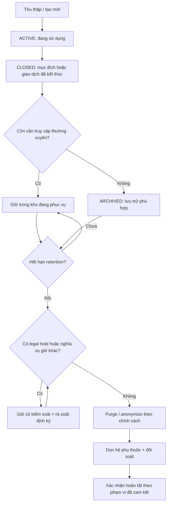
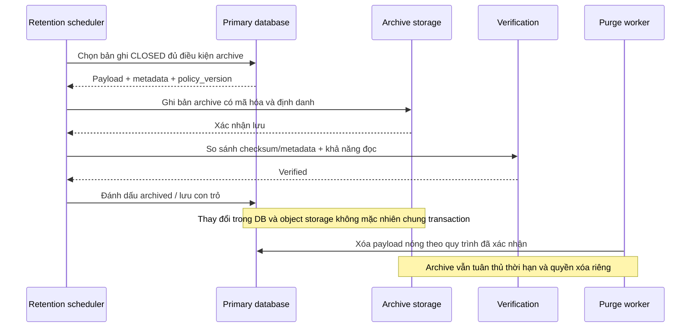
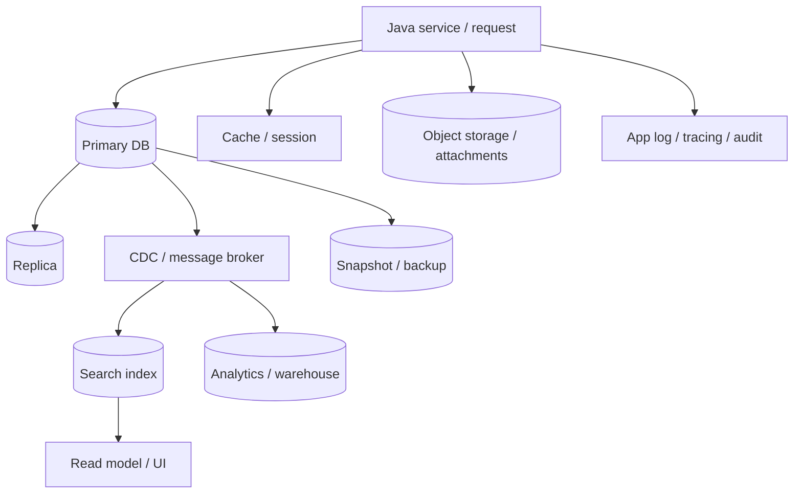

# Chính sách giữ dữ liệu và vòng đời dữ liệu liên quan

## 1. Vì sao dữ liệu không nên được giữ vô thời hạn?

Trong ứng dụng Java, một bản ghi được tạo thành công không có nghĩa là nó nên tồn tại mãi. Đơn hàng, lịch sử đăng nhập, hồ sơ tài khoản, dữ liệu phân tích, bản sao lưu, sự kiện trong message broker và tệp đính kèm có **mục đích sử dụng, thời hạn hữu ích, nghĩa vụ bảo quản và yêu cầu xóa** khác nhau.

Nếu giữ tất cả dữ liệu vô thời hạn, hệ thống tăng chi phí lưu trữ và chỉ mục, khiến truy vấn và backup nặng hơn, mở rộng phạm vi ảnh hưởng khi lộ dữ liệu và khó đáp ứng các yêu cầu xóa hợp lệ. Ngược lại, xóa quá sớm có thể làm mất khả năng đối soát giao dịch, điều tra sự cố, khôi phục dịch vụ hoặc đáp ứng nghĩa vụ lưu trữ.

Một **chính sách giữ dữ liệu** (data retention policy) quy định cho **từng nhóm dữ liệu**:

- Tại sao dữ liệu được thu thập và cần được giữ.
- Sự kiện nào làm bắt đầu đếm thời hạn giữ.
- Dữ liệu ở trạng thái hoạt động, lưu trữ dài hạn và chờ xóa trong bao lâu.
- Ai có thể truy cập, ai chịu trách nhiệm phê duyệt thay đổi chính sách.
- Khi nào dữ liệu phải được lưu trữ lạnh, ẩn khỏi nghiệp vụ, ẩn danh hoặc xóa.
- Trường hợp nào được tạm dừng việc xóa, chẳng hạn yêu cầu bảo quản hợp lệ (*legal hold*).
- Cách áp dụng cùng quy tắc cho database, cache, file, index, replica, hàng đợi, log và backup.
- Cách chứng minh chính sách đã được thực thi và khôi phục an toàn sau sự cố.

Mục tiêu không chỉ là tiết kiệm bộ nhớ. Chính sách giữ dữ liệu nằm ở giao điểm của **tính đúng đắn nghiệp vụ, độ bền lưu trữ, bảo mật, quyền riêng tư, khả năng khôi phục và hiệu năng**. Bài này đặt chính sách đó trong toàn bộ vòng đời dữ liệu và chỉ ra cách hiện thực trong Java với cơ sở dữ liệu quan hệ.

> **Lưu ý về ví dụ:** Các khoảng 7 ngày, 30 ngày, 180 ngày hoặc 1 năm xuất hiện trong bài đều là **giả định kỹ thuật để minh họa**. Thời hạn thực tế phải được quyết định theo mục đích, hợp đồng, quy định áp dụng, loại dữ liệu và tư vấn chuyên trách; không có một con số mặc định dùng cho mọi hệ thống.

## 2. Phân biệt những khái niệm liên quan

| Khái niệm | Ý nghĩa | Điều dễ nhầm |
|---|---|---|
| **Retention** (giữ dữ liệu) | Quy tắc giữ dữ liệu trong một khoảng thời gian hoặc đến một sự kiện xác định | Không đồng nghĩa “để trong bảng hoạt động mãi mãi” |
| **Lifecycle** (vòng đời dữ liệu) | Toàn bộ quá trình tạo, sử dụng, cập nhật, đóng, lưu trữ, xóa và xử lý dữ liệu dẫn xuất | Retention chỉ là một phần của lifecycle |
| **Archiving** (lưu trữ lưu kho/lạnh) | Chuyển dữ liệu ít dùng sang lớp lưu trữ với quyền truy cập, chi phí và hiệu năng phù hợp | Chuyển sang kho khác chưa phải xóa |
| **Deletion / Purge** (xóa) | Loại bỏ dữ liệu khỏi phạm vi lưu trữ và xử lý được chính sách xác định | Xóa hàng trong primary không tự xóa bản sao lưu |
| **Soft delete** | Đánh dấu bản ghi bị ẩn hoặc ngừng sử dụng, ví dụ `deleted_at` | Payload vẫn tồn tại; không đủ để kết luận đã xóa hoàn toàn |
| **Anonymization** (ẩn danh hóa) | Biến đổi dữ liệu để không còn xác định được cá nhân theo tiêu chí và bối cảnh áp dụng | Chỉ bỏ tên hoặc hash email có thể vẫn nhận diện được |
| **Pseudonymization** (giả danh hóa) | Thay định danh trực tiếp bằng mã nhưng còn có thể liên kết lại qua thông tin bổ sung | Thông thường vẫn cần bảo vệ như dữ liệu cá nhân |
| **Legal hold** (tạm giữ theo yêu cầu hợp lệ) | Tạm ngừng xóa dữ liệu có liên quan trong khi nghĩa vụ bảo quản còn hiệu lực | Không có nghĩa mọi dữ liệu khác đều được giữ vô hạn |
| **TTL** (time to live) | Mốc hoặc thời lượng dự kiến cho một đối tượng hết hiệu lực | TTL của cache/DB không tự tạo một quy trình xóa toàn hệ thống |
| **Backup retention** | Thời hạn giữ các bản backup/snapshot | Khác với thời hạn giữ của từng bản ghi nghiệp vụ |

**Retention không có nghĩa phải để mọi dữ liệu ở kho truy cập nhanh.** Một bản ghi có thể đã kết thúc sử dụng thường xuyên nhưng còn phải giữ ở kho lưu trữ vì đối soát. Ngược lại, một dữ liệu hoạt động có thể chưa hết hạn nhưng vẫn bị yêu cầu hạn chế truy cập hoặc ngừng xử lý vì thay đổi mục đích sử dụng.

## 3. Nhìn vòng đời dữ liệu như một máy trạng thái

Một mô hình đơn giản gồm:

1. **Thu thập/tạo mới:** Xác định mục đích, người sở hữu, phân loại nhạy cảm, schema và nơi lưu.
2. **Hoạt động (active):** Đọc/ghi trong các quy trình nghiệp vụ; kiểm soát tính đúng đắn, phân quyền và truy vết.
3. **Đóng/kết thúc mục đích (closed):** Sự kiện kích hoạt lịch giữ, ví dụ hoàn tất đơn hàng hoặc khóa tài khoản.
4. **Lưu trữ ít truy cập (archived):** Dữ liệu không còn dùng thường xuyên, vẫn có thể được lưu theo quy định.
5. **Đủ điều kiện xóa (eligible for purge):** Hết thời hạn, không còn mục đích/ngoại lệ giữ hợp lệ, các điều kiện trước xóa đã được kiểm tra.
6. **Xóa/ẩn danh hóa theo chính sách (purged/anonymized):** Kết quả xử lý tại nguồn chính và trong các hệ thống phụ thuộc.
7. **Đối soát sau xóa:** Kiểm tra cache, bản sao, chỉ mục, tệp, sự kiện và lịch hết hạn backup; lưu bằng chứng tối thiểu được cho phép.



Sơ đồ thể hiện **quy tắc nghiệp vụ**, không buộc mọi hệ thống phải có đúng các giá trị trạng thái trên một cột. Ví dụ, trạng thái thanh toán của đơn hàng (`PAID`, `REFUNDED`) và trạng thái vòng đời dữ liệu (`ACTIVE`, `ARCHIVED`) là **hai khái niệm độc lập**. Không nên dùng một trường `status` vừa biểu diễn nghiệp vụ, vừa biểu diễn quy định giữ dữ liệu.

Khi bản ghi đang bị giữ vì yêu cầu hợp lệ, đồng hồ thời hạn có thể đã chạy hết, nhưng thao tác purge vẫn phải bị chặn đến khi quyết định giữ được gỡ. Khi gỡ, hệ thống cần **đánh giá lại điều kiện xóa**, thay vì mặc định giữ thêm một thời hạn ngẫu nhiên.

## 4. Chính sách phải được định nghĩa theo từng nhóm dữ liệu

Giả sử hệ thống thương mại điện tử có các nhóm sau:

| Nhóm dữ liệu | Mục đích chính | Sự kiện bắt đầu tính hạn | Chiến lược minh họa | Ngoại lệ cần xét |
|---|---|---|---|---|
| Giỏ hàng chưa mua | Hỗ trợ tiếp tục mua sắm | Lần hoạt động cuối cùng | Xóa sau 30 ngày không hoạt động | Phiên đang xử lý hoặc đơn đã được tạo |
| Đơn hàng hoàn tất | Giao hàng, hỗ trợ, đối soát | Ngày giao dịch kết thúc theo định nghĩa nghiệp vụ | Giảm mức truy cập sau 90 ngày; giữ theo chính sách áp dụng rồi xóa/giảm định danh | Tranh chấp, hoàn tiền, nghĩa vụ kế toán |
| Log truy cập ứng dụng | Phát hiện lỗi và theo dõi vận hành | Thời điểm log được tạo | Lưu ngắn hạn, tổng hợp chỉ số trước khi xóa | Điều tra bảo mật hoặc yêu cầu lưu chứng cứ |
| Token đăng nhập | Xác thực phiên | Thời điểm hết hiệu lực hoặc thu hồi | Xóa sớm khi không còn dùng; TTL ngắn | Kiểm soát phiên đang hoạt động |
| Dữ liệu xuất báo cáo | Cung cấp file tải về | Thời điểm tạo file hoặc hết hạn liên kết | Tự động hết hiệu lực, xóa file và quyền tải | Báo cáo phải lưu theo hợp đồng |
| Backup DB | Khôi phục sau lỗi | Thời điểm snapshot/backup được tạo | Giữ theo cửa sổ phục hồi và lịch tuần hoàn riêng | Yêu cầu điều tra, sự cố hoặc phục hồi đặc biệt |

Các chính sách trên **không phải quy định pháp lý**. Bảng chỉ cho thấy mỗi nhóm dữ liệu cần một quyết định riêng; không nên lấy thời hạn của log áp dụng cho hóa đơn hoặc ngược lại.

Một bảng chính sách trong tài liệu quản trị thường cần tối thiểu:

- **Tên nhóm dữ liệu và hệ thống nguồn:** Database/table, bucket, topic, search index.
- **Data owner / steward:** Đầu mối quyết định nghiệp vụ và kiểm soát phạm vi dữ liệu.
- **Mục đích và căn cứ giữ:** Vì sao được giữ và điều kiện nào khiến việc giữ không còn cần thiết.
- **Dấu mốc bắt đầu, thời hạn và quy tắc tính:** Ngày tạo, ngày đóng tài khoản, ngày hoàn tất giao dịch, ngày hết hợp đồng...
- **Hành động khi hết hạn:** Xóa, ẩn danh hóa có kiểm chứng hoặc chuyển kho trong một khoảng khác.
- **Ngoại lệ, quyền truy cập và phê duyệt:** Legal hold, tranh chấp, bảo mật, thẩm quyền thay đổi.
- **Phạm vi hệ thống phụ thuộc:** Cache, các bản sao, outbox, đối tác, log, kho lưu trữ, backup.
- **Cơ chế đo/kiểm soát:** Tần suất job, ngưỡng tồn đọng, kiểm toán, kiểm thử khôi phục.

## 5. Tính hạn giữ dữ liệu: mốc bắt đầu quan trọng hơn số ngày

### 5.1. Chọn đúng sự kiện kích hoạt

Nếu chính sách nói “giữ 180 ngày”, cần hỏi **180 ngày tính từ khi nào**.

Ví dụ đơn hàng tạo ngày 01/01 nhưng hoàn tất ngày 20/01:

- Tính từ `created_at`: hạn dự kiến sớm hơn.
- Tính từ `completed_at`: hạn dự kiến muộn hơn.
- Tính từ ngày kết thúc tranh chấp: còn muộn hơn nữa.
- Với dữ liệu đang phục vụ một hợp đồng còn hiệu lực: có thể **chưa có mốc bắt đầu**.

Cần lưu sự kiện căn cứ như `closed_at`, phiên bản chính sách và mốc xóa tính ra (`retention_until`). Đừng chỉ nhìn `updated_at`: một lần thêm metadata hoặc thay đổi kỹ thuật có thể vô tình kéo dài thời gian giữ không có căn cứ.

### 5.2. Một công thức được diễn đạt rõ ràng

Với nhóm dữ liệu có thời hạn cố định sau một sự kiện:

```text
retention_until = retention_trigger_at + retention_period
eligible_for_purge =
    now >= retention_until
    AND lifecycle_state allows deletion
    AND no active hold
    AND no other valid obligation to retain
```

Trong thực tế:

- Thời hạn tính theo **ngày lịch** hay **số giờ** có thể cho kết quả khác qua chuyển giờ mùa hè; thống nhất múi giờ và quy tắc làm tròn.
- Nên lưu timestamp dưới dạng instant (ví dụ PostgreSQL `TIMESTAMPTZ`, Java `Instant`), chuyển sang múi giờ hiển thị riêng.
- Nếu mốc bắt đầu bị sửa, cần có quy tắc tính lại hạn và ghi nhận nguồn thay đổi.
- Nếu có nhiều nghĩa vụ cùng áp dụng, không thể lấy máy móc thời hạn ngắn nhất. Cần xác định khi nào mọi căn cứ giữ còn hiệu lực đã kết thúc.
- Khi chính sách đổi từ phiên bản 1 sang 2, phải có kế hoạch áp dụng cho bản ghi cũ; không được âm thầm xóa dữ liệu quá sớm chỉ vì triển khai cấu hình mới.

### 5.3. Quyết định được lưu cùng bản ghi

Thay vì ở mỗi lần chạy job lại suy đoán từ ngày tạo, có thể lưu:

```text
record_id         : mã bản ghi
data_category     : loại dữ liệu
lifecycle_state   : ACTIVE | CLOSED | ARCHIVED
closed_at         : mốc kích hoạt retention
retention_until   : thời điểm dự kiến đủ điều kiện xóa
policy_version    : phiên bản quy tắc đã dùng
legal_hold        : có đang bị chặn xóa hay không
```

Đây không phải cấu trúc bắt buộc. Với hệ thống lớn, chính sách có thể ở một service riêng; dù thiết kế nào, cần tái hiện được **vì sao bản ghi có ngày hết hạn đó**.

## 6. Thiết kế persistence trong PostgreSQL và Java

Ví dụ sau minh họa một loại hồ sơ kết thúc nghiệp vụ, dùng PostgreSQL và Java JDBC. Thời hạn `180 days` là giả định; hệ thống thật phải cấu hình theo loại bản ghi và chính sách được phê duyệt.

### 6.1. Lược đồ minh họa

```sql
CREATE TABLE retained_records (
    id UUID PRIMARY KEY,
    tenant_id UUID NOT NULL,
    category TEXT NOT NULL,
    lifecycle_state TEXT NOT NULL DEFAULT 'ACTIVE'
        CHECK (lifecycle_state IN ('ACTIVE', 'CLOSED', 'ARCHIVED')),
    payload JSONB NOT NULL,
    created_at TIMESTAMPTZ NOT NULL DEFAULT now(),
    closed_at TIMESTAMPTZ,
    archived_at TIMESTAMPTZ,
    retention_until TIMESTAMPTZ,
    policy_version TEXT,
    legal_hold BOOLEAN NOT NULL DEFAULT FALSE,
    updated_at TIMESTAMPTZ NOT NULL DEFAULT now(),
    CHECK (
        lifecycle_state = 'ACTIVE'
        OR closed_at IS NOT NULL
    ),
    CHECK (
        lifecycle_state <> 'ARCHIVED'
        OR archived_at IS NOT NULL
    )
);

CREATE INDEX ix_retained_records_purge
    ON retained_records (retention_until, id)
    WHERE lifecycle_state IN ('CLOSED', 'ARCHIVED')
      AND legal_hold = FALSE
      AND retention_until IS NOT NULL;

CREATE TABLE erasure_outbox (
    event_id BIGSERIAL PRIMARY KEY,
    record_id UUID NOT NULL,
    tenant_id UUID NOT NULL,
    event_type TEXT NOT NULL,
    created_at TIMESTAMPTZ NOT NULL DEFAULT now(),
    delivered_at TIMESTAMPTZ
);
```

Lược đồ có chủ đích phân tách:

- `lifecycle_state`: dữ liệu có còn trong quy trình hoạt động không.
- `retention_until`: hạn được tính từ chính sách, không phải từ lần đọc gần nhất.
- `legal_hold`: chặn xóa có thể thay đổi độc lập.
- `policy_version`: truy lại chính sách được áp dụng lúc tạo hạn.
- `erasure_outbox`: phát thông báo xóa dữ liệu dẫn xuất sau khi giao dịch tại nguồn thành công.

**Trong production**, không nên cho phép bất kỳ tiến trình nào tự ý đặt `legal_hold = FALSE`. Quyết định giữ hoặc gỡ giữ phải đi qua chức năng phân quyền, lý do, phê duyệt và dấu vết kiểm toán tối thiểu, có chính sách lưu riêng. Boolean ở đây chỉ để minh họa logic phối hợp khóa trên cùng hàng.

### 6.2. Đóng hồ sơ và xác lập hạn lưu

```sql
UPDATE retained_records
SET lifecycle_state = 'CLOSED',
    closed_at = now(),
    retention_until = now() + INTERVAL '180 days',
    policy_version = 'closed-record-v1',
    updated_at = now()
WHERE id = :record_id
  AND tenant_id = :tenant_id
  AND lifecycle_state = 'ACTIVE'
RETURNING id, closed_at, retention_until;
```

Các điều kiện trong `WHERE` đảm bảo chỉ chuyển hồ sơ đúng tenant và đang hoạt động. Nếu không có hàng nào được sửa, ứng dụng phải xem xét trạng thái đã đóng hoặc ID không tồn tại, không được tự tạo lại mốc giữ từ đầu.

Nếu chuyển từ `CLOSED` sang `ARCHIVED`, nên giữ nguyên `closed_at` và `retention_until` khi không có căn cứ thay đổi. Một job archive chạy lại không được tự kéo dài ngày xóa bằng cách đặt lại `closed_at = now()`.

### 6.3. Job xóa theo lô, chặn bằng retention và legal hold

Với PostgreSQL, có thể chọn tối đa 100 hàng đủ điều kiện, khóa chúng để xử lý đồng thời an toàn và ghi sự kiện xóa trong **cùng giao dịch**:

```sql
WITH candidates AS (
    SELECT id
    FROM retained_records
    WHERE lifecycle_state IN ('CLOSED', 'ARCHIVED')
      AND retention_until IS NOT NULL
      AND retention_until <= now()
      AND legal_hold = FALSE
    ORDER BY retention_until, id
    LIMIT 100
    FOR UPDATE SKIP LOCKED
),
deleted AS (
    DELETE FROM retained_records AS r
    USING candidates AS c
    WHERE r.id = c.id
    RETURNING r.id, r.tenant_id
),
events AS (
    INSERT INTO erasure_outbox (record_id, tenant_id, event_type)
    SELECT id, tenant_id, 'RECORD_ERASED'
    FROM deleted
    RETURNING event_id
)
SELECT count(*) AS deleted_count FROM events;
```

Một transaction chạy toàn bộ câu lệnh. Nếu sự kiện outbox không ghi được, xóa nguồn cũng không được commit. `FOR UPDATE SKIP LOCKED` hỗ trợ nhiều worker không cùng xử lý một hàng đang bị khóa; **không** bảo đảm thứ tự tuyệt đối và không thay thế việc đo tồn đọng.

Quan trọng về an toàn đồng thời:

- Tác vụ đặt hoặc gỡ `legal_hold` phải sửa **cùng hàng** và trong transaction có kiểm soát. Nếu hold commit trước khi job khóa hàng, job sẽ bỏ qua; nếu job đã xóa và commit trước, một yêu cầu hold đến sau không thể tự phục hồi dữ liệu.
- Vì vậy, hệ thống phải quy định **điểm chặn trước xóa**, độ trễ tiếp nhận hold và quy trình phối hợp với đơn vị quản trị. Nếu yêu cầu giữ có thể xuất hiện ngoài database hoặc trong hàng đợi chưa xử lý, việc chỉ kiểm tra cờ boolean là chưa đủ.
- Nếu dữ liệu có khóa ngoại từ bảng khác, `DELETE` có thể thất bại. Cần thiết kế rõ quan hệ xóa: cascade có kiểm soát, xóa con trong transaction, hoặc chỉ giữ metadata tối thiểu mà chính sách cho phép. Không bật `ON DELETE CASCADE` trên mọi bảng để né lỗi.
- Với lượng xóa lớn, job cần chia batch, giới hạn tải, xử lý timeout/deadlock và theo dõi số hàng đã xóa. Xóa số lượng lớn một lần có thể tạo lock contention, tăng WAL và làm truy vấn chậm.
- Không ghi `payload` vào outbox hoặc log chỉ để báo rằng dữ liệu đã bị xóa. Nếu `record_id` vẫn có thể nhận diện người dùng, chính bản ghi outbox cũng phải có chính sách retention và kiểm soát quyền truy cập.

### 6.4. Java chạy job có transaction tường minh

```java
import javax.sql.DataSource;
import java.sql.*;

public final class RetentionPurgeJob {
    private final DataSource dataSource;

    public RetentionPurgeJob(DataSource dataSource) {
        this.dataSource = dataSource;
    }

    public long purgeOneBatch() throws SQLException {
        String sql = """
            WITH candidates AS (
                SELECT id
                FROM retained_records
                WHERE lifecycle_state IN ('CLOSED', 'ARCHIVED')
                  AND retention_until IS NOT NULL
                  AND retention_until <= now()
                  AND legal_hold = FALSE
                ORDER BY retention_until, id
                LIMIT 100
                FOR UPDATE SKIP LOCKED
            ),
            deleted AS (
                DELETE FROM retained_records AS r
                USING candidates AS c
                WHERE r.id = c.id
                RETURNING r.id, r.tenant_id
            ),
            events AS (
                INSERT INTO erasure_outbox
                    (record_id, tenant_id, event_type)
                SELECT id, tenant_id, 'RECORD_ERASED'
                FROM deleted
                RETURNING event_id
            )
            SELECT count(*) FROM events
            """;

        try (Connection connection = dataSource.getConnection()) {
            connection.setAutoCommit(false);
            try {
                long deletedCount;
                try (PreparedStatement statement =
                         connection.prepareStatement(sql);
                     ResultSet result = statement.executeQuery()) {
                    result.next();
                    deletedCount = result.getLong(1);
                }

                connection.commit();
                return deletedCount;
            } catch (SQLException | RuntimeException error) {
                try {
                    connection.rollback();
                } catch (SQLException rollbackError) {
                    error.addSuppressed(rollbackError);
                }
                throw error;
            }
        }
    }
}
```

Đây là một **batch worker**, chưa bao gồm scheduler, bảng điều phối, quan trắc, giới hạn tốc độ hay phân quyền DB. Scheduler chỉ nên tiếp tục lấy batch khi hệ thống còn đủ tài nguyên và chính sách cho phép. Nếu `commit()` lỗi do mất kết nối, kết quả batch có thể không xác định; câu lệnh ở lần chạy sau sẽ bỏ qua hàng đã xóa, nhưng sự kiện đã commit vẫn phải được publisher xử lý idempotent.

**Đặt deletion vào một transaction không có nghĩa là xóa toàn bộ dữ liệu phụ thuộc đã hoàn tất.** Outbox chỉ là tín hiệu có thể phát lại an toàn. Worker downstream cần xóa cache, file và index theo ID, có retry; hệ thống còn phải theo dõi thời gian tồn đọng.

### 6.5. Khi nào dùng partition thay vì xóa từng hàng?

Nếu dữ liệu rất lớn, bất biến và chia được theo mốc thời gian, time partitioning có thể giúp quản lý nhiều dữ liệu hết hạn theo lô và giảm chi phí xóa. Nhưng chỉ có thể drop/detach một partition khi **mọi bản ghi trong partition** đều đủ điều kiện xóa và không có legal hold, khác biệt retention hoặc phụ thuộc cần giữ.

Một partition “tháng 01” có thể chứa một hồ sơ đang bị giữ; drop cả partition sẽ vi phạm chính sách. Khi đó cần tách dữ liệu có hold hoặc xóa chọn lọc. Kiến trúc partition phải được thiết kế ngay từ dữ liệu và chính sách, không được thay thế việc đánh giá điều kiện từng nhóm dữ liệu.

## 7. Archive: bảo quản lâu hơn mà không giữ nóng mọi thứ

Khi dữ liệu ít dùng nhưng còn cần giữ, archive giúp giảm tải hệ thống giao dịch. Một thiết kế archive cần làm rõ:

- **Mục tiêu:** Giảm kích thước bảng giao dịch, giới hạn truy cập, giảm chi phí hay phục vụ kiểm toán?
- **Tính toàn vẹn:** Làm sao bảo đảm archive chứa đủ bản ghi, đúng phiên bản schema và kiểm tra checksum hoặc số lượng?
- **Ranh giới chuyển giao:** Chỉ xóa bản ghi ở nguồn sau khi bản archive đã được ghi, xác minh và đáp ứng chính sách.
- **Khả năng đọc lại:** Định dạng dữ liệu, phiên bản schema, khóa mã hóa, metadata và thời gian khôi phục dự kiến.
- **Quyền truy cập:** Ai được khôi phục dữ liệu, có cần phê duyệt và ghi audit hay không?
- **Hạn xóa cuối cùng:** Archive có **cùng hoặc một quy tắc hạn giữ riêng được phê duyệt**; việc di chuyển không tự đặt lại đồng hồ.

Một quy trình minh họa:



Việc ghi DB và object storage thường **không cùng một ACID transaction**. Nếu ứng dụng crash giữa các bước, phải có idempotency và trạng thái công việc để tiếp tục; đừng xóa bản nguồn chỉ vì nhận được ACK mạng từ archive nếu chưa xác minh nội dung/khả năng truy xuất theo chính sách.

Archive không đồng nghĩa backup: backup phục vụ khôi phục hệ thống ở mốc thời gian; archive phục vụ giữ và truy xuất dữ liệu theo chính sách lâu dài hoặc ít truy cập. Chúng có thời hạn, yêu cầu tính toàn vẹn và quyền truy cập khác nhau.

## 8. Xóa một bản ghi không chỉ là xóa một hàng

Một bản ghi cá nhân có thể được sao chép qua nhiều hệ thống:



**Dữ liệu dẫn xuất cũng có vòng đời của nó.** Khi primary xóa một bản ghi:

- Replica cần nhận thao tác xóa hoặc áp dụng chính sách riêng nếu độc lập.
- Cache, session và CDN có thể vẫn lưu bản sao đến khi hết TTL hoặc nhận invalidation.
- Search index, warehouse và read model có thể chưa nhận được sự kiện xóa.
- File đính kèm, thumbnail và export phải có liên kết đến bản ghi gốc để tìm được khi dọn.
- CDC, dead-letter queue và broker có thể chứa bản ghi sự kiện với payload hoặc khóa nhận diện.
- Log/tracing có thể chứa dữ liệu nhạy cảm nếu ứng dụng đã ghi nguyên request/response; việc “xóa đơn” không dọn log.
- Backup/snapshot có thể giữ bản cũ đến hết thời hạn backup, kể cả sau khi đã xóa ở primary.

Vì vậy cần một **bản đồ luồng dữ liệu** (*data lineage/inventory*): trường nào được xuất đi đâu, ai sở hữu hệ thống đích, mỗi bản sao có thời hạn nào và sự kiện xóa được truyền theo cách nào.

### 8.1. Khác nhau giữa soft delete và hard delete

```sql
-- Soft delete: chỉ đánh dấu ngừng sử dụng
UPDATE user_profiles
SET deleted_at = now()
WHERE id = :user_id AND deleted_at IS NULL;

-- Hard delete: bỏ hàng khỏi mô hình logic của bảng
DELETE FROM user_profiles
WHERE id = :user_id;
```

Soft delete hữu ích khi cần phục hồi thao tác nhầm hoặc giữ một khoảng tạm thời. Nhưng payload vẫn còn trong database, chỉ mục, backup và bản sao; quyền riêng tư vẫn phải được đánh giá. Hard delete loại bỏ hàng khỏi tập dữ liệu logic của bảng, nhưng thường **không đồng nghĩa secure erase tức thời trên mọi block lưu trữ**: MVCC, WAL, snapshot và backup có vòng đời riêng.

Khi cần bảo đảm mức xóa mạnh hơn, phải xác định phạm vi hạ tầng, chính sách hết hạn backup, mã hóa, quản lý khóa và bằng chứng thực thi. *Cryptographic erasure* (hủy khóa mã hóa thích hợp) chỉ hữu hiệu trong thiết kế có cô lập khóa theo dữ liệu/phạm vi cần xóa và không còn bản sao plaintext hoặc khóa có thể khôi phục ngoài ý muốn.

### 8.2. Ẩn danh hóa không phải chỉ thay ID

Ví dụ:

```text
Trước:  customer_email = "a@example.com", order_total = 120, city = "X"
Sau:    customer_email = SHA256(email),    order_total = 120, city = "X"
```

Kết quả trên **không chắc đã là ẩn danh**: email có thể bị đoán bằng danh sách phổ biến, các thuộc tính còn lại có thể liên kết với nguồn khác, và bản ánh xạ có thể tồn tại. Nếu chỉ thay ID nhưng vẫn liên kết được với người, đó thường là dữ liệu giả danh cần tiếp tục bảo vệ.

Nếu mục đích thống kê còn hợp lệ, hãy thiết kế dữ liệu tổng hợp với mức chi tiết cần thiết, đánh giá rủi ro tái nhận diện, đồng thời tránh giữ vô hạn dữ liệu thô chỉ vì “sau này có thể cần”.

## 9. Backup, phục hồi và nguy cơ dữ liệu quay trở lại

Độ bền dữ liệu và nhu cầu xóa tạo ra một căng thẳng thực tế: backup được giữ để **khôi phục dữ liệu**, nhưng các bản backup cũ có thể chứa bản ghi đã bị xóa ở hệ thống đang chạy.

### 9.1. Hai thời hạn cần quản lý riêng

**Thời hạn dữ liệu nghiệp vụ:** Khi bản ghi không còn được giữ tại các hệ thống đang hoạt động và bản sao/archival liên quan.

**Thời hạn backup:** Backup cụ thể được giữ bao lâu trước khi bị luân chuyển hoặc hủy; có thể theo lịch chụp định kỳ và chính sách khôi phục.

Không thể hứa rằng `DELETE` thành công ở primary đồng nghĩa mọi bản backup cũng đã xóa bản ghi đó ngay lập tức. Cần nêu rõ giới hạn kỹ thuật và hành vi theo yêu cầu áp dụng, đồng thời hạn chế truy cập backup và bảo đảm backup hết hạn đúng lịch.

### 9.2. Phục hồi phải tránh làm “sống lại” dữ liệu đã bị xóa

Giả sử ngày D1 hệ thống tạo backup; ngày D2 người dùng được xử lý yêu cầu xóa; ngày D3 dịch vụ phục hồi từ backup D1. Nếu đưa bản phục hồi vào phục vụ ngay, dữ liệu đã xóa có thể xuất hiện trở lại.

Một quy trình an toàn cần:

1. Khôi phục backup trong môi trường cách ly với quyền truy cập hạn chế.
2. Xác định các sự kiện xóa hoặc quyết định giữ đã phát sinh **sau mốc backup**.
3. Áp dụng lại các sự kiện xóa có thể xác minh và chính sách retention hiện hành; đối soát các sự kiện chưa chắc đã xử lý.
4. Chỉ đưa dữ liệu đã kiểm tra trở lại phục vụ theo kế hoạch khôi phục.
5. Ghi nhận mức dữ liệu mất có thể xảy ra (RPO) và thời gian khôi phục (RTO) thực tế.

Cơ chế replay/tombstone hoặc sổ sự kiện xóa có thể giúp khôi phục, nhưng bản thân nhật ký này phải được **giảm thiểu dữ liệu, phân quyền và giữ theo thời hạn riêng**. Không nên giữ bản sao payload bị xóa trong “nhật ký xóa” vô thời hạn.

## 10. Legal hold và những ngoại lệ có kiểm soát

Một số dữ liệu đến hạn xóa nhưng vẫn liên quan đến tranh chấp, kiểm tra, điều tra hoặc nghĩa vụ bảo quản đang có hiệu lực. Khi đó cần **dừng purge có mục tiêu**.

Một quy trình phù hợp bao gồm:

1. **Tiếp nhận yêu cầu:** Xác định người có thẩm quyền, phạm vi bản ghi, mục đích, mốc hiệu lực và căn cứ giữ.
2. **Áp dụng hold trước khi xóa:** Ghi nhận trạng thái giữ tại nơi mà purge job kiểm tra; tránh độ trễ giữa hệ thống phê duyệt và database.
3. **Giới hạn truy cập:** Dữ liệu có hold vẫn cần bảo mật và giới hạn xử lý theo mục đích.
4. **Rà soát định kỳ:** Kiểm tra hold có còn cần thiết, tránh cơ chế giữ vĩnh viễn do quên gỡ.
5. **Gỡ giữ:** Ghi dấu vết có thẩm quyền; đánh giá lại retention và đưa dữ liệu hết hạn vào hàng đợi xử lý an toàn.

Ví dụ:

```sql
UPDATE retained_records
SET legal_hold = TRUE,
    updated_at = now()
WHERE id = :record_id
  AND tenant_id = :tenant_id;
```

Lệnh SQL là một phần nhỏ của quy trình. Phải có **xác thực, phân quyền, ghi lý do vào hệ thống audit có thời hạn, cơ chế đồng bộ và quy tắc giải quyết cạnh tranh** trước khi coi legal hold đã có hiệu lực.

Không nên diễn giải việc gỡ hold là cho phép xóa tất cả ngay lập tức mà không kiểm tra điều kiện nghiệp vụ và các căn cứ giữ khác. Hệ thống cần duy trì việc đánh giá độc lập từng nhóm dữ liệu.

## 11. Dùng TTL, scheduler và trigger khi nào?

| Cơ chế | Điểm mạnh | Hạn chế cần kiểm soát |
|---|---|---|
| **TTL có sẵn của cache/DB** | Gọn, phù hợp dữ liệu tạm thời có tuổi thọ rõ ràng | Xóa có thể bất đồng bộ; khó bảo đảm xóa liên hệ nhiều hệ |
| **Scheduled job trong Java** | Kiểm soát logic chính sách, hold, batch, audit, retry | Cần vận hành, chống chạy trùng, đo backlog và tài nguyên |
| **Database job/partition retention** | Xử lý khối lượng lớn gần dữ liệu, có thể nhanh | Dễ gây xóa rộng nếu điều kiện sai; nhiều ngoại lệ khó biểu diễn |
| **Event-driven workflow** | Phản ứng khi sự kiện đóng tài khoản/kết thúc hợp đồng xảy ra | Sự kiện đến chậm, lặp hoặc thất lạc; vẫn cần job quét đối soát |
| **Quy trình phê duyệt thủ công** | Thích hợp ngoại lệ nhạy cảm và legal hold | Không phù hợp làm đường xóa chính cho khối lượng lớn |

Thường nên **kết hợp**:

- Sự kiện thay đổi trạng thái nghiệp vụ để thiết lập `retention_until` đúng lúc.
- Job định kỳ quét những bản ghi đến hạn, giới hạn số lượng và chặn bằng legal hold.
- Outbox/CDC để yêu cầu các hệ thống phụ thuộc xóa hoặc ẩn danh hóa.
- Job đối soát để tìm dữ liệu quá hạn, event tồn đọng hoặc sai khác sau sự cố.
- Kiểm toán và báo cáo tổng hợp cho owner về mức độ tuân thủ.

TTL có thể là công cụ thực thi một phần chính sách; **TTL không thay thế chính sách**.

## 12. Hiệu năng, tính sẵn sàng và tiến hóa schema

Retention ảnh hưởng trực tiếp đến database và các chức năng Java:

**Chỉ mục và truy vấn:** Bảng tích lũy nhiều bản ghi quá hạn khiến index lớn, cache hit giảm, vacuum nặng hơn. Xóa định kỳ hoặc phân vùng phù hợp có thể cải thiện tốc độ và chi phí vận hành.

**Tải của job:** Purge lớn tạo nhiều WAL, lock và IO, có thể ảnh hưởng thời gian đáp ứng của API. Batch nhỏ, lịch chạy hợp lý, giới hạn tốc độ và index theo hạn giúp giảm ảnh hưởng. Đừng chạy purge không giới hạn trên giờ cao điểm chỉ vì “đã đến hạn”.

**Tính sẵn sàng:** Nếu archive hoặc broker tạm lỗi, job nên tạm dừng bước xóa phụ thuộc và retry có kiểm soát. Việc tạm ngừng phải được quan trắc để không biến thành giữ dữ liệu vô thời hạn.

**Tính đúng đắn và đồng thời:** Một thao tác nghiệp vụ đang cập nhật bản ghi và job purge đang xóa bản ghi phải có cơ chế phối hợp. Không quyết định purge chỉ dựa trên một lần `SELECT` cũ rồi xóa vô điều kiện; kiểm tra lại ngay trong transaction ghi.

**Tiến hóa schema:** Bản archive và backup có thể chứa schema cũ. Khi ứng dụng đổi kiểu dữ liệu, thay enum, đổi quan hệ hoặc tách bảng, phải có kế hoạch đọc/phục hồi/xóa các bản lưu trữ cũ, kể cả khi Java model mới không còn chứa field đó.

**Bảo mật:** Tài khoản chạy purge nên có quyền tối thiểu; job không cần quyền đọc plaintext của mọi dữ liệu nếu chỉ cần ID và hạn. Mã hóa, quản lý secret, giới hạn truy cập backup, phân tách quyền duyệt hold và quyền xóa giúp giảm rủi ro thao tác sai.

## 13. Đo lường và cảnh báo

Không thể kết luận chính sách đã hoạt động chỉ vì scheduler báo “job chạy thành công”. Nên theo dõi các chỉ số gắn với kết quả:

| Chỉ số | Ý nghĩa | Tín hiệu cần điều tra |
|---|---|---|
| **Overdue records** | Số bản ghi quá hạn nhưng chưa purge, loại trừ hold hợp lệ | Tăng liên tục hoặc vượt ngưỡng được duyệt |
| **Age of oldest overdue** | Bản ghi quá hạn lâu nhất chưa xử lý | SLA xóa bị vi phạm |
| **Purge success / failure / retry** | Số hàng hoàn tất, thất bại, phải thử lại | Constraint lỗi, deadlock hoặc logic lệch |
| **Hold coverage** | Số và thời gian hold, lần rà soát gần nhất | Hold quá lâu không có đánh giá |
| **Downstream erasure lag** | Thời gian từ xóa nguồn đến xóa cache/index/file | Event stuck, worker chậm, đích không phản hồi |
| **Archive verification failure** | Bản archive đọc lại sai checksum, số lượng hoặc schema | Nguy cơ xóa nguồn khi chưa lưu kho an toàn |
| **Backup expiration drift** | Backup vượt quá thời hạn được duyệt | Kho snapshot không được luân chuyển |
| **Restoration reconciliation** | Số lần phục hồi và áp dụng lại xóa sau restore | Nguy cơ dữ liệu bị “hồi sinh” |

Thông tin quan trắc phải ưu tiên **số lượng, mã sự kiện kỹ thuật và trạng thái**, hạn chế ghi dữ liệu nhạy cảm vào metric, log hoặc alert. Ví dụ, metric `purge_overdue_count{category="session"}` có thể đủ để cảnh báo; không cần gắn email của người dùng vào nhãn metric.

Cảnh báo quan trọng là **đã quá thời hạn hoàn thành xóa mà còn dữ liệu**, kể cả khi scheduler vẫn chạy đều.

## 14. Những lỗi thiết kế phổ biến

### 14.1. Đặt một TTL chung cho mọi bảng

Đơn hàng, log bảo mật, giỏ hàng và backup không có cùng căn cứ giữ. Một TTL duy nhất có thể xóa quá sớm dữ liệu cần đối soát và giữ quá lâu dữ liệu nhạy cảm. Cần phân loại và xác định mốc bắt đầu riêng.

### 14.2. Xóa mềm và coi như đã đáp ứng mọi yêu cầu xóa

`deleted_at` chỉ đổi khả năng hiển thị của một số truy vấn. Payload vẫn có thể xuất hiện qua SQL trực tiếp, backup, export hoặc code không lọc `deleted_at`. Phải có bước purge cuối và bảo vệ các đường truy cập.

### 14.3. Dùng `updated_at` để đếm hạn giữ

Một job cập nhật heartbeat, đồng bộ địa chỉ hoặc ghi metadata có thể khiến hạn giữ kéo dài mãi. Nên xác định sự kiện nghiệp vụ chuyên biệt và chính sách tính lại rõ ràng.

### 14.4. Di chuyển sang archive rồi xóa ngay nguồn

Nếu archive bị ghi thiếu, key mã hóa không đọc lại được hoặc schema khác mà chưa kiểm tra, xóa nguồn sẽ tạo mất dữ liệu. Chỉ xóa sau xác nhận và có quy trình khôi phục khi thất bại giữa các bước.

### 14.5. Bỏ qua cache, log, search index và backup

Primary có thể sạch nhưng bản sao ở nơi khác vẫn tồn tại. Thiết kế phải biết dữ liệu đã đi qua những hệ thống nào và ai chịu trách nhiệm xóa.

### 14.6. Cho legal hold chạy qua hàng đợi không được đồng bộ với purge

Yêu cầu giữ có thể đã được duyệt nhưng chưa cập nhật cờ tại nguồn. Job purge thấy “không hold” và xóa mất bản ghi. Cần quy định mốc hold có hiệu lực, kiểm soát đường đua giữa hai hành động và dừng purge nếu trạng thái quyết định chưa đáng tin.

### 14.7. Phục hồi từ backup cũ rồi mở dịch vụ ngay

Bản ghi đã xóa có thể xuất hiện trở lại. Restore là một phần vòng đời dữ liệu và cần áp dụng lại sự kiện xóa hoặc cơ chế đối soát phù hợp trước khi phục vụ dữ liệu được phục hồi.

## 15. Kịch bản thực hành

### Bài tập A — Thiết kế chính sách

Một ứng dụng Java lưu ba nhóm dữ liệu:

- Giỏ hàng chưa đặt mua.
- Đơn đã hoàn tất.
- Log truy cập API.

Hãy tự điền các cột: **mục đích, owner, trigger, thời hạn minh họa, archive, purge, hold, nơi dữ liệu có thể được sao chép và cách đối soát**. Giải thích vì sao ba nhóm không nên dùng chung một TTL.

### Bài tập B — Đường đua giữa legal hold và purge

Một hồ sơ có `retention_until` ở quá khứ. Cùng lúc:

- Worker A chuẩn bị xóa hồ sơ.
- Nhân viên được ủy quyền gửi yêu cầu legal hold.

Hãy mô tả các transaction, khóa hàng và quy tắc “hold có hiệu lực” để tránh xóa hồ sơ mà hệ thống đã xác nhận sẽ giữ. Chỉ ra giới hạn của giải pháp chỉ dùng `legal_hold BOOLEAN` khi việc phê duyệt đến từ dịch vụ khác.

### Bài tập C — Phục hồi làm xuất hiện lại dữ liệu

Ngày thứ Hai có backup. Thứ Ba hệ thống xóa một hồ sơ theo yêu cầu hợp lệ. Thứ Tư hệ thống khôi phục backup thứ Hai do sự cố.

Hãy đề xuất cách phát hiện và loại bỏ lại hồ sơ đã xóa trước khi phục vụ. Cơ chế đối soát cần giữ **loại bằng chứng nào**, ai được truy cập và làm sao bảo đảm bằng chứng không trở thành một kho dữ liệu nhạy cảm mới?

### Bài tập D — Đo chất lượng retention

Giả sử scheduler chạy mỗi giờ và báo thành công, nhưng số bản ghi quá hạn tăng từ 1.000 lên 200.000 trong một tuần. Hãy chọn ít nhất ba metric để xác định nguyên nhân: điều kiện policy, legal hold, lock, deadlock, thiếu index, thiếu capacity, lỗi downstream hay sự kiện đến hạn không được ghi.

### Gợi ý triển khai

Đối với mỗi bài tập, hãy đi theo thứ tự: **xác định loại dữ liệu → căn cứ và mốc retention → trạng thái vòng đời → điều kiện chặn xóa → thao tác transaction → hệ phụ thuộc → kiểm chứng kết quả**. Khi phân tích một lỗi, hãy kiểm tra cả **tính đúng đắn** của quyết định giữ/xóa lẫn **hiệu năng và tính sẵn sàng** của quy trình thực thi.

## 16. Checklist trước khi đưa chính sách vào production

1. Đã có inventory nhóm dữ liệu, data owner, mục đích và hệ thống nguồn/đích chưa?
2. Thời hạn được duyệt có đúng cho từng nhóm và từng nghĩa vụ áp dụng không? Ai có quyền sửa?
3. Trigger bắt đầu đếm được định nghĩa chính xác và kiểm thử với trường hợp mở lại, hoàn tiền, tranh chấp chưa?
4. Có lưu `policy_version` hoặc cách tương đương để giải thích mốc `retention_until` không?
5. Archive có checksum, quyền truy cập, khả năng đọc lại, tiến hóa schema và lịch xóa riêng không?
6. Legal hold có thể được áp dụng trước khi purge; có bằng chứng phê duyệt, rà soát và gỡ giữ an toàn không?
7. Job purge có điều kiện xóa nguyên tử, batch, khóa thích hợp, timeout, retry và xử lý xung đột không?
8. Các hệ phụ thuộc như cache, index, file, broker và warehouse có đường xóa/đối soát cụ thể không?
9. Backup có chính sách hết hạn độc lập, kiểm soát quyền truy cập và quy trình tránh phục hồi dữ liệu đã xóa không?
10. Có chỉ số quá hạn, backlog, lag downstream, cảnh báo và người chịu trách nhiệm xử lý không?
11. Đã kiểm thử lỗi giữa archive và xóa, commit không rõ, job trùng, restore và sai khác replication chưa?
12. Các log/audit dùng để chứng minh xóa có bị giữ quá lâu hoặc lưu lại thông tin không cần thiết không?

**Nguyên tắc kết luận:** Chính sách giữ dữ liệu là **quy tắc nghiệp vụ và vận hành áp dụng xuyên suốt vòng đời dữ liệu**, từ thu thập đến archive, xóa và khôi phục. Một triển khai persistence tốt trong Java phải thể hiện rõ **vì sao giữ, giữ đến khi nào, khi nào được xóa, những ngoại lệ nào ngăn xóa, và làm thế nào biết việc xóa đã hoàn tất trong phạm vi đã cam kết**.
