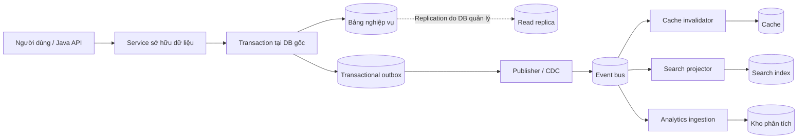

# Trách nhiệm đồng bộ khi dữ liệu xuất hiện ở nhiều nơi

Một khách hàng đổi địa chỉ giao hàng. Cơ sở dữ liệu hồ sơ đã ghi địa chỉ mới, nhưng màn hình vẫn hiện địa chỉ cũ do cache, bộ phận giao vận đọc một bản sao chậm và hệ thống phân tích tiếp tục giữ lịch sử địa chỉ. **Vậy ai có trách nhiệm làm cho các nơi này thống nhất, trong bao lâu và theo quy tắc nào?** Nếu không trả lời từ lúc thiết kế, một thao tác `UPDATE` thành công chưa đủ đảm bảo toàn bộ hệ thống dùng thông tin đúng.

Bài học thuộc chương **Vòng đời dữ liệu** của module **DATA_PERSISTENCE_FUNDAMENTALS**. Module trang bị nền tảng lưu trữ dữ liệu bền vững cho ứng dụng, từ mô hình dữ liệu, lược đồ, truy vấn và chỉ mục tới transaction, isolation, concurrency; thiết kế ranh giới persistence trong Java; xử lý lỗi kết nối, tiến hóa schema, bảo mật, sao lưu và hiệu năng. Trong phạm vi đó, bài này tập trung vào **trách nhiệm đồng bộ khi một thông tin có nhiều bản sao hoặc nhiều biểu diễn phục vụ các mục đích khác nhau**.

Sau bài này, bạn có thể:

- Xác định nguồn dữ liệu có thẩm quyền, nơi được phép ghi, bản sao và dữ liệu dẫn xuất.
- Phân biệt **ghi nguyên tử trong một kho dữ liệu** với **truyền thay đổi sang các hệ thống khác**.
- Lựa chọn thời điểm và mức nhất quán phù hợp với từng luồng nghiệp vụ.
- Thiết kế cơ chế truyền thay đổi có thể xử lý trễ, lặp, đảo thứ tự và lỗi từng phần.
- Phân công trách nhiệm giám sát, đối soát, sửa lệch và xóa dữ liệu xuyên suốt vòng đời.

## 1. “Dữ liệu xuất hiện ở nhiều nơi” nghĩa là gì?

Cùng một thông tin nghiệp vụ có thể tồn tại tại nhiều vị trí, với ý nghĩa khác nhau:

| Nơi chứa dữ liệu | Vì sao có bản dữ liệu ở đó? | Có được xem là nguồn chính không? |
| --- | --- | --- |
| **Database giao dịch** | Giữ trạng thái chính để xử lý nghiệp vụ | Thường có thẩm quyền đối với những thực thể nó sở hữu |
| **Read replica** | Chia tải truy vấn, tăng khả năng phục vụ | Thường là bản sao của primary; thời điểm cập nhật phụ thuộc cơ chế replication |
| **Cache** (ví dụ Redis, cache tại JVM) | Giảm thời gian đọc và tải xuống database | Thông thường là bản sao có thể hết hạn hoặc bị loại bỏ |
| **Search index** | Tìm kiếm toàn văn, lọc hoặc xếp hạng nhanh | Biểu diễn dẫn xuất, có thể cập nhật trễ so với nguồn |
| **Read model / materialized view** | Ghép, tổng hợp hoặc biến đổi dữ liệu cho màn hình | Kết quả tính toán từ một hoặc nhiều nguồn |
| **Message broker / event log** | Chuyển thông tin thay đổi cho các bên khác | Lưu sự kiện, không mặc định là ảnh chụp trạng thái hiện tại |
| **Hệ thống báo cáo / data warehouse** | Phân tích theo thời gian, tổng hợp, lịch sử | Có thể có định nghĩa dữ liệu và nhịp cập nhật riêng |
| **Client offline / thiết bị di động** | Cho phép người dùng xem hoặc sửa khi mất mạng | Có thể chứa dữ liệu cũ hoặc thay đổi chưa gửi lên |
| **Backup / snapshot** | Khôi phục sau sự cố hoặc thao tác xóa nhầm | Bản phục hồi theo thời điểm, không phải bản đọc phục vụ giao dịch hiện tại |

Cần phân biệt **bản sao cùng cấu trúc** (chẳng hạn primary → replica) với **dữ liệu dẫn xuất** (đơn hàng → tổng doanh thu tháng). Dữ liệu dẫn xuất không nhất thiết giống từng byte với nguồn. Việc “đồng bộ” có thể là sao chép, làm mới cache, cập nhật chỉ mục, tính lại tổng hợp hoặc áp dụng một sự kiện nghiệp vụ.

Một doanh nghiệp cũng có thể có *nhiều nguồn có thẩm quyền* cho những thuộc tính khác nhau: hệ thống tài khoản sở hữu email liên hệ, dịch vụ kho sở hữu số lượng tồn, hệ thống kế toán sở hữu số dư đã hạch toán. Không nên gán một “database chân lý toàn cục” cho mọi thuộc tính nếu thực tế quyền sở hữu được phân tách.

### Phân biệt ba khái niệm thường bị gộp

- **Durability (bền vững):** dữ liệu đã được ghi giữ lại qua những loại sự cố mà kho lưu trữ cam kết chịu được.
- **Consistency/visibility (nhất quán và khả năng nhìn thấy):** các lần đọc thấy những phiên bản nào và sau bao lâu.
- **Synchronization (đồng bộ):** cơ chế chuyển hoặc tái tạo thay đổi giữa các vị trí, theo hợp đồng về thứ tự, trễ, lỗi và đối soát.

Một thay đổi có thể **bền vững ở nguồn** nhưng **chưa xuất hiện ở cache hay search index**. Ngược lại, một cache có thể hiện giá mới dù transaction ở nguồn chưa commit nếu ứng dụng cập nhật cache quá sớm. Hai tình huống cần cách khắc phục khác nhau.

## 2. Xác định nguồn có thẩm quyền và quyền ghi

Trước khi lựa chọn Redis, event bus hay change data capture (CDC), hãy trả lời:

1. **Ai sở hữu thông tin?** Dịch vụ nào có trách nhiệm kiểm tra quy tắc nghiệp vụ và chấp nhận thay đổi?
2. **Bản ghi nào là chuẩn?** Khóa định danh và phiên bản chuẩn nằm ở đâu?
3. **Ai được phép ghi?** Chỉ owner hay nhiều bên? Các phía có thể ghi đè lẫn nhau không?
4. **Nơi nào chỉ được đọc?** Đó là bản sao, chỉ mục, thống kê hay dữ liệu lịch sử?
5. **Ai chịu trách nhiệm khắc phục sai lệch?** Đơn vị sinh thay đổi, đơn vị nhận, hay bộ phận vận hành phối hợp?

Ví dụ với giá sản phẩm:

| Thành phần | Quyền và trách nhiệm |
| --- | --- |
| **Catalog service** | Sở hữu giá niêm yết; xác thực quyền sửa; áp dụng quy tắc giá và phát ra thay đổi sau khi ghi thành công |
| **Catalog database** | Cưỡng chế kiểu dữ liệu, ràng buộc, tính nguyên tử của những thay đổi trong transaction |
| **Search service** | Tạo bản chiếu giá phục vụ tìm kiếm; kiểm tra phiên bản, chống áp dụng dữ liệu cũ; báo tiến độ cập nhật |
| **Website cache** | Đặt TTL, chính sách invalidation hoặc làm mới; không tự quyết định giá chuẩn |
| **Checkout service** | Quyết định cần xác minh giá hiện tại trước khi thanh toán; không tin tuyệt đối bản giá đọc từ search/cache |
| **Operations/SRE** | Theo dõi độ trễ đồng bộ, hàng lỗi, retry, đối soát, phương án phục hồi |

**Nguồn có thẩm quyền là một quyết định nghiệp vụ và kiến trúc**, không chỉ là nơi đang lưu dữ liệu. Khi hai dịch vụ đều tự cập nhật một thuộc tính mà không có quy tắc hòa giải, hệ thống rơi vào tình trạng *multi-writer* không có hợp đồng rõ ràng.

Với multi-writer thực sự (chẳng hạn ứng dụng offline hoặc cơ sở dữ liệu multi-leader), phải định nghĩa cách hợp nhất thay đổi, xử lý xung đột và ưu tiên nguồn. Đây là bài toán riêng: ghi nhận “bản mới nhất theo đồng hồ máy” có thể gây mất thay đổi do sai lệch thời gian. Không mặc định `last-write-wins` phù hợp với tiền, tồn kho hoặc quyền truy cập.

## 3. Đồng bộ diễn ra ở ranh giới nào?

Một luồng thường gặp: ứng dụng cập nhật dữ liệu gốc trong database, sau đó truyền sự kiện để các nơi còn lại cập nhật theo.



**Ranh giới cần hiểu:**

- **Trong transaction của DB gốc:** có thể ghi bản ghi nghiệp vụ và bản ghi outbox một cách nguyên tử, nếu cùng một transaction được DB hỗ trợ.
- **Từ outbox sang broker:** thường là truyền bất đồng bộ, cần retry và có thể phát trùng; commit ở DB không tự đồng nghĩa broker đã nhận.
- **Từ broker sang các consumer:** mỗi nơi cập nhật theo tốc độ, thứ tự và khả năng của mình; consumer này thành công không bảo đảm consumer khác cũng đã xong.
- **Read replica:** cơ chế nhân bản thường do database/hạ tầng điều phối, với hợp đồng riêng về đồng bộ và failover; không được đồng nhất với event bus của ứng dụng.
- **Backup:** phục vụ khả năng khôi phục; không giải quyết thay thế bài toán phát sự kiện hoặc làm mới các read model hằng ngày.

Không có một transaction cục bộ thông thường nào tự bao trùm SQL database, Redis, search engine, message broker và thiết bị di động. Khi các nơi đó bất đồng trong một khoảng thời gian, hệ thống cần biết **bất đồng nào chấp nhận được, bất đồng nào phải chặn nghiệp vụ**.

## 4. Chọn mức nhất quán theo hành vi người dùng

Không phải mọi màn hình phải đợi tất cả bản sao bắt kịp, và không phải mọi thao tác có thể cho phép chậm.

| Tình huống | Hợp đồng cần cân nhắc | Phương án điển hình |
| --- | --- | --- |
| Người dùng vừa đổi địa chỉ và xem lại hồ sơ | **Read-your-writes:** chính người ghi phải thấy dữ liệu vừa commit | Đọc từ owner/primary hoặc dùng cơ chế phiên có khả năng bảo đảm |
| Khách thanh toán theo giá cuối | Cần **xác minh giá có thẩm quyền** tại lúc chốt giao dịch | Kiểm tra lại trong luồng checkout; không dựa duy nhất vào search/cache |
| Kết quả tìm kiếm sản phẩm | Có thể chấp nhận cập nhật trễ vài giây tùy sản phẩm | Search index bất đồng bộ, đo freshness |
| Dashboard phân tích ngày | Có thể chấp nhận dữ liệu theo batch/cửa sổ thời gian | Pipeline theo lịch, hiển thị thời điểm cập nhật |
| Khóa quyền truy cập của tài khoản | Có thể cần hiệu lực nhanh, có giới hạn rủi ro cụ thể | Kiểm tra quyền ở nguồn phù hợp, token/session revocation tùy thiết kế |
| Thiết bị offline nhập ghi chú | Có thể phát sinh xung đột khi đồng bộ lại | Local queue, version, quy tắc merge/giải quyết xung đột |

Các kiểu đảm bảo có thể áp dụng theo nhu cầu:

- **Strong/linearizable read:** trả trạng thái theo ngữ nghĩa nhất quán mạnh được hệ thống hỗ trợ; thường có chi phí phối hợp hoặc giới hạn khả dụng.
- **Read-your-writes:** một phiên đọc được các thay đổi mình đã ghi, dù các phiên khác có thể chậm hơn.
- **Monotonic reads:** phiên người dùng không nên nhìn thấy dữ liệu quay về phiên bản cũ sau khi đã thấy bản mới.
- **Eventual consistency:** nếu ngừng thay đổi và không có lỗi kéo dài, các bản sao hợp lệ cuối cùng hội tụ; thuật ngữ này **không** tự chỉ rõ mất bao lâu hay giải quyết lỗi vĩnh viễn bằng cách nào.

**Độ trễ cho phép phải nói thành con số hoặc điều kiện:** ví dụ “95% thay đổi giá có mặt trong search index trong 5 giây; nếu chưa đạt thì checkout vẫn đối chiếu giá tại owner”. Đó là mục tiêu cần đo trên hệ thống thực, không phải lời hứa tự động của một event bus.

Đối với API: nếu trả `200 OK` sau khi DB nguồn commit nhưng search chưa bắt kịp, tài liệu API cần phản ánh điều đó. Nếu một yêu cầu chỉ mới được đưa vào hàng đợi để xử lý, `202 Accepted` thường rõ nghĩa hơn khi hợp đồng API là “đã nhận để xử lý”.

## 5. Những cơ chế chuyển thay đổi phổ biến

| Cơ chế | Cách hoạt động | Điểm mạnh và giới hạn |
| --- | --- | --- |
| **Write-through/đồng bộ trong request** | Request ghi nguồn rồi cập nhật hệ thống thứ hai trước khi trả kết quả | Có thể giảm độ trễ hiển thị, nhưng không tự cung cấp atomicity xuyên hệ thống; lỗi một phía gây kết quả không nhất quán |
| **Cache-aside + invalidation/TTL** | Ứng dụng đọc cache; cache miss thì đọc nguồn và điền cache; khi ghi thì xóa/làm mới | Đơn giản nhưng có race giữa đọc, ghi và populate; TTL chỉ giới hạn thời gian sống của entry theo cấu hình, không chứng minh không có stale read |
| **Transactional outbox** | Cùng transaction ghi dữ liệu gốc và bản ghi sự kiện, worker chuyển bản ghi đó đi | Tránh khoảng trống “DB commit nhưng quên phát event”; vẫn cần dedupe, ordering, relay và xử lý phát trùng |
| **CDC (change data capture)** | Đọc thay đổi từ log/stream của DB theo khả năng engine | Giảm nhu cầu sửa mã nghiệp vụ, nhưng phải quản lý schema, log retention, offset, snapshot và ý nghĩa nghiệp vụ của các thay đổi |
| **Polling theo watermark** | Định kỳ đọc các bản ghi mới/cập nhật kể từ mốc | Dễ triển khai cho tải thấp; phải tránh bỏ sót khi nhiều bản ghi cùng timestamp, cập nhật đến muộn hoặc thay đổi bị xóa |
| **Snapshot + cập nhật tăng dần** | Nạp trạng thái ban đầu rồi áp dụng sự kiện/CDC phát sinh | Phù hợp dựng lại read model lớn; phải có ranh giới snapshot và vị trí log để không tạo khoảng trống hoặc áp dụng sai thứ tự |
| **Đồng bộ hai chiều** | Hai phía đều tạo thay đổi và trao đổi lại | Phải có định danh, phiên bản và quy tắc giải quyết xung đột rõ ràng; nguy cơ vòng lặp và ghi đè |

Không nên chọn cơ chế chỉ vì “nhanh nhất”. Tiêu chí gồm: tải ghi, độ trễ chấp nhận, mức tin cậy, tính chất transaction, khả năng replay, giới hạn hạ tầng và khả năng kiểm chứng sau sự cố.

### Bẫy dual-write

Xét mã giả:

```java
database.save(product);
searchIndex.update(product);
```

Nếu DB commit thành công nhưng API gọi search thất bại, search giữ giá cũ. Đảo thứ tự cũng không giải quyết được: search có thể cập nhật trước khi DB rollback. Bọc hai lời gọi trong `@Transactional` của Java không mặc nhiên làm search engine tham gia cùng transaction.

Với dữ liệu gốc trong một DB có hỗ trợ transaction, **transactional outbox** là phương án thường gặp để bảo đảm mỗi thay đổi nghiệp vụ đã commit có một bản ghi cần phát đi. Nó không bảo đảm consumer xử lý đúng một lần; “at-least-once + idempotency” thường là hợp đồng thực tế hơn.

## 6. Ví dụ cụ thể: cập nhật giá và truyền sang các bản chiếu

Giả sử catalog lưu giá bằng số nguyên đơn vị nhỏ nhất (ví dụ đồng hoặc cent tùy quy tắc của hệ thống) và tăng `version` mỗi lần cập nhật. Ví dụ SQL dưới đây sử dụng **PostgreSQL**; tên bảng, driver và cú pháp cần thay đổi nếu dùng engine khác.

### 6.1. Dữ liệu nguồn và outbox

```sql
CREATE TABLE product (
    id UUID PRIMARY KEY,
    name TEXT NOT NULL,
    price_minor_units BIGINT NOT NULL CHECK (price_minor_units >= 0),
    version BIGINT NOT NULL DEFAULT 0
);

CREATE TABLE product_price_outbox (
    event_id UUID PRIMARY KEY,
    product_id UUID NOT NULL REFERENCES product(id),
    product_version BIGINT NOT NULL,
    price_minor_units BIGINT NOT NULL,
    created_at TIMESTAMPTZ NOT NULL DEFAULT CURRENT_TIMESTAMP,
    published_at TIMESTAMPTZ,
    UNIQUE (product_id, product_version)
);
```

Khi thay đổi giá, **một transaction** thực hiện:

```sql
BEGIN;

UPDATE product
SET price_minor_units = 125000,
    version = version + 1
WHERE id = '00000000-0000-0000-0000-000000000123'
RETURNING version;

-- Giả sử lệnh trên trả version = 8 và update đúng một sản phẩm.
INSERT INTO product_price_outbox (
    event_id, product_id, product_version, price_minor_units
) VALUES (
    '00000000-0000-0000-0000-000000000888',
    '00000000-0000-0000-0000-000000000123',
    8,
    125000
);

COMMIT;
```

Đây là minh họa cho **một phiên cập nhật đơn lẻ**. Trong mã thật phải lấy `version` vừa được DB trả về thay vì gõ cứng số 8, dùng prepared statement, xác minh bản ghi tồn tại, và xử lý lỗi trong transaction. Nếu commit thất bại ở phía client do đứt kết nối, kết quả có thể **chưa xác định**; phải đối soát bằng khóa yêu cầu/lệnh nghiệp vụ ổn định trước khi retry để tránh áp dụng thao tác hai lần. Một khóa `event_id` ngẫu nhiên cho mỗi lần gọi **không tự bảo vệ** việc client gửi lại cùng một ý định nghiệp vụ.

Ví dụ Java dưới đây cho thấy cách dùng **cùng một connection/transaction** để cập nhật giá và ghi outbox. Nó minh họa đường ghi và việc tách lỗi commit; ứng dụng thực tế cần thêm idempotency key, xác thực quyền, kiểm tra giá trị đầu vào và hợp đồng API cho trường hợp chưa rõ kết quả.

```java
import java.sql.*;
import java.util.UUID;
import javax.sql.DataSource;

public final class ProductPriceWriter {
    private final DataSource dataSource;

    public ProductPriceWriter(DataSource dataSource) {
        this.dataSource = dataSource;
    }

    public void changePrice(UUID productId, long newPrice) throws SQLException {
        if (newPrice < 0) throw new IllegalArgumentException("Negative price");

        try (Connection conn = dataSource.getConnection()) {
            conn.setAutoCommit(false);
            boolean commitAttempted = false;

            try {
                long nextVersion;
                try (PreparedStatement update = conn.prepareStatement("""
                        UPDATE product
                        SET price_minor_units = ?, version = version + 1
                        WHERE id = ?
                        RETURNING version
                        """)) {
                    update.setLong(1, newPrice);
                    update.setObject(2, productId);
                    try (ResultSet rows = update.executeQuery()) {
                        if (!rows.next()) {
                            throw new IllegalArgumentException("Unknown product");
                        }
                        nextVersion = rows.getLong("version");
                    }
                }

                try (PreparedStatement event = conn.prepareStatement("""
                        INSERT INTO product_price_outbox
                        (event_id, product_id, product_version, price_minor_units)
                        VALUES (?, ?, ?, ?)
                        """)) {
                    event.setObject(1, UUID.randomUUID());
                    event.setObject(2, productId);
                    event.setLong(3, nextVersion);
                    event.setLong(4, newPrice);
                    event.executeUpdate();
                }

                commitAttempted = true;
                conn.commit();
            } catch (SQLException failure) {
                if (commitAttempted) {
                    // Không biết chắc commit đã xảy ra hay chưa.
                    throw new CommitOutcomeUnknown(failure);
                }
                try {
                    conn.rollback();
                } catch (SQLException rollbackFailure) {
                    failure.addSuppressed(rollbackFailure);
                }
                throw failure;
            } catch (RuntimeException failure) {
                if (!commitAttempted) {
                    try {
                        conn.rollback();
                    } catch (SQLException rollbackFailure) {
                        failure.addSuppressed(rollbackFailure);
                    }
                }
                throw failure;
            }
        }
    }

    public static final class CommitOutcomeUnknown extends RuntimeException {
        public CommitOutcomeUnknown(SQLException cause) {
            super("Check the persisted operation before retrying", cause);
        }
    }
}
```

**Giới hạn của ví dụ:** nếu `close()` hoặc trả kết nối vào pool phát sinh lỗi sau một commit đã xác nhận, mã phía gọi vẫn cần phân loại theo vị trí lỗi; kết quả thành công của `commit()` và lỗi đóng kết nối có ngữ nghĩa khác nhau. Trong môi trường production, thường dùng một abstraction transaction được kiểm thử kỹ và thống nhất cách biểu diễn lỗi commit chưa xác định.

### 6.2. Publisher xử lý việc phát sự kiện

Worker/publisher đọc các dòng chưa công bố của outbox, gửi chúng lên broker, rồi ghi nhận tiến độ. Nếu broker đã nhận nhưng publisher chết trước khi đánh dấu `published_at`, sự kiện có thể được gửi lại. Vì vậy:

- Dùng `event_id` để nhận diện sự kiện và `product_id` làm khóa định tuyến nếu cần giữ thứ tự theo sản phẩm.
- Phải xác định cơ chế claiming/locking khi nhiều publisher chạy; nếu không, chúng có thể cùng phát một dòng.
- Chỉ đánh dấu đã phát theo **mức xác nhận mong muốn của broker**; nếu broker timeout, kết quả có thể chưa rõ.
- Giữ outbox đủ lâu cho quá trình retry và điều tra; quản lý backlog và retention.
- Không xóa dữ liệu outbox như thể việc phát thành công đã đồng nghĩa mọi consumer đều xử lý thành công.

**“Published” khác “applied by all consumers”.** Mỗi consumer có trạng thái tiến độ riêng. Nếu broker có cơ chế lưu offset, việc xác nhận offset quá sớm có thể làm mất việc xử lý chưa hoàn tất.

### 6.3. Consumer cập nhật theo phiên bản, chống sự kiện cũ ghi đè

Giả sử search/read model chỉ cần giá của sản phẩm. Bảng chiếu tại hệ thống nhận:

```sql
CREATE TABLE product_price_projection (
    product_id UUID PRIMARY KEY,
    price_minor_units BIGINT NOT NULL,
    source_version BIGINT NOT NULL
);
```

Khi nhận sự kiện `ProductPriceChanged(productId, version, price)`, áp dụng nguyên tắc **chỉ cập nhật nếu phiên bản mới hơn**:

```sql
INSERT INTO product_price_projection (
    product_id, price_minor_units, source_version
)
VALUES (:product_id, :price_minor_units, :version)
ON CONFLICT (product_id) DO UPDATE
SET price_minor_units = EXCLUDED.price_minor_units,
    source_version = EXCLUDED.source_version
WHERE product_price_projection.source_version < EXCLUDED.source_version;
```

Các tham số `:...` biểu diễn bind parameters; JDBC thuần thường dùng `?`. Câu lệnh `ON CONFLICT` này là cú pháp PostgreSQL; nếu dùng search engine khác, thực hiện **kiểm tra phiên bản nguyên tử tương đương** theo API của engine.

Giả sử sự kiện tới theo thứ tự `v8 → v7 → v8`. Khi đã nhận `v8`, sự kiện `v7` và bản phát lặp `v8` không ghi đè giá mới. Điều này hữu ích nhưng có giới hạn:

- Phiên bản phải **tăng đơn điệu theo cùng một thực thể**, do nguồn có thẩm quyền cấp và lưu nguyên tử với thay đổi.
- Khi nhiều dữ kiện trong một projection đến từ nhiều aggregate, một số `version` đơn lẻ không đủ mô tả tất cả phụ thuộc; cần quản lý phiên bản và join theo hợp đồng riêng.
- Bỏ qua sự kiện cũ không có nghĩa luôn được bỏ qua **sự kiện trung gian**. Nếu mỗi sự kiện đại diện cho một thay đổi *gia tăng* như “cộng 10 điểm”, consumer phải xử lý đúng thứ tự hoặc phát trạng thái cuối cùng có thể thay thế.
- Nếu consumer có side effect như gửi email, cần lưu thông tin đã xử lý `event_id` theo transaction thích hợp để chống gửi lặp; chỉ so phiên bản của projection chưa chắc đủ.

## 7. Các tình huống lỗi và trách nhiệm xử lý

| Sự cố | Biểu hiện | Trách nhiệm và cách ứng phó |
| --- | --- | --- |
| **Nguồn commit nhưng không phát event** | DB có dữ liệu mới, hệ thống nhận mãi không thấy | Producer/outbox owner bảo đảm ghi event cùng transaction; relay phải được giám sát và retry |
| **Event được gửi hai lần** | Consumer nhận cùng `event_id` lặp lại | Consumer phải idempotent; lưu khóa đã xử lý hoặc cập nhật có điều kiện |
| **Event đến sai thứ tự** | Giá từ phiên bản cũ ghi đè phiên bản mới | Producer/consumer thống nhất khóa thứ tự, source version và quy tắc so sánh |
| **Consumer ngừng hoạt động** | Lag và hàng đợi tăng | Consumer owner cảnh báo, xử lý backlog; SRE hỗ trợ hạ tầng và giới hạn lưu trữ |
| **Một consumer thành công, consumer khác thất bại** | Search mới nhưng báo cáo cũ | Từng consumer theo dõi checkpoint và lỗi riêng; không phát biểu “đã đồng bộ mọi nơi” theo trạng thái của một nơi |
| **Bản ghi nguồn bị xóa** | Cache/search vẫn còn dữ liệu hoặc dữ liệu cũ xuất hiện lại | Owner phát thông tin xóa; consumer áp dụng tombstone/invalidation và kiểm tra retention |
| **Sự kiện không đọc được sau schema change** | Consumer lỗi giải mã, backlog hoặc dead-letter | Producer/consumer quản lý version của event schema; triển khai tương thích ngược theo kế hoạch |
| **Mất event do hết retention** | Consumer khởi động lại nhưng offset quá cũ | Owner pipeline có đường rebuild từ snapshot/nguồn chuẩn, không chỉ retry vô hạn |
| **Replica hoặc cache trả dữ liệu cũ** | Người dùng vừa sửa nhưng đọc không thấy | API owner định nghĩa mức nhất quán; read path chọn nơi đọc phù hợp và hiển thị độ trễ nếu cần |
| **Đối soát phát hiện bản chiếu sai** | Tổng/giá/định danh lệch so với nguồn | Đơn vị sở hữu projection sửa lệch theo nguồn có thẩm quyền, ghi nguyên nhân và phòng ngừa tái phát |

Không thể quy mọi lỗi sang “database không đồng bộ”. Đồng bộ là trách nhiệm **đầu cuối**: người tạo thay đổi phải cung cấp tín hiệu đáng tin cậy, đường truyền phải giữ khả năng truy vết/khôi phục, người tiêu thụ phải xử lý đúng và chủ sở hữu sản phẩm phải chọn mức trễ được phép.

## 8. Trách nhiệm với xóa, sửa, lưu trữ và schema evolution

Các bản sao không chỉ phải nhận `INSERT` và `UPDATE`. **Xóa dữ liệu là một thay đổi cần được đồng bộ và kiểm chứng**, nhất là khi liên quan quyền riêng tư, thời hạn lưu giữ hoặc tài khoản bị vô hiệu hóa.

### Xóa và tombstone

Giả sử sản phẩm phiên bản `v12` bị xóa, nhưng một event `v10` vẫn nằm trong hàng đợi. Nếu search xóa hẳn document mà **không giữ dấu phiên bản xóa**, consumer có thể xử lý `v10` đến muộn và tạo lại sản phẩm.

Có thể dùng **tombstone** (dấu xóa) chứa `product_id`, `version=12` và trạng thái `deleted`. Khi nhận `v10`, hệ thống nhận biết đó là dữ liệu cũ và bỏ qua. Tombstone cũng cần chiến lược retention hoặc watermark/rebuild: xóa tombstone quá sớm có nguy cơ hồi sinh dữ liệu từ sự kiện cũ. Thời gian giữ nên dựa vào tuổi event tối đa, chiến lược replay và luồng offline.

Với yêu cầu xóa dữ liệu cá nhân, cần liệt kê cả cache, search, analytics, log, vật lưu trữ, bản sao và backup; đánh giá nghĩa vụ pháp lý và chính sách retention cho từng loại. Không thể coi một sự kiện xóa thành công ở database là bằng chứng đã xóa xong khỏi mọi nơi. Đặc biệt backup có thể không thể sửa từng bản ghi trực tiếp: cần chính sách giữ/xóa backup, kiểm soát truy cập và cách áp dụng yêu cầu xóa khi phục hồi.

### Sửa dữ liệu và chuyển đổi lược đồ

Ví dụ sự kiện cũ chứa `price` kiểu số thực, sự kiện mới dùng `price_minor_units` kiểu nguyên. Nếu publisher triển khai ngay mà consumer chưa hỗ trợ, hàng đợi có thể tích tụ lỗi. Một quy trình chuyển đổi an toàn thường là:

1. Định nghĩa schema version và quy tắc đọc phiên bản cũ/mới.
2. Triển khai consumer đọc được cả hai định dạng trước khi producer phát định dạng mới, khi điều kiện hệ thống cho phép.
3. Phát dữ liệu mới và theo dõi tỷ lệ lỗi/lag.
4. Backfill hoặc rebuild projection nếu cần, với mốc snapshot và offset rõ ràng.
5. Chỉ loại bỏ hỗ trợ cũ khi xác nhận không còn event/replay hợp lệ cần xử lý.

Không nên dùng thời điểm event được nhận làm thứ tự sự kiện nghiệp vụ. Việc lưu `occurred_at` giúp truy vết nhưng đồng hồ giữa các máy có thể lệch; cần source version hoặc sequence/checkpoint phù hợp để quyết định áp dụng.

## 9. Đối soát là phần bắt buộc của đồng bộ lâu dài

Ngay cả khi đã thiết kế retry và idempotency, bản chiếu vẫn có thể lệch do bug, deploy dở, dữ liệu lịch sử nhập thủ công hoặc sự kiện bị mất khỏi retention. **Đối soát (reconciliation)** so sánh trạng thái ở nguồn với nơi dẫn xuất và sửa khác biệt một cách có kiểm soát.

Một quy trình thực hành:

1. **Định nghĩa bộ khóa đối chiếu**: `product_id`, `source_version`, trạng thái xóa và các giá trị quan trọng. Với dữ liệu dẫn xuất, nêu rõ phép biến đổi từ nguồn.
2. **Chọn mốc so sánh nhất quán**: snapshot/version hoặc watermark; tránh kết luận sai lệch do so dữ liệu nguồn ở hiện tại với projection đang xử lý event cũ.
3. **Phát hiện chênh lệch**: đếm bản ghi thiếu/thừa, kiểm tra version lag, checksum theo partition hoặc truy vấn mẫu có chủ đích.
4. **Sửa bằng nguồn có thẩm quyền**: replay event còn đủ, snapshot + CDC catch-up, hoặc rebuild từng partition. Tùy trường hợp cần dừng ghi hoặc dùng version để tránh bản sửa cũ ghi đè bản mới.
5. **Ghi nhận và xác minh**: có metric số bản ghi sửa, số lỗi còn lại, thời điểm áp dụng và nguyên nhân gốc. Không “đánh dấu thành công” chỉ vì job kết thúc không có exception.

Ví dụ tìm kiếm sản phẩm:

```text
Source product: id=P01, version=23, price=125000, active=true
Search projection: id=P01, version=21, price=119000, active=true

=> Search đang chậm ít nhất 2 phiên bản đối với P01.
=> Cần kiểm tra consumer/queue hoặc rebuild P01 từ source v23.
=> Sau khi sửa, đọc lại search để xác nhận source_version >= 23.
```

Nếu thay đổi `v24` xuất hiện trong khi đối soát, một cập nhật mù dựa trên snapshot `v23` có thể đưa hệ thống trở về trạng thái cũ. Do đó cần cập nhật có điều kiện theo phiên bản và tôn trọng mốc nguồn.

### Vận hành: đo cái gì?

Các chỉ số nên gắn với hợp đồng của từng luồng:

- **Propagation lag / freshness:** khoảng cách giữa thời điểm commit tại nguồn và khi bản chiếu đạt phiên bản đó; lưu ý đồng hồ khác nhau có thể lệch.
- **Backlog, consumer lag, oldest pending age:** số lượng và tuổi sự kiện chưa xử lý.
- **Tỷ lệ retry, lỗi giải mã, dead-letter:** dấu hiệu một loại event bị mắc kẹt hoặc không tương thích.
- **Độ lệch theo phiên bản và số bản ghi sai:** đo bằng đối soát, không chỉ đếm message đã nhận.
- **Thời gian khôi phục sau lỗi:** consumer mất kết nối bao lâu thì bắt kịp, rebuild mất bao lâu, có vượt retention không.
- **Thời gian hoàn tất xóa và xử lý quyền riêng tư:** các nơi phải xác nhận xóa theo chính sách áp dụng.

Ví dụ SLO: “Tối thiểu 99% thay đổi sản phẩm được phản ánh trong search trong vòng 30 giây; sự kiện lỗi quá 5 phút phải có cảnh báo; phép đối soát hằng ngày không để bản ghi sai không được phân loại.” Đây chỉ là **ví dụ mục tiêu**, cần điều chỉnh theo khả năng đo, chi phí và rủi ro nghiệp vụ.

Quan sát phải đi kèm truy vết bằng `event_id`, `aggregate_id`, `source_version`, `correlation_id` và thời điểm xử lý. Tránh đưa mật khẩu, token, địa chỉ cá nhân hoặc payload nhạy cảm không cần thiết vào message và log; event có thể được lưu lâu, sao chép qua nhiều hệ thống.

## 10. Ranh giới thiết kế trong ứng dụng Java

Một cấu trúc có thể diễn đạt trách nhiệm như sau:

```text
CatalogApplicationService
  -> ProductRepository          : sửa nguồn chuẩn trong transaction
  -> ProductOutboxRepository    : ghi sự kiện cùng transaction
OutboxRelay                   : gửi event sau commit, retry và theo dõi
SearchProjectionConsumer      : cập nhật có điều kiện theo source_version
CacheInvalidationConsumer     : xóa/làm mới cache, quản lý stale read
ReconciliationJob             : so sánh, rebuild và báo sai lệch
CheckoutService               : kiểm tra giá có thẩm quyền khi chốt đơn
```

`@Transactional` của Spring hoặc `Connection.commit()` của JDBC chỉ quyết định phạm vi commit trong những tài nguyên đã tham gia transaction thực sự. Không được để `ProductRepository` âm thầm ghi đồng thời search hoặc gửi email mà caller tưởng đó là một giao dịch nguyên tử.

**Lưu ý kỹ thuật khi thiết kế Java:**

- Thiết kế cặp khóa `event_id` (dùng nhận diện bản tin) và `aggregate_id + version` (dùng đánh giá mới/cũ); không đánh đồng hai mục đích.
- Đừng tự động retry mọi `SQLException` ở ranh giới commit; cần phân loại kết quả chưa rõ và đối soát lệnh nghiệp vụ.
- Consumer phải quản lý ack/offset đúng sau khi áp dụng thành công theo hợp đồng của broker; nơi xử lý side effect cần dedupe riêng.
- Đối với cache JVM cục bộ trên nhiều instance, invalidate một instance không xóa cache của instance khác; cần TTL, pub/sub, version hoặc cơ chế thống nhất phù hợp.
- Với các thay đổi quan trọng, đặt tiêu chí test bằng **hành vi quan sát được**: bản ghi nguồn đúng, outbox tồn tại, projection đạt phiên bản mới, không áp dụng bản cũ, và có thể phục hồi sau tắt consumer.

## 11. Bài tập áp dụng

**Bài tập 1 — chủ sở hữu dữ liệu.** Hệ thống quản lý người dùng có account DB, cache phiên đăng nhập, search nhân sự và kho báo cáo. Khi đổi tên hiển thị, địa chỉ liên hệ, rồi khóa tài khoản, hãy xác định nơi có thẩm quyền và mức trễ tối đa chấp nhận cho từng thay đổi.

*Gợi ý:* Có thể cho phép tên hiển thị chậm cập nhật trên search, nhưng việc khóa quyền truy cập thường cần hiệu lực sớm hoặc một cơ chế kiểm tra theo hợp đồng bảo mật. Sự khác biệt này phải xuất hiện trong thiết kế read path và cơ chế revoke.

**Bài tập 2 — dual-write.** Một service Java ghi database thành công rồi gọi search API thất bại. Viết lại luồng bằng transactional outbox và giải thích vì sao publisher và consumer vẫn cần idempotency.

*Gợi ý:* DB commit sản phẩm và outbox cùng nhau; relay có thể gửi trùng nếu chết sau broker ack nhưng trước khi ghi tiến độ; consumer chống trùng và bảo vệ phiên bản.

**Bài tập 3 — sai thứ tự.** Một projection đang ở `version=17`, nhận lần lượt sự kiện `v19, v18, v19`. Bạn sẽ cập nhật thế nào nếu sự kiện mang **trạng thái giá đầy đủ**? Câu trả lời thay đổi ra sao nếu sự kiện chỉ mang lệnh **cộng thêm 10 điểm thưởng**?

*Gợi ý:* Với trạng thái có thể thay thế, ghi nhận `v19` và bỏ qua các phiên bản không mới hơn. Với phép cộng delta, không được bỏ qua mất sự kiện trung gian; cần trình tự, dedupe và cơ chế phát hiện khoảng trống.

**Bài tập 4 — xóa và hồi sinh dữ liệu.** Một tài khoản bị xóa tại `v12`, nhưng một sự kiện cập nhật `v10` được replay sau đó. Thiết kế tombstone và điều kiện ghi để tài khoản không xuất hiện lại; nêu điều kiện được phép dọn tombstone.

*Gợi ý:* Lưu trạng thái xóa kèm version đủ lâu để từ chối sự kiện cũ; muốn dọn cần chính sách retention/watermark và kế hoạch xử lý nguồn replay/offline.

**Thực hành có kiểm soát:**

1. Tạo bảng nguồn, outbox và projection trong một database thử nghiệm hoặc hai kho giả lập riêng biệt.
2. Ghi nhiều thay đổi liên tiếp cho cùng một sản phẩm, xác nhận source version tăng đúng và mỗi transaction commit có bản ghi outbox tương ứng.
3. Phát cùng sự kiện hai lần, phát ngược thứ tự, tắt consumer rồi chạy lại; kiểm tra projection cuối cùng và backlog.
4. Xóa bản ghi theo phiên bản mới hơn, gửi lại event cũ và xác minh tombstone ngăn tái tạo.
5. Cố tình bỏ một event rồi chạy đối soát; ghi lại thời gian phát hiện và sửa lệch.

Kết quả thành công là **hệ thống hội tụ theo hợp đồng đã xác định** trong các tình huống kiểm thử, không chỉ là message broker báo “đã gửi”.

## Ghi nhớ

Khi dữ liệu xuất hiện ở nhiều nơi, **trách nhiệm đồng bộ phải được phân bổ rõ từ nguồn ghi, đường truyền thay đổi, từng bản chiếu cho tới vận hành và khôi phục**. Cần biết ai sở hữu thuộc tính, nơi nào được ghi, mức trễ nào được chấp nhận, cách nhận diện thứ tự/phiên bản, xử lý mất–trùng–lặp–sai thứ tự và cách đối soát sau sự cố. Trong ứng dụng Java, transaction bảo vệ thay đổi ở phạm vi nó hỗ trợ; độ đúng đắn xuyên cache, replica, search và các dịch vụ khác đòi hỏi những hợp đồng và cơ chế bổ sung.
